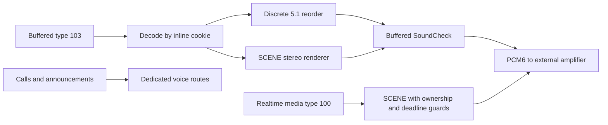

# Stereo to 5.1 Upmix — archived documentation

> Historical snapshot before the current-state documentation restructure. Commands, status and measurements below belong to their recorded revisions.

The current stereo renderer is **SCENE**, with the fine mask net c. Universal / Track A (`q6d`, V11, v21a) was retired on 2026-10-09. This page describes the checked-in runtime, reviewed on 2026-10-29. It does not certify a newly built package on a vehicle.

## 🧭 Audio paths

| Input | Processing | Output |
| --- | --- | --- |
| Buffered type 103, stereo AAC or supported decoded stereo | SCENE, controlled by the MMI UpMix setting | Six-channel PCM; Off keeps L/R only |
| Buffered type 103, APAC 5.1 with Spatial Audio enabled | Reorder decoded channels; bypass stereo synthesis | Discrete `L R C LFE Ls Rs` |
| APAC 5.1 with the live Spatial Audio setting disabled | Fold to stereo, then follow the UpMix setting | Stereo or synthesized six-channel PCM |
| Realtime type 100, media stereo | Separate SCENE instance, subject to media ownership and deadline guards | Six-channel PCM or L/R fallback |
| Calls, Siri and announcements | Dedicated voice/announcement routes | No music upmix |
| Internal amplifier | Installer disables the six-channel path | Stock stereo |

The type-103 offer is `[65,23]`: APAC 5.1 and AAC-LC stereo. The inline magic cookie selects the decoder; decoded geometry selects processing. The old `SPATIAL_103_EXTRA_INDEX` export is no longer a control. Index 66 / 5.1.2 remains experimental and is not enabled by the standard startup configuration. See [Discrete 5.1 Routing](../../../audio/DISCRETE_5_1_ROUTING.md) and [Buffered Audio Path](../../../audio/BUFFERED_AUDIO_PATH.md).



## 🎛️ Live MMI controls

<a id="mmi-level"></a>

**CarPlay UpMix** has three values: **Off, Normal, Intense**. Java persists the selection and sends `CMD_UPMIX` (`0x0119`) to the hook. **Spatial Audio** uses `CMD_SPATIAL` (`0x011A`). These are separate settings: disabling discrete spatial playback does not by itself disable stereo upmix.

`hook/audio/upmix_level.c` reloads `/tmp/carplay_settings` at initialization and session/stream boundaries. Level changes are applied by the audio render paths; they do not directly mutate a worker's engine from the bus thread. Once the Off fade finishes, the renderer skips scene and mask computation and preserves its dry-path latency, with output `L,R,0,0,0,0`.

The persisted fields and command payloads are documented in [Hook to Java Bus](../../../reference/HOOK_TO_JAVA_BUS.md). The owner's menu route is in the [README settings](../../../../README.md#mmi-settings).

## 🔊 What SCENE renders

The engine uses a 1024-sample STFT with a 256-sample hop. It separates coherent off-centre places from diffuse content, transfers eligible content to the rear and keeps protected content in front. The mask net supplies vocals, drum core, bass and other posteriors every 512 frames. It runs on a dedicated worker; a missing or invalid blob leaves the spatial engine available without semantic masking.

| Stage | Current behavior |
| --- | --- |
| Front L/R | Retain the input minus transferred content, with the calibrated front anchor |
| Rear Ls/Rs | Transferred places and decorrelated side content; 7 kHz side low-pass; no added rear delay |
| Center | Zero for synthesized stereo; discrete APAC center is preserved |
| LFE | Phase-coherent assist with 45–65 Hz front-woofer relief, bass/drum mask steering and paired front headroom |
| Cabin guard | Bounds the synthesized S16 output using the J525 matrix model |

The fixed runtime calibration includes `alpha=0.7`, `inst_alpha=0.9`, `inst_gamma=1`, `inst_gamma_lo=1.5` below 700 Hz, `duck_depth=0.25`, `sigma_min=0.08`, `bleed_cancel=0.15` and `wide_pair_alpha=0.35`. The front anchor is 1.5 dB for Normal and 2.8 dB for Intense; LFE gain is 11585 in Q15. These are **compiled parameters**, not environment settings. See `spa_upmix_apply_scene_calibration()` in [audio_hook.c](../../../../hook/audio/audio_hook.c) and [audio_hook.h](../../../../hook/audio/audio_hook.h).

<a id="front-anchor"></a>
<a id="-the-shipped-calibration"></a>

### Current calibration and historical tuning

The current calibration is the compiled configuration above. Older tuning tables describe earlier builds. The [pre-audit pipeline snapshot](../../../audio/archive/STEREO_TO_5_1_UPMIX_PRE_AUDIT_2026-10-29.md) preserves their derivations and the earlier output diagrams; [scene algorithm](../../../audio/UPMIX_SCENE_ALGORITHM_2026-10-08.md) preserves implementation experiments. Neither is a list of supported runtime knobs.

## ⚙️ Startup configuration

The standard startup exports:

```sh
export AUDIO_SPATIAL=1
export AUDIO_SPATIAL_ATMOS=0
export AUDIO_SPATIAL_ATMOS_MODE=downmix
export AUDIO_SCENE_MASK_BLOB="$H/scene_masknet_c.bin"
export AUDIO_SPATIAL_CODEC_LIB="$H/libcarplay_apac.so"
```

The installer gates `AUDIO_SPATIAL` for the detected amplifier. All supported external amplifier families use the six-channel route; **B&O and Bose are confirmed**. An internal amplifier stays on stock stereo. See [amplifier compatibility](../../../audio/ODIS_AMP_MAPPING.md#external-amplifier-support) and the installer functions `read_amp` / `gate_audio` in [custom.sh](../../../../install_MoreIncredibleBash/mod/custom.sh).

Only `AUDIO_SCENE_MASK_BLOB` remains an environment control for the scene engine. The old `AUDIO_STEREO_UPMIX`, `AUDIO_REALTIME_UPMIX`, `AUDIO_SCENE_MASK_SYNC`, scene tuning and HSSR exports are no longer parsed. Diagnostic buffering controls are a separate interface; see [Buffered Audio Path](../../../audio/BUFFERED_AUDIO_PATH.md).

The blob is `SMSKNET1`, 32,544 bytes. [settings.json](../../../../models/scene-masknet-c/settings.json) and [check_model_settings.py](../../../../scripts/check_model_settings.py) check its startup export; they do not expose the compiled calibration as user settings. Startup edits and a replaced hook take effect at the next CarPlay child start. Use MMI settings for live level changes.

<a id="output-order"></a>

## 🔊 SoundCheck and output order

The current buffered implementation does this:

```text
decoded S16 → discrete reorder or SCENE (including S16 cabin guard)
            → SoundCheck programme gain → optional limiter → PCM ring
```

**SoundCheck works well in vehicle use, confirmed by the owner on 2026-10-29. It is not tracked here as an unresolved playback defect.** This is an owner report, not a new instrumented test or a build-specific measurement.

SoundCheck follows synthesis so its gain does not change the mask net's input features. Metadata processing is enabled; RMS fallback and the optional peak limiter are disabled by default. `spa_soundcheck_main_gain()` caps positive gain using the supplied peak/headroom metadata (`-1 - parameters[2]`) before rounding. The S16 cabin guard precedes this programme gain and is not rerun afterward. That ordering is an implementation fact; by itself it does not establish audible clipping or a required fix. The earlier documentation audit overstated it as a current limitation without a reproducer. See the buffered render path in [audio_hook.c](../../../../hook/audio/audio_hook.c) and [soundcheck.c](../../../../hook/audio/soundcheck.c).

Realtime media uses its own engine and worker. The [deadline guard](../../../../hook/audio/rt_upmix_guard.h) allows a 12 ms processing budget, excuses 64 cold periods and disables upmix after four consecutive overruns; a stream gap of at least 500 ms permits rearming. Calls, Siri, alerts and buffered-media ownership prevent realtime music from taking their rail. Voice/announcement gain is separately fixed at +5 dB with a soft knee above −2.5 dBFS; see [Call and Siri Routing](../../../audio/CALL_AND_SIRI_ROUTING.md).

## 🧪 Evidence and recovery

The first SCENE car session was on 2026-10-09; the owner accepted its sound on 2026-10-10. That is one sighted listening report for the recorded build, not acceptance of every later code change or every amplifier calibration. Dated hashes, measurements and follow-up issues remain in the [original deployment record](../../../audio/archive/SCENE_BACKEND_DEPLOY_2026-10-09.md).

Use [Scene Backend Deploy](../../../build-and-deploy/SCENE_BACKEND_DEPLOY.md) for the current packaging and diagnostic workflow. Retired Universal code is recoverable from `upmix-universal-last-2026-10-09`; see [retirement record](../../../audio/archive/UPMIX_CODE_RETIREMENT_2026-10-09.md) and [retired tools](../../../audio/archive/RETIRED_TOOLS.md).
