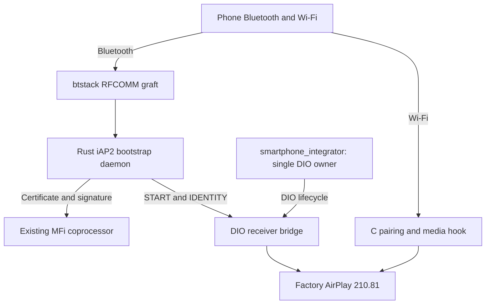

# Wireless CarPlay on MHI2Q — archived documentation

> Historical snapshot before the current-state documentation restructure. Commands, status and measurements below belong to their recorded revisions.

_Current SI-owned stock210 architecture, with dated vehicle and laboratory evidence. Documentation reconciled with the working tree on 2026-10-29._

---

[Documentation home](../../../README.md) · [Connect and USB](../../../connect-and-usb/README.md) · [Source tree](../../../../wireless)

## 📋 Current status

The selected network configuration is **Wi-Fi driver47a370bc + stock SDIO
and stock io-pkt**. SDIO patches and PF QoS/IP priority are excluded by the
owner's decision. Required CarPlay TCP ports6031/6032 remain enabled.
The recent load tests ran without experimental PF QoS.

The [network patcher](../../../stock-patches/README.md) stages Wi-Fi-only resources;
M.I.B. packages contain no SDIO inputs, PF QoS profiles or active-session
watcher. [SDIO A/B](../../../stock-patches/REJECTED_CONCEPTS.md) records restored TCP44.7–46.6Mbps
with stock SDIO. [Complete historical record](../../../stock-patches/README.md).

Latest local implementation: [wireless production channels](../../../wireless-carplay/WIRELESS_PRODUCTION_CHANNELS.md) covers production paired AltScreen forwarding, semantic iAP2 RGI/lanes/artwork/vehicle/GPS and generation-bound ASI control events. The native feature profile and fault matrix are included by `build_si_review.py --full-cycle`. Earlier main-screen, input and AltScreen behavior was partially confirmed by the owner on a previous build. The latest combined implementation is not physically accepted; the last recorded HU state is restored wired operation. See the [completion ledger](../../../carplay-lab/WIRELESS_COMPLETION_PLAN.md).

**Selected target, October 18:** integrate wireless device registration and
CarPlay-child ownership inside the existing, always-running SI. Rust remains a
separate bootstrap service. The [stage-1 HU record](../../../wireless-carplay/SI_STAGE1_HU_TEST.md) includes native publish/NOOP/deletion, boot fixes and a subsequently reproduced USB reconnect failure. [Stage 2](../../../wireless-carplay/SI_STAGE2_OFFLINE.md) has native discovery, controller admission, Rust IPC and SI-owned child routing; the October 21 physical run produced wireless main video, with input/audio/AltScreen/metadata failures. Later local fixes now have integrated native QNX evidence for audio, microphone transport, exact HID reports, Now Playing, cleanup and repeated reconnects. Physical acceptance of those fixes remains open. See the
[decision and implementation gates](../../internal-reference-2026-10-29/wireless-carplay/DIO_OWNERSHIP.md#-selected-direction-si-owned-wireless-sessions).
The [detailed SI extension plan](../../../wireless-carplay/SI_WIRELESS_EXTENSION_PLAN.md) starts with
MH2p donor comparison, then native discovery, SI-owned child startup and
wireless-specific teardown on the existing USB re-arm SI base.

The MU1316 / P5087 candidate retains factory AirPlay **210.81** on QNX 6.5 ARM.
The C wireless hook supplies pairing and modern control/event/media security;
the Rust daemon handles iAP2, MFi and Wi-Fi bootstrap. The private280 SDK code
inside the hook supplies protocol and crypto primitives. It does not replace
the factory receiver. [Architecture](../../../wireless-carplay/STOCK210_ARCHITECTURE.md) and
[lifecycle evidence](../../../wireless-carplay/STOCK210_RECEIVER_LIFECYCLE.md) describe the current path.

Earlier standalone QNX/QEMU validation passed three DIO owner generations and two media
sessions, including wired-priority drain and wireless resume. The newer
[SI-owned integrated fixture](../../../wireless-carplay/SI_STAGE2_OFFLINE.md#native-now-playing-and-hid)
uses the actual Rust daemon, SI and stock DIO with an independent phone peer;
its ten-cycle stress includes authenticated PCM, input and metadata on every cycle.
The October 18 offline revision adds supervised stock mDNS readiness and stop;
the QNX lifecycle now executes the production shell and generated wrapper from
a clean SI environment. The [HU test record](../../../wireless-carplay/STOCK210_HU_TEST.md#offline-mdns-ownership-october-18)
separates this newer candidate from the environment-fix kit already on the HU.
The emulator stand has its own [CarPlay laboratory documentation](../../../carplay-lab/README.md)
and [test source tree](../../../../tests/carplay_lab). Native vphone video, retained
iOS 14 experiments and queue measurements live there. They do not establish a
physical wireless CarPlay session on the unit.

The [October 18 native QNX integration](../../../carplay-lab/NATIVE_WIRELESS_QNX.md)
now connects the actual Rust daemon to native iOS, answers Wi-Fi `5702` and
delivers a receiver-bound StartSession consumed by CarKit. With the opt-in
VM association adapter, native wireless pairing and media now produce
independently decoded 800×480 Maps plus 1440×542 AltScreen in the optional
paired profile. The association uses virtual Ethernet;
physical Wi-Fi and RFCOMM remain unverified by this emulator result.

The [October 17 Wi-Fi audit](../../../stock-patches/README.md) measured direct Mac → HU
goodput of **36.9 Mbit/s TCP** and **42.8 Mbit/s UDP** over minute-long runs,
with wired CarPlay active. Mac AWDL and synthetic receiver scheduling
materially affected the results. Stock screen-like 176 KiB buffering was
enough for 37.3 Mbit/s in a short TCP run. This supports average capacity for
an assumed 19 Mbit/s video budget, while iPhone Wi-Fi capacity and production
frame pacing remain unmeasured. The unsuccessful iPhone app test was
cancelled and its temporary servers/port redirects fully reverted.

The optional [software MFi QNX/QEMU tests](../../../wireless-carplay/TEST_SOFTWARE_MFI.md#-qnx-and-qemu-integration)
replace fixed mock signature bytes with freshly generated RSA test vectors.
The QNX phone cryptographically verifies actual iAP2 responses in both the
bootstrap matrix and the combined stock210 lifecycle. The host private key
stays outside QEMU; these synthetic identities do not establish Apple trust.

<a id="components-and-ownership"></a>

## ⚙️ Architecture and ownership



| Component | Responsibility | Implementation |
|---|---|---|
| [btstack graft](../../../wireless-carplay/BTSTACK_GRAFT.md) | Discovery, RFCOMM and bounded byte bridge | [C graft](../../../../wireless/graft/graft.c) |
| [iAP2 daemon](../../../wireless-carplay/IAP2_DAEMON.md) | MFi, Wi-Fi handover, CarPlay Control | [Rust daemon](../../../../wireless/daemon/src) |
| [Receiver bridge](../../../wireless-carplay/RECEIVER_BRIDGE.md) | Real stock manager, readiness and identity | [C bridge](../../../../wireless/receiver_bridge/bridge.c) |
| [Wireless hook](../../../wireless-carplay/STOCK210_HTTP_PAIRING_ABI.md) | Pairing, encrypted transport and media | [C module](../../../../hook/wireless) |
| [Owner integration](../../../wireless-carplay/DIO_OWNERSHIP.md) | SI owns admission, child lifecycle and wired/wireless handover | [SI controller](../../../../wireless/si/si_controller.c) and [adapter](../../../../wireless/si/si_adapter.c) |

Bonjour, `/info`, signed PairSetup and iAP2 StartSession share one persistent
pairing identifier `pi`. It is separate from the Ed25519 public key. Pairing
keys, owner locks and the advisory generation marker use `/mnt/persist`;
`/tmp` is transient RAM. Pairing initialization and the media SETUP guard are
scoped to wireless owner mode. See [review corrections](../../internal-reference-2026-10-29/carplay-lab/IOS210_CODE_REVIEW.md#-corrections-and-regression-coverage) and
[receiver lifecycle](../../../wireless-carplay/STOCK210_RECEIVER_LIFECYCLE.md#queue-and-owner-lifecycle).

## 📚 Reading paths

| Topic | Notes |
|---|---|
| Current code review | [iOS and stock210 findings, reproductions and fixes required](../../../carplay-lab/IOS210_CODE_REVIEW.md) |
| First physical test | [Current test kit, baseline checks and rollback](../../../wireless-carplay/STOCK210_HU_TEST.md) |
| SI stage-1 HU proof | [Native queue, deletion, USB regression and manual rollback](../../../wireless-carplay/SI_STAGE1_HU_TEST.md) |
| SI-owned wireless target | [MH2p-guided SI extension plan](../../../wireless-carplay/SI_WIRELESS_EXTENSION_PLAN.md) · [Ownership decision](../../../wireless-carplay/DIO_OWNERSHIP.md) |
| Current receiver | [Architecture](../../../wireless-carplay/STOCK210_ARCHITECTURE.md) · [Startup](../../../wireless-carplay/RECEIVER_START.md) · [Bridge](../../../wireless-carplay/RECEIVER_BRIDGE.md) · [Readiness and restart](../../../wireless-carplay/STOCK210_RECEIVER_LIFECYCLE.md) |
| Bluetooth transport | [Graft](../../../wireless-carplay/BTSTACK_GRAFT.md) · [Channel layout](../../../wireless-carplay/RFCOMM_CHANNEL_LAYOUT.md) · [Duplex ABI](../../../wireless-carplay/RFCOMM_DUPLEX.md) · [Discovery](../../../wireless-carplay/BLUETOOTH_DISCOVERY.md) |
| Graft construction | [Insertion plan](../../../wireless-carplay/GRAFT_INSERTION_PLAN.md) · [Factory launcher experiments](../../../wireless-carplay/GRAFT_LAUNCHER_LIFECYCLE.md) |
| Pairing and media | [HTTP ABI](../../../wireless-carplay/STOCK210_HTTP_PAIRING_ABI.md) · [Media crypto ABI](../../../wireless-carplay/STOCK210_MEDIA_CRYPTO_ABI.md) · [280 source recipe](../../../wireless-carplay/AIRPLAY280_PAIRING_RECIPE.md) |
| Bootstrap and ownership | [iAP2 daemon](../../../wireless-carplay/IAP2_DAEMON.md) · [Software MFi tests](../../../wireless-carplay/TEST_SOFTWARE_MFI.md) · [iOS VM laboratory](../../../carplay-lab/IOS_VM_LAB.md) · [DIO ownership](../../../wireless-carplay/DIO_OWNERSHIP.md) · [Vendor provenance](../../../wireless-carplay/IAP2_VENDOR_PROVENANCE.md) |
| Network and hardware | [Wi-Fi discovery](../../../wireless-carplay/WIFI_AND_DISCOVERY.md) · [Final stock patches](../../../stock-patches/README.md) · [Firewall](../../../wireless-carplay/FIREWALL.md) · [Hardware and donors](../../../wireless-carplay/HARDWARE_AND_DONORS.md) |
| iOS and references | [Authentication selection](../../../wireless-carplay/IOS_AUTH_SELECTION.md) · [Wireless session gates](../../../wireless-carplay/IOS_WIRELESS_SESSION_GATES.md) · [Bootstrap comparison](../../../wireless-carplay/BOOTSTRAP_COMPARISON.md) |
| Evidence and history | [Pairing/media milestones](../../../wireless-carplay/STOCK210_VALIDATION.md) · [WCP0627 source handoff review](../../../wireless-carplay/WCP0627_SOURCE_REVIEW.md) · [Historical experiments](../../../wireless-carplay/history/README.md) · [Migration map](../../../wireless-carplay/history/MIGRATION.md) |

The history section preserves the earlier feature-bit probe, replacement280
receiver, installer experiment and failure traces. These are evidence records,
not the current deployment recipe. In particular, the historical280 installer
must not install the stock210 hook candidate.

<a id="build-and-reproduce"></a>

## 📦 Build and reproduce

Run from the repository root. Prerequisites are the local
`qnx65-armv7-toolchain:latest` C image and explicit `8.5-rust` image
(see [toolchain reproduction](../../../wireless-carplay/STOCK210_HU_TEST.md#-build-and-baseline)), pinned firmware inputs under
`Firmwares/HU`, and owner-provided SDK sources under `Refferences/Carplay`.
Those external inputs are not committed here.

```sh
bash scripts/build_hook_wireless.sh
python3 tests/carplay_lab/qnx/qemu_capture.py --wireless-hook-qemu \
  --wireless-media-qemu --wireless-lifecycle-qemu --mesh --start-experiment \
  --seed-display --skip-hid-qemu --mdnsd --mock-mac-qemu --interface-lo0-qemu
python3 wireless/daemon/probes/qemu_daemon_bridge.py --phone-probe --control-probe
python3 wireless/integration/build_stock210_review.py
```

The review builder writes `wireless/out/mhi2q-stock210-hook-review.tar` and an
adjacent `.sha256`. Its manifest records the exact packaged files. It contains
no installer or replacement libairplay; the existing btstack graft, AP/firewall
and wired-mod files remain integration prerequisites. Generated binaries,
archives, logs and raw analysis output remain local and ignored by Git.

The pre-migration archive had 16 hashed payload files and SHA-256
`8780e8bc8050bd70dfed2cbb0702a3d8291ed2846802e120eaa425b7f960436c`.
That digest identifies the earlier documentation snapshot; a rebuild after this
migration has a different manifest and archive digest. The tested runtime
artifact hashes are preserved in [the lifecycle report](../../internal-reference-2026-10-29/wireless-carplay/STOCK210_RECEIVER_LIFECYCLE.md#validation-completed-2026-09-29).

<a id="verified-offline"></a>

## 🧪 What the evidence establishes

| Check | Recorded result | Boundary |
|---|---|---|
| Combined QNX lifecycle | Three wireless owners, two media sessions, stable pi; actual wired DIO/wrapper/hook | Synthetic peripherals; idle wired watchdog stop, no real USB phone |
| Production shell and mDNS lifecycle | Clean SI environment; discovery restored after factory wired teardown; ordered final stop | QNX4 stand, synthetic io-pkt and devices |
| Active media TERM | BUSY preserves same DIO/daemon/mDNS; explicit recovery after phone TEARDOWN | Encrypted synthetic peer; fake IE recovery, no radio ioctl |
| Native runtime fault matrix | Seven cases pass, including hung/crashed mDNS, stale IPC refusal, stop refusal and held owner lock | Factory DNS-SD with a controlled inner executable |
| Pairing and control | Setup/Verify, reconnect, invalid signature/tag rejection | Independent protocol client, shared primitive helpers |
| Media adapters | Two AVC inputs, 160 PCM packets, events and microphone checks | Input-only OMX; no decoded output |
| Host protocol/ownership | 29 daemon tests, C callback suites under ASan/UBSan and native ownership checks | CF/key/pointer fixtures; no physical radio or SI session |
| Build and ABI guards | Wireless41 / wired26 exports, graft8/8 | Pinned local firmware images |

The [validation ledger](../../../wireless-carplay/STOCK210_VALIDATION.md) preserves earlier hashes and
individual tests. The [lifecycle report](../../../wireless-carplay/STOCK210_RECEIVER_LIFECYCLE.md) records
the latest combined run and separates runtime evidence from hardware questions.
Local log links require running the corresponding fixtures; logs are not in Git.

<a id="next-steps-and-constraints"></a>

## 🎯 Remaining work

Use the [wireless completion ledger](../../../carplay-lab/WIRELESS_COMPLETION_PLAN.md) as the current acceptance checklist. The first physical session is already historical; it is no longer the next milestone.

| Gate | Current boundary |
| --- | --- |
| MainHigh control / RTCP | Media codec and data-path tests exist; the production clock, feedback, retransmission, loss and drift contract is not complete |
| Connection policy | Native registration, Yes/No and remember behavior exist; USB/Wireless/Auto settings, boot/existing-BT behavior and two-phone policy remain incomplete |
| Native HMI audio focus | SI and real J9/HMI can run together; a complete wireless admission → DIO → Java audio grant/ACK session still needs validation |
| Combined laboratory session | Individual native video, AAC/APAC PCM, microphone and lifecycle tests exist; the simultaneous 110/111 + audio + mic + real HMI profile remains a gate |
| Vehicle acceptance | Earlier main/input/AltScreen confirmation is build-specific; current audio, calls/Siri, reconnect, boot, two-phone and rapid-zoom behavior need a matched candidate and physical checks |

The selected implementation uses the existing SI as the single CarPlay-child owner, the Rust daemon for iAP2/MFi/Wi-Fi bootstrap, the Bluetooth graft and the stock210 receiver bridge/hook. Use the [SI extension plan](../../../wireless-carplay/SI_WIRELESS_EXTENSION_PLAN.md), [stage-2 record](../../../wireless-carplay/SI_STAGE2_OFFLINE.md) and [production channels](../../../wireless-carplay/WIRELESS_PRODUCTION_CHANNELS.md). Production MFi uses the hardware adapter; software-MFi fixtures do not establish authentication with an unmodified physical phone.

The earlier `dio_owner_exec` / native-supervisor kit and its first-session procedure remain in [Stock210 HU Test](../../../wireless-carplay/STOCK210_HU_TEST.md) as a dated development path. They are not the current ownership architecture. Paired wireless stream 111 is implemented and exercised in the native lab; the old instruction to wait for its implementation is superseded. Keep laboratory evidence separate from vehicle acceptance.

Original offsets, byte layouts, hashes and negative results remain in the
technical notes. [The migration map](../../../wireless-carplay/history/MIGRATION.md) accounts for every document
moved from `wireless/`; source-directory READMEs now point here.

The [MH2p SI comparison](../../../wireless-carplay/SI_MH2P_COMPARATIVE_RE.md) preserves donor-specific device-registration and lifecycle RE used by the SI extension.
