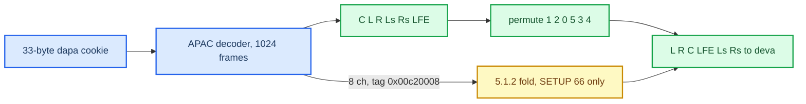

# APAC Codec

*Apple Positional Audio Codec on this head unit: what the format indices mean, how the cookie is read, why the decoded channel order is `C L R Ls Rs LFE`, and how Apple's decoder was ported to ARMv7/QNX as the optional `libcarplay_apac.so`. The receiver around it: [Buffered Audio Path](BUFFERED_AUDIO_PATH.md).*

---

## 📋 At a glance

APAC is the codec iOS uses for spatial masters on the buffered type-103 stream. Nothing on the MHI2Q (and nothing in Cinemo) decodes it, so the project ported Apple's own decoder out of a licensee binary (Pioneer SPHERA) into `apac_decoder/` and ships it as a separately loaded, versioned library. Index 65 (5.1) is vehicle-proven; index 66 (5.1.2) is accepted, validated and foldable but its native channel order is unmeasured.

| Fact | Value | Truth |
|---|---|---|
| Wire | 48 kHz, 1024 frames/packet, 46.9 packets/s | **[car]** |
| Cookie | `dapa` atom, 33 B for 5.1, 34 B for 5.1.2 | **[car]** |
| Decoder output order (5.1) | `C L R Ls Rs LFE`, tag `0x007c0006` (MPEG_5_1_D) | **[car]** measured |
| HU order after reorder | `L R C LFE Ls Rs` | **[code]** |
| Port accuracy | 1 S16 LSB on 0.005 % of 24,434,688 samples vs Apple; bit-exact above the FFT | bench |
| Cost | ~49 M ARMv7 instructions per second of audio, ≈ 2.9–3.7 % of one core at an assumed IPC 1.0 | QEMU `-icount` |
| Library | `libcarplay_apac.so`, ABI v1, 678,911 B, SHA-256 `a6a7bc8c…044f` | **[code]** |

## 📊 APAC format indices

All APAC indices are **extended-only**: `APAudioFormatIndexToAPAudioFormat` returns `1ULL << index` only below 64, so none has a legacy mask bit (the type-103 legacy `0x400000` is a separate AAC-family bootstrap). From iOS 27 `_APAudioFormatIndexToASBD@0x22669646c` / `_APAudioFormatIndexToChannelLayoutTag@0x226696ed4` **[decompile]**:

| Index | Layout | Ch | Layout tag (iOS) | PCM equivalent | Status on this HU |
|---:|---|---:|---|---:|---|
| 64 | stereo | 2 | `0x00650002` Stereo | — | gated by `bufferedAPACStereo` (default false); never selected |
| **65** | **5.1** | 6 | `0x007c0006` MPEG_5_1_D | 44 | **production** |
| 66 | 5.1.2 | 8 | `0x00c20008` Atmos_5_1_2 | 38 | experimental, `AUDIO_SPATIAL_ATMOS=1` only |
| 67 | 7.1 | 8 | `0x00800008` MPEG_7_1_C | 78 | not advertised |
| 68 | 7.1.4 | 12 | `0x00c0000c` | 84 | beyond the 6-ch ceiling |
| 76 | 5.1.4 | 10 | `0x00c3000a` | 80 | — |
| 77 | 7.1.2 | 10 | `0x00c4000a` | 82 | — |
| 92 | 9.1.6 | 16 | `0x00c10010` | — | — |

Apple's list builder appends optional 64 then 65/66/67/76/77/68/92; the CarPlay spatial gate fires on any of 65/66/67/68/76/77/92 (64 deliberately excluded). Pioneer's own table (Unicorn-executed) maps 65 to tag `0x00790006` (MPEG_5_1_A, `L R C LFE Ls Rs`) — that disagrees with the live cookie, and **the cookie wins**. Pioneer's receiver advertises 65/66/76.

## 🔐 The cookie and GlobalConfig

Accepted grammar (Pioneer, reproduced by `tools/pioneer_apac_cookie.py`): a bare `dapa` atom, or `frma(apac)` → optional `apac` (word at `+8` = 0) → `dapa`. The decoder payload starts at **`dapa+12`**, whose first two bytes are the sync word `0x0800`; GlobalConfig starts at **`dapa+14`**. Calling the metadata helpers on the sync word is the classic off-by-two.

From the GlobalConfig word: `sampleRateIndex = (w >> 15) & 0x3f`, `channels = (w >> 1) & 0xff`, `frames = 1024` if `(w & 0x7e00) == 0`; the rate table starts `96000, 88200, 64000, 48000, 44100, …`. An Apple-generated 4-ch cookie word `0x14018008` → 48 kHz / 1024 / 4 ch. `APACDecoder_GetProfile` reads six bits one position late — trust the bitstream, not that helper. The live 33-byte cookie consumes exactly 150 of its 152 bits in the port's `GlobalConfig::Deserialize` and yields tag `0x007c0006`.

Pioneer's C API: `APACDecoder_DecodeFrame@0x105bb0`, `GetCookieOffset@0x106030`, `SampleRate@0x106150`, `FrameLength@0x1061b0`, `NumberOfChannels@0x106210`, `SetParameter@0x106260`, `Configure@0x106490`, `Create@0x106800`, `Dispose@0x106c10`; `AirPlayAudioConverterSetProperty(..., 'dmgc', ...)` calls Configure; destination flags `12` select 4-byte float output, else 2-byte integer. The object `Create` returns is really an **`APACASPDecoder`** (vptr overwritten), so a frame starts with a **two-bit** frame type — reading one bit makes the first packet look like an LRVQ bug.

## 🔍 Channel order — measured three ways

1. **From audio:** on 74.6 s of live index-65 traffic, channel 5 has 100 % of its energy below 120 Hz; ch 1/2 correlate 0.61, ch 3/4 0.22. The declared `L R C LFE…` order would put LFE in channel 3, which has 1 % sub-120 Hz energy.
2. **From a round trip:** a locally encoded APAC stream decodes in encoder slot order, not re-ordered to the layout tag.
3. **From the bitstream:** the live cookie's GlobalConfig tag `0x007c0006` resolves in CoreAudio to `C L R Ls Rs LFE`.

So the hook permutes decoder → declared with `kFromDeclared = {1,2,0,5,3,4}` (`hook/audio/spatial_downmix.c:47-69`), exactly what deva's stream map `01 02 03 06 08 09` wants. **[code]** · **[car]**

**5.1.2 fold.** Pioneer's `kAudioMixMatrixSpeakerConfig5_1_AInt` (VA `0x4316c8`, 6 × 14 int16) gives `L'=L, R'=R, C'=C, LFE'=0.5·LFE, Ls'=Ls+0.5·Ltm, Rs'=Rs+0.5·Rtm` with auto-attenuation off, so saturation is possible; the hook saturates (`spa_downmix_5_1_2_s16`, `hook/audio/spatial_downmix.c:71-98`). It runs only for tag `0x00c20008` (`L R C LFE Ls Rs Ltm Rtm`) **and** a SETUP-66 session (`hook/audio/audio_hook.c:3226-3233`); other 8-ch cookies are refused as `unsupported-layout`. `AUDIO_SPATIAL_ATMOS_MODE` = `downmix` (−6 dB fold, default) / `drop` (discard heights) / `passthrough` (PCM8 — forbidden until the HU and amp really take 8 ch). PCM6 output is always `frames × 12` bytes; Pioneer sizes an 8-ch source buffer as `floor(maxOut × 4/3)` after a `5/3` worst case. The index-66 **native order is unmeasured** — do not assume "5.1 plus two heights" until a 66 capture is measured the same way **[open]**. Why 5.1.2 is never delivered as 8 ch: [Discrete 5.1 Routing](DISCRETE_5_1_ROUTING.md).

## ⚙️ The port

`apac_decoder/` (C++11, float, built by GCC 4.9.4/8.5 for QNX with `emutls=0 exceptions=0 rtti=0 stl=0 libstdc++=0`). The source binary keeps 441 APAC dynamic symbols with full Itanium names despite being "stripped": closed over the call graph the decoder is **396 functions, 179,120 B** plus 234 data objects dumped byte-for-byte — separate from a 623-function FDK-AAC build in the same library (APAC is not built on FDK and has no open-source decoder). The raw symbol table is [apac_symbols_pioneer.txt](../sources/reference/apac_symbols_pioneer.txt) (307 `.text` rows, only 263 unique addresses because of D0/D1/D2 aliases).

Architecture recovered from the names: an AAC-family transform codec (ICS info, scalefactor bands, TNS, SCE/CPE/LFE elements, MDCT synthesis) plus bandwidth extension, a lattice/residual vector quantiser (LRVQ), LSF/LPC tools and a mandatory loudness-DRC layer; float-based (`std::vector<float*>`), not fixed-point. `APACDecoder::DecodeFrame` dispatches only through vtables (its direct `bl` closure is one 564-byte function), so reachability had to be measured by stubbing, not read from branches. Entry points in Pioneer: `APACDecoder::DecodeFrame@0x93e50`, `Initialize(GlobalConfig)@0x946a0`, `CreateDecoderElement@0x93d90`, `APACCoreDecoder::DecodeAPACFrame@0x7db30` / `Deserialize@0x7d950`, `APACSpectralData::Deserialize@0xab3b0`, `APACSynthesisFilterBank::Initialize@0xae980`, `APACASPDecoder::DecodeFrame@0x72000`; global `g_APAC_ch@0x433b68`. The per-class function/byte table and every symbol are in [apac_symbols_pioneer.txt](../sources/reference/apac_symbols_pioneer.txt).

**Never scope the port by the substring "APAC".** Apple's DSP layer — `MDCT`, `DCT_IV`, `MultiRadix*FFT`, `BWELPC`, `CacDecoder`, `DRCConfiguration`, window-table accessors — has no APAC in its names, and 45 of 48 APAC-named `.rodata` objects are typeinfo strings; the real tables are unnamed, behind relocated pointer arrays. Components guessed droppable by name were live: every channel pair of every packet is joint/CAC-coded, `APACCoreLBRDecoder` is the subclass the C API drives, and `APACBWE2Decoder::Deserialize` is on the bit path. Truly droppable for 5.1: `apac::scene`, `APACAudioSceneDecoder`, `AudioSceneConfig` (Ambisonics), `apac::lbr`.

| Stage | Scope | State (per `apac_decoder/PORT_STATUS.md`) |
|---|---|---|
| a | bit reader, GlobalConfig, ASC, profile/level | done; 5,428 bit-reader ops bit-exact |
| b | ICS info, SFB offsets, scalefactors | done; 733 band offsets, 49 long / 14 short at 48 kHz |
| c | spectral data, 12 Huffman books | done |
| d | TNS, LSF/LPC, LPMDCT, synthesis filter bank, MDCT/FFT | done, one documented FFT tolerance |
| e | bandwidth extension (BWE2, BWELPC) | done where no FFT underneath; not reached by our content |
| f / g | SCE/CPE/LFE elements, CAC, core + LBR + ASP top level | done, bit-exact above the transform |
| h1 | LRVQ frame mode | done; not reached by our content |
| h | DRC/loudness parser (`apac` layer) | done; metadata is mandatory so the parser must advance |
| i | ARMv7/QNX build | done |
| j | hook integration | done, on-car verified for 65 |
| k | real-time cost | measured under QEMU `-icount` |

Three oracles: Apple's decoder on macOS (`tools/apple_apac_oracle.c`, `AudioConverter` with `kAudioConverterDecompressionMagicCookie`, S16LE, packet boundaries preserved); Pioneer's AArch64 library run **natively** in a `linux/arm64` container per function (`apac_decoder/reference/run.sh fn …`, fixtures committed so `make check` needs no Docker); and `afconvert` vectors — `afconvert in.caf out.mp4 -d apac -l MPEG_5_1_A -u csrc 36 -u cdrc 1 -u aspf 75` (`csrc`, `cdrc`, `aspf` are mandatory; omitting them was the old `!dat` failure). ASPs (Audio Synchronization Packets, recommended every 75 packets = 1.6 s) are the only legal entry point into a running stream and the only legal resume after a flush; the live capture is ASP-only. Loading Pioneer's whole plugin in a generic container faulted in its shared-memory constructors, which is why the per-function harness exists.

**Accuracy.** Whole live capture ([APAC_5_1_LIVE_20260831](../sources/captures/APAC_5_1_LIVE_20260831.md)): 3,980 frames authenticate, the 3,977 extracted APAC packets are byte-identical to the reference, output differs from Apple by 1 S16 LSB on 0.005 % of 24,434,688 samples — entirely from Apple's closed `vDSP_DFT_Execute`; with the port's FFT swapped into the original, the difference is exactly zero.

**Cost (stage k, measured instructions, assumed clock):**

| | Mean / packet | Worst of 3,977 |
|---|---:|---:|
| decode only | 950,655 insns | 1,237,622 |
| whole hook chain | 1,045,101 | 1,330,430 |
| @ 1.7 GHz, IPC 1.0 | 0.615 ms | 0.783 ms |
| share of the 21.333 ms budget | 2.9 % | 3.7 % |

Worst case is only 1.27 × the mean, ~27 × headroom (16 × at a pessimistic IPC). Cost follows **geometry, not packet size** (per-packet cost vs compressed size correlates −0.56). Nothing large sits on a stack and nothing is allocated on the decode path: the big objects (`BWELPC` 105 KiB, `SynthesisFilterBank` 92.6 KiB, `LRVQDecoder` 57.4 KiB, `LPMDCTFilter` 48.2 KiB) are inline members at file scope. Krait p99 on the real unit is still unmeasured **[open]**.

**Legal note.** The port is derived work lifted from a licensee's binary: fine locally, **not publishable**.

Port traps worth knowing before touching the decoder

- A function-local `static` with a constructor emits `__cxa_guard_*`, absent from the QNX 6.5 / GCC 4.9.4 libstdc++ config — use file scope. Same rule avoids stack blow-ups.
- Evaluate `powf(10, y)` in double and round once; macOS `powf` is 1 ULP off on 6 of 1,024 LRVQ gains. Codebook 11's escape exponent is the double nearest 4/3.
- `-ffp-contract=off` makes the LPC chain *worse* (5.6e-05 vs 3.1e-06); keep default contraction.
- `TBitstreamReader` refills big-endian 32 bit, pads a short tail with `0xFF`.
- `MDCT::InverseInPlaceTransform(buf, buf2)`: `buf2` must be `n` floats of its own, not `buf + n/2` — the header's wording caused an out-of-bounds write that was silent on the host and fatal on armle-v7.
- Only window sizes 128 and 1024 exist; `SynthesisFilterBank` works only at frameLength 1024. BWE also needs FFT sizes 768 and 96, so `ComplexFFT` accepts `3·2^k`.
- `vDSP_vdiv(A,…,B,…,C,…)` computes `C = B / A`.
- Hex-Rays merges adjacent stack VLAs and invents `this` for the all-static `APACLRVQDecoder`/`LSFTools` — count arguments at the call site.
- Codebooks 3/4 emit `-0.0` where others emit `+0.0`; compare bit patterns, not floats.
- The CAC rotation swaps outputs when `|gain| ≥ 0.999`; `APACCACDecoder` must `PutBack(16)`; run length `r` means `r + 1` bands.
- Float output is scaled by 1/32768.
- A canary around an object is containment, not correctness — a write three words away went unseen.

---

## 📚 Sources

Merged originals were removed from the tree after this note absorbed them; they remain in git history (commit 23972aa).

- `APAC_DECODER_PORT` — discovery of Apple's decoder in Pioneer, architecture, port order, counting corrections.
- [apac_symbols_pioneer.txt](../sources/reference/apac_symbols_pioneer.txt) — demangled APAC symbol list with addresses and sizes.
- `APAC_FORMAT_INDEX_AUDIT` — APAC index table and layout tags from iOS 27.
- `APAC_ON_CAR_CHECKLIST` — bench-proof definition, index-66 contract, what the bench could not answer.
- `PIONEER_TYPE103_STATIC_SPEC` — cookie grammar, GlobalConfig formulas, Pioneer API, 5.1 matrix.
- `HANDOFF_SPATIAL_AUDIO` — macOS oracle, `apac-decode` reference, Pioneer format table.
- [APAC_5_1_LIVE_20260831](../sources/captures/APAC_5_1_LIVE_20260831.md) — the live corpus the port is validated against.
- Code: `apac_decoder/README.md`, `apac_decoder/PORT_STATUS.md`, `hook/audio/spatial_downmix.{h,c}`, `hook/audio/apac_codec_loader.h`.

## 🔗 See also

[Buffered Audio Path](BUFFERED_AUDIO_PATH.md) · [Buffered Playback Lifecycle](BUFFERED_PLAYBACK_LIFECYCLE.md) · [Cinemo AAC Decoder](CINEMO_AAC_DECODER.md) · [Discrete 5.1 Routing](DISCRETE_5_1_ROUTING.md) · [Dolby Atmos](DOLBY_ATMOS.md) · [Audio overview](README.md)
