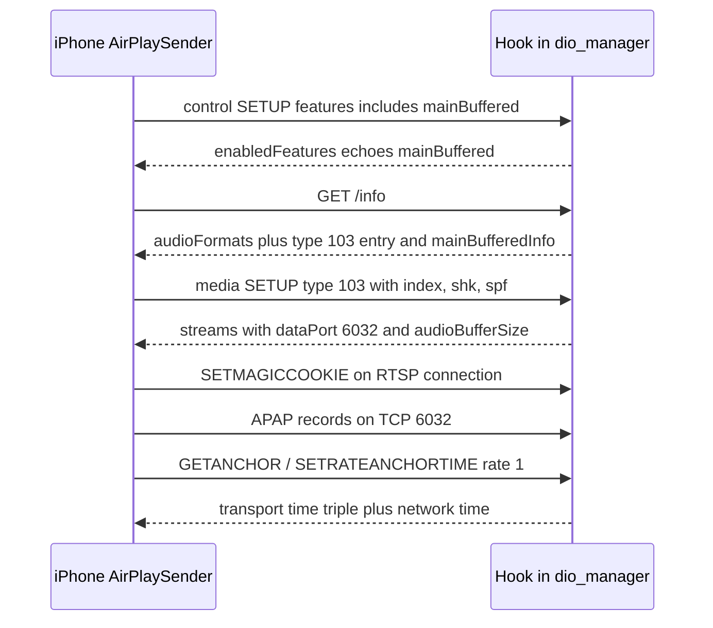

# Buffered Audio Path

*The hook-owned CarPlay type-103 receiver: how the phone is talked into the buffered stream, the exact SETUP / control / APAP contract, and why each piece exists. Playback, QSA ownership and flush behaviour live in [Buffered Playback Lifecycle](BUFFERED_PLAYBACK_LIFECYCLE.md); the codecs in [APAC Codec](APAC_CODEC.md) and [Cinemo AAC Decoder](CINEMO_AAC_DECODER.md).*

---

## 📋 What this is

Stock 210.81 libairplay has **no** type-103 receiver: it logs `Unsupported stream type: 103` and answers `{}`. The phone's multichannel and lossless audio only exist on that buffered stream (the realtime type-100 stream refused every multichannel bit, see [iOS CarPlay Spatial Wireformat](../reference/IOS_CARPLAY_SPATIAL_WIREFORMAT.md)). So the hook implements the whole receiver itself inside `dio_manager`: negotiation, SETUP, four RTSP control methods plus `SETMAGICCOOKIE`, the APAP data socket, decrypt, decode, and hand-off to the existing `mpl5_dio_ent` PCM6 rail.

The behaviour was reconstructed from three references, none of which is loaded at runtime:

| Reference | What it gave | Status |
|---|---|---|
| iOS 27 `24A5418b` (iPhone18,1 dyld cache) `AirPlaySender` / `AirPlaySupport` / `AirPlayReceiver` | sender contract, format tables, retry/teardown paths | static RE **[decompile]** |
| iOS 26.1 `23B85` restore pseudo-source | exact start gate, flush, trim, lifecycle | static RE **[decompile]** |
| Pioneer SPHERA 1.030010 `libSPF_CP_PlugInWrapper.so` (AArch64 AirPlay 480.7.4, SHA-256 `d8ac9aa2…1790`) | a complete shipping type-103 receiver with APAC and downmixer | static RE + Unicorn **[decompile]** |

Newer VAG stacks were checked first and have no 103 receiver: MPR3 AirPlay 450.14 and MHI3 450.14.2 (AArch64) reject 103 as `Unsupported stream type`; MH2p 320.17.1 (ARMv7, `f94f1b66…c5dc`) has a real `AudioConverter` + Cinemo AAC + ChaCha20-Poly1305 but no 103/APAC. Swapping the Audi 210 library for any of them would add no 103 and break the ABI.

## 🎯 What ships today

`AUDIO_SPATIAL=1`, `AUDIO_SPATIAL_ATMOS=0`, `SPATIAL_103_EXTRA_INDEX=23` (`deploy/smartphone_integrator/carplay_startup.sh:60-62,92`) → the hook advertises `[65,23]`: APAC 5.1 for spatial masters, AAC-LC/48 kHz stereo for everything else. The vehicle switches between them in both directions inside one type-103 session with no dropout or new underrun **[car]**. Spatial state is env-only: it is parsed once, so a change needs a fresh `dio_manager` generation (`scripts/set_spatial_profile.sh` edits only the three `AUDIO_SPATIAL*` exports).

The private dispatcher seam is fingerprinted: all VA/prologue data lives in one `spa103_private_profile_t` named `MHI2Q AirPlay 210.81` (`hook/audio/audio_hook.c:1324`); an unknown or K1004 image (whose `AirTunesServer_EnsureCreated` sits at `0x2e94c`, not `0x2e9ac`) leaves type 103 disabled and type 100 stock **[code]**.

## 🌐 Negotiation — three metadata gates



1. **`/info audioFormats` gets a type-103 entry.** The hook appends `{type:103, audioType:"media", audioOutputFormats:0x400000, audioOutputFormatsExtended:[65,23]}` to stock's two-entry array (`hook/audio/audio_hook.c:8548-8625`). Rules that each cost a failed connect:
   - The legacy mask must be **non-zero and one codec family**. The engine is built from the legacy mask (`carEndpoint_setupAudioStream@0x25108C080`); `_carPlayAudioFormat_repackageFormatsForStream@0x25107C9B0` returns `-6705` if retained bits map to two `formatID`s and requires FourCC `aac ` for 103. The first probe used `0x1440800` (bits 11/18/22/24); wired iOS intersected it to `0x400800` (PCM + AAC) and **killed both type 100 and 103**. Bit 22 alone (`SPA_BUFFERED_AAC_MASK`, `hook/audio/audio_hook.h:146`) fixed it **[car]**.
   - When the extended array exists it wins for content selection; bit 22 does **not** silently add AAC stereo.
   - `audioType` must be `media` — the only type-103 audio type; anything else is unrecognised, not "reserved".
   - Missing latency fields are wildcards; the stock universal entry (`inputLatencyMicros=95000`, `outputLatencyMicros=80000`) already matches stream 103.
2. **`mainBuffered` must be negotiated, not advertised.** `AirPlaySender` sets `SupportsBufferedAudio` (description byte `+65`) only when the setup-response `enabledFeatures` contains the token, and a receiver may only echo a token the phone proposed. The first probe added it unconditionally; the hook now adds it only when proposed (`hook/audio/audio_hook.c:8627-8690`). The phone offered 14 features, `mainBuffered` at index 5.
3. **`mainBufferedInfo` must pair with it, both ways.** `carEndpoint_validateInfoResponseKeyPresentForFeature@0x25108B10C` returns `-16720` for feature-without-key *and* key-without-feature — that was the 26–130 ms post-`/info` teardown seen three generations in a row. The hook publishes `mainBufferedInfo = {}` only for the session that negotiated the feature, `DCXEnabled` absent (`hook/audio/audio_hook.c:8703-8712`). The old `SPATIAL_103_DCX=1` probe knob is gone from the code.

**Accepted indices.** `SPATIAL_103_EXTRA_INDEX` accepts only 21/22/23/64/65/66 (`hook/audio/audio_hook.c:794-826`); SETUP accepts only 23/64/65/66 on the fixed 48 kHz rail (`:910-916`). The historical probe indices 40 (AAC-LC 5.1.2), 42 (AAC-ELD 5.1.2), 50/53 (DD+) are no longer reachable. **[code]**

| Index tried on the car | Outcome |
|---|---|
| 40 alone | iOS declined 103, fell back to stereo type 100 **[car]** |
| `[40,65]` | iOS chose 65/APAP; cookie = 48 kHz/1024/6ch — AAC 5.1.2 bypass closed **[car]** |
| 65 | real 103 SETUP, UI showed Dolby Atmos, 33-byte `dapa` cookie **[car]** |
| 66 | 103 again; 34-byte cookie decodes 48 kHz/1024/**8 ch** — genuine 5.1.2 on the wire **[car]** |
| `[65,64]` | phone still chose 65 — APAC stereo gated by `bufferedAPACStereo` (static default false) **[car]** |
| `[65,22]` | skipping stopped; stream at `0xAC44` (44.1 kHz) — needs a resampler, fallback only **[car]** |
| `[65,23]` | AAC-LC 48 kHz, `0xBB80`, separate 39-byte cookie — **production** **[car]** |
| `[65,21]` (ALAC 48/24) | `/info` goes out, no stream SETUP follows, playback hangs **[car]** |
| PCM (bit 11) | never offered: `APAudioFormatGetBufferedPassthroughSupportedFormats` is 0 unless the device is an APM speaker **[decompile]** |

With `[65]` alone the phone **skipped every non-Atmos track**: the buffered selector picks by source channel count, a stereo item finds no stereo format in the active stream, and the selector returns an error instead of switching endpoints — there is no per-item fall-back to type 100 **[decompile]** · **[car]**. iOS never upmixes stereo into APAC; "Spatial" is a badge (`kAPSBadgingFormatInfoType_*`) derived from the stream actually sent.

Sources: `HANDOFF_SPATIAL_AUDIO` §2, §4, §6, §9 · `APAC_FORMAT_INDEX_AUDIT` · `SAD_HEADER` (skip table) · `CODEX_PROMPT_APAC_FORMAT_INDICES`

## ⚙️ SETUP and the response contract

The phone's type-103 descriptor (captured mode-0600 plist):

```text
{ type = 103; audioType = media; audioMode = default; isMedia = true;
  audioFormat = 0 (APAC) | 0x800000 (AAC/23); audioFormatIndex = 65 | 23;
  packetFormatAPAP = true; spf = 1024; clientID = com.apple.Music;
  shk = <32 bytes>; supportsDynamicStreamID = true;
  soundCheckMediaKind = { "1": -16 } }
```

**Validation before replacing a live receiver** (`spa103_validate_setup_stream`, `hook/audio/audio_hook.c:918-986`): index ∈ {23, 64, 65, 66}; exact 32-byte `shk`; `packetFormatAPAP=true`; `spf=1024`; `isMedia=true`; `audioType=media`; `audioMode` absent or `default`; legacy `audioFormat` = `0x800000` for 23 and 0 for APAC; `ct` (compression type) if present = 4 for AAC, 0 for APAC. A rejected SETUP never stops a working receiver. CFLite booleans are safe to read as int64: target `CFGetInt64@0x57af0` compares against the exported true/false singletons first. **[code]**

**Legacy response** — the sender's `audioStream_resumeAsync_0` requires `dataPort` (`@0x251110B64`) and `audioBufferSize` (`@0x251110D10`, missing → the ~4 ms TEARDOWN after SETUP seen live); `arrivalToRenderLatencyMs` defaults to 0; `streamID` is generated by the sender if absent. `controlPort`/6033 is neither required nor used (APAT is explicitly rejected for CarPlay) — advertising it changed nothing and it was removed; PF only needs `6030:6032` in all four profiles (`install_MoreIncredibleBash/mod/custom.sh:95-100`). See [PF Firewall](../connect-and-usb/PF_FIREWALL.md).

| `audioBufferSize` | When | Source |
|---|---|---|
| 5,000,000 | AAC family: indices 22/23/40/42 (compression types 4 `aac ` / 8 `aace`) | receiver branch `0x250E06394` |
| 21,168,000 | APAC (compression type 0) | receiver branch `0x250E063A0` |
| **max over the whole offer** | what the hook returns: `[65,23]` → 21,168,000 even when SETUP selects 23 | `hook/audio/audio_hook.h:153-179`, `audio_hook.c:7683-7694` **[code]** |

The max-over-offer rule is load-bearing: codec changes never get a new SETUP, so the one immutable buffer must fit the largest family. With 5,000,000 on a mixed session an AAC→APAC item change stalled ~45.3 s; an earlier helper that only knew 40/42 had given index 23 APAC's buffer. Fresh 21,168,000 run: APAC→AAC switch clean **[car]**.

**Reproducible response built by the hook:** `{type:103, dataPort:6032, audioBufferSize, arrivalToRenderLatencyMs:0, streamID}` — accepted live with `streamID=21474836481` **[car]**.

Sources: `PIONEER_TYPE103_STATIC_SPEC` · `APAP_IGNORED_FIELDS_AND_SOUNDCHECK` · `BUFFERED_BACKGROUND_LIFECYCLE`

## 🔧 RTSP control — the five-second teardown, solved

After priming, the sender asks the **receiver** to start via four RTSP methods that 210.81 does not contain (`strings | grep -x` finds zero hits; its method list at `0xa15a4` is `ANNOUNCE, SETUP, RECORD, PAUSE, FLUSH, TEARDOWN, OPTIONS, GET_PARAMETER, SET_PARAMETER, POST, GET`). Unknown methods die in the HTTP dispatcher *before* any session-control call, which is why an `AirPlayReceiverSessionControl` interposer "never saw setRate".

| Method | iOS 27 receiver handler | Contract |
|---|---|---|
| `GETANCHOR` | `@0x250E40348` | request `{rate}`; reply transport triple + network time, or `status` (`-72152` no session, `-6718` no audio session, `-12782` no callback) |
| `SETRATE` | `@0x250E40730` | reply **full** triple `rtpTime + mediaTimeValue + mediaTimeScale`, `networkTime{Secs,Frac,TimelineID,Flags}`, `status=0` |
| `SETRATEANCHORTIME` (also POST `/rateandanchortime`) | `@0x250E40CA4` | `rate` always; at rate 1 adds `rtpTime/media*`, `firstAudible*`, `networkTime*`; reply `firstAvailable*` + `renderStartNetworkTime*` |
| `FLUSHBUFFERED` | `@0x250E3FEA8` | optional `flushFrom*`/`flushUntil*` bounds; the live pause form is until-only `{flushUntilSeq, flushUntilMediaTimeValue, flushUntilMediaTimeScale=48000}` |

Without them the sender retries the anchor 50 times (`hoseDescriptor+172 < 0x32`, `@0x25112F12C`) then `bufferedAudioEngine_handleTerminalSetRateError@0x251059A94` → session failure: the fixed **~4.5–5 s teardown** independent of how many APAP bytes were accepted (1,596,597 B unpaced and 63,598 B paced both died at the same wall time). The next wall is the network-clock lock: `networkClockLockTimeoutMs` default **10,000 ms** (`APAudioEngineBufferedCreate@0x250F72884`); errors `-71974` "Network clock failed to lock", `-71976` "Could not agree on grandmaster". We declare no PTP, so the session is NTP (`endpoint_getPreferredNetworkClockType`, log "Receiver supports PTP: %s, NTP forced: %s"); the accessory-visible clock levers, if the clock ever blocks, are `kAPEndpointDescriptionProperty_IsThirdPartyReceiver` and `…_SupportsSharedReceiverClock`, read by `APSenderSessionShouldPerformNetworkClockSETPEERS@0x2510FA2BC`. Diagnostic without protocol code: 210 still carries CoreUtils log categories — `gLogCategory_HTTPRequests` (`0xBA6D0`) and `gLogCategory_HTTPResponses` (`0xBA690`), layout `+00 level (-1 uninit) / +04 initialLevel / +10 name`, stride `0x40`, both `0xFF` (off) while `gLogCategory_AudioStream` (`0xBA490`) is 30; writing 30 into `+00/+04` of the HTTP pair yields a full RTSP transcript. **[decompile]**

Every answer uses one seam: an exported `AirTunesServer_EnsureCreated` interposer swaps the private request callback (`0x302e0`, table `+0x24`, copied to `HTTPServer+0x64`; outer global at image VA `0xbabcc`) **before the first accept** — a later swap missed the already-accepted connection. It handles only its exact methods and delegates everything else unchanged. **[code]** · **[car]**

Live corrections that each cost a build **[car]**:

- iOS 27 omits `rtpTime` from `SETRATE` and sends only `mediaTimeValue/mediaTimeScale/rate`; requiring it gave HTTP 400.
- `rtpTime` must be `floor(mediaTimeValue / mediaTimeScale × 48000) mod 2³²` — live `46670057988423/1e9×48000 = 0x85862bdf` equals the first APAP header value. Returning 0 rolled the phone's timeline back after 27 packets.
- Dropping the media-time pair from the `SETRATE` reply regressed to two 27-packet windows and a 9.298 s rate-zero (the 10 s clock wall).
- `MillisecondsToUpTicks` takes a `uint64_t` in `r0:r1`; declaring `uint32_t` left `r1` garbage and anchors jumped by millions of seconds.
- MU1316's 16-byte `AirTunesTime` has no timeline-ID field; `session+0x13d0` is an output **slot** (`[session+0x13d0]`), and treating it as the inline object crashed on Play.

**`SETMAGICCOOKIE`** is a custom method on the same RTSP connection (APTransport package `0x6d616763`), body `bplist {magicCookieID: int64, magicCookie: CFData}`. Pioneer (`@0x11386c` → `AirPlayAudioStreamSetMagicCookie@0x12bd30`) keeps the **first** CFData per ID, ACKs duplicates without replacing, and ACKs-and-discards when no 103 context exists; TLV 17 later selects a stored ID. The hook mirrors this with ≤16 cookies of ≤1 MiB. Do not add it to OPTIONS/Public — Pioneer's Public list omits it and the sender sends it anyway. SETUP `ct` is compression type, not a cookie table.

Sources: `HANDOFF_SPATIAL_AUDIO` §10 · `PIONEER_TYPE103_STATIC_SPEC`

## 🔐 APAP framing and crypto

```mermaid
flowchart LR
    accTitle: APAP receive pipeline
    accDescr: A TCP byte stream is framed by an inclusive big-endian length, the fixed header and AEAD body are authenticated with the SETUP key, the TLV prefix updates cookie and metadata state, and only then is the access unit queued for decode.
    tcp_6032["TCP 6032 bytes"]
    frame_be32["BE32 inclusive length framer"]
    fixed_hdr["15-byte fixed header"]
    aead_open["ChaCha20-Poly1305 64x64 open"]
    tlv_prefix["ULEB128 TLV prefix"]
    au_queue["compressed AU FIFO"]
    reject_rec["drop record, keep session"]
    tcp_6032 --> frame_be32 --> fixed_hdr --> aead_open
    aead_open -->|tag ok| tlv_prefix --> au_queue
    aead_open -->|tag bad| reject_rec
    classDef primary fill:#dbeafe,stroke:#2563eb,stroke-width:2px,color:#1e3a5f
    classDef success fill:#dcfce7,stroke:#16a34a,stroke-width:2px,color:#14532d
    classDef danger fill:#fee2e2,stroke:#dc2626,stroke-width:2px,color:#7f1d1d
    class tcp_6032,frame_be32,fixed_hdr primary
    class aead_open,tlv_prefix,au_queue success
    class reject_rec danger
```



| Layer | Layout |
|---|---|
| Outer frame | BE32 length **including its own 4 bytes** |
| Fixed header (15 B) | signed BE64 media-time value · signed BE32 timescale · BE24 sequence |
| Body | `ciphertext ‖ Poly1305 tag[16] ‖ nonce[8]` |
| AEAD | original ChaCha20-Poly1305 with 8-byte nonce and 64-bit counter; key = SETUP `shk` verbatim, **no HKDF** |
| AAD | audio: `header[4:12]` (8 B); extension/state: `header[0:12]` (12 B) — the packet does not say which, try both (`hook/audio/apap_crypto.h:1-47`) |

The crypto was proven, not guessed: Pioneer's `chacha20_poly1305_encrypt_all_64x64@0x1bae90` under Unicorn matched PyCryptodome byte for byte; earlier raw-`shk` attempts failed on guessed body boundaries/AAD, not on derivation. All 3,980 complete frames of the live index-65 capture authenticate (every one under the extension AAD). APAP copies the codec's `CMBlockBuffer` bytes verbatim (`_APSAPAPBBufEncodeMediaDataCallback@0x2266cd28c`) — no ADTS/LATM/LOAS is added. **[decompile]** · **[car]**

**Extension TLVs** (`ULEB128 id, ULEB128 length, payload`, id 0 ends; `hook/audio/apap_crypto.h:53-67`):

| ID | Meaning | AAC/23 capture | APAC/65 capture | Hook action **[code]** |
|---:|---|---|---|---|
| 2 | transport `APAudioFormatIndex` | 23 | 65 | hint only: picks which decoder to try first |
| 4 / 5 | trim at start / end (BE64 value + BE32 timescale) | absent | absent | applied after decode, before reorder/upmix/ring |
| 7 | legacy SoundCheck, N × 5 × BE32 | absent | absent | validated/counted, gain **not** synthesised |
| 8 | samples per frame | 1024 | 1024 | validated |
| 10 | `TransitionID` (BE uint64) | absent | absent | count and drop; never a reset |
| 11 | MainLoudnessParameters, 3 × BE32 float | `[-6.5,-1,0.96875]` | `[-18,-1.8125,-1.78125]` / `[-19.25,-2.25,-2.25]` | SoundCheck gain |
| 12 | SoundCheck media kind | 1 | 1 | selects SETUP target |
| 17 / 18 | cookie ID / inline cookie | 39-byte AAC | 33-byte APAC | decoder authority |
| 19 / 21 | `SbufTracer` / extended | once | 43 packets | length/count telemetry only |
| 20 | source/content format index | 73 | 35 | telemetry only |

The inline cookie rides in **every** packet, so a codec change never depends on `SETMAGICCOOKIE` ordering. The sender encoder `_bufferedAudioEngine_encodeExtensionAPAP@0x2510637b0` emits these IDs independently of the captured values. Old docs saying "fields 2 and 8 are both `spf=1024`" were a summary error, superseded by re-reading the authenticated bytes. **[car]**

**Trim (4/5).** `trimSamples = floor(value × decodedRate / timescale)`, per packet, no fractional carry (Pioneer `0x124ae8..0x124b00`, `0x12642c..0x126488`); clamped to the AU, a whole-AU trim yields zero PCM without counting as a decoder failure. Implemented overflow-safe in `spa_apap_trim_window` (`hook/audio/apap_crypto.c:440`), applied at `hook/audio/audio_hook.c:3344`. **[code]**

**SoundCheck (11/12).** Pioneer `AirPlayReceiverApplySoundCheck@0x12fbf0` ported exactly (`spa_soundcheck_main_gain`, `hook/audio/soundcheck.c:65-95`): `desired = setupTarget − p[0]`; if `desired > 0`, cap at `headroom = −1 − p[2]` (0 if headroom < 0); `rounded = min(floor(desired + 0.5), +20)`; gain `10^(rounded/20)`. Retained tuples give **−9 dB** (AAC) and **+1 dB** (both APAC). Applied **after** reorder/upmix to all six channels (HSSR reads absolute levels; pre-scaling by −9 dB dropped rear correlation to 0.90–0.92 on a 20 s A/B), 20 ms ramp between items, first tuple immediate, flush keeps the audible gain. Defaults: `AUDIO_SOUNDCHECK=1`; optional `AUDIO_SOUNDCHECK_FALLBACK=rms` (−18 dBFS target, −12/+6 dB, 2 s warm-up) and `AUDIO_SOUNDCHECK_LIMITER=peak` (−1 dBFS sample peak, 100 ms release, not true-peak) both **off** in production (`carplay_startup.sh:87-89`). **[code]**

Sources: `APAP_IGNORED_FIELDS_AND_SOUNDCHECK` · `IOS_AUTOMIX_BUFFERED_TRANSITION_AUDIT` · [APAC_5_1_LIVE_20260831](../sources/captures/APAC_5_1_LIVE_20260831.md)

## 🔄 Codec switching inside one session

iOS re-selects the transport per source item (`_bufferedAudioEngine_enqueueMessagesFromBufferQueue@0x2510611a8`, log "Transport audio format changed: %{asbd} = %@" at `0x251062444`); the selector (`@0x226654c88`) reads `mChannelsPerFrame` at ASBD `+0x1c`: a 6-channel source → index 65 if advertised; stereo → APAC 64 only if `bufferedAPACStereo`, else ALAC 20/86/21, else AAC-LC 23/22. Array order does not override that. **[decompile]**

The receiver treats SETUP's index as the **initial hint only** (it stays stale across switches). On a changed cookie: destroy the old handle through its **own** API (the first implementation freed an AAC object with APAC `destroy`), try the hinted decoder, then the alternate; keep whichever accepts the cookie. The decoded PCM kind — codec + channels + 48 kHz + layout tag — selects the action (`spa_classify_decoded_pcm` / `spa_select_decoded_pcm_action`, `hook/audio/spatial_downmix.c:16-45`): stereo → the HSSR renderer ([Stereo to 5.1 Upmix](STEREO_TO_5_1_UPMIX.md)), APAC 6ch tag `0x007c0006` → native reorder, 8ch `0x00c20008` → only in a SETUP-66 session. The PCM ring is **not** cleared on a codec change (it may still hold the previous item's tail); only `FLUSHBUFFERED` clears. **[code]** · **[car]**

**The SAD header stays fixed for the session.** stock `CQNXSoundIF::createMetadata` maps channels → ASAD from a table at `0x000a9ff0` (1→`0x20`, 2→`0xc0`, 3→`0xe0`, 4→`0xcc`, 5→`0xec`, **6→`0xfc`**, 7→`0xef`, 8→`0xff`). The hook announces 6 ch / 24 bit while Spatial is armed (`hook/audio/audio_hook.c:5123-5200`; overrides `AUDIO_SAD_CHANNELS`/`AUDIO_SAD_BITS`, 0 disables). The deva SET devctl (`0x3f8a8..0x3f908`) only stores the fields; they reach LPASS at the next `session_csd_start_playback` (`0x6a048/0x6a058`), so a mid-track SAD change would do nothing until a restart. On amp sink `0x26` both `0xc0` and `0xfc` select matrix bank 1 (SHARC control `5.0`) anyway — the amp V850 polls the INIC allocation (`FUN_000D1D94`, saved at `gp-0x3e21`, task-9 event 15 rewrites the matrix) and ASAD only re-banks raw-bank-2 sinks — so live SAD switching is rejected policy. Addresses: table read `0x47568..0x4757c` / `0x4889c..0x488b0` (both lock policies), 24-byte metadata pushed by devctl `0x8018fa01` at `0x475e8` / `0x4891c`; `set_device_tdm_sad_header@0x29d70` reaches `csd_ioctl` at `0x29eac` only in the playback-start sequence. The metadata struct is 20 bytes (`[0] media_type [1] codec_type [2] emi [3] asad [4] cgms [8] bitrate [12] sample_width [16] dword`, read back by the GET path `0x3f748`); `pcm_devctl@0x3f0a0` compares against devctl numbers registered at start-up (context `+92/+96`), so a client cannot hardcode them — hence the fix at `createMetadata`. Confirmed on the car 2026-09-03: hook `announcing 6ch/24bit instead of 2ch/16bit`, deva `asad=0xfc … sample_width=0x18`. The only remaining SAD experiment is diagnostic: two separate-start index-23 sessions with `AUDIO_SAD_CHANNELS=6` vs `2`, comparing speaker use (never play 65 at `0xc0`). SAD/CSD history: [Discrete 5.1 Routing](DISCRETE_5_1_ROUTING.md).

Sources: `DYNAMIC_BUFFERED_CODEC_SWITCH` · `SAD_HEADER` · `AAC_BUFFERED_PATH_PLAN`

## 🔍 Who actually gets the buffered stream

- **Spotify never does.** MediaToolbox `airplayRoute_updateAudioSessionPolicyForBuffered` denies buffered registration when `HostApplicationDisplayID == com.spotify.client` (also `com.espn.ScoreCenter`), with or without logging. iOS 26.6 `23G71`: `@0x1974a061c`, compare `@0x1974a0bb0`, deny byte `+132`; iOS 27 `24A5418b`: `@0x196d44ecc`, deny byte `+148`, and `AllowsAirPlayBuffered=true` does **not** bypass it. Registration (`airplayRoute_updateRoutingRegistryInternal`) needs routing UUID ∧ playback active ∧ `!fpap_disableBuffered` ∧ `!deny`. iOS 26.1's text dump has the same structure but lost the compare arguments — Spotify unconfirmed there. Before the app checks, 26.6 also denies interruption styles 16/32 without `RemoteDeviceID`, `PrefersConcurrentAirPlayAudio`, and alert/ringtone categories; iOS 27 replaces those inputs with a single `AllowsAirPlayBuffered` property. Other gates exist on other objects: `carEndpoint_setupStreams@0x2277ff304` builds the buffered stream only if endpoint byte `+58` is set; `interruptibleStreamWrapper_resumeOrSuspendSubstreamAsNecessary@0x2277f12cc` suspends a wrapped substream while the routing context has buffered clients; `audioRendererAirPlay_updateBufferedAirPlayOutput@0x1973dd1e8` needs `BufferedAirPlayAllowed` byte `+77`. Scope: this route's client registration, not every playback API. To attribute a live session, capture the phone's FigAirPlay_Route diagnostics (HostApplicationDisplayID, AudioSessionDisallowsBuffered, routingContextUUID, buffered client count) alongside HU SETUP/TEARDOWN while switching Spotify → Music stereo → Music Atmos → Spotify. **[decompile]**
- **Capability ≠ eligibility.** `airPlayDescription_isCarPlaySpatialAudioSupported@0x2278bb498` (26.6) needs `bufferedAPACSurround` (default 1), description byte `+65`, and any of 65/66/67/68/76/77/92 (mask `0x800180f` over `index−65 ≤ 27`). No "open Apple Music once" or "enable Atmos once" unlock exists in the inspected code. In a 2026-09-19 capture, 103 started only after a Music/Atmos experiment; Spotify sessions never started one. **[car]**
- **Consequence:** Spotify and every app without 103 play on realtime type 100, which gets its own HSSR instance (`AUDIO_REALTIME_UPMIX=on`, `carplay_startup.sh:86`) only while a tracked main stream has `audioType=media` and no non-media owner (`spa_media_route_realtime_upmix_allowed`, `hook/audio/media_route.h:158-167`). audioType values on stream 100: `media` → upmix; `telephony`, `speechRecognition`, `alert`, `default`, `compatibility` → plain L/R and they block media. `audioType=media` means the session's purpose, not music and not Atmos; `103 ≠ Atmos`. Guard: 10 ms budget per 16 ms period, 4 consecutive misses disable it until the handle closes, 16 warm-up periods, 500 ms counts as a pause (`hook/audio/rt_upmix_guard.h:24-34`). The source's "8 of 16 ms" figure is superseded. **[code]**
- **AutoMix happens on the phone.** SonicKit plans the transition (strategies, pivot, speed ramp, per-side automations); MediaToolbox mixes outro + intro through an offline mixer and transcodes to **one** transport. The deferred properties are `AudioCurves`/`SecondaryAudioCurves`/`SpeedRampData`, never a codec or cookie. (SonicKit strategies include `SmartCrossFade`, `BeatMatchedFilteredCrossFade` pop/hip-hop/dance, `FallbackCrossFade`, dead-air removal and soft-skip; effect catalogue filter/repeater/reverb/delay/gate/flanger/phaser/tape-stop at `0x2b87a0500..0x2b87a09e0`; MediaPlaybackCore callbacks `smartTransitionWillBegin@0x1cde02cac`, pivot `@0x1cde03204`, end `@0x1cde036f4`; Buffered AirPlay mix events `_fbapspManager_{prepare,start,stop}MixingData@0x196cf51e8..` and `_FigBufferedAirPlayAudioChainSubPipeTranscodeCreate@0x197381924`; a field-10 packet with media is rejected by Apple's receiver and an empty one becomes a marker `CMSampleBuffer`, `_hoseSBAR_enqueueAudioBBuffToInternalBuffersInternal@0x226661b48`.) Only trims 4/5 and marker 10 cross APAP; none appeared in three retained captures, so they are not the proven cause of the A→B→C incident **[open]**.

Sources: `IOS_26_6_SPOTIFY_BUFFERED_ELIGIBILITY` · `IOS_27_SPOTIFY_BUFFERED_COMPARISON` · `AUDIOTYPE_DOLBY_AND_PCM_UPMIX` · `IOS_AUTOMIX_BUFFERED_TRANSITION_AUDIT`

## 🔍 Reference addresses

<details>
<summary>Pioneer, MH2p and MU1316 addresses the receiver was built from</summary>

| Binary | Function | Address |
|---|---|---|
| Pioneer | `getAudioFormats` (type 100 `default`, type 103 `media` with 65/66/76, gated by `s_DeviceSupportsMainBuffered` + initial-info bit 6) | `0x142950` |
| Pioneer | `AirPlayReceiverSessionSetup` → helper → `_BufferedAudioSetup` | `0x120100` → `0x11b290` → `0x12c500` |
| Pioneer | `shk` read as 32-byte CFData / copied to stream key `+0x500` | `0x11b5a4` / `0x11b704..0x11b71c` |
| Pioneer | `_BufferedAudioThread` (reader) / `_TearDownBufferedStream` | `0x123f08` / `0x12c290` |
| Pioneer | `AirPlayAudioStreamReadAudio` / session flush / stream flush | `0x1281b0` / `0x11a710` / `0x127e60` |
| Pioneer | `APAPDecodeFixedHeader` / `APAPDecodeExtension` | `0x109930` / `0x1099f0` |
| Pioneer | ChaCha helper / `chacha20_poly1305_encrypt_all_64x64` | `0x123aa0` / `0x1bae90` |
| Pioneer | `CarPlayGetBufferedAudioOutputBuf` / proxy `getBufferedAudioOutputBuf` / `CarPlayGetAudioOutputBuffer` | `0x144a40` / `0x139ec0` / `0x14b470` |
| Pioneer | ring allocation | `0x800000` + two `0x61b0` buffers |
| MH2p 320 | `chacha20_poly1305_{init_64x64,add_aad,decrypt,verify,decrypt_all_64x64}` | `0x69a90`, `0x69dfc`, `0x69e74`, `0x69fe4`, `0x6a164` |
| MU1316 210 | `AirTunesServer_EnsureCreated` / `HTTPServerCreate` (table copied to `server+0x40`) | `0x2e9ac` / `0x6c324` |
| MU1316 210 | stock `HTTPMessage` method / body fields | `+0x201c/+0x2020` / `+0x209c/+0x20a8` |
| MU1316 210 | `requestProcessFeedback` / `AirPlayReceiverSessionControl` (returns only active type 100/101 `{type, sr}`) | `0x2FE78` / `0x28EE0` |

Pioneer firmware analysed: `DMH-WT8000NEX_UC_01030010_20260617.avh` (1.030010, 2026-06-17, 277 MiB, SHA-256 `bd3422e5…d461`), fully unpacked to its ext4 rootfs (`923744…2802`); library `usr/local/lib/libSPF_CP_PlugInWrapper.so`. MH2p also holds a complete ARMv7 `AudioConverter` (`AudioConverterNew@0xafc68`, `FillComplexBuffer@0xb00ec`, `CAudioDecoder::decode@0xb2874`, AAC-LC ctor `0xb37b4`, AAC-ELD ctor `0xb37e8`, supports `aac `, `aace`, `opus`, PCM) — never load a second `libairplay.so` into the process. iOS sources: `Refferences/ios27_dsc/24A5418b__iPhone18,1/` (`aps_out/AirPlaySender`, `carkit_out/CarKit`, `mt_out/MediaToolbox`, `AirPlayReceiver.i64`, `APTransport.i64`; extract more with `ipsw dyld extract <cache> <Image>`), iOS 26.1 pseudo-source under `Refferences/iPhone18-3_26.1_23B85_Restore/`, iOS 26.6 cache under `Refferences/ios266_extract/23G71__iPhone18,2/`.

</details>

---

## 🔧 Tools and captures

| Tool | Purpose |
|---|---|
| `tools/pioneer_apap_decrypt.py` | auth/decrypt, header + TLV parse, one file per verified frame, `manifest.tsv/.jsonl` |
| `tools/pioneer_apac_cookie.py` | `dapa` grammar, sync at `dapa+12`, GlobalConfig at `+14` |
| `tools/pioneer_magic_cookie.py` | build/validate `SETMAGICCOOKIE` bodies |
| `tools/pioneer_airplay_formats.py` | run Pioneer's format tables under Unicorn |
| `tools/pioneer_type103_patch.py` | donor-only Pioneer 5.1 matrix recipe (never install on Audi) |
| `tools/apple_apac_oracle.c` | macOS AudioToolbox APAC decoder from raw packets + cookie |
| `tools/aac_es_to_adts.py` | wrap captured raw AAC AUs in ADTS for a standard decoder |

The oracle was proven end to end on a synthetic stream: macOS 26.5.1 (`25F80`) exposes `adec/apac/appl` (1–256 channels); `afconvert in-4ch.wav out.caf -f caff -d apac -c 4 -l HOA_ACN_SN3D` produced a 131-byte cookie (`00 00 00 83 64 61 70 61`, a whole `dapa` atom) and 14 packets (12,000 frames + 2,048 priming + 288 remainder); every packet decoded to 1,024 frames, total 114,688 B, SHA-256 `96c94d08…a6a3`. `Ambisonic_B_Format` and arbitrary `WAVE_7_1` encodes returned `!dat` (encoder limits, not decoder). The external `fourMs/apac-decode` repo (MIT, `733f9fbc`) is only a Swift wrapper over AVFoundation for 4-ch ambiX microphone APAC — no codec and no CarPlay channel-order evidence; an FFmpeg remux can strip the `dapa` cookie.

**Live index-65 corpus (2026-08-31)**, manifest [APAC_5_1_LIVE_20260831](../sources/captures/APAC_5_1_LIVE_20260831.md) — kept locally only, excluded from git because SETUP holds `shk` in clear and APAP holds programme audio: raw APAP 1,320,019 B (SHA-256 `54167e13…d710`), SETUP `91772831…e201`, 33-byte cookie `0b1252fc…5d8a` (sync `0x0800`, 48 kHz/1024/6ch). 3,980/3,980 complete frames authenticate, 1,148,875 B plaintext APAC. The last 4 bytes are a dangling length prefix from teardown — work on a copy of the first 1,320,015 bytes, never trim the raw file. Never print or commit `shk`; keep artifacts mode 0600.

<details>
<summary>History — the capture-sink era, build by build (2026-08-29 → 09-04)</summary>

- **2026-08-29** combined type-103 advert → teardown 30–130 ms after `/info`, three generations (missing `mainBufferedInfo`); feature-only run recovered the 14-feature proposal.
- `0x1440800` legacy mask → both streams lost (mixed codec family); `0x400000` → first real type-103 SETUP, `clientID=com.apple.Music`.
- Stock `{}` response → iPhone closed the screen connection (`kConnectionErr -6753`) and restarted CarPlay — the "Play-button crash".
- `{type,dataPort}` only → TEARDOWN 4 ms after SETUP, no TCP connect (missing `audioBufferSize`).
- Complete response → APAP flowed: `spatial_apap_5.bin` 1,214,052 B = 3,667 packets, ~78 s of media delivered in ~5 s, then clean sender teardown.
- `updateFeedback` rewrite to `{streams:[]}` (Apple's own receiver returns that) and `controlPort=6033` both falsified as the 5 s cause; paced reader (32-frame prefill, 21.333 ms/frame) cut accepted bytes 1,596,597 → 63,598 but the teardown stayed at ~5 s.
- **2026-08-30** static RE named the four missing RTSP methods; **2026-08-31** `AirTunesServer_EnsureCreated` interposer → `SETMAGICCOOKIE` 33 B, `SETRATE` 200, session alive > 2 min.
- **2026-09-03** blanked feedback proved harmful (see [Buffered Playback Lifecycle](BUFFERED_PLAYBACK_LIFECYCLE.md)); AAC-LC 23 selected; **2026-09-04** bidirectional APAC↔AAC switch accepted.
- Build hashes of that era: `13aee019` paced reader · `1ff579fc` 6033 listener · `cb8c23ab` feedback `{streams:[]}` rewrite (capture `3249cde4…900f`, 1,596,597 B, 4,826 frames) · `e89a3bbe` control-command capture interposer · `3c87e526` complete legacy response (first APAP capture `ed948cec…fc5d`) · `840a3720` first `SETMAGICCOOKIE` build (not deployed) · `78e93829` (404,640 B) installed dispatcher build · `dc5545c9` SETRATE accepted, > 2 min · `b8305141` pause/FLUSH ACK · `d7dc11db` clock-pointer attempt. Hook builds from the later playback work are in [Buffered Playback Lifecycle](BUFFERED_PLAYBACK_LIFECYCLE.md).
- Profiles then lived in `scripts/set_spatial_profile.sh` as `spatial-5.1`, `spatial-5.1.2`, `experimental-aac-5.1.2` (`[40,65]`), `fallback-5.1`, `fallback-stereo`, editing `SPATIAL_5_1/SPATIAL_103/SPATIAL_103_INDEX/SPATIAL_103_EXTRA_INDEX`; the script now edits only `AUDIO_SPATIAL*` (profiles `spatial-5.1`, `spatial-5.1.2`, `atmos-downmix|drop|passthrough`, `fallback-stereo`).
- Pioneer ships APAC to 4.0/4.1 (`g_APAC_ch`, `SpatialAudioDownMixerProcess@0x71640`, bass management, LFE −6 dB) with 8/10-byte frame sizes hardcoded — a 5.1 adaptation must move every size to 12 B/frame together.

</details>

---

## 📚 Sources

Merged originals were removed from the tree after this note absorbed them; they remain in git history (commit 23972aa).

- `HANDOFF_SPATIAL_AUDIO` — the full spatial handoff: gate, `/info` shape, live negative results, Pioneer discovery, RTSP methods, closure.
- `PIONEER_TYPE103_STATIC_SPEC` — (Russian) implementation-ready static type-103 contract from Pioneer.
- `APAC_FORMAT_INDEX_AUDIT` — 0–94 index enumeration, legacy vs extended, selection boundary.
- `APAP_IGNORED_FIELDS_AND_SOUNDCHECK` — corrected TLV map, SoundCheck, SETUP validation.
- `DYNAMIC_BUFFERED_CODEC_SWITCH` — in-session codec switch and SAD lifetime.
- `SAD_HEADER` — ASAD semantics, the `qsa_play` retraction, index trials.
- `CODEX_PROMPT_APAC_FORMAT_INDICES` — task brief for the stereo-skip question (provenance).
- `CODEX_PROMPT_AAC_BUFFERED_PATH` — task brief that produced the AAC route (provenance).
- `AUDIOTYPE_DOLBY_AND_PCM_UPMIX` — (Russian) streamType vs audioType vs format, realtime upmix rule.
- `IOS_26_6_SPOTIFY_BUFFERED_ELIGIBILITY` — Spotify deny in 26.6 and the vehicle observations.
- `IOS_27_SPOTIFY_BUFFERED_COMPARISON` — the same deny in iOS 27, 26.1 dump limits.
- `IOS_AUTOMIX_BUFFERED_TRANSITION_AUDIT` — AutoMix on the phone, TLV 4/5/10.
- [APAC_5_1_LIVE_20260831](../sources/captures/APAC_5_1_LIVE_20260831.md) — (Russian) manifest of the live index-65 corpus.

## 🔗 See also

[Buffered Playback Lifecycle](BUFFERED_PLAYBACK_LIFECYCLE.md) · [APAC Codec](APAC_CODEC.md) · [Cinemo AAC Decoder](CINEMO_AAC_DECODER.md) · [iOS CarPlay Spatial Wireformat](../reference/IOS_CARPLAY_SPATIAL_WIREFORMAT.md) · [Dolby Atmos](DOLBY_ATMOS.md) · [Discrete 5.1 Routing](DISCRETE_5_1_ROUTING.md) · [Audio overview](README.md) · [Landmines](../LANDMINES.md)
