# Buffered Playback Lifecycle

*How decoded type-103 audio actually reaches the speakers: the single `mpl5_dio_ent` QSA handle, who owns it across phone lock and app background, the rate/flush state machine, the feedback clock, and every vehicle failure that shaped it. Protocol and negotiation: [Buffered Audio Path](BUFFERED_AUDIO_PATH.md).*

---

## 📋 The shape of the problem

There is exactly **one** PCM consumer for CarPlay media: stock libairplay's QSA handle on `mpl5_dio_ent` (device 4, 48 kHz only, 6 voices after the deva mirror patch — see [Discrete 5.1 Routing](DISCRETE_5_1_ROUTING.md)). The hook never opens a competing handle while stock owns it; decoded type-103 PCM rides stock's own write cadence. That design keeps the audio stack untouched, but it means the buffered stream inherits every lifetime event of the realtime stream — and iOS tears type 100 down whenever it considers it unnecessary.

Owner-stated status 2026-09-17: connection stability and audio/UI mode transitions are closed on the current vehicle setup **[car]**. The dated gates below are the history that got there.

## ⚙️ The PCM6 rail and the QSA seam

```mermaid
flowchart LR
    accTitle: Buffered PCM to the stock QSA handle
    accDescr: The APAP thread decodes into a PCM6 ring; the stock type-100 writer or the detached APAP writer submits whole 768-frame periods to the single mpl5_dio_ent QSA handle, which feeds deva, CSD and the MOST ring.
    apap_thread["APAP receiver thread, SCHED_RR 18"]
    decode_unit["decode, trim, reorder or HSSR"]
    pcm6_ring["PCM6 ring, tagged by seq and RTP"]
    stock_writer["stock type-100 writer"]
    detached_writer["detached writer, same thread"]
    qsa_handle["one QSA handle on mpl5_dio_ent"]
    deva_csd["deva, CSD, MOST to amp"]
    apap_thread --> decode_unit --> pcm6_ring
    pcm6_ring -->|type 100 alive| stock_writer --> qsa_handle
    pcm6_ring -->|type 100 closed| detached_writer --> qsa_handle
    qsa_handle --> deva_csd
    classDef primary fill:#dbeafe,stroke:#2563eb,stroke-width:2px,color:#1e3a5f
    classDef success fill:#dcfce7,stroke:#16a34a,stroke-width:2px,color:#14532d
    classDef neutral fill:#f3f4f6,stroke:#6b7280,stroke-width:2px,color:#1f2937
    class apap_thread,decode_unit,pcm6_ring primary
    class stock_writer,detached_writer,qsa_handle success
    class deva_csd neutral
```

Three interposers on the exact 210.81 binary (SHA-256 `01c116b1…56f2`) make stock carry the wider stream without knowing it **[code]** · **[decompile]**:

- `snd_pcm_plugin_params` — widens the handle to PCM6 (PCM8 only for Atmos passthrough).
- `snd_pcm_plugin_setup` (stock calls at `0x466d8` / `0x47a08`) — translates the 6ch/9216-byte fragment back to stock's 2ch/3072-byte view, or stock would size its buffer for 6 ch and the write bridge would expand twice.
- `snd_pcm_plugin_write` (PLT `0x1b1d8`; only callers `0x47324`/`0x473f8` and `0x48648`/`0x4871c`) — writes the expanded bytes and reports the **original** byte count back. Failures map to 0, cancel to `size`, never negative (`spa_stock_write_result`, `hook/audio/audio_hook.c:3769`); a negative return once crashed `dio_manager` with a `memset(-47)` (see [Landmines](../LANDMINES.md)).

**Geometry.** Device fragments are 768 frames (16 ms, 9216 B at 6ch/S16); APAP AUs are 1024 frames, so the ring re-fragments without touching samples. The QSA queue is eight to ten 16 ms fragments. Ring knobs (`hook/audio/audio_hook.c:1555-1620`) **[code]**:

| Env | Default | Meaning |
|---|---|---|
| `AUDIO_RING_MS` | 500 | ring capacity |
| `AUDIO_HIGH_MS` | 250 (12,000 frames) | backpressure mark — above it the APAP thread stops reading TCP and submits one period |
| `AUDIO_PRIME_MS` | 400 (19,200 frames) | cold-start cushion — matches the iOS sender's ordinary 400 ms start-up delay (other modes: 200/300/600/750) |
| `AUDIO_REPRIME_MS` | 160 → 7,680 frames | post-`FLUSHBUFFERED` cushion, rounded up to whole 768-frame periods (= ten fragments `START_FULL`) |

Before type 103 decodes, the phone's stereo type-100 PCM is widened (`L,R,0,0,0,0`, or HSSR when the realtime upmix rule allows) — the immediate fallback.

**One media owner per period.** Once type 103 owns media, a QSA period is either a complete buffered period or a complete **silent** period — never realtime type-100 PCM and never a decoded prefix plus zero tail (`hook/audio/audio_hook.c:6330-6345`, counters `bufferedSilence=periods/frames`, trace `QSA_BUFFERED_SILENCE`) **[code]**. Two superseded policies led here: the original bridge zero-padded a short read (a 512/768 read with a 256-frame zero tail seen at an AAC→APAC switch); its replacement substituted the realtime stream for the whole period, which could splice item C under item B's Now Playing metadata because type 100 and 103 are independent sender timelines. Whole-period silence gives a clean gap on genuine starvation and nothing worse.

Sources: `HANDOFF_SPATIAL_AUDIO` (QSA seam) · `APAC_ON_CAR_CHECKLIST` · `BUFFERED_BACKGROUND_LIFECYCLE`

## 🔄 Presentation state machine

```mermaid
stateDiagram-v2
    accTitle: Type-103 presentation gate
    accDescr: SETUP starts the stream stopped and queues authenticated records; rate one drains the queue in order; rate zero stops presentation but keeps the queue; flush removes a range and reprimes; teardown releases everything.
    [*] --> stopped_queueing: SETUP
    stopped_queueing --> playing: SETRATE or SETRATEANCHORTIME rate 1
    playing --> stopped_queueing: rate 0, queue kept
    playing --> flushing: FLUSHBUFFERED
    stopped_queueing --> flushing: FLUSHBUFFERED
    flushing --> stopped_queueing: range removed, rate still 0
    flushing --> playing: reprime 160 ms reached
    playing --> [*]: type-103 TEARDOWN
    stopped_queueing --> [*]: type-103 TEARDOWN
```

One lifecycle object, no lock and no thread of its own (`hook/audio/apap_lifecycle.h`, owned by the render lock) **[code]**:

1. **SETUP starts stopped.** The pre-repair hook set `playing=1` at render start; a cold-connect trace showed eight complete writes (6,144 frames, 128 ms) *before* the first `SETRATE rate=1`. The sender buffers first and starts presentation only by an explicit rate operation (`bufferedAudioEngine_startPlaybackIfNecessary`).
2. **Rate 0 keeps the queue.** The pre-repair hook discarded every AU while `rate=0`; a no-flush handoff lost 30 AUs = 30,720 frames ≈ 640 ms. Pioneer gates reading at its stored rate (`AirPlayAudioStreamReadAudio@0x1281b0`) and removes packets only on flush. Now the APAP thread authenticates, validates TLVs and stores the whole encrypted record in FIFO order; on rate 1 it re-authenticates at the head and decodes exactly once; a rate edge racing decode requeues at the head.
3. **Bounded queue.** Limit = response `audioBufferSize` + one record; at the limit the socket is not read, so TCP is the backpressure.
4. **Flush is a range.** Compressed records **and** decoded PCM frames carry the authenticated APAP sequence and RTP; a bounded `from…until` removes only its interval and keeps decoder continuity; an until-only request removes the inclusive prefix and resets decoder/upmix and the sequence baseline. A FLUSH can mark the in-flight packet but never frees it until the APAP thread returns ownership. In every retained bounded flush, iOS sent an until-only flush with the same upper bound 6–16 ms later.
5. **Flush reaches QSA.** Old PCM already accepted by `snd_pcm_plugin_write` kept playing until starvation (eight rapid song selections → eight zero-write recoveries 272–427 ms after each flush). An until-only flush now takes the QSA I/O lock, calls the real `snd_pcm_plugin_flush` then `snd_pcm_plugin_prepare` on the tracked handle and resets the feedback-clock window before ACKing (`spa_pcm_sink_flush_buffered_timeline`, `hook/audio/audio_hook.c:4589-4690`, trace `QSA_TIMELINE_FLUSH action=flush_prepare`). A lone bounded flush does not: QSA periods carry no sequence tags.
   Measured item-change flushes before these fixes (one session, 2026-09-04): AAC→AAC 497 packets / 1.097 s, AAC→APAC 477 / 0.668 s, APAC→AAC 1 / 0.085 s — lag followed the amount of old data before `flushUntilSeq`, not decoding. A later seek showed `FLUSHBUFFERED` → 612 ms until the next APAP record → first QSA write 1,167 ms after the flush: the sender-silent part of a real flush cannot be hidden.
6. **Stale data drains fast.** While a flush boundary is pending, stale records are authenticated and discarded without the 21.33 ms producer sleep (a 500-packet stale queue used to cost ~10.67 s, and a new seek could move `until_seq` before the old one was reached). `BUFFERED_FLUSH_BOUNDARY sequence=… discarded=…` marks the crossing; discarded packets do not seed sequence continuity.
7. **Prime/high-water deadlock (fixed).** The first rate-zero-FIFO build stopped decoding at the 250 ms high-water while the cold path waited for the 400 ms prime — with no QSA owner nothing drained, so both waited forever (33 records then silence). Pre-prime decode now uses the prime target as its watermark, and QSA bootstrap retries at the watermark. Vehicle confirmation pending **[open]**.

**Still open:** timestamped presentation. The hook stores anchor, `firstAudible` and network time but drains FIFO on the QSA clock; Pioneer maps media time through `AirTunesClock_GetUpTicksNearSynchronizedNTPTime` (`AirPlayReceiverSessionSetRateAndAnchorTime@0x12c0d0`). Measure one transition trace (APAP seq/media time, anchor, queue-head time, QSA write time, cookie epoch, Now Playing ID) before changing `arrivalToRenderLatencyMs` or adding sleeps **[open]**.

Sources: `IOS_26_1_BUFFERED_AUDIO_LIFECYCLE_AUDIT` · `BUFFERED_BACKGROUND_LIFECYCLE`

## 📌 Phone lock and app background — QSA ownership

The 2026-09-04 trace (ordinary AAC track, `ambient-lite`, so not an HQ regression) found the real failure: iOS tore type 100 down on lock, stock closed the only QSA handle at `00:11:43.135`, the PCM ring filled to 24,000 frames (`drop=433472`), stock `updateFeedback` went null (no realtime stream to enumerate), and ~7 s later iOS sent `rate=0` → `FLUSHBUFFERED` → type-103 TEARDOWN. Two dependencies had failed together: the physical consumer and the clock feedback.

```mermaid
stateDiagram-v2
    accTitle: mpl5_dio_ent handle ownership
    accDescr: Stock owns the handle while type 100 lives; when stock closes it during an active type-103 stream the hook retains it and the APAP thread writes it detached; when type 100 reopens the same live handle is handed back without close or open.
    [*] --> stock_owned: type-100 open
    stock_owned --> detached_owned: stock close while 103 active, flush deferred
    detached_owned --> stock_owned: type-100 reopen, same handle reclaimed
    detached_owned --> closed: 103 teardown or geometry change
    stock_owned --> closed: stock close, 103 idle
    closed --> [*]
```

What the hook does now **[code]**:

- **Retain, don't close.** A stock close of the expanded handle while type 103 is active returns success but keeps the handle (`hook/audio/audio_hook.c:6600-6640`, log `retained mpl5_dio_ent … handoff=continuous`). Stock's close path always does `snd_pcm_plugin_flush` immediately before close (`0x47744`/`0x48a94`); that flush is **deferred** only for this handle while 103 is active (`deferred close-adjacent flush`), and restored if the close turns out not to retain.
- **Detached writes.** The existing APAP thread writes complete 768-frame periods to the retained handle; its blocking writes clock playback. No new thread, no second handle.
- **Reclaim live.** When stock reopens type 100 it gets the *same* running handle between two complete writes; exactly one redundant `params` and one `prepare` are acknowledged without touching QSA if the format is still PCM/S16/48 kHz and the width unchanged, and `prepare` is skipped only if the device reports `SND_PCM_STATUS_RUNNING` (after an explicit iOS flush it is status 4, `UNDERRUN`, and is prepared at once). Real `setup` still validates 6ch/48 kHz/9216 B. Any mismatch falls back to real close/open (`prepare-required`, `geometry changed`, `closed detached`).
- **Separate locks.** QSA state and real I/O use different mutexes; nothing holds the state mutex across `libasound`, which the `snd_pcm_write_internal` interposer re-enters (this closed an `EDEADLK`/premature-unlock hole).
- **Priority.** The APAP receiver/QSA writer runs `SCHED_RR` 18 (`AUDIO_BUFFERED_THREAD_PRIO`, fallback `AUDIO_RECEIVER_THREAD_PRIO`, default 18; `hook/audio/audio_hook.c:7775-7800`; production pins it at `carplay_startup.sh:90`). At QNX default 10 a 98%-CPU spike drained all eight fragments (>128 ms) and libasound hid a `STOP → prepare → GO` behind a full write return; `detachedRecoveries` now counts every such prepare.

Vehicle results **[car]**: first build — lock survived, 2,412 detached writes `zero=0`, hand-back clean, a small audible jump remained; same-handle build — one handle through lock/unlock/lock, 1,024 full writes, "excellent"; priority-18 build — 16,384 detached periods (262.144 s) with `underruns=0 recoveries=0`, past the earlier 144 s recovery. Two reported freezes in that run overlapped full 1.3 MB `sloginfo` extraction on a 94–100 % busy unit with no audio-path discontinuity — **never pull full slog during playback**. One later full connection restart (new `dio_manager` PID, final reason `-6753 kConnectionErr`, orderly `stop=1`, 3,434 clean detached writes, no core) was a connection loss, not a hook crash; its cause is unknown **[open]**.

## 🌐 Feedback clock and route ownership

**`updateFeedback` carries the sender's clock.** Stock replies `{streams:[{type:100, sr:48004.0625}]}` — `sr` is a **measured** rate. An early hook blanked it to `{streams:[]}` (Apple's own receiver does return that) and delivery collapsed to ~1 packet/s against the needed 46.9: a flush armed at 00:44:31 cleared at 00:47:42 after 212 packets in 191 s, and the phone skipped tracks. Blanking is now opt-in only (`AUDIO_FEEDBACK_BLANK=1`, `hook/audio/audio_hook.c:8763-8910`). The stock response never mentions type 103 and that is enough. **[car]** · **[code]**

**Detached clock.** With type 100 gone stock has nothing to report. Replaying the last stock plist froze a transient forever — once `48080.2265625` (+0.167 %) for ~276 s, ≈0.46 s of timeline error. Now (`hook/audio/feedback_clock.h:19-23`) **[code]**: discard 256 warm-up writes, measure 1,024 writes (16.384 s) on `CLOCK_MONOTONIC`, publish nominal `48000` until a clean window exists, reset on any gap > 100 ms / short write / recovery, reject rates outside 40–60 kHz, and build a fresh verified `{streams:[{type:100, sr}]}` each time (`CFDictionarySetDouble@0x56ad0`, double in `r2/r3`, `kCFNumberFloat64Type`).

**Cold connect — declaring the Media route.** A type-103-only generation decoded fine and wrote 10,861 full periods through a cold-opened handle — yet stayed **inaudible** until opening Music produced a stock type-100 SETUP. The missing piece was the HMI route declaration that stock `AudioStreamPrepare` makes before opening QSA: `dio::CDIOManager::s_audioTypeCallback(kAudioTypeMedia)` → `CAirPlayServiceEvent_UpdateMainAudioType` → `CDSICarplayImpl::updateMainAudioType(type=2, add=true)`. The hook now queues that exact exported callback before a cold QSA open, and `s_audioTornDownCallback` only when it still owns the route (`hook/audio/audio_hook.c:3780-3800`; `AUDIO_COLD_CONNECT=0` disables, default on, `:81-95`). Fresh cold connect: audible automatically, 2,560 clean periods **[car]**.

**Route reacquisition.** A generation that began on stock type 100 and then detached lost the route to stock's `audioTornDown` and played 17,061 inaudible writes. The hook now re-requests the route 50 ms after a retained close (`SPA_MEDIA_ROUTE_REACQUIRE_DELAY_NS`, `hook/audio/media_route.h:18,120`); a stock reopen cancels it. Host-tested; vehicle acceptance of this inverse transition pending **[open]**.

Sources: `SAD_HEADER` (feedback half) · `BUFFERED_BACKGROUND_LIFECYCLE`

## 🔧 From the QSA handle to the amp

Connection `162` (`CL_ENT_AMP_DIO_MEDIA`, CarPlay media) is routed by MIBRoot, not derived from QSA voices. `CAudioManagementPresCtrl::requestRequestConnection` (`FUN_001f1790`) → mapper `FUN_001e2a18` walks two 143-entry tables (records `0x14` B): `{0xa2, terminal 1} → resource 0x78` (file `0xcdf6e8`), then resource `0x78` → internal `{0x46e eSRC_ENT_AMP_DIO_MEDIA, 1 eSNK_SPEAKERS}` / external `{0x46f eSRC_ENT_AMP_DIO_MEDIA_MC, 2 eSNK_DTCP51}` (file `0xce05a4`). The selector is `mIsExternalAmpCoded` (RAM `0x010bc0e8`), fed from coding E2P `0xF1` byte 11 = 2. On the B&O car it resolves to amp **sink `0x26`** (`Entertainment_5.1_SAD`, 6 × 16-bit). The "CarPlay is wired to a stereo MOST sink" hypothesis is **falsified** — do not patch VA `0x00de05b4` (`eSNK_SPEAKERS_MC`=31 would be a different logical sink). The HU actually sends `BlockWidth 0x001a` in Connect; the amp accepts any 1..372. Full amp side: [Virtual Cabin and Amp RE](VIRTUAL_CABIN_AND_AMP_RE.md). **[decompile]**

Call chain: LSD `BaseAudioService::callRequestConnection(162, terminal, channel)` → `DSIAudioManagementProxy` method 12 (three int32) → `FUN_001f1790` → `FUN_001e2a18` → DMM wrapper `FUN_001d6cb4` → serializer `FUN_00755a58` → `AudioRouter.DMMRouting` → `CRoutingServer` → `CConnection::manageConnection` → `CMOSTRoutingClient` (+ `CSPCClient` for DTCP) → amp FBlock `0x22` FktID `0x0112`. Not the owners: `audio_service` (CSD/DSP side), the Java/native DSI proxy (a marshaller with no SinkNr), `mediarouter` (QSA mixer). Physical profiles come from resource-map records `{byte snkNr, u32 snkID, u32 bandwidth}` (`FUN_0083599c`), not a connection-162 literal. Amp side: `FUN_000C7424` (`SinkInfo.Get`, FktID `0x0111`) indexes sinks by `SinkNr − 0x21`; `FUN_000C4B30` parses `Connect.StartResult` as big-endian `SenderHandle(2) SinkNr(1) BlockWidth(2) ConnectionLabel(2)`. On-wire confirmation, if ever wanted: bytes `26 00 1a` at Connect payload offsets 2..4. MIBRoot SHA-256 `e6e710d7…acd1`; enum names at VA `0x00dddee4`/`0x00dddefb`/`0x00dde98e`/`0x00dde99c`.

Sources: `DIO_MEDIA_SINK_STATIC_AUDIT` · `CODEX_PROMPT_DIO_MEDIA_SINK`

## ✅ On-car checklist

Grep for `buffer103: APAC decoder up id=<cookie> 48000 Hz 6 ch 1024 frames/packet` (8 ch for index 66). If it never appears, the render state names the fault (`hook/audio/audio_hook.c:1629-1640`, strings `:1800-1811`) **[code]**:

| State | Meaning | Look at |
|---|---|---|
| `idle` | 103 never active | profile, private-image fingerprint, selected index |
| `waiting-for-cookie` | key, no usable cookie | `SETMAGICCOOKIE`, early teardown |
| `no-key` | SETUP had no 32-byte `shk` | SETUP path |
| `unsupported-format` | index outside the rail | advert/selection |
| `unsupported-layout` | cookie geometry/tag not 5.1 or (SETUP-66) 5.1.2 | capture the cookie, never guess a map |
| `cookie-failed` | no decoder accepted it | compare to the bench cookie |
| `no-memory` | allocation failed in `dio_manager` | process memory |
| `decoder-unavailable` | `libcarplay_apac.so` missing or not ABI v1 | path, permissions, build |
| `transport-failed` | data socket failure | network/PF |

Then the sink lines: `captured mpl5_dio_ent`, `params source=2ch target=6ch`, `setup actual=6ch → stock=2ch`, and `writes= buffered= underrunFrames= …` — `buffered` must grow, `ringRead` non-zero, `underrunFrames` stays **0**, `devUnderruns` 0. Symptom map: wrong channel order = dialogue from a surround or bass in the wrong speaker; dropouts = real-time/producer, not decode; silence with decoder up = the DIO side is not draining. `fallback-stereo` in `scripts/set_spatial_profile.sh` disables both Spatial requests.

Lock/background acceptance sequence: `deferred close-adjacent flush` → `retained … handoff=continuous` → `detached writes=1 … handoff=continuous` → `updateFeedback published detached QSA clock` → `reclaimed live … without close/open` → `reclaimed params/prepare kept live`, with the reclaimed pointer equal to the retained one.

Hook builds along the way (read-back verified on the unit)

| SHA-256 prefix | Size | What it proved |
|---|---:|---|
| `6223410c` | 524,536 | first retain/detach — lock survives |
| `dd1413c1` | 524,825 | all-or-zero period policy — not the lock gap |
| `875139d4` | 528,060 | same-handle handoff — one handle through lock/unlock/lock |
| `d0bdb723` | 528,773 | AAC family 22/23 → 5,000,000 buffer (confirmed live) |
| `6aee7e03` | 531,252 | `SCHED_RR` 18 + detached recovery telemetry — 262 s clean |
| `9a6a73bd` | 532,641 | max-over-offer buffer 21,168,000 — APAC→AAC clean |
| `8ef70b59` | — | measured detached feedback clock |
| `7ff56c94` | 401,541 | `LOG=0` quiet pre-production build |
| `7e886987` | — | cold-connect Media declaration — audible cold start |
| `084e9730` | 559,540 | fast stale-flush drain |
| `cccda67b` | — | rate-zero FIFO lifecycle (built, not deployed then) |

`libcarplay_apac.so` stayed `a6a7bc8c…044f` (678,911 B) throughout.

The stereo renderer changed under these builds; the traces name it: `ambient-lite` (hook `d1773dab`, 462,429 B) → `ambient-hq` (`ee821ef4`, 517,849 B: causal N=1024/H=256 sqrt-Hann STFT, 24 Bark covariance bands, rear = `X − s(1−λ2/λ1)v(vᴴX)`, spectral-flux attack mask, rear band 120 Hz–7 kHz, Schroeder + linked limiter, denormal snap below 1e-20; host mean/p99 144/162 µs, QEMU 4.03 M instructions per 1024 frames) → `hsr-td` (`8037fee4`, GCC 8.5: six bands, principal projector refreshed every 8 samples, no FFT, 1.09 M vs HQ 3.95 M instructions; better rear correlation/SI-SDR, worse envelope/fold-back than lite) → `hsr-td-active` / `music-stage` / `hssr-object` / `hssr-neon` → today's HSSR Universal. All pre-HSSR renderers are gone from the source; current calibration lives in [Stereo to 5.1 Upmix](STEREO_TO_5_1_UPMIX.md) and [HSSR Model](HSSR_MODEL.md). Deploy a live `.so` by staging `.new` and renaming atomically; QNX refuses to open a mapped shared object for write.

---

## 📚 Sources

Merged originals were removed from the tree after this note absorbed them; they remain in git history (commit 23972aa).

- `BUFFERED_BACKGROUND_LIFECYCLE` — the lock/background saga, QSA handoff, feedback clock, cold connect, flush fixes.
- `IOS_26_1_BUFFERED_AUDIO_LIFECYCLE_AUDIT` — iOS 26.1 lifecycle matrix, rate-zero queue, flush ranges, QSA timeline flush.
- `APAC_ON_CAR_CHECKLIST` — render states, sink log lines, symptom map.
- `SAD_HEADER` — the `updateFeedback` clock finding.
- `DIO_MEDIA_SINK_STATIC_AUDIT` — connection 162 → `eSNK_DTCP51` → sink `0x26`.
- `CODEX_PROMPT_DIO_MEDIA_SINK` — task brief that launched the sink audit (provenance).
- `HANDOFF_SPATIAL_AUDIO` — QSA seam addresses and the build log.

## 🔗 See also

[Buffered Audio Path](BUFFERED_AUDIO_PATH.md) · [APAC Codec](APAC_CODEC.md) · [Cinemo AAC Decoder](CINEMO_AAC_DECODER.md) · [Discrete 5.1 Routing](DISCRETE_5_1_ROUTING.md) · [Stereo to 5.1 Upmix](STEREO_TO_5_1_UPMIX.md) · [Now Playing Cold Start](../connect-and-usb/NOW_PLAYING_COLD_START.md) · [Audio overview](README.md) · [Landmines](../LANDMINES.md)
