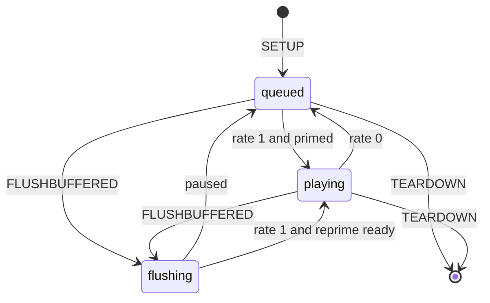

# Buffered Playback Lifecycle

Buffered type-103 PCM shares the CarPlay media output with stock type 100 through one `mpl5_dio_ent` QSA handle. The hook manages queueing, presentation, handoff and feedback while preserving stock voice/call priority.

## ⚙️ PCM output and ownership

The APAP receiver authenticates and decodes packets into a tagged PCM6 ring. When the stock media writer is active, it drains that ring through its own QSA cadence. When stock releases its media stream while type 103 still needs output, the hook can retain the configured handle and use a detached writer. A later stock reclaim reuses the live handle.

There is no competing media handle while stock owns one. A call, Siri or another stock main-audio owner blocks hook media-route claims; the ownership rules are in [Call and Siri Routing](CALL_AND_SIRI_ROUTING.md).

## 🔄 Presentation state

| Operation | Current behavior |
| --- | --- |
| SETUP | Starts presentation stopped; authenticated data may queue before the first rate command |
| Rate 0 | Stops presentation without discarding the compressed queue |
| Rate 1 | Drains queued records in order after the presentation/priming conditions are met |
| Queue bound | Uses the negotiated `audioBufferSize` plus one record; TCP provides backpressure when full |
| Bounded flush | Removes the specified sequence/time interval from queued records and tagged PCM |
| Prefix flush | Removes the prefix, resets the affected timeline and flushes/prepares the tracked QSA sink |
| Teardown | Revokes the generation, shuts transport down and releases owned resources |

Rate changes preserve continuous SCENE state. Decoder/cookie changes, sequence gaps and timeline-breaking flushes reset the affected processing state. On confirmed QSA underrun, recovery prepares the device and pre-rolls one silent period before retrying audio. [Buffered Audio Path](BUFFERED_AUDIO_PATH.md) defines the control-message contract.

## 🌐 Feedback and route ownership

The phone requires an audio-clock reference. Feedback uses a valid media clock, including the retained/detached sink where appropriate. A voice/call route must not become the source of cached music feedback. Route epochs and stream purpose constrain reuse.

After the last stock main-audio owner stops, the hook waits the 50 ms settle interval before reclaiming Media. Reclaim requires type 103 to be playing, primed and ready with a full period. A new stock Prepare takes precedence; a paused buffered stream does not force the media route.

Transport failure invalidates queued output and its feedback cache. A new SETUP or media Prepare establishes the next usable generation. Shutdown waits for worker completion; a timed-out generation is quarantined instead of being reused.

## 🔎 Diagnostics

| State or log | Inspect |
| --- | --- |
| `idle` | Type-103 negotiation, image fingerprint and selected format |
| `waiting-for-cookie` / `cookie-failed` | Cookie delivery and decoder acceptance |
| `no-key` | SETUP key material |
| `unsupported-format` / `unsupported-layout` | Negotiated format and decoded geometry |
| `decoder-unavailable` | APAC library path, ABI and permissions |
| `transport-failed` | Socket lifecycle and network state |
| Decoder ready but no audible output | PCM-ring draining, QSA setup and audio-route ownership |

Check `captured mpl5_dio_ent`, six-channel setup and advancing buffered write counters. Distinguish a confirmed device-underrun recovery from a decoder or transport failure. For handoff, follow retained → detached writes → reclaimed handle and verify that the same configured sink remains in use.

The amplifier route is selected by RCC connection 162 and coding, separately from QSA voice count. See [Discrete 5.1 Routing](DISCRETE_5_1_ROUTING.md) and [Internal Amp Path](INTERNAL_AMP_PATH.md).

## 🧪 Regression checks

Exercise cold start, pause/resume, rapid track changes, seeking, phone lock/background, calls/Siri, reconnect and codec switches. Check audible continuity, route priority, bounded shutdown and stale-generation rejection. Protocol and model tests do not substitute for an audible vehicle check.

Implementation: [audio_hook.c](../../hook/audio/audio_hook.c), [apap_lifecycle.h](../../hook/audio/apap_lifecycle.h), [media_route.h](../../hook/audio/media_route.h). Earlier build hashes and observations are preserved in the [archived lifecycle record](../archive/snapshots-2026-10-29/audio/BUFFERED_PLAYBACK_LIFECYCLE.md).
