# Call and Siri Routing

The buffered media route shares the head unit with stock calls, Siri and realtime media. This guide defines stream priority, PCM I/O and feedback ownership.

---

## 📋 Current behavior

The hook advertises 24 kHz voice/call/microphone formats and 48 kHz navigation announcements. `ann3_dio_ann` and `ann4_dio_voice` receive fixed +5 dB gain with a soft knee above −2.5 dBFS. Music upmix is restricted to media. Format definitions are in [audio_hook.c](../../hook/audio/audio_hook.c); the matching driver geometry is in [deva-ctrl-qc](../stock-patches/deva-ctrl-qc.so.md).

## 🔗 What stock does with each stream

iOS 26.1 `AirPlaySender` builds `type=100` streams with `audioType=telephony`, optional `vocoderInfo` and the `input` flag; `carPlayAudioFormat_getFormatsKeyForAudioType` picks `audioInputFormats` for telephony/speech independently of media output (`AirPlaySender_01.mm` ~l.4070, `AirPlaySender_13.mm` ~l.9479 in the `iPhone18-3_26.1_23B85_Restore` dump). Pioneer `libSPF_CP_PlugInWrapper.so` `AudioStreamStart @0x14d210` starts main input and main output separately from buffered 103 and alternate 101 — **type 102 is not a call prerequisite, 100 is not "music", 101 is not "Siri"** `[decompile]`.

Stock MU1316 `libairplay.so` (210.81):

| Function | Address | Behaviour |
|---|---|---|
| `get_audio_path` | `0x49398` | telephony 3 → `tel2_dio_phone`; speech 4 → `ann4_dio_voice`; media → `mpl5_dio_ent` |
| `AudioStreamPrepare` | `0x4a9d0` | reads streamType at object `+108`, audioType at `+112`; main 100 declares its audio type, **waits for the HMI ACK**, then opens QSA; input uses `mic2_dio` |
| `AudioStreamStop` | `0x4a2f8` | synchronously joins workers, runs teardown callbacks, closes QSA |
| `_AudioStreamCopyProperty` | `0x49a90` | needs prepared state, does not return audioType — useless before Prepare |
| `AudioStreamStart` | `0x4a73c` | on failure calls `AudioStreamStop` |

Both Prepare and Stop are `R_ARM_JUMP_SLOT` imports, so the hook interposes them (exported via `carplay_hook.exports.map`); private offsets are read only after the AirPlay 210.81 fingerprint passes.

`dio_manager`: `s_audioTypeCallback @0x154e58` queues the global main-audio type; `s_audioTornDownCallback @0x154dbc` queues −1 — neither is scoped to a QSA handle. The hook calls the exported symbols `_ZN3dio11CDIOManager19s_audioTypeCallbackEiPv` / `…23s_audioTornDownCallbackEPv` with `kAudioTypeMedia = 1` (`hook/audio/audio_hook.c:3789-3799`) **[code]**. The Pioneer handler maps Media to DSI main-audio type 2 via `CDSICarplayImpl::updateMainAudioType(type=2, add=true)`. Java `CarPlayDSIManager.updateMainAudioType` *replaces* the active audio resource, so an out-of-order hook Media request can knock out telephony even though the PCM devices differ.

The MIBRoot connections behind these devices (all → `eSNK_SPEAKERS` on both amp types, except ringtone): see [Internal Amp Path](INTERNAL_AMP_PATH.md).

Sources: `AUDIO_CALL_ROUTING`, `AUDIO_5_1_STATE` §22

## ⚙️ Route ownership rules

Stock main-audio ownership takes priority over hook media-route claims throughout Prepare, Stop and teardown.

```mermaid
stateDiagram-v2
  accTitle: Main-audio route ownership between stock and hook
  accDescr: Stock owns the route from before any main-100 Prepare until after its Stop. After the last Stop a 50 ms settle passes; the hook reclaims Media only with playing, primed, full-period buffered PCM. Any new stock Prepare takes the route back without a hook release.
  [*] --> stock_owned: main-100 Prepare
  stock_owned --> stock_owned: more Prepare or Stop, any purpose
  stock_owned --> settling: last stock Stop done
  settling --> stock_owned: stock reopens
  settling --> hook_owned: 50 ms passed and 103 playing, primed, full period
  settling --> idle: 103 paused or not ready
  idle --> hook_owned: 103 becomes ready
  idle --> stock_owned: stock Prepare
  hook_owned --> stock_owned: stock Prepare, no hook release sent
  hook_owned --> idle: buffered teardown, release under routeLock
```

1. Before **every** main-100 Prepare (all purposes, not only known phone/Siri values) the stock object is registered and hook ownership relinquished **without** sending tornDown. Alternate 101 is unaffected.
2. The object stays registered through Stop, worker joins and its teardown callback, so an older media Stop cannot unblock a newer phone/Siri Prepare. A failed new Prepare removes only its own registration.
3. Cold bootstrap and the detached 103 writer cannot claim Media while any stock main object is registered; the detached pump yields instead of consuming PCM.
4. After the last stock Stop: 50 ms settle (`SPA_MEDIA_ROUTE_REACQUIRE_DELAY_NS`, `hook/audio/media_route.h:18`), retry 1 s on resolution failure (`:19`). Reclaim only with PLAYING, primed, full-period buffered PCM; a paused receiver never forces playback.
5. Ownership checks and any global release happen under the same `routeLock` as the stock-begin transition (`hook/audio/audio_hook.c:3809`, `:4127-4163`); the lock is **never** held across real Prepare/Stop (HMI wait, QSA re-entry and joins run without it). Lock order `ioLock → routeLock → state`.

Tracking is eight fixed slots (`SPA_MEDIA_ROUTE_MAX_MAIN_STREAMS`, `media_route.h:32`), no heap, no thread; overflow fails closed for hook claims for the process lifetime and never blocks stock telephony **[code]**.

Sources: `AUDIO_CALL_ROUTING`

## 🔐 PCM I/O and feedback hardening

- **Transport failure** (APAP TCP EOF, framing rejection, receiver failure) sets renderer `TRANSPORT_FAILED`, clears queued PCM, invalidates the clock cache and closes a detached QSA handle; the realtime 100 timeline is **not** substituted. Recovery needs a fresh media Prepare or new 103 SETUP.
- **Scratch** for PCM6 expansion is reserved before configuring (1 MiB max), never reallocated in `plugin_write`; bad geometry or oversize writes error out rather than sending stereo bytes to an expanded device. Partial writes commit only the whole-frame accepted prefix.
- **Nonblocking writes**: at most one device period per native write, 10 ms polling slices, 250 ms transfer budget (`SPA_PCM_IO_TIMEOUT_MS`, `SPA_PCM_IO_SLICE_MS`, `hook/audio/pcm_io.h:8-9`). Zero/EAGAIN is backpressure; prepare+retry only on confirmed UNDERRUN, with its own 250 ms budget. Phone, Siri and mic I/O bypass the media `ioLock`.
- **Receiver teardown** shuts sockets, waits ≤2.5 s for real worker exit, joins only exited workers; on timeout it quarantines the old generation (`BUFFERED_STOP_TIMEOUT quarantined=1`) — no `pthread_cancel`, no reuse.
- **Feedback**: stock main objects keep purpose and a route epoch; feedback is cacheable only for known media with no competing non-media object and an unchanged epoch (`spa_media_route_feedback_allowed`, `media_route.h:53`). Telephony/speech leave stock feedback untouched and invalidate the music cache, so a whole call inside a slow query cannot leave a phone clock in the music cache.
- **Transactional params**: `UNKNOWN → CONFIGURING → READY/FAILED` under `ioLock`; only READY writes; every success is confirmed by `plugin_setup` readback; failures latch.
- **SETUP tickets and generations**: a ticket is recorded before stock Setup and revoked before TearDown; controls snapshot SETUP sequence and receiver generation; FLUSH rechecks the renderer generation after each wait and again after acquiring `ioLock`. Stale commands log `BUFFERED_CONTROL_STALE`.

### Native QSA re-entry

MU1316 `libasound.so.2` (`snd_pcm_plugin_write @0x1012c`) calls helper `0xfe70` (from `0x101f0`, `0x10254`, `0x10290`), which re-enters `snd_pcm_plugin_setup` through PLT `0x4190` / GOT `0x20d64` (native `0xfd98`); flush also calls it (`0x10300`). That re-entrant call must see the real PCM6 geometry and must not retake the non-recursive `ioLock`, so the hook tracks the I/O owner by `pthread_t` (no TLS/emutls) and gives the owner native setup while other callers get the stereo view. Native write (`0x10260–0x10268`) can set errno while returning a positive accepted count.

Sources: `AUDIO_CALL_ROUTING`

## 🚫 Never return a negative to stock

Stock `CAudioOutputThread` consumes the write result as a byte count. Preserve the bridge contract: `spa_stock_write_result()` converts failures into stock-native short writes; deliberately cancelled fragments report consumed size with `ECANCELED` to preserve pacing. Negative errno values must not reach the stock byte-count consumer. [audio_interposer_test.c](../../tests/audio_interposer_test.c) covers this boundary.

Sources: `AUDIO_CALL_ROUTING`

## 🔧 Tests and the vehicle checklist

Host: `scripts/run_tests.sh` (includes `tests/media_route_test.c`, `pcm_io_test.c`, `media_transport_test.c`, `receiver_wait_test.c`); `scripts/test_audio_interposers.sh` compiles the real `audio_hook.c` with mocked QSA/CF/AirPlay (run with `SANITIZE=address,undefined` or `thread`). Coverage: music→call→resume, cancelled/failed/duplicate Prepare, phone/Siri overlap, cold 103 during a call, pause, teardown 103 during a call, capacity overflow, 20,000 concurrent iterations per thread, 64 concurrent SETUP/teardown and 32 late-SETUP cases. None of this exercises native ARM code, real QSA timing or audible playback.

Vehicle regression recipe: incoming answer/reject, outgoing, remote/local hangup, Siri, phone foreground/background, reconnect mid-call; check mic and remote voice, then music resume (including deliberately paused). Between `AUDIO_ROUTE action=stock_begin phase=prepare audio_type=3/4` and `stock_end phase=stop_done` there must be **no** hook `action=request` or `action=release`. Also: kill the APAP TCP sender → `BUFFERED_TRANSPORT_FAILED`, then fresh SETUP → new generation.

Sources: `AUDIO_CALL_ROUTING`

## 📚 Sources

Merged originals were removed from the tree after this note absorbed them; they remain in git history (commit 23972aa).

- `AUDIO_CALL_ROUTING` — the call/Siri priority design, hardening passes, QSA re-entry evidence, test coverage and the negative-return core analysis.
- `AUDIO_5_1_STATE` §22 — the cold-connect media-route callback and the stock→hook inverse transition that this ownership machine completes.

Earlier crash analysis and dated validation are in the [archived routing record](../archive/snapshots-2026-10-29/audio/CALL_AND_SIRI_ROUTING.md).
