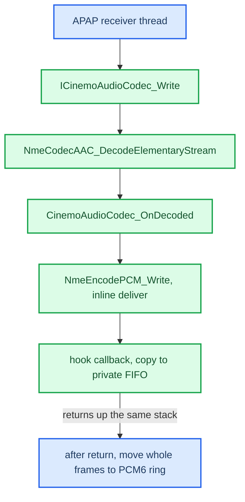

# Cinemo AAC Decoder

*How ordinary (non-spatial) CarPlay music on the buffered stream is decoded: index 23 AAC-LC through the Cinemo SDK already present in `dio_manager`, its recovered C ABI, the ownership trap that aborted the process, and why it is safe beside stock Cinemo state. The receiver around it: [Buffered Audio Path](BUFFERED_AUDIO_PATH.md).*

---

## 📋 Why it exists

With only APAC advertised, iOS skipped every non-Atmos track — it never upmixes stereo into APAC. The fix was to also advertise **index 23, AAC-LC / 48 kHz / stereo**, which the phone selects for ordinary content: same rate as every HU media endpoint, so **no resampler**. Stock libairplay cannot decode it (`AudioConverterNew_compat@0x3ddf0` allocates, destroys and returns an error; `SetProperty_compat@0x3ddc8` and `FillComplexBuffer_compat@0x3ddd4` return `0xffffe5b1`), but the MHI2Q ships Cinemo's `libNmeAudioAAC.so` (`NmeAudioAAC 1.79.33`, built 2017-12-19) and `dio_manager` already has `libNmeSDK.so` in `DT_NEEDED`. The bridge is `hook/audio/aac_bridge.c`, presenting the same function table as the APAC library so the receiver can alternate between them. Vehicle-confirmed in both switch directions **[car]**.

## 📊 What the stream carries

| Measurement (vehicle capture, 2026-09-03) | Result |
|---|---|
| APAP media time scale | `0x0000bb80` = 48,000 |
| Access units | 601 raw AAC-LC AUs, 376–1,322 B, 423,276 B total, 12.821333 s |
| First AU | `21 4e aa fb …` — no `0xfff` ADTS or `0x2b7` LOAS sync |
| Cookie | separate 39-byte MPEG-4 descriptor chain with its own ID |
| Proof | ADTS headers added by `tools/aac_es_to_adts.py` without touching AU bytes → exactly `601 × 1024` frames of 48 kHz stereo S16 |

The cookie (hex):

```text
03 80 80 80 22 00 00 00                                ES_Descriptor
04 80 80 80 14 40 14 00 18 00 00 01 f4 00 00 01 f4 00 DecoderConfigDescriptor
05 80 80 80 02 11 90                                   DecSpecificInfo = ASC 11 90
06 80 80 80 01 02                                      SLConfig
```

Lengths use the legal long form `80 80 80 xx`, so the ASC must be found by **walking tags**, not by a fixed offset (`aac_extract_asc`, `hook/audio/aac_bridge.c:146-180`). ASC `11 90` = object type 2 (AAC-LC), 48 kHz, 2 ch. Index 22 would be `12 10`. iOS's default-cookie helper `APAudioFormatGetMagicCookieForAACLC@0x22669e680` only fills 6/8-channel 48 kHz cookies; the stereo cookie comes from the source `CMAudioFormatDescription` and its ID is a hash of its bytes. **[car]** · **[decompile]**

The Cinemo AAC plugin's `AUDIO_ES` path (media type 5 or 7) goes straight from `NmeCodecAAC_Write@0x4dc8` to `NmeCodecAAC_DecodeElementaryStream@0x4540` without any sync search, and `AACDecoder_ApplyAudioSpecificConfig@0x5d08` reads the object type from **bit zero** of `header_data` — so it needs the raw ASC, never the whole cookie.

## ⚙️ The recovered C ABI

Resolved by `dlsym(RTLD_DEFAULT, …)` from the already loaded `libNmeSDK.so` (`hook/audio/aac_bridge.c:118-132`) — no private vtable addresses **[code]**:

| Export | VA | Shape |
|---|---:|---|
| `CinemoCreateAudioCodec` | `0x4ea44` | `int(void **out)` — fresh 112-byte wrapper per call; 0 ok, 12 alloc failure |
| `ICinemoAudioCodec_Initialize` | `0x9eedc` (impl `0x4e740`) | `int(codec, ctx, callback, const CinemoMediaType *in, const CinemoMediaType *out)` — 5 args, one on the stack |
| `ICinemoAudioCodec_Write` | `0x9ef00` | `int(codec, au, bytes, 1, int64 pts = 0, 1)` |
| `ICinemoAudioCodec_Drain` / `_Flush` | `0x9ef2c` / `0x9ef40` | `int(codec)` |
| `ICinemoAudioCodec_Release` | `0x9eeb4` | release the interface |

`Write(…, 1, 0, 1)` is copied from the working MH2p ARMv7 adapter (Thumb at `0xb2888`, `0xb2892..0xb289a`, call `0xb28a0`); earlier notes proposing `(0,0,0)` were wrong, and the two `1`s have no recovered names (`hook/audio/aac_bridge.c:325`). PTS stays 0 — timing belongs to the receiver clock, not a 70.56 MHz Cinemo conversion.

`CinemoMediaType` is exactly `0x80` bytes, zero-initialised (`MediaTypeInit` memsets `0x80`); the bridge writes it as a byte array with accessors so padding assumptions cannot shift a field (`hook/audio/aac_bridge.c:28-47`):

| Offset | AAC input | PCM output |
|---:|---|---|
| `+0x00` media type | 5 `AUDIO_ES` | 2 `PCM` |
| `+0x04` subtype | `0x101a` AAC-LC (`0x1022` AAC-ELD) | `0x1023` PCM |
| `+0x08` sample format | 0 | 2 = S16 |
| `+0x0c` rate / `+0x10` channels | 0 / 0 (the ASC carries them) | 48000 / 2 |
| `+0x74` header type | 5 = ASC | 0 |
| `+0x78` / `+0x7c` | pointer to ASC / length | 0 |

Callback: `int decoded(void *ctx, const void *pcm, uint32_t bytes, const CinemoMediaType *fmt, int64_t pts, uint32_t flags)` — a plain C function pointer stored at wrapper `+0x50`, context at `+0x54`. Error codes from the guards themselves: 11 = NULL callback (`0x4e77c`); 12 = allocation or null class factory; 20 = `NmeFindAudioDecoder(subtype)` found nothing (never seen, which confirms `0x101a` at `+4`); 23 = no registered class implements `INmeAudioCodec::iid`.

APAP-side proof that no framing is added: `APSAPAPBBufEncode@0x2266ccfc8` hands the `CMBlockBuffer` to the encoder, `_APSAPAPBBufEncodeMediaDataCallback@0x2266cd28c` writes each contiguous region verbatim (pointer/length at `0x2266cd2e0`/`0x2266cd2f0`), `_APSAPAPBBufDecodeMediaDataCallback@0x2266cd6a0` exposes one item as one block buffer.

**How it was landed (risk order):** 0 keep a known-good bundle and hashes; 1 corpus proof (done); 2 host tests with fake Cinemo (cookie parsing, zero/multiple callbacks, bad geometry, slow `Write`, flush, stale generation, FIFO bounds); 3 integrate behind a disabled gate; 4 one bounded in-process create/decode/flush/release canary with local playback stopped; 5 replay stock local audio before and after; 6 index 23 alone, stationary; 7 `[65]` regression; 8 `[65,23]` bidirectional switch (done, accepted). No gate needed a moving car; CPU margin of the 2017 decoder on the Krait is still unmeasured **[open]**.

## ⚠️ The two traps

**The codec owns the header.** Cinemo frees the ASC pointer at `+0x78` when the codec is released. Passing a pointer into our own struct gave `free malloc object that is not allocated: …/dlist.c:1121` — the `dio_manager` **SIGABRT** the first time the AAC path ran, at teardown, so it did not look like a decoder bug at all. The ASC is now its own heap allocation handed over on a **successful** `Initialize`; if `Initialize` fails it is still ours to free (`hook/audio/aac_bridge.c:235-253`). Both behaviours reproduced with `tools/cinemo-probe/cinemo_probe.c`, built for QNX and safe while the car plays (`PROBE_CONFIG=1` = the working sequence, exits 0; `PROBE_STACK_ASC=1` reproduces the abort; `PROBE_PLUGIN=<path>` hand-`dlopen`s a plugin, which does not help). **[car]** · **[code]**

**Error 23 = no plugin directory.** `dio_manager` loads Cinemo only for iAP, transport and VFS; its core dump carries no `libNmeAudioAAC`, and the class factory knows no audio codec until `ICinemoConfig_SetPluginDirectory` runs — `dlopen`-ing the plugin by hand does not help. The bridge therefore, **only after a create has failed**, calls `CinemoCreateConfig` + `SetPluginDirectory("/mnt/app/armle/usr/lib/cinemo")` (override `AUDIO_CINEMO_PLUGIN_DIR`) and never releases that config (`hook/audio/aac_bridge.c:82-116`). The probe goes from 23 to a clean 0. This **supersedes** the static plan's rule "never create a second Cinemo configuration or change the plugin directory", which assumed `dio_manager`'s `iap2.cinemoLib = /armle/usr/lib/cinemo` setting also registered audio codecs. **[code]** · **[car]**

## 🔐 Thread safety beside stock Cinemo



Static audit of the exact MU1316 binaries (`dio_manager` `e9862680…e794`, `libNmeSDK.so` `a34a968e…e73e`, `libNmeBaseClasses.so` `d69b568c…505b`, `libNmeAudioAAC.so` `89536dcd…cd46`, `libNmeEncoder.so` `d2bdf340…82d7`, `libOmxCore.so` `17210d4b…1c02`) **[decompile]**:

- **No stock codec to collide with.** `dio_manager` imports only `CinemoCreateConfig`, `CinemoCreateMetapool`, `CinemoErrorToString`, `CinemoCreateIAP`; nothing in the image imports `CinemoCreateAudioCodec`.
- **Every object is private.** Fresh wrapper (112 B), fresh AAC object (`NmeCreateCodecAAC@0x4a20`, 7,536 B), fresh PCM encoder (`NmeCreatePCMEncoder@0x13e64`, `0x190` B) per call; no thread-ownership check.
- **The shared registry is locked.** `NmeClassFactory::Create@0xe7a1c` (mutex at `this+8`), `NmeClassModules::{Initialize,Register,Lookup,LoadPlugin}` under one mutex, `NmeClassDLL::AddRef/Release` interlocked. Only racing stock initialisation or `NmeClassFactory::Delete@0xe9888` would be unsafe; type-103 SETUP can only happen after iAP is up.
- **Fully synchronous.** `NmeCodecAAC_Write@0x4dc8` → decode `@0x4540` → callback `BLX@0x4750` → `CinemoAudioCodec_OnDecoded@0x4eb9c` → `NmeAudioEncoder_Write@0xb204` → `NmeEncodePCM_Write@0x13848` → `DeliverPCMInline@0xb058` → `CinemoAudioCodec_OnPCM@0x4e638` → app callback `BLX@0x4e710`, all before `Write` returns. Zero or several callbacks per AU. No `pthread_create`, no condvar on this path — the MH2p donor's 100 ms condvar wait (`0xb348a`) must not be copied.
- **No OMX.** Both `libNmeAudioAAC.so` and `libNmeSDK.so` list `libOmxCore.so` in `DT_NEEDED` but have no `OMX_*` import, relocation, `dlopen` or `dlsym`. (OMX core is refcounted multi-client anyway: `OMX_Init@0x20e4` under `omx_core_lock@0x2380`.)

Integration rules the bridge follows **[code]**: one decoder per type-103 generation, all calls on the APAP thread; create lazily after a validated cookie, never from the preload constructor or an ELF destructor; the callback only validates format/generation and copies into a bounded private FIFO (4 × 1024 frames, `hook/audio/aac_bridge.c:49-51`), then complete frames move to the shared ring after `Write` returns — no socket, QSA or render lock is held across a Cinemo call. Malformed callback format or FIFO overflow counts and drops that AU. On `FLUSHBUFFERED`: `Flush`, clear FIFOs; on a cookie/format change: release and recreate; `Drain` only at orderly EOS.

**Fallbacks not built.** Index 22 (44.1 kHz) would need a resampler *inside the bridge, before the ring*: `libspeex.so` (`speex_resampler_init_frac@0x232c0`, `process_interleaved_int@0x21eb8`) at ratio 160/147, quality 5, fractional phase kept across AUs (1,114/1,115 output frames per AU); Cinemo's own `NmeResample` (`libNmeBaseClasses.so` `Create@0xbe278`, `Write@0xbfdfc`, `Drain@0xbf188`, `Flush@0xbde18`, built by `NmeAudioRenderer_RecreateResampler@0x5960`) is private C++ ABI. `libspeex.so` SHA-256 `36526f8b…3eb6`. FDK-AAC is a rollback design only — the image's `NmeEncodeFDK` is an **encoder**; a vendored FDK decoder would be an optional library like `libcarplay_apac.so`, never a hard `DT_NEEDED`.

---

## 📚 Sources

Merged originals were removed from the tree after this note absorbed them; they remain in git history (commit 23972aa).

- `AAC_BUFFERED_PATH_PLAN` — framing proof, cookie structure, Cinemo call contract, resampling decision, rollout gates.
- `CINEMO_AUDIO_CODEC_ABI` — on-unit probe: Initialize arity, error codes, the header-ownership abort.
- `CINEMO_AAC_THREAD_SAFETY_AUDIT` — registry locking, synchronous chain, OMX refutation, FDK rollback boundary.
- `CODEX_PROMPT_AAC_BUFFERED_PATH` — the original task brief (provenance).
- `PIONEER_TYPE103_STATIC_SPEC` — MH2p `AudioConverter` adapter addresses and the AAC 5.1.2 ASCs (`11 c0 00 00`, `3e 39 c0 00`) of the abandoned index-40/42 route.

## 🔗 See also

[Buffered Audio Path](BUFFERED_AUDIO_PATH.md) · [APAC Codec](APAC_CODEC.md) · [Buffered Playback Lifecycle](BUFFERED_PLAYBACK_LIFECYCLE.md) · [Audio overview](README.md) · [Landmines](../LANDMINES.md)
