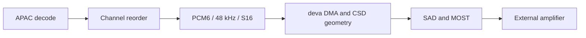

# Discrete 5.1 Routing

APAC 5.1 from buffered type 103 is decoded, reordered to **`L R C LFE Ls Rs`** and sent to the external amplifier. With Spatial Audio enabled it bypasses SCENE stereo synthesis. Discrete 5.1 is confirmed working in the vehicle.

## ⚙️ End-to-end path

| Boundary | Contract |
| --- | --- |
| Decoder → hook | APAC 5.1 decoder order `C L R Ls Rs LFE`; classify by decoded codec, channels, rate and layout |
| Hook → QSA | Apple declared order `L R C LFE Ls Rs`, six S16 samples per frame |
| QSA/deva | `mpl5_dio_ent`, fixed 48 kHz six-voice route |
| CSD | Device 78; six-channel geometry selected at route attach |
| SAD | `ASAD=0xfc` declares all six active channels |
| RCC routing | Connection 162 selects the external multichannel route from amplifier coding |

The QSA sample format and downstream transport slot width are separate layers. [QNX Audio Topology](QNX_AUDIO_TOPOLOGY.md) documents CSD/LPASS, DMA, SAD and MOST byte layouts.

## 🔧 Driver geometry

The selected [deva patch](../stock-patches/deva-ctrl-qc.so.md) keeps capability records, active DMA geometry and the CSD session consistent. `mpl5_dio_ent` mirrors the six-channel entertainment capability geometry: six voices and `0x4800` fragment size at the CSD boundary. A 16 ms period represents 768 frames at 48 kHz.

CSD reads the static minimum geometry when the route attaches; changing only a later live PCM channel is insufficient. QSA can still convert stereo input on the patched driver. The installer keeps internal-amplifier systems on the stock stereo policy.

Reproduce the selected driver with [build_final.py](../../deploy/deva-ctrl-qc/build_final.py). It is installed at `/mnt/app/armle/lib/dll/deva-ctrl-qc.so` and is loaded by `io-audio`; a replacement becomes active after reboot. Use the [installation procedure](../build-and-deploy/DEPLOY_AND_RELEASE.md) for backups, replacement and uninstall.

## 🔍 Codec switching and live settings

The standard type-103 offer is `[65,23]`: APAC 5.1 and AAC-LC stereo. A session can switch codecs without a new SETUP. The **inline magic cookie** is the decoder authority; the SETUP format index is only an initial hint.

- Stereo decode enters SCENE according to **UpMix: Off / Normal / Intense**.
- APAC 5.1 with **Spatial Audio On** takes the discrete reorder path.
- APAC 5.1 with **Spatial Audio Off** is folded to stereo, then follows the UpMix setting.

The buffered session keeps one PCM6 / 48 kHz / S16 output rail. Codec changes do not require reconfiguring the amplifier. See [Buffered Audio Path](BUFFERED_AUDIO_PATH.md) for cookies and [Stereo to 5.1 Upmix](STEREO_TO_5_1_UPMIX.md) for live controls.

## 🔊 Amplifiers and layout limits

All supported external amplifier families use the multichannel path, including confirmed B&O and Bose support. Their downstream DSP matrices and sound controls differ; consult [ODIS Amp Mapping](ODIS_AMP_MAPPING.md#external-amplifier-support). Internal DSP speaker outputs do not imply a six-channel CarPlay input route; [Internal Amp Path](INTERNAL_AMP_PATH.md) explains the installer gate.

The standard output is six channels. APAC index 66 / 5.1.2 is an experimental negotiated path; it does not establish a supported eight-channel amplifier route. Its decoder layout and fold/drop policy are documented in [APAC Codec](APAC_CODEC.md).

## 🧪 Verification

Check the decoded layout, the QSA six-channel setup and the channel declaration together. Preserve feedback publication: the phone requires a valid audio clock even when the buffered writer temporarily owns the QSA handle. See [Buffered Playback Lifecycle](BUFFERED_PLAYBACK_LIFECYCLE.md).

Validate channel placement through CarPlay. A standalone `qsa_play` invocation does not establish the same SAD/session state. Earlier captures, bus traces and rejected hypotheses remain in the [archived routing investigation](../archive/snapshots-2026-10-29/audio/DISCRETE_5_1_ROUTING.md).
