# Internal Amp Path

*What happens to CarPlay media on an Audi coded for the internal (non-B&O) amplifier: the RCC MIBRoot route decision, the AudioProcess sink maps, the Jacinto C674x DSP, and the four-site RCC patch plan that would give it discrete 5.1. Static RE from 2026-09-19, corrected 2026-10-18; the route conclusion is now confirmed on an internal-amp car, the patch plan is not.*

---

## 📋 The answer first

On an internal-amp car there is **no stock six-channel CarPlay route**. MIBRoot picks the stereo pair `eSRC_ENT_AMP_DIO_MEDIA (0x46e) → eSNK_SPEAKERS`, which allocates a 4-byte (2 × 16-bit) MOST source. The MMX still packs six TDM slots and the hook still writes PCM6, so C/LFE/Ls/Rs are simply not transported: front L/R only. **Confirmed on an A4 B9 with `Sound_System=1` on 2026-10-18** `[car, Matze89x]` — plain stereo, nothing from the rears or centre even on an Atmos track, the MMX sink healthy at `source=2ch target=6ch`. The earlier prediction that it would also sound thinner than stock, because the upmix moves energy out of the fronts, was **not** observed: no front level loss was reported.

The policy is therefore `AUDIO_SPATIAL=0` unless the RCC coding byte says external (`02`). The installer implements it: `custom.sh` (`read_amp`, `gate_audio`) reads `modifyE2P r FC 1` and rewrites the installed `carplay_startup.sh` to `AUDIO_SPATIAL=0` unless the byte is `02`; an unreadable byte also gives stereo. The Java UpMix row is left out on `DEVICETYPE_BASIC_2CH/BASIC_4CH/STANDARD_6CH` from the stock `AmplifierListener` `[code]`; the live `modifyE2P` output for one byte is confirmed on a car (see Still unknown 10). `AUDIO_STEREO_UPMIX=off` alone is not enough — it still writes PCM6 `L R 0 0 0 0`.

A real internal 5.1 path is **feasible with no hard wall**, but needs RCC-only edits in two binaries (MIBRoot and the DSP image) and a car with the internal amp to test on.

## ⚙️ Where the decision lives

`MIBRoot` (the audio-policy owner: `CAudioManagementPresCtrl`, `AudioPersistence`, `Amp.Amplifier`) runs on the **RCC** (TI Jacinto 5 DRA6xx), not the MMX. `rootifs_out/usr/apps/MIBRoot == MIBRoot_RCC` (16,468,409 B). The MMX audio stack is amplifier-agnostic: `VARIANT=G22` is hardcoded in MMX `startup.sh` (l.426), `io-audio ... platform_id=mib2` and `audio_service` start unconditionally (l.618–655), and no PPS object mirrors the coding.

```mermaid
flowchart LR
  accTitle: Connection 162 route decision on the RCC
  accDescr: E2P record 0xF1 byte 11 is read by AudioPersistence, published as ExternalAmplifierCoded, cached in one byte that the MIBRoot mapper reads to pick the internal stereo pair or the external multichannel pair, which AudioProcess turns into a DSP crossbar input or a MOST Connect.
  e2p_byte["E2P 0xF1 byte 11, Sound_System"]
  persistence["AudioPersistence 0x1e03e8"]
  ext_prop["Amp.Amplifier ExternalAmplifierCoded"]
  route_byte["MIBRoot byte 0x10bc0e8"]
  mapper["mapper 0x1e2a18, resource 0x78"]
  int_pair["0x46e to eSNK_SPEAKERS, 4 bytes"]
  ext_pair["0x46f to eSNK_DTCP51, 26 bytes"]
  crossbar["AudioProcess SPC crossbar, internal DSP"]
  most_connect["MOST Connect, external amp"]
  e2p_byte --> persistence --> ext_prop --> route_byte --> mapper
  mapper -->|"byte == 0"| int_pair --> crossbar
  mapper -->|"byte != 0"| ext_pair --> most_connect
  classDef primary fill:#dbeafe,stroke:#2563eb,stroke-width:2px,color:#1e3a5f
  classDef warning fill:#fef9c3,stroke:#ca8a04,stroke-width:2px,color:#713f12
  classDef success fill:#dcfce7,stroke:#16a34a,stroke-width:2px,color:#14532d
  class e2p_byte,route_byte primary
  class int_pair warning
  class ext_pair success
```



### The mapper and the one byte

`sub_1E2A18(conn, term, &src, &snk)` (called from `requestRequestConnection 0x1f1790` at `0x1f1900`) scans the connection table at `0xDDEFB8` (143 × 20 B `{connection, terminal, flags, resource, property}`), then the resource table at `0xDDFC1C` (143 × 20 B `{resource, int_src, int_snk, ext_src, ext_snk}`), and selects columns by `LDRB` of `g_externalAmplifierCoded @0x10BC0E8` (`0x1e2ab8` src, `0x1e2ae8` snk). The only writer is `onExternalAmplifierCodedUpdate` (`0x1e6a3c`, store `0x1e6a64`); the reverse mapper `0x1e2b18` reads the same byte. Selected pairs leave MIBRoot as a `DMMAudioManagement` proxy call (`sub_1D6CB4` → `0x755a58`, method `0x80000002`, src at msg `+0x50`, snk `+0x54`).

The byte has exactly **three** users in the whole binary — those two mappers and that writer, 11 references in all; there is no watchdog and no periodic re-read `[measured]`. The writer fires only on a DMM coding update with status == 2, and it keeps a **second copy** of the value in the object at `+1404` (plus a "received" flag at `+1405`). That copy has a different consumer: `sub_1E62B0`, the sink-delay configurator, which on the internal branch subtracts 12 ms from every adaptation delay and programs `setSinkDelay for internal amp` on sinks 1 and 2, and on the external branch skips the −12 ms and programs sink 2 only. So routing follows the global while lip-sync follows the object copy; they are only consistent because one writer sets both.

`g_externalAmplifierCoded` sits in the writable `.bss` segment and reads 0 on an internal-amp car `[car, Matze89x]`, but it is **not** a CarPlay-scoped switch. Of the 143 resource records, 98 are byte-identical in both columns and 45 differ: 21 keep the source and move sink 1 → 2, 19 switch to the MC source and move sink 1 → 2, 3 (`CL_ENT_MUHP_*`, rear-seat headphone) switch source and keep sink 15, and 2 (`CL_ANN_AMP_ICC`, `CL_ANN_AMP_MENU_ICC`) move sink 32 → 1. So flipping the byte sends every entertainment source — all five tuners, CD/DVD, USB, Bluetooth, AUX, Cloud, MirrorLink, Android Auto, CarPlay — and every traffic/PTY31 announcement and ringtone to `eSNK_DTCP51`, which does not exist on an internal-amp car. Chimes, PDC, navigation prompts, speech and call audio (sinks 6/21/22/29) are in the unaffected 98. `sub_1E2A18` also has 50+ callers (every volume, tone and subwoofer request, not just connection create) and `sub_1E2B18` has 45, so a flip-and-restore around a single connection leaves the forward and reverse mappers disagreeing about that connection. Not a useful probe: a correct site 1 edit answers the same question (does AudioProcess accept `{0x46f, 2}` here?) without taking radio down.

Connection 162 record `@0xDDF6E8`: `a2 00 00 00 | 01 00 00 00 | 00 00 00 00 | 78 00 00 00 | 01 00 00 00` (`CL_ENT_AMP_DIO_MEDIA`, `FRONT_DRIVER`). Resource `0x78 @0xDE05A4`: `78 00 00 00 | 6e 04 00 00 | 01 00 00 00 | 6f 04 00 00 | 02 00 00 00`.

The request itself (`DSIAudioManagement.requestConnection(connection, terminal, group)`) and the whole `org.dsi.ifc.carplay` API carry **no channel count**; QSA's six-voice negotiation never feeds this decision. The unrelated `org.dsi.ifc.media.AudioStream.numChannels` is DVD/media-player UI only.

### CarPlay-related resource records

| Resource | Internal pair | External pair |
|---|---|---|
| `0x78` DIO media (conn 162) | `0x46e` → SPEAKERS | `0x46f` `_MC` → DTCP51 |
| `0x79` DIO phone (conn 151) | `0x470` → SPEAKERS | same |
| `0x7b` DIO Siri (conn 152) | `0x471` → SPEAKERS | same |
| `0x7d` / `0x7e` DIO announcement / lowering | → SPEAKERS | same |
| `0x7f` DIO ringtone (conn 165) | `0x484` → SPEAKERS | `0x491` `_MC` → DTCP51 |
| `0x7a`, `0x7c` DIO phone / Siri speech input | → `eSNK_MU_REF` | same |
| `0x80` GAL media (conn 156), `0x88` BCL media (conn 167) | → SPEAKERS | `_MC` → DTCP51 |

Across all 143 records: sink 31 `eSNK_SPEAKERS_MC` and sink 3 `eSNK_DTCP20` never occur; every `_MC` source appears only in the external column paired with DTCP51; 45 records differ between columns (SPEAKERS→DTCP51, MUHP `_21`→`_2A`, and ICC↔SPEAKERS for resources `0x5f`/`0x61`). Resource `0x11` is referenced by connection `0x66` but missing ("Could not map"). Internal DVD 5.1, BT, MFP, CLOUD, GAL, A2LS and DIO media all end in `eSNK_SPEAKERS`. The complete 143-row resource and connection tables with raw bytes stay verbatim in [INTERNAL_AMP_MIBROOT_ROUTING](../sources/INTERNAL_AMP_MIBROOT_ROUTING.md) §2.

<details>
<summary>Enum and table details</summary>

- Sink enum (name array `0xDDCF5C`, lookup `0x1e11ec`): 1 SPEAKERS, 2 DTCP51, 3 DTCP20, 4 SDS, 5 MIC, 6 MU_REF, 7/8 MIC1/2, 9 TEL, 10–13 MUIN01/01DTCP/02/02DTCP, 14 MUDELAY20, 15 MUHP, 16–19 RUHP1/2 RSEHP1/2, 20 BB, 21/22 MUBTHS1/2, 23/24 RSEIN01/02, 25 TPMEMO, 26 MUTVSD, 27/28 MUDVDCSD/HD, 29 DCIMAPSD, 30 TLAM, **31 SPEAKERS_MC**, 32 ICC.
- Source values: compare tree at `0x1e120c` (IDA-undefined, emulated): `0x46e` DIO_MEDIA, `0x46f` DIO_MEDIA_MC, `0x470` DIO_PHONE, `0x471` DIO_SIRI, `0x473` DIO_ANNOUNCEMENT, `0x474` DIO_LOWERING, `0x484` DIO_RINGTONE, `0x491` DIO_RINGTONE_MC, −3 FOREGROUND, −1 ALL; four names inferred by string-blob order (`0x415`, `0x417`, `0x477`, `0x479`).
- Terminals (`0xDE077C`): 0 SINGLE_USER_DEFAULT, 1 FRONT_DRIVER, 2 FRONT_PASSENGER, 3/4 RSE_LEFT/RIGHT. Connection names `0xDE07A4`, conn ≤ `0x135`.
- Side tables `0xDDFAE4` (78 × u32) and `0xDDEE74` (81 × u32) hold classes 0..10 per resource; identical for 2ch and `_MC` resources — not channel counts.
- The analysed `RE/MIBRoot/MIBRoot` copy differs from shipped RCC MIBRoot by 35 experiment bytes (NOPs in `sub_1E7138`, edits `0x7b2974..0x7b8e17`), none in the mapper or tables.

</details>

---

Sources: [INTERNAL_AMP_MIBROOT_ROUTING](../sources/INTERNAL_AMP_MIBROOT_ROUTING.md), `MC_SELECTION_AUDIT`, `CODEX_PROMPT_MC_SELECTION`

## 💾 Coding bytes and how to read them

| E2P address | Byte | Meaning | Consumer |
|---|---|---|---|
| `0xF1` | +11 (flat `0xFC`) | **Sound_System**: 1 internal, 2 external; `0xFF` → warn "invalid sound system ==> set SoundSystem = INTERN" | the router (via `g_externalAmplifierCoded`) |
| `0x3E4` | +0 | SignalFlowId (dataset) | diagnostics |
| `0x3E5` | +0 | **ChannelNo**: 2 → `INT_AMP_2CH`, 4 → `INT_AMP_4CH`, anything else → `INT_AMP_6CH` | loudspeaker diagnosis only |

`sub_1DEFE4` builds `speakerCoding` (u16 at `AudioDiagPresCtrl+706`) only for `startLoudspeakerDiagnosis` (`sub_1DB4B0`) and the test-sound channel bound (`sub_1D0B0C`); it is not a property, not sent to deva, and not read by the mapper. The AudioDiag `CodedAmplifier` value (`0x20a2f4`, "please check Byte 11 ;-)") is the same byte-11 value. The `DEVICETYPE_*` enum (parser `0x1f81cc`: "120" BASIC_2CH, "121" BASIC_4CH, **"122" STANDARD_6CH = the internal 6-channel amp**, "140" ALPINE_BO_AUDI, "160"/"161" Bose, "181" ADVANCED_BO_AUDI = this car, …) comes from the DMM `AmplifierInfo` string and only drives HMI sound-setting capabilities. For the external branch nothing remaps by device type, so a **Bose** car (`Sound_System=2`) takes the same `DTCP51` route — its sink profile is unaudited `[open]`.

This car's dump `MU1316-EEProm.bin @0xF1`: `01 94 53 02 00 00 00 00 13 22 00 [02] 04 1a 00 10 2f 00 12 e5 01 70 09 04 be` — byte 11 = `02`, external `[car]` (matches `MU1316-LOG.txt` `Coding: 0194530200…`). Engineering scripts write it with `on -f rcc /ffs/extbin/apps/bin/VIPCmd ee bc Sound_System 1|2`.

Ranked ways to read it from an MMX shell at CarPlay start:

| Rank | Method | Caveat |
|---:|---|---|
| 1 | `on -f rcc /usr/apps/modifyE2P r fc 1` (or `r f1 19`, take byte 12) | blocks until RCC `DSIE2PAccess` is up; wrap in background+kill (QNX 6.5 has no `timeout`); `02` external, `01` internal, `ff` → internal; output format unconfirmed live |
| 2 | `cat /net/rcc/HBpersistence/etc/AmplifierCoding` / `useExternalAmplifier` | consulted by AudioProcess only when `--amptype` is absent; likely absent on production units |
| 3 | Java: `DSISound.ATTR_ACTIVEAMPLIFIERCAPABILITIES=35` → full amp id → `/tmp/carplay_amp_type` | the only way to tell Bose apart; boot ordering vs `carplay_startup.sh` unproven |
| 4 | `on -f rcc sloginfo`, grep for `Amptype from EEPROM` and `speakerCoding =` | trace-scope dependent |

The gate uses rank 1, once, at install time: `install_MoreIncredibleBash/mod/custom.sh` `read_amp` runs `on -f rcc /usr/apps/modifyE2P r FC 1` (`02` external, `01` internal, anything else unknown) and `gate_audio` rewrites the installed `carplay_startup.sh` to `AUDIO_SPATIAL=0` / `AUDIO_SPATIAL_ATMOS=0` for internal and unknown `[code]`. Recoding the amplifier later needs a reinstall.

Sources: `INTERNAL_AMP_PATH_KNOWLEDGE`, [INTERNAL_AMP_MIBROOT_ROUTING](../sources/INTERNAL_AMP_MIBROOT_ROUTING.md), `MC_SELECTION_AUDIT`

## 🔍 AudioProcess: logical sink to physical input

AudioProcess (`rcc ifs3 /bin/AudioProcess`, SHA `3d591ef3…`) resolves MIBRoot's `(src, snk)` against the G22 audio table's `<conn>` list. The table is `/etc/MIB_AudioTable_AU_G22.xml`, **gzip-compressed**; loader `sub_18B2A8` uses `gzopen` + libxml2 with DTD validation that only warns (the DTD is not shipped) but rejects non-well-formed XML. The start line comes from `collectConfigData` → `/tmp/startArgs_AudioProcess` (`--audiotable=/etc/MIB_AudioTable_AU_G22.xml`, `--amptype=EXT|120|121|122`), started by `srv-starter.cfg:573`.

`<snk amid nr>` → AM sink id (`sub_18E048`), then `CMainAmp` maps AM sink → amplifier sink by **area**: 51 = internal (`sub_146B78`), 42 = MOST (`sub_146A1C`); the wrong area is ignored with a log line.

| XML sink | AM id | Internal amp (area 51) | External MOST amp (area 42) |
|---|---:|---|---|
| `SPEAKERS` (`eSNK_SPEAKERS` nr 1) | 0 ENT1_STEREO | DSI sink **1**, width 4 | `0x21`, BW 4 |
| `MULTICHANNEL` (`eSNK_DTCP51` nr 1) | 10 ENT1_OLD_DTCP51 | DSI sink **6** "Entertainment Multichannel", width 26 | **`0x32`**, BW 26 |
| (ENT1_DTCP51) | 2 | sink 6 | `0x26`, BW 14 |
| `SPEAKERS_MC` (`eSNK_SPEAKERS_MC`) | 13 | **sink 1 — alias of stereo** | absent → "not supported" |
| ANN1..3 | 4..6 | 2..4 | `0x22..0x24` |
| `HEADPHONE1` | 7 | 9 | 9 |

G22 XML: `SPEAKERS` used by 53 connections, `MULTICHANNEL` by 35, `SPEAKERS_MC` by **zero**; `LC_ENT_AMP_DIO_MEDIA.MULTICHANNEL` (`src="LS_ENT_AMP_DIO_MEDIA.MC"`) already exists. `CDSIAudioManagement` sinks (`0x2d4140`): `1:4 2:2 3:2 4:2 5:4 6:26 7:26 8:4 9:4 10:4 11:2`. IoAmp addressing puts sink 6 on **the same DSP zone 0 / sink 0** as stereo sink 1. FBlock `0x22` sinks known to the HU: `0x21:4 0x22..0x24:2 0x25:12 0x26:14 0x27:6 0x28:16 0x29:18 0x2a:9 0x2b:18 0x2c:21 0x32:26`.

Internal sinks are `DEVICE_INTERNAL` (netID 1): `CConnectionPending::SinkInit` (`sub_1235D0`) sends `CrossbarConnect.SetGet` to `/dev/spc` (`dev_signalpath_configurator` → `/dev/io-amp/routing` → dspipc). `libSPC_configuration.so` `sourceMapping @0x2a98` maps MOST srcIDs to DSP crossbar inputs: **srcID `0x34` (source 7, 26 B) → input 9; `0x3a` (source 1, 4 B) → input 10**; Mmx/5,4,3,6 → 11,12,14,15. Device `0xD001`, 26 local sources, 5 zones. The SPC's "number of channels does not match for device %s" check compares runtime-filled `.bss` values — not decidable statically. The A2I/dspipc WavePlayer (`uNumChannels` 1–2 only) is the chime player, not the entertainment path.

> ⚠️ **Hard wall:** coding an internal-amp car as external (`Sound_System=2`) makes `collectConfigData` pass `--amptype=EXT`; `CMainAmp` then ignores internal area 51 and waits for a MOST amp that does not exist — **no audio at all**.

> ⚠️ **Contradiction with the B&O audits:** this map sends `MULTICHANNEL` to external sink `0x32`, not `0x26`. See [QNX Audio Topology](QNX_AUDIO_TOPOLOGY.md) — `[open]` until a live `raiseConnSR` trace.

<details>
<summary>AudioProcess parser and table anchors</summary>

- Conn/resource parser `sub_18C9C8` (elements `conn`, `resource`, `xactions/xaction`, `limit`, `fade-override`, flags `flag-ENT`, `flag-foreground`, `attn-type`, `volumelock`, `dsp-limiter-set-id`, `prio`); `<snk>` parser `sub_18E048` (33-entry `eSNK_*` name table `off_2C35F4`); parse order `sub_18E630`: src `sub_18DD8C`, snk, conn, settings/constraints `sub_18B8E0/18BF40`, amplifiers `sub_18B57C`. `CAudioMngWrapper` (`sub_13B01C`) args `--audiotable= --audiobrand= --amptype= --tlam-dir=`; default `/HBpersistence/etc/MIB_AudioTable.xml` only when `--audiotable` is absent; empty or `/dev/null` → built-in fallback (`sub_168F30`, static table `0x2b924c`). Override files `AmplifierCoding` (`"INTERN|EXTERN [x] <id>"`) / `useExternalAmplifier` read by `sub_15CDDC` via `sub_13AA10` only without `--amptype`. `collectConfigData` (`sub_101E14`): amptype byte cfg`+24`==2 → `EXT`, else `120/121/122` from cfg`+32` (2/4/6; unknown → 121 + "wrong number of channels"). Table siblings: `_AU_G11`, `_VW`, `_SK`, `_SE`, `_PO_G11/G24`, `_BY`.
- `amname` → AM id table `0x2c3574`: ENT1/ENT120→0, ENT2/ENT220→1, ENT151E→2, ENT171FE→3, MULTI-COMPAT→10, ANN110/210/310→4/5/6, HP1→7, TPMEMO→8, REF→9, TLAM→12, SPEAKERS_MC→13, ICC→14. AM enum (`0x2adb6c`): 0 ENT1_STEREO, 1 ENT2_STEREO, 2 ENT1_DTCP51, 3 ENT1_DTCP71, 4–6 ANN1–3, 7 HP1, 8 TPMEMO, 9 REFSINK, 10 ENT1_OLD_DTCP51, 11 count, 12 TLAM, 13 SPEAKERS_MC, 14 ICC.
- `CMainAmp` (0x170-byte object, ctor `sub_147044`), area decision `sub_14907C` (amp descriptor byte `+20` = external), entries `{AM id, x, y, sinkNr}` added by `sub_1469CC`, read by `SetSinkDelay` `sub_14262C`; `CAudioManager::SetSinkdelay` `sub_15A600` names sink 1 "INT_AMP SPEAKERS", 50 "EXT AMP MULTI CHANNEL", 9 "HEADPHONE". Internal DSI sink names at `0x2b8630`: 1 Entertainment Stereo, 2–4 Infotainment Mono (Navi/SDS/Phone), 5 TPMemo, 6/7 Entertainment Multichannel, 8 RefChannel, 9/10 Headphone 1/2, 11 In Car Communication. IoAmp table `0x2b8718` (accessor `sub_15D0B4`): sink 1→zone0/s0, 2→z0/s1, 3→z0/s2, 4→z0/s3, 6→z0/s0, 7→z0/s0, 9→z2/s0, 10→z2/s1, 11→z0/s5.
- Router: `CRoutingServer::requestSinkInit2` `sub_1205C4` (netID 1 DEVICE_INTERNAL, 2 MOST_25, 3 MOST_50P), `CRouter::startSinkInit2` `sub_114A00`; the router sends only source nr, sink nr and one byte to SPC — no channel arithmetic; `ch_desc` for internal sources is a 4-byte source number (`setResultSourceInit` `sub_117AAC`); `isSpecialInternalSource` (`sub_113A04`) does not apply to the DIO MOST source. `startSourceInit` rejects only a re-init with a different bandwidth.
- Optional cosmetic alternative (not recommended): make AM 13 map to sink 6 by patching the `STR R6` store at `0x146c74` — an instruction patch for no gain.

</details>

---

Sources: `INTERNAL_AMP_AUDIOPROCESS_SINKS`

## 🔍 The internal amp's DSP

The internal amp DSP is the Jacinto's C674x, loaded by the IPL (dev-dspipc runs with `suppress`, so it does not download). Image in RCC NOR at `0x3D00000` (813,348 B), a **Harman "BGZ boot table"**: magic `0xC6000ABC`, `word[1]` = exact file size (also the NOR scan step), entry `0x87629000` at `+0x20`, records `{tag, size, dst, data}` with tag `0xC6C6C601` = LZO1X, `0xC6C6C600` = raw, size-0 terminator. 38 records; `.text` at `0x87500180`, `.const` `0x875E7DC0`, `.cinit` `0x87612900` (795 records), version block `DRX6XX_DSPBIOS-RELEASE.A024_MIB2.DSPDUMP.No_Audio_Decoder.1`. The loader stub (`0xE00544..0xE006F0`) does **no CRC and no signature**; the IPL's BG CRC32 is used only for its own self-checks and verbose dumps `[decompile]`.

Each McASP instance is initialised from `.cinit` as a regular block: `{rx cfg 0x28, tx cfg 0x28, head 0x0C, descriptor 0x54, head 0x0C, descriptor 0x54}`. The rx/tx cfg blocks are 10 words; the slot geometry lives entirely in words 2 and 3.

| McASP | rx cfg | AFSRCTL (w2) | RTDM (w3) | Slots | Role |
|---|---|---:|---:|---|---|
| 0 | `0x8760CA5C` | `0x113` | `0x3` | 2 (I2S) | — |
| 1 | `0x8760CBF0` | `0x413` | `0xFF` | 8 (TDM) | DAC → internal amp; **a live TDM8 port on this DSP** |
| 2 | `0x8760CD84` | `0x111` | `0x3` | 2 | — |
| 3 "nvidia" | `0x8760CF18` | `0x412` | `0xFF` | 8 (TDM) | link from the front-end SoC |
| 3 "QC" | `0x8760D098` | `0x113` | `0x3` | **2 (I2S)** | **selected on MHI2Q** |

`AFSRCTL` carries the slot count in `RMOD`, bits 15:7 — `0x113` → 2, `0x412`/`0x413` → 8 — plus `FSRP` (bit 0, frame-sync polarity), `FSRM` (bit 1, internally generated, set in all of them) and `FRWID` (bit 4). `RTDM` is the active-slot bitmask: `0x3` = slots 0–1, `0xFF` = slots 0–7. RFMT (w1) is `0x180F0` everywhere (32-bit slots).

Only four words differ between the two McASP3 variants, and **McASP1 — a working TDM8 port — is the better reference than the nvidia template** `[measured]`:

| word | McASP1 (TDM8, live) | McASP3 nvidia | McASP3 QC |
|---|---:|---:|---:|
| w2 `AFSRCTL` | `0x413` | `0x412` | `0x113` |
| w3 `RTDM` | `0xFF` | `0xFF` | `0x3` |
| w7 | `0xA0` | `0x20` | `0xA0` |
| w8 | `0x0` | `0x0` | `0x8000` |

w7 is therefore **not** the TDM discriminator: the live TDM8 port shares the QC value `0xA0` and it is nvidia that differs. w7 and w8 are unexplained `[open]`; leave them alone. The tx blocks mirror the rx blocks in every instance.

The 3-word heads (`0x8760CF68` nvidia, `0x8760D0E8` QC) are `[2, 2, 3]` for rx and `[2, 0, 1]` for tx, and the 84-byte descriptors are **byte-identical** between the variants except one self-pointer. Neither carries a channel count `[measured]`.

The selector (`0x875334AC..0x87533560`) tests **bit 31 of the return value of the call that lands at `0x875334A0`** (`MV .L2X A4, B5` then `SHRU .S2 B5, 1Fh, B0`) and logs "Frontground chip is nvidia/QC" (strings `0x875F6296`, `0x875F618C`). The global `0x876251AC` is loaded into **B4** in the same fetch packet and is *not* the tested word — an earlier pass reported it as the source. The tested value is the 32-bit DSP startup parameter, returned by the accessor `0x875E6A80` and cached at `0x8760C7E0`: the ARM side builds it in `collectConfigData` as `dspstartupparam=0x%.2x00%.2x%.2x` from `table[mainunit-3]` | (amp type) | E2P `0x3E4`, and an MHI2Q unit shows `0x80000030` — bit 31 set, QC head `[car, Matze89x]`. How it reaches the DSP, and why it still cannot be used to select the TDM8 variant, is under *The selector input* below.

`arcInputDev_ReaderSettings` stores constant 2 as the input channel count. The processing chain (`MIB2_AudioProcessingChain_create`) runs `hPreDownMixer` → Zone0 MainMix → delay, dyn-comp, EQ, limiter, gain boost, Gala, TCL/TLAM → mixer → MOST-mute → writers. The zone-0 mixer (`SetupZone0Mixers 0x8755a050`) is a real N×M matrix with an output bus already ~6 wide (FL FR C LFE Ls Rs, C/LFE at −6 dB).

The MainMix **source** map is always `0x8760C108`; the **channel** map is chosen in `SetupZone0Mixers` at `0x8755A470` from the low byte of the startup parameter (`EXTU A12, 24, 24` — left-then-right shift, so bits 7:0), i.e. from SignalFlowId (E2P `0x3E4`). `SUBAH A10, 0x19` and `SUBAW A10, 0x0D` scale their immediates by 2 and 4, so the real comparands are 50 and 52, tested with the unsigned-underflow equality idiom `CMPLTU 1, A10 - n`:

| SignalFlowId | channel map | second table |
|---|---|---|
| 50, 51 | `0x8760C2C8` | `0x8760C198` |
| 52, 53 | `0x8760C358` | `0x8760C1E8` |
| anything else (e.g. **48 = `0x30`**) | **`0x8760C238`** | `0x8760C198` |

An earlier pass read the immediates `0x19`/`0x0D` as the thresholds and recorded them as "=13 / ≤14 / >14"; that was wrong. Three rows of 20 bytes are then copied into a stack array by an SPLOOP. Group boundaries are `[static]` from predicated, software-pipelined code — confirm against the stack array at runtime before editing a map.

The **A2I** ARM→DSP stream library (`liba2itodspipc.so.1`) accepts ≤10 channels but opens only 16-bit, 8–48 kHz; packages are a 32-byte header (`00 00 01 BA 80 00 | size BE | … | nch | bits | rate BE`) + PCM. It serves WAVPlayer1..3 only.

<details>
<summary>BGZ header, boot chain and tools</summary>

Header (32 B LE): `0x00` magic `0xC6000ABC`; `0x04` size `0x000C6924`; `0x08` unpacked size `0x0011AE70` (records sum to `0x11AD30`); `0x0C` `0x11800100` (unread); `0x10` datecode `0x2817145A`; `0x14` subtype/core 0 "DSP1"; `0x18`/`0x1C` fillers `0x11111111`/`0x22222222`; `0x20` entry `0x87629000`. The terminator at `0xC6918` (`01c6c6c6 00000000 27e4b3ad`) carries an unread word. Records round-trip with `python-lzo` `lzo.decompress(blob, False, bufsize)`. Entry stub sets B15 `0x876207FC`, B14 `0x87624CE0`, jumps to `c_int00 0x8760CE14`; L2 fast code at `0x81C400`/`0x81D300`.

Boot: IPL (NOR 0, `c674x_ipl_T10`, base `0x40300000`) `sboot` → `sub_40305C98` scans NOR, classifies headers via `sub_40309304` (type 11 BGZ; type 8 header+COFF only via the manual `dsp` command `sub_40305204`), loads the embedded C6000 loader stub (COFF at IPL file `0xDDEC`, entry `0xE00000`) and releases reset. QNX startup (`sub_830009A0`) polls loader status ("DSP loader failed: %d" / "timed out"); `/bin/dsploader` mounts IFS images. The BG CRC32 (`sub_403025EC`, poly `0x04C11DB7`) is used only by the `crc32` command, IPL self-check, memboot copy check and verbose dump. `dev-dspipc -ddra6xx,int=77,intprio=20,base=0x87000000,memsize=0x1000000,suppress,clockenable=1` (from `/tmp/startArgs_dev_dspipc`); its COFF loader (`load_coff_file 0x2404`) is only for `filename=*.out`.

A2I `check_parameter @0x4C1C`: DevType 0, GapMode 1, packages 1..256, package size power of two, channels 1..10, sample size must be 2 on Open, rate Hz or flag `0x900000xx` (table `0x5630..0x57D8`), MuxType 0 interleaved / 1 non-interleaved, writeTrigger `0x0ABABABA` client / `0x05555555` library, priority-19 stream channel. No DSP code reads the header's channel byte; WavePlayer handles at `0x875344E0..0x87534B10`.

McASP blocks live in `.cinit` as 40-byte rx/tx configs plus 84-byte channel descriptors: McASP0 `0x8760CA5C`/`CA84` (ser tx5/rx3, buf `0xA00`/`0x600`), McASP1 `0x8760CBF0`/`CC18` (buf `0x800`), McASP2 `0x8760CD84`/`CDAC` (buf `0x200`), McASP3 nvidia `0x8760CF18`/`CF40`, QC `0x8760D098`/`D0C0` (word9 `0x8000`), both buf `0x1000`. Reader settings `0x875317C8..0x875318F0` store 2 alongside 64, 42, 8, 4, 9. Chain builder `0x87531310..0x87535F04`; PreDownMixer `0x87559640`; mixer/xbar tables reached from `0x8755A628`/`0x8755A7E8`; `dly_setSampleFreq` zone0/zone2; system rate from startup param `IF_SAMPLE_RATE`.

Tools: `bgz_unpack.py` (records → flat windows), `mkelf.py` (records → ELF32 LE, `e_machine` 140, one PT_LOAD per record, for a disassembler) and an idalib renderer that walks fetch packets. The 2026-09-19 `bgz_pack.py` (repack with self-check) and the `c6x_*.py` helpers were lost with a deleted scratch directory and have **not** been rebuilt — **a repacker is a prerequisite for any DSP edit**, and its first test is a byte-identical round-trip of the stock image. Records round-trip with `lzo.decompress(blob, False, bufsize)` (headerless). IDA: tms320c6 processor; per-word `define_code` is unusably slow, use idalib.

</details>

---

Sources: `INTERNAL_AMP_RCC_DSP`

## 🌐 The MMX to RCC link: MOST, but unsettled

> ⚠️ **This section contradicts the McASP table above, and the contradiction is not resolved.** The reasoning below concludes the link is MOST and needs no MMX patch. But McASP3 has two config variants selected per front-end SoC ("Frontground chip is nvidia/QC") from a parameter the ARM derives from the unit variant — which only makes sense if McASP3 is fed **directly** by that SoC. If the direct link is the truth, the MMX must also emit TDM8 and site 5 is not "none". Everything downstream depends on which reading is right, so settle this before building any image. What to reverse: where MMX AFE `TDM_OUT_MPL` physically terminates; and what a 26-byte NAL allocation in RCC `bin/car` actually binds to.

`TDM_OUT_MPL` does not wire directly to the RCC. The AFE frame uses header type 2 `ENTERTAINMENT_MOST`, the path carries a MOST Connect/BlockWidth handshake, and the SPC maps MOST srcIDs to DSP inputs — so the topology is **MMX AFE → MMX INIC → MOST150 ring → RCC INIC → McASP3 → C674x**. The MMX's 6 × 24-bit slots and the RCC's 2/8 × 32-bit McASP3 frame sit on opposite sides of two INICs and never have to agree; only the BlockWidth crosses the ring. On an internal-amp car the MMX sends exactly what it sends on this B&O car (six slots, ASAD mask); the width reduction happens on the RCC by allocating the 4-byte source. **No MMX patch is needed for either amp.** Whether the INIC forwards all six active slots for a 26-byte BlockWidth is a live-capture question only `[open]`.

Sources: `INTERNAL_AMP_MMX_LINK`, `INTERNAL_AMP_PATH_KNOWLEDGE`

## 🔧 The internal 5.1 patch plan

Verdict: **feasible, no hard wall found** — four RCC edit sites, one of them code. Planned, not built; validation needs a `Sound_System=1` car.

### Work order, which is not the site numbering

The sites are numbered by position in the chain, not by the order to do them in. **Site 1 is the only step that can leave an unbootable unit**, so it goes last.

1. **Car evidence, read-only.** `AUDIO_STEREO_UPMIX=off` with `AUDIO_SPATIAL=1` (sends the 6-slot frame with only L/R filled); `on -f rcc sloginfo` across a CarPlay connect, grepping `CConnectionPending.SinkInit`, `requestSpcConnect`, `number of channels does not match`, `Amptype from EEPROM`, `speakerCoding =`; `modifyE2P r FC 1`.
2. **Full RCC NOR dump off the car** — `rccd -d` (`cat /net/rcc/dev/fs0`, ~64 MB) or `backupplus`. Keep it on a PC.
3. **Demonstrate the recovery channel on a healthy unit** (unknown 7). A broken stage 2 does not need the emergency IFS to recover from: the whole flash kit is already in stage 1 `[measured, CN stage-1 IFS, 709 entries]` — `sbin/devf-generic`, `usr/bin/flashit`, `flashmib`, `flashctl`, `bin/ksh`, `bin/on`, `lib/dll/lsm-qnet.so`, `bin/io-pkt-v4`, `usr/bin/pdebug`. `/dev/shmem/ifs2_available` is created by `/bin/dsploader -r / -x touch /dev/shmem/ifs2_available` (srv-starter process 44) and gates only the *automatic* start of `devf-generic` (process 43 requires interfaces 37 and 44); the driver itself needs nothing from stage 2. Nothing reboots on the missing interface: all 56 processes carry `FinalAction IGNORE`, 55 of 56 `OnTerminate IGNORE_ALL`, `dsploader` has `MaxProcessRestarts 0`, and `/bin/watchdog` (interface 41) requires no interface at all and is itself in stage 1 — so a missing stage 2 gives no reset loop. The channel that survives is **qnet, not telnet**: `/proc/boot/start_pcie_cbc` (process 29, no requirements) brings up `io-pkt-v4 -p tcpip -p qnet bind=rcc0`, `rcc0 = 10.0.0.16`, default route `10.0.0.15`, while `usr/sbin/telnetd` lives in **stage 2** — stage-1 `inetd` accepts the connection and then fails to exec. So the way back is `on -f rcc` from the MMX plus `flashit`/`flashmib` against `/net/rcc/dev/fs0`, and the rehearsal on a healthy unit is `flashctl -p /dev/fs0 -x` (stock `stop_efs_driver.sh`) followed by a hand start of `devf-generic -s0x08000000,64M,,,128k,2,1 -r -D -P 1` (the `ResArgs` from `srv-starter.cfg`). The stage-1 IFS boot script leaves a root login on `/dev/ser1` at 115200 as the hardware fallback.
4. ~~The no-flash startup-parameter experiment — clear bit 31 in `dspstartupparam` in `/tmp/startArgs_dev_dspipc` and restart `dev-dspipc`.~~ **Withdrawn** `[measured, Matze89x + CN stage-1 IFS]`. The stock argument line carries `suppress`, and with `suppress` the driver does no download and no reset (`NO DSP-Reset due to suppress=1`); its own usage text says so — `suppress  don't do download to DSP, just start the communication`, in the documented pairing `base=…,suppress,dspstartupparam=0x…`. The DSP application is loaded before QNX runs: `/bin/dsploader` loads nothing, it reads the loader's result table out of the `/memory/loadargs` asinfo region the IPL left behind, checks each image's status and mounts `/dev/mem` with `offset=…,size=…` (its `STOP`/`WAIT`/`COPY`/`DMA_PRIO`/`DSP_PRIO` strings are only the pretty-printer for the IPL's script under `-dd`). So restarting `dev-dspipc` rewrites the word and redoes the magic handshake against a DSP that is long past its init, and the argument file is regenerated at every boot by `collectConfigData` from variant data, not read from anywhere editable. There is no RAM rehearsal for sites 2 and 3 either. Go to step 5.
5. **Settle the transport** (the warning above). May remove work rather than add it.
6. **Build the repacker; prove a byte-identical round-trip.**
7. **Flash an unchanged DSP image** and confirm audio still works — this validates the tooling and the flash path while nothing semantic is at stake. `flashunlock`, then `flashit -v -d -x -a 0x3D00000 -p /net/rcc/dev/fs0 -f `; M.I.B.'s `flashit -x` does **no** verify, so read back and compare hashes.
8. **DSP changes** (site 2, then 3, then 4). With site 1 unpatched the DSP still receives stereo, so these are **not observable yet**; the pass criterion at this stage is only "stereo still plays".
9. **Site 1 last**, and only from flash. Reading the record out of the running MIBRoot via `/proc/<pid>/as` works and confirms the anchor on a live car (`0xDE05A4` → `78 00 00 00 6e 04 00 00 01 00 00 00 6f 04 00 00 02 00 00 00`, MIBRoot is non-PIE with load segment 2 at VA `0x100000`, so file offset = VA − `0x100000`) `[car, Matze89x]`. **Writing it does not**: the resource table is in the `r-x` load segment, procnto honours the mapping and the write fails with `Server fault on msg pass`, with nothing changed. An earlier revision of this section suggested a RAM edit as a pre-flash test — that is withdrawn. There is no RAM rehearsal for site 1; the first test is the flashed image, which is why step 1 (the recovery channel) is not optional.

| Site | Binary | Edit | Kind |
|---|---|---|---|
| 1 | MIBRoot | resource `0x78` internal pair (file `0xCE05A8`/`0xCE05AC`, VA `0xDE05A8`/`AC`): src `6e 04 00 00` → `6f 04 00 00` (`0x46f`), snk `01 00 00 00` → `02 00 00 00` (`eSNK_DTCP51`) — **not** `SPEAKERS_MC` (31) | data, 8 bytes |
| 2 | DSP image | McASP3 QC rx block (`.cinit` run `0x876153A0` → dst `0x8760D098`), **two words only**: AFSRCTL `0x113` → `0x413`, RTDM `0x3` → `0xFF`. Same in the tx block (`0x876153D0` → `0x8760D0C0`) if the path is bidirectional | data, 8 bytes |
| 3 | DSP image | Reader channel count 2 → 6. **Site unresolved** — see below | **code** |
| 4 | DSP image | MainMix source map `0x8760C108` + the channel map **for this car's SignalFlowId** to identity; PreDownMixer offsets `0x876225A0` to identity | data, needs mixer semantics |
| 5 | MMX | none, *if* the link is MOST — unsettled, see above | — |

Keep `Sound_System=1` and `--amptype=122`. File offsets must be resolved per record from `bgz_unpack.py`'s section map (no fixed run→file delta).

**Site 2 — prefer `0x413` over the nvidia `0x412`.** `0x412` also flips `FSRP`. The QC block already has `FSRP=1` and so does the live TDM8 McASP1, so `0x113` → `0x413` changes only `RMOD` 2→8 and nothing else. The earlier plan additionally listed a "descriptor channel word 2→8" and pointed at `0x8760D044`: that word does not exist (the descriptors are identical across the variants) and `0x8760D044` is the **nvidia tx** descriptor, not a QC block. Both items are withdrawn.

**Site 3 — the earlier address was wrong.** `0x87532A2C` holds `MVK .D1 6, A5` (stored at `0x87532A74` into `*(B12+4)`); there is no 2 in that window, and the stated enclosing range `0x87532d30..0x87533730` does not contain the address. The only reader-side `MVK 2` is **`0x875317E0`** (`MVK .D1 2, A5`, word `0x02804041`) inside `arcInputDev_ReaderSettings`, whose struct fills as:

| off | +0x00 | +0x04 | +0x08 | +0x0C | +0x10 | +0x14 | +0x18 | +0x1C | +0x20 | +0x24 | **+0x28** | **+0x2C** |
|---|---|---|---|---|---|---|---|---|---|---|---|---|
| value | 0 | 64 | 9 | 9 | 1 | 0 | 3 | 5 | 42 | 4 | **8** | **2** |

plus +0x30 = 1, +0x34 = 64, +0x38/+0x3C = 9, +0x54/+0x58 = 4, +0x5C = 2 (A29 aliases A6). The `{8, 2}` pair at +0x28/+0x2C reads as frame slots / active channels `[hypothesis]`.

> ⚠️ **Trap:** that one `MVK` feeds **five** stores — `*A6(0x2C)`, `*A29(0x5C)` (same struct), `*A31(4)`, `*A30(0x0C)` and `*A30(0x10)`, where A30/A31 come from `*B15(0x68)`/`*B15(0x64)`. Editing the immediate sets all five to 6, including two fields of a second structure whose meaning is unknown. A surgical change needs the single store at `0x87531890`, not the immediate.

Two reasons simple scans miss these sites: `MVK` has `.S`, `.L` and `.D` forms, and C64x+/C674x packs compact 16-bit instructions into header-based fetch packets (header word top nibble `0xE`), so a fixed 32-bit stride produces garbage. A renderer must walk packet by packet and skip the header word.

### The selector input is not in the image — and not a software knob either

The whole variant selection rides on one word that the flashed DSP image never contains. Both ends are now `[measured]`.

**ARM side** (`rcc ifs3 lib/dll/dspipc-dra6xx.so`). `dspipc_dra6xx_init` parses the `-d` suboptions with `getsubopt` against the name array at `0xBB7C`; `dspstartupparam` is index 12 and `strtoul`s into the admin struct at `+0x1DC` (default 0, `base=` is index 9 → `+0x10C`, default `0xC2800000`). Then `dspipc_dra6xx_startApplication`, after the image download and after the DSP leaves reset, writes it as a single 32-bit word into the shared window and logs it:

```c
j_dra6xxAccessMem32(adm, *(adm + 0x10C) + 0x100, 1, /*write*/ 1, adm + 0x1DC);
hb_slogf_error("%s: DSP-Startup-Parameter-Value: %lX", ..., *(adm + 0x1DC));
```

The comm block at `base` is `+0x00` DSP→ARM info, `+0x80` the magic word (ARM 0 → 1, DSP → 2, ARM → 3), `+0x100` the startup parameter. It is written **once per `startApplication`**, immediately before the handshake.

**DSP side.** The accessor is `0x875E6A80`, five instructions: `A3 = 0x876128C0`, `A0 = *A3` (valid flag), `A3 -= 4`, `A4 = 0`, `[A0] A4 = *A3` — i.e. return `*(0x876128BC)` if the flag is set, else 0. Both words lie in `0x876047B4 .. 0x87612900`, which no BGZ record covers and which is below `.cinit`, so they are uninitialised memory filled at runtime from the comm block. (The DSP-side copy loop was not located; it forms neither address with an `MVK`/`MVKH` pair, so it goes through a DP constant. Immaterial to the result.) The accessor is called from eight sites: `0x875312B4`, `0x87533454`, `0x875336F0`, `0x875598C8`, `0x8755F910`, `0x8755F944`, `0x8755F984`, `0x87560424`. Besides bit 31, `0x8755F92C` and `0x8755FA14` test **bit 30** (`EXTU x, 1, 31`), and the low byte is the SignalFlowId; `0x80000030` is therefore bit 31 set, bit 30 clear, SignalFlowId 48.

**Consequence, corrected.** The image holds the accessor and *both* complete McASP3 variants, and the nvidia variant is already TDM8 in its own `.cinit` run (`0x412` / `0xFF` against the QC `0x113` / `0x3`) — so the selector input is indeed not in the flashed image. But it is not a software knob either, for two measured reasons.

First, **the word is not a free value**: `collectConfigData` builds it from variant data in `sub_102084` `[measured, CN stage-1 IFS]` —

```c
memcpy(dest, "-ddra6xx,int=77,intprio=20,base=0x87000000,memsize=0x1000000,suppress,clockenable=1", 0x54);
v0 = (field_24(cfg) == 2) ? 0xFF : 0;                       // byte 1
i  = field_00(cfg) - 3;                                     // mainunit
v2 = (i <= 4) ? tbl[i] : 0;                                 // tbl = { 0x40, 0x00, 0x00, 0x40, 0x80 }
if (field_04(cfg) == 1 || field_04(cfg) == 3) v2 |= 0x20;    // brand
v4 = field_28(cfg);                                         // SignalFlowId
sprintf(args, ",dspstartupparam=0x%.2x00%.2x%.2x", v2, v0, v4);
```

so the top byte is a **main-unit class**, not a feature flag: mainunit 3 → `0x40`, 4 → `0x00`, 5 → `0x00`, 6 → `0x40`, 7 → `0x80`. An MHI2Q car reports mainunit 7 and gets `0x80……` — which is exactly the `0x80000030` measured on a car `[car, Matze89x]`, from a different build, so the table is stable. **Bit 31 therefore means "main unit 7" and bit 30 means "main unit 3 or 6"**; bit 29 is brand 1 or 3. The nvidia McASP3 variant belongs to main units 4 and 5 — an earlier main-unit generation, not an alternative mode of this board. Clearing bit 31 does not "turn on TDM8", it tells the DSP it is sitting in a different head unit, which is the framing/clock mismatch listed as risk 1 below, now with a cause.

Second, **the value cannot be changed on a running unit**: the stock argument line carries `suppress`, so `dev-dspipc` neither resets nor downloads (`NO DSP-Reset due to suppress=1`) — the IPL loads the DSP before QNX starts, and `dsploader` only mounts the IFS images from the loader result table in `/memory/loadargs`. A `dev-dspipc` restart rewrites the word and redoes the handshake against an already-initialised DSP; `/tmp/startArgs_dev_dspipc` is regenerated from variant data at every boot. The only mechanical route left is `dev-dspipc` **without** `suppress`, with `loader=` and `filename=`, where the driver resets the DSP and downloads both itself — which needs a C6000 bootloader blob and a COFF application built out of the BGZ records, i.e. more work and more risk than the `.cinit` edit it was meant to avoid. Verification, if it is ever run, needs no listening: the slog prints `DSP-Startup-Parameter-Value: <hex>` plus `Set DSP-BOOTADDR` / `load_coff_file() done: DSP-StartAddr` on every start.

Remaining risk, in order: the two variants differ in more than slot count (words 7/8, `0x20`/`0xA0` and `0x0`/`0x8000`, see Still unknown 5) — if one of them is the frame/bit-clock direction, the nvidia variant may expect the DSP to be clock master on a board where the INIC is, and the result is silence rather than six channels; bit 31 is also consulted at `0x875336F0` (picking `0x8760D000` vs `0x8760D180`, almost certainly the tx side) and at five further sites for unknown purposes; and none of it changes site 1, so the MMX still sends two channels either way. Do it first anyway — it is free, reversible and it answers the clock question that gates the rest of the plan. The older alternative — NOP the `[B0]` predicate at `0x875334E4` — remains valid but requires a flash.

**Build and flash** reuse the M.I.B. (More Incredible Bash) RCC pipeline: the RCC is qnet node `/net/rcc`, NOR at `/net/rcc/dev/fs0`, DSP region at `0x3D00000` (`AUDI_MIB_DSP.bin.bgz`), stage-2 IFS with MIBRoot at `0x00BA0000`. MIBRoot's bytes sit inside an LZO-compressed imagefs (stored `0xF405C0` vs `0x2A94A1C` uncompressed; 44.6 MB will not fit the ~16 MB region), so the minimal path is surgical: recompress the one LZO block and fix its length prefix, `stored_size` and the imagefs checksum. The DSP image needs a repacker that does not currently exist (see Tools above); BGZ has no CRC or signature, so a round-trip-verified repack is the only integrity check there is. No per-region signature was found; FEC (`FecContainer.fec`) is feature licensing and untouched. Watch at bring-up: SPC "number of channels does not match", router trace `CConnectionPending.SinkInit - DEVICE_INTERNAL sinkNr=0x6`, `CSPCClient.requestSpcConnect(source=0x34 …)`.

<details>
<summary>Exact plan anchors and flash commands</summary>

- Site 2: edit the `.cinit` payload, not the `.bss` run address — the record is `{len 0x28, dst 0x8760D098, data}` at `.cinit` run `0x876153A0`. AFSRCTL is data word 2 (LE `13 01 00 00` → `13 04 00 00`) and RTDM word 3 (`03 00 00 00` → `ff 00 00 00`). Same pair in the tx record at `0x876153D0` → `0x8760D0C0` if the path is bidirectional. Descriptor buffer word is `0x1000` and needs no change.
- Site 3: `arcWriterDistribution 0x87532104` has a matching size tap on the writer side — check whether it needs the same change once the reader field is identified.
- Site 4: MainMix source map rows are `{0,0,1,2,3,4,5}` (7×20); which channel map is live depends on SignalFlowId (table above), e.g. row3 `4 5 6 7 1 1`; C/LFE output gains at `0x87602648` ([4]=[5]=0.5); PreDownMixer created in `CreatePreMixChain 0x87559650`; the mixer config has 158 entries.
- Flash: dump with `rccd -d` (`cat /net/rcc/dev/fs0`, ~64 MB) or `backupplus` (DSP at NOR block 15616, 768 blocks); `patch_prep` finds stage 2 via startup magic `EB7E FF00 0100 08` and size dword at header `+0x24` (`C005F400`); write with `flashunlock`, then `flashit -v -d -x -a <OFFSET> -p /net/rcc/dev/fs0 -f ` (`0x00BA0000` IFS, `0x3D00000` DSP), reboot. Flashlock only write-protects. Datasets (`apps/subwoofer`, `apps/amp`) are separately CRC16-protected. Before building: confirm the MIBRoot bytes fall in one LZO block that recompresses to ≤ its original size (pad if smaller).

</details>

---

Sources: `INTERNAL_AMP_6CH_PATCH_PLAN`, `INTERNAL_AMP_AUDIOPROCESS_SINKS`, `INTERNAL_AMP_RCC_DSP`

## ⚠️ Still unknown

1. ~~Live behaviour of PCM6 + `ASAD=0xfc` on the internal BW-4 route.~~ **Answered on a car 2026-10-18** `[car, Matze89x]`: plain stereo, nothing from the rears or centre on an Atmos track either, and **no thinning or level loss at the front**. The MMX sink reports `source=2ch target=6ch` and stays healthy (no underruns, no short writes). A matrix measurement (L-only, R-only, mono, anti-phase, fader rear) showed no individual speaker addressing, so an LtRt-style encode in the hook would not help.
2. **Whether crossbar input 9 and input 10 are the same McASP3 stream.** `libSPC_configuration.so` maps srcID `0x34` (26 B) → input 9 and `0x3a` (4 B) → input 10. If they are different physical inputs, site 1 alone yields silence rather than two channels. This is the question that decides whether the whole path is possible.
3. Whether the `AU_6CH` C6000 application accepts SPC input 9 with six channels on zone 0, and the 26-byte layout inside it.
4. The RCC INIC streaming-port configuration (I2S vs TDM). Never found; nothing in `bin/car` configures a port. If the OS81xxx takes its geometry from an EEPROM or an I²C config push, it may not be patchable from software at all — the real candidate for a hard wall. Best remaining lead: `libSPC_configuration.so`, the only file that knows both MOST srcIDs and DSP crossbar inputs.
5. What words 7 and 8 of the McASP rx/tx cfg blocks configure (`0xA0`/`0x20` and `0x0`/`0x8000`).
6. ~~Which function returns the 32-bit startup parameter on the DSP side, and whether it is read at chain-create time.~~ **Answered** `[measured]`: the accessor is `0x875E6A80` over `0x876128BC`/`0x876128C0`, and the value is written by the ARM into the comm block at `base + 0x100` once per `dspipc_dra6xx_startApplication` — not at chain-create time. Bit 30 is answered too: the top byte is the main-unit class from `collectConfigData` (bit 31 = main unit 7, bit 30 = main unit 3 or 6, bit 29 = brand 1 or 3). What the other six call sites do with it is still open, as is the DSP-side copy of `base + 0x100` into `0x876128BC` — it is a one-shot latch by design (both words are zero at reset and the accessor gates on the flag), but the copy itself was never located.
7. ~~How the emergency IFS (NOR `0x20000`, UCL NRV2B, serial console `/dev/ser1` 115200, own telnetd) is entered, and whether it can write flash.~~ **Moot for recovery** `[measured]`: stage 1 carries the flash driver, `flashit`/`flashmib`, `ksh`, `on` and qnet, so a broken stage 2 is recoverable over `on -f rcc` from the MMX without entering the emergency image (step 3). Still open: how the IOC is told to report a mode — `IOC_BOOTMODE` reaches QNX as a two-character boot-environment string (`/usr/apps/iocBootMode` scans `environ` for `IOC_BOOTMODE=`; `startCorrectIPC` logs `bmb_string invalid use default` and falls back to `N3`), and nothing in either IFS writes it. The only software entry we can see is the SWDL diagnostic routine in stage-2 `/bin/diagnosis` (`31 01 04 C8` SetMedium, `31 01 04 C9` enter SWDL), which flashes stock.
8. Bose external amps (`0x160`/`0x161`): sink profile, width acceptance and matrix unaudited — PCM6 unvalidated there.
9. Which E2P bytes carry the detailed `CodedAmplifier` id.
10. ~~Exact `modifyE2P` stdout for a 1-byte read.~~ **Confirmed on a car** `[car, Matze89x]`: `Wait for DSI to connect …` / `DSI Connected role1.DSIE2PAccess` / `0xfc<TAB>01` / `DSI Disconnected`. The installer's `e2p_bytes` parser handles it.

Sources: `INTERNAL_AMP_PATH_KNOWLEDGE` §2

## 🔗 Files for deeper RE

- RCC `usr/apps/MIBRoot`: E2P handler `0x1e03e8`, CodedAmplifier callback `0x20a2f4`, source table `0x207dd4`, route tables `0xddefb8`/`0xddfc1c`.
- RCC `bin/AudioProcess`: sink init (`requestSinkInit2`), `isSpecialInternalSource`, A2I open params, `--amptype` parser, audio-table loader; the decoded `MIB_AudioTable_AU_G22.decoded.xml` (12,802 lines) sits beside the source audit.
- Internal DSP: `rcc_extracted/ifs2_out/bin/dev-dspipc`, `lib/dll/dspipc-dra6xx.so`, `bin/dev-ioamp-router` (+ `libioamp-router-config.so.1`; ops `Amp_Equalizer*`, `Amp_ChannelDelay`, `Amp_SinkDelay`, `Amp_Loudness`, `Amp_MOSTMute`…), `bin/dev_signalpath_configurator`, `opt/sys/lib/liba2itodspipc.so.1`; C6000 images `/etc/bootloader.bin` + `/etc/application.bin` are not in the extracted IFS trees — carve from `MU1316-RCC_fs0.bin`.
- RCC `bin/car` (MOST NetServices, NAL resources BW 4/26) — the TDM-slot → sync-source binding every audit still calls an inference. `usr/apps/modifyE2P` — the E2P reader.
- Java: `de/audi/tone/app/AmplifierVariant.java` (DSI amp int → id), `de/audi/tone/app/dsi/DSISoundListenerImpl.java`, `org/dsi/ifc/audio/{Constants,AmplifierCapabilities,DSISound,DSISoundListener}.java`.
- Dumps: `MU1316-EEProm.bin/.txt` (flat 8 KiB EEPROM), `MU1316-LOG.txt` (coding line and a `modifyE2P` write at `0x3F0`).

Sources: `INTERNAL_AMP_PATH_KNOWLEDGE` §4, `INTERNAL_AMP_RCC_DSP`

## 📚 Sources

Merged originals were removed from the tree after this note absorbed them; they remain in git history (commit 23972aa).

- `INTERNAL_AMP_PATH_KNOWLEDGE` — ground truth for this car's coding, ranked read methods, file inventory.
- [INTERNAL_AMP_MIBROOT_ROUTING](../sources/INTERNAL_AMP_MIBROOT_ROUTING.md) — MIBRoot mapper, full resource/connection tables, enums, speakerCoding, DEVICETYPE.
- `INTERNAL_AMP_AUDIOPROCESS_SINKS` — AM sink ids, `CMainAmp` maps, SPC source mapping, audio-table loader.
- `INTERNAL_AMP_RCC_DSP` — BGZ container, boot chain without integrity checks, McASP configs, processing chain.
- `INTERNAL_AMP_MMX_LINK` — site 5: the link is MOST, no MMX patch.
- `INTERNAL_AMP_6CH_PATCH_PLAN` — the four RCC edit sites and the flash mechanics.
- `MC_SELECTION_AUDIT` — the external-amp branch is unconditional; one-hot L/R-only result that preceded the SAD fix.
- `CODEX_PROMPT_MC_SELECTION` — the brief behind the MC-selection audit.
- [VIRTUAL_CABIN](../research/VIRTUAL_CABIN.md) — the B&O side for comparison; see also [Virtual Cabin and Amp RE](VIRTUAL_CABIN_AND_AMP_RE.md).
