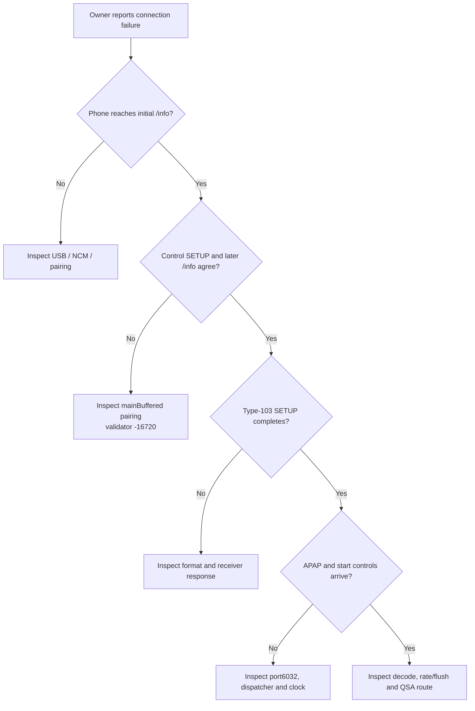

# iOS 26 type-103 connection triage

_2026-10-03. Static comparison and hook contract hardening following a tester's iOS 26.4.2 report. The failure occurs when music starts. The failing-generation transcript and deployed build remain unavailable; the incident's root cause is not established._

## 🧾 Reported incident and interpretation

The tester reports iOS **26.4.2**: the head unit sees the phone, CarPlay works until music is started, then the connection drops. Changing the cable did not resolve it. Android Auto works, without cluster maps; the iPhone case shows the project logo/name but no map. The tester also reports resetting MMI to factory settings; this does not establish which hook/startup files remain installed.

This places the observed trigger at the transition into media playback. Initial feature/info validation and subsequent type-103 SETUP/start are different edges. If initial control negotiation already completed, a missing initial `mainBufferedInfo` is a weaker explanation than a later stream/format/dispatcher/clock failure. The logo alone does not prove a working video stream. The report does not establish complete USB transport health or a specific AirPlay error.

## 📋 Scope and available references

The supplied iOS 26.6 `23G71` IPSW already has an extracted AirPlaySender binary and IDA database in `Refferences/ios266_extract/dylibs/`; unpacking the entire restore again is unnecessary for this check. The iOS 26.1 `23B85` directory provides decompiled pseudo-source, not Apple's source code.

| Input | Use in this audit |
| --- | --- |
| `ios266_extract/dylibs/AirPlaySender.i64` | Opened in an isolated headless IDA session; directly decompiled the info/feature validator |
| `ios27_dsc/24A5418b__iPhone18,1/aps_out/AirPlaySender.i64` | Directly compared the same validator in the available iOS 27 beta |
| `iPhone18-3_26.1_23B85_Restore/.../AirPlaySender/Activate.mm` | Compared feature negotiation and the `mainBufferedInfo` validation call |
| Same directory, `AirPlaySender_14.mm:7821` | Compared both mismatch branches of the validator |
| Current `hook/audio/audio_hook.c` | Hardened final SETUP ownership and paired server-info publication; verified with host tests and a QNX cross-build |

No iOS 26.4.2 binary was supplied. The 26.1/26.6 comparison constrains the protocol hypothesis; it does not substitute for analyzing that exact build or its failing transcript.

The database reports the AirPlaySender input SHA-256 as `952d73f8e97d4697490f69bdf08067df6ccff29f5b44c60489eb117db015d832`. This identifies the inspected extracted input, not a deployed head-unit build.

## 🔍 Verified feature and info contract

In iOS 26.6, `_carEndpoint_validateInfoResponseKeyPresentForFeature` at `0x227804760` tests key presence against the negotiated flag. Both mismatch branches return low signed 32-bit OSStatus **−16720**; conversion of the decompiler's `4294950576` was checked with Python `ctypes.c_int32`. The check tests presence, not the dictionary's contents.

| Negotiated feature | Corresponding `/info` key | Result |
| --- | --- | --- |
| Yes | Present | Pass this validator |
| Yes | Absent | Reject: expected but not found |
| No | Present | Reject: found but not negotiated |
| No | Absent | Pass this validator |

The iOS 26.1 pseudo-source has the same two mismatch branches. `Activate.mm:498` reads `mainBuffered` from the accepted feature array into endpoint byte58; `Activate.mm:954` validates `mainBufferedInfo` against that byte. In 26.6, the corresponding activation validator call at `0x2277fabbc` likewise uses byte58. The large caller's CFString constant is not automatically resolved in the current IDA extraction; the 26.1 textual key identification and the generic 26.6 validator are recorded separately rather than claiming every extracted constant was resolved.

### iOS 27 does not forgive this mismatch

The available iOS 27 `24A5418b` AirPlaySender input SHA-256 is `379fb232ff228287d3b11d1253b1b942e6c50dd633d150cfab6acb9d063bead1`. Its `_carEndpoint_validateInfoResponseKeyPresentForFeature` at `0x25108b10c` has the **same two rejection branches and −16720 status** as 26.6. The activation block calls this validator; its second call at `0x251082b04` uses endpoint byte66 and CFString constant `0x275b05720`, corresponding to the `mainBufferedInfo` string at `0x2511db673`. In the extracted shared-cache data, that constant contains cached string offset `0xd11db673`; the inspected cache mapping base is `0x180000000` and the string length is16. The string at the resulting address was read directly in IDA. This is an observed constant binding, not a general fixup decoder.

[Archived iOS 27 validator](IOS26_TYPE103_CONNECTION_TRIAGE_2026-10-03_ios27_validator.json). A successful session on 27 therefore does not show that it ignores this particular mismatch. Different stream choices, application policy, timing, deployed configuration or another later protocol edge remain hypotheses until paired session evidence exists. This conclusion is scoped to the inspected beta binary, not every future iOS 27 release.

## 🔧 Hook changes and their scope

The old hook recorded the negotiated owner inside the first response-mutation callback, before other modules finished merging `enabledFeatures`. It also allocated the paired key/dictionary later during `/info`, after already returning successful SETUP. The hardening changes these concrete failure opportunities:

| Change | Result |
| --- | --- |
| Commit ownership from final successful control-SETUP response | A subsequently removed token no longer leaves a buffered contract active |
| Prepare and retain `mainBufferedInfo` key/dictionary before committing successful SETUP | Explicit paired-object allocation failure returns an error before accepting the feature |
| Use an explicitly constructed token for final membership checks | Failure to create a lookup token is an error, rather than being confused with feature absence |
| Insert paired info in the final server-info callback | Normal server-info mutators run before this insertion |
| Retain cached objects under the session lock | A concurrent owner change/teardown cannot free the objects during insertion |
| Reject stale control responses and release cached references on matching full TEARDOWN | An old session cannot replace a newer contract; foreign teardown leaves the current owner intact |
| Preserve the owner across media SETUP without a feature proposal | Starting type103 does not retire a valid control contract |

No CFLite ABI or model/renderer change is introduced. `/info` dictionary insertion still uses stock CFLite; its internal allocation can fail, and insertion readback now logs that failure rather than claiming a key was added. Object preparation does not guarantee immunity to every process-wide out-of-memory condition.

These are verified contract improvements, **not proof that this tester hit either old failure opportunity**. With normal current responses and successful allocations, the earlier hook already formed a matching feature/info pair. A disconnect triggered by music still requires the first failing media edge to be captured.

### Verification

`SANITIZE=address,undefined sh scripts/test_audio_interposers.sh` passes the production C seams with injected native/CF boundaries: accepted and removed final tokens, failed/missing SETUP responses, paired key/dictionary and token-lookup allocation failures, unoffered acceptance, foreign/stale sessions, preserved media owner, teardown and cached-reference balance. Existing QSA rollback/partial-write and concurrent SETUP/teardown/generation tests also pass. These are host control-flow checks, not iOS 26.4.2 or QNX driver execution.

The QNX/ARMv7 build and its shipping ABI/export/constructor gates are checked separately from a clean detached base plus only the changed audio-hook source. Its final source/artifact hashes and build output are retained in [verification evidence](IOS26_TYPE103_CONNECTION_TRIAGE_2026-10-03_checks.json). Local artifacts and logs are archived under `build/ios26-mainbuffered-contract-20261003/` (ignored by Git). The binary is an unprotected test artifact, not a tester-specific VIN package or a verified in-car fix.

## 🧭 Locate the first failed edge

| First failing edge | Evidence needed |
| --- | --- |
| Before control SETUP | `/info` reachability, USB/NCM and session-generation logs |
| After enabling buffered, before media SETUP | Final `enabledFeatures`, subsequent full `/info`, phone validation error |
| During media SETUP | Type-103 request/response, format index, buffer size, returned port and stream ID |
| After SETUP, before playback | TCP6032 accept/APAP counters, GETANCHOR/SETRATE/SETRATEANCHORTIME and cookie outcomes |
| Decoding/writing but silent | Media-route declaration, retained/cold-open QSA handle, playback ownership and rate/flush sequence |

Existing protocol and incident history: [Buffered Audio Path](BUFFERED_AUDIO_PATH.md), [Buffered Playback Lifecycle](BUFFERED_PLAYBACK_LIFECYCLE.md), [PF Firewall](../connect-and-usb/PF_FIREWALL.md), [iOS Version Gate](../connect-and-usb/IOS_VERSION_GATE.md). Earlier display-advertisement and USB hypotheses do not establish the cause of this report. The installed PF contract admits TCP6030:6032; verify the failing unit's actual rules before attributing a missing accept to the sender.

## 🎯 Required next evidence

The owner confirms that no incident log is available. The prepared build can test the hardened contract on the next reproduction, but its effect on this incident is unknown. Record the deployed build/configuration identity and one 26.4.2 connection through starting music and disconnect. The useful minimum is `carplay_hook.log`; `sloginfo` and captured control/media plists improve attribution. Compare the ordered feature, info, stream-setup and first-playback edges, then address the first demonstrated mismatch. Redact session keys and other credentials. No reboot, j9 restart, on-unit environment switch, deployment or audio-model training was performed.
