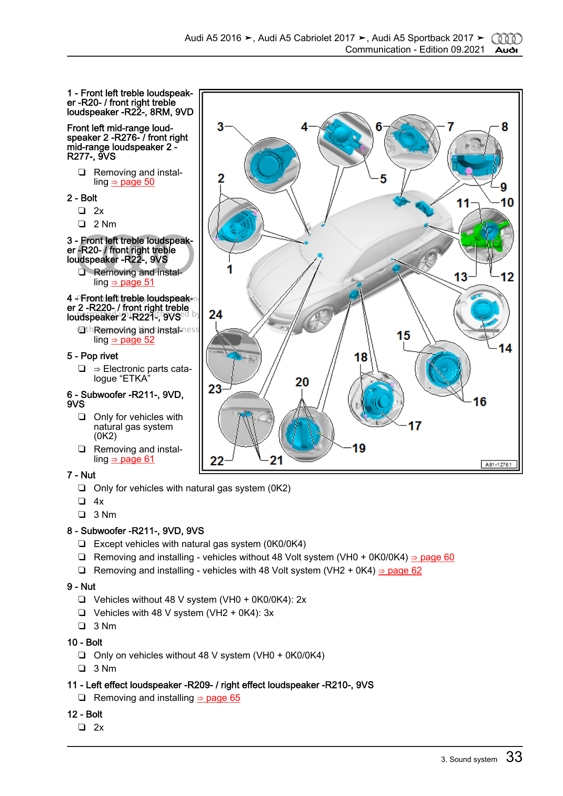
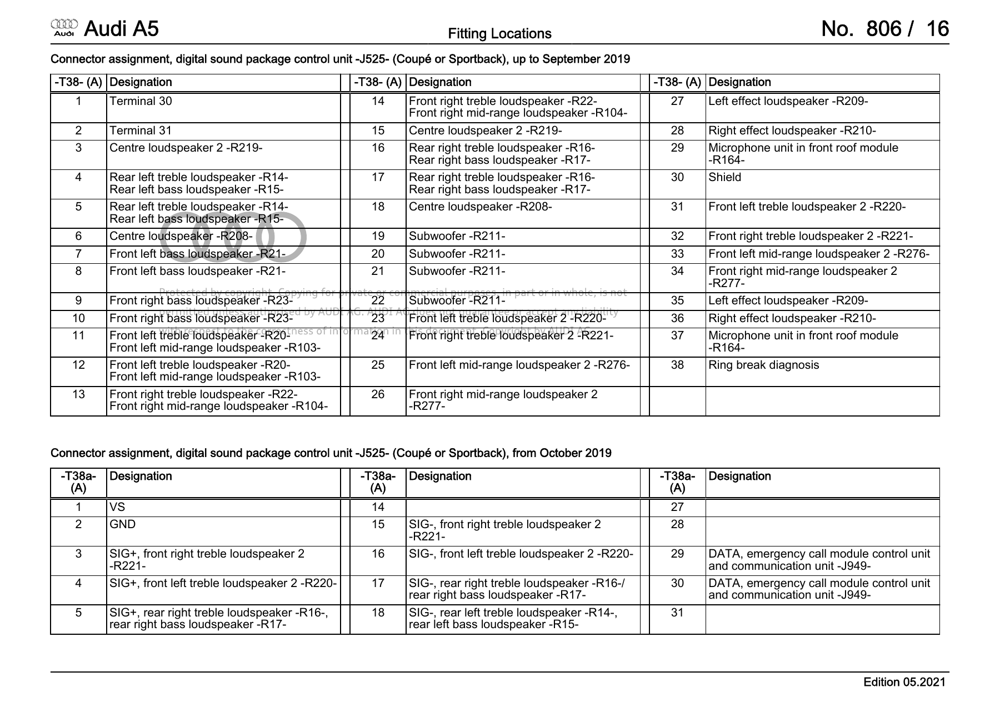

# J525 Wiring and Speakers

*The physical end of the Virtual Cabin: the 19 B&O 9VS loudspeakers of the A5/S5 Sportback MY2018, the 16 amplified circuits on the J525 T38 connector, which DSP output probably drives which circuit, and what external measurements can and cannot tell us.*

---

## 📋 Target and evidence levels

Target vehicle: Audi S5 Sportback, MY2018 (built 09.04.2018), sales type F5A54A, PR codes **9VS** (B&O 3D Advanced), K8R, GP0, 0K0, VH0; amplifier J525 `8W0035465` SW `0420` HW `H11`; Symphoria/3D off. The factory fit was checked against ETKA (A5CO USA 2018, illustration 035036) and Audi documents; parts actually installed after possible repairs were not inspected.

| Layer | Status |
|---|---|
| 19 drivers on 16 T38 circuits | proven from Audi Current Flow Diagram No. 45 (from 07.2016) + J525 connector page (Coupé/Sportback up to 09.2019) `[decompile]`-grade document evidence |
| DSP output slot → T38 circuit | **candidate** only: numeric routing + passbands + driver inventory |
| Per-circuit filters, gains, delays, polarity | EQ record counts and some crossover records recovered; polarity and passive networks unknown |
| Speaker and cabin acoustics | unknown — no measurement |

For the DSP side see [SHARC DSP Blocks](SHARC_DSP_BLOCKS.md); for the overall story [Virtual Cabin and Amp RE](VIRTUAL_CABIN_AND_AMP_RE.md).

Sources: `SOUNDAMP_9VS_VIRTUAL_CABIN_EVIDENCE`, `SOUNDAMP_9VS_SPEAKER_PARTS_RESEARCH`

## 📍 The 19 loudspeakers and 16 circuits

*Fitting locations of the Sportback sound-system speakers (Audi repair manual, Communication, edition 09.2021, page 33).*

| Circuit | T38 pins | Loudspeaker(s) | Part number |
|---:|---|---|---|
| 1 | 3, 15 | R219 centre tweeter ("centre loudspeaker 2") | 8W0 035 397 |
| 2 | 4, 5 | R14 rear-left treble + R15 rear-left bass | 8W5 035 399 A / 8W5 035 411 A |
| 3 | 6, 18 | R208 centre mid | 8W0 035 454 A |
| 4 | 7, 8 | R21 front-left bass (door woofer) | 8W5 035 297 |
| 5 | 9, 10 | R23 front-right bass | 8W5 035 297 |
| 6 | 11, 12 | R20 front-left treble (lower A-pillar) + R103 front-left mid (door) | 8W0 035 399 A / 8W0 035 303 |
| 7 | 13, 14 | R22 front-right treble + R104 front-right mid | 8W0 035 399 A / 8W0 035 303 |
| 8 | 16, 17 | R16 rear-right treble + R17 rear-right bass | 8W5 035 399 A / 8W5 035 411 A |
| 9 | 19, 20 | R211 subwoofer, winding A | 8W9 035 382 C |
| 10 | 21, 22 | R211 subwoofer, winding B | (same driver) |
| 11 | 23, 31 | R220 front-left treble 2 (upper A-pillar) | 8W6 035 399 D |
| 12 | 24, 32 | R221 front-right treble 2 | 8W6 035 400 D |
| 13 | 25, 33 | R276 front-left mid 2 (dash side) | 8W0 035 416 D |
| 14 | 26, 34 | R277 front-right mid 2 | 8W0 035 416 D |
| 15 | 27, 35 | R209 left effect (C-pillar trim, Sportback) | 8W8 035 454 |
| 16 | 28, 36 | R210 right effect | 8W8 035 454 |

The circuit table comes from Current Flow Diagram No. 45 sheets [45/1](../sources/papers/j525_wiring-0540.png), [45/2](../sources/papers/j525_wiring-0541.png), [45/3](../sources/papers/j525_wiring-0542.png), [45/4](../sources/papers/j525_wiring-0543.png), [45/5](../sources/papers/j525_wiring-0544.png), [45/6](../sources/papers/j525_wiring-0545.png), [45/7](../sources/papers/j525_wiring-0546.png), [45/8](../sources/papers/j525_wiring-0547.png), [45/9](../sources/papers/j525_wiring-0548.png) ([text extraction](../sources/papers/j525_wiring_541_548.txt)) and the connector pages [1694](../sources/papers/j525_connector-1694.png)/[1695](../sources/papers/j525_connector-1695.png). Other T38 pins: 1 = terminal 30 (battery +), 2 = terminal 31 (ground), **29 and 37 = microphone unit in the front roof module R164**, 30 = shield, 38 = ring-break diagnosis. The J525 sits on the MOST fibre ring with J794 (MIB2 information electronics) and J285 (instrument cluster). The pin diagrams give no `+`/`−` labels usable as acoustic polarity. Four circuits carry two named drivers and the subwoofer takes two circuits, which accounts for all 19 drivers.

*J525 T38 connector assignment. The top table (up to 09.2019) is this car; the `T38a` table (from 10.2019) is a different, later pinout with SIG+/SIG− naming and J949/J794 data lines.*

**The rear is six drivers on four outputs.** Each rear door's treble + bass share one circuit (T38/4,5 left, 16,17 right) and the effect speakers R209/R210 have their own. The two door drivers can never be addressed independently, and two logical inputs Ls/Rs cannot give four independent commands. Driver count must not become a loudness factor.

**Parts caveats.** ETKA shows front woofer `8W5 035 297 A` after 09.12.2019; it is also the updated service part of TSB 2052251/4 (25.06.2020, B&O S5 Sportback 2018–2019: an amp parameter allowed speaker overload; the fix is a J525 check/update and, if damaged, replacing the sub or both front woofers — never mixing `…297` and `…297 A` left/right). Not a diagnosis of this car; SW `0420` alone does not prove applicability. Subwoofer `8W9 035 382 C` is the 9VS row after 09.01.2017; the 0K2 (natural gas) and 0K4/VH2 variants do not apply. The emergency-call speaker (PR IW1/IW3) is not one of the 19.

Sources: `SOUNDAMP_9VS_VIRTUAL_CABIN_EVIDENCE`, `SOUNDAMP_9VS_SPEAKER_PARTS_RESEARCH`, [j525_wiring_541_548.txt](../sources/papers/j525_wiring_541_548.txt)

## 📊 DSP output slots and candidate circuits

The final routing tables are known exactly; the jump from DSP slot to physical pin is not.

 Two A07 tables feed the selectors: mode table `A07[0x102DAD + mode·16] → 0xA91C6 → SHARC 0xC20D0` (both stored modes are `[8,0,8,0,9,1,9,1,4,5,6,7,2,2,3,3]`) and normal routing `A07[0x102DCD] → 0xA9328 → 0xC2114` = `[1,5,4,0,2,6,11,10,8,9,13,12,3,7,14,15]` in V850 config order. V850-to-DSP permutation at `0x68B40` = `[11,10,9,8,4,5,6,7,15,14,13,12,0,1,3,2]`, inverse at `0x68B30`; it is shared by routing (`0xA9328`), delays (`0xA9C94`), gains (`0xAC464`), dynamics (`0xACAA0`, `0xA8548`) and monitoring (`0xA8238`). `0xA9328` also implements channel-test overrides (diagnostic inputs 16/17, mute `0xFFFFFFFF`).

| V850 config | DSP slot | Bus10 source | Candidate speaker(s) | Candidate T38 | Output EQ count |
|---:|---:|---:|---|---|---:|
| 0 | 11 | 0 | R20 + R103 front-left mid/treble | 11,12 | 12 |
| 1 | 10 | 1 | R22 + R104 front-right mid/treble | 13,14 | 12 |
| 2 | 9 | 9 | R221 upper A-pillar right | 24,32 | 5 |
| 3 | 8 | 8 | R220 upper A-pillar left | 23,31 | 5 |
| 4 | 4 | 8 | R276 dash left | 25,33 | 4 |
| 5 | 5 | 9 | R277 dash right | 26,34 | 4 |
| 6 | 6 | 7 | R210 right effect | 28,36 | 10 |
| 7 | 7 | 6 | R209 left effect | 27,35 | 10 |
| 8 | 15 | 4 | R14 + R15 rear-left door | 4,5 | 12 |
| 9 | 14 | 5 | R16 + R17 rear-right door | 16,17 | 12 |
| 10 | 13 | 2 | R208 centre mid | 6,18 | 17 |
| 11 | 12 | 2 | R219 centre tweeter | 3,15 | 6 |
| 12 | 0 | 0 | R21 front-left bass | 7,8 | 17 |
| 13 | 1 | 1 | R23 front-right bass | 9,10 | 17 |
| 14 | 3 | 3 | R211 one winding | 19,20 or 21,22 | 0 |
| 15 | 2 | 3 | R211 other winding | 21,22 or 19,20 | 0 |

Bus10 is the ten-channel stage after the first mixer, not raw MOST input. Bus10 8/9 feed the elevated front branches and 6/7 the effect branches; neither pair is MOST inputs 7/8. The sub windings cannot be ordered. The output-EQ design records (`0x102448`, 143 used of 144) put an HP-family record at **100 Hz** on the rear doors, a **6000 Hz** mid/tweeter split on the centre pair, **HP 62 Hz / LP 240 Hz** on the front woofers; the rear input buses carry 113/138/174 Hz records at −8 dB each plus mid/treble correction, and the LFE input bus has **LP 66 Hz and HP 33 Hz** — zero output-EQ count does not mean an unfiltered sub. These are digital design parameters, not acoustic crossovers. B01 (3562 words, `0x12000C → 0xC3C6A`) is not a flat 23-biquad catalogue as an early scan suggested.

**Known electrical A-path (profile 0, row 1, B = 0, C4D17 identity), dB re the MOST input:**

| Output candidate ← input | 31 Hz | 63 | 125 | 250 | 500 | 1k |
|---|---:|---:|---:|---:|---:|---:|
| Front woofer ← L | −18.9 | +0.9 | −0.7 | −15.6 | −32.0 | −49.2 |
| Front mid/treble ← L | −35.2 | −26.3 | −22.1 | −2.0 | −2.6 | −1.5 |
| Centre mid ← L only | −69.5 | −45.9 | −33.6 | −8.8 | −8.2 | −16.2 |
| Rear door ← Ls | −20.9 | −4.4 | −6.3 | 0.0 | +4.5 | −2.4 |
| Sub winding ← LFE | +3.8 | +4.9 | −25.3 | −40.2 | −59.8 | −67.1 |

Known A-path delays (samples, excluding upmixer and filter group delay): front mid/treble 1786/1789, rear doors 2035, centre mid 1757, centre tweeter 1774, front woofers 1719, sub windings 1836.

Sources: `SHARC_OUTPUT_BINDING_AUDIT`, `SOUNDAMP_FULL_DSP_MODEL`, `SHARC_VISA_3D_OFF_AUDIT`

## 🔍 Channel-number hypotheses

The V850 service tables group the 16 output IDs as `[1,2,4,3] [5,6,8,7] [9,10,12,11] [13,14] [16,15]`. An official Audi MIB3 self-study (later J525 convention: 3/4 centres, 9/10 effects, 11/12 front bass, 13/14 rear, 15 sub) combined with this topology gives an **unproven** MIB2 map: 1/2 front shared mid+treble, 3/4 R219/R208, 5/6 R220/R221, 7/8 R276/R277, 9/10 R209/R210, 11/12 R21/R23, 13/14 rear door pairs, 15/16 sub. Confidence is strongest for 3/4 and 9–15. The service-table numbering must not be combined with the DSP permutation above as if both were proven.

The documentary "circuits" renderer mode used an explicit zone inference — Bus L/R → the four front circuits of each side, Bus C → two centre circuits, Bus LFE → the two sub circuits, Bus Ls/Rs → rear door pair + effect speaker — each bus divided by √(destinations) for equal test energy. That was a topology test, not OEM gains, and its line "Bus 7/8 unused in the 5.1 bank" came from the transposed matrix reading: in the corrected orientation bus 7/8 carry L/R at −3 dB and Ls/Rs at +9 dB. `[model]`

Sources: `SOUNDAMP_9VS_VIRTUAL_CABIN_EVIDENCE`, `SHARC_MATRIX_CONTROL_2026-09-20`

## 💬 External speaker measurements

Bobby Kinstle's B9 S4 workbook ([B9 S4 B&O speaker data.xlsx](../sources/B9%20S4%20B%26O%20speaker%20data.xlsx), SHA-256 `e118a86e…3b586`) is amateur microphone-sweep data on a *different car* (S4, partly modified — its `My Car` tab is aftermarket). Useful as a cross-check, **never as filter coefficients**; don't fit rectangular passbands from it.

| Group | Author's observation |
|---|---|
| Front door woofer | 8 Ω, ≈58–260 Hz (amp channel said to reach 44 Hz) |
| Front door mid | 4 Ω, ≈150–4500 Hz |
| Rear doors | mid/tweeter in parallel (4 Ω each), ≈160–5000 Hz, low end limited by the amp, tweeter capacitor |
| Subwoofer | two 8 Ω coils, ≈30–90 Hz |
| Upper A-pillar / dash side | "3D effect" drivers, ≈2–7 kHz / 150–2000 Hz |
| Centre | separate mid + tweeter, measured together |
| Rear shelf surrounds | ≈120–5000 Hz |

Consequence for the upmix: the rear "bass loudspeaker" is a mid-bass door driver carrying real vocal-range content, not a sub.

The workbook's embedded `Amp Wiring Chart` (image `xl/media/image1.png`) agrees with Audi on most pairs but **disagrees on three**: it labels 3/15 "right front door Mid-Tw", 13/14 "right pillar tweeter" and 24/32 "center tweeter", where the Audi page has 3/15 = R219 centre tweeter, 13/14 = R22 + R104 front-right, 24/32 = R221. Use the Audi page. Other workbook conflicts kept as-is: `System overview!D10` is `=#REF!`; lower A-pillar tweeter range is 8–12.5 kHz in `A1` but 2–12 kHz in `E5`.

Sources: `B9_SPEAKER_WORKBOOK_EVIDENCE_2026-09-20`, `SOUNDAMP_9VS_SPEAKER_PARTS_RESEARCH`

## ⚠️ Amp data on hand and what it does not give

- EEPROM dump `S-25C640A@TMSOP8.BIN` (8192 B) carries `4TU-00120.07.163JA20162` at `0x0004` and `8W2909510A` at `0x0124` — identifiers in a saved dump, not a live read.
- CodeFlash holds A07 (`0x100000`), B01 (`0x120000`) and the SHARC stream; `Config_24082026_172036.bin` is only 5 bytes and is not an acoustic dataset.
- The old `SoundAmp/AMP_AUDIO_DSP_TUNING.md` has useful addresses but wrong claims (PR 9VD instead of 9VS, pop-up tweeters, a contradictory reading of table `0x97028`); don't transfer its acoustic assignments without checking the consuming code.
- Unknowable without measurement: speaker impedance curves, passive crossover transfer functions, directivity, seat impulse responses, exact runtime effect of the Surround and Sound Focus controls. `[open]`

**Upmix priorities that came out of this (proposals, not done):** measure rear-vocal leakage per driver and seat rather than as Ls/Rs energy (the +3 dB / 4 kHz rear shelf acts on logical rear, not on door tweeters); separate "move an object out of the front" from "make rear ambience"; extend the checking renderer with per-driver branches bounded by scenario ranges; only then add a cabin-aware training criterion.

Sources: `SOUNDAMP_9VS_SPEAKER_PARTS_RESEARCH`

## 📚 Sources

Merged originals were removed from the tree after this note absorbed them; they remain in git history (commit 23972aa).

| File | What it holds |
|---|---|
| `SOUNDAMP_9VS_VIRTUAL_CABIN_EVIDENCE` | T38 circuits, channel hypotheses, zone inference |
| `SOUNDAMP_9VS_SPEAKER_PARTS_RESEARCH` | part numbers, TSB, EEPROM ids, upmix priorities (Russian) |
| `B9_SPEAKER_WORKBOOK_EVIDENCE_2026-09-20` | read-only extraction of the workbook |
| [B9 S4 B&O speaker data.xlsx](../sources/B9%20S4%20B%26O%20speaker%20data.xlsx) | Kinstle's B9 S4 speaker workbook (84 MB) |
| `SHARC_OUTPUT_BINDING_AUDIT` | DSP slot → circuit candidates, EQ records |
| [sportback-speaker-layout.png](../sources/papers/sportback-speaker-layout.png) | repair-manual speaker fitting locations |
| [j525-connector.png](../sources/papers/j525-connector.png) | T38 / T38a connector assignment, page 806/16 |
| [j525_connector-1694.png](../sources/papers/j525_connector-1694.png), [j525_connector-1695.png](../sources/papers/j525_connector-1695.png) | wiring-PDF pages 1694/1695: T38 table and the later T38a continuation |
| [0540](../sources/papers/j525_wiring-0540.png), [0541](../sources/papers/j525_wiring-0541.png), [0542](../sources/papers/j525_wiring-0542.png), [0543](../sources/papers/j525_wiring-0543.png), [0544](../sources/papers/j525_wiring-0544.png), [0545](../sources/papers/j525_wiring-0545.png), [0546](../sources/papers/j525_wiring-0546.png), [0547](../sources/papers/j525_wiring-0547.png), [0548](../sources/papers/j525_wiring-0548.png) | Current Flow Diagram No. 45/1–45/9 (0540 = sheet 1): power and left effect, sub, front trebles, roof mic and centre/dash mids, rear-left door, cluster/MIB/right effect, rear-right door, front bass and mids |
| [j525_wiring_541_548.txt](../sources/papers/j525_wiring_541_548.txt) | text extraction of sheets 45/2–45/9 |
