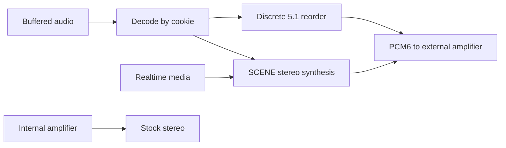

# Audio

CarPlay audio supports stereo playback, SCENE UpMix and discrete 5.1. All external amplifier families on supported MHI2Q systems use the six-channel path; **B&O and Bose are confirmed**. Internal amplifiers retain stock stereo through the installer gate.

## 🔊 Processing

Buffered type-103 audio is decoded according to its inline cookie. Stereo enters SCENE; APAC 5.1 uses the discrete channel reorder. Realtime type-100 media has a separate SCENE instance. Calls and announcements use their dedicated routes.

MMI provides **UpMix: Off / Normal / Intense** and a separate **Spatial Audio** switch. Engine calibration is compiled into the hook. SoundCheck applies buffered programme gain and is confirmed working in vehicle use.

## 📚 Runtime guides

| Guide | Content |
| --- | --- |
| [Stereo to 5.1 Upmix](STEREO_TO_5_1_UPMIX.md) | Processing, live settings, fixed calibration and SoundCheck |
| [Discrete 5.1 Routing](DISCRETE_5_1_ROUTING.md) | Channel order, deva geometry, SAD and external routing |
| [Buffered Audio Path](BUFFERED_AUDIO_PATH.md) | Negotiation, control methods, APAP framing and codec switching |
| [Buffered Playback Lifecycle](BUFFERED_PLAYBACK_LIFECYCLE.md) | Queue, pause/resume, QSA ownership and feedback |
| [Call and Siri Routing](CALL_AND_SIRI_ROUTING.md) | Voice formats, gain and media/telephony priority |
| [Scene Backend Deploy](../build-and-deploy/SCENE_BACKEND_DEPLOY.md) | Build, package and verify the audio payload |

## 🔧 Codecs, amplifiers and hardware

| Reference | Content |
| --- | --- |
| [Amplifier compatibility and ODIS mapping](ODIS_AMP_MAPPING.md) | B&O, Bose, B&O Advanced and internal DSP routing |
| [Internal Amp Path](INTERNAL_AMP_PATH.md) | RCC coding, the stereo gate and internal DSP constraints |
| [QNX Audio Topology](QNX_AUDIO_TOPOLOGY.md) | QSA, deva, CSD, LPASS, SAD and MOST |
| [Virtual Cabin and Amp RE](VIRTUAL_CABIN_AND_AMP_RE.md) | B&O J525 matrices and DSP topology |
| [J525 Wiring and Speakers](J525_WIRING_AND_SPEAKERS.md) | Speaker circuits and DSP slot mapping |
| [SHARC DSP Blocks](SHARC_DSP_BLOCKS.md) · [SHARC B Processors](SHARC_B_PROCESSORS.md) | Amplifier kernels, controls and calibration banks |
| [APAC Codec](APAC_CODEC.md) · [Cinemo AAC Decoder](CINEMO_AAC_DECODER.md) | Decoder ABI, cookies, layouts and validation |
| [Dolby Atmos](DOLBY_ATMOS.md) | Content formats and the CarPlay transport boundary |

## 🧪 Development references

The [scene algorithm](UPMIX_SCENE_ALGORITHM_2026-10-08.md) retains the mathematical derivation and implementation experiments. [Compute budget](UPMIX_COMPUTE_BUDGET.md), [datasets and teachers](UPMIX_DATASETS_AND_TEACHERS.md), and [literature](UPMIX_LITERATURE.md) provide research context. Use the runtime guide above for current parameters.

[Audio history](archive/README.md) contains retired models, old tuning and listening journals. [Documentation home](../README.md).
