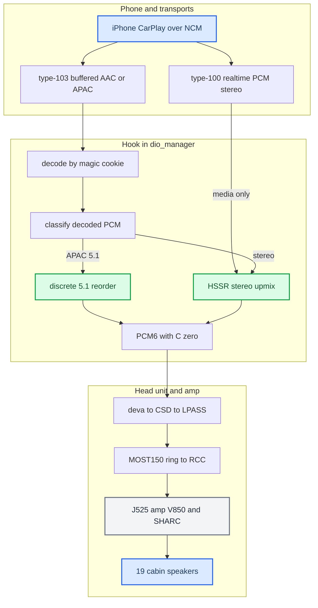

# Audio

*Map of content for the whole stereo→5.1 CarPlay audio pipeline — phone to the 19 speakers of the Audi B&O "Virtual Cabin".*

---

## 📋 What this section covers

Two problems had to be solved to play surround over CarPlay: get the **right six PCM channels** to the amp, and **synthesize six channels** for the stereo content that is 99% of what people play. The J525 B&O amplifier is already a complete 5.1 renderer, so the head unit only feeds it `L R C LFE Ls Rs` and lets it do the acoustics — that division of labour is the [Virtual Cabin](VIRTUAL_CABIN_AND_AMP_RE.md).

This page is the entry point for the domain. Start with [Stereo to 5.1 Upmix](STEREO_TO_5_1_UPMIX.md) for the end-to-end flow, then branch into the model, the amp, Dolby, or the discrete path. For the hub note and the trap list see [Home](../README.md) and [Landmines](../LANDMINES.md).

## 📊 The whole pipeline

Both CarPlay audio streams reach the HSSR upmix: the buffered type-103 stream for decoded stereo, and the stock realtime type-100 stream for media apps such as Spotify (`AUDIO_REALTIME_UPMIX=on`, `deploy/smartphone_integrator/carplay_startup.sh:86`).

## 🔗 The notes

| Note | What it covers |
|---|---|
| [Stereo to 5.1 Upmix](STEREO_TO_5_1_UPMIX.md) | End-to-end pipeline: ingest, where upmix vs discrete kicks in, the shipped calibration, what ships. |
| [HSSR Model](HSSR_MODEL.md) | The AI: why separation failed, the second-scene design, the runtime, every model iteration V9→q6d, calibration. |
| [Virtual Cabin and Amp RE](VIRTUAL_CABIN_AND_AMP_RE.md) | The J525 amp reverse-engineered: two-SoC topology, the single-byte routing decision, the SHARC DSP chain. |
| [Dolby Atmos](DOLBY_ATMOS.md) | What Atmos is on CarPlay, why phone-side spatial is blocked, what HSSR borrowed and where it diverges. |
| [Discrete 5.1 Routing](DISCRETE_5_1_ROUTING.md) | The native 5.1 path: deva mirror driver, CSD min_voices fix, SAD `asad=0xfc`, magic-cookie codec authority. |

### Upmix model and research

| Note | What it covers |
|---|---|
| [Upmix Training History](UPMIX_TRAINING_HISTORY.md) | Iteration ledger V9→q6d (V16, G, H1, P1, R1/C1/C2, Q1–Q5): what each measured and why it stopped. |
| [Upmix Datasets and Teachers](UPMIX_DATASETS_AND_TEACHERS.md) | MoisesDB, MUSDB18, FLOAT, AlbumDB, teacher networks, their defects and licences, the role-label contract. |
| [Upmix Compute Budget](UPMIX_COMPUTE_BUDGET.md) | Krait cost units and measurements, the arithmetic that admitted HSSR and blocked CUpGAN/H1/Q2, training machines. |
| [Upmix Literature](UPMIX_LITERATURE.md) | The papers and systems the work drew on, what each changed, and which paper files are failed downloads. |

### Upmix runtime and release

| Note | What it covers |
|---|---|
| [Upmix Calibration and Tuning](UPMIX_CALIBRATION_AND_TUNING.md) | How every shipped value was reached: bass complaint, corrected matrix, 60 s one-lever grid, scene bed, treble taper. |
| [Upmix Separator Handoff](UPMIX_SEPARATOR_HANDOFF.md) | Current separator-track decision record: rules, PC/tooling, complete iteration ledger, stopped queue and offline architecture next steps. |
| [Upmix Architecture Gate 2026-09-28](UPMIX_ARCHITECTURE_GATE_2026-09-28.md) | Ideal-mask audio full-40 renderer bound, failed string-share gate, and front/rear energy decomposition of the original oracle swings. |
| [Upmix Direct-Object Renderer Probe 2026-09-28](UPMIX_DIRECT_OBJECT_RENDERER_PROBE_2026-09-28.md) | Host-only object/bed architecture iterations, the true-audio full-40 result, representation checks and remaining deployment gates. |
| [Upmix Causal Shared-Mask Source-Loss Pair 2026-09-28](UPMIX_CAUSAL_SOURCE_PAIR_2026-09-28.md) | Matched 4k causal estimator screen, source-attributed leakage, vocal entries and real-C renderer decision. |
| [Upmix Causal Four-Role Probe 2026-09-28](UPMIX_CAUSAL_ROLE_PROBE_2026-09-28.md) | Budget-sized competing-source separator probe, gain-invariant source selectivity and matched-level C screen. |
| [Upmix Causal Role-Focus Probe 2026-09-28](UPMIX_CAUSAL_ROLE_FOCUS_2026-09-28.md) | One-change rare-source supervision screen, train/pseudo/DEV confidence audit and hard-threshold ranking bound. |
| [Upmix Causal Confidence Map 2026-09-28](UPMIX_CAUSAL_CONFIDENCE_MAP_2026-09-28.md) | Frozen smooth causal role-score mappings: source attribution, vocal-entry failures and promotion decision. |
| [Upmix Dual-Head Causal Probe 2026-09-28](UPMIX_DUAL_HEAD_CAUSAL_PROBE_2026-09-28.md) | Matched causal complex-audio control and auxiliary four-role-head architecture screen. |
| [Upmix Causal Deep-Filter Probe 2026-09-28](UPMIX_CAUSAL_DEEP_FILTER_PROBE_2026-09-28.md) | Frozen two-tap causal complex-filter architecture screen against the matched complex control. |
| [Upmix Continuous-Context Audit 2026-09-28](UPMIX_CONTINUOUS_CONTEXT_AUDIT_2026-09-28.md) | Paired 60-second uninterrupted versus 8-second-reset inference audit of the causal complex models. |
| [Upmix Spatial-Cue Upper Bound 2026-09-28](UPMIX_SPATIAL_CUE_UPPER_BOUND_2026-09-28.md) | Privileged first-half-fit/second-half-evaluate test of diagonal versus cross-channel stereo separation. |
| [Upmix Causal Matrix Probe 2026-09-28](UPMIX_CAUSAL_MATRIX_PROBE_2026-09-28.md) | Budget-sized causal 2×2 stereo matrix student, matched to the saved diagonal complex control. |
| [Upmix Matrix Cross Ablation 2026-09-28](UPMIX_MATRIX_CROSS_ABLATION_2026-09-28.md) | Frozen matrix-student cross-term energy and source/transition ablation after failed promotion. |
| [Upmix Matrix Source-Loss Probe 2026-09-28](UPMIX_MATRIX_SOURCE_LOSS_PROBE_2026-09-28.md) | Full-operator source-retention/protection training test with parameter-gradient-calibrated loss weight. |
| [Upmix Matrix Cell-Attribution Audit 2026-09-28](UPMIX_MATRIX_CELL_ATTRIBUTION_2026-09-28.md) | Frozen matrix comparison locates added vocal leakage chiefly in pure-vocal cells. |
| [Upmix Protected-Cell Veto Upper Bound 2026-09-28](UPMIX_PROTECTED_VETO_UPPER_BOUND_2026-09-28.md) | True-stem gate fixes protected ratios but loses eligible recall and vocal-entry continuity. |
| [Upmix Vocal-Invariance Matrix Probe 2026-09-28](UPMIX_VOCAL_INVARIANCE_PROBE_2026-09-28.md) | Controlled paired-mixture training test for eligible stability as vocal level changes. |
| [Upmix Anchored Vocal-Entry Matrix Probe 2026-09-28](UPMIX_VOCAL_ENTRY_TARGET_PROBE_2026-09-28.md) | Paired vocal-onset reconstruction target to prevent the silent consistency solution. |
| [Upmix Spatial-Memory Horizon 2026-09-28](UPMIX_SPATIAL_MEMORY_HORIZON_2026-09-28.md) | Privileged fixed-window and recency-weighted spatial fits; short decay passes after evidence accumulates. |
| [Upmix Dual-State Spatial Probe 2026-09-28](UPMIX_DUAL_STATE_PROBE_2026-09-28.md) | Matched causal slow-state versus reset student; learned memory changes output but fails protected-source and entry-tail gates. |
| [Upmix Frozen Dual-State Role-Cue Audit 2026-09-28](UPMIX_ROLE_CUE_AUDIT_2026-09-28.md) | Pure-cell ranking, weak mixed-cell ownership and small direct decoder response in the frozen dual-state student. |
| [Upmix Fine-Cell Role and Direct Matrix Route Probe 2026-09-28](UPMIX_FINE_ROLE_PROBE_2026-09-28.md) | Matched current-bin role models: stronger route, but failed overlap, protected-source and vocal-entry gates. |
| [Upmix Vocal-Overlap Bounded-Mask Upper Bound 2026-09-29](UPMIX_OVERLAP_ORACLE_BOUND_2026-09-29.md) | True-stem bounded IRM passes vocal, drums and entry targets but misses the bass source ratio. |
| [Upmix Spatial Operator Source and Vocal-Entry Bound 2026-09-29](UPMIX_SPATIAL_OVERLAP_BOUND_2026-09-29.md) | True-stem 2×2 stereo fit passes median source and entry gates, with severe per-song outliers. |
| [Upmix Frozen Student Cue for the Spatial Operator 2026-09-29](UPMIX_STUDENT_SPATIAL_CUE_2026-09-29.md) | Causal fine-role cue improves the spatial fit's bass ratio but fails vocal and drum source gates. |
| [Upmix Protected Contribution to the Spatial Cue 2026-09-29](UPMIX_CUE_ATTRIBUTION_BOUND_2026-09-29.md) | True-stem attribution shows protected subtraction fixes source ratios at the cost of eligible transmission. |
| [Upmix Causal Slow-Operator Anchor Probe 2026-09-29](UPMIX_OPERATOR_ANCHOR_PROBE_2026-09-29.md) | Frozen calibrated 4k control/anchor pair for a causal fast and slow stereo operator. |
| [Upmix Cross-Song True-Stem Augmentation Probe 2026-09-29](UPMIX_CROSSSONG_AUGMENT_PROBE_2026-09-29.md) | Controlled TRAIN-only MoisesDB source remix against the prior fine-role baseline. |
| [CarPlay Upmix Listening Protocol](UPMIX_CARPLAY_LISTENING_PROTOCOL.md) | Live CarPlay front-only vs Track A score sheet, level matching, and the boundary between in-car evidence and headphone previews. |
| [Persistent Rear Membership Screen](UPMIX_PERSISTENT_MEMBERSHIP_SCREEN_2026-09-28.md) | First offline global-membership test through the C renderer; paired result and the reason it was not promoted. |
| [Upmix Separator Night Report 2026-09-28](UPMIX_SEPARATOR_NIGHT_REPORT_2026-09-28.md) | The separator track's night of 27→28.09: five controlled runs on one frontier (width, supervision, structure, loss ruled out), the gap decomposed by source attribution, the transition-driven "back and forth" measured, the rapid test loop, the queue and the open decisions. |
| [Upmix Mask Net Phase 1 Report 2026-09-27](UPMIX_MASK_PHASE1_REPORT_2026-09-27.md) | The per-cell mask net in the car: runtime 3.92 → 1.46 M instructions per control, the reset handoff bug, the health line, the drive curve against the 22.09 reference, what is deployed and why the rear still feels thin. |
| [Upmix Stability 2026-09-25](UPMIX_STABILITY_2026-09-25.md) | "The sound goes back and front": the measurement tools (synthetic scenes, MoisesDB stems, any song folder), the causes (per-instrument depth split, slow-release memories, the 22.09 attack detector), the vocal gate and the knob changes. |
| [Upmix Listening and Deploy Log](UPMIX_LISTENING_AND_DEPLOY_LOG.md) | What ran in the car when, hashes, every listening verdict, the live readback (2026-09-17 → 09-22). |
| [Upmix Release and Acceptance](UPMIX_RELEASE_AND_ACCEPTANCE.md) | The frozen acceptance protocol, runtime audit, cabin constraints, and the candidates that never shipped. |

### Amplifier

| Note | What it covers |
|---|---|
| [SHARC DSP Blocks](SHARC_DSP_BLOCKS.md) | The J525 SHARC program: flash layout, 79-entry graph, kernels, level EQ, C4D17, the V850 control plane. |
| [SHARC B Processors](SHARC_B_PROCESSORS.md) | The spectral first B (amp's own spatial library) and the auxiliary second B: modes, maths, calibration banks. |
| [J525 Wiring and Speakers](J525_WIRING_AND_SPEAKERS.md) | 19 speakers, 16 T38 circuits, DSP slot → circuit candidates, the B9 workbook and its conflicts. |

### Head-unit routing

| Note | What it covers |
|---|---|
| [QNX Audio Topology](QNX_AUDIO_TOPOLOGY.md) | deva, mixer router, CSD 78, ACDB, LPASS COPP, AFE/TDM slots, SAD, MOST blockwidth — frame to MOST bytes. |
| [Internal Amp Path](INTERNAL_AMP_PATH.md) | Non-B&O cars: RCC MIBRoot route decision, AudioProcess sinks, C674x DSP, the four-site patch plan. |
| [Call and Siri Routing](CALL_AND_SIRI_ROUTING.md) | How type-103 media shares the main-audio route with telephony, Siri and realtime media. |

### Codecs and the buffered stream

| Note | What it covers |
|---|---|
| [Buffered Audio Path](BUFFERED_AUDIO_PATH.md) | The hook-owned type-103 receiver: negotiation, SETUP/control/APAP contract, codec switching. |
| [Buffered Playback Lifecycle](BUFFERED_PLAYBACK_LIFECYCLE.md) | The single QSA handle, lock/background ownership, rate/flush state machine, feedback clock, car failures. |
| [APAC Codec](APAC_CODEC.md) | Format indices, cookie grammar, `C L R Ls Rs LFE` order, the 5.1.2 fold, the ARMv7 port. |
| [Cinemo AAC Decoder](CINEMO_AAC_DECODER.md) | Index-23 AAC-LC through dio's Cinemo SDK: recovered ABI, header-ownership abort, plugin-dir error 23. |

## 💡 Truth levels

Throughout these notes, claims are tagged: `[car]` confirmed on the unit, `[model]` static-RE or offline render, `[open]` unverified. The honest headline: discrete 5.1 is `[car]`; the amp DSP is `[model]` static RE; no blind listening or cabin SPL has ever been measured.

Code state is checked against the source tree; every code claim cites `path:line`. Provenance lives in `docs/research/UPMIX.md` and its three companion papers.
