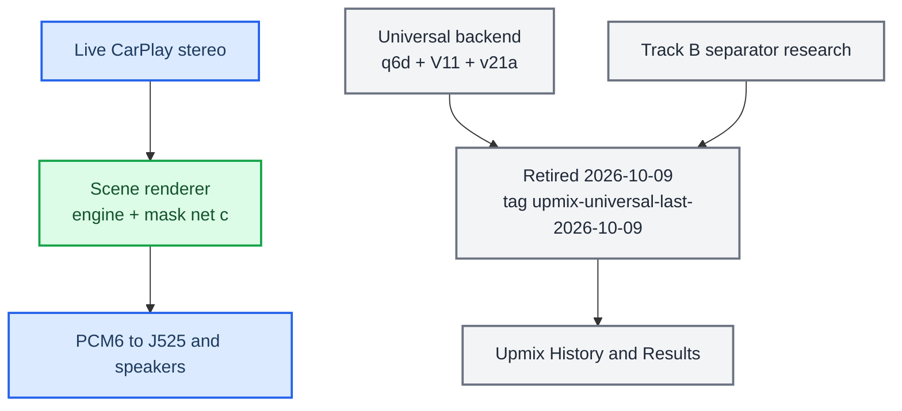
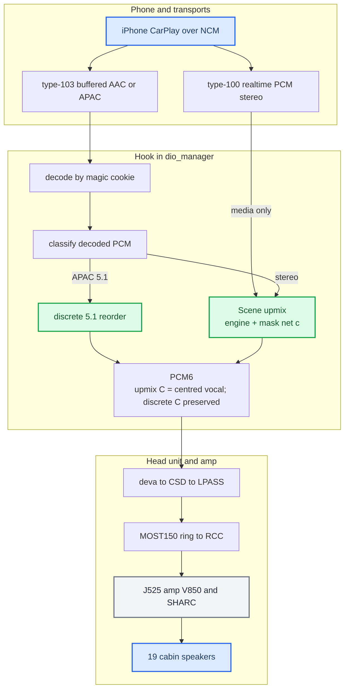

# Audio

*Map of content for the whole stereo→5.1 CarPlay audio pipeline — phone to the 19 speakers of the Audi B&O "Virtual Cabin".*

---

## 📋 What this section covers

Two problems had to be solved to play surround over CarPlay: get the **right six PCM channels** to the amp, and **synthesize six channels** for the stereo content that is 99% of what people play. The J525 B&O amplifier is already a complete 5.1 renderer, so the head unit only feeds it `L R C LFE Ls Rs` and lets it do the acoustics — that division of labour is the [Virtual Cabin](VIRTUAL_CABIN_AND_AMP_RE.md).

This page is the entry point for the domain. Start with [Stereo to 5.1 Upmix](STEREO_TO_5_1_UPMIX.md) for the end-to-end flow, then branch into the model, the amp, Dolby, or the discrete path. For the hub note and the trap list see [Home](../README.md) and [Landmines](../LANDMINES.md).

## 🧭 Runtime and research map

As of 2026-10-09, live CarPlay stereo goes through the **scene renderer** of [Stereo-to-Rear Scene Algorithm](UPMIX_SCENE_ALGORITHM_2026-10-08.md): a structural per-bin decomposition with stage clusters and one small net (the fine mask net c) for the semantic stage, the only stereo renderer in the hook since the Universal backend (q6d routing, V11 guard, v21a mask) was retired the same day. It ships as variant J with the net loaded; the first car session was 2026-10-09 and the owner accepted the sound on 2026-10-10 (one sighted listener, no blind test). [Stereo to 5.1 Upmix](STEREO_TO_5_1_UPMIX.md) is the end-to-end description, [Scene Backend Deploy](../build-and-deploy/SCENE_BACKEND_DEPLOY.md) the package and the log lines. Everything before it — Track A's three models, Track B's separator research, the September verdicts — is history: the inventory in [Upmix Code Retirement](UPMIX_CODE_RETIREMENT_2026-10-09.md), every iteration with its numbers in [Upmix History and Results](UPMIX_HISTORY_AND_RESULTS_2026-10-09.md), the code at git tag `upmix-universal-last-2026-10-09`. Rows marked *(history, Universal retired 2026-10-09)* below describe that era.

## 📊 The whole pipeline

Both CarPlay audio streams reach the scene upmix: the buffered type-103 stream for decoded stereo, and the stock realtime type-100 stream for media apps such as Spotify (`AUDIO_REALTIME_UPMIX=on`, `deploy/smartphone_integrator/carplay_startup.sh:123`).

## 🔗 The notes

| Note | What it covers |
|---|---|
| [Stereo to 5.1 Upmix](STEREO_TO_5_1_UPMIX.md) | End-to-end pipeline: ingest, where upmix vs discrete kicks in, the scene renderer and its knobs, the mask worker, latency, the log lines, what ships. |
| [Scene Backend Deploy](../build-and-deploy/SCENE_BACKEND_DEPLOY.md) | The shipped package, the QEMU cost, the two A/B levers, the rollback, what to read in the log after the first car session. |
| [Upmix Code Retirement 2026-10-09](UPMIX_CODE_RETIREMENT_2026-10-09.md) | The inventory of the Universal retirement: which hook files, models, tests, tools and knobs went, what stayed, the execution plan and the rollback. |
| [Upmix History and Results 2026-10-09](UPMIX_HISTORY_AND_RESULTS_2026-10-09.md) | Every renderer and model iteration from 2026-09-04 to the scene renderer with its numbers and verdict, so the deleted code stays readable. |
| [Archive](archive/README.md) | The 67 research notes of 2026-09-25 → 10-04 archived with the Universal retirement (separator, oracle-renderer and Track B joint-scene probes, the source-separation plan and the separator handoff) with their measurement sidecars; one verdict line per note, the code at tag `upmix-universal-last-2026-10-09`. |
| [Upmix Domain Model](UPMIX_DOMAIN_MODEL.md) | (history, Universal retired 2026-10-09) Production/research boundaries, evidence entities, single-network architecture and qualification lifecycle at the final paused state. |
| [HSSR Model](HSSR_MODEL.md) | (history, Universal retired 2026-10-09) The AI: why separation failed, the second-scene design, the runtime, every model iteration V9→q6d, calibration. |
| [Virtual Cabin and Amp RE](VIRTUAL_CABIN_AND_AMP_RE.md) | The J525 amp reverse-engineered: two-SoC topology, the single-byte routing decision, the SHARC DSP chain. |
| [Dolby Atmos](DOLBY_ATMOS.md) | What Atmos is on CarPlay, why phone-side spatial is blocked, what HSSR borrowed and where it diverges. |
| [Discrete 5.1 Routing](DISCRETE_5_1_ROUTING.md) | The native 5.1 path: deva mirror driver, CSD min_voices fix, SAD `asad=0xfc`, magic-cookie codec authority. |

### Upmix model and research

| Note | What it covers |
|---|---|
| [Stereo-to-Rear Scene Algorithm 2026-10-08](UPMIX_SCENE_ALGORITHM_2026-10-08.md) | The proposed algorithm itself: closed-form primary/ambient decomposition per STFT cell, rear built from the ambient residual + off-centre primary at its own image + static floor/air with static or slow gains, optional α relocation of the coherent off-centre primary only, geometric protection plus an optional floored learned duck, a bounded learned scene prior from Atmos renders; stability argument, compute, knobs, first listen; §13 what a true double stage requires; §14 the numpy reference implementation (`tools/stereo-upmix-render/scene_upmix.py`), its 37-row synthetic suite, the oracle-master test and the ten-song AlbumDB table against the passive matrix; §15 DEV40 and TEST20 on the training PC against Track A and the passive matrix, swing attribution, membership ablation, the car listening kit; §16 the semantic instrument stage (external eligibility mask, oracle ceilings on AlbumDB and DEV40, the mask as a duck); §17 the block-exact streaming reference and the compute envelope. |
| [Upmix Radical Directions 2026-10-07](UPMIX_RADICAL_DIRECTIONS_2026-10-07.md) | The owner's "what to change globally" question answered as a ranked menu: measured cabin IRs + rear-lead (reverse precedence), Spotify realtime-guard and authored-Atmos diagnostics, sidecar separation box with its free offline kill test, Atmos-corpus professional profile, venue layer, compute-envelope measurement; amp flashing and the 8-channel sink parked; 3-stage roadmap and owner questions. Panel-made, nothing built or heard. |
| [Upmix Rework Proposal 2026-10-07](UPMIX_REWORK_PROPOSAL_2026-10-07.md) | The redesign to discuss before the first car session: structural rear (pan + coherence + side + static floor and air) at a materially higher level with a bit-exact front, nets demoted to a floored protection duck, rear-first cabin guard, one-tone amp-bleed probe, listening-first sessions 0-3, the eight owner questions, the runner-up and the dead ends. Panel-made, skeptic-checked, nothing built or heard yet. |
| [Upmix Rework Baseline 2026-10-07](UPMIX_REWORK_BASELINE_2026-10-07.md) | Start here for the rear-scene redesign: what runs in the car, why the rear is faint and unstable (ranked, with evidence strength), every line of work 09-04→10-04 with its outcome, established positives/negatives, hard constraints, metric blind spots, classical baselines, open threads and the levers a redesign must weigh. |
| [Upmix Training History](UPMIX_TRAINING_HISTORY.md) | (history, Universal retired 2026-10-09) Historical entry point,09-04→09-30: original V/G/H/P/Q generations plus the complete separator continuation and final spectral40k verdict. |
| [Upmix Datasets and Teachers](UPMIX_DATASETS_AND_TEACHERS.md) | MoisesDB, MUSDB18, FLOAT, AlbumDB, teacher networks, their defects and licences, the role-label contract. |
| [Upmix Compute Budget](UPMIX_COMPUTE_BUDGET.md) | Krait cost units and measurements, the arithmetic that admitted HSSR and blocked CUpGAN/H1/Q2, training machines. |
| [Upmix Literature](UPMIX_LITERATURE.md) | The papers and systems the work drew on, what each changed, and which paper files are failed downloads. |
| [Current Track A Matched40 2026-09-30](UPMIX_TRACKA_MATCHED40_2026-09-30.md) | (history, Universal retired 2026-10-09) Current three-model baseline at−9dB rear-air, same40×60s/231rows:29swing songs and all source/band metrics. |

### Upmix runtime and release

| Note | What it covers |
|---|---|
| [Upmix Calibration and Tuning](UPMIX_CALIBRATION_AND_TUNING.md) | (history, Universal retired 2026-10-09) How every shipped value was reached: bass complaint, corrected matrix, 60 s one-lever grid, scene bed, treble taper. |
| [CarPlay Upmix Listening Protocol](UPMIX_CARPLAY_LISTENING_PROTOCOL.md) | (history, Universal retired 2026-10-09) Live CarPlay front-only vs Track A score sheet, level matching, and the boundary between in-car evidence and headphone previews. |
| [Upmix Stability 2026-09-25](UPMIX_STABILITY_2026-09-25.md) | (history, Universal retired 2026-10-09) "The sound goes back and front": the measurement tools (synthetic scenes, MoisesDB stems, any song folder), the causes (per-instrument depth split, slow-release memories, the 22.09 attack detector), the vocal gate and the knob changes. |
| [Upmix Listening and Deploy Log](UPMIX_LISTENING_AND_DEPLOY_LOG.md) | (history, Universal retired 2026-10-09) What ran in the car when, hashes, every listening verdict, the live readback (2026-09-17 → 09-22). |
| [Upmix Release and Acceptance](UPMIX_RELEASE_AND_ACCEPTANCE.md) | (history, Universal retired 2026-10-09) The frozen acceptance protocol, runtime audit, cabin constraints, and the candidates that never shipped. |

### Amplifier

| Note | What it covers |
|---|---|
| [SHARC DSP Blocks](SHARC_DSP_BLOCKS.md) | The J525 SHARC program: flash layout, 79-entry graph, kernels, level EQ, C4D17, the V850 control plane. |
| [SHARC B Processors](SHARC_B_PROCESSORS.md) | The spectral first B (amp's own spatial library) and the auxiliary second B: modes, maths, calibration banks. |
| [J525 Wiring and Speakers](J525_WIRING_AND_SPEAKERS.md) | 19 speakers, 16 T38 circuits, DSP slot → circuit candidates, the B9 workbook and its conflicts. |

### Head-unit routing

| Note | What it covers |
|---|---|
| [QNX Audio Topology](QNX_AUDIO_TOPOLOGY.md) | deva, mixer router, CSD 78, ACDB, LPASS COPP, AFE/TDM slots, SAD, MOST blockwidth — frame to MOST bytes. |
| [Internal Amp Path](INTERNAL_AMP_PATH.md) | Non-B&O cars: RCC MIBRoot route decision, AudioProcess sinks, C674x DSP, the four-site patch plan. |
| [Call and Siri Routing](CALL_AND_SIRI_ROUTING.md) | How type-103 media shares the main-audio route with telephony, Siri and realtime media. |

### Codecs and the buffered stream

| Note | What it covers |
|---|---|
| [Buffered Audio Path](BUFFERED_AUDIO_PATH.md) | The hook-owned type-103 receiver: negotiation, SETUP/control/APAP contract, codec switching. |
| [iOS 26 Type-103 Connection Triage](IOS26_TYPE103_CONNECTION_TRIAGE_2026-10-03.md) | iOS 26.4.2 disconnect on music start: final SETUP/info contract hardening, host/QNX checks, and the same rejection in iOS 27 beta; incident cause remains unverified. |
| [Buffered Playback Lifecycle](BUFFERED_PLAYBACK_LIFECYCLE.md) | The single QSA handle, lock/background ownership, rate/flush state machine, feedback clock, car failures. |
| [APAC Codec](APAC_CODEC.md) | Format indices, cookie grammar, `C L R Ls Rs LFE` order, the 5.1.2 fold, the ARMv7 decoder. |
| [Cinemo AAC Decoder](CINEMO_AAC_DECODER.md) | Index-23 AAC-LC through dio's Cinemo SDK: recovered ABI, header-ownership abort, plugin-dir error 23. |

## 💡 Truth levels

Throughout these notes, claims are tagged: `[car]` confirmed on the unit, `[model]` static-RE or offline render, `[open]` unverified. The honest headline: discrete 5.1 is `[car]`; the amp DSP is `[model]` static RE; no blind listening or cabin SPL has ever been measured.

Code state is checked against the source tree; every code claim cites `path:line`. Provenance lives in `docs/research/UPMIX.md` and its three companion papers.
