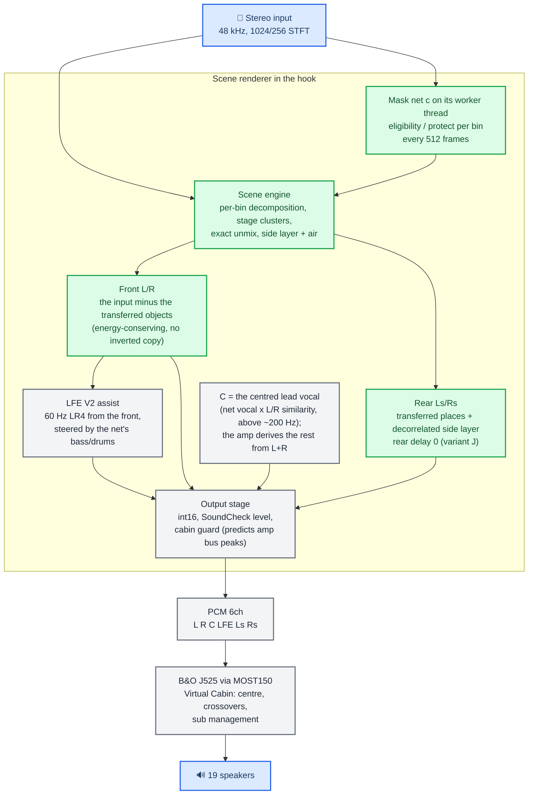
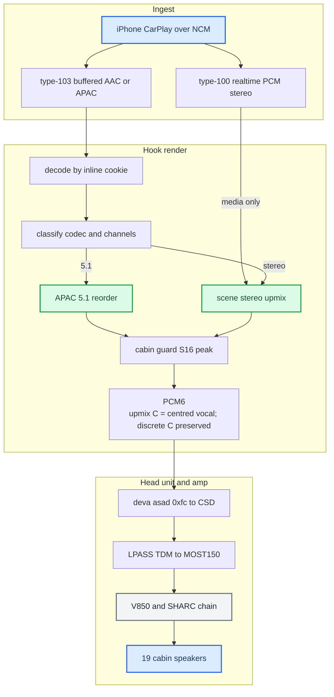
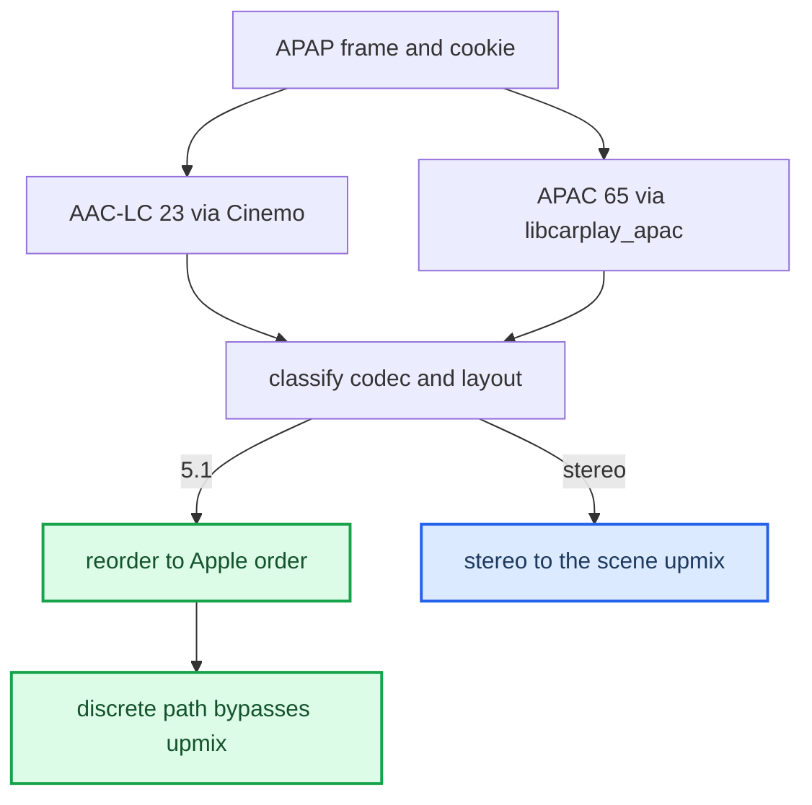
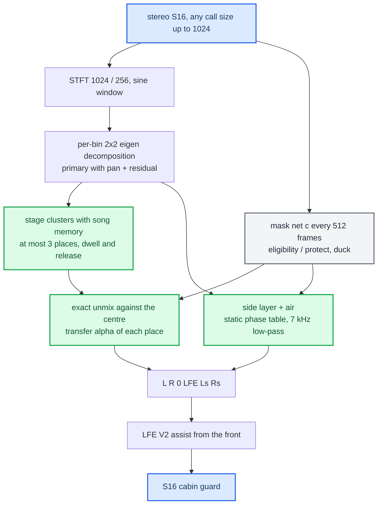
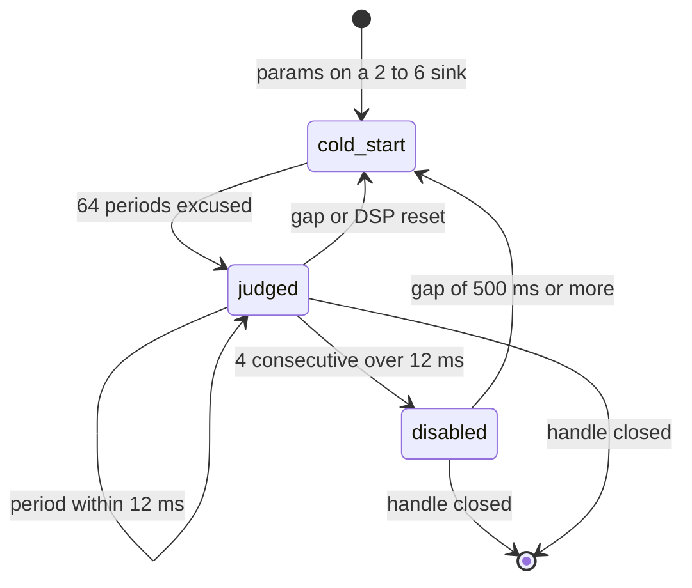

# Stereo to 5.1 Upmix

*The end-to-end pipeline from the phone's audio to the six PCM channels the amp renders — where discrete 5.1 and the scene renderer each kick in, and the configuration the startup script ships. State of 2026-10-17: the SCENE backend is the only stereo renderer since 2026-10-09, when the Universal backend (q6d / V11 / v21a) was retired; the owner accepted it by ear in the car on 2026-10-10.*

---

## 🧭 At a glance: what each channel gets

For stereo music (type-103 decoded stereo and type-100 realtime media). Spatial Audio / Atmos tracks arrive as real 5.1 and skip this; calls and Siri stay plain stereo. Values are the shipped configuration below; heard and accepted in the car by one sighted listener, no blind A/B (see [the honest gaps](#-the-honest-gaps)).



| Channel / stage | What it gets |
|---|---|
| **Front L/R** | The input itself, 1024 frames late, minus the share of each admitted off-centre place that moved behind; the subtraction is at the place's own pan, so nothing inverted appears in the other front channel (`hook/audio/scene_engine.c`). |
| **Rear Ls/Rs** | The transferred places at their own image plus the residual room (the side layer, decorrelated between Ls and Rs by a static per-bin phase table, low-passed at 7 kHz) and the air copy above 2–2.5 kHz. No delay of our own (`AUDIO_SCENE_REAR_DELAY_MS=0`); the amp's rear doors trail its front mid/treble by ~5.2 ms by themselves `[model]`. |
| **Mask net c** | Four posteriors per bin (vocals, drum core, bass, other) every 512 frames; eligibility = other, protect = vocals + drums + bass. It gates which cells may move as instruments and ducks the spatial transfer and side layer where protected content sits (`hook/audio/scene_mask.c`, `models/scene-masknet-c/manifest.json`). |
| **LFE** | Cabin-Aware LFE V2: a 60 Hz LR4 sub-band of the front, polarity-safe mono fold, level steered by the net's bass and drum posteriors, paired front headroom 31392/32768 (`hook/audio/stereo_upmix.c`: `kLfeLow`, `spa_upmix_lfe_v2_normalized()`). |
| **C** | 0 on purpose: the amp derives the centre from L+R. |
| **Output stage** | int16 conversion with the existing clamp, the SoundCheck programme gain (type 103), then the S16 cabin guard, which predicts the amp's bus peaks at the played level and scales if needed (`spa_upmix_cabin_guard_s16()` in `stereo_upmix.c`). |
| **Amp** | PCM 6ch over MOST150; the B&O Virtual Cabin handles centre, crossovers and sub management across 19 speakers ([Virtual Cabin and Amp RE](VIRTUAL_CABIN_AND_AMP_RE.md)). |

## 🎯 The big picture

Two things had to be built: get the **right six PCM channels**, and **synthesize them** for stereo content. The amp (J525 B&O) is a complete 5.1 renderer — the [Virtual Cabin](VIRTUAL_CABIN_AND_AMP_RE.md) — so the head unit only feeds it `L R C LFE Ls Rs` and lets it do the acoustics: it derives the centre, manages the sub, crosses over every driver, and fans out to 19 speakers.

The synthesis is the scene renderer of [Stereo-to-Rear Scene Algorithm](UPMIX_SCENE_ALGORITHM_2026-10-08.md) (sections 14–18 are the implementation record), a structural decomposition with one small net for the semantic stage; its numpy reference is `tools/stereo-upmix-render/scene_upmix.py` and the C port in `hook/audio/scene_*.c` matches it to −131 dB on the fixtures (`tools/stereo-upmix-render/port/test_engine.py`). The amp RE is in [Virtual Cabin and Amp RE](VIRTUAL_CABIN_AND_AMP_RE.md) and [Dolby Atmos](DOLBY_ATMOS.md); traps are in [Landmines](../LANDMINES.md).



## ⚙️ Ingest — two CarPlay audio streams

There are two CarPlay audio streams (`docs/reference/IOS_CARPLAY_SPATIAL_WIREFORMAT.md §21`), and which one a track uses decides everything downstream.

| Stream | Advertised as | Codec | On the car |
|---|---|---|---|
| type-100 realtime | `audioOutputFormats` | PCM only | 48k/16/stereo `[car]` |
| type-103 buffered | `audioOutputFormatsExtended` | AAC-LC (23) / APAC 5.1 (65) / 5.1.2 (66) | lossless + spatial; our hook supplies it |

The stock realtime stream never carries multichannel, and phone-side spatial over it is blocked by a phone feature flag (`ScreenSpatialAudioReceiver`) — see [Dolby Atmos](DOLBY_ATMOS.md). So all **multichannel** input rides the buffered type-103 path. On that path the frame is APAP (BE32 + ChaCha20-Poly1305); the **inline magic cookie** decides the decoder, not the APAP index hint — see [Discrete 5.1 Routing](DISCRETE_5_1_ROUTING.md).

The shipped startup advertises `[65,23]` on type 103: primary APAC 5.1 because `AUDIO_SPATIAL_ATMOS=0` (`deploy/smartphone_integrator/carplay_startup.sh:84`), plus AAC-LC stereo via `SPATIAL_103_EXTRA_INDEX=23` (`carplay_startup.sh:129`).

Stereo on the realtime stream is upmixed too. With `AUDIO_REALTIME_UPMIX=on` (`carplay_startup.sh:123`) the same scene renderer runs on type-100 media PCM — Spotify and every app without type 103 — with its own engine state and its own mask worker (`spa_rt_upmix_start()` in `hook/audio/audio_hook.c`). It falls back to plain L/R while a phone, Siri or alert stream is tracked or while type 103 owns the rail (`hook/audio/media_route.h:158`).

## 🔧 Where upmix vs discrete kicks in

After decode, the PCM is classified by codec, channel count and layout (`hook/audio/spatial_downmix.h`):



iOS may alternate AAC-LC ↔ APAC inside one session; the cookie authority makes the switch seamless. iOS never sends ordinary stereo as APAC 5.1, so normal music decodes as stereo and is upmixed on our side. The 5.1 case is `[car]` end to end.

Decoded 5.1.2 (index 66) is accepted only when SETUP itself negotiated 66, which the shipped config never advertises; otherwise the decoder is rejected as `unsupported-layout` because the native PCM8 order is unmeasured.

## 📊 The scene renderer

The renderer is **structural, not a classifier**: per STFT cell it decides from the two-channel statistics what is a coherent off-centre source and what is room, and moves whole places behind the listener; the only learned part is the mask net, which says which cells may move as instruments and which must stay protected. Every stage lives in `hook/audio/scene_engine.c` (frame and block driver), `scene_engine_math.c` (helpers, tables, the 1024-point real FFT), `scene_clusters.c` (the stage clusters), `scene_mask.c` (the net) and `scene_mask_worker.c` (its thread); `hook/audio/stereo_upmix.c` wraps them with the OFF bypass, the int16 conversion, the LFE V2 assist and the cabin guard. Spec sections 14 and 18 of [the algorithm note](UPMIX_SCENE_ALGORITHM_2026-10-08.md) record every design change the implementation forced and the port's numbers.

One frame: a sine-windowed **1024-sample STFT at hop 256** (ERB-pooled groups for the pooled statistics); per bin the 2×2 covariance of L and R, tracked with three time constants (8 ms for the fast pan gate, 43 ms for the Wiener scalar and the clustering, 300 ms for the direction of the residual), is decomposed into a coherent primary with a pan and an orthogonal residual; the centre-removed pan of the primary feeds the **stage clusters** (at most three admitted places with dwell, 2 s release, shadow rejection, merges and a song memory); for every admitted place each bin is unmixed exactly against the centre (`[L; R] = [a; b]·s + [1; 1]/√2·m`, so a centred source stays in front sample-exactly) and the fraction `alpha` of the place is transferred to the rear at its own pan and subtracted from the front at the same pan; the residual becomes the side layer, decorrelated between Ls and Rs by a static per-bin phase table and low-passed at 7 kHz, with the air copy ramping in at 2.0–2.5 kHz; the **mask net c** posteriors (one row per 512 input frames) set the instrument transfer (`inst_alpha`, `inst_gamma`) and duck the spatial transfer and the side layer by the protect mask (`duck_depth`); the engine writes `L R 0 0 Ls Rs`; `stereo_upmix.c` then converts to int16, adds the LFE V2 assist from the front and runs the cabin guard.



### Knobs

Read once per `dio_manager` start (a change applies at the next HU boot of the CarPlay child); a value outside its range is refused with an `audio config: invalid …` line and the default used (`spa_audio_config_init_once()` in `hook/audio/audio_hook.c`, the `SPA_AUDIO_SCENE_*_ENV` block of `hook/audio/audio_hook.h`). The hook reads nine tuning knobs plus the blob path; the startup exports eight of them (not `AUDIO_SCENE_SIGMA_MIN`) and the blob. The scene values in the startup block are the engine defaults of variant J, spelled out so the running configuration can be read from the file.

| Knob | Shipped (`carplay_startup.sh`) | Default | Range | What it is |
|---|---|---|---|---|
| `AUDIO_STEREO_UPMIX` | `on` (`:86`) | off | on, off | on = the scene renderer; off = the exact `L,R,0,0,0,0` bypass, which always wins |
| `AUDIO_REALTIME_UPMIX` | `on` (`:123`) | off | on, off | the same renderer on the stock type-100 media stream, own state and own mask worker |
| `AUDIO_STEREO_LFE` | `assist` (`:87`) | off | off, assist | Cabin-Aware LFE V2 |
| `AUDIO_STEREO_LFE_GAIN` | `0` (`:89`) | 0 | −24..+12 dB re 4096 | assist level; not the whole subwoofer feed (the corrected BANK1 also feeds the sub from L/R/C/Ls/Rs) |
| `AUDIO_SCENE_MASK_BLOB` | `$H/scene_masknet_c.bin` (`:104`) | unset | path | the fine mask net c weights (`SMSKNET1`, 32,544 B), run on the scene mask worker; unset = spatial only; set but unreadable or rejected = no upmix (plain stereo), logged once |
| `AUDIO_SCENE_ALPHA` | `0.7` (`:109`) | 0.7 | 0..1 | spatial relocation fraction of an admitted place |
| `AUDIO_SCENE_INST_ALPHA` | `0.9` (`:107`) | 0.9 | 0..1 | instrument transfer fraction (needs the blob) |
| `AUDIO_SCENE_INST_GAMMA` | `1` (`:106`) | 1 | 0.1..4 | eligibility exponent; 1 = full rear (kit letters I/J), 2 = the balanced fallback H |
| `AUDIO_SCENE_DUCK_DEPTH` | `0.25` (`:108`) | 0.25 | 0..1 | duck of the spatial transfer and the side layer by the protect mask (needs the blob) |
| `AUDIO_SCENE_REAR_DELAY_MS` | `0` (`:105`) | 0 | −50..50 | 0 = variant J: our rear and the amp's own front bleed meet the rear doors in phase |
| `AUDIO_SCENE_SIGMA_MIN` | not exported | 0.08 | 0.01..1 | place width floor; 0.15 is the documented second candidate (spec §15) |
| `AUDIO_SCENE_SIDE_LP_HZ` | `7000` (`:110`) | 7000 | 0 = off, 1000..24000 | side-layer low-pass |
| `AUDIO_SCENE_BLEED_CANCEL` | `0` (`:111`) | 0 | 0..0.5 | variant K's cancel of the amp's −3 dB front copy in the rear bus (0.355); 0 = J |
| `AUDIO_SCENE_FRONT_KEEP_DB` | `1` (`:115`) | 0 (off) | 0 = off, 0.5..12 (0..0.5 refused) | front anchor: the most every transfer together may take from the front over ~1 s (below) |
| `AUDIO_SCENE_CENTRE` | `1` (`:119`) | 1 | 0..1 | the share of the centred lead vocal that moves from L/R to C (below; needs the blob); 0 = C silent |

What the renderer no longer has: `AUDIO_STEREO_SURROUND`, `FRONT_BASS_DB`, `FRONT_TREBLE_DB`, `REAR_BODY_DB`, `REAR_AIR_DB`, `FRONT_RETENTION` and every `AUDIO_HSSR_*` knob left with the Universal backend; the fronts and rears leave at the engine's own levels (unity scale, as the car kit renders) and only the LFE assist, the SoundCheck gain and the cabin guard apply on top (`hook/audio/stereo_upmix.h:70-77`).

### Front anchor

A sparse mix made only of wide parts (two guitars at the edges and their room, no vocal, bass or drums for the mask to protect) used to go almost whole to the rear: the mask lets every cell go, each transfer is subtracted from the front, and nothing bounded the total. Measured through the hook renderer at the Aggressive level: the intro of a sparse wide song lost 2.8 dB of front with the rear only 3 dB under it; a wide-guitar rock song lost up to 9.8 dB with the rear up to 6.8 dB over the front; dense mixes lose under 1 dB. `[sim]`

`front_keep_db` bounds it (`hook/audio/scene_engine.c`, `front_anchor()`; the same in `scene_upmix.py`). Per frame the engine sums, with a 1 s EMA, the input energy `Ex`, the front subtraction at full transfer `S` (`sub / cold_gain`) as `Es`, and their cross term `Rxs`; the front at anchor gain `a` keeps `Ex − 2a·Rxs + a²·Es`, so the largest `a` that keeps `10^(−keep/10)·Ex` is the smaller root of a quadratic: no feedback through the measurement, nothing to hunt. The gain follows that bound down in 0.3 s and back in 2 s and multiplies `cold_gain`, so every transfer and the ambient layer shrink together and the scene keeps its shape. At 1 dB (shipped): the sparse intro keeps the rear 5.4 dB under the front instead of 3.2, the wide-guitar song 5.6 dB under instead of 0.7, dense mixes are unchanged to 0.1 dB; a centred vocal renders bit-identically with it on (`test_scene_upmix.py` check 14). C against the reference: the anchor gain per frame within 3·10⁻⁷ and the output at −129 dB on the port fixture `stream_anchor.npz` (`port/test_engine.py`), and −74.5 dB through the backend with the net's rows at `--front-keep-db 1` (`port/test_hook_render.py`). `[sim]` Not yet heard in the car.

### Centre

The amp derives a centre from L + R by itself, so the renderer used to leave C at zero. It now feeds C with the one thing a centre speaker is for: the lead vocal, which in a car otherwise collapses toward the nearer door for both front seats (`centre_vocal()` in `hook/audio/scene_engine.c`, `scene_engine_set_vocal()`). Per bin, after the rear transfers and the front anchor: `w = AUDIO_SCENE_CENTRE · v · smoothstep(ψ, 0.6, 0.9) · smoothstep(f, 150, 250 Hz)`, with `v` the net's vocal posterior (output 0, the same row as the masks, 30 ms attack / 300 ms release) and `ψ = 2·Re(L·R*) / (|L|² + |R|²)` on the 43 ms statistics (1 = centred and coherent, 0 for one-sided or uncorrelated content). L and R each lose `w·M` (`M` = the mid of what is left in front), C gets `sqrt(2w(2 − w))·M`, so a centred source keeps its power: at 1 it leaves L/R completely, at 0.5 L/R drop 6 dB. Panned parts, ambience and everything under ~200 Hz stay where they were, and the rears are untouched. Without the blob there is no vocal row and C stays exactly 0; the Off level fades C out with the rest of the scene. On album01 through the hook renderer at 1: L/R −0.7 dB, C at −26 dB, front power (L + R + C) −0.05 dB, no clipped sample. `[sim]` The stage is not in `scene_upmix.py`: every reference comparison renders with `--centre 0`, and `tests/scene_centre_test.c` covers it (off silent, power kept, half share, a hard-left tone stays). `[code]`

In the car (owner, 2026-10-17, 10 s on/off A/B at 1): "not a huge difference, but the centre no longer feels empty". Not proven yet: that the amp plays C discretely rather than folding it into L/R in its first B stage ([SHARC B processors](SHARC_B_PROCESSORS.md)). `[car]`

### MMI level

**Sound → Sound effects → CarPlay UpMix** is a row added to the stock screen (`java_patch/com/luka/carplay/tone/UpmixToneUi.java`, wired by the replaced tone `Activator`; any failure there falls back to the stock bank and screen, so the worst case is no row). It takes its texts from the tone string table, where the installer puts them at the fixed slots 1000..1005, past the stock 897 (luka-collection writes only the Car table, so no clash) (`deploy/lang/upmix_lang.py` with our `ldzip.py`, run by M.I.B.'s micropython; translated for every Sound-table locale of the US, EU and CN trains, Off in each locale's own stock word, written only for the locales the unit's zip has; a slot holding someone else's text is never overwritten); the jar carries no copy, so empty labels mean the install step failed. Java owns the level (`com/luka/carplay/core/UpmixSetting.java`): it is stored in the stock HMI persistence (`IStorageAccess`, the Sound app's namespace 1009, key 1000) and flushed on every write through the shared `FlushValuesDict.register()` (the stock flush list plus a register API; every mod that needs an immediate flush ships the same class, luka-collection included, so jar order no longer matters). At HMI boot, which comes before `dio_manager`, Java writes the level to `/tmp/carplay_upmix_level`; the hook reads it at init and again at every stream start (`spa_upmix_level_reload`, so a hook that came up first still catches up), and a choice in the row arrives live as `CMD_UPMIX`. Both scene instances take the level on their own thread at init and on every period (`spa_stereo_upmix_set_level`). **[code]**

In the car: the row, its texts and live switching confirmed on 2026-10-13 with a hand-patched `lang_data.zip`, and on 2026-10-14 with the texts written by the installer itself (owner). `[car]`

| Level | `alpha` | `inst_alpha` | `duck_depth` | `side_lp_hz` |
|---|---|---|---|---|
| Off | bypass: `L, R, 0, 0, 0, 0`, still 1024 frames late | | | |
| Moderate | 0.5 | 0.7 | 0.35 | 7000 |
| Normal (default) | the `AUDIO_SCENE_*` knobs above | | | |
| Full | 0.9 | 1.0 | 0.15 | 11000 |
| Aggressive | 1.0 | 1.0 | 0.10 | 12000 |

Every change takes 300 ms: to and from Off an ease in/out crossfade between the scene and the plain stereo (the engine keeps running under Off, so it comes back warm), between the other levels a linear glide of the four knobs together; a new stream starts at its level directly. The rear delay never changes with the level. Full was chosen from a 2026-10-13 simulation through the hook renderer and the J525 electronic model (`tools/soundamp-virtual-cabin/amp_dsp_chain.py`): in the rear doors our rear rises above the amp's own front copy by +1.8 dB above 7 kHz (4.7 → 6.5 dB) with the vocal still about 9 dB under the front. Not yet heard in the car. **[sim]**

### The mask worker and its timing

The net costs 1.37 M ARMv7 instructions per 512-frame control on the QEMU bench (`models/scene-masknet-c/manifest.json`), so it runs on the **scene mask worker** (`hook/audio/scene_mask_worker.c`, SCHED_RR priority 17, started per SETUP on the type-103 path and kept across re-params on the realtime path; `spa_scene_mask_worker_attach()` in `audio_hook.c`): two job slots of 512 frames, two result slots, generation and sequence numbers, stale results dropped. The audio thread pays only the hand-off (about 1.1 k instructions per 768-frame period on the bench) and installs the newest finished row at every 512-frame control boundary (256, 768, 1280 … pushed frames, `hook/audio/stereo_upmix.h:44-57`), so a row applies **one control (10.7 ms) after** the reference's own timing, one more per control the net needs beyond its period — the engine's slow instrument attack absorbs that; the net primes on its first two controls, so rows start at the fourth boundary. A control that arrives while both slots are full is refused, never waited for: the engine keeps its last row and the net's 2048-sample history gets a 512-frame splice. The count is `skipped=N` in the stop line below; 0 is the only healthy value. The net never runs on the audio thread: the upmix is whole or absent, so a worker thread that cannot start leaves that path on plain stereo (fail-closed table below). The host tools (`scene_render_hook --mask-blob`) run the same worker without a thread, stepped inside each submit, so their renders carry the unit's timing while its worker keeps up.

### Latency

The engine emits a sample only once its 1024-sample analysis frame is complete, so `spa_stereo_upmix_process_s16` primes its output FIFO with 1024 zero frames and every call then emits exactly the frames it was given: output frame *i* is input frame *i − 1024* rendered, **21.3 ms** on both paths (`stereo_upmix.h:35-40`). The retired Universal renderer lagged 512 frames and never reported them (the type-103 SETUP response carried `arrivalToRenderLatencyMs: 0` since the first build, and the car is tuned to that), so OFF still reports 0 and **SCENE reports only the extra 512 frames, 11 ms** (`spa103_upmix_extra_latency_ms()` in `audio_hook.c`). The SETUP is answered before the stream's codec is known (the inline cookie decides, mid-session too), so the 11 goes out on every type-103 SETUP of a SCENE session, native 5.1 included, which plays with 0 (a pure reorder). The realtime type-100 upmix adds its 21.3 ms with no field to report it in. What the phone does with the field is to verify in the car.

### Track-change reset

A new song must not inherit the previous song's places and song memory. On the type-103 path the APAP **transition id** of the stream is sample-exact: a changed id calls `spa_stereo_upmix_scene_track_change` (`spa103_observe_extension_locked()` in `audio_hook.c`). On the realtime path the hook reads the iAP2 **NowPlayingUpdate** (0x5001) persistent identifier on Cinemo's receive thread and sets an atomic flag that stock's audio thread consumes at its next period (`spa_audio_on_message()`, `spa_rt_upmix_period_locked()`). Both reset the engine only — every place fades out, the histogram and the song memory are cleared, the tables are kept because the reset runs inside the realtime callback — while the net's stream carries on (`spa_stereo_upmix_scene_track_change()` in `stereo_upmix.c`, `scene_clusters.h:24`).

### Fail-closed contract

The upmixer never silently picks another renderer `[code]`:

| Condition | Output |
|---|---|
| `AUDIO_STEREO_UPMIX=off` | exactly `L,R,0,0,0,0`; every other audio knob ignored |
| blob unset | spatial only (no instrument transfer, no duck) |
| blob set but unreadable or rejected | no upmix: plain stereo (type 103 at the OFF bypass, the realtime path not armed: zero rears); `SCENE: mask blob unreadable path=… errno=…; upmix off` or `… rejected … (expected 32544 bytes of SMSKNET1); upmix off`, then `audio upmix 103\|rt: mask blob set but unusable; upmix off` (`spa_scene_mask_blob_init_once()`, `spa_scene_mask_worker_attach()`) |
| worker thread cannot start | no upmix, as above: `audio upmix 103\|rt: scene mask worker failed to start; upmix off` |
| upmix init fails on the type-103 path | `buffer103: stereo upmix init failed status=…; exact L/R passthrough retained` (`spa103_render_start()`) |
| process error at render time | exact L/R widening, one ERROR line (`spa103_render_frame()`) |
| invalid knob value | `audio config: invalid …`, the default used |

Every reset (prefix FLUSH, pause/rate teardown, cookie or codec change, SETUP replacement, session stop) advances a process-wide generation; the worker drops rows of an older generation (`spa_scene_arm()` in `stereo_upmix.c`). Env values are read once per `dio_manager` process — a change applies at the next start of the CarPlay child, a replaced `.so` too.

## ⚙️ SoundCheck and the output order

Per buffered frame the order is fixed `[code]` (`spa103_render_frame()` in `audio_hook.c`):

```text
stereo:    decoded S16 → scene engine + LFE V2 → SoundCheck gain → S16 cabin guard → optional SoundCheck limiter → PCM ring
APAC 5.1:  decoded S16 → reorder                → SoundCheck gain                    → optional SoundCheck limiter → PCM ring
```

SoundCheck is a **programme** gain kept out of the analysis on purpose: the renderer's statistics and the net's log-power features see the decoded level, not a −9 dB AAC gain. On the upmix path the hook takes the per-frame gains of SoundCheck's ramp (`spa_soundcheck_take_gains()`) and hands them to `spa_stereo_upmix_process_gain_s16()`, which scales each finished frame before the cabin guard, so the guard bounds the J525 buses at the level that is played: a positive gain no longer passes them unchecked, and a negative one no longer costs guard action the attenuated frame never needed. Every other path (reorder, widening, the 5.1.2 fold) applies the gain to its output as before. SETUP carries `soundCheckMediaKind {"1":-16}`; APAP type 103 carries MainLoudnessParameters (TLV 11) and media kind (TLV 12). The gain is `target − p0`, positive gain capped at `−1 − p2`, rounded Pioneer-style `floor(x+0.5)`, bounded −128..+20 dB (`spa_soundcheck_main_gain()` in `soundcheck.c`); first metadata applies immediately, later changes ramp over 20 ms (`soundcheck.c:7`), FLUSH resets history without forcing unity. Observed tuples: AAC `[-6.5,-1,0.96875]` → −9 dB, the retained APAC tuples → +1 dB. The RMS fallback and sample-peak limiter are separate opt-ins, both off in the shipped config. `-16` is the captured protocol value, not a published Apple rule.

> 📌 **Checked `[code]`:** `test_scene_gain_before_guard` in `tests/stereo_upmix_test.c` renders a loud wide mix at +6 dB: with the gain after the guard (the order until 2026-10-17) 421 of 8192 frames overload a bus, through `process_gain_s16` none. The SoundCheck limiter stays off. What the guard cannot undo is int16 saturation of a single channel by a positive gain before it (the cap at `−1 − p2` keeps the stereo programme below −1 dBFS); a 2026-09-08 diagnostic proved that a limiter placed after S16 clipping cannot restore channel ratios (`[30000,31000]` at +1 dB → `32767,32767`). No clipped song has been captured.

## ⚡ The realtime path in the car

The stock type-100 media stream (Spotify, every app without buffered 103) is upmixed inside stock's own QSA thread: period 768 frames = 16 ms (`SPA_PCM_SINK_PERIOD_FRAMES` in `audio_hook.c`), own engine state and own mask worker, allowed only for realtime periods, 2→6, a tracked media stream and no phone/Siri/alert owner (`media_route.h:158`). The deadline guard (`hook/audio/rt_upmix_guard.h:27-41`): 12 ms budget per period, 4 consecutive overruns disable the upmix (rears silent, fronts untouched), 64 cold periods (~1 s) are excused after every arm or break, revival only after a gap of ≥ 500 ms in the stream.



**Cost on the QEMU ARMv7 bench** (`tools/stereo-upmix-render/bench/`, [Scene Backend Deploy](../build-and-deploy/SCENE_BACKEND_DEPLOY.md)) `[model]`: the engine 0.31–0.34 M instructions per 256-frame hop (0.98 M per 768-frame period at the shipped flags, spatial only 0.31 M per hop), the net 1.37 M per 512-frame control on the worker, the hand-off 1.1 k per period. The only instructions-to-Krait calibration so far (the Universal runs) scales this to **1.1–1.8 ms of the 16 ms period on the audio thread** against the 12 ms guard, 1.6–2.5 ms per control on the worker. The guard histogram in the `stop` line is the only real number: 19 min of realtime on 2026-10-09 gave a mean of 2.0 ms and a worst of 6.0 ms per 16 ms period, the guard never tripped. The Universal-era car sessions (three of five disabled themselves on the 8 ms build) and its cost work are in [Upmix History and Results](UPMIX_HISTORY_AND_RESULTS_2026-10-09.md).

Deliberately **not** done: triggering on real `deviceUnderruns` (it reaches into the QSA write interposer that once crashed dio_manager — see [Landmines](../LANDMINES.md)), and thread CPU time instead of wall time (`CLOCK_THREAD_CPUTIME_ID` exists on QNX 6.5).

## ✅ What ships

The on-unit file set, staged by `scripts/prepare_install.sh` ([Deploy and Release](../build-and-deploy/DEPLOY_AND_RELEASE.md)):

| Path | File |
|---|---|
| Upmix + all interposers | `/mnt/app/root/hooks/libcarplay_hook.so` (1,441,797 B unprotected; 2.1 MB with Universal) |
| APAC decoder (dlopen'd) | `/mnt/app/root/hooks/libcarplay_apac.so` |
| Model | `/mnt/app/root/hooks/scene_masknet_c.bin` (32,544 B, sha256 `58cdc72f…`, from `models/scene-masknet-c/`); `hssr_model.bin`, `hssr_guard.bin` and `hssr_mask.bin` are no longer shipped, the uninstaller still removes them from older installs |
| Startup | `/mnt/app/root/hooks/carplay_startup.sh`, the audio block live at lines 79–125 |
| Java (needs a unit restart) | `/mnt/app/eso/hmi/lsd/jars/carplay_hook.jar` |
| Firmware | `/mnt/app/eso/bin/apps/smartphone_integrator` |
| 6-voice mirror driver | `/mnt/app/armle/lib/dll/deva-ctrl-qc.so` |

The first scene package was `build/install_scene_j_unprotected.zip` (2026-10-09, sha256 `74fbad0a…`; hook `33b6ee9b…`, APAC `1c25799f…` unchanged since 2026-09-22), driven in the car the same day; every public release since `MHI2Q-2026-10-14` carries the scene renderer.

**How to confirm the running config** from `/tmp/carplay_hook.log` at the next phone connect (the log is WARN-only by default, `touch /mnt/app/carplay_verbose` lifts it to INFO):

| Line | Level | Proves | Code |
|---|---|---|---|
| `SCENE: mask net ready path=/mnt/app/root/hooks/scene_masknet_c.bin bytes=32544` | WARN | the blob passed size and magic (the worker checks the dimensions when it starts) | `spa_scene_mask_blob_init_once()` |
| `audio realtime upmix: enabled, scene renderer, mask net loaded, on the worker` | WARN | the realtime policy at start (`unusable (upmix off)` / `none (spatial only)` otherwise) | `audio_init()` |
| `buffer103: render … stereoUpmix=scene frontGainQ15=31392 sceneMask=worker stereoLfe=assist lfeGainQ15=4096 …` | INFO | the buffered path's configuration (`sceneMask` = `worker`, `none` for no blob, `off` for the bypass) | `spa103_render_start()` |
| `buffer103: response committed {type:103,…,arrivalToRenderLatencyMs:11,…}` | WARN | the phone was told the renderer's extra 512 frames (every SETUP of a SCENE session) | `spa_setup_buffered_receiver()` |
| `audio realtime upmix: armed (backend=scene init=0 period=768 frames, scene_mask=worker)` | WARN | the type-100 path armed | `spa_rt_upmix_start()` |
| `audio upmix 103\|rt: scene mask worker stopped rows=A/B skipped=N stale=… superseded=… resets=…` | WARN | at stream stop: B controls handed to the worker, A finished, N refused because both slots were full | `spa_scene_mask_worker_log_stop()` |
| `audio realtime upmix: stop periods=… mean_us=… worst_us=… cold_us=… disables=… revivals=… ms_hist=…` | WARN | the real period-time distribution (9 buckets of 1 ms, last = ≥ 8 ms) | `spa_rt_upmix_stop()` |
| `audio realtime upmix: DISABLED …` / `back after a … ms break` | WARN | guard tripped / revived | `spa_rt_upmix_period_locked()` |

Read `skipped` and `disables` first. If `disables > 0`, check whether the overruns fall in loud passages (our cost) or are scattered (scheduler preemption).

Whether any of this runs depends on `AUDIO_SPATIAL`. Only B&O external-amp cars have a 6-channel route, so the installer reads the amplifier coding (RCC E2P 0xFC) and rewrites the startup line to `AUDIO_SPATIAL=0` (and `AUDIO_SPATIAL_ATMOS=0`) unless it reads `02` (`read_amp()` and `gate_audio()` in `install_MoreIncredibleBash/mod/custom.sh`); the MMI UpMix row is left out on the head unit's own amplifier through the stock `AmplifierListener` (DEVICETYPE 1–3, `java_patch/com/luka/carplay/core/UpmixSetting.java`). The shipped file carries `AUDIO_SPATIAL=1` (`carplay_startup.sh:83`). The gate has not yet run on a car with an internal amp. See [Landmines](../LANDMINES.md).

## ⚠️ The honest gaps

- **One sighted listener, no blind test** — the scene renderer was accepted offline (51 reference checks, the fixture gates, the car kit on headphones), then driven on 2026-10-09 (realtime 19 min: mean 2.0 ms / worst 6.0 ms per 16 ms period, guard never tripped; worker `skipped=1` of 106,490 rows; type 103 `sceneMask=worker`, `drop=0`) and accepted by the owner on 2026-10-10: "sounds good, really good" `[car]`. No level-matched A/B against `AUDIO_STEREO_UPMIX=off` (the owner's on/off check of 2026-10-14 at one volume was sighted and informal), and the blinded car kit was not played; the resume fix `a00959cc` was confirmed on 2026-10-14 (play/pause without a rip, [Scene Backend Deploy](../build-and-deploy/SCENE_BACKEND_DEPLOY.md)). `[open]`
- **+11 ms reported latency** — the phone sees a changed `arrivalToRenderLatencyMs` for the first time, on native 5.1 too (which adds nothing), while the realtime path's 21.3 ms is never reported; its effect on A/V alignment is unknown. `[open]`
- **Amp timing is static RE** — the ~5.2 ms by which the rear doors trail the front mid/treble (2035 against 1786 samples on the static path, [J525 Wiring and Speakers](J525_WIRING_AND_SPEAKERS.md)) that variant J relies on and the bleed coefficients behind `AUDIO_SCENE_BLEED_CANCEL` were never measured in the cabin; the one-tone probe of [Upmix Radical Directions](UPMIX_RADICAL_DIRECTIONS_2026-10-07.md) decides J against K. `[model]`
- **J525 state unreadable** — SSH to the head unit is not a J525 memory transport; `/dev/io-amp` on RCC is the internal TI DSP. Active bank/B/EQ selector are hypotheses in every model number. `[open]`
- **No blind listening / cabin acoustic evidence** — all tuning is on a conditional electrical model and headphones, never SPL. `[open]`
- **Known limits of the method** — mixes with no coherent off-centre place (most modern pop) get only the side layer and the net's instrument stage; two coherent sources at one frequency cannot be separated by any two-channel statistic (spec §12, §14). `[model]`

Runtime code: `hook/audio/{scene_engine,scene_engine_math,scene_clusters,scene_mask,scene_mask_worker,stereo_upmix,soundcheck}.{c,h}`, `hook/audio/scene_fft.h`, `hook/audio/scene_simd.h`, `hook/audio/rt_upmix_guard.h`, `hook/audio/media_route.h`.

## 📜 History

Until 2026-10-09 the stereo renderer was the HSSR **Universal** backend: the q6d routing GRU, the V11 guard and the v21a per-cell mask net on a 512/128 STFT, with the surround / front-bass / retention / bed / vocal-gate / mask-drive knobs and the calibration of [Upmix Calibration and Tuning](UPMIX_CALIBRATION_AND_TUNING.md). It was retired with the SCENE backend's first package; the inventory and the plan are in [Upmix Code Retirement](UPMIX_CODE_RETIREMENT_2026-10-09.md), every iteration with its numbers in [Upmix History and Results](UPMIX_HISTORY_AND_RESULTS_2026-10-09.md), and the last tree that has the code, the models and the Universal tooling is git tag `upmix-universal-last-2026-10-09` (commit `1501fc7d`). [HSSR Model](HSSR_MODEL.md) describes that renderer.

## 🔗 Related notes

- [Stereo-to-Rear Scene Algorithm](UPMIX_SCENE_ALGORITHM_2026-10-08.md) — the algorithm, its offline results, the DEV40 comparison, the semantic stage, the port record (§14–§18).
- [Scene Backend Deploy](../build-and-deploy/SCENE_BACKEND_DEPLOY.md) — the package, the measured cost, the A/B levers, the rollback, what to read in the logs.
- [Upmix History and Results](UPMIX_HISTORY_AND_RESULTS_2026-10-09.md) · [Upmix Code Retirement](UPMIX_CODE_RETIREMENT_2026-10-09.md) — what came before and why it left.
- [Upmix Rework Baseline](UPMIX_REWORK_BASELINE_2026-10-07.md) · [Upmix Rework Proposal](UPMIX_REWORK_PROPOSAL_2026-10-07.md) · [Upmix Radical Directions](UPMIX_RADICAL_DIRECTIONS_2026-10-07.md) — why the rear was faint and unstable, and the redesign that became the scene renderer.
- [Virtual Cabin and Amp RE](VIRTUAL_CABIN_AND_AMP_RE.md) (the amp) · [Dolby Atmos](DOLBY_ATMOS.md) · [Discrete 5.1 Routing](DISCRETE_5_1_ROUTING.md) · [Landmines](../LANDMINES.md).
- [Buffered Audio Path](BUFFERED_AUDIO_PATH.md) · [Call and Siri Routing](CALL_AND_SIRI_ROUTING.md) — the type-103 transport the upmix renders into, and what happens when a call or Siri takes the output.
- [J525 Wiring and Speakers](J525_WIRING_AND_SPEAKERS.md) — the rear doors are mid-bass speakers, which bounds what the rear can carry.
- Long-form: [UPMIX](../research/UPMIX.md), [VIRTUAL_CABIN](../research/VIRTUAL_CABIN.md), [DOLBY_ATMOS_TEARDOWN](../research/DOLBY_ATMOS_TEARDOWN.md).

## 📚 Sources

Merged originals were removed from the tree after this note absorbed them; they remain in git history (commit 23972aa). They describe the Universal renderer and are history since 2026-10-09:

- `UPMIX_STATUS_2026-09-22` — 22.09 deploy hashes, HF taper, −28.8 % cost work, realtime deadline policy and the five recorded sessions.
- `STEREO_TO_5_1_UPMIX_DESIGN` — the Universal contract: output order, OFF bypass, fail-closed model load, generation reset, runtime split.
- `UPMIX_STATIC_READINESS_AND_SOUNDCHECK` — SoundCheck math, order and the reproduced headroom failure (still the SoundCheck section above).
- `UPMIX_GUARD_RETENTION_2026-09-20` — the corrected guard table (still the cabin guard above) and the S16 transfer boundary fixes.
- `UPMIX_AGENT_HANDOFF_2026-09-19` — env knob list, host renderer recipe, the 21.09 "do not tune" decision.
- `UPMIX_DOLBY_DISTRIBUTION_PLAN_2026-09-21` — the scene-bed flags and the HF taper knob.
