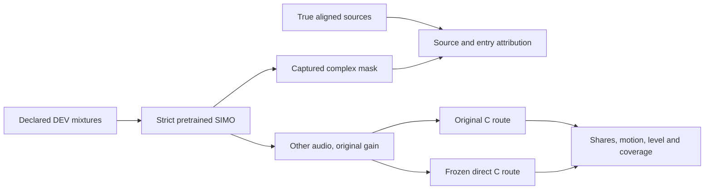

# Pretrained SIMO-BSRNN: source, entry and real-C check

_2026-09-29. Track B, offline PC reference. Protocol fixed before the first evaluation run; no fine-tuning, gain search or Track A port._

## Question and frozen protocol

Does the stronger [pretrained SIMO reference](UPMIX_BSRNN_PRETRAINED_INFERENCE_2026-09-29.md) preserve instruments and reject protected sources well enough to improve the actual renderer? Its four-crop fitting score alone did not answer this.

1. Use the exact original **40 DEV song IDs and 60-second excerpt selection** from `direct_object_full40/manifest.json` and `upmix_stem_tests.load_song`. All of these songs have previously informed development. Do not inspect TEST or describe this as independent validation.
2. Use the same verified optimized SIMO checkpoint and unmodified upstream forward as item 1, strict state load. One globally normalized mixture per excerpt, with its peak restored. For bounded host memory: 11-second chunks, 10-second hop, 1-second linear weighted overlap, checked unity coverage. This declared wrapper schedule is not the upstream CLI's asymmetric fader scheduling and is not a causal inference path.
3. Source attribution captures the **actual complex GLU mask** of the `other` head using forward hooks; no division by a near-zero mixture or isolated-source network inference. Apply that frozen mixture-conditioned operator to true aligned sources through the same STFT/iSTFT, resamplers and overlap weights. Require reconstruction and source-sum closure against the actual predicted audio. Group definitions: vocals; bass; drums **plus percussion**; remaining instrument audio. The old oracle C reference includes percussion as eligible, so its RMS is a contextual reference, not identical target semantics.
4. Render exactly the same predicted `other` audio through the two already frozen C binaries: original control, and host-only direct/no-bed/body-0 at surround **.3235**. Original control retains its declared surround .40. Injection gain **1.0**, no per-song or global gain fit to SIMO. Mixture normalization remains the harness's peak .7. C input is 16-bit PCM; reject rather than silently clip an over-range prediction. Record file and binary hashes.
5. All-source rear metrics use the original harness ownership, one-second range and level regression. Report unique any-stem swing songs and coverage. Absolute gates: guitar .15, keys .15 (also report the owner's optional .12 interpretation), piano .10, strings .14; voice .02, bass .06, drums .08; at most five swing songs; guitar/keys/wind absolute slope .05. No best-gain selection. Rear RMS must remain visible; compare with the saved true-audio reference, with the semantics caveat above.
6. Vocal-entry diagnostic: the existing `diag_transitions.events` detector on true full-song cached vocal, all **40 declared DEV songs**, at most three non-overlapping events per kind/song, pre 4 s, post 8 s, warm 10 s. Infer a frozen operator on each 22-second mixture segment; never infer on isolated stems. Use the existing reanalysed-STFT `per_frame` metric with .5-second bins and −55 dBFS denominator floor. Report entry eligible retention post/pre median/p10 (limits **.85/.60**), absolute pre/post retention, vocal leak early/steady, exits and sustained controls. This is an extractor diagnostic, separate from C rear-share motion.
7. Single GPU tenant with exclusive lease; no package installation or training. Instrument-family labels come from the raw stems for C, while seven-slot caches supply the transition reference. An offline numerical pass would still leave causality, device budget/latency, corpus independence and owner ears open.

## Preflight correction

The first TRAIN smoke emitted a complex-to-real warning: the generic energy helper used `.double()` on complex STFT tensors, dropping imaginary energy. Only the owned evaluator was stopped before a C result was obtained, and the smoke/partial run and logs were preserved with `_aborted_complex_power`. Corrected to `abs().double().square()` and added a pure-imaginary energy assertion to the TRAIN smoke. No data, weights, gain or gate was changed. The corrected smoke and complete run, not the initial smoke marker, are required evidence.

## PC interruption and verified resume

After 12 complete C pairs, the process stopped consuming CPU/I/O for several minutes and the GPU was idle. The exact blocked operation could not be reconstructed in the original process; WinBtrfs file cleanup and the interrupted SSH pipeline are possibilities, not a confirmed cause. Only owned evaluator PIDs 30996/21788 were stopped. PID 21788 retained a single thread/kernel object, but Windows `HasExited` was true; an explicit process-query returned exit status zero and another termination request returned access denied, consistent with an already terminated process. A synchronous-I/O cancellation attempt on its last thread returned 1168 (no request found).

Microsoft documents that [process termination can leave an object until I/O/handle cleanup](https://learn.microsoft.com/en-us/windows/win32/api/processthreadsapi/nf-processthreadsapi-terminateprocess), and [CancelSynchronousIo is a cancellation request rather than a completion wait](https://learn.microsoft.com/en-us/windows/win32/api/ioapiset/nf-ioapiset-cancelsynchronousio). No machine, driver or head unit was restarted/reset.

The resume reuses only complete C pairs with matching mixture/injection/output hashes and valid source closure. Checkpoint, raw harness hashes, song manifest, binaries, chunk schedule and gain must match the original corrected protocol. An exited process is excluded from the active-GPU guard; its owned stale lease is archived before the new exclusive lease. Original protocol/attempt log remain; `resume_protocol.json` records the new executable script and trace file. A detached runner redirects stdout/stderr to C:, and a C: faulthandler log samples the stack every 90 seconds while active; a periodic sample alone is not evidence of a stall. These are execution changes, with no data, source-attribution or metric/gate change. Completed input/output WAVs are not regenerated. Two launch attempts exited before new C work because the original PowerShell runner still held the original D: `Tee-Object` log; foreground execution exposed the file-sharing exception. Only that original runner PID 2528 was stopped after decoding/validating its exact evaluator command. Resumed `Tee-Object` now writes a unique C: log, preserving the held original log. Start-Process/WMI startup returns were not accepted as evidence of running inference.

## Original-harness quiet-stem coverage correction

All 40 C pairs completed, but the strict 231-row assertion stopped evaluation before transitions: the wrapper produced 229 rows. It applied the quiet-stem threshold to raw `stem`, while the original harness compares normalized `lead = stem*k` against raw mixture energy. These expressions are not equivalent when `k` differs from one. The expected prior CSV identified exactly two omissions: **Ben James — Home / other**, and **Holy Magick — Crystal Observatory / percussion**, in both conditions. No other source key differed.

The wrapper now copies the original expression exactly; this restores the predeclared harness rather than changing its acceptance criteria. [CPU coverage repair](../../tools/stereo-upmix-render/bsrnn_reference_coverage.py) verifies every saved mixture/injection/C-output hash, calculates only the missing metrics from existing C WAVs, preserves all 229 existing row values, and backs up the affected row files. Its `coverage_repair.json` records the expected CSV hash, additions and before/after row hashes. No model inference, audio regeneration, gain change or gate selection is part of the repair. The original expression's gain dependence is retained for comparability; this is not a new universal definition of stem audibility.

The first CPU repair attempt found a refactor variable error (`mixture` was no longer in the extracted metrics helper). It exited before any row modification; the helper now takes its mask length from `dry_mix`. This attempt is not accepted repair evidence.

## Native exit during transitions

After 19 songs / 121 saved events, the evaluator exited natively without a Python exception. The C: faulthandler log records **Windows fatal exception: access violation** inside upstream BSRNN's tensor forward. The sampled earlier stacks differ, so those samples do not establish one continuous blocked operation. No live Python or GPU lease remained. The origin of the native failure is unconfirmed; it is not an acoustic failure or evidence of a particular model defect.

The saved transition rows, execution protocol and stdout were preserved before continuation. Event resume validates duplicate keys, song membership, closure and retention algebra; it regenerates the original event detector's event set and requires an exact final key match, then infers only missing events with the same model/precision/schedule. A CPU smoke uses a `None` model to require that all 121 saved events in the first 19 songs are reused without an inference call, and compares every resulting row exactly. Neither corpus, event selection, source metric nor gate changes. The complete C pairs are verified/reused again.

## Execution and results

**Completed:** 40 paired 60-second songs, exactly 231 original-harness stem rows per condition, injection gain 1.0; 265 source-attributed transition/control events across all 40 songs. **SIMO + the frozen direct C route passes all 14 predeclared observed offline gates.** The original C route fails swing count and strings. This is a learned noncausal reference result on previously inspected DEV, not achievement of the product goal.

### Fixed-gain real-C results

These are medians of valid song/stem measurements. The control is the frozen host experiment's original route with predicted SIMO audio; it is **not a fresh measurement of today's deployable Track A configuration**. Both routes use the harness `shipped` table (rear air −12 dB, attack off, front retention .5), q6d and guard, mask drive 1.0. The direct route additionally sets rear body 0 and surround .3235.

| Metric | Original C + SIMO | Direct C + SIMO | Required | Valid shares / stem rows |
| --- | ---: | ---: | ---: | ---: |
| Guitar rear share | .217055 | .200240 | ≥ .15 | 39 / 39 |
| Keys rear share | .179962 | .210830 | ≥ .15 | 27 / 27 |
| Piano rear share | .158039 | .218735 | ≥ .10 | 15 / 15 |
| Strings rear share | .134577 | .204158 | ≥ .14 | 6 / 6 |
| Vocal rear share | .007793 | .002222 | ≤ .02 | 40 / 40 |
| Bass rear share | .013343 | .006993 | ≤ .06 | 28 / 40 |
| Drum rear share | .064881 | .003299 | ≤ .08 | 40 / 40 |
| Unique any-stem swing songs | 11 / 40 | **0 / 40** | ≤ 5 | All 231 rows |
| Guitar level slope / 6 dB | .014107 | .022786 | absolute ≤ .05 | 39 valid |
| Keys level slope / 6 dB | .015343 | .028401 | absolute ≤ .05 | 27 valid |
| Wind level slope / 6 dB | .015522 | .010736 | absolute ≤ .05 | 5 valid |
| Median rear RMS, dBFS | −38.029739 | −37.928726 | Difference ≤ .5 dB | 40 songs |

The direct route passes every frozen **C** gate. The original route fails swing count and strings. The direct-minus-original rear RMS is **+.101012 dB** with the same extractor and gain; the motion reduction is not explained by making the entire rear quiet. No promotion to the car follows from this host result.

Paired song bootstrap, 5,000 samples, fixed seed 1609: all 11 original swing songs resolve and no new one appears. Piano's paired share improvement is +.066, 90% CI [.0424, .0791]; guitar/keys/strings paired median changes across routes do not establish universal improvement. Differences between marginal medians and paired medians must not be conflated. Coverage is especially limited for strings (six songs) and winds (five).

### Matched enriched DEV20 versus sep9

Restrict SIMO's finished full40 CSV to the exact prior enriched 20-song manifest; require **115 identical song/stem keys**. Use the same direct/no-bed/body-0 C route and fixed injection gain 1.0 for both estimators. This subset was already used in development; it is not untouched validation.

| Rear share | Prior sep9 | Pretrained SIMO |
| --- | ---: | ---: |
| Guitar | .105 | .204 |
| Keys | .144 | .228 |
| Piano | .089 | .218 |
| Strings | .188 | .228 |
| Voice | .019 | .002 |
| Bass | .070 | .006 |
| Drums | .016 | .004 |
| Any-stem swing songs | 1 / 20 | 0 / 20 |

Guitar paired delta **+.095**, 90% CI [.0823, .1137]; keys **+.074**, CI [.0417, .0874]; piano **+.104**, CI [.0597, .1213]. The previously observed recall/leak frontier is surpassed by this offline reference on matching material and C routing. Model pretraining, capacity, future context, normalization and head all differ, so this does not identify a winning causal encoder component. Rear RMS is **+1.149227 dB** versus sep9 at the declared fixed gain: this comparison is not level-matched. Protected shares fall despite that rise, and SIMO also satisfies the absolute operating-point gates. No gain sweep or stronger statistical claim is added.

### Remaining failures within the reference

Aggregate passes are not per-song guarantees. Direct-C guitar is .0376 on **Holy Magick — Hungry Mind**; keys .0235 on **Ben James — 1973**; strings .0119 on **Strugzy — RW**. Six valid bass songs exceed .06, with a maximum **.2112** on **Holy Magick — Even Though**. Every valid vocal and drum share is below its aggregate limit. Raw per-song CSVs remain necessary for choosing eventual listening cuts.

Actual-mask source attribution across the 40 excerpts gives median eligible energy transmission **.760908**, vocal **.071496**, drums-plus-percussion **.028737**, bass **.050555**. These are extractor transmissions, not C rear shares. `Other` median SI-SDR is **6.534351 dB**, fixed-gain nSDR **7.468483 dB**. Eligible transmission at 8–14 kHz is **.118433 (−9.265 dB)**, above 14 kHz **.118947**: this reference still loses upper-band instrument energy. Maximum final source-sum NSE is **2.82461×10⁻¹³**; chunk mask parity and source closure passed the declared assertions.

Renderer aliases read back unchanged against the repository: `hssr_model.bin` SHA-256 `96abe57d9ee703f2e39c0231de97580c303ce896ce044b7450c14240002b0a0e`, `hssr_guard.bin` `ab01463e9359f013c4b40f311d630bd20af48d761ad361563cb5246f6bd686ae`. PC modification timestamps precede the run (2026-09-25). C binary, harness, checkpoint and execution hashes are in the protocol records.

### Vocal entries, exits and sustained controls

| Event kind | Events / songs | Valid post/pre ratios | Retention ratio median | Retention ratio p10 |
| --- | ---: | ---: | ---: | ---: |
| Vocal entry | 84 / 36 | 83 | **.875674** | **.745983** |
| Vocal exit | 79 / 35 | 78 | 1.121178 | .972516 |
| Sustained vocal control | 102 / 37 | 102 | 1.000665 | .886347 |

Entry limits **median ≥ .85 and p10 ≥ .60 both pass**. These are medians/percentiles of each event's post/pre ratio, not ratios of aggregate medians. Entry absolute eligible retention is median **.909435 before / .763892 after**. Thus suppression has not disappeared: 27 of 83 valid entries have a ratio below .85, and two are below .60: **Holy Magick — Hungry Mind, 34.0 s (.459905)** and **Strugzy — RW, 14.0 s (.542847)**. These are concrete remaining failure cuts, even though the predeclared distribution gates pass.

One entry (**Holy Magick — It's Your Money, 151 s**) has no valid pre-entry eligible denominator; one exit (**Modified Freq — Fire, 36 s**) has no valid pre/post denominator. Their ratios remain undefined under the frozen −55 dBFS floor and are counted as events but excluded from ratio percentiles; no replacement value is invented. Every detected event key is present exactly once in the final result.

Entry true-vocal transmission has median **.081401 in the first two seconds / .137165 at steady state**. It is an extractor transmission, not rear vocal share; the C chain's low vocal median cannot be attributed to a perfectly vocal-free `other` estimate. Exit eligible retention increases by median 12.1%, and some individual entries still duck strongly. Neither an offline pass nor a noncausal event-aligned chunk schedule establishes the owner's “nothing moves when singing starts” verdict. Maximum event source-sum NSE **6.27170×10⁻¹³**.

### Evidence, verification and terminal state

| Artifact | Record |
| --- | --- |
| Completed numerical verdict | [Final JSON](UPMIX_BSRNN_REAL_C_CHECK_2026-09-29.json) |
| All C stem measurements | [Original CSV](UPMIX_BSRNN_REAL_C_CHECK_2026-09-29_baseline.csv), [direct CSV](UPMIX_BSRNN_REAL_C_CHECK_2026-09-29_direct.csv) |
| Per-song attribution / reconstruction | [Extraction JSON](UPMIX_BSRNN_REAL_C_CHECK_2026-09-29_extraction.json) |
| All events, including invalid ratios and failures | [Transition JSON](UPMIX_BSRNN_REAL_C_CHECK_2026-09-29_transitions.json) |
| Paired song bootstrap | [Two C routes, DEV40](UPMIX_BSRNN_REAL_C_CHECK_2026-09-29_paired_routes40.json), [sep9 versus SIMO, matched DEV20](UPMIX_BSRNN_REAL_C_CHECK_2026-09-29_paired_sep9_dev20.json) |
| Frozen and resumed execution | [Original protocol](UPMIX_BSRNN_REAL_C_CHECK_2026-09-29_protocol.json), [first resume](UPMIX_BSRNN_REAL_C_CHECK_2026-09-29_execution_resume.json), [coverage resume](UPMIX_BSRNN_REAL_C_CHECK_2026-09-29_event_resume.json), [final resume](UPMIX_BSRNN_REAL_C_CHECK_2026-09-29_resume_protocol.json) |
| Quiet-stem restoration | [Coverage audit](UPMIX_BSRNN_REAL_C_CHECK_2026-09-29_coverage_repair.json) |
| Host outputs / attempt logs / original backups | `D:\upmix\runs\bsrnn_reference_check40_v1`, with C: execution/trace logs listed in the protocols |

Local readback independently recomputed all C summaries and gates from the fetched CSVs, all three transition ratio median/p10 statistics from individual rows, exact 231 paired stem keys, 265 unique event keys covering 40 songs, completion/protocol/repair hashes, and the deployed evaluator's source hash. CPU event-resume smoke passed all 121 cached rows exactly without a model call. Accepted complete JSON SHA-256 **`679f1dea7b18ec2017275b1ed8c5ab831ddd23319cdda6c727fc884f45414637`**; final evaluator **`e5ded4764041d9e5ee65ffcbf60b8fc47f2f782427a9121d8889f628ed409c51`**.

Terminal PC readback: **zero active Python, GPU lease absent, rapid queue empty, upstream checkout clean**. No training, shared package change, Track A edit, unit action or owner listening occurred in this evaluation. Failed attempts and recovery are recorded above; their partial markers are not completion evidence.

## Decision and next step

The known numerical frontier is **not an unavoidable property of the target or of the tested corrected C route**: a pretrained learned estimator now passes the observed joint DEV40 gates at fixed gain. The matching-song sep9 comparison supports extraction quality as a remaining limitation of the earlier student. Conversely, identical strong SIMO audio gives 11 swing songs through the original route and zero through the corrected route at +.101 dB median rear level, so renderer routing remains a separate measured cause of instability.

This does not diagnose which combination of corpus, training duration, capacity, complex head, normalization or future context explains the student gap. Optimized SIMO has **108.7 million parameters** and uses unrestricted future within offline chunks. Its extraction quality cannot be assumed to survive ≤150 M measured int8 MAC/s and ≤85 ms total extra latency. No independent untouched-20 result exists here, and the owner has not heard this candidate through live CarPlay.

Next use this executable reference and fixed-gain C evaluation as a quality target for a **matched causal mechanism test**, before compression or head-unit porting. The literature plan's normalized residual causal encoder against the original encoder, using the same fixed trained decoder and exact four TRAIN crops, remains the next proposed controlled diagnostic; it has not been implemented/queued by this check. A positive acoustic result must then survive full DEV, source/entry/C gates, an independently reserved set, and device measurement. No automatic promise that a new encoder will work, no larger device budget, and no imitation of q6d's errors as the sole training target. Track A owns any eventual hook integration; owner blind live CarPlay remains a separate final gate.
