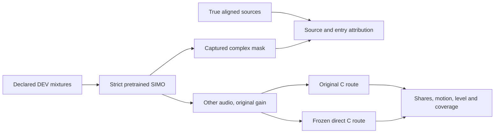

# Pretrained SIMO-BSRNN: source, entry and real-C check

_2026-09-29. Track B, offline PC reference. Protocol fixed before the first evaluation run; no fine-tuning, gain search or Track A port._

## Question and frozen protocol

Does the stronger [pretrained SIMO reference](UPMIX_BSRNN_PRETRAINED_INFERENCE_2026-09-29.md) preserve instruments and reject protected sources well enough to improve the actual renderer? Its four-crop fitting score alone did not answer this.

1. Use the exact original **40 DEV song IDs and 60-second excerpt selection** from `direct_object_full40/manifest.json` and `upmix_stem_tests.load_song`. All of these songs have previously informed development. Do not inspect TEST or describe this as independent validation.
2. Use the same verified optimized SIMO checkpoint and unmodified upstream forward as item 1, strict state load. One globally normalized mixture per excerpt, with its peak restored. For bounded host memory: 11-second chunks, 10-second hop, 1-second linear weighted overlap, checked unity coverage. This declared wrapper schedule is not the upstream CLI's asymmetric fader scheduling and is not a causal inference path.
3. Source attribution captures the **actual complex GLU mask** of the `other` head using forward hooks; no division by a near-zero mixture or isolated-source network inference. Apply that frozen mixture-conditioned operator to true aligned sources through the same STFT/iSTFT, resamplers and overlap weights. Require reconstruction and source-sum closure against the actual predicted audio. Group definitions: vocals; bass; drums **plus percussion**; remaining instrument audio. The old oracle C reference includes percussion as eligible, so its RMS is a contextual reference, not identical target semantics.
4. Render exactly the same predicted `other` audio through the two already frozen C binaries: original control, and host-only direct/no-bed/body-0 at surround **.3235**. Original control retains its declared surround .40. Injection gain **1.0**, no per-song or global gain fit to SIMO. Mixture normalization remains the harness's peak .7. C input is 16-bit PCM; reject rather than silently clip an over-range prediction. Record file and binary hashes.
5. All-source rear metrics use the original harness ownership, one-second range and level regression. Report unique any-stem swing songs and coverage. Absolute gates: guitar .15, keys .15 (also report the owner's optional .12 interpretation), piano .10, strings .14; voice .02, bass .06, drums .08; at most five swing songs; guitar/keys/wind absolute slope .05. No best-gain selection. Rear RMS must remain visible; compare with the saved true-audio reference, with the semantics caveat above.
6. Vocal-entry diagnostic: the existing `diag_transitions.events` detector on true full-song cached vocal, all **40 declared DEV songs**, at most three non-overlapping events per kind/song, pre 4 s, post 8 s, warm 10 s. Infer a frozen operator on each 22-second mixture segment; never infer on isolated stems. Use the existing reanalysed-STFT `per_frame` metric with .5-second bins and −55 dBFS denominator floor. Report entry eligible retention post/pre median/p10 (limits **.85/.60**), absolute pre/post retention, vocal leak early/steady, exits and sustained controls. This is an extractor diagnostic, separate from C rear-share motion.
7. Single GPU tenant with exclusive lease; no package installation or training. Instrument-family labels come from the raw stems for C, while seven-slot caches supply the transition reference. An offline numerical pass would still leave causality, device budget/latency, corpus independence and owner ears open.

## Preflight correction

The first TRAIN smoke emitted a complex-to-real warning: the generic energy helper used `.double()` on complex STFT tensors, dropping imaginary energy. Only the owned evaluator was stopped before a C result was obtained, and the smoke/partial run and logs were preserved with `_aborted_complex_power`. Corrected to `abs().double().square()` and added a pure-imaginary energy assertion to the TRAIN smoke. No data, weights, gain or gate was changed. The corrected smoke and complete run, not the initial smoke marker, are required evidence.

## PC interruption and verified resume

After 12 complete C pairs, the process stopped consuming CPU/I/O for several minutes and the GPU was idle. The exact blocked operation could not be reconstructed in the original process; WinBtrfs file cleanup and the interrupted SSH pipeline are possibilities, not a confirmed cause. Only owned evaluator PIDs 30996/21788 were stopped. PID 21788 retained a single thread/kernel object, but Windows `HasExited` was true; an explicit process-query returned exit status zero and another termination request returned access denied, consistent with an already terminated process. A synchronous-I/O cancellation attempt on its last thread returned 1168 (no request found).

Microsoft documents that [process termination can leave an object until I/O/handle cleanup](https://learn.microsoft.com/en-us/windows/win32/api/processthreadsapi/nf-processthreadsapi-terminateprocess), and [CancelSynchronousIo is a cancellation request rather than a completion wait](https://learn.microsoft.com/en-us/windows/win32/api/ioapiset/nf-ioapiset-cancelsynchronousio). No machine, driver or head unit was restarted/reset.

The resume reuses only complete C pairs with matching mixture/injection/output hashes and valid source closure. Checkpoint, raw harness hashes, song manifest, binaries, chunk schedule and gain must match the original corrected protocol. An exited process is excluded from the active-GPU guard; its owned stale lease is archived before the new exclusive lease. Original protocol/attempt log remain; `resume_protocol.json` records the new executable script and trace file. A detached runner redirects stdout/stderr to C:, and a C: faulthandler log records a stack every 90 seconds if a stall repeats. These are execution changes, with no data, source-attribution or metric/gate change. Completed input/output WAVs are not regenerated. Two launch attempts exited before new C work because the original PowerShell runner still held the original D: `Tee-Object` log; foreground execution exposed the file-sharing exception. Only that original runner PID 2528 was stopped after decoding/validating its exact evaluator command. Resumed `Tee-Object` now writes a unique C: log, preserving the held original log. Start-Process/WMI startup returns were not accepted as evidence of running inference.

## Original-harness quiet-stem coverage correction

All 40 C pairs completed, but the strict 231-row assertion stopped evaluation before transitions: the wrapper produced 229 rows. It applied the quiet-stem threshold to raw `stem`, while the original harness compares normalized `lead = stem*k` against raw mixture energy. These expressions are not equivalent when `k` differs from one. The expected prior CSV identified exactly two omissions: **Ben James — Home / other**, and **Holy Magick — Crystal Observatory / percussion**, in both conditions. No other source key differed.

The wrapper now copies the original expression exactly; this restores the predeclared harness rather than changing its acceptance criteria. [CPU coverage repair](../../tools/stereo-upmix-render/bsrnn_reference_coverage.py) verifies every saved mixture/injection/C-output hash, calculates only the missing metrics from existing C WAVs, preserves all 229 existing row values, and backs up the affected row files. Its `coverage_repair.json` records the expected CSV hash, additions and before/after row hashes. No model inference, audio regeneration, gain change or gate selection is part of the repair. The original expression's gain dependence is retained for comparability; this is not a new universal definition of stem audibility.

The first CPU repair attempt found a refactor variable error (`mixture` was no longer in the extracted metrics helper). It exited before any row modification; the helper now takes its mask length from `dry_mix`. This attempt is not accepted repair evidence.

## Execution and results

_Pending execution. This protocol is not a numerical result or product promotion._
