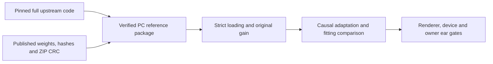

# BSRNN reference intake — 2026-09-29

**Subsequent item 1 completed:** [Pretrained inference report](UPMIX_BSRNN_PRETRAINED_INFERENCE_2026-09-29.md). Five checkpoints strictly loaded and four TRAIN excerpts processed, with original-gain WAVs and runtime audit. The download-only state and dependency inventory below describe the earlier intake snapshot. Neither model is an Audi candidate.

## Scope and result

The owner redirected the proposed custom causal-encoder work: **download a complete BSRNN implementation first**. Completed: full upstream source, training/evaluation/inference configs, BSRNN-large checkpoints and optimized SIMO-BSRNN checkpoints. No downloaded model was executed, trained or adapted. No dependency installation, dataset evaluation, Track A change or head-unit operation occurred.

Selected source: [magronp/bsrnn](https://github.com/magronp/bsrnn), pinned at `94adc8c184ac9b1d2e496fcb6e78cfe3fb78fc9c`. This is the replication authors' open implementation, **not the original BSRNN authors' complete training pipeline**. It supplies the full pipeline and public pretrained weights; it replaces our simplified BandSepNet as the code reference for subsequent comparison.

Weights: [Zenodo record 17516442, version 3](https://zenodo.org/records/17516442). The publisher identifies MUSDB18-HQ as the training corpus. Code is MIT; weight metadata specifies CC-BY-4.0. Both sets are PC references, not causal or budget-qualified Audi candidates.

## Locations and selected bundles

| Item | Verified location |
| --- | --- |
| Full PC code | `D:\upmix\third_party\bsrnn_reference\code` |
| BSRNN-large, four source checkpoints | `D:\upmix\third_party\bsrnn_reference\weights\bsrnn-large\bsrnn-large\{vocals,bass,drums,other}.ckpt` |
| Optimized SIMO, one four-source checkpoint | `D:\upmix\third_party\bsrnn_reference\weights\simo-bsrnn-opt\simo-bsrnn-opt\separator.ckpt` |
| Original archives | `D:\upmix\third_party\bsrnn_reference\archives` |
| PC provenance and hashes | `D:\upmix\third_party\bsrnn_reference\INTAKE_COMPLETE.json` |
| Full Mac code, same clean revision | `/Users/luka/Desktop/AUDI_2/Research/bsrnn-reference` |
| Repository copy of the intake manifest | [Public provenance and checkpoint hashes](UPMIX_BSRNN_REFERENCE_INTAKE_2026-09-29.json) |
| Reproducible downloader | [download_bsrnn_reference.py](../../tools/stereo-upmix-render/pc/download_bsrnn_reference.py) |

The repeated bundle directory names come from the upstream ZIP layout. Do not point inference at the parent directory: the actual `.ckpt` files are one level deeper.

BSRNN-large gives a reference closer to the original architecture. SIMO supplies an optimized shared model for all four sources, useful for later source-ownership comparison. The separate `bsrnn-opt.zip` bundle was not fetched; these two selected bundles cover the original-style and optimized shared references.

## Integrity checks

| Archive | Bytes | Published MD5, matched | Computed SHA-256 |
| --- | ---: | --- | --- |
| `simo-bsrnn-opt.zip` | 1,213,413,202 | `817e8ce4bcd17c38bd3812167e97db58` | `8699cf8834aab285edb9a303699b0d1727fe5e594a8c1d7c6dbdb45b6e42e012` |
| `bsrnn-large.zip` | 1,627,580,581 | `0d1e298e725bf45577a4f61e0a30c2b1` | `d091c2b31acb5cf456ddf8d04ec4e7cec9df78217a1462582847de96983b3656` |

Total archive payload: **2,840,993,783 bytes**. Every ZIP member passed CRC (2 SIMO members, 5 large-model members). Extracted checkpoint count is exactly **1 + 4**; each checkpoint has a separate size/MD5/SHA-256 in the manifest. Extraction markers are written only after verification. Checkpoints were **not unpickled**, and state-dict compatibility, model loading, inference quality and training reproduction remain unverified.

The downloader uses only the Python standard library and Git. Eight explicit byte-range requests improved transfer speed from about 1.1 MB/s to roughly 10–20 MB/s. Each range must match its requested offset/end/total, then the assembled archive must match the publisher's size and MD5 before extraction. Source revision and clean checkout are checked. A per-root OS file lock prevents two downloaders writing the same artifacts; a second invocation was verified to fail before network work.

### Interrupted download and recovery

The initial serial download was slow. A replacement-script transfer exceeded the Windows command-line limit and failed before stopping the serial process; an incorrectly sequenced relaunch briefly created a second serial downloader. Both **owned downloader processes only** were then stopped. Their shared, unverified partial was preserved as `archives\simo-bsrnn-opt.zip.part.serial_conflict` and was not reused or promoted. Transfer was changed to send the script over stdin, and download restarted with independent ranges and an exclusive file lock. The final archives passed the checks above. No training process was stopped.

The completed transfer used downloader SHA-256 `80fdc865df2199afdc23a1cc1ecddb3a70ffb6e121d76f0bf775081733789873`. After completion, the source acquisition step was changed to fetch only the pinned Git commit rather than redundant full history. The current repository/PC downloader copies match SHA-256 `f7ed036565bc6bacbadb7558ef3d26fa521adea256ff0c95ea64954c4e94c286`. The downloaded upstream code itself remains unmodified and clean at the same commit.

## Runtime readiness and traps

| Check | Finding | Required action before an inference claim |
| --- | --- | --- |
| Architecture configs | Large and optimized SIMO use 128 features, 12 repeats and bidirectional time recurrence | Treat as offline references; a causal adaptation needs its own experiment |
| Installed PC packages | `torch` and `torchaudio` are `2.11.0+cu128`; Lightning, Hydra, museval, musdb and codecarbon are absent | Prepare an isolated compatible reference environment or an audited loader; do not install the entire upstream requirements into the shared PC environment |
| Upstream requirements | Pin torch/torchaudio 2.7.0 | Do not downgrade the shared 2.11 training stack |
| Missing checkpoint behavior | Upstream instantiation falls back to random initialization when a path is missing | Require every requested checkpoint before inference and prohibit this fallback in the benchmark wrapper |
| Loading behavior | Upstream loader uses `strict=False` | Audit missing/unexpected keys and shapes before accepting a pretrained run |
| Output gain | CLI peak-normalizes the mixture; its output-saving path does not restore the outer input peak | Preserve/restore the original input gain explicitly in the evaluation wrapper; do not use saved CLI WAVs as a stable-gain product comparison unchanged |

The last three findings come from the pinned [instantiation helper](https://github.com/magronp/bsrnn/blob/94adc8c184ac9b1d2e496fcb6e78cfe3fb78fc9c/models/instanciate_src.py), [separation CLI](https://github.com/magronp/bsrnn/blob/94adc8c184ac9b1d2e496fcb6e78cfe3fb78fc9c/separate.py) and [saving helper](https://github.com/magronp/bsrnn/blob/94adc8c184ac9b1d2e496fcb6e78cfe3fb78fc9c/helpers/data.py). These are source-audit observations, not a completed audio experiment or evidence that the supplied weights are incompatible.

## Next step and terminal state

Before implementing another simplified encoder, establish a **strictly loaded, gain-correct upstream pretrained PC reference** on declared TRAIN excerpts. Record source/target semantics: four-stem `other` is not every rear-eligible cache role. Keep the 20 untouched DEV songs and DSD Test uninspected during loader/debug work. Then use the [research protocol](UPMIX_RESEARCH_REVIEW_2026-09-29.md) to decide how to adapt the useful structure causally and test the original fitting gap. A noncausal pretrained win does not prove causal learnability or compression to 150 M MAC/s.

Post-download inventory: **zero Python processes, no GPU lease, zero rapid queued jobs**. No inference/training was started. The first custom causal reference/control experiment remains unimplemented. All head-unit compute/latency, full real-C, untouched-set and owner listening gates remain open.
