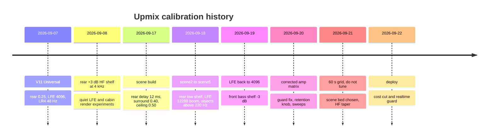

# Upmix Calibration and Tuning

> **Retired 2026-10-09 with the Universal backend.** The renderer, models and knobs this note describes left the tree; the last tree that has them is git tag `upmix-universal-last-2026-10-09`.
> What runs now: [Stereo to 5.1 Upmix](STEREO_TO_5_1_UPMIX.md). Why, and with which numbers: [Upmix History and Results](UPMIX_HISTORY_AND_RESULTS_2026-10-09.md), [Upmix Code Retirement](UPMIX_CODE_RETIREMENT_2026-10-09.md).
> The LFE, amp and measurement facts below remain valid.

*How every shipped upmix value was reached — the bass complaint, the corrected amp matrix, the 60-second one-lever grid, the Dolby-principle scene bed and the treble taper — plus the offline method to measure the next change. Ledger for 2026-09-07 → 2026-09-22.*

---

## 📋 The decision on record

**Luka, 2026-09-21 morning: the current calibration is OK for now — do not tune.** The rules that came with it:

- No defaults, env values or deploys change without Luka's word.
- Any later change only after he has listened, and only **one lever at a time** (table below).
- The float candidate (surround 0.30 / front bass −1 / retention 0.75) is **not** to be applied: it was a +1.9 dB bass increase, not a bass fix.
- Level discipline: every level lives in env and `carplay_startup.sh`; never move a default inside a feature commit without a line in the status log (`UPMIX_Q4_SECOND_SCENE_STATUS.md`).

Later on 2026-09-21 he chose the scene-bed variant after a headphone A/B (`output/listen-bed-20260921/`, four 60 s cuts, seven variants): retention 0.5, bed delays on, owner attack, collapse 0.75, everything else unchanged. In the car that evening the front sounded too bright ("a bit too much treble, especially on the first Spotify stream; the problem is in the front; everything else sounds very decent"), which led to the retention HF taper. After the 2026-09-22 deploy: "everything was great". The shipped table with code citations is in [Stereo to 5.1 Upmix](STEREO_TO_5_1_UPMIX.md#-the-shipped-calibration); the deploy chronology in [Upmix Listening and Deploy Log](UPMIX_LISTENING_AND_DEPLOY_LOG.md).

### Symptom → one lever

Per-step effects are the measured 60 s model deltas below; every lever is an env line in `carplay_startup.sh`, applied at the next phone connect, no reboot.

| Symptom | Lever | Effect per step `[model]` | Side effect |
|---|---|---|---|
| too much bass | `AUDIO_STEREO_FRONT_BASS_DB` −3 → −4 / −5 | woofers −1, sub −1.1 dB per dB | none |
| too little bass | same, −3 → −2 | +1 / +1.1 dB | none |
| front empty, vocal sunk | `AUDIO_STEREO_FRONT_RETENTION` 0 → 0.25…0.5 | front mid ≈ +0.8…+1.5 dB, bass 0 | rear +0.4…0.7, centre +1…2, higher peaks; avoid 0.75 |
| too much rear | `AUDIO_STEREO_SURROUND` 0.40 → 0.30 | rear −0.5, front mid +0.6, centre +1 | bass 0 |
| front treble too bright | `AUDIO_HSSR_RETENTION_HF` (default 1000:2500) | 1500:4000 returns about a third of the treble | rear bit-identical |

---

## 🔄 How the values were reached

*Timeline of every calibration change that reached the car or the startup script.*



| Date | Change | Why | Evidence |
|---|---|---|---|
| 09-07 | V11 Universal: rear 0.25, LFE assist Q15 4096 (LR4 48 Hz), front gain 31392 with LFE | the one-algorithm cleanup; older 95 Hz punch branch removed | `STEREO_TO_5_1_UPMIX_DESIGN` |
| 09-08 | Ls/Rs RBJ high shelf +3 dB, 4 kHz midpoint (+1.5 dB at 4 kHz, → +3 dB above 8 kHz) | rear tweeters sounded subdued | `stereo_upmix.c:43-53` |
| 09-17 | scene: rear delayed 576 frames (12 ms), rear ceiling 0.25 → 0.50, surround 0.40 | "second scene" by precedence | on car 09-17: "gorgeous, bright objects behind" |
| 09-17 | rear low shelf −4 dB @ 500 Hz before the transfer | the "bass" Luka turned down was 350–800 Hz from the rear door woofers | `stereo_upmix.c:32-41` |
| 09-17→18 | LFE corner 48 → 60 Hz and level 4096 → 12288 (+9.5 dB) | close a modelled 48–62 Hz dip (transposed-matrix reasoning) | the boom — the **level** was reverted 09-19; the 60 Hz corner stayed (`stereo_upmix.c:23-31`) |
| 09-18 | objects and universal ramp start at 220 Hz (was 125) | Radio bass in rear 7.0 → 5.6 % | synth-bass harmonics still pass (semantic miss) |
| 09-19 | LFE default back to 4096 + `AUDIO_STEREO_LFE_GAIN` (dB re 4096) | +9.5 dB sub was the "bass everywhere" | `stereo_upmix.h:35`, `audio_hook.c:277-296` |
| 09-19 | front-only RBJ low shelf 200 Hz, `AUDIO_STEREO_FRONT_BASS_DB=-3` | ≈ "MMI Bass −30 %" for CarPlay only; restores the front bass/mid ratio | test: 60 Hz −3.0 dB, 3 kHz 0.0, LFE bit-identical |
| 09-20 | corrected guard table, retention knob | matrix orientation correction | [The corrected matrix changed the diagnosis](#the-corrected-matrix-changed-the-diagnosis) |
| 09-21 | S16 only; float/cabin/quiet paths deleted (`9255485`, −837/+165 lines, S16 byte-identical) | the float candidate was a bass increase | 60 s grid |
| 09-21 | retention 0.5, bed delays, owner attack 0.75 | headphone A/B | [🎯 The scene bed — Dolby principles ported](#-the-scene-bed--dolby-principles-ported) |
| 09-21 | retention HF taper 1000:2500 Hz (`48b9851`) | bright front | same section |

**Surround history:** every hook since `2f4b677` clamped surround to 0.25 until the scene build; the 09-17 scene hook logged `rearGainQ15=13107` = 0.40. In the 09-17 bus model (pre-correction matrix; the Ls → Ls-bus diagonal is unaffected) at 0.40 the rear bus rises +4 dB from 350 Hz up (the amp's Ls → Ls-bus gain is +6 dB, PCM 0.40 → bus 0.80): 350–800 Hz went from 3–9 dB below the front to level, 800 Hz–4 kHz ended 3–5 dB **above** the front. 0.50 leaves no rear-bus headroom (−0.1 dBFS peaks), so 0.40 stayed.

---

## 🔍 The bass complaint, traced

**What Luka reported:** 09-17 the MMI Bass knob had to come down after the scene deploy; 09-19 at Bass 0 modern masters "boom from every speaker", Bass had to go to −30 %; the Subwoofer knob is fine and he does not want to touch it; he wants bass guitar to stay audible behind. The 19.09 handoff warned the next agent: the 09-18 build shipped a +9.5 dB sub change nobody announced, and the six-bus cabin model gave a wrong bass diagnosis for a day.

Two independent causes were found:

1. **The +9.5 dB LFE** in the 09-18 build (`ccb09c6`). Modelled sub 20–60 Hz −4.5 dB re input vs woofers −17 dB. Returning 12288 → 4096 lowers modelled sub 20–60 Hz by 9.54 dB. But the complaint predates 12288, so this cannot be the whole story.
2. **Our transfer policy depletes the front midrange while bass survives.** The code is `front = dry·front_gain − 2.5·surround·shelved_source`; at surround 0.40 the source-subtraction multiplier is exactly 1, and low bass is protected from transfer. Seven held-out tracks, 60 s, current renderer, surround 0.40, dry reference = L/R-only PCM6 through bank 1 — run on 09-19 through the **pre-correction (transposed) AmpChain**, so the group numbers below are historical `[model]`:

| Renderer variant | Woofer 60–120 Hz | Front mid 500–2000 Hz | Bass/mid shift |
|---|---:|---:|---:|
| LFE 12288, no front shelf | −0.79 dB | −3.59 dB | +2.80 dB |
| LFE 4096, no front shelf | −0.52 dB | −3.59 dB | **+3.07 dB** (every track +1.02…+4.47) |
| LFE 4096, front shelf −3 dB | −3.46 dB | −3.61 dB | **+0.15 dB** (per track −1.91…+1.53) |
| same 4096 render, LFE zeroed afterwards | −0.38 dB | −3.59 dB | +3.21 dB |

The PCM-level measurement is unaffected by the matrix and stands: L/R 60–120 Hz −0.38 dB, 500–2000 Hz −4.38/−4.57 dB — the imbalance is created by the upmix before the amp, so lowering LFE alone cannot restore it. Through the **corrected** matrix the shift is larger (+4.30 dB) and the −3 dB front shelf leaves +1.43 dB (next section): the shelf helps but does not close the gap, and it is no proof that "MMI Bass −30 %" equals −3 dB.

**Where the midrange goes** (seven cached clips, corrected v7 chain) `[model]`: before the amp, mean L/R 500–2000 Hz is already −4.483 dB (tracks −7.054…−1.709); the front gain 31392/32768 explains only −0.373 dB. After the amp the front mid is −4.684 dB, all from the authored front channels; the centre mid is −4.812 dB, of which −0.663 dB is **less constructive L+R summation** (still positive on every clip: dry +1.84…+2.78 dB, authored +0.72…+2.24 dB — not a phase inversion). A diagnostic blend `front' = (1−α)·cached + α·gain·delayed_dry` shows the trade:

| Metric | Existing | α 0.5 | α 1.0 |
|---|---:|---:|---:|
| Front mid 500–2000 Hz | −4.684 | −2.664 | −0.373 |
| Centre mid 500–2000 Hz | −4.812 | −2.665 | −0.373 |
| Front woofers 60–120 Hz | −0.380 | −0.377 | −0.373 |
| Rear doors 500–2000 Hz | +0.125 | +0.849 | +1.896 |
| Bass/mid tilt | +4.303 | +2.287 | ≈ 0 |
| Max modelled output peak | +4.727 dBFS | +4.831 | +5.351 |

Restoring the front mid also raises the rear speakers, because the corrected matrix feeds the rear bus from front L/R too — leaving rear PCM unchanged does not leave the rear speakers unchanged. This diagnostic became the `front_retention` knob.

### The corrected matrix changed the diagnosis

On 2026-09-20 the amp's A07 input matrix was found transposed in every model up to AmpChain v6 (rows are **outputs**; see [Virtual Cabin and Amp RE](VIRTUAL_CABIN_AND_AMP_RE.md#-the-input-matrix)). Consequences for tuning `[model]`:

| Seven-track mean vs dry bank 1 | LFE 0 / front 0 | LFE +9.54 / front 0 | LFE 0 / front −3 |
|---|---:|---:|---:|
| Front woofers 20–60 Hz | −0.374 | −0.374 | −3.357 |
| Front woofers 60–120 Hz | −0.380 | −0.380 | −3.278 |
| Sub 20–60 Hz | −1.290 | −2.746 | −4.715 |
| Sub 60–120 Hz | −1.197 | −3.038 | −4.459 |
| Front mid/treble 500–2000 Hz | −4.684 | −4.684 | −4.703 |
| Centre mid 500–2000 Hz | −4.812 | −4.812 | −4.840 |
| Rear doors 500–2000 Hz | +0.125 | +0.125 | +0.105 |

- Baseline bass/mid tilt **+4.303 dB** (tracks +1.285…+7.159); front −3 brings it to +1.425 but does not fix the mid loss.
- Re-inserting only the old transpose reproduces the historical v2 band powers exactly (0.0 dB); corrected minus transposed sub 20–60 Hz is +14.98 / +14.66 dB on Boost Up / Crazy Train.
- **Zeroing LFE raises the modelled sub** (+1.27 / +1.26 dB at 20–60 Hz, +0.90 / +0.75 at 60–120): LFE sums destructively with the other contributions in this fixed linear chain. The louder LFE variant *lowers* seven-track sub 20–60 Hz by 1.457 dB. So "sub only from LFE / no LFE = silent sub" is false and lowering LFE is not a standalone bass fix.
- Input-EQ bank 10 vs 7 moves woofers/sub by about +5.9 dB — more than every upmix lever combined; neither bank is proven active in the car.

**Withdrawn, because they came from the transposed reading:** "sub gets only our LFE"; "front woofers sum L/Ls/C/LFE"; "the centre is a third door playing mono bass at full level"; "the amp returns 0.708·Ls into the front, a 12 ms comb (±3 dB, 83 Hz spacing, 300–3000 Hz)". In the corrected matrix Ls does not reach the front bus; instead **L reaches the rear bus at −3 dB**. The front-echo pre-compensation (`−0.891·rear_delayed` into the front) had already been rejected on 09-17 — it put an anti-phase 12 ms copy of rear objects into the centre (+4…5 dB at 4–16 kHz), worse than the echo it removed.

The same audit found the C guard table stale in 22 of 48 coefficients (e.g. L → centre bus 0.501 vs corrected 0.398; L → rear bus 0.0000112 vs 0.708) and the S16 LFE limiter using the old topology. Both were rewritten against the extracted matrix, checked on 729 signed corners plus 20 000 random PCM6 frames per guard mode; S16 now first reduces LFE within its sign/magnitude and, if that cannot bound all eight buses, linked-attenuates all six channels (ceiling 32275, 8 units reserved for quantization).

---

## 📊 The 60-second grid

On 2026-09-21 a first music check used **six-second prefixes** (56 rows: 7 tracks × input-EQ 7/10 × dry / front bass 0 / startup / float candidate, `full_static_nearest_zero_aux`). Its tilts (front bass 0 → +1.85 dB, startup −1.01, float candidate −0.46) looked like a bass problem at front bass 0 — and were then withdrawn by the 60 s grid, because four of seven prefixes were quiet intros (peaks −4 to −17 dBFS).

The 60 s grid: seven cuts, 60 s + 4 s zero tail, EQ 7 only, baseline = startup settings at unity programme gain, four variants each changing **exactly one** control, plus dry bank 1. 42 rows, three shards, ≈ 11.5 min per row, ≈ 6.4 GB peak per shard, ≈ 3.5 h total, ≈ 10 GB on disk.

| Track | startup 6 s | startup 60 s | bass0 6 s | bass0 60 s | startup peak 6 s → 60 s |
|---|---:|---:|---:|---:|---:|
| Boost Up | +0.50 | −0.03 | +3.30 | +2.86 | −16.51 → +3.14 dBFS |
| Crazy Train | −2.62 | −0.40 | +0.24 | +2.45 | +0.31 → +1.20 |
| Deep Down Low | −2.24 | −1.29 | +0.61 | +1.58 | +3.65 → +4.73 |
| Heart-Shaped Box | −2.58 | +2.26 | +0.36 | +5.18 | −11.71 → −3.64 |
| The Blue-Eyed Devil | −0.41 | −1.77 | +2.46 | +1.12 | +2.13 → +3.71 |
| UP. UP. UP. | −0.12 | +3.16 | +2.78 | +6.03 | −8.35 → +1.23 |
| take your vibes and go | +0.39 | +1.60 | +3.23 | +4.44 | −3.69 → +1.57 |
| **mean** | **−1.01** | **+0.50** | **+1.86** | **+3.38** | |

Six-second prefixes understated the tilt by ≈ 1.5 dB on average and up to 4.8 dB on a track. Every 6 s conclusion is withdrawn.

### One lever at a time

Variant minus startup, mean over seven tracks [min, max], dB `[model]`:

| Changed | Woofer 60–120 | Sub 20–60 | Sub 60–120 | Front mid | Rear 500–2000 | Rear 2–8 k | Centre mid | Tilt | Peak |
|---|---:|---:|---:|---:|---:|---:|---:|---:|---:|
| front bass −3 → 0 | +2.90 [2.86, 2.94] | +3.43 [2.95, 3.61] | +3.26 | +0.02 | +0.01 | −0.01 | +0.03 | +2.88 | +0.04 |
| surround 0.40 → 0.30 | 0.00 | 0.00 | 0.00 | +0.62 [0.21, 1.21] | −0.58 [−1.45, 0.05] | −0.51 | +0.95 [0.36, 1.48] | −0.62 | +0.18 |
| retention 0 → 0.75 | +0.01 | 0.00 | 0.00 | +2.43 [0.78, 4.49] | +1.15 [0.84, 1.41] | +0.73 | +3.27 [1.30, 4.92] | −2.42 | +0.66 [0, 1.82] |
| S16 → float | −0.29 | −0.05 | −0.19 | −0.10 | −0.16 | −0.19 | −0.10 | −0.18 | −0.08 |

- **Front bass is the only lever that moves bass, and it moves the modelled sub too** (+3.3…3.4 dB for a 3 dB shelf change). The startup comment "sub and rear untouched" (`carplay_startup.sh:69`) describes the PCM, not the amp output.
- **Retention never touches bass.** Its −2.42 dB tilt is entirely front-mid restoration, and it raises rear, centre and peaks. It is a front/centre level control.
- **Float** was a small global reduction plus lower PCM6 peaks (−0.57 dB) from its linked −1 dBFS rail — its guard was active on every track over 60 s (minimum gain 0.26 on Deep Down Low, 293 700 of 3.07 M frames). S16 emits no guard telemetry: clean S16 PCM6 does not mean no internal limiting.
- The old float candidate was retention (mid restore) + surround 0.30 (rear cut) + front bass −3 → −1 (**+1.9 dB bass**); its "−0.46 dB tilt" was not a bass reduction.

**Level-matched view** (mean vs dry): startup is ≈ 3 dB **quieter** than dry broadband through the same chain (front mid −3.8, woofers −3.3, sub −4.7) while the modelled rear-door band stays at the dry level (−0.07). The upmix does not make the rear louder; it makes the front quieter. Matched at the front-mid anchor: rear +3.7 dB, sub −0.9 dB vs dry.

**Tails:** all 42 rows below −80 dBFS from the second 250 ms tail window and exactly zero from ≈ 1.25 s; PCM6 exactly zero ≤ 49 ms after the programme (11 ms for dry). No state accumulation; a 1 s tail suffices from now on.

**Peaks:** worst raw sample peaks (Deep Down Low, cfg 0) dry +6.35, startup +4.73, bass0 +4.88, surr30 +4.80, retain75 +5.13, float +4.26 dBFS; six of seven tracks exceed 0 dBFS in every row including dry. The model runs gain 1 and a limiter threshold of 100, so this flags the assumed level budget, not hardware clipping. Dry carries 25 641 near-rail samples inherited from the masters; upmix rows carry none.

<details>
<summary><strong>📊 Earlier sweeps on 2026-09-20 (history)</strong></summary>

**Retention sweep, float, surround 0.40, front bass 0, 7 tracks, v7 chain** — mean dB vs dry bank 1:

| Metric | S16 r0 | Float r0 | r 0.50 | r 0.75 | r 1.00 |
|---|---:|---:|---:|---:|---:|
| Front mid 500–2000 | −4.681 | −4.856 | −2.880 | −1.723 | −0.662 |
| Centre mid 500–2000 | −4.814 | −4.969 | −2.857 | −1.696 | −0.633 |
| Front woofers 60–120 | −0.385 | −0.840 | −0.833 | −0.843 | −0.869 |
| Sub 20–60 | −1.291 | −1.422 | −1.424 | −1.437 | −1.467 |
| Rear doors 500–2000 | +0.090 | −0.152 | +0.567 | +1.051 | +1.557 |
| Bass/mid tilt | +4.296 | +4.017 | +2.047 | +0.880 | −0.207 |
| Max modelled peak | +4.727 | +4.029 | +4.242 | +4.330 | +4.964 dBFS |

Guard-attenuated frames 10.8 / 11.7 / 13.4 / 16.7 % for r 0 / 0.5 / 0.75 / 1.0; minimum instantaneous gain 0.2536 (−11.9 dB) at 0.75. A further constant 5.34 dB post-guard attenuation would have been needed to keep the modelled output below −1 dBFS on this corpus.

**105-render grid** (retention 0.50/0.75/1.00 × rear 0.30/0.35/0.40, then bass/LFE around 0.75/0.30):

| Retention | Rear | Tilt | Rear delta | Max post-EQ peak | Frames attenuated |
|---|---:|---:|---:|---:|---:|
| 50 % | 0.30 | +1.553 | 0.000 | +4.292 | 9.6 % |
| 50 % | 0.40 | +2.047 | +0.567 | +4.242 | 11.7 % |
| 75 % | 0.30 | +0.679 | +0.469 | +4.481 | 11.3 % |
| 75 % | 0.40 | +0.880 | +1.051 | +4.330 | 13.4 % |
| 100 % | 0.30 | −0.134 | +0.933 | +4.964 | 14.3 % |
| 100 % | 0.40 | −0.207 | +1.557 | +4.964 | 16.7 % |

At 75 %/0.30 the LFE gain was **not monotonic** on the sub: assist 0 dB −1.381, −6 dB −0.933, +6 dB −2.191, off −0.198 dB (off also raises front gain); pure channel-3 zeroing +0.917 dB on average. Bass −1 cut guard occupancy 11.3 → 5.0 % but raised the post-EQ peak +4.481 → +4.701 dBFS (weaker input limiting, higher downstream peaks). EQ/B stress (392 measurements, arbitrary ±0.25 donors) moved candidate tilt by at most 0.036 dB, while bank 10 vs 7 on dry raised woofers +4.98 dB and sub +5.72 dB. Twenty-eight level-matched PCM6 comparison files exist (front-mid matched to 0.0000046 dB, peaks ≤ −1.1999 dBFS) in `output/upmix-tuning-matched-final-20260920/pcm/`; nobody listened to them.

**End-to-end six-second prefixes** (70 rows, v7 vs composed first-B scenario): S16 reference tilt +1.371 / +1.422, float retention 75 % / surround 0.30 / bass −1 −0.356 / −0.344; composed peaks near +21 dBFS came from synthetic unity spectral controls; with the retained B01 first-B controls the same candidates gave +1.077 → −0.461 dB tilt and ≤ +3.8 dBFS peaks. The aux/adaptive probe on Deep Down Low (bank 10) peaked +22.09 dBFS dry with zero aux and +31.99 dBFS with synthetic aux + adaptation (first-B six-tail +11 / +9 / +1 dB gains against unity spectral branches); with retained B controls the probe peaks fell to +16.8 / +15.3 / +14.2 dBFS. The static-numerics pass (firmware log/pow tables, stored FFT table at complex stride 2, 31 interpolated fields, 313 coefficient updates per 512-sample mode-5 call) changed a 512-row synthetic state grid by at most 1.25e-9 and music by 1.19e-7 — no effect on any tuning conclusion. None of these became a preset.

</details>

---

## 🎯 The scene bed — Dolby principles ported

Dolby's surround kernel never sends the dominant object rearward: the directed part stays put and only the **residual** (plus anti-phase) goes back. Our second scene deliberately does send objects back (Luka accepted that product), so the three Dolby principles were mapped onto HSSR's three rear terms — the **object** (`mask·steer·proj`, fully subtracted from the front at retention 0 because 2.5·0.40 = 1), a small side **ambience** (≤ 0.04) and the **universal bed** (rotated mid + diffuse layer + percussion presence, ≤ 0.55·makeup, not subtracted). The source teardown is [DOLBY_ATMOS_TEARDOWN](../research/DOLBY_ATMOS_TEARDOWN.md); the model-side description is [HSSR Model](HSSR_MODEL.md#scene-bed-distribution).

**Principle 1 — energy on transfer** (no code; it is the retention knob). The object keeps `r` in front and gets `b` in the rear; energy is conserved at `r* = sqrt(1 − b²)`:

| b (rear) | r* | object front share |
|---:|---:|---:|
| 0.30 | 0.954 | −0.4 dB |
| **0.40** | **0.917** | **−0.75 dB** |
| 0.50 | 0.866 | −1.25 dB |

At r = 0.917 the object localizes in front (front 7.2 dB louder and 12 ms earlier), so `r*` is an upper bound, not a target: pick the largest r at which the object still reads as behind. The planned 0.5 / 0.917 grid was not finished; listening chose r = 0.5. No makeup gain after the transfer — model peaks were already +4.7 dBFS.

**Principle 2 — per-band bed delays** (`AUDIO_HSSR_BED_DELAYS`). Only the bed is decorrelated; objects stay coherent. A 16-hop per-bin ring (43 ms, ≈ 66 KB), per-band delays in 2.667 ms hops, different for Ls and Rs, mixed `0.79·now + 0.60·delayed_same − 0.14·delayed_opposite` (unit energy for uncorrelated copies) `[code]` (`hssr_dsp.c:53-64`, `:1192-1240`):

| Bands | Hz | Ls hops / ms | Rs hops / ms |
|---|---|---:|---:|
| 0–4 | 0–220 | 12 / 32 | 15 / 40 (bed ≈ 0 here) |
| 5–9 | 220–680 | 9 / 24 | 7 / 18.7 |
| 10–13 | 680–1450 | 4 / 10.7 | 6 / 16 |
| 14–17 | 1450–3000 | 2 / 5.3 | 3 / 8 |
| 18–31 | 3 k–24 k | 1 / 2.7 | 2 / 5.3 |

The shape follows Dolby's residual delay tables; the absolute scale assumes Dolby's delay unit is 64 samples, which is **unproven** — if the kernel period is 1024 samples the Dolby delays are 64–660 ms (not decorrelation) and this table must be revised. The previous fixed per-bin phase rotation (12–45°) was a sub-millisecond effect, not decorrelation at this scale.

**Principle 3 — attacks gather in one place** (`AUDIO_HSSR_BED_ATTACK`, `AUDIO_HSSR_ATTACK_COLLAPSE`). Luka's formulation 09-21: the point of the attack rule is not "forward" but "together" — a hit must come from one place, not from two with delays. Dolby's residual has no owner, so it always gathers forward; ours knows the band owner. Detector per band: `H ← βH + (1−β)E`, `target = clamp(0.5017·log2(0.5012·E/H), 0, 1)` (0 at ≤ +3 dB, 0.5 at +6, 1 at ≥ +9 dB), `w = max(target, β·w)`, β = 0.98169² = 0.9637 per hop (≈ 73 ms if the 64-sample unit holds) (`hssr_dsp.c:65-66`, `:1171-1189`). Owner = `smoothstep(best_score, 0.04, 0.28)`.

| Band state | Steady | On a hit (w → 1) |
|---|---|---|
| second-scene object owns it | object front `r`, rear `b`; bed delayed and undelayed | object gathers **rear**: `r_eff = r·(1 − c·w)`; delayed bed copies × `(1 − w)` |
| no owner | bed to rear, delayed and undelayed | gathers **front**: delayed copies × `(1 − w)`, undelayed bed × `(1 − 0.61·w)` (0.39 at w = 1, as Dolby) |

`front` mode is the pure Dolby reference (everything forward). With attacks on, retention moves from the time-domain scalar into the STFT (`source_mask *= 1 − r(f)·(1 − c·w·owner)`), which is also where the HF taper lives.

**PCM6 metrics** (4 tracks × 60 s, all at retention 0.5 / 0.40 / −3 / LFE 0, vs the same base) `[model]`:

| Variant | MSC Ls/Rs 2–8 kHz | Attack smear | Rear/front 300–3000 | Front mid | Rear 2–8 kHz |
|---|---:|---:|---:|---:|---:|
| base (r 0.5) | 0.499 | −1.41 dB | 0 | 0 | 0 |
| bed delays | 0.404 | −1.34 | −0.14 | 0.00 | −0.51 |
| owner attack (c 1) | 0.452 | −1.35 | +0.49 | −0.79 | −0.51 |
| delays + owner | 0.362 | −1.31 | +0.36 | −0.80 | −0.98 |
| delays + front | 0.337 | −1.28 | −0.27 | −0.01 | −1.34 |

Delays cut rear coherence ≈ 20 % without raising lead leakage; owner mode costs the front ≈ 0.8 dB mid on hits (up to −1.66 on *take your vibes*), which is why collapse became a knob (0.75 shipped; 0.5 is the fallback if the front "breathes" in the car). The attack-smear metric cannot separate the variants (±0.1 dB): in 0–40 ms after a hit the rear is dominated by the coherent object, so measuring bed smear needs a bed-only render or ears. The shipped combination (delays + owner at 0.75) lowered Ls/Rs 2–8 kHz coherence 0.50 → 0.36 and kept the lead band of the rear unchanged (−0.18 dB).

### The treble taper

Retention 0.5 + owner 0.75 vs retention 0 + delays (4 tracks × 60 s, PCM6 without the amp model):

| Band / channel | Deployed minus base |
|---|---:|
| 0.5–2 kHz front L/R | +1.31 / +1.43 |
| 2–8 kHz front L/R | +1.32 / +1.23 |
| 8–16 kHz front L/R | +1.04 / +1.02 |
| 2–8 kHz rear Ls/Rs | −0.18 / −0.21 |
| centre (all bands) | 0.00 |

Retention lifts the front **broadband**: the objects (lead, vocal, cymbals) are bright, so the half left in front brings its treble along while the rear does not grow. The fix makes retention frequency-dependent — full below `lo`, none from `hi` — computed once per band into `band_front_keep[]` (5 fewer operations per bin; ARM icount 7 821 376 → 7 809 633 with attacks off):

| `AUDIO_HSSR_RETENTION_HF` | Front 0.5–2 k | Front 2–8 k | Front 8–16 k | Rear |
|---|---:|---:|---:|---|
| off (deployed 09-21) | +1.31 / +1.43 | +1.32 / +1.23 | +1.04 / +1.02 | unchanged |
| 2000:6000 | +1.31 / +1.43 | +0.81 / +0.73 | −0.00 | unchanged |
| 1500:4000 | +1.30 / +1.43 | +0.41 / +0.36 | −0.00 | unchanged |
| **1000:2500 (default)** | **+1.21 / +1.35** | **+0.04** | **−0.00** | unchanged |

1000:2500 returns the front treble to its pre-retention level while keeping 92 % of the body gain; the rear is bit-identical in every variant. `--retention-hf 0:0` is `cmp`-identical to the previous binary on all four tracks; `test_retention_hf_taper` pins equality below 1 kHz, keep = 1 from 2.5 kHz, bit-identical rear and a changed front.

---

## 🔧 How to measure the next change offline

**Host renderer** (bit-exact with the hook's S16 path; build with `-ffp-contract=off` on the host — Apple clang otherwise fuses `a·b+c` into an FMA the ARMv7 target does not have, up to 800 LSB peak drift because tracker decisions flip on the last bit):

```bash
cc -std=gnu99 -O2 -ffp-contract=off -Ihook -Ihook/audio tools/stereo-upmix-render/stereo_upmix_render.c \
   hook/audio/stereo_upmix.c hook/audio/hssr_dsp.c hook/audio/hssr_neon.c \
   hook/audio/hssr_control_worker.c hook/audio/soundcheck.c -lm -lpthread -o /tmp/stereo_upmix_render
/tmp/stereo_upmix_render --mode hssr-universal --model build/hssr_model.bin --guard-model build/hssr_guard.bin \
   --lfe assist --lfe-gain 0 --surround 0.40 --front-bass -3 --front-retention 0.5 \
   --bed-delays --bed-attack owner --attack-collapse 0.75 IN.wav OUT6.wav
```

The C CLI defaults differ from the car (surround 0.18, LFE off, no guard): always pass every knob. The ARM bench has `--scene` for the car's exported config; the earlier bench measured library defaults, a path the car never runs, and compiled `stereo_upmix.c` without `-mfpu=neon`.

**End-to-end runner** (`tools/soundamp-virtual-cabin/audit_upmix_end_to_end_batch.py`): variant strings are `name:float_or_s16:surround:front_bass_db:lfe_gain_db:retention`; repeat `--input` per track; `--jobs N` runs isolated subprocesses; output directories must be new. The 60 s grid used `--seconds 60 --tail-seconds 4 --input-eq-bank 7 --scenario full_static_nearest_zero_aux --jobs 3 --save-output-wavs`. The seven 60 s 48 kHz cuts live in `/private/tmp/upmix-bank1-audit.BR9uxY/` (769 MB, inputs of every grid); the grid WAVs were deleted on 09-21 to free 17 GB (reports, logs and reviews kept, `WAVS_DELETED.txt` marks each folder).

**Discipline that the history taught:**

- ≥ 60 s fragments, never 6 s prefixes; a 1 s zero tail is enough.
- Change one control per row; the float candidate showed what four at once hides.
- The dry reference is L/R-only PCM6 through the **same** bank-1 scenario delayed 512 frames — not stock stereo / bank 0.
- Report absolute band levels, per-output peaks, near-rail counts and guard activity together; a smaller bass/mid tilt can mean restored mids, reduced bass or both.
- Level-match only post hoc on band powers; never declare the quieter variant better.
- Compare within one track and one scenario; bank 7 and bank 10 are both hypotheses.

---

## ⚠️ What these numbers are not

Every figure above is a **conditional electrical model** `[model]`: host float math, an assumed bank-1 / profile-0 / 3D-OFF state, B processors and C4D17 in stated hypotheses, gains 1, a limiter threshold of 100, no measured speaker-to-ear responses. They predict relative balance between groups of amp outputs, not SPL or taste. Peaks above 0 dBFS flag an assumed level budget, not proven DAC clipping — dry exceeds too. The real arbiter so far has been Luka's ears; no blind, level-matched in-car A/B has been run ([Upmix Release and Acceptance](UPMIX_RELEASE_AND_ACCEPTANCE.md)).

---

## 📚 Sources

Merged originals were removed from the tree after this note absorbed them; they remain in git history (commit 23972aa).

- `UPMIX_LONG_ONEVAR_2026-09-21` — the 60 s one-variable grid, level-matched view, tails and peaks.
- `UPMIX_FULL_MODEL_SOUND_CHECK_2026-09-21` — the withdrawn 6 s full-model check (56 rows) and float guard activity.
- `UPMIX_DOLBY_DISTRIBUTION_PLAN_2026-09-21` — three Dolby principles, bed delay table, attack rule, PCM6 metrics, treble taper.
- `UPMIX_BANK1_BASS_AUDIT_2026-09-19` — the +3 dB bass/mid shift from the transfer; missing second pair mixer (amp side in [Virtual Cabin and Amp RE](VIRTUAL_CABIN_AND_AMP_RE.md)).
- `UPMIX_MATRIX_RERENDER_2026-09-20` — corrected-matrix rerender, LFE-zero control, bank 7 vs 10.
- `UPMIX_MIDRANGE_ATTRIBUTION_2026-09-20` — front/centre mid loss decomposition, α recovery, stale guard table.
- `UPMIX_GUARD_RETENTION_2026-09-20` — guard rewrite, retention knob, retention sweep.
- `UPMIX_TUNING_SWEEP_2026-09-20` — 105-render grid, LFE non-monotonic, EQ/B stress, matched files.
- `UPMIX_END_TO_END_2026-09-20` — the end-to-end runner, variant syntax, measurement discipline, 70-row prefix run.
- `UPMIX_RETAINED_B_2026-09-20` — retained first-B scenario and its 70 + 6 rows.
- `UPMIX_STATIC_COMPLETION_2026-09-20` — `full_static_*` scenarios, 512-row state grid, what static work cannot close.
- `UPMIX_Q4_SECOND_SCENE_STATUS` — scene/scene2 levels, the LFE culprit, front shelf, rejected pre-compensation.
- `UPMIX_AGENT_HANDOFF_2026-09-19` — the 21.09 decision, symptom → lever table, host tool recipes.
- `UPMIX_STATUS_2026-09-22` — treble complaint and taper, host FMA trap, bench `--scene`.
- `UPMIX_CABIN_BRIDGE_2026-09-20` — the legacy documentary renderer still transposed; `cabin_model.py` now fail-closed; `amp_cabin_render.py` IR bridge (synthetic IRs only).
