# Causal reference: broad true-stem generalization

_2026-09-29. Track B. The owner authorized the next stage after the successful fixed-decoder causal fit. Freeze this protocol before GPU execution._

## 🎯 Question and scope

The [completed causal fitting pair](UPMIX_CAUSAL_REFERENCE_ENCODER_2026-09-29.md) improved median SI-SDR 7.754→10.500 dB and objective by 20.584% on four known TRAIN crops, with the same trained decoder. Its vocal/bass attributions increased, high frequencies remain weak and the reference costs 2.168 G estimated neural MAC/s. It needs a natural-song generalization test before compression.

Compare **the same two causal encoder packages on the complete original MoisesDB TRAIN pool**, with matched draws and supervision. This tests whether the demonstrated fitting advantage survives broader training. Mixed-corpus training, teacher output distillation and loss changes remain separate comparisons after this result. The renderer comparison uses the already frozen original/direct C routes; there is no hook port.

## 🧊 Frozen initialization and data

- Both warm-start from their exact completed 10k fitting checkpoints. Each had the same four TRAIN crops, horizon, frozen trained decoder and common normalization statistics; their trained encoders differ. Fresh optimizer in both arms. Report this as a warm-started package comparison, not training from scratch or an isolated equal-compute ablation.
- Original checkpoint SHA-256 `7d3d1fde1f8bd2c64bd539292a7cb0eac4bce19b8377b06f7c22a32ed4b4e470`; residual96×4 `682c09f1d253fb694bfde6fa43e1bfd1168f9161398a3abd969b0ad7fec1603a`.
- The common decoder starts bit-identical, SHA-256 `d04d9fd5a73ebb3788240772b3be0fb1ecf420e059ddfc2a0bf5aeff1f4fec05`. **All parameters, including decoder, now train** in both arms. Record decoder gradients and hashes; freezing it indefinitely would unnecessarily constrain broad learning.
- Retain common fitting statistics `mean=-3.6760525703430176`, `std=2.43422794342041` to preserve checkpoint semantics. They are fixed TRAIN-derived constants, not statistics over DEV or future input; broad recalibration is not tested here.
- Cache `D:\upmix\datasets\masknet_cache7`: **176 TRAIN / 40 DEV / 24 Test** present. Seven real-stem int16 slots at 48 kHz. Existing split hash `3972aa752b44d872c84b002c217735ca2ff5da0653bdeeb8c1003262f0bd265f`. Preparation verified disjoint song IDs and zero TRAIN/DEV artist or normalized artist/title overlap. This is a metadata audit, not a full audio-fingerprint duplicate audit.
- Training draws all 176 songs uniformly, valid 8-second offsets uniformly, separate ±6 dB gains for the seven slots. The mixture is exactly the sum of those gained stems. Eligible = slot 6; vocal = 0+1; drums/percussion = 2+3+4; bass = 5. No same-window limiter or independent target scaling.
- No pseudo labels, remix, extra corpus or privileged inference. In particular, DSD Test and the 24 Moises Test audio files stay unopened. The separate 20 untouched instrument-covered song gate remains reserved.
- Step-local RNG `[seed=1, step]` fixes donor, offset and gain sequence independently of optimizer/evaluation activity. A rolling descriptor SHA, per-song exposure and source-audibility counts accompany every saved progress row; the CPU auditor requires identical sequence hashes across arms. Descriptor hashes identify sampling decisions, not full-cache audio hashes.

## 🏃 Full training horizon

| Setting | Both arms |
| --- | --- |
| Added broad-training steps | **40,000**, after the completed 10k fitting initialization |
| Batch / duration | 4 × 8 seconds; no gradient accumulation |
| Total sampled windows | 160,000 per arm, 355.56 hours of augmented crop exposure |
| Optimizer | Fresh AdamW, weight decay 1e−4, clip norm 5 |
| Precision | Float32; cuDNN/matmul TF32 disabled |
| Schedule | 2k linear warmup to 3e−4, cosine to 3e−5 at 40k |
| Objective | Unchanged `separator_fit_probe.objective`: linear magnitude/complex STFT + original multiresolution magnitude loss |
| Loss switches | None; no new source, treble, SI-SDR or teacher term |
| Progress / recovery | Every 250 steps, atomic checkpoint with optimizer and exposure history |
| Acoustic snapshots | Step 0 / 1k / 4k / 10k / 20k / 30k / 40k |
| Selection | Fixed terminal 40k in both arms, no DEV-selected best checkpoint |

This continues the demonstrated causal recipe on broad data with a common newly trainable decoder. It is distinct from the deferred DSD efficacy protocol, whose pseudo mix and SI-SDR stage are not silently imported. Equal steps and crop exposure do not establish equal compute or convergence. Preserve curves through 40k; do not reject solely on a noisy 4k ranking. Nonfinite output/gradient, changed inputs, numerical audit failure or a worker stall are execution failures, not acoustic negative results.

## 🔎 TRAIN/DEV curves and CPU audit

Prepare **12 fresh TRAIN monitoring songs**, deterministically ranked by ID hash, excluding all four fitting-song IDs. Their natural crops use the established loudest-vocal selection, with up to 10 s of preceding causal warmup and 20 s scored. Training still samples all 176 songs. DEV uses all 40 declared songs under the identical crop/warmup convention. Freeze crop starts, duration and int16 byte hashes before GPU execution.

At each acoustic snapshot, preserve every song's objective, waveform SI-SDR/NSE, frozen actual-mixture-mask eligible/vocal/drum/bass attribution, frequency-band error/transmission and attribution closure. Quiet absent sources remain undefined. These contributions can cancel in summed audio, so increased attributed energy is a selectivity concern to assess jointly with reconstruction and actual C output.

Both 20-step TRAIN-only GPU smokes precede full training. A CPU replay of their two fresh TRAIN monitor crops must verify strict saved-checkpoint semantics, trained decoder change, source coverage and prefix future-perturbation NSE ≤1e−10. Final 40k checkpoints receive the same independent CPU replay. Tolerances: objective 1e−4 absolute, SI-SDR .05 dB, transmission .005. The auditor checks finite weights, exact checkpoint/protocol hashes and matched sample-sequence digest. This is temporal causality of the fixed-STFT neural network; stateful waveform transform, total latency and device execution remain uncertified.

## 🎛️ Fixed terminal DEV40/source-entry/C comparison

After both 40k arms and CPU audit, evaluate **all 40 previously inspected DEV songs × 60 s** from the original real-stem harness. No independent Test is spent on this development decision.

- Use original harness normalization `0.7 / dry_mix_peak`, injection gain **1.0**, no fitted gain or clipping to rescue a model.
- Infer each whole natural excerpt continuously. Apply the **actual mixture-inferred complex mask** to each true source, verifying their summed attribution reproduces the estimate, normalized residual ≤1e−9. No reset at 11 s, overlapping model chunks or isolated-stem network inference.
- Render both arms through the frozen original C and frozen `direct_no_bed_body0_cal` C route (rear body 0, surround .3235). Model/guard/C hashes are frozen by the runner. This holds routing constant between architectures and retains the separate renderer comparison.
- Require the exact original **231 song/stem rows**, including the previously corrected two quiet stems. Use the existing metric helper's corrected scaled-lead eligibility expression. Record source shares, any-stem unique-song swings, guitar/keys/wind depth/level slopes and per-song rear RMS.
- Detect source-attributed entries/exits/sustained controls using unchanged `diag_transitions` over each full cached DEV song, up to three events per kind. Infer 22-second event excerpts with 10 seconds preceding scored context; record absolute eligible pre/post retention, ducking median/p10 and vocal leakage, not just ratios.
- Save each completed song's output/input hashes and rows for verified resume. A model exceeding PCM headroom causes an explicit execution/representation failure; do not tune gain after seeing it.

### Predeclared relative quality gate

This gate decides whether broad separation/protection jointly improved enough to preserve for the next mechanism study; it does **not** substitute for product acceptance:

1. Terminal DEV20s paired-song median SI-SDR gain ≥.5 dB, with 90% song-bootstrap interval lower bound >0 (2,000 resamples, seed 0).
2. Full60s eligible transmission nonworse; vocal, drum and bass median transmissions each ≤control +.01 absolute.
3. Entry ducking median and p10 each ≥control −.02; absolute pre/post eligible medians each ≥.95×control.
4. Fixed direct-C median rear RMS within .5 dB of the control. If this fails, report the fixed-gain results and level difference; no posthoc level-matched architecture claim.

Always publish measured source/instrument/entry/C deltas and failed gate names. A reconstruction-only win with failed protection prompts one matched source/loss mechanism experiment. A borderline result prompts a matched second seed rather than a success declaration. TRAIN gain without DEV gain prompts a coverage/generalization audit before compressing. Neither pattern alone diagnoses overfitting or data insufficiency.

### Unchanged product gates

For each C route record the seven source thresholds, any-stem swings ≤5, absolute median depth/level slopes ≤.05 and entry ≥.85/.60 median/p10. Retain keys ≥.15, with the owner's .12 alternative reported separately if considered; do not silently lower it. The original/direct route rear-level difference is also recorded using the existing half-dB renderer screen.

Even a DEV40 aggregate pass cannot qualify this PC reference: **≤150 M measured device int8 MAC/s**, **≤85 ms additional latency**, the **20 untouched instrument-covered songs**, Track A port coordination and the owner's blind live CarPlay verdict remain open. No Track A files or unit actions are part of this run.

```mermaid
flowchart LR
    accTitle: Broad causal reference comparison
    accDescr: Two completed fitting checkpoints train on the same 176 true-stem TRAIN songs for 40k steps, receive identical TRAIN and DEV monitoring and a CPU replay, then compare on frozen source, transition and real-C tests before considering compression.
    checkpoints["Both completed causal fitting checkpoints"] --> train["Matched 176-song true-stem training"]
    train --> curves["Fixed TRAIN12 and DEV40 curves"]
    curves --> audit["Terminal saved-checkpoint CPU audit"]
    audit --> harness["DEV40 source, entry and frozen C routes"]
    harness --> decision["Joint measured result before compression"]
```

## 🖥️ Reproducibility and execution state

| Artifact | Location |
| --- | --- |
| Frozen data/protocol manifest | [Exact PC manifest](UPMIX_CAUSAL_GENERALIZATION_2026-09-29_manifest.json) |
| Trainer, sampler, crop monitor and CPU auditor | [train_causal_reference_generalization.py](../../tools/stereo-upmix-render/train_causal_reference_generalization.py) |
| Terminal source/entry/C comparison | [eval_causal_reference_generalization.py](../../tools/stereo-upmix-render/eval_causal_reference_generalization.py) |
| Exclusive supervised runner | [run_causal_reference_generalization.ps1](../../tools/stereo-upmix-render/pc/run_causal_reference_generalization.ps1) |
| PC root | `D:\upmix\runs\causal_reference_generalization_v1` |
| Each training arm | `last.pt`, `stepN.pt`, `progress.json`, `eval_stepN.json`, `train_complete.json` |
| Terminal evidence | `audit.json`, `full40/`, `complete.json` |

Manifest SHA-256 **`d5583a4d4b01682dbdd9bc853a5595249c838e3589eb27b7f5f60178c691d9d6`**. Preparation on PC verified cache layout, metadata/split separation, checkpoint hashes and decoder/statistics parity, then froze evaluation crops. It did not decode Test, infer DEV or train.

Protocol commit **`e07027eb`** preceded GPU execution. First launch on 2026-09-30 completed the original 20-step smoke, but PowerShell `Start-Process` lost its exit code after `Refresh` and the supervisor stopped conservatively; no full run began, no Python or lease remained. A separate CPU exit probe reproduced a valid exit code 0 when the native process handle is retained. The supervisor now retains that handle, treats undefined exit codes as failures and reuses only completed, matching-protocol smoke markers before CPU auditing. Original smoke/checkpoint/logs are preserved; no training model, loss, schedule, manifest or acoustic gate changed. A read-only import preflight also initially omitted the tools working directory; corrected preflight passed CPU import and PowerShell parse without GPU execution.

Original-arm snapshot before the owner-requested reorder, **2026-09-30: both 20-step smokes and independent CPU replay passed; full original-arm training was active**. Corrected wrapper PID **10456**, Python launcher/worker **34632/29684** (one interpreter tree, not two GPU tenants), GUID lease owned by `causal_generalization`. Live supervisor log `C:\Users\LuKa\AppData\Local\Temp\upmix_causal_generalization_live_v2.log`; worker logs have distinct C: names recorded there. Rapid queue empty. Original progress export at **step 500**, 2,000 sampled windows, **all 176 TRAIN songs reached**, 86.54 s recorded, zero clipped steps; sampled training objective .195257, decoder gradient norm .078611. This is one stochastic training-batch loss, not a DEV improvement or an estimate of the final result. This was the initial sequence; the later priority amendment below supersedes its live-process/order details. Both terminal40k caps and the final CPU/full40/source-entry/C gates remain pending. The exclusive runner requires empty rapid queue and no Python/rapid daemon, exact source/manifest/model/C hashes, and acquires its own GUID lease. It uses the already existing isolated BSRNN venv with the unchanged shared torch stack; no installs. C: stdout/stderr logs and plain persistent cache reads avoid known WinBtrfs traps. A 20-minute log-silence watchdog terminates only its own launched worker tree and preserves artifacts; resumption is explicit and restores the same fixed schedule and checkpointed state. No automatic horizon extension or orphan lease cleanup.

## 🔀 Owner-requested execution order amendment, 2026-09-30

The owner asked to give the new architecture the GPU before completing the control. At the latest inspected control checkpoint, added step25k was active; its declared DEV SI-SDR still improved **−2.097 at10k → −1.747 at20k**. This is not evidence of a fully converged ceiling, and the remaining15k cannot be assumed to make no difference.

Change **execution order only**: preserve the control's last complete checkpoint, optimizer, sampling digest and original logs; run residual96×4 to40k first; then resume the control to its original40k cap before final CPU/source-entry/C decisions. Keep all model/data/statistics/loss/learning-rate/crop/gain/gate definitions and the original manifest unchanged. The existing20k snapshots provide an earlier common-age comparison for information; they do not select a new checkpoint or replace the terminal gate.

Before releasing its lease, validate ownership of the live original supervisor/worker tree, terminate only that tree, archive the last atomic checkpoint and verify it on CPU with [audit_causal_reference_priority_pause.py](../../tools/stereo-upmix-render/audit_causal_reference_priority_pause.py). Strict checkpoint mode/protocol/stats, finite model/optimizer, fixed40k scheduler position, exposure counters and descriptor digest must pass. Interrupted work since the last250-step checkpoint may be replayed; the archived checkpoint is the authoritative effective training age, not a newer progress JSON. Keep the immutable pause archive and amendment record. The modified runner requires `-Resume -PrioritizeReference` and the verified pause evidence before starting the changed order.

Amendment/source freeze commit **`4e7c6913`** preceded the pause. The positively identified original supervisor10456 and child interpreter tree34632/29684 were terminated; no other Python work was active. The last complete checkpoint was **added step28,750**, 115,000 windows. CPU validation passed: strict original-mode/frozen-protocol/stats, finite weights and optimizer, exact saved scheduler position, exposure counts and sampling digest. The archived checkpoint is byte-identical to the resumable `original/last.pt`, SHA-256 **`0dd6f28ffb35579813c07643af6150a3f40247ee505da017a21dcd3b7b8b0c0e`**; sampled-descriptor digest **`3b10fb9573fb7221b816b3f0eaaba1b1c2a751282d9046f785df44f259175743`**. The original progress snapshot also ends28,750. The old lease was moved into this run's own pause archive after verification.

**Current verified execution: residual96×4 is active**, captured through added **step1,000**, under the sole GPU lease. Priority wrapper20256, Python launcher/worker43460/51060 (one interpreter tree), C: supervisor log `upmix_causal_generalization_live_priority_v1.log`; new worker log names are recorded there. The original control is paused at28,750 with **11,250 steps remaining**. The priority runner automatically runs reference40k, resumes original40k using saved optimizer/history and the unchanged step-indexed sampler/schedule, then performs final CPU/full40 source-entry/C evaluation. No broad matched-age comparison is complete yet; the declared20k comparison is informational when both snapshots exist.

| Scheduling/evidence artifact | Repository capture |
| --- | --- |
| CPU pause verification and unchanged40k requirements | [Priority amendment](UPMIX_CAUSAL_GENERALIZATION_2026-09-29_priority_amendment.json) |
| Owned stopped process tree and UTC timestamp | [Process stop record](UPMIX_CAUSAL_GENERALIZATION_2026-09-29_priority_process_stop.json) |
| Complete control progress through28,750 | [Paused control progress](UPMIX_CAUSAL_GENERALIZATION_2026-09-29_original_paused_progress.json) |
| Original declared10k monitor | [Control10k](UPMIX_CAUSAL_GENERALIZATION_2026-09-29_original_step10000.json) |
| Original declared20k monitor | [Control20k](UPMIX_CAUSAL_GENERALIZATION_2026-09-29_original_step20000.json) |
| New reference captured progress through1k | [Reference priority progress](UPMIX_CAUSAL_GENERALIZATION_2026-09-29_residual_priority_progress.json) |

Archive on PC: `priority_pause/original_last.pt`, `original_progress_before_pause.json`, `original_supervisor.log`, `process_stop.json`, `old_gpu_lease.txt`. Pause-audit artifact SHA-256 **`7b76aa5a73d3d70d1fc97cd0211c81a836d3990838e87fa628148a6f01aa1251`**. Report the pause as owner steering and a resumable order change; do not call the28,750 control a completed40k model or evidence that future improvement is impossible. No model/data/loss/gain/threshold/manifest change, reboot, driver reset, unit action, extra GPU tenant or shared-package install.

## 🧪 Completed smoke evidence and live snapshot

Both smokes used **the identical 80 sampled windows**, reaching 59 distinct TRAIN songs, with sequence SHA-256 `0d48421888b525c7a4c387957ac2e61f426edfa60c20fe581111f16621daac4c`. Every source/offset/gain descriptor matched. Decoder gradient norm .079162 (original) / .074431 (reference), zero clipped steps; saved decoder tensors changed in both arms. CPU reconstruction replay and source-coverage checks passed, future-prefix NSE **0** in both trained networks.

Largest CPU/GPU absolute discrepancies across both replay crops/arms: objective **3.109e−5**, SI-SDR **1.287e−5 dB**, transmission **6.557e−7**, below the frozen tolerances. These are execution checks, not an acoustic promotion: 20 steps on a broad pool do not assess learned generalization.

| Captured evidence | Repository copy |
| --- | --- |
| Independent CPU smoke audit, exact matched sequence | [Smoke audit](UPMIX_CAUSAL_GENERALIZATION_2026-09-29_smoke_audit.json) |
| Original smoke: two fresh TRAIN crops | [Original smoke](UPMIX_CAUSAL_GENERALIZATION_2026-09-29_original_smoke.json) |
| Reference smoke: same crops | [Reference smoke](UPMIX_CAUSAL_GENERALIZATION_2026-09-29_residual_smoke.json) |
| Original checkpoint before broad training, TRAIN12/DEV40 | [Original initial monitor](UPMIX_CAUSAL_GENERALIZATION_2026-09-29_original_initial.json) |
| Captured original-arm progress through step 500 | [Original live snapshot](UPMIX_CAUSAL_GENERALIZATION_2026-09-29_original_progress.json) |

### Early control monitoring; reference arm pending

The original control's first declared broad-training snapshot is now captured. This establishes that a positive four-crop fit does not mean useful unseen-song separation at initialization. It does not compare the two broad-trained architectures or justify an early stopping decision.

| Original control monitor | Before broad training | Added step 1,000 |
| --- | ---: | ---: |
| Fresh TRAIN12 median SI-SDR, dB | −7.053622 | −3.590665 |
| DEV40 median SI-SDR, dB | −5.285403 | −2.942938 |

[Exact original step-1k metrics](UPMIX_CAUSAL_GENERALIZATION_2026-09-29_original_step1000.json) retain every song/source/band row. DEV 8–14 kHz eligible transmission is still .000910 at this early control age. The matched reference's broad results are pending, and the full40k schedule/selection/gates remain unchanged.

CPU smoke audit SHA-256 `e36f98e78c9fe50b4add923f88dc2d49d6528e7d2ec38e98fe68ef9fd5ace581`. Exports retain captured PC bytes under the narrow attributes rule. The initial monitor and training snapshot are recorded without selecting checkpoints or changing the protocol. Fetch final curves/results separately when terminal markers exist; a captured live snapshot is not automatically current.

Never reboot/reset the PC, GPU driver, head unit or j9. English docs, own paths only, no Co-Authored-By, no credentials or private dataset links in output.
