# Causal reference: broad true-stem generalization

_2026-09-29. Track B. The owner authorized the next stage after the successful fixed-decoder causal fit. Freeze this protocol before GPU execution._

## 🎯 Question and scope

The [completed causal fitting pair](UPMIX_CAUSAL_REFERENCE_ENCODER_2026-09-29.md) improved median SI-SDR 7.754→10.500 dB and objective by 20.584% on four known TRAIN crops, with the same trained decoder. Its vocal/bass attributions increased, high frequencies remain weak and the reference costs 2.168 G estimated neural MAC/s. It needs a natural-song generalization test before compression.

Compare **the same two causal encoder packages on the complete original MoisesDB TRAIN pool**, with matched draws and supervision. This tests whether the demonstrated fitting advantage survives broader training. Mixed-corpus training, teacher output distillation and loss changes remain separate comparisons after this result. The renderer comparison uses the already frozen original/direct C routes; there is no hook port.

## 🧊 Frozen initialization and data

- Both warm-start from their exact completed 10k fitting checkpoints. Each had the same four TRAIN crops, horizon, frozen trained decoder and common normalization statistics; their trained encoders differ. Fresh optimizer in both arms. Report this as a warm-started package comparison, not training from scratch or an isolated equal-compute ablation.
- Original checkpoint SHA-256 `7d3d1fde1f8bd2c64bd539292a7cb0eac4bce19b8377b06f7c22a32ed4b4e470`; residual96×4 `682c09f1d253fb694bfde6fa43e1bfd1168f9161398a3abd969b0ad7fec1603a`.
- The common decoder starts bit-identical, SHA-256 `d04d9fd5a73ebb3788240772b3be0fb1ecf420e059ddfc2a0bf5aeff1f4fec05`. **All parameters, including decoder, now train** in both arms. Record decoder gradients and hashes; freezing it indefinitely would unnecessarily constrain broad learning.
- Retain common fitting statistics `mean=-3.6760525703430176`, `std=2.43422794342041` to preserve checkpoint semantics. They are fixed TRAIN-derived constants, not statistics over DEV or future input; broad recalibration is not tested here.
- Cache `D:\upmix\datasets\masknet_cache7`: **176 TRAIN / 40 DEV / 24 Test** present. Seven real-stem int16 slots at 48 kHz. Existing split hash `3972aa752b44d872c84b002c217735ca2ff5da0653bdeeb8c1003262f0bd265f`. Preparation verified disjoint song IDs and zero TRAIN/DEV artist or normalized artist/title overlap. This is a metadata audit, not a full audio-fingerprint duplicate audit.
- Training draws all 176 songs uniformly, valid 8-second offsets uniformly, separate ±6 dB gains for the seven slots. The mixture is exactly the sum of those gained stems. Eligible = slot 6; vocal = 0+1; drums/percussion = 2+3+4; bass = 5. No same-window limiter or independent target scaling.
- No pseudo labels, remix, extra corpus or privileged inference. In particular, DSD Test and the 24 Moises Test audio files stay unopened. The separate 20 untouched instrument-covered song gate remains reserved.
- Step-local RNG `[seed=1, step]` fixes donor, offset and gain sequence independently of optimizer/evaluation activity. A rolling descriptor SHA, per-song exposure and source-audibility counts accompany every saved progress row; the CPU auditor requires identical sequence hashes across arms. Descriptor hashes identify sampling decisions, not full-cache audio hashes.

## 🏃 Full training horizon

| Setting | Both arms |
| --- | --- |
| Added broad-training steps | **40,000**, after the completed 10k fitting initialization |
| Batch / duration | 4 × 8 seconds; no gradient accumulation |
| Total sampled windows | 160,000 per arm, 355.56 hours of augmented crop exposure |
| Optimizer | Fresh AdamW, weight decay 1e−4, clip norm 5 |
| Precision | Float32; cuDNN/matmul TF32 disabled |
| Schedule | 2k linear warmup to 3e−4, cosine to 3e−5 at 40k |
| Objective | Unchanged `separator_fit_probe.objective`: linear magnitude/complex STFT + original multiresolution magnitude loss |
| Loss switches | None; no new source, treble, SI-SDR or teacher term |
| Progress / recovery | Every 250 steps, atomic checkpoint with optimizer and exposure history |
| Acoustic snapshots | Step 0 / 1k / 4k / 10k / 20k / 30k / 40k |
| Selection | Fixed terminal 40k in both arms, no DEV-selected best checkpoint |

This continues the demonstrated causal recipe on broad data with a common newly trainable decoder. It is distinct from the deferred DSD efficacy protocol, whose pseudo mix and SI-SDR stage are not silently imported. Equal steps and crop exposure do not establish equal compute or convergence. Preserve curves through 40k; do not reject solely on a noisy 4k ranking. Nonfinite output/gradient, changed inputs, numerical audit failure or a worker stall are execution failures, not acoustic negative results.

## 🔎 TRAIN/DEV curves and CPU audit

Prepare **12 fresh TRAIN monitoring songs**, deterministically ranked by ID hash, excluding all four fitting-song IDs. Their natural crops use the established loudest-vocal selection, with up to 10 s of preceding causal warmup and 20 s scored. Training still samples all 176 songs. DEV uses all 40 declared songs under the identical crop/warmup convention. Freeze crop starts, duration and int16 byte hashes before GPU execution.

At each acoustic snapshot, preserve every song's objective, waveform SI-SDR/NSE, frozen actual-mixture-mask eligible/vocal/drum/bass attribution, frequency-band error/transmission and attribution closure. Quiet absent sources remain undefined. These contributions can cancel in summed audio, so increased attributed energy is a selectivity concern to assess jointly with reconstruction and actual C output.

Both 20-step TRAIN-only GPU smokes precede full training. A CPU replay of their two fresh TRAIN monitor crops must verify strict saved-checkpoint semantics, trained decoder change, source coverage and prefix future-perturbation NSE ≤1e−10. Final 40k checkpoints receive the same independent CPU replay. Tolerances: objective 1e−4 absolute, SI-SDR .05 dB, transmission .005. The auditor checks finite weights, exact checkpoint/protocol hashes and matched sample-sequence digest. This is temporal causality of the fixed-STFT neural network; stateful waveform transform, total latency and device execution remain uncertified.

## 🎛️ Fixed terminal DEV40/source-entry/C comparison

After both 40k arms and CPU audit, evaluate **all 40 previously inspected DEV songs × 60 s** from the original real-stem harness. No independent Test is spent on this development decision.

- Use original harness normalization `0.7 / dry_mix_peak`, injection gain **1.0**, no fitted gain or clipping to rescue a model.
- Infer each whole natural excerpt continuously. Apply the **actual mixture-inferred complex mask** to each true source, verifying their summed attribution reproduces the estimate, normalized residual ≤1e−9. No reset at 11 s, overlapping model chunks or isolated-stem network inference.
- Render both arms through the frozen original C and frozen `direct_no_bed_body0_cal` C route (rear body 0, surround .3235). Model/guard/C hashes are frozen by the runner. This holds routing constant between architectures and retains the separate renderer comparison.
- Require the exact original **231 song/stem rows**, including the previously corrected two quiet stems. Use the existing metric helper's corrected scaled-lead eligibility expression. Record source shares, any-stem unique-song swings, guitar/keys/wind depth/level slopes and per-song rear RMS.
- Detect source-attributed entries/exits/sustained controls using unchanged `diag_transitions` over each full cached DEV song, up to three events per kind. Infer 22-second event excerpts with 10 seconds preceding scored context; record absolute eligible pre/post retention, ducking median/p10 and vocal leakage, not just ratios.
- Save each completed song's output/input hashes and rows for verified resume. A model exceeding PCM headroom causes an explicit execution/representation failure; do not tune gain after seeing it.

### Predeclared relative quality gate

This gate decides whether broad separation/protection jointly improved enough to preserve for the next mechanism study; it does **not** substitute for product acceptance:

1. Terminal DEV20s paired-song median SI-SDR gain ≥.5 dB, with 90% song-bootstrap interval lower bound >0 (2,000 resamples, seed 0).
2. Full60s eligible transmission nonworse; vocal, drum and bass median transmissions each ≤control +.01 absolute.
3. Entry ducking median and p10 each ≥control −.02; absolute pre/post eligible medians each ≥.95×control.
4. Fixed direct-C median rear RMS within .5 dB of the control. If this fails, report the fixed-gain results and level difference; no posthoc level-matched architecture claim.

Always publish measured source/instrument/entry/C deltas and failed gate names. A reconstruction-only win with failed protection prompts one matched source/loss mechanism experiment. A borderline result prompts a matched second seed rather than a success declaration. TRAIN gain without DEV gain prompts a coverage/generalization audit before compressing. Neither pattern alone diagnoses overfitting or data insufficiency.

### Unchanged product gates

For each C route record the seven source thresholds, any-stem swings ≤5, absolute median depth/level slopes ≤.05 and entry ≥.85/.60 median/p10. Retain keys ≥.15, with the owner's .12 alternative reported separately if considered; do not silently lower it. The original/direct route rear-level difference is also recorded using the existing half-dB renderer screen.

Even a DEV40 aggregate pass cannot qualify this PC reference: **≤150 M measured device int8 MAC/s**, **≤85 ms additional latency**, the **20 untouched instrument-covered songs**, Track A port coordination and the owner's blind live CarPlay verdict remain open. No Track A files or unit actions are part of this run.

```mermaid
flowchart LR
    accTitle: Broad causal reference comparison
    accDescr: Two completed fitting checkpoints train on the same 176 true-stem TRAIN songs for 40k steps, receive identical TRAIN and DEV monitoring and a CPU replay, then compare on frozen source, transition and real-C tests before considering compression.
    checkpoints["Both completed causal fitting checkpoints"] --> train["Matched 176-song true-stem training"]
    train --> curves["Fixed TRAIN12 and DEV40 curves"]
    curves --> audit["Terminal saved-checkpoint CPU audit"]
    audit --> harness["DEV40 source, entry and frozen C routes"]
    harness --> decision["Joint measured result before compression"]
```

## 🖥️ Reproducibility and execution state

| Artifact | Location |
| --- | --- |
| Frozen data/protocol manifest | [Exact PC manifest](UPMIX_CAUSAL_GENERALIZATION_2026-09-29_manifest.json) |
| Trainer, sampler, crop monitor and CPU auditor | [train_causal_reference_generalization.py](../../tools/stereo-upmix-render/train_causal_reference_generalization.py) |
| Terminal source/entry/C comparison | [eval_causal_reference_generalization.py](../../tools/stereo-upmix-render/eval_causal_reference_generalization.py) |
| Exclusive supervised runner | [run_causal_reference_generalization.ps1](../../tools/stereo-upmix-render/pc/run_causal_reference_generalization.ps1) |
| PC root | `D:\upmix\runs\causal_reference_generalization_v1` |
| Each training arm | `last.pt`, `stepN.pt`, `progress.json`, `eval_stepN.json`, `train_complete.json` |
| Terminal evidence | `audit.json`, `full40/`, `complete.json` |

Manifest SHA-256 **`d5583a4d4b01682dbdd9bc853a5595249c838e3589eb27b7f5f60178c691d9d6`**. Preparation on PC verified cache layout, metadata/split separation, checkpoint hashes and decoder/statistics parity, then froze evaluation crops. It did not decode Test, infer DEV or train.

Current recorded state: **CPU preparation complete; GPU smoke/full run not yet launched**. Update this paragraph from verified run markers after launch. The exclusive runner requires empty rapid queue and no Python/rapid daemon, exact source/manifest/model/C hashes, and acquires its own GUID lease. It uses the already existing isolated BSRNN venv with the unchanged shared torch stack; no installs. C: stdout/stderr logs and plain persistent cache reads avoid known WinBtrfs traps. A 20-minute log-silence watchdog terminates only its own launched worker tree and preserves artifacts; resumption is explicit and restores the same fixed schedule and checkpointed state. No automatic horizon extension or orphan lease cleanup.

Never reboot/reset the PC, GPU driver, head unit or j9. English docs, own paths only, no Co-Authored-By, no credentials or private dataset links in output.
