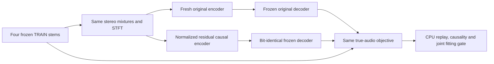

# Causal reference encoder: matched fixed-decoder experiment

_2026-09-29. Track B. Owner authorized the causal-student sequence after the completed SIMO check. Protocol frozen before training._

---

## 🎯 Question and scope

The [pretrained SIMO reference](UPMIX_BSRNN_REAL_C_CHECK_2026-09-29.md) passes the observed offline DEV40 source/entry/real-C gates, but has 108.7 M parameters and unrestricted future within chunks. The next question is whether a stronger **causal encoder** can overcome the current student's fitting gap before compression.

This implements the [research review's first controlled experiment](UPMIX_RESEARCH_REVIEW_2026-09-29.md#proposed-execution-protocol): four exact TRAIN crops, the original trained decoder, and unchanged true-audio supervision. SIMO stays frozen as the quality reference. This first pair does not imitate its output or internal coordinates, change datasets, strengthen the treble loss, run DEV, or compress. Those interventions require a successful causal mechanism to preserve. The failed [raw-state supervision](UPMIX_DECODER_STATE_SUPERVISION_2026-09-29.md) remains evidence against that particular shortcut.

## 🏗️ Architecture and cost

| Component | Fresh original encoder | Normalized residual reference |
| --- | --- | --- |
| Features and bands | Original complex quadratures + standardized log magnitudes, 48 original bands | Identical features and band geometry |
| Level normalization | Stereo-linked causal 2 s EMA | Identical EMA |
| Band input | Linear → tanh, 48 features | Frame-local LayerNorm over each band's flattened features → linear, 96 features |
| Time processing | Original two unidirectional GRUs | Four blocks: feature LayerNorm → unidirectional 96-unit GRU → projection → residual |
| Frequency processing | Original two local mixers | Each block then uses feature LayerNorm → band-bidirectional GRU (48 units/direction) → projection → residual |
| Output interface | Original 32 local + 32 global coordinates | Shared linear 96→32 local projection; original global GRU 32→32 |
| Global-GRU initialization | Seed 1, original construction | Bit-identical initial state to control, verified by hash |
| Decoder | Original trained affine complex stereo-mask head | Same exact tensors, frozen in both arms |
| Total / trainable parameters | 586,916 / 320,416 | 1,350,960 / 1,084,460 |
| Estimated neural MAC/s | 125.139 M | **2,167.950 M** |

MAC estimates use the original multiply-accumulate convention for linear, convolution and recurrent matrices. Biases, normalization, activations, FFTs, memory traffic and renderer are excluded; these are not measured device costs. The reference is approximately 14.45× the 150 M device allowance. It is a PC diagnostic that asks whether useful causal behavior exists in this encoder package; it is not a deployment candidate or authorization to increase the car budget.

Normalization spans features within one frame, never the time axis. Bidirectionality is over frequency bands at the same frame. The fixed-frame network's future-perturbation test is required before and after training. The centered host STFT/iSTFT and whole-array convenience path do not certify stateful streaming or total chain latency.

## 🔬 Frozen training protocol

- Input: exactly the four 8-second MoisesDB TRAIN crops and int16 hashes in `separator_fit_probe_v1/manifest.json`; split membership/hash must match. Eligible = slot 6; vocal = 0+1, drums/percussion = 2+3+4, bass = 5. No remix or pseudo labels in this experiment.
- Trained decoder comes from the original 10k checkpoint, SHA-256 `0e560b9924feea88f3e61b97253734c60a02a3901c7636779e107653d7e77e41`. Strict replay must reproduce its saved acoustic objective within `1e−5` and per-crop SI-SDR within `.001 dB` before either fresh encoder trains.
- Both encoders start fresh from seed 1. The original global-GRU initialization is exactly common. Copy only the trained decoder; mark every decoder parameter `requires_grad=False` and check its hash at every evaluation/save. No trained encoder warm start.
- Both use fresh AdamW, constant learning rate `3e−4`, weight decay `1e−4`, gradient clipping 5, float32 with TF32 disabled, and **exactly 10k steps**. No early acoustic stopping or extension. One whole four-crop batch per step; evaluate every 250 steps, preserving 1k/4k/10k results and all intermediate curves.
- Objective is unchanged: original linear magnitude/complex STFT loss + original multiresolution magnitude audio loss. Saved training statistics are fixed constants, equal in both arms. No source-loss coefficient or high-frequency weighting is selected after results.
- Record waveform SI-SDR/NSE, actual objective, attributed eligible/vocal/drum/bass transmissions, reconstruction/transmission in 0–300 Hz / 300 Hz–8 kHz / 8–14 kHz / 14–24 kHz, gradient/clipping counts, control input-tanh saturation by band, nominal cost, checkpoint/source/head hashes and elapsed time.

This is a package comparison with different compute and capacity, not an isolated normalization ablation or equal-compute contest. Equal steps do not establish that either architecture has converged.

## ✅ Predeclared diagnostic gate

The 10k reference must jointly satisfy the following against **both** the fresh matched frozen-head control and the historical jointly trained 10k model:

1. Actual audio objective ≤90% of each control.
2. Median waveform SI-SDR ≥1 dB above each control.
3. At least three of four crops nonworse in SI-SDR against each control.
4. No crop worse by more than 1 dB against either control.

Historical measurements are replayed from the exact checkpoint; previous report values are approximately `.055586` objective / `7.797 dB` median. Decoder parity and network causality must also pass. A 20-step smoke cannot earn promotion. Source and band metrics describe the mechanism; this fitting gate is not a relaxed product gate.

If the package fails, stop this recipe and inspect optimization/interface evidence. Failure does not rule out all causal separation or all normalization. If it passes, preserve the demonstrated mechanism for broader causal training, true-stem-anchored output distillation and later compression; four-crop fitting alone does not authorize those later product claims.

## 🧪 Preflight, execution and verification

CPU construction check passed before protocol freeze: parameter/MAC totals above, identical initial global-GRU SHA-256 `238ae28f00c77aa22fb41ccbbdd3c560b42ff5fe0f89ecc2c25856d754983282`, future-perturbation prefix NSE **0** in both networks with changed future outputs. This is a synthetic fixed-STFT test, not a trained audio result.

The runner requires no live Python/rapid daemon, empty GPU queue, exact source and anchor hashes, and a new output directory. It takes one exclusive GPU lease; executes a **20-step smoke of both arms**, then the full 10k pair sequentially; then runs the independent saved-checkpoint audit on CPU. Unique C: logs avoid the previous shared D: log-lock failure. No environment install or head-unit operation.

The CPU auditor verifies checkpoint/head/source/window hashes and semantics, parameter/nominal-cost counts, finite tensors, future-frame causality, and recomputes the acoustic measurements and all gates. Declared CPU/GPU replay tolerances: objective `1e−4`, per-crop SI-SDR `.05 dB`, source transmission `.005` absolute; promotion booleans must agree. Numerical parity is separate from acoustic success.

| Artifact | Location |
| --- | --- |
| Reference model | [separator_causal_reference.py](../../tools/stereo-upmix-render/separator_causal_reference.py) |
| Paired experiment | [separator_causal_reference_probe.py](../../tools/stereo-upmix-render/separator_causal_reference_probe.py) |
| CPU auditor | [audit_separator_causal_reference.py](../../tools/stereo-upmix-render/audit_separator_causal_reference.py) |
| Exclusive runner | [run_separator_causal_reference.ps1](../../tools/stereo-upmix-render/pc/run_separator_causal_reference.ps1) |
| PC smoke / full root | `D:\upmix\runs\separator_causal_reference_smoke_v1` / `separator_causal_reference_v1` |
| Each arm | `architecture.json`, `progress.json`, `fit.pt`, `complete.json` |
| Pair | `manifest.json`, `complete.json`, `audit.json` |

Source SHA-256: model `764a594242d26e7f75884d122b91656adc3037b53a7c54f602b74678f58a07d0`; probe `e514fff84f29b0cc52236b6f4a2095cccd79b5c1777a77eb5f29a60347f37ccc`; auditor `2f21ef3c14a09acc6e643c784a64fe384917c37801101dacca08f26fce7cf2e7`; runner `ec5296aa0741eafdbd4451b39e25c02fe5d01b0831ca6cf5a56e0c7443ea3928`. Sources, crop hashes and all measured architecture details are saved again in the run manifest.

### Undefined-source audit correction

During training, a read-only progress summary encountered an undefined transmission for an absent bass source. The training metric correctly returns `null` below its fixed energy floor. This exposed that the not-yet-executed CPU auditor would attempt subtraction on an array containing `None`. Before final auditing, its comparison was corrected to require **identical undefined positions** and compare only valid numeric pairs. No missing source is assigned zero, and no training model, loss, target, checkpoint or gate changed. Both training arms continue in the original process; this is not a failed acoustic run.

Corrected auditor SHA-256 `1765c9407c850ef640707f54bf1327c0ef1aa2cb71d9a691d0dde0ac703add3f`; runner hash table updated for future launches, SHA-256 `2825c628d4c74ae5c66e86268d0c915d86eee29ffcfc96115f48e1bc2905e267`. The already active PowerShell run had passed the original preflight; it invokes the corrected auditor after training. The final audit records its own executed source hash. The model/probe fingerprints above remain unchanged.

## 📊 Results and next gate

Protocol/source commit **`de861b23`**. Both 20-step GPU smoke arms completed with finite losses/gradients and trained-decoder hash `d04d9fd5a73ebb3788240772b3be0fb1ecf420e059ddfc2a0bf5aeff1f4fec05`; global initialization matched and future-prefix NSE was 0. Historical checkpoint replay passed. Smoke does not satisfy the 10k acoustic gate. The guarded runner started the full pair; fresh original first, residual second, then CPU audit. Live log `C:\Users\LuKa\AppData\Local\Temp\upmix_causal_reference_live_v1.log`. No completed 10k result yet.

Full-data source/entry/C evaluation, independent instrument-covered songs, ≤150 M measured int8 MAC/s, ≤85 ms additional chain latency, Track A hook integration and owner blind live CarPlay remain separate gates. Track A's files, others' uncommitted files, the head unit and shared packages are untouched. Never reboot or restart the unit/j9; no Co-Authored-By; no credentials or private dataset link in output.
