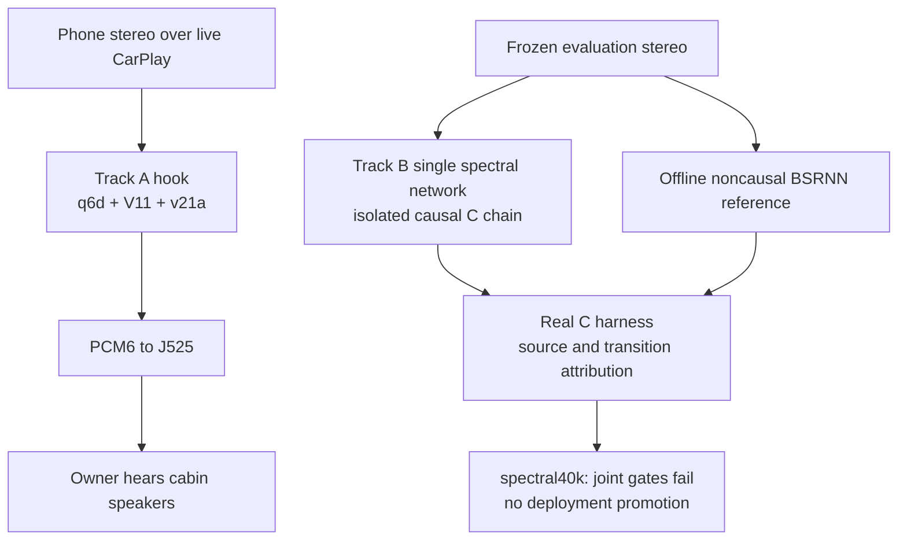
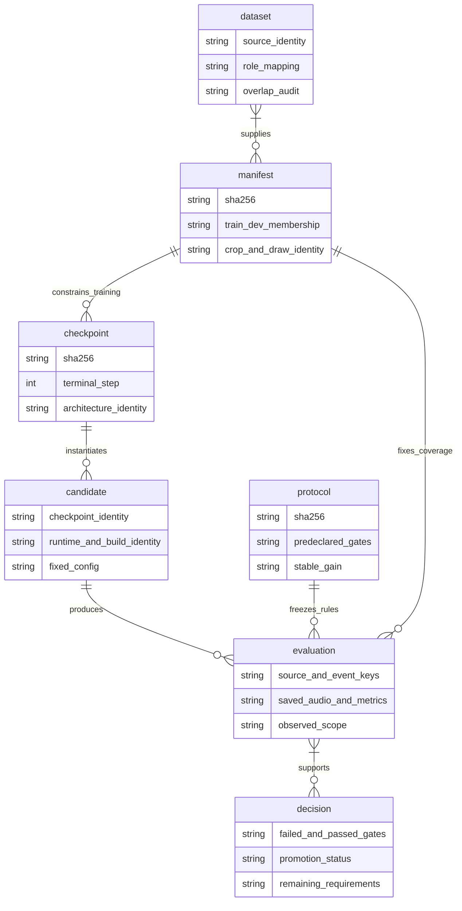
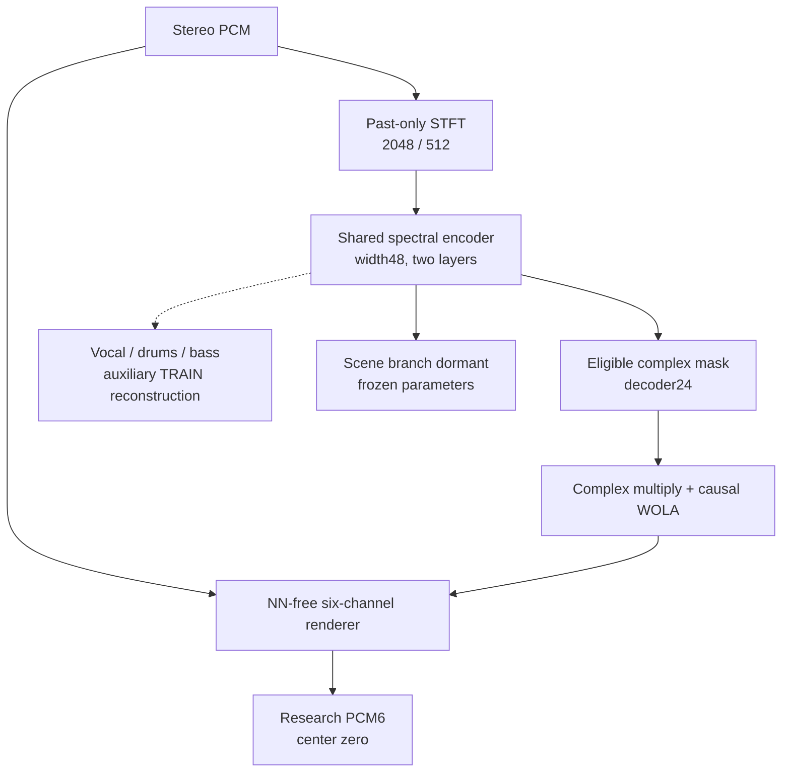

# Upmix domain model and qualification map

_Documentation snapshot, 2026-10-01. Runtime boundaries, experimental evidence and release decisions for CarPlay stereo to 5.1._

## 🧭 Domain boundaries and current state

| Area | Responsibility | Current evidence |
| --- | --- | --- |
| Track A | Deployed hook, three-model routing/protection, int8 implementation and unit integration | q6d + V11 guard + v21a mask; [phase 1 car report](UPMIX_MASK_PHASE1_REPORT_2026-09-27.md), [matched40 host baseline](UPMIX_TRACKA_MATCHED40_2026-09-30.md) |
| Track B | Causal eligible-audio extraction, isolated one-network runtime and controlled experiments | Spectral decoder24 C float/int8 arithmetic verified; completed spectral40k fails joint acoustic promotion; [architecture ledger](UPMIX_UNIFIED_SCENE_ARCHITECTURE_2026-09-30.md) |
| Reference models | Offline extraction target and feasibility comparison | Noncausal pretrained BSRNN SIMO passes its observed offline gates; [real-C reference check](UPMIX_BSRNN_REAL_C_CHECK_2026-09-29.md); no device deployment |
| Qualification | Stable-gain source attribution, transitions, independent generalization, device timing and owner listening | Original full40 complete; genuinely untouched20, loaded-device and blind live CarPlay acceptance remain open |
| J525 amplifier | Render supplied PCM6 across the cabin speakers | [Virtual Cabin and amp RE](VIRTUAL_CABIN_AND_AMP_RE.md); cabin behavior cannot be inferred from host arithmetic alone |

Track B is paused at the owner's request. The final PC snapshot is dated **2026-10-01 03:28 UTC**: the existing study finished and released its lease; no next efficacy run is queued. This page is a documentation snapshot, not a live queue monitor. See the [session wrap](UPMIX_SESSION_WRAP_2026-09-30.md) and [complete attempt chronicle](UPMIX_SEPARATOR_CHRONICLE_2026-09-25_TO_2026-09-30.md).

## 📦 Evidence entities

This is a conceptual domain model of the existing files, not a new database or a proposed artifact format. A candidate is meaningful only with its exact terminal checkpoint, runtime/build and fixed configuration. A saved score must retain the evaluated source/split, gain, coverage and protocol identity.

| Evidence layer | Canonical entry point | Interpretation boundary |
| --- | --- | --- |
| Corpora and stem roles | [Datasets and teachers](UPMIX_DATASETS_AND_TEACHERS.md) | Real stems, pseudo stems and inspected DEV have different evidential value |
| Recipes and failures | [Attempt chronicle](UPMIX_SEPARATOR_CHRONICLE_2026-09-25_TO_2026-09-30.md) | Stopped, prepared and executed attempts have distinct recorded outcomes |
| Candidate implementation | [Unified architecture ledger](UPMIX_UNIFIED_SCENE_ARCHITECTURE_2026-09-30.md) | Numerical parity and operation counts do not establish acoustic or device acceptance |
| Final acoustic comparison | [Spectral full40 decision](UPMIX_UNIFIED_SCENE_ARCHITECTURE_2026-09-30_spectral_broad_full40_complete.json) | 40 songs × 60 s, 231 stem rows, fixed gains and 265 attributed events |
| Archive identity | [Final inventory](UPMIX_UNIFIED_SCENE_ARCHITECTURE_2026-09-30_spectral_broad_final_inventory.json), [aggregation checks](UPMIX_UNIFIED_SCENE_ARCHITECTURE_2026-09-30_spectral_broad_archive_checks.json) | Hashes preserve the original results; recomputation checks their summaries |
| Car evidence | [Listening protocol](UPMIX_CARPLAY_LISTENING_PROTOCOL.md), [deploy log](UPMIX_LISTENING_AND_DEPLOY_LOG.md) | Only live CarPlay and the owner can establish the requested cabin verdict |

## ⚙️ One-network research architecture

Selected eligible + scene dense arithmetic is **116.712 M MAC/s**; the full four-source graph is 144.387 M. These exclude FFT/WOLA, normalization, nonlinearities, DSP, memory and scheduling. They are not measured device int8 throughput. Native float/int8 C and ARM/QNX numerical checks are archived in the ledger; full40 native int8 acoustic qualification has not run.

The reserved upper64 variant has 23 Python structural checks and 129.327 M selected dense MAC/s. It has no efficacy result or compatible new C/int8 port. Float-preserving initialization does not guarantee preserved int8 activation scaling. The [session wrap architecture section](UPMIX_SESSION_WRAP_2026-09-30.md#-architecture-and-implementation-boundary) retains runtime state and latency details.

## 🚦 Qualification lifecycle and stopping point

```mermaid
stateDiagram-v2
    accTitle: Upmix candidate qualification lifecycle
    accDescr: A frozen experiment proceeds through terminal and acoustic checks before independent, device and owner qualification. Any failed acoustic decision is archived; the current spectral candidate stops there.

    state "Freeze paired experiment" as frozen_pair
    state "Audit fixed terminal" as terminal_audit
    state "Original full40 acoustic gates" as full40_gates
    state "Archive rejected candidate" as archived_failure
    state "Untouched20 and native int8 acoustics" as independent_native
    state "Loaded-device budget and latency" as device_qualification
    state "Owner blind live CarPlay test" as owner_listening
    state "Qualified release candidate" as qualified_release

    [*] --> frozen_pair
    frozen_pair --> terminal_audit: Complete fixed training
    terminal_audit --> full40_gates: Numerical audit passes
    terminal_audit --> archived_failure: Audit fails
    full40_gates --> archived_failure: Joint gates fail
    full40_gates --> independent_native: Joint gates pass
    independent_native --> device_qualification: Generalization and int8 acoustics pass
    independent_native --> archived_failure: Required gate fails
    device_qualification --> owner_listening: Causal, budget and latency pass
    device_qualification --> archived_failure: Required gate fails
    owner_listening --> qualified_release: Owner acceptance passes
    owner_listening --> archived_failure: Owner rejects
    qualified_release --> [*]
    archived_failure --> [*]

    note right of archived_failure
        Current spectral40k candidate:
        bass, movement and entry gates fail.
        Owner-requested research pause.
    end note
```

At nominal .40, the spectral candidate has G/K/P/S rear shares .225/.217/.219/.191, but bass .1585 exceeds .06, swings are 31/40 and entry median/p10 is .7991/.4509. Both arms pass 9/13 absolute gates; the spectral arm also fails relative promotion on paired source SDR and string regression. Higher overall guitar share coexists with weak 6–16 kHz rear transmission. These source-dominance measurements do not mean that 22.5% of the whole song is sent behind the listener or that the rear sounds bright.

Required release conditions remain all instrument/protection/stability gates on full40 **and genuinely untouched20**, causal execution, ≤150 M MAC/s int8 measured on the device, ≤85 ms extra loaded-chain latency, and the owner's level-matched blind live CarPlay verdict. Previously inspected reserved20 songs cannot satisfy the untouched requirement.

If research is explicitly resumed, at most the reserved matched upper64-versus24 hypothesis may follow the measured treble defect. It must retain bass, movement and entry gates. A further joint failure ends that finite search and leads to delivery of the best measured candidate and evidence of its limits. The current documentation update launches no experiment.
