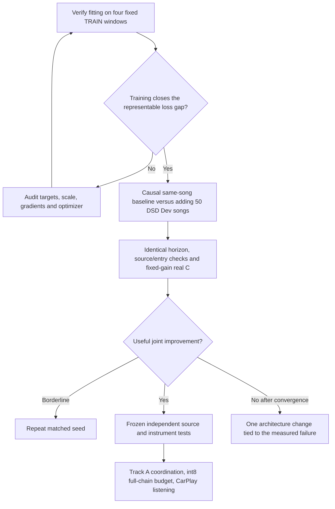

# Upmix Experiment Effectiveness Audit — 2026-09-29

**Latest verified diagnosis, 2026-09-29:** The [TRAIN-path investigation](UPMIX_TRAINING_PATH_DIAGNOSIS_2026-09-29.md) completed four fixed-window fitting, raw/cache consistency, decoder-state relaxation, physical polarity and real-C oracle-parity checks. At 10k, the causal baseline closed 73.2% of its numerical oracle loss gap, median SI-SDR 7.80 dB. Its unchanged trained decoder reached 20.59 dB with privileged optimized states (69.9% less remaining loss), demonstrating a substantial encoder/state-inference or optimization gap rather than a decoder-only ceiling. Exact eligible reconstruction can still have protected frozen-filter contributions; real C output parity confirms these contributions are not audible contamination in the summed waveform. Treat that metric as sensitivity evidence, jointly with reconstruction, entry and C tests; no historical student is promoted. DSD100 is now fully CRC/SHA validated (50 Dev/50 Test), with Test audio undecoded/unscored and Dev conversion pending. GPU diagnostics are terminal and the rapid queue/lease clear. All audited encoder blocks receive gradients; saturation is localized, not a proven treble-failure cause. Next freeze one representation/state-learning intervention before another broad efficacy run. Device and ear gates remain open.

_Track B. Requested by the owner after the Cambridge pair. This updates the next experiment policy; it preserves historical results and leaves Track A untouched._

## 📋 Verdict

Execution is controlled, but the current sequence spends too many GPU runs on weak tests of the eventual product. Matched seeds, exact training stem sums, real-C fixed-gain screens, source attribution, single-GPU ownership and reporting failed results are useful. A succession of 4k, noncausal data screens cannot establish that remix, data diversity or a particular architecture cannot work after convergence. The next comparison should answer one stronger question after verifying that the training path can fit known TRAIN audio.

This audit does not establish an architectural impossibility. Earlier width, truth-only and spectral-structure comparisons did run to 40k; their specific negative results remain evidence. The [night report](UPMIX_SEPARATOR_NIGHT_REPORT_2026-09-28.md) records a structure variant that trailed until 20k and caught up at 30k. The [rapid-loop review](UPMIX_SOURCE_SEPARATION_PLAN.md) already called for validation of early versus final rankings. The completed shared-mask 4k/10k pair demonstrated a false early positive, rather than validating reliable early rejection.

## 🔎 Findings and corrections

| Finding | Verified evidence | Effect on decisions | Correction |
| --- | --- | --- | --- |
| Early rejection is stronger than the evidence | The rapid runner uses 4k total steps, 2k warmup and a SI-SDR term only after 20k. No intervention-diverse early/final rank-validation study is recorded. | Failure at 4k bounds that checkpoint and recipe; it does not reject a corpus or learned mechanism generally. | Retain 4k for execution and early behavior. Use one longer matched comparison with an identical fixed training horizon before declaring a data lever exhausted. |
| Later data screens inherit a rejected remix | Cambridge and the initially prepared DSD pair specify `--remix 0.5`, although the first rapid remix lost to same-song windows under the joint screen. | Their within-pair contrasts are valid, but may miss gains on the better data recipe. | Start the next efficacy comparison with same-song windows, `--remix 0`. Cross-corpus remix is a later separate comparison. |
| A repeated subset is an artificial efficacy baseline | The extra-pool controls resample only 3 or 50 selected Moises TRAIN songs for about 25% of all windows. | Pool sizes match, but the control no longer samples the original TRAIN distribution uniformly. A win against it need not beat the original recipe. | The main DSD baseline uses the complete original Moises TRAIN pool, with no extra pool. The candidate adds DSD Dev at a stated probability. The already-built repeated subset remains a possible sampling sensitivity control. |
| Rapid normalization is noncausal and changes context with crop length | `sep_net.py` defaults to whole-window level normalization; training crops are 8 s, source diagnostics 20 s and C excerpts 60 s. GRU and normalization state reset on a new call. | Data effects measured on this model need not transfer to CarPlay. | Train the next product-directed pair with `--norm stream`; separately prove streaming/chunk/reset parity before porting. Centered STFT delay must also be included. |
| TRAIN/DEV aggregates do not diagnose fitting | The recorded TRAIN12 and DEV12 sets contain different songs and source balances; TRAIN was not even better in the first remix diagnostic. | Neither a small gap nor a larger gap proves capacity, overfitting or data limitation. | Add a fixed, small TRAIN-window fitting test, then inspect loss curves and source errors at comparable source occupancy. |
| Historical vocal-owned cells use an incorrect interference calculation | `diag_gap.py` uses `max(|X|²−|V|²,0)` instead of `|X−V|²`; source cross terms make these different. The training scalar evaluator already uses the actual remainder. | Conditional vocal-owned leak and coverage are biased. All-cell frozen-filter leakage and the C CSV do not depend on this ownership mask. | Use the new [source audit](../../tools/stereo-upmix-render/audit_separator_source_metrics.py) with actual interference. Keep the other agent's dirty `diag_gap.py` unchanged and preserve historical reports. |
| Standard mask diagnostics are not general operator diagnostics | Historical `diag_gap.py` multiplies `last_mask`; matrix2 and deep2 need cross-channel/past-frame terms. On reinspection, current `diag_transitions.py` already calls `apply_last_filter` outside its special role-map path; the earlier claim about its generic path was incorrect. | Using the generic rapid reports for a new operator would undercount its attributed output. | The new source audit uses `apply_last_filter`. Verify the matching operator implementation in each diagnostic; preserve the already-correct generic transition path. |
| Aggregate treble gain hides its distribution | Cambridge 8–14 kHz energy-weighted gain is +8.3 dB, but one song supplies 87.4% of the net output-energy increase. Paired-song median gain is +1.98 dB; 3–8 kHz worsens in 11/12 songs. | An aggregate band improvement is not a broad instrument-recovery result. | Report per-song band deltas, source-energy coverage and protected-source transmission together. |
| Two local board implementations had diverged | The root `rapid_board.py` still summed stem swing counts; `pc/rapid_board.py` and the deployed PC version already count unique songs. | Redeploying the stale root file could restore double counting. Current paired Cambridge counts were already correct. | Synchronize root to the fixed PC source. Use CSV-based paired reports for decisions. |
| Song bootstrap does not measure training variance | The paired comparison bootstraps songs from one seed. Two historical anchor seeds are not a variance estimate for every changed data recipe. | Confidence across songs can coexist with seed sensitivity. | Repeat a borderline pair with another seed; use several seeds for a finalist. Label bootstrap scope explicitly. |
| Independent product coverage is incomplete | Repeatedly used Moises DEV/former TEST songs are selection data. DSD Test has four broad roles, no separate guitar/keys/piano/string truth. Cambridge's three songs are TRAIN only. | DSD cannot certify all four instrument-family thresholds. | Reserve an adequate instrument-labelled set before any selection feedback. Keep all 50 DSD Test songs sealed for performance until settings are frozen. |
| Device and listening remain unverified | 125 M is estimated neural arithmetic. No Track B int8 full-chain device result or owner blind live-CarPlay verdict exists. | A PC score cannot be called a car improvement. | Keep the ≤150 M measured-device and ≤85 ms latency limits. The owner deferred listening; record that the ear gate remains pending. |

Random source remix is a real technique: Demucs' official implementation shuffles sources within groups of a batch, and its published default configuration enables remix, shifts and gain scaling.[^demucs] That supports testing the idea. It does not imply that our 25%-of-all-windows, 4k recipe on a much smaller causal model reproduces that result.

## 📊 Completed Cambridge result

Both seed-1 4k checkpoints, the DEV12 source audit, 43 vocal entries and the identical real-C DEV20 screen completed. The pair only changes a three-song extra truth pool within the historical recipe. It fails its product promotion screen.

| Metric | Moises three-song control | Cambridge three-song addition |
| --- | ---: | ---: |
| Eligible transmission, all cells | .43190 | .43191 |
| Vocal transmission, all cells | .22091 | .23145 |
| Vocal transmission, corrected vocal-owned cells | .19167 | .19517 |
| Vocal transmission, historical vocal-owned cells | .20085 | .21197 |
| Drum / bass transmission, all cells | .03187 / .02311 | .04305 / .03252 |
| Entry post/pre median / p10 | .759 / .419 | .757 / .395 |
| Entry absolute eligible pre / post | .554 / .427 | .620 / .408 |
| C guitar / keys rear share | .1062 / .1045 | .0963 / .0897 |
| C piano / strings rear share | .0634 / .1145 | .0581 / .1090 |
| C voice / bass / drums rear share | .0452 / .0617 / .0959 | .0459 / .0576 / .0894 |
| C unique songs with any-stem swings | 3/20 | 2/20 |
| C rear level, one observation per song | −37.423 dBFS | −37.828 dBFS |

Guitar paired median rear-share delta is **−.0124**, with a song-bootstrap 90% interval **[−.0173, −.0043]**; keys **−.0099 [−.0149, −.0022]**. Voice's difference of medians is slightly positive, but its paired median is negative; do not confuse these statistics. Piano has eight covered songs, strings five and winds two; bass rear share is finite on only eleven songs. None supplies broad independent coverage.

The corrected source audit reproduces all-cell eligible/vocal figures from the historical diagnostic and checks attributed-output closure to a maximum normalized residual **5.48e−14**. A phase-cancellation example verifies why the old ownership mask fails. Its saved PC output is `D:\upmix\runs\rapid\cambridge3_metric_audit.json`; paired C rows are `cambridge3_ctrl_s1/screen/stems.csv` and `cambridge3_add_s1/screen/stems.csv`. No historical checkpoint or report was overwritten. Source-audit script SHA-256 is `851f57fda4b55627e925c4323c1a132669dfacef12066e6e967d4ab1aa9f3ce4`; its JSON is `933c00bbd7d43247aa8769465dadfba1afb1793b099020a291af7f2498e84cd3`. The paired-C JSON is `67bd787967bd2bafd124ce79f3719396cf193da9ff3c6e96310fb2fa6fd5e76d`, copied to PC as `cambridge3_pair_audit_s1.json`. The Cambridge result justifies no immediate 10k extension of this recipe; it does not reject a larger Cambridge corpus or a converged remix recipe.

## 🧭 Revised next experiment

1. **Complete data integrity independently of model selection.** Finish DSD100 download, full size/CRC/SHA verification and Dev-only cache alignment/closure. Do not decode Test for performance. Cambridge needs a timing/source-content audit before enlargement; its tail padding assumes a common timeline origin and its synthetic mix is not an independent master-closure check.
2. **Verify learnability of the training path before a further architecture sweep.** Preselect four Moises TRAIN windows with audible eligible and protected content, freeze exact starts/lengths, omit pseudo labels and augmentation, and fit the same causal model on these exact windows. Record the actual training objective, gradients/clipping, output scale and reconstruction. Compare with a numerically stable representable oracle on those same windows; use ≥80% reduction of the initial-to-oracle objective gap as a fitting diagnostic, with at most 10k steps and a plateau check. Failure triggers target/optimization inspection, not a declaration that data cannot help. Passing is a sanity result, not generalization or the source-protection goal.
3. **Use the useful baseline distribution.** Both main arms use BandSepNet, `norm=stream`, zero neural lookahead, same-song windows, the same half-truth/half-pseudo policy and fixed renderer gain. Control uses the complete original Moises TRAIN pool without an extra pool. Candidate replaces half of true windows with DSD Dev: about 25% of all windows in expectation. Record actual corpus and audible-source exposure. The intentional difference is the data policy; do not call this equal distinct-song count or identical draw order.
4. **Freeze the full horizon and treat checkpoints as checkpoints.** Plan 40k total steps, 2k warmup, the unchanged SI-SDR switch after 20k, and save 4k/10k/20k/40k. Use the same horizon in both arms. The current rapid daemon trains a separate short cosine schedule ending at each job's horizon; it must not silently substitute for this longer experiment. Loading a short-run optimizer/scheduler into a different horizon also does not construct a matched longer schedule. Prepare a dedicated runner before queuing. Check 4k for execution/behavior, 10k for joint trends; retain ambiguous nondegenerate comparisons through the loss switch and convergence. Abort clear broken/degenerate training, rather than prolonging it solely to satisfy a step count.
5. **Select on the joint output.** Useful instrument gain at stable level, protected voice/bass/drums, absolute entry retention and its tail, unique-song swings and per-song errors must agree. Preserve actual deltas and uncertainty; tiny changes need another seed. Do not rescue an extraction failure by tuning gain on repeatedly used DEV. If the larger-corpus pair still fails after convergence, pick one causal reconstruction/ownership change supported by the worst overlap cases; do not start another broad architecture sweep.

The old `dsd50_ctrl_s1` / `dsd50_add_s1` 4k remix queue lines are **superseded and must not be queued**. The prepared smoke script now uses `norm=stream`, `remix=0`, the original baseline distribution and a fresh `dsd50_stream_smoke` output directory. The new main runner and four-window fitting experiment are planned, not launched by this audit. The revised smoke source SHA-256 is `c7f8980518558c634b50eed2555186245c8c35721ff8b764c2acfdd73c7253d1`; it uses a fresh output directory so old smoke markers cannot pass the changed recipe.

## 🖥️ PC state at this audit

The Cambridge queue is empty, both checkpoints and screens are terminal, and the GPU lease is absent. The verified idle rapid daemon PID 7744 was stopped after checking the empty queue/lease and absence of training/harness work; its wrapper also exited. The read-only corrected source audit used a temporary exclusive GPU lease and released it. DSD100 is still transferring in its original resumable download, independently of GPU work; the final read for this audit found **15.076/15.990 GB**, with the original curl and wrapper alive. Refresh size/process observations before validation. No training, head-unit, Track A or package-install operation was started by this audit.

[^demucs]: [Demucs source augmentations](https://github.com/facebookresearch/demucs/blob/main/demucs/augment.py) and [published default configuration](https://github.com/facebookresearch/demucs/blob/main/conf/config.yaml). Accessed 2026-09-29. These describe that implementation; they are not a causal-budget performance guarantee.

## Follow-up completed

The fixed-window fitting test and decoder relaxation are now terminal; see the [training-path diagnosis](UPMIX_TRAINING_PATH_DIAGNOSIS_2026-09-29.md). The 80% fitting gate was not reached at 10k, so the longer DSD efficacy pair is not queued. DSD download/integrity is complete; Dev conversion remains pending. The source-filter/actual-waveform distinction also requires an explicit protocol correction before another source-only rejection. The PC-state paragraph above describes this earlier audit, not current live state.
