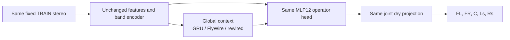

# FlyWire Topology Screen for Joint Scene Recovery

*2026-10-04 · Track B · Owner-authorized finite research experiment.*

## 🧭 Question and scope

Does a small, anatomically derived recurrent wiring pattern improve our joint front/rear reconstruction compared with the same reservoir using rewired connections? The existing MLP12/GRU model is a practical reference. This experiment adapts a biological graph to an audio network; it does not emulate a fly brain or inherit an ability to recognize musical instruments.

The [previous MLP12 trial](UPMIX_JOINT_SCENE_MLP12_HEAD_2026-10-03.md) improved the fixed TRAIN crop at 8192 updates, but missed the rear NMSE ≤.10 fitting gate. This new screen keeps that head, crop, normalization, loss and training settings. The finite horizon is **4096 updates per new variant**, declared before fitting results. Its verdict applies to that horizon; the earlier MLP12 crossover shows why a short screen cannot establish an asymptotic ceiling.

This tests five authored scene channels, not isolated instrument stems. No source-role, multi-song, independent DEV, real C renderer, device, int8 or cabin qualification follows from this single-crop screen.

## 🧬 Data and graph selection

Public FlyWire FAFB v783 CSV exports were obtained from the storage endpoint used by the official Codex loader.[^1] Underlying connectivity attribution: FlyWire Consortium, Dorkenwald et al., 2024; connectivity release DOI 10.5281/zenodo.10676866, CC BY 4.0.[^2] Raw CSVs remain outside this repository; exact URLs, byte counts and SHA256 hashes are retained in the reduced graph JSON.

The biological motivation is structural. Connectome-constrained models have described fly sensorimotor transformations and predicted visual neural activity; neither result demonstrates music separation.[^3][^4]

Selection is deterministic and independent of audio errors:

1. Use connections in AMMC_R only. Admit endpoints with predicted ACH, GABA or GLUT transmitter labels. Remove self edges; aggregate synapses per directed pair and require at least five.
2. Find inputs explicitly annotated with subclass `auditory`. Select 16 intrinsic targets receiving the most synapses from those inputs; break ties by root ID.
3. Grow to 64 intrinsic nodes by the strongest total incoming/outgoing synapse count to the selected set, again breaking ties by root ID.
4. Retain the induced directed graph and sort node indices by root ID.
5. Assume ACH positive and GABA/GLUT negative, a simplified sign convention. Transform counts by square root and normalize each nonzero incoming row to L1 norm .9. These are engineering transformations, not measured physiological synaptic strengths.

The final graph has **64 nodes and 340 directed edges**. Seven nodes have no internal incoming connection and six have no internal outgoing connection; all nodes still receive learned audio drive and contribute through the decoder. This is an auditory-seeded anatomical neighborhood, not a functionally validated auditory circuit.

### Preparation attempts retained

| Draft | Selection | Structural finding | Action |
|---|---|---|---|
| Region degree | Top64 weighted degree in AMMC_R | 439 edges; six wind/gravity afferents; no explicitly auditory subclass among selected nodes | Superseded before training |
| Direct targets | Top64 targets of auditory afferents | 121 edges; 22 zero-indegree and 24 zero-outdegree nodes | Superseded before training |
| Auditory-seeded neighborhood | Top16 intrinsic auditory targets plus strongest connected intrinsic neighborhood | 340 edges; seven zero-indegree, six zero-outdegree nodes | Frozen for the finite pair |

These were data-selection checks, not efficacy training or separate trained architecture wins. The raw exports and builder reproduce the chosen graph. Functional selectivity of the selected nodes remains unverified.

## 🔀 Rewired control and model

The null uses 6800 accepted directed two-edge swaps, fixed seed 20261004. Sources can swap only when their signs agree; self edges and duplicates are rejected. Every node retains its incoming/outgoing degree. Each recipient retains its signed synapse-count multiset and therefore its normalized incoming weights. Outgoing weighted strength and higher-order motifs are not preserved. This sampler is not asserted to be uniform over all valid graphs.

Only 82 of 340 directed connections remain in common: approximately 76% changed. The input projection and initial leak parameters are bit-identical in the two variants.

For the reservoirs, `h_t = (1-alpha) h_prev + alpha tanh(B z_t + b + A h_prev)`. A is fixed; B, b and node leakage are learned. Initial time constants range logarithmically from 10 to 160 ms by sorted node index, identically in both variants. Alpha remains in [.02,.8]. The row norm bound and tanh bound the recurrence; this mathematical property is not an audio scene stability measurement.

The existing global GRU64 is replaced. The frequency encoder, band GRU, global input/output projections, MLP12 head, feature history and dry projection retain bit-identical fresh same-seed initialization. Temporal processing is causal and supports state across chunks. No biological spikes or measured membrane dynamics are simulated.

| Variant | Learned parameters | Estimated dense neural MAC/s | Recurrent topology |
|---|---:|---:|---|
| GRU + MLP12 reference | 68,136 | 111,113,625 | Learned dense gated recurrence |
| FlyWire reservoir | 47,400 | 108,041,625 | Fixed signed auditory-seeded graph |
| Rewired reservoir | 47,400 | 108,041,625 | Degree/sign/incoming-weight preserving null |

Reservoir multiplication currently uses a dense matrix containing zeros. The MAC estimate counts that actual dense kernel; no sparse speed claim. FFT/WOLA, features, projection, nonlinearities and LFE remain excluded. The common estimated dense ceiling is 111.12 M MAC/s; complete device cost is unmeasured. The reservoir pair is capacity-matched to each other. The GRU reference has more trainable recurrence parameters and different dynamics, so its comparison is not a single-factor topology ablation.

## 🧪 Frozen training and decision rules

| Item | Setting |
|---|---|
| NAS study | `runtime/scene-fly-topology-4096-20261004-a` |
| Execution | FlyWire then rewired, serialized; three CPU threads; no installs |
| Reference | Existing completed same-seed MLP12/GRU monitor at 4096; hash-bound protocol and monitor |
| New horizon | Fresh4096 updates each; no automatic extension |
| Input/target | Stereo known downmix of the same authored five-channel target |
| Crop | TRAIN albumdb-01, start1,354,304, length33,536 samples (.698667 s) |
| Geometry | FFT1024/hop256; 128 frames, 32 warm, 96 scored |
| Normalization | Unchanged parent TRAIN channel powers and common gain |
| Training | Seed20261003; AdamW lr.001, decay.0001, clip 5; same complex MSE + .05 magnitude MAE |
| State/effects | Reset recurrent state each update; effect gain0 |
| Monitoring | Every128; best by worse rear channel; paired2048 and terminal model+optimizer |
| Topology signal | Fly BOTH rear NMSE at least 5% below rewired; FL/FR/C no more than5% higher; dry conservation passes |
| Practical reference | Fly BOTH rear errors below GRU at matched4096; FL/FR/C no more than5% higher; dry conservation passes |
| Original fitting gate | BOTH rear NMSE≤.10 and dry PCM relative null RMS≤1e-5 |
| Partitions | No DEV/heldout audio opened |

The supervisor freezes rules before launch, checks other upmix Python tenants before each child, holds an owned lease, and releases it on completion/failure. An owned study `STOP` prevents subsequent children; the active child observes its own `fly/STOP` or `shuffled/STOP` marker. Study-only STOP does not interrupt a child already running. Frozen source snapshots and graph hashes prevent local edits from changing a live run.

Local contracts passed: graph degrees/signs/weights, genuine rewiring, shared initialization, future invariance, chunk-state equivalence, conservation, finite nonzero gradients into the learned reservoir drive/leak and frozen recurrent weights. The optimizer resume regression test also passed. Four contracts passed again on NAS; each variant completed a 20-update real-crop smoke with finite gradients and passing conservation before efficacy training. Smoke outputs are retained separately. Mermaid rendering passed in light and dark themes using Mermaid 11.12.0.

## 📊 Results

<!-- FLY_RESULT_START -->
**Both 4096-update runs completed.** Topology-signal rule: failed. Practical GRU comparison: failed. Original ≤.10 fixed-crop fitting gate: failed.

NMSE measures channel reconstruction error, not rear share, source leakage or instrument extraction. Lower is better.

| Channel | GRU @4096 | FlyWire @4096 | Rewired @4096 |
|---|---:|---:|---:|
| FL | 0.041162 | 0.049137 | 0.049330 |
| FR | 0.045276 | 0.054557 | 0.054261 |
| C | 0.010424 | 0.012263 | 0.012179 |
| Ls | 0.359372 | 0.410671 | 0.402237 |
| Rs | 0.402050 | 0.442171 | 0.430779 |

| Variant | Best step | Best Ls / Rs NMSE | Terminal dry null RMS | Elapsed seconds |
|---|---:|---|---:|---:|
| fly | 4096 | 0.410671 / 0.442171 | 7.27518e-07 | 725.1 |
| shuffled | 4096 | 0.402237 / 0.430779 | 4.17208e-07 | 728.7 |

### Matched 2048 comparison

| Variant | Ls NMSE | Rs NMSE |
|---|---:|---:|
| GRU | 0.468725 | 0.516417 |
| fly | 0.489378 | 0.521853 |
| shuffled | 0.479484 | 0.512720 |

### Complete matched monitor curve

| Step | GRU Ls | Fly Ls | Rewired Ls | GRU Rs | Fly Rs | Rewired Rs |
|---|---:|---:|---:|---:|---:|---:|
| 128 | 0.891279 | 0.892771 | 0.894722 | 0.884246 | 0.884188 | 0.886860 |
| 256 | 0.865163 | 0.865390 | 0.866368 | 0.847210 | 0.841793 | 0.841363 |
| 384 | 0.833318 | 0.817919 | 0.829965 | 0.808537 | 0.799710 | 0.806233 |
| 512 | 0.741309 | 0.736544 | 0.740989 | 0.751949 | 0.749219 | 0.749725 |
| 640 | 0.680538 | 0.670610 | 0.668114 | 0.707950 | 0.695897 | 0.693792 |
| 768 | 0.645107 | 0.624845 | 0.614195 | 0.676755 | 0.655041 | 0.655613 |
| 896 | 0.620889 | 0.598450 | 0.589433 | 0.658341 | 0.632633 | 0.637715 |
| 1024 | 0.579892 | 0.578897 | 0.570811 | 0.623282 | 0.616607 | 0.617482 |
| 1152 | 0.555254 | 0.561712 | 0.553413 | 0.601574 | 0.600845 | 0.599862 |
| 1280 | 0.535501 | 0.545249 | 0.537651 | 0.583487 | 0.585911 | 0.583514 |
| 1408 | 0.516818 | 0.531519 | 0.524609 | 0.565529 | 0.572885 | 0.567384 |
| 1536 | 0.503659 | 0.520800 | 0.514248 | 0.555265 | 0.561646 | 0.554309 |
| 1664 | 0.493932 | 0.511790 | 0.506099 | 0.544079 | 0.550901 | 0.544960 |
| 1792 | 0.486070 | 0.503942 | 0.497078 | 0.536170 | 0.540531 | 0.534004 |
| 1920 | 0.477373 | 0.497745 | 0.489143 | 0.525191 | 0.532341 | 0.524721 |
| 2048 | 0.468725 | 0.489378 | 0.479484 | 0.516417 | 0.521853 | 0.512720 |
| 2176 | 0.458821 | 0.481440 | 0.475221 | 0.506477 | 0.512493 | 0.507726 |
| 2304 | 0.447782 | 0.474909 | 0.465305 | 0.494645 | 0.506086 | 0.498039 |
| 2432 | 0.444693 | 0.473076 | 0.458099 | 0.492682 | 0.505978 | 0.489529 |
| 2560 | 0.428517 | 0.460630 | 0.451017 | 0.474691 | 0.489706 | 0.483106 |
| 2688 | 0.420591 | 0.454745 | 0.447475 | 0.467724 | 0.484070 | 0.481157 |
| 2816 | 0.413523 | 0.454042 | 0.439217 | 0.459721 | 0.487960 | 0.473445 |
| 2944 | 0.405096 | 0.444164 | 0.432915 | 0.451429 | 0.474768 | 0.464874 |
| 3072 | 0.398241 | 0.440291 | 0.428416 | 0.445187 | 0.471634 | 0.461848 |
| 3200 | 0.392241 | 0.435429 | 0.423606 | 0.439022 | 0.467087 | 0.454833 |
| 3328 | 0.385921 | 0.431481 | 0.425410 | 0.432189 | 0.463328 | 0.460545 |
| 3456 | 0.380663 | 0.427929 | 0.415801 | 0.425902 | 0.459890 | 0.446203 |
| 3584 | 0.375581 | 0.424214 | 0.412522 | 0.419867 | 0.456213 | 0.442312 |
| 3712 | 0.370694 | 0.436859 | 0.409981 | 0.414490 | 0.478235 | 0.439192 |
| 3840 | 0.368646 | 0.420823 | 0.406328 | 0.413436 | 0.453907 | 0.435106 |
| 3968 | 0.362994 | 0.415412 | 0.404112 | 0.407464 | 0.446738 | 0.432164 |
| 4096 | 0.359372 | 0.410671 | 0.402237 | 0.402050 | 0.442171 | 0.430779 |

Terminal and paired checkpoints, protocol bindings, source snapshots and optimizer counters 4096/2048 verified. Gradient/lease/process evidence is retained in JSON. No next run is queued.

[Machine-readable evidence](UPMIX_FLYWIRE_TOPOLOGY_SCREEN_2026-10-04.json) retains protocol, source/data hashes, graph identity, launch state, raw metrics, checkpoint bindings and complete terminal monitor histories. Full optimizer histories and logs remain in the immutable NAS study.
<!-- FLY_RESULT_END -->

## 📁 Implementation and evidence

- [Graph builder](../../tools/stereo-upmix-render/build_scene_fly_graph.py): deterministic CSV reduction and constrained null.
- [Reduced attributed graph](../../tools/stereo-upmix-render/scene_flywire_783_64.json): node IDs, annotations, source hashes and both edge lists.
- [Reservoir model](../../tools/stereo-upmix-render/scene_fly_net.py): isolated global context replacement.
- [Contracts](../../tools/stereo-upmix-render/test_scene_fly_net.py): meaningful null/model guarantees.
- [Finite supervisor](../../tools/stereo-upmix-render/run_scene_fly_pair_nas.py): serialized trial and predeclared comparisons.
- [Fixed-crop runner](../../tools/stereo-upmix-render/fit_scene_fixed_nas.py): explicit global-core flag and hash-bound protocol.

## 🧾 Measured verdict and next decision

The predeclared topology-signal rule fails: FlyWire rear NMSE is 2.10%/2.64% higher than the degree/sign/incoming-weight preserving null, rather than at least 5% lower in both channels. The practical rule also fails: it is 14.27%/9.98% higher than GRU, with front/centre regressions. This one-seed comparison supplies no evidence of an advantage from the selected biological wiring. The small null difference is not a statistical claim across seeds.

Both reservoirs pass conservation and numerical checks; each of their 4096 gradients was finite and none exceeded clip 5. The terminal checkpoint is best in each run, and both still improve near the end. Their final errors remain above the original≤.10 gate. Total new efficacy training time is 1453.8 s, approximately 24.2 minutes, plus tests/smokes; the existing GRU curve was reused at matched counts.

The hypothesis screen is finished. No longer reservoir run or additional topology is queued. The proposed next main-track diagnostic remains an oracle upper bound for the exact bounded output operators and projection; use it to distinguish output constraints from encoder/training limitations before further architecture changes. It was not run as part of this owner-selected experiment.

## 🔬 Interpretation boundary

A positive result is a candidate structural prior on this one crop and seed. It needs another seed/crop and broader evaluation before a quality claim. A negative result rejects this particular continuous-state reduction and training recipe at 4096; it does not prove all fly-inspired networks useless or prove an asymptotic error floor. Biological sign, normalization, input mapping, leak dynamics, subgraph truncation and fixed weights are assumptions of the tested recipe.

The original full40/untouched20 source protection, vocal-entry retention and scene motion, complete causal int8 device budget/latency and owner CarPlay preference remain acceptance gates. Extraction of named instruments requires separate stem/source attribution; authored-channel fitting cannot establish it.

## 🔗 References

[^1]: Murthy Lab. Official FlyWire Codex data loader: <https://github.com/murthylab/codex/blob/main/codex/data/local_data_loader.py>. FlyWire FAFB v783 CSV storage endpoints retrieved2026-10-04; exact source hashes in the graph JSON.
[^2]: FlyWire Consortium. FlyWire Whole-brain Connectome Connectivity Data, v783. <https://zenodo.org/records/10676866>. Dorkenwald et al. (2024), Neuronal wiring diagram of an adult brain: <https://www.nature.com/articles/s41586-024-07558-y>.
[^3]: Shiu et al. (2024). A Drosophila computational brain model reveals sensorimotor processing. <https://www.nature.com/articles/s41586-024-07763-9>.
[^4]: Lappalainen et al. (2024). Connectome-constrained networks predict neural activity across the fly visual system. <https://www.nature.com/articles/s41586-024-07939-3>.
