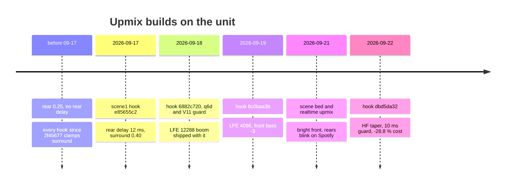

# Upmix Listening and Deploy Log

> **Retired 2026-10-09 with the Universal backend.** The renderer, models and knobs this note describes left the tree; the last tree that has them is git tag `upmix-universal-last-2026-10-09`.
> What runs now: [Stereo to 5.1 Upmix](STEREO_TO_5_1_UPMIX.md). Why, and with which numbers: [Upmix History and Results](UPMIX_HISTORY_AND_RESULTS_2026-10-09.md), [Upmix Code Retirement](UPMIX_CODE_RETIREMENT_2026-10-09.md).
> The deploy facts (hashes, the jar-restart rule, the live readback) remain valid as history.

*What upmix build ran in the car when, which files and hashes went over, what Luka heard, and what the one live readback proved. Chronology 2026-09-17 → 2026-09-22.*

---

## 📍 Where the car stands

**2026-09-22**, from `build/release-20260922` (commit `b021ec9`), every file byte-compared by read-back before and after the transfer `[car]`:

| File | sha256 | Takes effect |
|---|---|---|
| `libcarplay_hook.so` | `dbd5da32…` | next phone connect |
| `libcarplay_apac.so` | `1c25799f…` (content unchanged) | next phone connect |
| `carplay_startup.sh` | `93e39a67…` | next phone connect |
| `carplay_hook.jar` | `10137756…` | **only after a unit restart** — the jar is on j9's `-Xbootclasspath` (carries the KDK visibility fix, `b021ec9`) |
| `hssr_model.bin` / `hssr_guard.bin` | q6d `96abe57d…` / V11 `ab01463e…` | unchanged since 2026-09-18 |

`altscreen_render` and `maneuver_render` were not replaced. Config = the shipped table in [Stereo to 5.1 Upmix](STEREO_TO_5_1_UPMIX.md#-the-shipped-calibration). Luka after the deploy: **"everything was great"**.

Not collected yet: the realtime `stop` line with `mean_us`, `cold_us` and `ms_hist` — the only way to learn the real period-time distribution instead of the QEMU estimate. Pull `/tmp/carplay_hook.log` next time the unit is online.

---

## 🔄 Deploy timeline

*Timeline of every upmix build that reached the unit.*

| When | Hook on the unit | What changed | Verdict / trigger |
|---|---|---|---|
| ≤ 09-17 | builds after `2f4b677` | rear clamped to 0.25, no delay | — |
| 09-17 ~20:43 (unit reboot) | scene build, `e85655c2` | `-DSPA_HSSR_SCENE=1`: rear-only 12 ms delay, surround ceiling 0.5, env 0.40; fresh jar; V11 unchanged; log 21:02 showed `rearGainQ15=13107` | "it sounds gorgeous now", "great bright objects behind"; MMI Bass turned down |
| 09-18 17:31 EDT | `6882c720`, 672 060 B | unified scene code (scene5): 4 slots, coherence, hold, q6d `96abe57d` + V11 guard `ab01463e`; **also LFE 12288 and LR4 60 Hz** | "sound is not bad, a bit less WOW, but the highs are clearly heard behind"; bass needed MMI Bass −30 % |
| by 09-19 evening EDT | `6c0baa3b…`, 674 618 B | LFE default 4096 + `AUDIO_STEREO_LFE_GAIN=0`, `AUDIO_STEREO_FRONT_BASS_DB=-3`, QSA negative-return crash fix | confirmed by live readback (below) |
| 09-21 morning | same | — | **decision: calibration OK, do not tune** ([Upmix Calibration and Tuning](UPMIX_CALIBRATION_AND_TUNING.md#-the-decision-on-record)) |
| 09-21 | `6ea3f2f1` (the scene-bed-only build `cbb23556` in `build/bed-experiment-20260921/car-LOG1/` was first parked on Luka's "don't deploy yet") | scene bed: retention 0.5, bed delays, owner 0.75; realtime type-100 upmix with the 8 ms guard | "a bit too much treble, especially on the first Spotify stream; the problem is in the front; everything else sounds very decent"; rears blinking on the realtime path |
| 09-22 | `dbd5da32` | retention HF taper 1000:2500, 10 ms guard / 16 cold periods / revival on a ≥ 500 ms gap, −28.8 % DSP cost | "everything was great" |

Backups: the 09-18 transfer saved the previous unit files (scene1 hook `e85655c2`, old V11 model) locally in `~/Desktop/AUDI_2/upmix-data/unit-backup-20260918-1731/`; the unit itself holds no backups. Earlier scene builds (scene2 `697d6300`, scene3 `d199103a`, scene4 `b78bc19a`, scene5 `912d7c31`) were host-only candidates folded into the 09-18 hook; they are gone from `build/`.

### Scene build lineage (host candidates, 2026-09-17/18)

| Build | Added | Key measurement |
|---|---|---|
| scene1 | rear delay 12 ms, rear ceiling 0.5 | rear PCM below 350 Hz 40–55 dB under the input; the "bass" was the 350–800 Hz rear door band at front level |
| scene2 | rear low shelf −4 dB @ 500 Hz before the transfer; LFE 60 Hz / 12288; bed makeup ceiling 3.5 → 1.5; bed pan from each bin's L/R balance; source-aligned subtraction `2.5·shelf(source)` | lead solo → rear −30.3 / −28.7 / −35.1 dB (Radio / Joy / Scars) |
| scene3 | slower slot confidence decay 0.018 → 0.006 per hop, calmer confident-slot pan | slot on/off per minute Joy 22 → 4, Scars 16 → 2; hold length itself irrelevant (250–1200 ms sweep), returned to 250 ms |
| scene4 | per-bin L/R coherence weight (≈ 45 ms EMA), diffuse layer, 4 slots | mean mask 0.61 → 0.48 at equal rear energy |
| scene5 | guitar 0.80, vocal boost, second (V11) guard GRU | keys released, lead held; the Joy intro remains the one unfixable case |

<strong>🔧 Research that fed the scene builds (Q4, q5, q6, 2026-09-17/18)</strong>

**Q4 learned protection mask** (formulation accepted by Luka: genre-agnostic, no instrument classes; rear = not protected AND wide/decorrelated/textural; only the protection mask is learned). Tools: `tools/stereo-upmix-render/q4_second_scene.py` (variants `dsp`, `roles`, `dsp+prot`, `prot-only`), `q4_teachers.py` (htdemucs_6s + BS-RoFormer + Mel-RoFormer karaoke on Mac MPS; lead 14.6 / bass 11.5 / drums 10.4 dB SDR vs true stems, ≈ 1.5× realtime), `q4_protect.py` (2-way ProtectNet on the Q3 trunk, 293k params, loss 3·leak + support). Offline rear / protected-leak dB:

| Song | roles | dsp | dsp+prot | prot-only |
|---|---|---|---|---|
| Joy To The World | −5.0 | −5.8 / −7.5 | −8.5 / −17.4 | −6.1 / −14.7 |
| Radio | −5.5 | −8.3 / −10.7 | −11.1 / −18.4 | −8.6 / −15.2 |
| Scars On The Lining | −11.4 | −11.6 / −11.3 | −22.1 / −24.5 | −19.2 / −21.4 |

Without protection the lead leaks −7…−11 dB; with it −15…−25 dB at rear −6…−11 dB on rock; honest protection leaves electronica almost nothing behind. The mask line was later shelved (worse than V11 in-mix; see [HSSR Model](HSSR_MODEL.md)).

**q5 azimuth objects vs HSSR** (`q5_azimuth_scene.py`, `q5_hssr_ab.py`): HSSR held solo vocal −23…−32 dB but barely released keys/backing (−18…−51 / −14…−30); pure azimuth released backing, keys and hats at −4…−7 but wide vocal leaked (solo −5…−18, in-mix −5…−12, 13–45 % of rear energy from vocal-dominant bins). Lead and bass sit centred only in some songs (Radio 100 %, Joy 48 %); off-centre coherent energy is 3–18 % of the mix. Verdict: **a vocal veto is mandatory — it is the whole game**; panorama cannot tell a wide vocal from a panned guitar.

**Why keys and backing were vetoed under V11:** MUSDB has no keys class (keys sit in *other* with guitar and pads; backing sits in *vocals* with the lead), and the veto `vocal_keep = (1 − 0.97·p_vocal)^3` blocks backing by construction and keys by confusion. **q6** re-mapped 12 MoisesDB parts into the same six slots (lead | bass | drums+perc | guitar+plucked | backing+other vocals+strings+other | keys) with no C change; q6 (lead only) leaked processed leads (Joy −27 → −7 dB), q6b failed on a flat 0.2 guitar rearability target, **q6d** (v3 targets, fine-tune from V11, LR 5e-4, best epoch 3) kept V11's rear level and released keys (−5.5 / −10 / −20 dB solo → rear). Poll over 40 DEV songs: lead missed (p_vocal < 0.5) V11 1/40 vs q6d 4/40; keys blocked as vocal V11 8/16 vs q6d 0/16; guitar p_vocal ≤ 0.07 for 90 %. The q6d miss is section-dependent (Joy loud part 0.88, intro 0.01) — 32-band features, not labels. Options then: ship q6d alone, run a hybrid veto, or stay on V11; the hybrid (scene5) shipped.

**Master sources found on the NAS** (`/Volumes/private/Audi/upmix-training-2026-09-11/`): private training 43 songs / 2.83 h; private held-out 7 songs / 0.41 h — **blind listening only, never training**; Amvizo remixes 20 songs / 1.37 h; AlbumDB 10 songs / 0.57 h with named stems (true protection targets on mastered stereo); Amvizo 5.1/7.1 FLAC and HiRez multichannel (not for the mask). NAS over Tailscale ran ≈ 1 MB/s, so heavy chains were run at home on LAN.

**Hold literature used for scene3:** auditory stream continuity tolerates ~200–400 ms gaps, gate/VAD hangover 100–500 ms, direction trackers drop a track after ~0.5–1 s; no published figure exists for upmixer slots.

---

Rejected on the way: objects keeping their own pan (`TRUEPAN`, rear L/R correlation 0.42–0.56 → 0.86–0.90, near-mono) and vocal-veto hysteresis (latched on transients, in-mix rear −7…−20 dB). The in-mix transfer capture showed solo-stem probes flatter by ≈ 20 dB; the model story is in [HSSR Model](HSSR_MODEL.md).

---

## 💬 Listening verdicts

All listening so far is one listener (Luka), sighted, in the car or on headphones — personal acceptance, not a blind test.

| Date | Setting | Verdict | What followed |
|---|---|---|---|
| 09-17 | scene1, 0.40 + 12 ms | "gorgeous", bright objects behind; bass knob down | bass-origin measurement → rear low shelf |
| 09-18 | headphone previews of scene variants | — | scene5 + q6d + guard chosen |
| 09-19 | 09-18 hook | less "WOW", clearly audible behind in the highs; Bass −30 %; keep bass guitar behind; Subwoofer knob fine | LFE culprit found, front shelf −3 |
| 09-21 | car state S16 / 0.40 / −3 / LFE 0 / r 0 | "current calibration is OK" | freeze |
| 09-21 | headphone A/B, 4 × 60 s cuts, 7 variants | chose r 0.5 + bed delays + owner 0.75 | deployed same day |
| 09-21 | car, scene bed | front treble too much, worst on Spotify; everything else "very decent" | HF taper |
| 09-21 | realtime path | rears blinking | 10 ms guard |
| 09-22 | car, `dbd5da32` | "everything was great" | — |

**What to listen for next:** front treble back to the pre-retention level with body kept; rear unchanged; no rear appearing mid-track on Spotify. If collapse 0.75 makes the front "breathe" on hits, try `AUDIO_HSSR_ATTACK_COLLAPSE=0.5`. Suggested A/B set from the plan (equal loudness, same cuts, MMI Bass 0 / Sub 0): base / `BED_DELAYS` / + `BED_ATTACK=owner` at c 0.5 and 1 / `front`.

---

## 🔍 The live readback, 2026-09-19/20

A read-only session (≈ 2026-09-20 02:10–02:20 UTC; no deploy, restarts, writes or memory pokes) `[car]`:

- `uname`: QNX mmx 6.5.0, ARM LE. RCC `AudioProcess` runs with `--amptype=EXT` and `/etc/MIB_AudioTable_AU_G22.xml`.
- `pidin -p dio_manager env`, filtered to `AUDIO_*`: `AUDIO_STEREO_UPMIX=on`, `AUDIO_STEREO_LFE=assist`, `AUDIO_STEREO_LFE_GAIN=0`, `AUDIO_STEREO_FRONT_BASS_DB=-3`, `AUDIO_STEREO_SURROUND=0.40`, `AUDIO_HSSR_MODEL=/mnt/app/root/hooks/hssr_model.bin`, `AUDIO_SOUNDCHECK=1`, `AUDIO_SOUNDCHECK_FALLBACK=off`, `AUDIO_SOUNDCHECK_LIMITER=off`. The dio_manager PID changed during inspection (3186823 → 18030727); the cause was not investigated.
- `/tmp/carplay_hook.log`: repeated `source=2ch target=6ch`, `writes 37888, underrunFrames 0, shortWrites 0`.
- On-disk hook 674 618 B, sha `6c0baa3baaec…` (file identity, not mapped pages).

**J525 state was not read, and cannot be over SSH.** RCC's `/dev/io-amp` and `/dev/dspipc` reach the *internal* TI DRA6xx/C6000 DSP, not the external J525 SHARC. The amp's matrix-row read handler `D39B6` exists but its outer service/transport is unverified; no MOST/UDS payload was guessed. So live B=0, the active bank/profile and the input-EQ selector remain hypotheses in every model number. Next prerequisite: a verified read-only route MOST/diagnostic → V850 → SHARC (addresses, word addressing, byte order), or an authorised passive capture. Amp detail: [Virtual Cabin and Amp RE](VIRTUAL_CABIN_AND_AMP_RE.md).

---

## 🔧 Deploy mechanics and traps

- **Never restart the unit or j9 yourself** — deploying files is fine; a jar needs a restart and that is Luka's call each time.
- The unit has no `scp`, `tar` or `cksum`: `mount -uw /mnt/app`, `cat > file.new`, `mv`, then read back and `cmp`. Fetch the unit's `carplay_startup.sh` first and patch only the env lines if it differs.
- Env is read per CarPlay generation: a new `.so` or env line applies at the next phone connect, no reboot.
- Build deploy artifacts from a clean `git worktree` through the Docker `qnx65-armv7-toolchain` image; assert `nm | grep emutls` is empty.
- The SSH password stored in the local helper script is stale; repeated wrong attempts make the unit reject even the right one for a while. Do one careful login check before any transfer.
- The unit is reachable over Tailscale or the Audi network address; the full transport recipe and traps are in [Deploy and Release](../build-and-deploy/DEPLOY_AND_RELEASE.md).

---

## ✍️ What to check in the car next

1. The arm line `audio realtime upmix: armed (… retention_q15=16384 bed_delays=1 bed_attack=1)` and `audio upmix scene bed: delays=1 attack=1`.
2. By ear: front treble as before retention, body and rear as now.
3. The realtime `stop` line: `mean_us`, `worst_us`, `cold_us`, `ms_hist`, `disables`, `revivals`.
4. If `disables > 0`: are the overruns in loud passages (our cost) or scattered (scheduler)?
5. Before any further level change: a phone-mic recording at the driver's seat, same track and volume, stock stereo (`AUDIO_STEREO_UPMIX=off`) vs ours — the only way to get real sub/centre/rear levels the model cannot produce. Record MMI 3D / Focus / Surround / Bass / Sub.

---

## 📚 Sources

Merged originals were removed from the tree after this note absorbed them; they remain in git history (commit 23972aa).

- `UPMIX_STATUS_2026-09-22` — 22.09 deploy table, access trap, in-car checklist.
- `UPMIX_Q4_SECOND_SCENE_STATUS` — scene1–5 builds, 17/18.09 deploys, verdicts, bass-origin measurements.
- `UPMIX_AGENT_HANDOFF_2026-09-19` — unit/build table, deploy recipe, verdict history, 21.09 deploy status notes.
- `UPMIX_LIVE_READBACK_2026-09-19` — the read-only session and why J525 is not readable.
- `UPMIX_DOLBY_DISTRIBUTION_PLAN_2026-09-21` — the 21.09 car complaint and the suggested A/B set.
