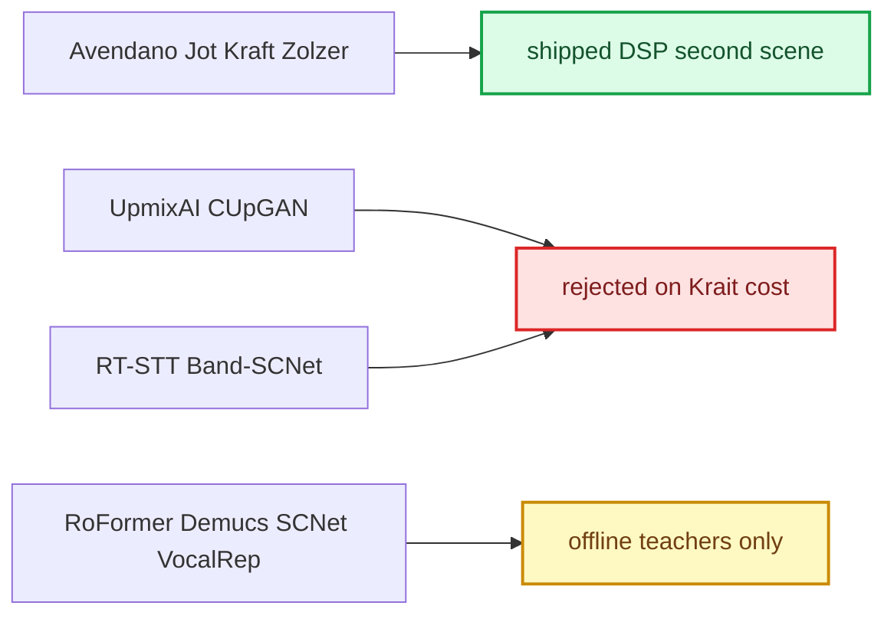
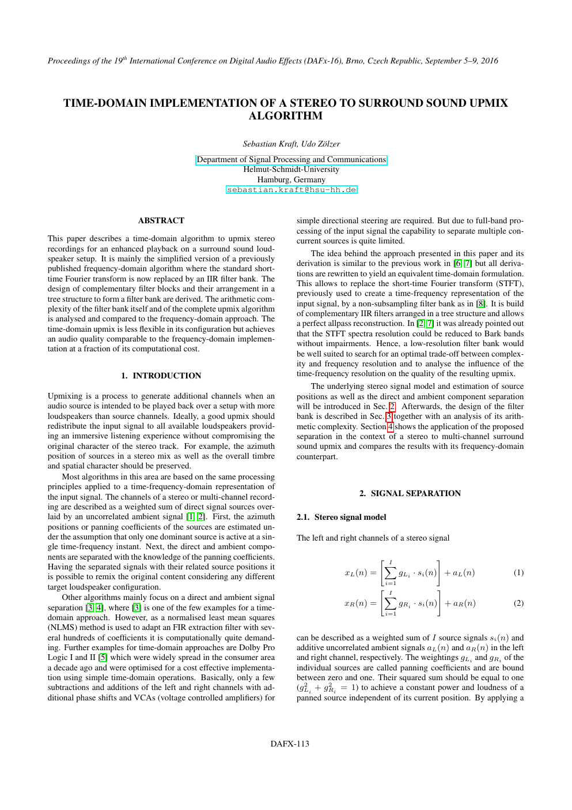
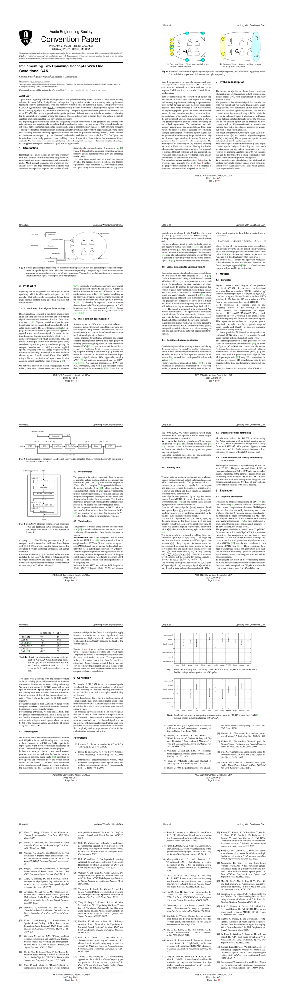
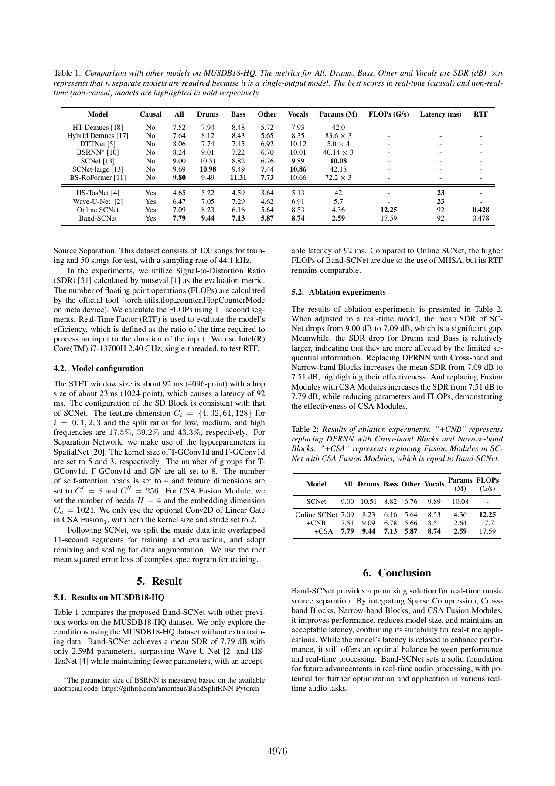

# Upmix Literature

**Latest separator review, 2026-09-29:** [Research review and the next discriminating experiment](UPMIX_RESEARCH_REVIEW_2026-09-29.md) compares 22 research lines and pinned implementation code with Track B's observed fitting gap, failed data/architecture probes, and the Audi compute/latency gates. Its proposed direction is a stronger causal reference encoder followed by measured compression; it establishes no new separation or deployment result.

*The papers and published systems the upmix work drew on — classic direct/ambient DSP, ML upmixers, source separation and its evaluation — with what each one actually changed in this project.*

---

## 📋 How to read this

Two families of prior art matter. **DSP upmixers** split stereo into direct and ambient parts per band from pan and coherence; they are cheap and genre-agnostic, and the shipped second scene is essentially one of them with a learned protection veto ([HSSR Model](HSSR_MODEL.md)). **ML separators** are far stronger offline but cost 10–1,000× the Krait budget ([Upmix Compute Budget](UPMIX_COMPUTE_BUDGET.md)) and separate *instruments*, not *roles*. Published numbers below are the authors' own claims, not project benchmarks.

## 🔗 Classic direct/ambient upmixing

**Kraft & Zölzer, DAFx-15** — *Stereo signal separation and upmixing by mid-side decomposition in the frequency domain.* Model per STFT band: `X_L = a_L·D + N`, `X_R = a_R·D + e^{jφ}·N` with real, power-normalized pan gains (`a_L² + a_R² = 1`) and ambience equal in magnitude on both sides. Under the assumption that one dominant source owns each time-frequency cell, a generalized band-wise mid/side decomposition yields the azimuth, the direct part and the ambience. Direct is re-panned (VBAP), ambience spread and decorrelated; a stereo→5 VST ran at low cost. They note Bark-band resolution suffices and that decorrelating ambience matters more as speakers are added.

**Kraft & Zölzer, DAFx-16** — *Time-domain implementation of a stereo to surround upmix.* Same model with the STFT replaced by a non-subsampled tree of complementary IIR filters (allpass-reconstructing). Stereo→5 in the frequency domain ~38 MFlops; the time-domain variant 8–20 MFlops with comparable quality. The lowest and highest bands gave unreliable positions; a short delay decorrelates front from rear ambience.

*Figure 1: Kraft & Zölzer DAFx-16 first page (filter-bank upmix).*

Both cite Avendano & Jot (inter-channel coherence as ambience/pan index), Faller (least-squares direct/ambient), Goodwin (PCA), Vickers (centre extraction), Usher (NLMS reverb extraction) and Dolby Pro Logic II. The shipped HSSR uses the Avendano–Jot/DirAC idea directly: a ~45 ms per-bin L/R coherence weights object masks (`hook/audio/hssr_dsp.c:1493-1494`) [code]. The Q5 azimuth prototype is the Kraft–Zölzer model in code form (`tools/stereo-upmix-render/q5_azimuth_scene.py:1-15`).

Sources: [dafx2015_ms_upmix.pdf](../sources/papers/dafx2015_ms_upmix.pdf) ([text](../sources/papers/dafx2015_ms_upmix.txt)), [dafx2016_time_domain_upmix.pdf](../sources/papers/dafx2016_time_domain_upmix.pdf) ([text](../sources/papers/dafx2016_time_domain_upmix.txt)), [dafx2016_p7.png](../sources/papers/dafx2016_p7.png).

## 💡 ML upmixers

**UpmixAI** (N. N. Tong, University of Miami MSc project, May 2025): reframes primary-ambient extraction as music source separation, trains a high-complexity MSS network on a custom PAEDB dataset inside a VPA upmix system. In a listening study the DNN system and the DSP system were rated alike and both above an MLP variant, whose gating artifacts cost spectral quality — though some listeners found those artifacts *more* immersive. Conclusion: ML matches classic DSP upmixing, does not beat it. [upmixai.pdf](../sources/papers/upmixai.pdf) ([text](../sources/papers/upmixai.txt)).

**CUpGAN** (Uhle, Weyers, Zimmermann, Fraunhofer IIS; AES 2026 Automotive Audio, paper 9): one conditional generator, FiLM-switched between ambience (`CUpGAN-A`, direct = `x − â`) and centre extraction (`CUpGAN-C`). STFT 1024/512 at 44.1 kHz; six features per bin (log magnitude, normalized re/im per channel) → 21 channels → four causal ConvNeXt blocks (3×3 depthwise, LayerNorm, 21→84→21 GELU, FiLM) → iSTFT. Claimed ~14,000 params, 264 M MAC/s, 23 ms latency. Trained on MUSDB18 + audiobook speech + ReverbFX impulse responses: 2,400 six-second pairs, 400k Adam steps, batch 16, ~32 h on an A100; losses multi-resolution STFT, complex STFT, high-passed time MSE, LSGAN and feature matching. Two A/B tests with ten expert listeners on eleven 5–13 s commercial clips (headphones): preferred over GSDR (centre) and DAD (ambience), though SI-SDR was meaningless for ambience and DAD scored better on 2F. No weights or code published; measured infeasible on Krait ([Upmix Compute Budget](UPMIX_COMPUTE_BUDGET.md)).

*Figure 2: CUpGAN AES 2026 paper, contact sheet of the ten rendered pages.*

Sources: [cupgan_aes_2026.pdf](../sources/papers/cupgan_aes_2026.pdf) ([text](../sources/papers/cupgan_aes_2026.txt); pages [01](../sources/papers/cupgan-render.gLSa4E/page-01.png), [02](../sources/papers/cupgan-render.gLSa4E/page-02.png), [03](../sources/papers/cupgan-render.gLSa4E/page-03.png), [04](../sources/papers/cupgan-render.gLSa4E/page-04.png), [05](../sources/papers/cupgan-render.gLSa4E/page-05.png), [06](../sources/papers/cupgan-render.gLSa4E/page-06.png), [07](../sources/papers/cupgan-render.gLSa4E/page-07.png), [08](../sources/papers/cupgan-render.gLSa4E/page-08.png), [09](../sources/papers/cupgan-render.gLSa4E/page-09.png), [10](../sources/papers/cupgan-render.gLSa4E/page-10.png)), `CUPGAN_A_FEASIBILITY`.

**AlbumDB** (McKenzie, Moliner, Wright, AES Europe 2026): multitrack album with stereo and 7.1.4 masters; its channel order and derived 5.1 are in [Upmix Datasets and Teachers](UPMIX_DATASETS_AND_TEACHERS.md). The paper demonstrates MEGAMI as an automatic stem mixer, not a tested stereo→5.1 upmixer. `UPMIX_ALBUMDB_PAPER_AUDIT`.

## 📚 Source separation, as surveyed 2026-09-12

Offline quality references — candidates for teachers, not for the car:

| Work | What it offers | Limit for this project |
|---|---|---|
| BS-RoFormer (Lu et al. 2023) | band-split RoPE transformer; complex mask per FFT bin inside each band | large compute; community checkpoint score ≠ our result |
| Mel-Band RoFormer (Wang, Lu, Won 2023) | overlapping mel bands; gains on vocals/drums/other | depth not a universal win |
| SCNet (Tong et al. 2024) | sparse-compression encoder/decoder; a *different-error* second opinion | checkpoint claims must be reproduced |
| VocalRep (ACL Findings 2026) | lead / harmony / accompaniment; PHV-40 harmony SI-SDR 2.87 dB vs 1.65 SCNet-L, 0.78 Band-RoFormer | lead 7.99 < 8.08; README forbids use without a licence; same singer can be lead and backing |
| SFC (Saijo, Bando 2026) | input-adaptive spectral compression | millions of params, offline |
| BSRNN replication (Magron et al. 2026) | released code/weights, shows pipeline sensitivity | offline, non-causal |
| MSST (Solovyev et al. 2026) | unified train/eval framework | overlap/TTA/ensembles not streamable |
| Banquet, query-by-region (Watcharasupat, Lerch) | query-conditioned fine-grained instruments on MoisesDB | instrument class ≠ arrangement role |
| SAM Audio (Meta 2025), DiCoSe (2026) | promptable / generative refinement | CUDA-class; generated detail is not fidelity |

Low-latency systems, authors' figures:

| Work | Size, quality | Latency, platform |
|---|---|---|
| RT-STT (2025) | 383k params, cSDR 5.17 dB | 23 ms algorithmic; 1.01 ms FP16 on RTX 3080 Ti; spectrum cut at ~16.5 kHz |
| Band-SCNet (Interspeech 2025) | 2.59 M, SDR 7.79 dB, 17.59 GFLOP/s | 92 ms; RTF 0.478 one i7 thread |
| Raspberry Pi 4 prototype (blog, 2026-09-04) | 0.86 M, SDR 3.79 dB | 186 ms lookahead, 279 ms end to end, ~15.5 ms per 23.2 ms block on A72 |
| Moises-Light (2025) | ~5 M per stem ×4, cSDR 9.96 dB | 9 s offline chunks; band-limited to ~14.7 kHz |

Takeaways the project adopted: a per-bin decoder beats per-band gains; keep full band (hats and cymbals live above 14 kHz); causal band-split + recurrent is the plausible student shape; judge role separately from separation. Evaluation references: *Beyond SDR* (transients and dynamics), SAM Audio Judge (reference-free critic, needs calibration), ITU-R BS.1534 (MUSHRA) and BS.1116, Acerbi et al. 2026 on spatial-cue preservation. The review's own verdict: VocalRep is a candidate for one link, not a replacement for the instrumental system. It proposed three pilot students for G, all with the same targets and budget: a causal band-split recurrent separator with a per-bin complex decoder; a compact causal conv encoder/decoder with a recurrent bottleneck; and SFC-style adaptive compression only if the encoder proved to be the limit. Semantics would run on a slower role path with uncertainty. Its evaluation card: protected leakage, useful retention, waveform/phase fidelity, attacks and tails, L/R stability, front after redistribution and hardware cost, reported as medians plus worst cases. Its recommended loss pilot: waveform L1 + complex STFT + multi-resolution spectral losses, with the coefficients set by ablation.

*Figure 3: Band-SCNet page with the latency/quality table.*

Sources: `UPMIX_RESEARCH_2026_09`, [band-scnet.pdf](../sources/papers/upmix-research-20260912/band-scnet.pdf), [vocalrep.pdf](../sources/papers/upmix-research-20260912/vocalrep.pdf), [vocalrep-06.png](../sources/papers/upmix-research-20260912/vocalrep-06.png), `UPMIX_CHAIN_REASSESSMENT_G5`.

## ⚠️ Files that are not papers

Several files in `sources/papers/` are failed downloads and contain no paper text:

| File | Actual content |
|---|---|
| [bharitkar2023.pdf](UPMIX_LITERATURE.md), [bharitkar_22087.pdf](UPMIX_LITERATURE.md) | IEEE Xplore HTML login page |
| [song_ambient_phase_2025.pdf](UPMIX_LITERATURE.md), [song_ambient_phase_2025_https.pdf](UPMIX_LITERATURE.md) | IEEE Xplore HTML page |
| [cupgan2026.bin](UPMIX_LITERATURE.md) | a 44-byte `401 JWT Token not found` JSON |

The intended papers (Bharitkar's ML upmixing work, Song et al. 2025 on ambient phase) were never read by the project.

## 📚 Sources

Merged originals were removed from the tree after this note absorbed them; they remain in git history (commit 23972aa).

| Source | What it holds |
|---|---|
| [dafx2015_ms_upmix.pdf](../sources/papers/dafx2015_ms_upmix.pdf) | Kraft & Zölzer 2015, frequency-domain M/S upmix |
| [dafx2016_time_domain_upmix.pdf](../sources/papers/dafx2016_time_domain_upmix.pdf) | Kraft & Zölzer 2016, IIR filter-bank upmix |
| [dafx2016_p1.png](../sources/papers/dafx2016_p1.png), [dafx2016_p7.png](../sources/papers/dafx2016_p7.png) | Rendered DAFx-16 pages |
| [upmixai.pdf](../sources/papers/upmixai.pdf) | UpmixAI thesis |
| [cupgan_aes_2026.pdf](../sources/papers/cupgan_aes_2026.pdf) | CUpGAN AES 2026 paper |
| `CUPGAN_A_FEASIBILITY` | CUpGAN on-target feasibility |
| `UPMIX_RESEARCH_2026_09` | Separation literature review 2026-09-12 (Russian) |
| `UPMIX_ALBUMDB_PAPER_AUDIT` | AlbumDB paper reading |
| [UPMIX](../research/UPMIX.md) | Pipeline paper |
