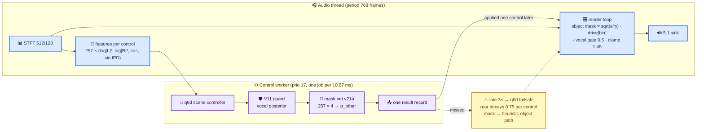
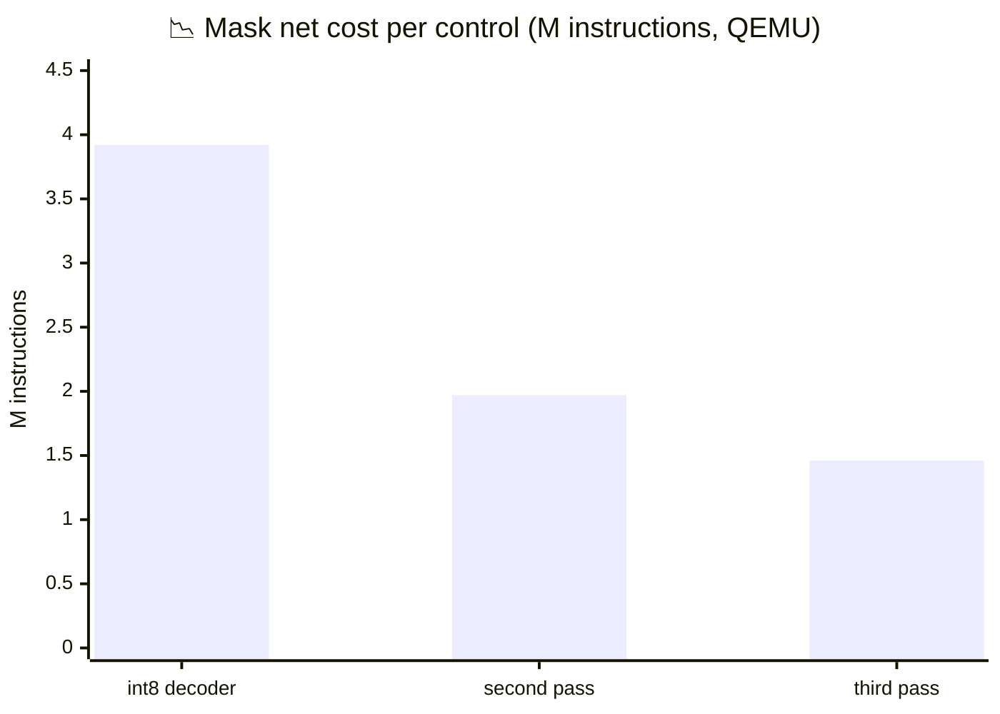
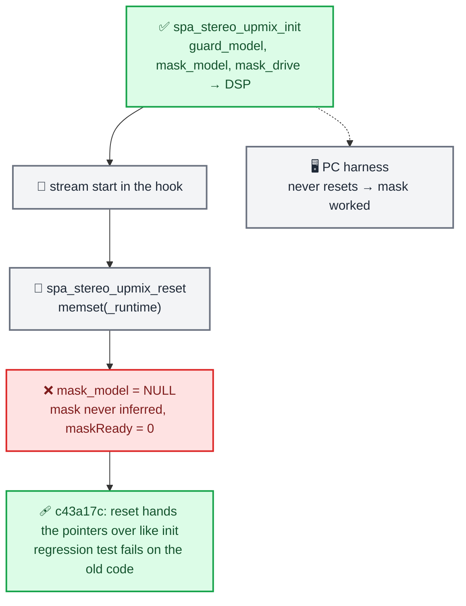
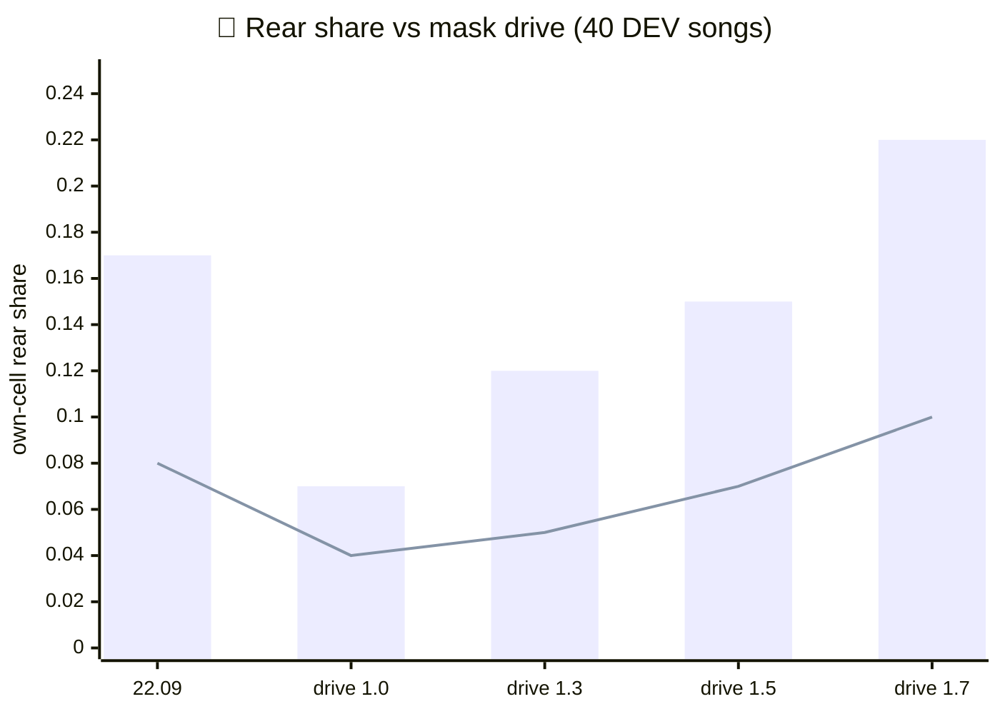

# Upmix Mask Net Phase 1 — Status Report

_Track A (the in-car build of the per-cell rear-eligibility student), 2026-09-27_
_LuKa · branch `feature/upmix-source-separation`, commits 0c91d5e → 04fb06d_

---

## 📋 TL;DR

- **Overall:** the mask net runs in the car for the first time tonight, at 1.33 ms per control on the Krait, with every worker job on time; the ear says "something is behind, still less than 22.09".
- **Progress:** the runtime went from 3.92 M to 1.46 M ARMv7 instructions per control in three passes with NEON parity to 1e-6; the install package, per-model settings files and a health line in the hook log shipped with it.
- **Found:** `spa_stereo_upmix_reset()` dropped the guard and mask model pointers, so the mask had never run in the car until the fix; the "2/40 swinging" figure of the morning was a level-dependent metric read on a thin rear.
- **Blocker:** the per-cell student's fullness ceiling. At the 22.09 rear level it swings a third less and leaks less voice than the heuristic, but it cannot give "distinct instruments behind" without the voice creeping back. That is Track B's separator.
- **Next:** listen at drive 1.5 over voice-heavy material; read the separator diagnostics (sep6/sep7/sep8) in the morning; keep the two reserve levers (mask every second control, split worker publication) unused until a Krait number asks for them.

---

## 🚦 Health Summary

| Area | Status | Trend | Notes |
| --- | --- | --- | --- |
| **Runtime cost** | 🟢 On track | ↑ | 1.33 ms per 10.67 ms control on the unit, 24× margin to the failsafe threshold |
| **Correctness** | 🟢 Good | ↑ | NEON vs scalar 4e-5, scalar vs PyTorch 0.0168 (the int8 decoder), regression test for the reset handoff |
| **Sound** | 🟡 At risk | → | drive 1.5 shipped: guitars 0.15 rear (22.09: 0.17), voice 0.07 (0.08), relative swing 1.47 (2.35); the ear still wants more |
| **Stability in the car** | 🟢 Good | → | 30 k+ controls, worker never late, no failsafe, no fallback, no underrun, guard never tripped |
| **Track B dependency** | 🟡 At risk | → | separator students plateau at −0.3 dB SI-SDR; three diagnostics run overnight |

**Status key:** 🟢 On track · 🟡 At risk · 🔴 Off track / blocked
**Trend key:** ↑ Improving · → Stable · ↓ Declining

---

## 🕒 The Day

_Timeline of the day's work from the QEMU profile in the morning to the drive curve in the car at night._

```mermaid
timeline
    title 📅 2026-09-27, Track A
    section Morning
        11:50 : 🔬 QEMU per-line profile : 3.9 M instructions per control, 0.5 M of them in QNX libm
        12:30 : ⚙️ Second pass : fast exp/log, 16-lane quantiser, 4-wide tanh, padded convs → 1.97 M
        12:00 : ✅ Production path on 40 DEV songs : same row as the test path, int8 identical
    section Afternoon
        13:30 : ⚙️ Third pass : spills found by objdump, 4-row convs, int8 flat, cell skip → 1.46 M
        14:00 : 📦 Install package : blob, startup env, settings.json per model with a drift check
        18:45 : 🏗️ Full unprotected build : hook, renderers, Java, zip
    section Evening
        19:00 : 🚗 Deployed over SSH : 5 files updated, 12 identical, Krait bench 1.33 ms per control
        19:30 : 🐛 Reset handoff bug : maskReady=0 in the new health line, fixed in the hook
        20:30 : 🎚️ Drive curve : 22.09 reference row, 1.0 → 1.3 → 1.5 in the car, 1.7 rejected
```

---

## 🧩 What Runs in the Car Now



Three networks run per control. The mask net is 87 % of the worker's instructions; q6d and the guard together cost 0.29 M. Everything the mask does is behind two environment knobs that default to off in the hook (`AUDIO_HSSR_MASK_MODEL`, `AUDIO_HSSR_MASK_DRIVE`); with the drive at 0 the object path is the 25.09 heuristic.

---

## ⚙️ Runtime: 3.92 M → 1.46 M Instructions per Control

| Pass | What changed | Per control (QEMU, ARMv7) |
| --- | --- | --- |
| float reference | the per-cell student operation for operation, parity 3.6e-7 vs PyTorch | ~13 M |
| int8 decoder + NEON taps + rational tanh (morning) | decoder as [257 × 57] · [57 × 32] int8 | 3.92 M |
| **second pass** | polynomial exp/log (QNX 6.5 `expf`/`logf` are software double on softfp, ~180 instructions a call, 2.8 k calls per control), 16-lane bit-exact quantiser, 4-wide tanh with `vrecpe` + 2 Newton steps, 4-row int8 decoder groups, convs in direct form over zero-padded rows, `vld2`/`vext` stride-2 depthwise, 4-row gemvs | **1.97 M** |
| **third pass** | `objdump` showed 601 of 1787 instructions per cell were `vldr`/`vstr` spills in the macro-expanded decoder → 4-row loops with the inputs in registers; convs four output rows per pass over load-time transposed weights (`vmla` by lane); flat layer int8 (540 KB → 135 KB of weights per control, accuracy unchanged); cells 60 dB below the control's loudest bin keep their last eligibility (28 % of cells on music) | **1.46 M** |

_Instructions per control after each pass; the dashed target is the morning's estimate of what the worker could afford._



On the unit (Krait 1512 MHz, `stereo_upmix_bench` in `/ramdisk`, 400 blocks of 1024 frames):

| Measurement | Without the mask | With the mask |
| --- | --- | --- |
| synchronous, nets inside the audio thread, per block | 4.67 ms | 7.33 ms → **1.33 ms per control** |
| production layout (async worker, realtime pacing), audio thread per block | 3.99 ms | 4.04 ms |
| worker jobs completed / submitted, busy, stale | 839 / 839, 0, 0 | 839 / 839, 0, 0 |

Parity: NEON (QEMU) vs scalar (host) max |Δe| 4e-5 over 12 synthetic controls (`stereo_upmix_bench --mask-selftest`, `bench/mask_selftest_compare.py`); scalar vs PyTorch max 0.0168, mean 0.0011, corr 0.99991 — the int8 quantisation, unchanged by every pass. The 40-song production-path row is identical for the float, int8, shipped-arithmetic and cell-skip builds (voice 0.04, guitars 0.07, keys 0.08, rear −37.6 dBFS, error vs the oracle 0.16).

<details>
<summary><strong>📊 What the profile taught</strong></summary>

- Per-line attribution at `-O3` is unreliable: inlined intrinsics land on `arm_neon.h` lines and the inlining chain from `addr2line -i` mis-assigns stages. Function counts plus `objdump` histograms (`vldr`/`vstr` = spills) were the reliable signals.
- The QEMU L1D model (16 KB, 4-way) counts 23 k misses per control with or without the int8 flat layer: with 16 KB the misses are the stage scratch buffers re-touched between stages; what the int8 flat layer shrank is the unique working set per control, ~1.0 MB → ~0.6 MB, the L2 question.
- The white-noise bench barely skips cells; the 60 dB skip only shows on music (28 % of cells).

</details>

---

## 🐛 The Bug That Hid the Mask



The new health line found it within a minute of the first playback: `HSSR health rt: … maskReady=0 … worker=1535/1535 busy=0 stale=0` — every job on time and no result applied. The same line now runs every ~16 s beside the sink statistics for both upmix paths, and a WARN fires the first time the q6d failsafe or the mask fallback happens (counters `inference_failures`, `mask_fallbacks`). Before it, neither event was visible in any log.

---

## 🎚️ The Drive Curve and What the Ear Said

The 22.09 build is the last one the ear knew. Through the same 40-song harness it is the reference row: guitars 0.17 rear, keys 0.18, drums 0.26, **voice 0.08 with 8 songs above 15 %**, rear −36.3 dBFS. The mask at drive 1.0 sends back less than half of every instrument at almost the same level, hence "the rear is almost gone".

| Drive | Guitars | Voice (songs > 15 %) | Drums | Rear dBFS | Guitars, relative swing | Voice, relative swing |
| --- | --- | --- | --- | --- | --- | --- |
| 22.09 heuristic | 0.17 | 0.08 (8) | 0.26 | −36.3 | 2.35 | 4.8 |
| 1.0 | 0.07 | 0.04 (0) | 0.17 | −37.6 | 2.20 | 3.1 |
| 1.3 | 0.12 | 0.05 (0) | 0.23 | −35.3 | 1.48 | 2.8 |
| **1.5 (shipped)** | **0.15** | **0.07 (0)** | 0.28 | −33.8 | **1.47** | 2.5 |
| 1.7 | 0.21 | 0.10 (8) | 0.33 | −33.6 | 1.53 | 2.8 |

"Relative swing" is the 1-second range of a stem's rear share divided by its median share. The morning's `swing > 0.30` count grows with the level by construction (a thin rear cannot move by 0.30), which is why the drive-1.0 row read as "never swings". Level-matched, the mask path swings about a third less than the heuristic and keeps the voice lower; it does not remove the swing.

_Guitar and voice rear share against the mask drive, with the 22.09 heuristic as the first bar group._



Knobs built tonight and rejected on the harness:

| Knob | Values | Result | Verdict |
| --- | --- | --- | --- |
| `AUDIO_HSSR_MASK_TREBLE_DB` (drive shelf above ~2.5 kHz) | +3, +6 | drums 0.44 / 0.50, voice 0.10 / 0.12 | cymbals and voice sit in the "other" cells' highs; off |
| `AUDIO_HSSR_MASK_GAMMA` (eligibility exponent) | 0.7, 0.5 | voice 0.14 / 0.16, drums past 0.5 | the student's voice/guitar contrast (0.41 vs ~0.55) is too small to sharpen; off |
| surround 0.5 + rear body 0 at drive 1.3 | — | voice 0.12, guitars 0.24 | the whole rear up, voice with it; off |
| rear air −12 → −9 | — | +3 dB of static air above 2.5 kHz | kept: the mask rear was 1.6 dB darker than 22.09 |

Car verdicts, in order: drive 1.0 "the rear is almost gone" (the reset bug, the mask was not running); drive 1.7 "voices not behind, hi-hats barely"; drive 1.3 "on rock songs there is something behind, still little"; drive 1.5 shipped, listening continues.

---

## 📦 What Is Deployed

| File on the unit | State |
| --- | --- |
| `/mnt/app/root/hooks/libcarplay_hook.so` | third-pass runtime, reset fix, health line, treble and gamma knobs (1.196 MB) |
| `/mnt/app/root/hooks/hssr_mask.bin` | v21a blob, 173 711 floats, `models/mask-full-probe-v21a` |
| `/mnt/app/root/hooks/carplay_startup.sh` | `MASK_DRIVE=1.5`, `MASK_MODEL`, `VOCAL_GATE=0.5`, `REAR_AIR_DB=-9` |
| `carplay_ncm_cleanup.sh`, `carplay_hook.jar` | were missing / older on the unit, now the package's |
| 12 other package files | byte-identical, left alone |

Every file was written as `name.new`, renamed, read back and compared byte for byte (`hu.sh`: one SSH ControlMaster, banner-safe read-back). The repository matches the unit: `scripts/check_model_settings.py` verifies every knob a `models/*/settings.json` records against `carplay_startup.sh` at package time (22 knobs).

---

## 🧭 Lessons

- **The harness never resets; the hook resets on every stream.** Any state the config hands over in `init()` must be handed over in `reset()` too, and the test now says so.
- **A stability count with an absolute threshold is a level metric in disguise.** Compare swings relative to the stem's own rear share, or level-match first.
- **The unit's address is `10.173.189.1` (LAN) or `100.127.17.86` (tailscale).** The `8.78.0.19` that scripts mention is not the head unit; a day of "unreachable" was the wrong address.
- **QNX 6.5 `expf`/`logf` on a softfp build cost ~180 instructions each.** Float-epsilon polynomials are exact enough for a network and 10× cheaper.
- **`objdump` histograms beat line profiles at `-O3`.** Spills show as `vldr`/`vstr`; the fix is code shape, not intrinsics.
- **zsh does not word-split unquoted variables.** Options assembled in a string become one argument; use arrays.
- **A PowerShell one-liner that kills by command-line pattern matches itself.** Put the patterns in a script file that excludes its own name.

---

## 📍 Next

1. **Listen at drive 1.5** on voice-heavy songs; pull the health lines after each session. The reserve inside this net is 1.7 (22.09 fullness, 22.09 voice leak).
2. **Read the separator diagnostics** (Track B: sep6 truth-only supervision, sep7 cross-band BiGRU, sep8 log-domain loss; gates +1 dB SI-SDR at matched vocal leakage, recall toward 0.60, treble recovery, no added swings). The per-cell student's fullness ceiling is the reason the rear still feels thin.
3. **Two reserve levers, untouched:** publish q6d + guard before the mask in the worker (removes the coupling of a slow mask to the scene failsafe); the mask every second control (−50 % cost). Neither is needed at 1.33 ms per control.

---

## 🔗 References

- [Upmix Source Separation Plan](UPMIX_SOURCE_SEPARATION_PLAN.md) — the living log with every row, review and decision.
- [Upmix Stability 2026-09-25](UPMIX_STABILITY_2026-09-25.md) — the "back and front" causes and the vocal gate.
- [Bench README](../../tools/stereo-upmix-render/bench/README.md) — QEMU instruction counts, the per-function profile plugin, the NEON self-test.
- `models/mask-full-probe-v21a/manifest.json`, `models/*/settings.json` — provenance and the shipped knobs.
- Commits: 0c91d5e, efa42d9, 81a836e, 6d667c7, 68a137f, e835282, c43a17c, 196d1bd, dcbacb5, 04fb06d.
