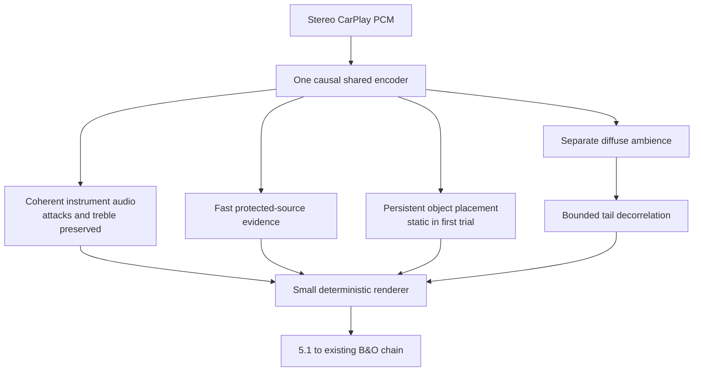
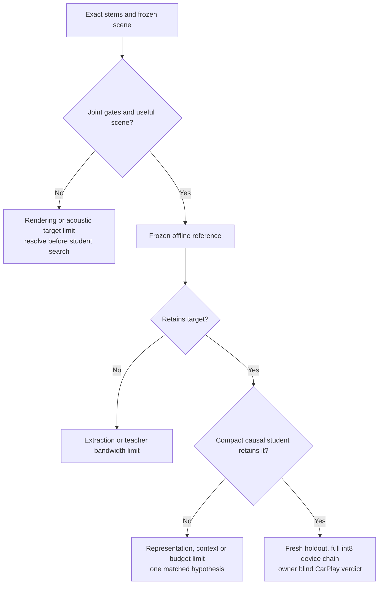

# Rear Scene Research: Recent Papers and a Bounded Architecture Proposal

*2026-10-03 · Track B literature follow-up · Research and planning; no training, PC jobs, deployment or runtime edits.*

---

## 🧭 Recommendation

**Our proposed direction is one causal shared encoder with separate instrument, ambience and scene-control outputs, followed by a small deterministic renderer.** Preserve coherent instrument attacks and treble; place their objects steadily behind the listener; add independently controlled diffuse ambience. Keep source protection responsive even while placement stays fixed.

This is a hypothesis assembled from recent research and our measured failures. None of the reviewed papers demonstrates our complete Audi target: causal int8 inference at ≤150 M MAC/s measured on the loaded unit, ≤85 ms extra latency, protected-source limits, stable vocal entries and owner preference through live CarPlay.

The immediate useful experiment is a **scene/rendering comparison with extraction held fixed**, using the existing BSRNN reference and true stems. A new large encoder is not yet justified by these papers. Training remains paused; the reserved upper64-versus24 experiment in the [session wrap](UPMIX_SESSION_WRAP_2026-09-30.md) remains unexecuted.

## 📏 What actually needs improving

These are the existing nominal-gain host results, not new measurements. They use the original DEV40 ×60 s and real C rendering. Read each report for its pipeline and attribution boundaries.

| Candidate | Guitar / keys / piano / strings rear share | Voice / bass / drums rear share | Any-stem swinging songs | Attributed vocal-entry median / p10 |
|---|---|---|---|---|
| Current Track A, three networks | .165 / .152 / .095 / .069 | .0756 / .1493 / .2964 | 29/40 | Not measured in that baseline |
| Final causal spectral40k, one network, nominal .40 | .225 / .217 / .219 / .191 | .0139 / .1585 / .0139 | 31/40 | .799 / .451 |
| Offline BSRNN SIMO with direct C route | .200 / .211 / .219 / .204 | .0022 / .0070 / .0033 | 0/40 | .876 / .746 |

Sources: [Track A matched40](UPMIX_TRACKA_MATCHED40_2026-09-30.md), [completed spectral40k](UPMIX_UNIFIED_SCENE_ARCHITECTURE_2026-09-30.md#-completed-spectral40k-pair-joint-promotion-fails), [BSRNN real-C check](UPMIX_BSRNN_REAL_C_CHECK_2026-09-29.md).

Rear share is the harness's source-attributed metric, **not a percentage of perceived surround immersion**. Different source populations and signal paths matter; this table does not isolate architecture effects. BSRNN uses noncausal chunks and excerpt normalization and remains an offline reference.

Three verified constraints shape the research:

1. **Aggregate instrument recall has already risen above the old shelf.** The final one-network candidate fails jointly on bass, movement and both vocal-entry gates. Its scene head remains dormant; a learned semantic scene controller has not been demonstrated.
2. **Upper-band instrument content remains weak.** The final spectral candidate's 10–16 kHz rear proxies are .010982 / .004237 / .006252 for guitar / keys / strings, versus labelled-oracle .322519 / .288704 / .217993. These are band-specific proxies; they must not be compared as overall rear shares. Even the BSRNN reference attenuates upper-band eligible content.
3. **Rendering materially changes stability.** With BSRNN held fixed, the original route has 11/40 swinging songs; direct routing has 0/40 at approximately +.10 dB rear RMS. With true audio, the earlier combined direct/no-bed intervention gives 0/40. That intervention changed multiple renderer factors, so it does not identify a single causal knob. See the [direct-object probe](UPMIX_DIRECT_OBJECT_RENDERER_PROBE_2026-09-28.md).

The original instrument/protected-source, movement, level-dependence, vocal-entry and device/ear gates still apply. A stronger rear scene must preserve all of them.

## 🔎 Search scope and evidence quality

This follow-up prioritizes 2026 spatial upmixing, musical object control, perceptual evaluation and streaming conversion. It extends the [September 29 review of 22 research lines](UPMIX_RESEARCH_REVIEW_2026-09-29.md); those separator families are not rediscovered here.

Sixteen primary-source entries are recorded below. Full-text entries mean methods/results/limitations were inspected, not reproduced. The cabin-localization entry has an official abstract only; the CUpGAN refresh combines its official abstract with the project's earlier full-paper analysis. CUpGAN and primary–ambient upmixing have earlier project coverage, explicitly noted. Publication dates and manuscript revision dates are distinguished. Searches were completed on October 3; indexing freshness is not proof of a new publication.

No checkpoint availability, licence, runtime cost or listening claim is inferred from a title alone. Paper data involving MoisesDB or MUSDB18 require original-recording deduplication against our evaluation sets. The old DEV40 and previously inspected TEST20 are diagnostic sets; they cannot become fresh holdouts again.

## 📚 Primary-source inventory

### Spatial upmixing and object control

| Work and date | Evidence inspected | Reported contribution and important limit | Relevance to this project |
|---|---|---|---|
| **S2X-Net**, official IEEE publication listing October 2026 [^s2x] | Author manuscript methods/evaluation; official publication listing. IEEE full-text endpoint requires browser verification. | Modular music-source and primary–ambient separation, stereo-to-5.1/7.1 synthesis and downmix consistency; a MUSHRA-inspired study uses 50 subjects. No verified Audi compute, causality or cabin result. | Separate coherent sources from diffuse content; retain a stereo conservation constraint. This does not certify clean rear vocals. |
| **SEND**, DAFx 2026, September 1–4 [^send] | Full conference paper. | Detects intervals suitable for object motion using source/background context; trained on 1,000 immersive projects. Reported frame F1 .7675. Listening examples use **human-authored trajectories** constrained by detections; this is not a fully automatic renderer. | Keep placement stable between meaningful events. Our first proposal disables intentional motion entirely. |
| **SPHERE**, August 31, 2026 preprint [^sphere] | Full manuscript, rewards and listening protocols. | Predicts spatial mix parameters from **already separated multitrack stems** using a large audio-language model. High-reward mixes are preferred in 76.8% of 440 trials from 44 listeners. A separate small expert test finds little improvement from RL over supervised fine-tuning. | Offline parameter teacher and role-aware constraints; neither a stereo extractor nor a budget-sized runtime. |
| **PAEDB**, DAFx 2026, September 1–4 [^paedb] | Full conference paper; extends earlier UpmixAI coverage. | 1,809 synthetic primary/ambient pairs, >550 hours, derived from MUSDB18-HQ and MoisesDB. A 12-person calibrated 5.1 study scores ELAE DSP 14.63 and Mel-RoFormer 14.45 on the combined measure. Targets inherit the generating DSP's ceiling. | Ambience is a separate supervised task. Dataset hours are not independent new recordings; do not contaminate our holdout. |
| **ImmersiveFlow**, January 19 preprint; revision September 28, 2026 [^flow] | Full revised manuscript and linked project/repository. | Stereo-to-7.1.4 generation with a 281 M-parameter flow model and frozen audio VAE, trained on 500 professional songs and synthetic downmixes. Evaluation uses binaural headphone listening. | Possible offline spatial reference. Ten-second generation, codec fidelity and arbitrary-master distribution shift prevent a live-Audi claim. |
| **CUpGAN**, AES Automotive Audio, July 2026 [^cupgan] | Official abstract refreshed; existing local full-paper analysis and disclosed-core QNX benchmark reused. | Conditional shared weights support direct/centre and diffuse extraction with phase-aware losses. **Already known here**: the disclosed core is too expensive; approximately 715 M MAC/s at 48 kHz by our accounting, before complete integration. | Borrow conditional sharing only if a smaller independently trained model passes the budget. No repeat of the rejected original graph. |

For the CUpGAN arithmetic and missing implementation details, see [Compute Budget](UPMIX_COMPUTE_BUDGET.md#-cupgan-a-measured-out) and [Literature](UPMIX_LITERATURE.md#-ml-upmixers). Its publication is recent, but its feasibility is not an open discovery in this project.

### Streaming, frequency fidelity and data quality

| Work and date | Evidence inspected | Reported contribution and important limit | Relevance to this project |
|---|---|---|---|
| **Adapting offline models to a streaming context for music source separation**, September 28, 2026 preprint [^stream] | Full PDF, readout-position method and runtime/results tables. | Sliding inference changes the readout position to trade future context against delay. HTDemucs at 23 ms algorithmic latency adds 20.6 ms GPU inference; SCNet's reported RTF 1.59 misses realtime. Very early readout can produce buzzing. | Sweep bounded future context on the PC to diagnose quality dependence. GPU timing does not demonstrate Krait feasibility; positive lookahead is not strict causality. |
| **Music Source Separation via Stem Discovery**, September 25, 2026 preprint, submitted to ICASSP 2027 [^mus3d] | Full manuscript. | Automatic audio-query discovery feeds conditional separation. Missed or false queries limit extraction; recursive generation is costly. Listening comparisons also expose the audio VAE as a quality bottleneck. | Persistent instrument identity deserves an explicit representation. Do not assume automatic stem discovery solves whole-song continuity or fits the unit. |
| **Dissecting Performance Degradation under Sampling Frequency Mismatch**, January 21 manuscript; ICASSP 2026 [^sampling] | Full manuscript; author publication listing. | Missing high-frequency information after large sample-rate changes degrades multiple separators; noise-shaped/trainable resampling is studied. | Audit resampling and teacher/student bandwidth. Their large rate mismatches do not establish the cause of our nearby 44.1/48 kHz problem; noise is not restored guitar detail. |
| **CrowdioSet and PaRIRset**, July 30, 2026 preprint [^crowd] | Full manuscript and project page. | Audience/reverberation data help live-music separation; singalong remains difficult. | Audit live-recording and reverberant-vocal contamination. The downstream Audi cabin is not equivalent to reverberant source audio. |
| **Towards Blind Data Cleaning**, October 2025 manuscript; ICASSP 2026 [^clean] | Full manuscript and official Sony publication page. | Studies imperfect source-label cleaning and unlearning; removal choices require expensive validation, and experiments use Open-Unmix. | Audit teacher-target leakage before remixing it. No evidence that indiscriminate filtering fixes our spectral student. |

### Perception and automotive rendering

| Work and date | Evidence inspected | Reported contribution and important limit | Relevance to this project |
|---|---|---|---|
| **Multichannel Audio Quality Assessment**, September 29, 2026 preprint [^quality] | Full manuscript, channel-group features and evaluation. | Extends a pretrained perceptual model with front/surround/centre relationships; overall PCC/SCC .9063/.8303 on codec-quality tests. Requires a reference; backbone/data availability was not verified. | Evaluate channel relationships. Codec-quality prediction does not measure whether instruments are pleasantly behind the driver. |
| **Spacing Out**, July 28, 2026 preprint [^spacing] | Full manuscript and metric/listening analysis. | Binaural separator study with 26 valid listeners; spatial reconstruction and ILD metrics align better than tested ITD metrics. Narrowband bass challenges GCC-PHAT estimates. | Add spatial fidelity checks; never promote on an ITD estimate alone. Headphone findings need cabin validation. |
| **Perceptual Decorrelator Based on Resonators**, DAFx 2025 [^decorrelator] | Full paper; retained as a relevant older mechanism. | Designs decorrelation using frequency-dependent group delay and resonators; perceptual evidence comes from noise/headphone experiments. Whole-music multichannel validation remains limited. | Use controlled decorrelation on diffuse tails. Avoid smearing coherent instrument attacks; check pole stability and impulse decay. |
| **Headrest-Integrated Loudspeakers**, June 23, 2026 accepted manuscript, AES Automotive July [^headrest] | Full manuscript and listening tables. | Nineteen listeners evaluate a modified Volvo cabin with extra headrest/height hardware. Preference is configuration-dependent; not every contrast is significant. | Seat/hardware transfer matters. This Audi has no demonstrated equivalent added hardware. |
| **Sound Source Localization: Vehicle Cabin vs Reference Room**, Forum Acusticum September 10, 2026 [^cabin] | Official abstract only. | Thirty-two participants, navigation voice/PDC sounds; ±20° accuracy is 77% in the room versus 67% in the car, with an asymmetric cabin bias. | Room/headphone screening cannot replace driver-seat verification. These are not musical rear-scene results. |

## 🧠 Proposed architecture and what would actually change

This diagram is **our proposal**, not an implementation or a reproduction of any one paper. Cost allocations must be measured before choosing widths or adding heads.

### Two timescales with an explicit safety boundary

Audio extraction and protected-source evidence update at the audio hop. Object placement changes only at a justified phrase boundary, with a conservative hold and a click-free transition. A vocal entry is **not** itself a reason to move or reduce the instrument scene. SEND suggests event-aware control; SPHERE suggests explicit musical roles. Their published large models are not proposed for runtime inference.

Holding placement must not hold a contaminated mask open. Fast protection retains authority over leaked vocals/bass/drums. The earlier persistence/smoothing experiments did not establish a solution; missing or contaminated instrument audio cannot be repaired by freezing its position.

### Coherent objects plus independent ambience

The foreground instrument branch preserves source phase, attacks and upper-band detail. Initially use stable Ls/Rs placement and no intentional object motion. The diffuse branch may add spaciousness after a separate contamination audit and with bounded energy. Decorrelation operates on that branch alone.

Our BSRNN reference exposes vocals/drums/bass/other, not separate guitar/key/piano objects. Its first scene comparison therefore uses the eligible stereo bus as one stable object. Per-instrument placement can be tested with exact labelled stems as an upper bound; realizing it from stereo needs separately verified identity/extraction outputs. No such capability is assumed in the existing checkpoint.

PAEDB and S2X-Net motivate treating ambience independently. They do not justify feeding the old raw-mixture bed into the rear again. All vocals remain protected under the owner's existing goal, including backing vocals; a paper's alternative creative policy does not change our acceptance contract.

### Train the quantity that reaches the listener

Use true-stem supervision for source identity, frequency-balanced reconstruction for instrument detail and source-attributed leakage penalties. Add renderer-aware objectives for fixed-level source output, vocal entries and channel relationships. Calibrate any differentiable proxy against the actual C renderer before using it for selection.

Downmix reconstruction is a useful auxiliary check for mix balance, following the general consistency direction in S2X-Net. It is not evidence that vocals stay out of the rear: different multichannel outputs can downmix to the same stereo. Post-limiter and B&O behaviour also lie outside a simple reconstruction constraint.

The current upper64 preparation addresses one measured decoder defect. Its 129.327 M selected dense MAC/s count excludes qualification of the complete int8 chain; it proves neither available room for new heads nor a treble recovery. Bass, movement and vocal-entry failures need separate evidence.

## 🧪 Finite verification sequence if work is resumed

No experiment below was launched by this research. Do not alter Track A's files or copy these proposals into the hook without a separately qualified implementation.

| Stage | Controlled comparison | What it answers | Stop or advance rule |
|---|---|---|---|
| 0: bandwidth audit | Saved mix, true stems, BSRNN, student and rear output; bind sample rates, alignment, normalization and source-attribution rules | Is useful treble missing in the recording/teacher, estimator, projection or renderer? | Identify the first failing boundary. Do not infer this from a total-share scalar. |
| 1: scene preflight | Freeze extracted audio and global gain. Begin with current direct-C baseline; test static coherent placement, then add clean diffuse ambience as a separate change. Repeat with exact stems. | Can rendering improve the scene before changing the network? | All existing protected/movement/entry gates must hold. Freeze added treble/attack/coherence measures before evaluation; ears are needed for preference. |
| 2: one source-capacity hypothesis | Reserved upper64-versus24 pair with identical parent, data, loss, seed and horizon | Does the measured upper-band bottleneck improve without worsening other gates? | One matched trial; no promotion for treble alone. Existing finite restart limit still applies. |
| 3: scene learning, contingent | Only if stage 1 establishes a useful target: fixed encoder/audio recipe, small active placement/ambience heads versus fixed control | Can compact learned control retain the demonstrated scene? | Exact source/entry attribution, real-C joint gates and an explicit complete runtime budget. Do not change datasets and architecture together. |
| 4: qualification | Recording-disjoint fresh holdout, complete native int8 output, loaded-device measurement and owner blind live-CarPlay test | Does the result survive unseen music and the actual cabin? | ≤150 M MAC/s, ≤85 ms extra latency and all original numeric/ear requirements. Headphone previews remain previews. |

Existing DEV40 may diagnose stages 0–3, but repeated use does not provide generalization proof. PAEDB's underlying MoisesDB/MUSDB recordings must be excluded from any new holdout and its training derivatives. When attributing source output, freeze controls produced by the mixture; do not run the separator independently on isolated stems and call that mixture attribution.

### Claims we can and cannot make now

The latest paper evidence supports **testing stable object rendering, explicit ambience and perceptually informed channel objectives**. It does not establish that any downloaded model is a deployable single-network replacement. The existing BSRNN/direct-route result already establishes a strong offline reference; the current compact model has not retained its stability and bass rejection.

A scene that passes host metrics still requires level-matched listening in the Audi. Conversely, if exact-stem rendering cannot make the requested rear scene convincing, more separator training has no demonstrated path to fix that boundary. Record successful, failed and abandoned trials in the [chronicle](UPMIX_SEPARATOR_CHRONICLE_2026-09-25_TO_2026-09-30.md) when they actually occur.

## 🔗 Primary references

Documentation verification: 16 footnote definitions and local file links checked; both Mermaid diagrams parsed and rendered with Mermaid 11.12.0 in light and dark themes. The 12 unrelated dirty/untracked files matched their pre-existing content hashes. These checks validate the document, not any proposed audio result.

[^s2x]: [IEEE Signal Processing Society: S2X-Net, October 2026](https://signalprocessingsociety.org/publications-resources/ieee-transactions-audio-speech-and-language-processing/2026/10/s2x-net-stereo-multichannel-neural-upmixing-network); [author manuscript](https://www.researchgate.net/publication/413816112_S2X-Net_Stereo-to-Multichannel_Neural_Upmixing_Network). Official link resolves to IEEE document 11673289; the direct full-text endpoint returned browser verification during this review.
[^send]: [SEND: DAFx 2026 paper 09](https://dafx.de/paper-archive/2026/papers/DAFx26_paper_09.pdf).
[^sphere]: [SPHERE: Automatic Music Upmixing via Audio Language Model Post-Training with Spatial Heuristic Rewards](https://arxiv.org/html/2608.30559).
[^paedb]: [PAEDB: DAFx 2026 paper 14](https://dafx.de/paper-archive/2026/papers/DAFx26_paper_14.pdf).
[^flow]: [ImmersiveFlow, revised manuscript](https://arxiv.org/html/2601.12950v2); [author repository](https://github.com/violet-liang/ImmersiveFlow).
[^cupgan]: [AES: Implementing Two Upmixing Concepts With One Conditional GAN](https://aes.org/publications/elibrary-page/?id=23403); [previously archived project paper](../sources/papers/cupgan_aes_2026.pdf).
[^stream]: [Adapting offline models to a streaming context for music source separation](https://arxiv.org/pdf/2609.35397).
[^mus3d]: [Music Source Separation via Stem Discovery](https://arxiv.org/html/2609.30912).
[^sampling]: [Dissecting Performance Degradation in Audio Source Separation under Sampling Frequency Mismatch](https://arxiv.org/html/2601.14684); [author's conference publication listing](https://sites.google.com/view/kanami-imamura/publications).
[^crowd]: [CrowdioSet and PaRIRset: Two Datasets Towards Live Music Source Separation](https://arxiv.org/html/2607.27828).
[^clean]: [Towards Blind Data Cleaning: A Case Study in Music Source Separation](https://arxiv.org/html/2510.15409); [Sony official publication page](https://ai.sony/publications/towards-blind-data-cleaning-a-case-study-in-music-source-separation).
[^quality]: [Multichannel Audio Quality Assessment: Extending Pretrained Perceptual Models to Spatial Audio](https://arxiv.org/html/2609.37116).
[^spacing]: [Spacing Out: On the Reliability of Binaural Music Source Separation Metrics](https://arxiv.org/html/2607.25919).
[^decorrelator]: [Perceptual Decorrelator Based on Resonators, DAFx 2025 paper 80](https://dafx.de/paper-archive/2025/DAFx25_paper_80.pdf).
[^headrest]: [Evaluation of Headrest-Integrated Loudspeakers for Enhanced Spatial Audio Immersion in Automotive Cabins](https://arxiv.org/html/2606.24146).
[^cabin]: [Forum Acusticum: Sound Source Localization in a Vehicle Cabin and Reference Room](https://indico.iem.at/event/10/contributions/3829/).
