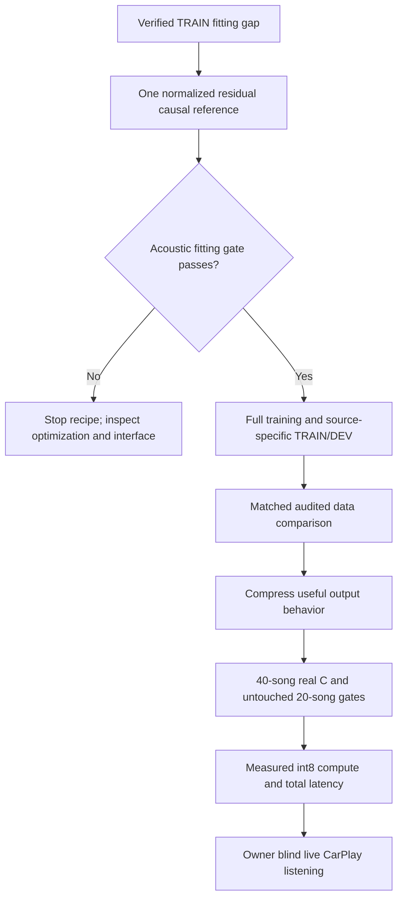

# Upmix separator: research review and the next discriminating experiment

_2026-09-29. Track B. Literature and source-code review requested by the owner after repeated failed separator probes. This review launches no training and changes no renderer, Track A or head-unit file._

**Later owner-directed prerequisite completed:** the [full pretrained BSRNN run](UPMIX_BSRNN_PRETRAINED_INFERENCE_2026-09-29.md) establishes an executable optimized SIMO reference, 11.013 dB median `other` SI-SDR on the same four TRAIN crops. The custom causal experiment recommended below remains proposed. Pretraining/future context/capacity differ; this result does not isolate an encoder mechanism.

## Recommendation

**Build a stronger causal reference encoder, demonstrate an acoustic improvement, then compress the successful mechanism into the car budget.** The reference should use frame-local normalization and repeated residual temporal/frequency blocks while initially retaining the original trained decoder. This is a proposed experiment, not a verified fix.

Our small network has failed several useful interventions, but it is a substantial simplification of published band-split separators. “38 variants failed” does not mean that a properly trained causal reference has established an information or compute ceiling. Conversely, the privileged decoder-state result does not guarantee that such a reference can infer those states from stereo.

The earlier recommendation to prioritize a 40k original-versus-DSD pair is **deferred as the next breakthrough experiment**. That pair still addresses a legitimate data/convergence question; it does not isolate the already-observed fitting gap. No reviewed paper establishes that the existing SI-SDR switch at 20k will remove that gap.

## What was reviewed

The review covers **22 research lines** below, including two closely related 2026 BSRNN replication papers counted as one line, the owner's source-separation tutorial, and selected implementation files from three research repositories. Methods, training procedures and relevant ablations were examined; these models were not reproduced or benchmarked here. Recent arXiv manuscripts are evidence reported by their authors, with publication status distinguished where material.

### Band-split models, representations and training

| Work and primary source | Relevant finding | Consequence for this project |
| --- | --- | --- |
| [BSRNN, Luo and Yu, 2022/2023](https://arxiv.org/html/2209.15174) | Band normalization/projection, repeated normalized residual sequence/band RNNs, and a nonlinear gated complex-mask head. Random source remix, gains and source dropout are part of training. | Our two small time GRUs, shallow band mixing and linear decoder are not a faithful small replica. Preserve causality when adapting normalization and time recurrence. |
| [BS-RoFormer, Lu et al., 2023](https://arxiv.org/html/2309.02612) | Normalized residual time/frequency modeling; waveform and multiresolution **complex** spectral reconstruction. Large models and substantial training resources. | Useful reference ingredients, with no evidence that its full architecture fits Audi. Our multiresolution term uses magnitude, not complex error. |
| [Mel-band RoFormer, Wang et al., 2023](https://arxiv.org/html/2310.01809) | Overlapping bands retain complex bins and merge overlapping mask estimates; improvements depend on source. | Mel overlap is a different intervention from redistributing our nonoverlapping bands. It remains a later option, with duplicated work that must be costed. |
| [SCNet, Tong et al., 2024](https://arxiv.org/html/2401.13276) | Learned unequal frequency compression, richer low-frequency processing and hierarchical reconstruction. Its original sequence processing includes noncausal operations. | Learned multiscale encoding is more substantial than moving our band edges. The original is an offline reference, not a hook candidate. |
| [Hybrid Demucs, Défossez, 2021/2022](https://arxiv.org/html/2111.03600) | Hybrid representations and compressed residual branches; normalization helped unstable configurations but could slow or worsen others. Realistic remix helped fine-tuning, while training from scratch on it was worse. | Neither normalization everywhere nor “more realistic mixes” is a universal fix. Test the relevant mechanism and retain random-remix controls. |
| [HT Demucs, Rouard et al., 2022/2023](https://arxiv.org/html/2211.08553) | Cross-domain modeling, large curated stem collections and extensive training; removing random remix hurt its ablation. | Supports remix and audited extra truth. It does not turn our failed 4k remix screen into proof that more data cannot help. |
| [Magnitude/phase separation, Kong et al., 2021](https://arxiv.org/html/2109.05418) | Bounded magnitude masks impose a ceiling; some ideal complex-mask magnitudes exceed one. Deep residual modeling and phase estimation improve separation. | Our original complex masks are already unbounded. Merely removing a sigmoid is not an untested solution here. |
| [Differentiable consistency, Wisdom et al., 2018](https://arxiv.org/html/1811.08521) | STFT and mixture consistency can be enforced differentiably; demonstrated improvements concern speech separation. | Measure STFT inconsistency first. With eligible output E and protected output defined as X−E, a mixture-sum loss is identically satisfied and adds no information. |
| [BSRNN replication, Magron et al., March 2026](https://arxiv.org/html/2603.09187), [September companion](https://arxiv.org/html/2609.21918) | Pipeline details, data generation, learning-rate/batch choices and stopping criteria materially affect reproduction. More convergence patience reduces seed variability at increased cost. | Reproduce a complete reference recipe rather than judging the model name alone. A selected early checkpoint or a single small difference is weak evidence. |
| [DTTNet, Chen et al., 2023/2024](https://arxiv.org/html/2309.08684) | Grouped recurrent processing reduces cost; explicit challenging nonvocal patterns improve robustness. Original time recurrence is bidirectional. | Useful compression and hard-negative ideas. A wah guitar or horn mistaken for voice is a data/ownership failure to inspect, not a reason to suppress all treble. |
| [Moises-Light, 2025](https://arxiv.org/html/2510.06785) | Asymmetric encoder/decoder allocation and grouped processing reduce offline model cost. | Supports allocating work to useful encoding rather than simply adding output heads. Published offline inference is not Audi latency certification. |
| [Banquet, Watcharasupat and Lerch, 2024](https://arxiv.org/html/2406.18747) | Query-conditioned separation beyond four broad stems on MoisesDB; encoder pretraining stabilizes learning. Its 24.9 M parameter system needs query audio/features. | Keep fine instrument labels for supervision and coverage. Copying the query workflow would introduce unavailable live inputs and excessive cost. |

### Causal systems and compression

| Work and primary source | Relevant finding | Consequence for this project |
| --- | --- | --- |
| [HS-TasNet, Venkatesh et al., 2024](https://arxiv.org/html/2402.17701) | Causal hybrid music separation at 23 ms. A spectral objective restored missing highs but increased source interference; SI-SNR/SD-SDR losses did not improve their experiments. | Closely resembles our sep8 tradeoff. More high-frequency energy or a different SDR objective does not establish improved ownership. |
| [RT-STT, 2025](https://arxiv.org/html/2511.13146) | Causal shallow recurrent/convolutional model, 383k parameters and 23 ms. Authors ultimately preferred float16 over int8 after speed/quality comparisons on their GPU. | Small parameter count and GPU milliseconds do not establish Krait int8 suitability. Quantization requires acoustic as well as runtime validation. |
| [Band-SCNet, Yang et al., Interspeech 2025](https://www.isca-archive.org/interspeech_2025/yang25d_interspeech.pdf) | A causal sparse-compression music separator reports 7.79 dB SDR, 2.59 M parameters, 17.59 G FLOP/s and 92 ms latency. | Stronger causal separation is possible in another operating regime. Its reported latency exceeds our 85 ms allowance, and its cost is much larger. |
| [Embedded MSS, Li et al., September 2026](https://arxiv.org/html/2609.12201) | SHARC-FX prototype: 131k parameters but 1.89 G MAC/s. It also reports a block-trained convolutional model failing during continuous inference. Manuscript submitted to ICASSP 2027. | Especially relevant deployment evidence, but a preprint on different hardware. Our earlier continuous-state audit did **not** reproduce that failure. |
| [DeepFilterNet, Schröter et al., 2021/2022](https://arxiv.org/html/2110.05588) | Coarse spectral gains plus complex filtering of past/future spectral frames, concentrated at low frequencies for efficient speech enhancement. | A structured coarse/fine division is worth considering after encoder success. Speech enhancement does not demonstrate instrumental rear eligibility. |
| [DeepFilterNet2, 2022](https://arxiv.org/html/2205.05474) | Grouped projections, recurrent processing and feature normalization refine the efficient enhancement design. | Useful implementation pattern for a compressed student. Its speech targets, lookahead and quality results require revalidation for music. |
| [DeepFilterNet3/perceptual real-time enhancement, 2023](https://arxiv.org/html/2305.08227) | Streaming implementation and selective processing support low-latency enhancement. | Learn from its state/runtime engineering. Skipping separation work must not make a rear instrument disappear when singing begins. |
| [Subnetwork-to-go, Li and Luo, 2023](https://arxiv.org/html/2312.03464) | A jointly trained elastic BSRNN provides subnetworks that outperform corresponding separately trained networks. Reported range starts at 1.44 G MAC/s. | Supports learning one useful large model before choosing smaller variants. Even its smallest published subnetwork is 9.6× our budget, not a ready solution. |
| [Group communication/context codec, Luo et al., 2020/2021](https://arxiv.org/html/2012.07291) | Shared small group processors and learned context compression reduce speech-separator cost. Some original context modules are bidirectional and use whole blocks. | Candidate mechanism for compression after a successful reference. Adapt to causal bounded state; do not assume speech gains or original block latency transfer. |
| [Teaching speech models to sing, Bereuter et al., 2026](https://arxiv.org/html/2607.11630) | Speech pretraining followed by full or LoRA adaptation improves singing separation in reported comparisons. BSRNN uses bidirectional time LSTMs; checkpoint selection uses the GenSVS test set. | Pretraining is promising, but this evidence is not an untouched-test or causal Audi guarantee. LoRA reduces trainable weights, not the base model's inference work. |

### Tutorial and implementation checks

The owner's [ISMIR source-separation tutorial](https://source-separation.github.io/tutorial/landing.html) explicitly teaches [single-item fitting before larger training](https://source-separation.github.io/tutorial/training/putting_it_all_together.html), [coherent/incoherent mixture generation](https://source-separation.github.io/tutorial/data/scaper.html), and [using the sum of processed stems rather than a nonlinear master as the exact target mixture](https://source-separation.github.io/tutorial/data/introduction.html). Remix expands combinations; it does not create new independent recordings, timbres or performances. The tutorial's categorical wording about multisource/coherent mixtures should not override later successful multisource remix implementations.

Selected code was read at pinned revisions:

| Repository | Revision and files | Check |
| --- | --- | --- |
| BSRNN replication authors | `94adc8c184ac9b1d2e496fcb6e78cfe3fb78fc9c`: [band modules](https://github.com/magronp/bsrnn/blob/94adc8c184ac9b1d2e496fcb6e78cfe3fb78fc9c/models/bs.py), [model](https://github.com/magronp/bsrnn/blob/94adc8c184ac9b1d2e496fcb6e78cfe3fb78fc9c/models/bsrnn.py), [analysis](https://github.com/magronp/bsrnn/blob/94adc8c184ac9b1d2e496fcb6e78cfe3fb78fc9c/docs/analysis.md) | Normalization, residual routes and nonlinear mask heads are concrete implementation differences. `GroupNorm` on `[batch, channels, time]` aggregates over time even if the following RNN is unidirectional; copying it would violate causality. This is the replication authors' code, not a complete original-author pipeline. |
| Demucs authors | `e976d93ecc3865e5757426930257e200846a520a`: [augmentation](https://github.com/facebookresearch/demucs/blob/e976d93ecc3865e5757426930257e200846a520a/demucs/augment.py) | Source-specific shifts, remix and gains act on separate stems; stereo pairing and mixture/target closure must remain intact. |
| DeepFilterNet authors | `d375b2d8309e0935d165700c91da9de862a99c31`: [model](https://github.com/Rikorose/DeepFilterNet/blob/d375b2d8309e0935d165700c91da9de862a99c31/DeepFilterNet/df/deepfilternet2.py) | Grouped/recurrent encoding and separate gain/filter decoding provide concrete compression examples, not a music checkpoint that can be deployed unchanged. |

## What is actually known about our plateau

| Evidence | Supported conclusion | Conclusion it does not support |
| --- | --- | --- |
| [Four fixed TRAIN crops](UPMIX_TRAINING_PATH_DIAGNOSIS_2026-09-29.md): original 10k loss .055586, median SI-SDR 7.797 dB; raw/cache/STFT closure checks pass | There is a measured fitting gap on known inputs, with slow continued improvement | A hard asymptotic ceiling, or generalization being irrelevant |
| Same trained decoder with privileged free per-frame states: loss .016720, median 20.59 dB | The decoder can produce much better audio for these examples with different inputs | A causal encoder can infer those states; 20.59 dB is an achievable generalization target |
| Encoder gradients exist; first low bands show substantial tanh saturation | Gradient disconnection is not the general explanation; normalization/conditioning is a plausible intervention | Saturation causes the missing treble, or normalization is guaranteed to improve quality |
| [Invariant input](UPMIX_INVARIANT_INPUT_PROBE_2026-09-29.md), [raw-state teaching](UPMIX_DECODER_STATE_SUPERVISION_2026-09-29.md), [band redistribution](UPMIX_BAND_ALLOCATION_PROBE_2026-09-29.md) fail | These specific routes did not close the acoustic gap | Every feature representation, distillation objective or band encoder is exhausted |
| sep5 wider and sep7 cross-band GRU fail their historical frontier | Those width/mixing changes were insufficient | All capacity/conditioning/spectral structures are ruled out |
| [Two-tap filter](UPMIX_CAUSAL_DEEP_FILTER_PROBE_2026-09-28.md) fails; [60 s context audit](UPMIX_CONTINUOUS_CONTEXT_AUDIT_2026-09-28.md) differences stay within ±.05 dB | These checkpoints do not show the hypothesized large state-reset collapse | Physical frame-by-frame streaming parity or different architectures are already certified |
| Repeated Moises/OnAir/Cambridge rapid data screens fail at 4k | No tested recipe earns promotion at that age | All datasets/remix fail after convergence; a mixed pool is intrinsically useless |
| True eligible audio succeeds through the renderer; source-attribution cancellation and C parity are checked | Extraction and useful state inference remain major concerns | Any large frozen-filter source contribution is literally audible leakage, or listening is unnecessary |

The night report's historical phrases “capacity ruled out” and “spectral structure ruled out” are too broad. They should be read as **the specific sep5 and sep7 interventions failed**, with their original numerical results preserved. Likewise, sep9c and the bidirectional-time sep10 diagnostic were paused, not completed evidence that future information cannot help.

## The architectural difference that deserves a serious test

Source audit of [`sep_net.py`](../../tools/stereo-upmix-render/sep_net.py), SHA-256 `11e0c4fe89c82d3be3814e5d2a421c5fd73c40d4e3fa505904c57ae1d7dba905`:

| Stage | Current original BandSepNet | Proposed causal reference |
| --- | --- | --- |
| Input | Complex stereo quadratures plus log magnitudes; one linked running full-band scale | Retain those features and original band boundaries |
| Band encoder | Affine → tanh; no learned band normalization | Frame-local band normalization/projection, avoiding the initial unnormalized tanh bottleneck |
| Time model | Two shared small GRUs without residual time blocks | Repeated normalized residual unidirectional recurrent blocks |
| Frequency model | Two local residual mixers, or historical one band BiGRU | Interleaved frequency modeling at each current frame; bidirectionality over frequency is causal in time |
| Decoder | One affine complex-mask head per band | Initially the **identical frozen trained decoder**, reached through a learned interface projection |
| Runtime purpose | Budgeted student, nominal neural 125.139 M MAC/s | PC diagnostic allowed above budget; never treated as a deployable candidate |

This reference is **inspired by the normalized residual band-split family**, not advertised as an exact BSRNN reproduction. Keeping the trained decoder initially asks a sharper question: can an audio-trained causal encoder supply more useful states to an output map already shown capable of better reconstruction? A nonlinear gated head is a conditional later comparison; the privileged result does not make it the first bottleneck to fix.

A positive result identifies a useful encoder/conditioning package. It does not isolate width, normalization or residual connections individually. Only after a substantial positive result should small ablations locate the ingredients worth retaining at 150 M.

## Proposed execution protocol

This is a research recommendation; **no runner or candidate is implemented or queued by this document**. Before execution, freeze a short protocol with source/config hashes, construction checks, exact head tensors and stopping rules.

### 1. Causal reference fitting before another broad data run

Use the existing four exact 8 s TRAIN crops and target bytes. Keep original complex output, reconstruction objective, gain and band geometry. No remix, teacher labels, new datasets, scalar source-loss tuning or raw privileged-state MSE in this diagnostic.

Prepare one reference, rather than a grid: proposed starting configuration **96 features, four alternating residual time/frequency block pairs**, unidirectional time GRUs, and frame-local normalization. Map local features to the old 32-channel interface; the global recurrent route remains part of the trainable encoder. The original trained affine decoder tensors are frozen and bit-identical. This configuration is a design choice awaiting parameter/MAC/memory calculation, not a published optimum or budget claim.

The matched control restarts the original encoder against the same frozen decoder. Both start fresh encoder weights from a declared seed, train for 10k with the existing finite-fit optimizer/objective, and save 1k/4k/10k curves. Retain the previous jointly trained 10k model as an additional acoustic reference. Starting both encoders fresh avoids comparing a newly initialized reference against a control with an unreported training head start.

Proposed diagnostic gate, frozen before results:

- Actual loss ≤90% of **both** the matched frozen-head control and historical .055586 reference.
- Median SI-SDR ≥1 dB above **both** controls.
- At least 3/4 crops nonworse and none worse by >1 dB relative to either control.
- Report per-crop waveform error, low/mid/high reconstruction, gradient/clipping statistics and saturation. A quieter output is not success.

For the matched control this gate must use its measured values, not the old jointly trained score alone. Establish CPU/checkpoint parity, causality under future-input perturbation and head hash equality. Fix output-time alignment when testing causality because the centered host STFT itself uses a window of future samples; certify the complete streaming transform separately.

If the reference fails, do not label stereo information or the whole architecture family impossible. Stop this recipe and audit its optimization/interface realizability. A jointly trainable decoder comparison is warranted only if frozen-head diagnostics specifically implicate the interface; a noncausal teacher is not a substitute for a successful causal reference. A cheap normalization-only arm may localize a successful package afterward, rather than becoming another unbounded sequence of speculative probes.

### 2. Generalization and data, once there is something to preserve

A four-crop memorization win is only a diagnostic. Confirm useful separation on declared fresh TRAIN crops, then train the successful causal recipe with a documented full horizon and inspect source-specific TRAIN/DEV curves. Record sample exposure, batch size, learning rate and actual convergence; paper epoch counts are not interchangeable with our step counts.

Then compare the audited mixed-data recipe against an identical control. Preserve true-stem supervision, fine instrument coverage, exact mixture closure, artist/song separation and duplicate audits. Give each dataset an explicit sampling share. DSD **Dev only** can enlarge the truth pool; DSD Test stays undecoded/unscored. Pseudo-teacher remix remains separate and requires a source-leakage audit. New data changes should not coincide with the first encoder diagnostic.

If TRAIN improves and DEV does not, data coverage/generalization is the next question. If neither improves, more data alone is a weak explanation of the failed fit. Neither pattern by itself diagnoses underfitting or overfitting; examine learning curves and source errors.

### 3. Compress a demonstrated causal solution

Transfer useful **audio/output behavior**, with true-stem anchoring; the failed raw-state MSE probe discourages copying arbitrary internal coordinates. Test structured channel/depth reduction or shared/grouped projections, then int8-aware adaptation if measured quantization needs it. Elastic-network training is an alternative for selecting widths/depths, not an automatic next experiment.

Keep fast frame-level protection and detail. If a slow contextual branch updates less often, include its worst-case update wait and do not allow stale membership to duck instruments at vocal entry. Learned temporal compression or a past-frame filter may be investigated only when a causal reference identifies a relevant temporal deficit. Our existing two-tap negative remains part of that decision.

### 4. Apply the unchanged product gates

Only a candidate fitting **≤150 M MAC/s int8 measured on the device and ≤85 ms additional chain latency** proceeds toward the car. Use full 40-song/60 s real-C fixed-gain evaluation and 20 untouched instrument-covered songs, including protected stems, unique any-stem swings, depth/level coupling and source-attributed vocal entry. Academic SDR, four-crop SI-SDR and estimated neural MACs do not replace these tests.

Track A owns hook/int8 integration. The final live CarPlay comparison remains the owner's blind listening test; headphone previews of a PC teacher do not prove the car chain. Never reboot/restart the unit or j9. A successful reference or compressed student is not a deployment authorization.

## Budget traps in the literature

| System | Published/reported operating point | How it relates to Audi |
| --- | --- | --- |
| Our original student | 125.139 M estimated neural MAC/s | Does not include certification of all transforms, non-MAC work or device int8 quality |
| [Embedded SHARC-FX model](https://arxiv.org/html/2609.12201) | 1.89 G MAC/s | 12.6×150 M, different processor and arithmetic |
| RT-STT reproduction in that embedded paper | 11.39 G MAC/s estimate | About 76×; not an original-author Krait benchmark |
| [Band-SCNet](https://www.isca-archive.org/interspeech_2025/yang25d_interspeech.pdf) | 17.59 G FLOP/s, 92 ms | FLOP and MAC conventions need reconciliation; reported latency already exceeds our allowance |
| [Smallest reported elastic subnetwork](https://arxiv.org/html/2312.03464) | 1.44 G MAC/s | 9.6×; the published method needs further adaptation |

These are different tasks/source counts and hardware settings. Ratios contextualize reported computation; they do not establish a lower bound for our one-output eligible separator. No reviewed system demonstrates our full instrument/protection/stability/ear gates inside our Audi budget.

## Decisions, uncertainties and handoff

**Verified:** several specific cheap interventions failed; the fixed decoder has unused acoustic capability under privileged states; our architecture omits substantial components of the published reference family; current data screens do not establish converged data benefit.

**Hypothesis to test:** normalized residual causal encoding can materially close the fitting gap, and some of that improvement can survive compression. Neither stage is established. Pretraining is a later option if a compatible causal checkpoint, complete training recipe and suitable target definition are available; the reviewed bidirectional speech-to-singing model is not such a drop-in checkpoint.

**Next concrete work:** freeze and implement the single causal reference/control fitting protocol above in dedicated Track B files. Calculate cost first, preserve original files and all failed artifacts, and use the exclusive GPU lease. Do not resume the deferred DSD pair or another architecture grid automatically. The last verified PC snapshot remains idle/queue empty from the band result; this literature turn performed no fresh PC process inventory and launched no jobs.

There is no verified instant breakthrough and no newly promoted candidate. The purpose of this change in direction is to obtain one demonstrably useful causal model and an explicit quality-versus-cost result, rather than spending further weeks interpreting small proxy movements as progress.
