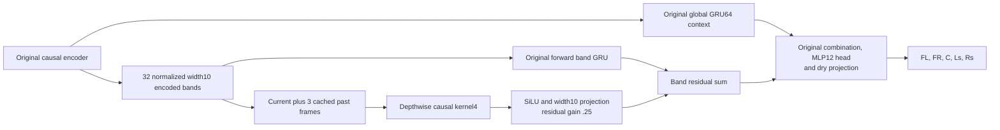

# Joint Scene Explicit Encoded History

*2026-10-04 · Track B · Current encoded frame plus three past frames, alongside the original GRU.*

## 🧭 Hypothesis and bounded comparison

The owner proposed supplying several past encoded frames and selected **16 ms of history**. The previous [interband context trial](UPMIX_SCENE_INTERBAND_CONTEXT_2026-10-04.md) failed its terminal joint comparison. The [output oracle](UPMIX_SCENE_OUTPUT_REACHABILITY_2026-10-04.md) demonstrates accurate representation is possible on this fixed TRAIN target, but does not supply a predictor from stereo.

The [MLP12 anchor](UPMIX_JOINT_SCENE_MLP12_HEAD_2026-10-03.md) already has per-band and global temporal GRU state. This trial preserves both and adds direct access to the pooled encoded inputs **before** temporal GRU compression. A short explicit history may expose attacks, continuing partials and decays that the recurrent state compresses. This is a hypothesis, not an established explanation of the fitting error.

Freeze the same terminal rule as the previous branch: at 8192 fresh updates, BOTH rear channel NMSE must be at least 5% lower than the MLP12 anchor; FL/FR/C may be at most 5% worse; dry PCM relative null RMS must remain ≤1e-5. The absolute fitting gate remains BOTH rear NMSE≤.10 plus conservation. No early checkpoint substitutes for terminal evaluation, no threshold is relaxed, and no automatic horizon extension is scheduled.

## 🏗️ Architecture and state

For each band, the temporal branch receives `[three_cached_inputs, current_chunk]`. A valid kernel4 convolution emits exactly one output per current frame using offsets −3, −2, −1, 0. The pointwise projection mixes ten feature channels within that band. There is no new frequency block, attention, forward lookahead or change to the target/head/loss. Band weights are shared, as in the original temporal GRU.

At hop256/48kHz, each offset is 5.333 ms; the oldest explicit frame is 16 ms before the current frame. This is additional explicit encoded history, not the model's total receptive field: its STFT window and recurrent states already retain past information. The 768-sample/16ms [QSA output period](STEREO_TO_5_1_UPMIX.md) is a separate scheduling cadence. This branch neither changes QSA buffering nor waits for future audio. Complete chain latency is still unmeasured.

`state['band']` now contains the unchanged temporal GRU state and a three-frame `encoded` cache. Other state keys are untouched. Cold history uses zeros. The returned cache is cloned so it owns only three frames of storage, rather than retaining the full chunk allocation. A streaming caller must still detach carried state for TBPTT. This is a Python research interface, not a hook ABI or int8 port.

## 🧮 Initialization, compute and contracts

The complete MLP12 anchor is constructed first under seed 20261003. Only then is the band GRU wrapped and the temporal branch added. Every anchor tensor is bit-identical at initialization after mapping `band_gru.*` to `band_gru.temporal.*`. The depthwise layer uses default initialization; the pointwise layer uses weight std .005 and zero bias; residual gain is .25. Step-zero output is slightly perturbed and is recorded.

| Model | Parameters | Estimated dense neural MAC/s | Added float cache, batch1 |
|---|---:|---:|---:|
| MLP12 anchor |68,136 |111,113,625 |0 |
| Explicit history16 |68,296 |111,953,625 |3,840 bytes |
| Added branch |160 |840,000 |3,840 bytes |

The extra arithmetic is `32*(4*10 + 10*10)*187.5 = 840,000` dense MAC/s. Cache size is `32*3*10*4 = 3840` bytes. These counts exclude cache copies, activation arithmetic, normalization, FFT/WOLA, feature construction, projection, complex multiplication and LFE DSP. They do not establish ≤150M complete int8 device cost, loaded timing or production readiness.

Four local contracts pass: exact shared initialization and counts; future-prefix invariance and irregular chunk/state equivalence with batch2; an isolated oldest-tap test proving exactly three past encoded inputs and bounded cache allocation; dry downmix after effect subtraction and finite nonzero front/centre/rear gradients into every new branch and temporal-GRU parameter. The existing optimizer-resume test also passes after the runner change. NAS repeats the four contracts and a 20-update real-crop smoke before the efficacy trial.

### Preparatory numerical failure, retained

The first two local test executions rejected strict bit equality of an unchanged prefix in a batch2 test. Measured maximum output difference was 2.98e-8 against a 3.51 peak. The depthwise temporal output was bit-identical; the batched pointwise projection differed by 2.33e-9. The contract now explicitly allows 3e-6 absolute numerical difference, matching the existing chunk-equivalence bound, and retains the isolated causal-tap test. The test passed after this correction. No efficacy training was run before contracts passed; this is a test-assumption correction, not a model-quality result or lowered acoustic gate.

## 🗂️ Frozen protocol

| Item | Setting |
|---|---|
| Study | `runtime/scene-encoded-history16-fixed-8192-20261004-a` |
| Control | Completed MLP12/GRU anchor8192 |
| Data | TRAIN albumdb-01, start sample1,354,304, length33,536 (.698667s at48kHz) |
| Analysis | FFT1024/hop256,128 frames,32 warm excluded,96 scored |
| Normalization / gain | Original TRAIN powers and same common gain; no renormalized target |
| Loss | Original normalized complex MSE +.05 magnitude MAE |
| Optimizer | AdamW lr.001, decay.0001, clip 5; state reset every update |
| Initialization / horizon | Fresh seed 20261003,8192 updates; no restored weights or optimizer |
| Retention |128-step monitors, paired2048 model+optimizer, terminal8192 model+optimizer, best weights |
| Resources | One NAS upmix training tenant; CPU3threads, no GPU/install/unit changes |
| Partitions | No DEV/heldout audio decoded |
| Physical scope | Five learned channels; effect gain0; no LFE/C/device/live-CarPlay qualification |

## 📊 Execution and matched results

<!-- HISTORY16_RESULT_START -->
Completed 8192/8192 updates in 1548.1s. Terminal strict fitting gate: FAIL; best monitored fitting gate: FAIL (best step 8192).

Four NAS contracts and the 20-update real-crop smoke passed. Lower NMSE means lower target reconstruction error; it is neither rear share nor voice leakage.

| Updates | Channel | MLP12 anchor NMSE | History16 NMSE | Delta |
|---|---|---:|---:|---:|
| 2048 | FL | 0.056632 | 0.056720 | +0.000088 |
| 2048 | FR | 0.064152 | 0.064629 | +0.000477 |
| 2048 | C | 0.014230 | 0.014206 | -0.000024 |
| 2048 | Ls | 0.468725 | 0.464270 | -0.004454 |
| 2048 | Rs | 0.516417 | 0.500283 | -0.016134 |
| 8192 | FL | 0.031377 | 0.035185 | +0.003808 |
| 8192 | FR | 0.035131 | 0.038346 | +0.003215 |
| 8192 | C | 0.008274 | 0.009364 | +0.001090 |
| 8192 | Ls | 0.284776 | 0.302618 | +0.017842 |
| 8192 | Rs | 0.314774 | 0.343079 | +0.028305 |

Predeclared comparison: **FAIL**. Rear error reductions versus anchor: -6.27% / -8.99%. Dry PCM relative null RMS: 6.98e-07. No device or generalization promotion follows.

| Terminal diagnostic | Ls | Rs |
|---|---:|---:|
| Energy / target | 0.701056 | 0.651918 |
| Target cosine | 0.835097 | 0.810513 |

Terminal/paired/best hashes, protocol bindings, source snapshot and AdamW counters verified. All 8192 gradients are finite; 0 exceed clip 5. Tenant and lease status: [], lease present=False.

### Complete matched monitor curve

| Updates | Anchor Ls | History16 Ls | Anchor Rs | History16 Rs |
|---|---:|---:|---:|---:|
| 128 | 0.891279 | 0.891250 | 0.884246 | 0.884016 |
| 256 | 0.865163 | 0.865034 | 0.847210 | 0.847340 |
| 384 | 0.833318 | 0.831043 | 0.808537 | 0.806166 |
| 512 | 0.741309 | 0.741524 | 0.751949 | 0.751915 |
| 640 | 0.680538 | 0.680170 | 0.707950 | 0.704847 |
| 768 | 0.645107 | 0.640685 | 0.676755 | 0.665826 |
| 896 | 0.620889 | 0.608956 | 0.658341 | 0.632720 |
| 1024 | 0.579892 | 0.581675 | 0.623282 | 0.603718 |
| 1152 | 0.555254 | 0.560203 | 0.601574 | 0.582395 |
| 1280 | 0.535501 | 0.543339 | 0.583487 | 0.567116 |
| 1408 | 0.516818 | 0.528848 | 0.565529 | 0.554563 |
| 1536 | 0.503659 | 0.522061 | 0.555265 | 0.554424 |
| 1664 | 0.493932 | 0.501656 | 0.544079 | 0.529713 |
| 1792 | 0.486070 | 0.490069 | 0.536170 | 0.519565 |
| 1920 | 0.477373 | 0.479926 | 0.525191 | 0.515750 |
| 2048 | 0.468725 | 0.464270 | 0.516417 | 0.500283 |
| 2176 | 0.458821 | 0.452594 | 0.506477 | 0.492757 |
| 2304 | 0.447782 | 0.444863 | 0.494645 | 0.487884 |
| 2432 | 0.444693 | 0.435526 | 0.492682 | 0.480223 |
| 2560 | 0.428517 | 0.429102 | 0.474691 | 0.476296 |
| 2688 | 0.420591 | 0.423859 | 0.467724 | 0.473546 |
| 2816 | 0.413523 | 0.418579 | 0.459721 | 0.470061 |
| 2944 | 0.405096 | 0.411287 | 0.451429 | 0.463398 |
| 3072 | 0.398241 | 0.406338 | 0.445187 | 0.459570 |
| 3200 | 0.392241 | 0.402031 | 0.439022 | 0.456459 |
| 3328 | 0.385921 | 0.398929 | 0.432189 | 0.453923 |
| 3456 | 0.380663 | 0.392943 | 0.425902 | 0.449368 |
| 3584 | 0.375581 | 0.389384 | 0.419867 | 0.446739 |
| 3712 | 0.370694 | 0.386192 | 0.414490 | 0.443608 |
| 3840 | 0.368646 | 0.383486 | 0.413436 | 0.443023 |
| 3968 | 0.362994 | 0.382515 | 0.407464 | 0.443335 |
| 4096 | 0.359372 | 0.374152 | 0.402050 | 0.433873 |
| 4224 | 0.353434 | 0.370703 | 0.396106 | 0.430549 |
| 4352 | 0.351480 | 0.368775 | 0.394278 | 0.429499 |
| 4480 | 0.346795 | 0.364351 | 0.389247 | 0.424212 |
| 4608 | 0.342182 | 0.361435 | 0.383405 | 0.421426 |
| 4736 | 0.339118 | 0.361225 | 0.379773 | 0.421813 |
| 4864 | 0.339507 | 0.355932 | 0.384710 | 0.415508 |
| 4992 | 0.332630 | 0.360470 | 0.372896 | 0.420619 |
| 5120 | 0.329667 | 0.349961 | 0.369768 | 0.408296 |
| 5248 | 0.326930 | 0.348620 | 0.367147 | 0.406561 |
| 5376 | 0.325598 | 0.344531 | 0.364477 | 0.401590 |
| 5504 | 0.320963 | 0.342898 | 0.360920 | 0.399268 |
| 5632 | 0.319393 | 0.339939 | 0.359687 | 0.395286 |
| 5760 | 0.315759 | 0.339991 | 0.355508 | 0.394951 |
| 5888 | 0.313806 | 0.338926 | 0.353205 | 0.392889 |
| 6016 | 0.311783 | 0.333546 | 0.351391 | 0.385761 |
| 6144 | 0.309324 | 0.331445 | 0.348491 | 0.383384 |
| 6272 | 0.307492 | 0.329626 | 0.345877 | 0.380760 |
| 6400 | 0.305263 | 0.328613 | 0.343250 | 0.379169 |
| 6528 | 0.303931 | 0.326505 | 0.341917 | 0.376095 |
| 6656 | 0.304156 | 0.326062 | 0.341486 | 0.374747 |
| 6784 | 0.299887 | 0.321674 | 0.336585 | 0.370012 |
| 6912 | 0.301200 | 0.319875 | 0.337850 | 0.367220 |
| 7040 | 0.301289 | 0.318530 | 0.339396 | 0.365720 |
| 7168 | 0.298149 | 0.316248 | 0.333308 | 0.362590 |
| 7296 | 0.295546 | 0.316533 | 0.331605 | 0.362067 |
| 7424 | 0.298938 | 0.312540 | 0.336875 | 0.357565 |
| 7552 | 0.292104 | 0.313785 | 0.325678 | 0.359086 |
| 7680 | 0.295600 | 0.309305 | 0.331198 | 0.353118 |
| 7808 | 0.288908 | 0.308273 | 0.320294 | 0.350865 |
| 7936 | 0.287332 | 0.306924 | 0.317852 | 0.349452 |
| 8064 | 0.286041 | 0.304269 | 0.316186 | 0.345584 |
| 8192 | 0.284776 | 0.302618 | 0.314774 | 0.343079 |

[Machine-readable evidence](UPMIX_SCENE_ENCODED_HISTORY_2026-10-04.json) retains protocol, source hashes, preparatory numerical test correction, smoke, initial/best/terminal metrics and all matched monitors. Raw optimizer histories and checkpoints remain on NAS.
<!-- HISTORY16_RESULT_END -->

## 📍 Decision boundaries

The completed history16 candidate is rejected: rear error increases 6.27%/8.99%, FL/FR/C 12.14%/9.15%/13.18% versus MLP12 at 8192. Both comparison and strict fitting gates fail; dry conservation passes. Last checkpoint is best, but no asymptotic floor is established. Keep the MLP12 control. No longer run or second efficacy seed was launched.

A successful terminal comparison would have justified further independent crop/seed evaluation; single-crop error reduction is not generalization or a cabin-quality result. A failed comparison closes this particular short-history branch at 8192. Declining terminal curves do not establish a hard asymptotic floor. Preserve the full measurements and the better measured control rather than increasing the horizon after seeing the result.

## 🔎 Read-only objective alignment check

While the frozen trial runs, arithmetic from the existing anchor shows that dataset-normalized complex MSE and this crop's per-channel NMSE are weighted differently. For each channel, `relative_MSE = NMSE * target_power / (96*513*TRAIN_normalization_power)`. The shared mean then divides all channels by 5.

| Channel | Multiplier of NMSE before common mean |
|---|---:|
| FL |.453397 |
| FR |.409410 |
| C |.387934 |
| Ls |.106878 |
| Rs |.093665 |

For equal fractional target error, the FL/Ls weight ratio is 4.24 and FR/Rs 4.37. This is not a measurement of parameter-gradient dominance: the projection couples channels, Jacobians differ, and the additional .05 magnitude term remains present. At the completed MLP12 anchor, the actual rear MSE contributions are .03044/.02948, greater individually than front .01423/.01438; the rear is not ignored in the observed terminal objective. No loss code, normalization or acceptance rule was changed during the history trial.

This identifies a concrete next diagnostic if explicit history fails: evaluate loss/gate alignment and channel gradients on the retained MLP12 weights before another architecture change. A matched loss intervention would need its own frozen protocol and the same five-channel comparison/conservation gates. The arithmetic alone does not prove that reweighting fixes inference, nor that dataset normalization was globally wrong. No additional training was launched for this check.

### Retained MLP12 channel-gradient audit

After history16 completed, a separate read-only NAS CPU audit reloaded the hash-bound MLP12 terminal checkpoint and the same TRAIN crop. Its NMSE and actual objective replay match the retained report. No optimizer step, weight-file change, DEV or heldout decode occurred. The auditor is stored under `audit_code`, leaving the completed training source snapshot intact.

| Channel | Actual per-channel objective gradient norm, before common mean | NMSE derivative along unit negative actual total gradient |
|---|---:|---:|
| FL |.115393 |−.131711 |
| FR |.134971 |−.166821 |
| C |.027027 |−.033999 |
| Ls |.366108 |−2.177328 |
| Rs |.415512 |−3.310441 |

The rear parameter gradients are larger than the front/centre gradients at this retained point. All channel pairs have positive gradient cosine here, ranging from .05494 to .82725 off diagonal. The actual total-loss descent direction has negative derivatives for BOTH rear NMSEs, so it locally improves rather than opposes them. The audit does not show front-gradient domination or conflicting channel-gradient directions at this point. It does not identify why the preceding training trajectory left a reconstruction error.

A hypothetical per-crop power normalization gives total-gradient cosine .964465 with the original objective, with norm 1.222516 versus .142325. Its unit-direction rear derivatives are −2.224796/−3.617467. That calculation changes the diagnostic objective only; it is not an observed training gain. A local Euclidean gradient direction is not an AdamW update, a convergence proof, or a whole-trajectory diagnosis. The one-point result does not rule out earlier conflicts, other crops, capacity or optimization difficulty. Blind loss reweighting is not supported by this audit.

### Next proposed diagnostic: frozen trained-head context

Before another full architecture run, freeze the retained MLP12 model and test target-informed context on this same TRAIN crop. First optimize a free `[1,128,32,10]` band-context table while preserving the original local features, interpolation, trained MLP12 head, coefficient bounds and dry projection. Replay the original context first to prove baseline equivalence; report all five channels and the unchanged .10/conservation gate. This tests the output path with its actual trained head and frequency structure, rather than bypassing that head as the earlier coefficient oracle did.

A feasible answer would demonstrate room for better context inference on this crop. A failed finite optimization alone would not prove a representational ceiling. Only after a declared bounded failure should a separate free per-bin context upper bound test whether interpolation/frequency detail limits that trained path. These are privileged diagnostics, not causal stereo predictors. No context optimization or new architecture training was launched in this turn.
