# Joint Scene Interband Context Comparison

*2026-10-04 · Track B · One additional frequency-context block on the MLP12 anchor.*

## 🧭 Hypothesis and decision rule

The [output oracle](UPMIX_SCENE_OUTPUT_REACHABILITY_2026-10-04.md) reconstructs the frozen target with rear NMSE .000265/.000317 through the original bounded head and dry projection. The trained [MLP12 anchor](UPMIX_JOINT_SCENE_MLP12_HEAD_2026-10-03.md) reaches only .284776/.314774 after 8192 updates. The output family can represent a sufficiently accurate answer on this crop; the network still has to infer its coefficients from stereo.

This experiment adds explicit communication between temporal band states. The original encoder already has local frequency convolutions and pooled global context; it is not devoid of cross-frequency information. The new branch tests an additional nonlinear path across the 32 band states within each frame. More learned parameters are also added, so a positive result would support this candidate, not isolate connectivity from capacity.

The predeclared terminal comparison requires **at least 5% lower NMSE in both rear channels**, FL/FR/C no more than 5% worse, and dry PCM relative null RMS≤1e-5, against the completed MLP12 anchor at 8192. The stricter fixed-crop fitting gate remains both rear NMSE≤.10 and conservation. No early checkpoint can replace the terminal comparison. At 2048 retain the matched comparison for diagnosis; do not stop/promote based on it.

## 🏗️ Architecture

```mermaid
flowchart LR
  accTitle: Causal interband scene encoder
  accDescr: After independent forward temporal GRUs, a bidirectional frequency GRU mixes band states within each frame. A small residual rejoins the unchanged global context, MLP12 output head and joint downmix projection. Frequency recurrence adds no future audio frames.
  stereo_features["Original stereo features"] --> local_encoder["Original local encoder and pooling"]
  local_encoder --> temporal_bands["32 independent forward temporal GRUs"]
  temporal_bands --> frequency_norm["Width10 LayerNorm"]
  frequency_norm --> frequency_gru["Frequency GRU12 each direction<br/>one frame at a time"]
  frequency_gru --> residual_projection["24 to10 projection, gain .25"]
  temporal_bands --> band_residual["Band residual sum"]
  residual_projection --> band_residual
  local_encoder --> global_context["Original global GRU64 context"]
  band_residual --> original_combination["Original band/global combination"]
  global_context --> original_combination
  original_combination --> original_head["Original MLP12 head and dry projection"]
  original_head --> five_channels["FL, FR, C, Ls, Rs"]
```

The adapter reshapes temporal output `[B*32,T,10]` to `[B*T,32,10]` for frequency processing. Both frequency directions see the same current frame. They do not process backwards in audio time, keep state between frames, or replace the original forward temporal state. After mixing, the tensor returns to the exact original layout. The original global branch, interpolation,20→12→20 head, tanh bound, endpoint constraints and dry projection are unchanged.

The complete anchor is constructed first with seed 20261003. Only then is its temporal band GRU wrapped and the new branch initialized. All anchor tensors, including the MLP head and global GRU, are bit-identical at initialization after mapping `band_gru.*` to `band_gru.temporal.*`. The added projection has weight standard deviation .005, zero bias and fixed residual gain .25. The initial candidate output is slightly perturbed, not identical; initial metrics are retained.

The frequency/time factorization is motivated by BSRNN's band-sequence approach.[^1] This is our small isolated branch, not a BSRNN port or reproduction of its separation quality. The original published temporal recurrence is not the causal contract implemented here.

## 🧮 Compute and contracts

| Model | Parameters | Estimated dense neural MAC/s |
|---|---:|---:|
| MLP12 anchor |68,136 |111,113,625 |
| MLP12 + frequency GRU12 |70,134 |122,057,625 |
| Added branch |1,998 |10,944,000 |

At 187.5 frames/s, the bidirectional frequency GRU costs `32*2*3*(10*12+12*12)=50,688` MAC/frame; its projection costs `32*24*10=7,680`. LayerNorm parameters are counted, but normalization arithmetic is excluded from the dense MAC estimate. FFT/WOLA, features, complex operators/projection, nonlinearities and LFE DSP are also excluded. This is not a complete device/int8 budget or latency measurement.

Four local contract tests passed: shared seeded initialization and cost; future-prefix invariance, chunk/state equivalence and dry downmix after effect subtraction; communication from a distant band; finite nonzero front/centre and rear gradients into the temporal GRU, normalization, both frequency directions and projection. The runner's existing checkpoint-resume test also passed locally after the runner change. NAS runs the four contracts and a 20-update real-crop smoke before the8192 trial. See retained status below for actual execution results.

## 🗂️ Frozen protocol

| Item | Setting |
|---|---|
| Active study root | `runtime/scene-interband-gru12-fixed-8192-20261004-b` |
| Control | Completed MLP12/GRU anchor8192; same model/head/loss source hashes |
| Data | TRAIN albumdb-01, start sample1,354,304, length33,536 at48kHz |
| Analysis | FFT1024/hop256,128 frames,32 warm,96 scored |
| Initialization | Fresh same seed 20261003; no checkpoint continuation |
| Loss / normalization | Original normalized complex MSE +.05 magnitude MAE; original TRAIN powers |
| Optimizer | AdamW lr.001, decay.0001, clip 5; state reset each update |
| Horizon |8192 fresh updates;128-step monitors, paired2048 and terminal checkpoint |
| Resources | One NAS upmix training tenant, CPU3threads; no GPU or installs |
| Partitions | No DEV or heldout decoded |
| Physical chain | Five channels, effect gain0; no LFE, hook/int8/device/car qualification |

The first preflight root (`…20261004-a`) exited before contract tests, smoke or training: the older anchor protocol lacks the later `global_core` field. The supervisor now accepts that historical schema only when the architecture explicitly identifies the original MLP12/GRU model and source hashes match. The failed root and log remain retained. A fresh `-b` root was used; no partial checkpoint was resumed or overwritten.

## 📊 Execution and matched results

<!-- INTERBAND_RESULT_START -->
Completed 8192/8192 updates in 1696.9s. Terminal strict fitting gate: FAIL; best monitored fitting gate: FAIL (best step 8192).

Four NAS contracts and the 20-update real-crop smoke passed. Lower NMSE means lower target reconstruction error; it is neither rear share nor voice leakage.

| Updates | Channel | MLP12 anchor NMSE | Interband NMSE | Delta |
|---|---|---:|---:|---:|
| 2048 | FL | 0.056632 | 0.054716 | -0.001916 |
| 2048 | FR | 0.064152 | 0.063220 | -0.000933 |
| 2048 | C | 0.014230 | 0.014532 | +0.000302 |
| 2048 | Ls | 0.468725 | 0.498530 | +0.029805 |
| 2048 | Rs | 0.516417 | 0.500910 | -0.015507 |
| 8192 | FL | 0.031377 | 0.033985 | +0.002608 |
| 8192 | FR | 0.035131 | 0.036152 | +0.001022 |
| 8192 | C | 0.008274 | 0.009002 | +0.000728 |
| 8192 | Ls | 0.284776 | 0.289843 | +0.005067 |
| 8192 | Rs | 0.314774 | 0.311788 | -0.002986 |

Predeclared comparison: **FAIL**. Rear error reductions versus anchor: -1.78% / 0.95%. Dry PCM relative null RMS: 8.57e-07. No device or generalization promotion follows.

| Terminal diagnostic | Ls | Rs |
|---|---:|---:|
| Energy / target | 0.703388 | 0.688739 |
| Target cosine | 0.842718 | 0.829585 |

Terminal/paired/best hashes, protocol bindings, source snapshot and AdamW counters verified. All 8192 gradients are finite; 0 exceed clip 5. Tenant and lease status: [], lease present=False.

### Complete matched monitor curve

| Updates | Anchor Ls | Interband Ls | Anchor Rs | Interband Rs |
|---|---:|---:|---:|---:|
| 128 | 0.891279 | 0.891630 | 0.884246 | 0.884101 |
| 256 | 0.865163 | 0.865053 | 0.847210 | 0.841303 |
| 384 | 0.833318 | 0.831118 | 0.808537 | 0.800479 |
| 512 | 0.741309 | 0.760834 | 0.751949 | 0.760776 |
| 640 | 0.680538 | 0.690855 | 0.707950 | 0.709939 |
| 768 | 0.645107 | 0.648182 | 0.676755 | 0.664278 |
| 896 | 0.620889 | 0.614878 | 0.658341 | 0.626673 |
| 1024 | 0.579892 | 0.589698 | 0.623282 | 0.597174 |
| 1152 | 0.555254 | 0.572821 | 0.601574 | 0.579423 |
| 1280 | 0.535501 | 0.559549 | 0.583487 | 0.565151 |
| 1408 | 0.516818 | 0.551108 | 0.565529 | 0.561919 |
| 1536 | 0.503659 | 0.538213 | 0.555265 | 0.539898 |
| 1664 | 0.493932 | 0.527639 | 0.544079 | 0.528796 |
| 1792 | 0.486070 | 0.520738 | 0.536170 | 0.521083 |
| 1920 | 0.477373 | 0.508160 | 0.525191 | 0.509133 |
| 2048 | 0.468725 | 0.498530 | 0.516417 | 0.500910 |
| 2176 | 0.458821 | 0.489870 | 0.506477 | 0.492945 |
| 2304 | 0.447782 | 0.481706 | 0.494645 | 0.483780 |
| 2432 | 0.444693 | 0.468886 | 0.492682 | 0.474321 |
| 2560 | 0.428517 | 0.467109 | 0.474691 | 0.475538 |
| 2688 | 0.420591 | 0.451935 | 0.467724 | 0.461062 |
| 2816 | 0.413523 | 0.446471 | 0.459721 | 0.450285 |
| 2944 | 0.405096 | 0.437597 | 0.451429 | 0.443326 |
| 3072 | 0.398241 | 0.432989 | 0.445187 | 0.436005 |
| 3200 | 0.392241 | 0.424111 | 0.439022 | 0.429045 |
| 3328 | 0.385921 | 0.418419 | 0.432189 | 0.422064 |
| 3456 | 0.380663 | 0.413961 | 0.425902 | 0.422243 |
| 3584 | 0.375581 | 0.409279 | 0.419867 | 0.412502 |
| 3712 | 0.370694 | 0.408110 | 0.414490 | 0.409128 |
| 3840 | 0.368646 | 0.400112 | 0.413436 | 0.411957 |
| 3968 | 0.362994 | 0.393219 | 0.407464 | 0.398489 |
| 4096 | 0.359372 | 0.386901 | 0.402050 | 0.391924 |
| 4224 | 0.353434 | 0.382867 | 0.396106 | 0.389612 |
| 4352 | 0.351480 | 0.377999 | 0.394278 | 0.384364 |
| 4480 | 0.346795 | 0.373532 | 0.389247 | 0.380718 |
| 4608 | 0.342182 | 0.379156 | 0.383405 | 0.387390 |
| 4736 | 0.339118 | 0.371943 | 0.379773 | 0.382087 |
| 4864 | 0.339507 | 0.361979 | 0.384710 | 0.373617 |
| 4992 | 0.332630 | 0.356791 | 0.372896 | 0.368432 |
| 5120 | 0.329667 | 0.354213 | 0.369768 | 0.368191 |
| 5248 | 0.326930 | 0.349323 | 0.367147 | 0.363774 |
| 5376 | 0.325598 | 0.345182 | 0.364477 | 0.359890 |
| 5504 | 0.320963 | 0.341750 | 0.360920 | 0.357230 |
| 5632 | 0.319393 | 0.338728 | 0.359687 | 0.355319 |
| 5760 | 0.315759 | 0.335133 | 0.355508 | 0.352367 |
| 5888 | 0.313806 | 0.332290 | 0.353205 | 0.350044 |
| 6016 | 0.311783 | 0.331103 | 0.351391 | 0.349450 |
| 6144 | 0.309324 | 0.328496 | 0.348491 | 0.348578 |
| 6272 | 0.307492 | 0.324776 | 0.345877 | 0.343754 |
| 6400 | 0.305263 | 0.321524 | 0.343250 | 0.341740 |
| 6528 | 0.303931 | 0.321679 | 0.341917 | 0.342151 |
| 6656 | 0.304156 | 0.315900 | 0.341486 | 0.337096 |
| 6784 | 0.299887 | 0.315494 | 0.336585 | 0.337711 |
| 6912 | 0.301200 | 0.310875 | 0.337850 | 0.333045 |
| 7040 | 0.301289 | 0.308728 | 0.339396 | 0.330691 |
| 7168 | 0.298149 | 0.306241 | 0.333308 | 0.328895 |
| 7296 | 0.295546 | 0.303337 | 0.331605 | 0.325844 |
| 7424 | 0.298938 | 0.303648 | 0.336875 | 0.326880 |
| 7552 | 0.292104 | 0.298649 | 0.325678 | 0.321182 |
| 7680 | 0.295600 | 0.296589 | 0.331198 | 0.319214 |
| 7808 | 0.288908 | 0.294965 | 0.320294 | 0.317853 |
| 7936 | 0.287332 | 0.292523 | 0.317852 | 0.315173 |
| 8064 | 0.286041 | 0.290356 | 0.316186 | 0.313089 |
| 8192 | 0.284776 | 0.289843 | 0.314774 | 0.311788 |

[Machine-readable evidence](UPMIX_SCENE_INTERBAND_CONTEXT_2026-10-04.json) retains protocol, source hashes, failed preflight attempt, smoke, initial/best/terminal metrics and all matched monitors. Raw optimizer histories and checkpoints remain on NAS.
<!-- INTERBAND_RESULT_END -->

## 📍 Interpretation and next step

This candidate is rejected at the declared 8192 horizon: Ls error rises 1.78%, Rs falls only .95%, FL rises 8.31%, FR 2.91% and C 8.79%. Extra estimated 10.944 M dense MAC/s produces no joint win. Keep the MLP12 anchor; no second efficacy seed or longer continuation was launched. This does not reject every interband architecture or establish an asymptotic floor.

A terminal comparison win would have warranted an independent crop/seed check, followed by broader qualification. A failure stops this specific branch at the declared horizon. A small gain below the declared threshold is recorded without relabeling it a pass. The curves can still be declining at 8192: this horizon does not prove an asymptotic ceiling.

The remaining inference problem is underdetermined: a known stereo downmix cannot uniquely identify an authored five-channel scene without a learned prior. The oracle uses the target and tests representability only. Even exact single-crop memorization would still require multi-song TRAIN/DEV evaluation and explicit safety/transition tests before complete device/C and live CarPlay checks.

### Owner proposal: explicit past encoded frames

During this trial the owner asked about supplying the current frame together with several past encoded frames. The existing network already has per-band temporal GRU state, global GRU state and a previous-frame phase feature. These compressed states are different from retaining several complete encoded frames. Prefer caching the pooled encoded inputs before the temporal GRU for this hypothesis, while preserving its long recurrent memory; buffering already compressed GRU states would be a different intervention.

The first sketch used four past frames (21.33ms). The owner then proposed 16 ms, so the preferred next isolated trial is a causal temporal convolution on each of 32 width 10 band representations: depthwise kernel 4 over the current frame and three cached past frames, then a width 10 pointwise projection and a residual. This exposes 16 ms of explicit past-frame offsets at hop256/48kHz without waiting for future frames. It can retain attack/decay cues that recurrent state may compress; whether it improves this task is an untested hypothesis. Three frames of 32×10 float32 activations use 3840 bytes, and the depthwise/pointwise branch costs `32*(4*10+10*10)*187.5 = 840,000` estimated dense MAC/s. Activation/normalization, copies and complete device execution would require measurement.

The shipped [realtime rail](STEREO_TO_5_1_UPMIX.md) has a 768-sample/16ms QSA output period. That cadence is distinct from the research model's256-sample/5.33ms neural hop, history depth and future lookahead. Past-frame caching does not require waiting 16 ms for future data; using future frames would add latency. The output period does not bound allowable history or imply 16 ms of free compute.

This is a proposed experiment only. No temporal-buffer code, training or deployment was launched by that question. The active interband trial keeps its frozen recipe and horizon. A follow-up should compare against the unchanged MLP12 anchor, changing only explicit temporal memory, rather than adding it silently to the running frequency-context model.

[^1]: Luo and Yu. *Music Source Separation with Band-split RNN*. https://arxiv.org/abs/2209.15174
