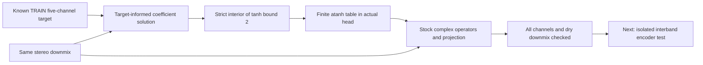

# Joint Scene Output Reachability

*2026-10-04 · Track B · Constructive output test before changing the encoder.*

## 🧭 Result and decision

The current bounded complex output operators can reconstruct the frozen TRAIN target well inside the original fitting gate. Rear NMSE is **.000265 / .000317**, compared with **.284776 / .314774** for the trained [MLP12 anchor](UPMIX_JOINT_SCENE_MLP12_HEAD_2026-10-03.md). All five target channels are recovered with small error, and dry PCM weighted downmix conservation passes.

This rejects the coefficient bound or dry projection as the explanation for the anchor's large error on this particular crop. It does not identify whether information loss in the encoder, optimization, head capacity or the loss weighting dominates. It justifies testing one additional interband context block while keeping the output representation intact.

This is an oracle: coefficients are calculated from the known target for each time-frequency cell. They are not predicted from stereo by a causal network. No multichannel information was recovered blindly, no generalization was tested, and no rear-scene quality was established by listening.



## 🧮 Construction and exact interface

Let `x` be the complex stereo STFT cell, `y` its known five-channel target, `I` the front-pass identity operators, `D` the stock weighted downmix, and `R = Dᵀ(DDᵀ)⁻¹`. The initial raw solution is:

```text
delta = y - I x
A = delta conjugate(x)ᵀ / ||x||²
O = I + A
O_projected = O + R (I₂ - D O)
prediction = O_projected x
```

The dataset's input is the known downmix of this same target. Without bounds, the construction recovers the target up to floating point arithmetic except at zero-input cells. Zero cells use a safe denominator; the tests cover an impossible hidden target at zero input.

The bounded construction clips each real and imaginary raw component to `±2(1−1e-5)`, sets DC/Nyquist imaginary parts to zero, and keeps the original projection. The bound applies to the raw components before projection; projected operators may exceed it, exactly as in the stock model. A table head emits finite `atanh(A/2)` logits, so the stock `2*tanh()` head and actual forward reproduce the construction. This is a feasible interior point, rather than a solution requiring infinite logits at the boundary.

A projected convex quadratic refinement is available if the initial construction fails. It was **not needed or run** on this crop. No numerical lower-bound argument is needed for this positive result: the actual stock forward provides a feasible witness. The available tangent-bound implementation uses floating point arithmetic; a future negative conclusion would require a numerical-tolerance audit rather than treating a failed construction as proof.

## 📊 Measured reconstruction

| Channel | Trained MLP12 NMSE | Bounded oracle NMSE | Oracle energy / target | Oracle cosine |
|---|---:|---:|---:|---:|
| FL | .031377 | .00001400 | .999897 | .999993 |
| FR | .035131 | .00001447 | .999858 | .999993 |
| C | .008274 | .00000638 | .999937 | .999997 |
| Ls | .284776 | .00026519 | .998467 | .999867 |
| Rs | .314774 | .00031711 | .998356 | .999842 |

NMSE is target reconstruction error, not rear share or voice leakage. The table concerns the same scored complex STFT frames used by the fixed fitting study. Dry PCM conservation uses the finite WOLA synthesis, as in the anchor.

| Check | Result |
|---|---:|
| Both rear NMSE ≤ .10 | Pass |
| All five NMSE ≤ .10 | Pass |
| Dry PCM relative null RMS ≤ 1e-5 | Pass: 5.85e-7 |
| Stock forward / constructed output max difference | 4.26e-6 |
| Unbounded rear NMSE | 2.93e-13 / 3.35e-13 |
| Unbounded maximum raw component | 13.80234 |
| Fraction of raw components clipped | .00037007 (about .037%) |
| Bounded maximum absolute raw component | 1.99997997 |
| Maximum absolute head logit | 6.10236, finite |
| Projected refinement updates | 0 |
| Oracle computation elapsed | .280 s |

## 🗂️ Frozen scope and verification

| Item | Setting |
|---|---|
| NAS run | `runtime/scene-output-oracle-20261004-a/run` |
| Target | TRAIN albumdb-01; same hash-verified authored FL/FR/C/Ls/Rs target |
| Crop | Start sample 1,354,304; length 33,536 at 48 kHz (.698667 s) |
| Analysis | FFT1024/hop256; 128 frames; 32 warm excluded, 96 scored |
| Gain and loss normalization | Identical to the MLP12 anchor |
| Stock source | Original model and loss hashes verified against the anchor |
| CPU | Three threads; no network training, GPU use or package installation |
| Partitions | No DEV or heldout audio opened |
| Effects / LFE | Effect gain zero; no learned LFE |
| Retained witness | `raw_coefficients.npy` on NAS, SHA256 in JSON evidence |

Three contract tests passed locally and on NAS: math/actual-head equivalence on a reachable target, zero-input impossibility, and a nonzero bounded infeasible synthetic target with a convex tangent bound. The real witness's coefficient hash and the complete code snapshot hashes were verified. Coefficients were retained on NAS; repository evidence contains metrics, protocol and hashes.

The launcher spawned the child successfully, then failed while mistakenly treating `code/__pycache__` as a file during metadata hashing. The child completed. Its status, protocol, checks and witness were inspected before any new process was launched. `launch.json` was recovered with explicit provenance: its start time is the oracle protocol time, not an invented exact spawn time. No duplicate oracle ran. This was a bookkeeping defect, not an efficacy failure.

## 🔗 Evidence and next experiment

[Machine-readable evidence](UPMIX_SCENE_OUTPUT_REACHABILITY_2026-10-04.json) contains the recovered launch record, full protocol, all five-channel metrics, witness hash, and trained-anchor reference. Implementation: `scene_operator_oracle.py`, `test_scene_operator_oracle.py`, `run_scene_operator_oracle_nas.py`.

Proceed to the [interband architecture comparison](UPMIX_SCENE_INTERBAND_CONTEXT_2026-10-04.md). Keep the frozen output/head/loss/data recipe. Even a successful encoder fitting test would still need another crop/seed, multi-song evaluation, protected-source and transition checks, the complete C/device chain, and live CarPlay listening before any deployment claim.
