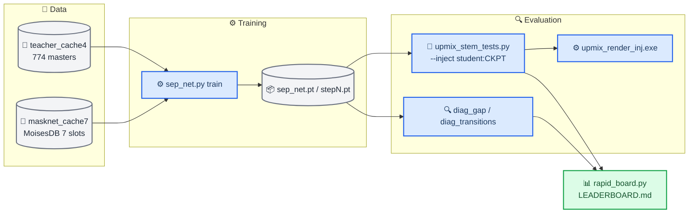

# Upmix Separator Track — Handoff

**Perfect-label renderer bound complete, 2026-09-30:** Same NN-free C,40×60s/231rows and fixed .40: guitar/keys/piano/strings .386/.396/.395/.392,voice/bass/drums .0057/.0125/.0117,2/40swings; all11 observed renderer gates pass. Thus the nominal harness can support a much stronger rear than the current network's .177guitar/27swings. The .50 oracle fails11swings/keys slope; gain alone is not a repair. [Raw evidence and scope](UPMIX_UNIFIED_SCENE_ARCHITECTURE_2026-09-30.md#exact-labelled-audio-nn-free-renderer-result-expressive-rear-is-attainable-in-this-harness). Capacity continuation remains running; expanded standalone C and ARM/QNX numerical checks pass on actual20-step TRAIN weights, without terminal acoustic/int8/device/ears qualification.


**Current Track B, 2026-09-30:** The fixed broad source study completed both40k arms and full40×60s/231-row NN-free C plus265 attributed events per arm. Joint at fixed .40 gives guitar/keys/piano/strings .177/.193/.194/.195 and voice/drums .0109/.0100, but bass .130,27/40 swing songs and entry median/p10 .765/.431 fail. Rear is3.13dB below current Track A; increasing gain worsens stability. Auxiliary source supervision alone is not a product gain. TRAIN mixture projection and shared-decoder gradient-domination diagnostics are negative. A function-preserving matched capacity continuation is running sequential20k per arm on oneGPU: original24/2/16 versus24/3/24, same data/objective/draws; expanded selected-output graph132.2505M counted denseMAC/s, not device measured. CPU/CUDA starting-function and both smoke gates pass. An independent CPU perfect-label renderer oracle checks whether the NN-free C/measurement itself meets the target. Scene remains dormant, expanded C/int8 port and original int8 drum recovery are pending; untouched20/device/ownerCarPlay remain open. [Full evidence, failures and frozen protocols](UPMIX_UNIFIED_SCENE_ARCHITECTURE_2026-09-30.md). No Track A/unit/env changes. Older snapshots below are historical.


**Current Track B execution, 2026-09-30:** Fixed broad eligible-only40k is complete on156TRAIN; joint audio supervision is past36k/40k from the identical warm start/sample sequence, with terminal audit and full DEV40 real-C/events pending. Control TRAIN12/DEV40 eligible SDR−.636/−.831dB and upper-band transmission≈.01 show that four-crop fitting success is not broad quality. Scene remains dormant. Independent C float source/waveform parity and isolated ARM/QNX execution pass; original int8 export fails drum SDR by.840dB, mainly weight rounding in the TRAIN decomposition. Selected eligible-plus-scene inference is bit exact to full inference on Windows/ARM and costs91.5555M counted dense MAC/s; device/full-chain cost remains unmeasured. TRAIN horizon resets did not repair the control. A CPU-only fixed-terminal TRAIN12 mixture-consistency diagnostic is scheduled after joint40k; no DEV selection, new GPU recipe or projection-quality result yet. [All protocols, outcomes, failures and raw artifacts](UPMIX_UNIFIED_SCENE_ARCHITECTURE_2026-09-30.md). No hook/unit/package changes. Original untouched20 and owner CarPlay gates remain open. Older snapshots below are historical.


**2026-09-30 unified execution:** Both matched20k four-crop source-fitting arms completed; all frozen fitting and saved CPU/CUDA PCM gates pass. Eligible median7.564control/7.539joint; joint vocal/drum/present-bass medians9.204/11.022/6.616dB. This is TRAIN fitting, not rear/generalization proof. Next fixed broad source study starts both arms from identical joint20k weights, trains156true-stem songs with actual past-only analysis/WOLA, keeps scene dormant, and ends in full40/231-row NN-free-C plus attributed events. Metadata-only artist reservation makes20songs candidate-independent; older models saw them, so the strict untouched20 gate stays open. [Full protocol, evidence and scope](UPMIX_UNIFIED_SCENE_ARCHITECTURE_2026-09-30.md#-frozen-broad-source-study-and-holdout-scope). No Track A/unit/environment change. Older live snapshots below are history.


**Latest execution — unified model, 2026-09-30:** [Unified report](UPMIX_UNIFIED_SCENE_ARCHITECTURE_2026-09-30.md): both10k TRAIN fitting arms completed; joint eligible median6.914dB versus6.750 control, all relative/protected comparisons pass but absolute7dB floor fails. A concrete cuFFT C2R endpoint violation was reproduced and corrected in new Track B synthesis; saved weights now pass all-source CPU/CUDA signal parity and causality. Original checkpoints/failures preserved. Bounded matched extension to20k is frozen with valid inverse FFT, same architecture/data/source coefficient; no DEV or scene promotion yet. [Current Track A full40](UPMIX_TRACKA_MATCHED40_2026-09-30.md), actual−9dB air:29/40swings, guitar/keys/piano/strings.165/.152/.095/.069 and voice/bass/drums.076/.149/.296. Copied no-legacy-network audio host and past-only waveform path verified; scene training, broad quality, device budget and owner ears remain required. No Track A/unit/env edits.


**Earlier prototype-only snapshot — superseded by execution above:** Replace q6d+guard+v21a with one shared causal audio/scene model. The [architecture and expressiveness plan](UPMIX_UNIFIED_SCENE_ARCHITECTURE_2026-09-30.md) and isolated `unified_upmix_net.py` CPU prototype are implemented: four joint source operators, six instrument memberships/pans/update rates, carried state;483,086 parameters,110.0055M estimated denseMAC/s including all heads. Future-prefix/chunk/reset/attribution/gradient/silence structural checks passed; this is untrained, with no acoustic, device or hook-ABI claim. Owner wants full instruments clearly behind; historical15–20% floors do not establish expressiveness. Explore frozen TRAIN-calibrated20/30/40% transfer points with source protection, body/attack/band/level and entry evidence, then owner ears. Next complete copied-host replacement contract and current Track A matched full40 baseline, freeze real-TRAIN fitting/source/scene supervision, then one-GPU execution. No job queued or GPU/package/unit/Track A change from this update. Earlier proposed next scalar mechanism is superseded by this explicit unified direction; preserve its measured failures and both reference checkpoints.

**Completed Track B — broad causal pair and full C test, 2026-09-30:** The [completed comparison](UPMIX_CAUSAL_GENERALIZATION_2026-09-29.md#-completed-full40-result-2026-09-30) finished both40k horizons, strict CPU checkpoint audit,40 DEV×60s,231 stem rows per C route and265 source-attributed events per arm. All11 relative quality gates pass, **absolute product gate fails**. Median paired DEV20s SI-SDR gain **+1.302827dB**, bootstrap90%[1.051355,1.443251],39/40 nonworse. Fixed direct-C control→reference guitar/keys/piano/strings **.103/.105/.091/.103→.121/.159/.135/.109**, voice/bass/drums **.0152/.0536/.0096→.0059/.0521/.0085**,0/40 swings both; rear+.365834dB at unchanged gain. Keys/piano/protected stems/slopes pass; guitar/strings and vocal-entry **.803796/.419774 median/p10** fail. Original-C swings worsen10→15/40, so direct-C stability is not an encoder-only achievement. Reference passes10/14 observed direct gates;2.168G estimated neuralMAC/s remains over≤150M allowance. PC idle: evaluator/supervisor returned0, no Python or GPU lease; no next job queued. Next predeclare one matched source/loss mechanism study on measured guitar/strings/entry failures before compression. Exact raw results/CSV/transition rows are committed with the report. Test24/independent20/device/ownerCarPlay remain open. No Track A/unit/shared-package change. Earlier active/pause snapshots below are history.

**Completed causal fitting result — causal reference pair, 2026-09-29:** The [matched normalized residual causal encoder experiment](UPMIX_CAUSAL_REFERENCE_ENCODER_2026-09-29.md) completed both 10k arms and independent CPU checkpoint audit. Same four frozen TRAIN crops, unchanged true-audio objective and bit-identical frozen trained decoder: fresh control → reference median SI-SDR **7.754→10.500 dB** (+2.746 dB), objective **.057067→.045320** (−20.584%); all four crops improved and all eight predeclared fitting comparisons passed. Fixed-STFT future-prefix NSE **0**, decoder/source/checkpoint parity verified. This demonstrates better causal fitting for this encoder package, not generalization or a product pass: vocal/bass frozen-mask transmissions rose **.0633→.0767 / .0748→.0901**, treble remains weak, and cost is **2,167.95 M estimated neural MAC/s** versus the ≤150 M measured-device allowance. No new causal DEV/source-entry/C, device or owner listening result. PC root `D:\upmix\runs\separator_causal_reference_v1`; terminal readback zero Python, lease absent, rapid queue empty. Next prepare broader true-stem training plus source-specific TRAIN/DEV and natural-song entry/C gates before compression; no next job queued. No Track A/unit/package edit. Earlier live execution and prerequisite notes below are history; SIMO remains the separate noncausal quality reference.

**Latest Track B result — full40 pretrained SIMO check, 2026-09-29:** [Completed source/entry/real-C evaluation](UPMIX_BSRNN_REAL_C_CHECK_2026-09-29.md) passes all 14 predeclared observed offline gates with the frozen host-only direct route, original gain 1.0, 40 DEV×60 s and 231 stem rows. Guitar/keys/piano/strings rear shares **.200/.211/.219/.204**, voice/bass/drums **.0022/.0070/.0033**, **0/40** any-stem swings versus **11/40** on the original C route; rear RMS difference **+.101 dB**. Vocal-entry retention **.875674/.745983** median/p10, 84 entries across 36 songs (83 valid ratios), within 265 total events across all 40 songs. On the identical enriched DEV20/direct-C subset, sep9→SIMO guitar **.105→.204**, keys **.144→.228**, voice **.019→.002**, at fixed gain but +1.149 dB rear RMS; no level-matched architecture claim. Aggregate passes retain individual bass/entry/instrument failures and upper-band attenuation, documented in the report. This is a large noncausal pretrained reference, not a device-qualified or owner-heard candidate; untouched-20, causal int8 ≤150 M/≤85 ms and live CarPlay gates remain open. Quiet-stem coverage and native/SSH execution failures were corrected with verified saved-output/event resume; final CSV/statistics/hash readback passed. PC idle: zero active Python, GPU lease absent, rapid queue empty, upstream clean. Next proposed matched causal encoder diagnostic with the same fixed trained decoder; no training queued, no Track A/unit edit. Earlier intake/inference/execution notes below are history.

**Latest Track B result — pretrained BSRNN item 1, 2026-09-29:** [Strict inference](UPMIX_BSRNN_PRETRAINED_INFERENCE_2026-09-29.md) completed on the exact four frozen TRAIN crops: all five public checkpoints loaded with zero missing/unexpected keys and exact tensor parity; 32 predicted stems saved at original gain in 48 kHz float WAV. Optimized SIMO `other` median SI-SDR **11.013 dB**, original-style large **7.463 dB**, versus historical small causal fitting baseline **7.797 dB**. SIMO's +3.216 dB is an offline pretrained reference improvement, not a matched causal architecture result or source/entry/C/device/listening pass. Dependencies were installed only in a separate venv, sharing unchanged torch/torchaudio 2.11.0+cu128. Three setup failures and their recovery are documented. PC idle: zero Python, lease absent, queue empty; upstream source clean. Next predeclare the fixed-gain source/entry/real-C comparison using SIMO as the stronger reference, then test causal mechanisms with a matched control. No fine-tuning, new encoder, Track A or head-unit change; earlier intake-only statements below are historical.

**Latest owner-directed prerequisite, 2026-09-29:** [Full BSRNN intake](UPMIX_BSRNN_REFERENCE_INTAKE_2026-09-29.md) completed before any custom encoder work: upstream `magronp/bsrnn` pinned at `94adc8c`, code on PC/Mac, 2.84 GB of BSRNN-large and optimized SIMO archives, five extracted checkpoints with published MD5/full ZIP CRC and individual hashes. No model execution or package install. Both are noncausal PC references. Next establish strict checkpoint loading and gain-correct reference inference; the shared PC stack lacks Lightning/Hydra and must not receive the upstream torch downgrade. Custom causal work below remains proposed, not started. Post-download PC inventory: no Python, no GPU lease, queue zero. Source, recovery details and hashes are in the intake record.

**Latest research decision, 2026-09-29:** The owner's [literature review](UPMIX_RESEARCH_REVIEW_2026-09-29.md) examines 22 research lines, tutorials and pinned implementation code against our measured failures. Next proposed diagnostic: **one stronger normalized residual causal encoder versus the original encoder, both with the same frozen trained decoder**, on the exact four TRAIN crops. A positive acoustic result must precede generalization, compression and product promotion. This supersedes the immediate priority of the DSD 40k pair in the following result note; that data/convergence question remains deferred. Historical sep5/sep7 failures do not exclude all capacity/conditioning changes, and neither normalization nor compression is a verified fix. Two-tap filtering and the earlier negative continuous-context audit are already accounted for. This research turn changed documentation only: no new model, runner or GPU job; last verified idle snapshot below is not a fresh PC inventory. Track A, device and listening gates remain open.

**Latest Track B result — band allocation, 2026-09-29:** The [same-budget 48-band test](UPMIX_BAND_ALLOCATION_PROBE_2026-09-29.md#completed-10k-result-and-decision) completed 10k on the exact four TRAIN windows. Reducing maximum band width **89→41** kept **586,916 parameters / 125.139 M estimated neural MAC/s**, but improved objective only **.055586→.055163 (0.76%)** and median SI-SDR **7.797→7.951 dB**. Three windows were nonworse, one lost .338 dB; the frozen joint gate failed. CPU checkpoint/budget/window parity passed; no DEV/C/device promotion or long extension. Keep the original partition. Next prepare the previously frozen full-horizon causal original baseline versus DSD Dev addition, rather than extend these failed shortcuts; its cache/runner remain pending and no long run is queued. GPU lease/rapid queue are clear, no Python/daemon. Earlier execution entries below are history.

**Latest Track B result — direct decoder-state teaching, 2026-09-29:** The [matched 2k continuation](UPMIX_DECODER_STATE_SUPERVISION_2026-09-29.md#completed-matched-2k-result) completed with the original encoder and a bit-identical fixed decoder. State MSE fell only **5.86%**, while audio loss worsened **.05530→.06616** versus control and median SI-SDR **7.79→7.54 dB**. All frozen gates failed; no continuation/C/device promotion. CPU target/checkpoint parity passed. About 45% of initial concatenated state-error energy is invisible to the individual band decoders, under the documented per-band projection; this is not a full-operator or universal capacity diagnosis. The cuDNN eval-mode startup error was fixed before either student ran, with saved target reuse. GPU lease/rapid queue are clear, no Python/daemon remains. Next predeclare one same-budget 48-band redistribution test, reducing the widest high-frequency groups without discarding complex phase. Nothing new is queued; earlier execution entries are history.

**Latest Track B result — invariant input, 2026-09-29:** The [fixed-TRAIN feature comparison](UPMIX_INVARIANT_INPUT_PROBE_2026-09-29.md#completed-10k-result-and-decision) completed 10k. With the same original encoder/trunk/decoder and exact TRAIN windows, magnitude/relative-phase inputs achieved polarity NSE **0** but reconstruction worsened: objective **.05559→.05747**, median SI-SDR **7.80→7.63 dB**, all four windows slightly worse. Frozen diagnostic promotion **NO**. Checkpoint semantics and feature formula passed an independent CPU audit; no DEV/C/device/car claim. This whole feature replacement also discards cross-frequency phase information, so it does not reject all polarity-invariant representations. The GPU lease/rapid queue are clear and no Python/daemon remains. Next predeclare one direct decoder-state learning diagnostic versus matched audio-loss continuation on the original encoder; no follow-up is queued. Earlier state entries below are history.

**Latest verified diagnosis, 2026-09-29:** The [TRAIN-path investigation](UPMIX_TRAINING_PATH_DIAGNOSIS_2026-09-29.md) completed four fixed-window fitting, raw/cache consistency, decoder-state relaxation, physical polarity and real-C oracle-parity checks. At 10k, the causal baseline closed 73.2% of its numerical oracle loss gap, median SI-SDR 7.80 dB. Its unchanged trained decoder reached 20.59 dB with privileged optimized states (69.9% less remaining loss), demonstrating a substantial encoder/state-inference or optimization gap rather than a decoder-only ceiling. Exact eligible reconstruction can still have protected frozen-filter contributions; real C output parity confirms these contributions are not audible contamination in the summed waveform. Treat that metric as sensitivity evidence, jointly with reconstruction, entry and C tests; no historical student is promoted. DSD100 is now fully CRC/SHA validated (50 Dev/50 Test), with Test audio undecoded/unscored and Dev conversion pending. GPU diagnostics are terminal and the rapid queue/lease clear. All audited encoder blocks receive gradients; saturation is localized, not a proven treble-failure cause. Next freeze one representation/state-learning intervention before another broad efficacy run. Device and ear gates remain open.

_Initial handoff of the rear-eligible separator track (Track B), written 2026-09-28 04:50 on `feature/upmix-source-separation` at `6eac814`. Later review sections below update that snapshot._
_Read this first, then [the night report](UPMIX_SEPARATOR_NIGHT_REPORT_2026-09-28.md) for the initial numbers and [the plan](UPMIX_SOURCE_SEPARATION_PLAN.md) for the full history through review 43 and the later data screens._

**Latest decision — experiment effectiveness audit, 2026-09-29:** The [audit](UPMIX_EXPERIMENT_EFFECTIVENESS_AUDIT_2026-09-29.md) found that matched execution is useful but repeated 4k noncausal screens, a rejected remix anchor and oversampled subset controls do not adequately test converged data benefit. Cambridge completed and failed its joint screen: C guitar/keys **.1062/.1045→.0963/.0897**, any-stem swings **3→2/20**, entry median/p10 **.759/.419→.757/.395**. Its aggregate treble gain is concentrated in one song. A read-only source audit corrected vocal-owned interference metrics and verified attribution closure; all-cell leakage and historical C results remain valid. Root/PC leaderboard copies are now synchronized to the existing unique-song fix. The rapid queue/lease are clear and the idle daemon was stopped. DSD100 continues downloading. **The old DSD 4k remix pair is superseded:** next verify fitting on fixed TRAIN windows, then prepare one longer causal same-song baseline versus DSD Dev addition with an identical full training horizon. The prepared DSD smoke has changed accordingly; no new training was launched by the audit. All older execution entries below are history, not live state.

**Stop snapshot 2026-09-29:** The owner's [one-page status](UPMIX_STATUS_AND_PROBLEMS_2026-09-29.md) covers both tracks; the [detailed Track B snapshot](UPMIX_SEPARATOR_STATUS_2026-09-29.md) records verified outcomes, failures, live PC state and the unrun cross-song probe. The owner stopped the investigation here. No new GPU job is queued; the already-running review-42 control was left running to preserve its uncheckpointed work. Its state must be checked afresh on resume.

**Later planning update, 2026-09-29:** The earlier execution snapshot above is historical. Claude subsequently reported stopping the uncheckpointed review-42 job and cleaning an accidentally queued `remix` rapid job. A read-only check then found no PC GPU lease or Python training process, an empty rapid queue, and only a short log in `remix_aborted`; no remix result exists. The owner is **planning only**. The [data-first, architecture-second decision plan](UPMIX_SOURCE_SEPARATION_PLAN.md#next-decision-data-first-architecture-second-owner-planning-update-2026-09-29) specifies matched MoisesDB remix, curated OnAir, detailed raw MoisesDB instruments, optional audited teacher remix, causal confirmation, joint promotion gates and device/ear requirements. It separates the rapid BandSepNet comparison from review 43's causal fine-role probe. No run or hook port is authorized by this note.

**Execution resumed, 2026-09-29 02:24 PC local time:** The owner then authorized the first Track B run. The [frozen MoisesDB remix control](UPMIX_MOISES_REMIX_PROBE_2026-09-29.md) records the baseline hashes, one-change intervention and joint readout. `remix_moises_s1` began on the single PC GPU with `--remix 0.5`; results are pending. This is the rapid BandSepNet data screen, separate from review 43's unrun fine-role probe. No Track A or head-unit file was changed.

**First data result, 2026-09-29 02:50 PC local time:** `remix_moises_s1` completed 4k, attribution, transitions and the real-C DEV20 screen. The [result table and TRAIN/DEV diagnostic](UPMIX_MOISES_REMIX_PROBE_2026-09-29.md#completed-4k-result-and-decision) show no useful instrument gain at matched rear level and worse median vocal-entry retention, so the precommitted joint gate rejects 10k. The GPU lease and queue are empty, and the rapid daemon was stopped. Next compare curated OnAir with the better same-song data recipe; no Track A port or car result follows.

**Second data result, 2026-09-29 03:41 PC local time:** The [curated OnAir matched pair](UPMIX_ONAIR_DATA_PROBE_2026-09-29.md#completed-4k-result-and-decision) completed 4k and its real-C DEV20 screen. At nearly identical rear RMS, 25% OnAir among true-stem windows lowered eligible transmission **.43→.39**, guitar **.11→.09** and strings **.13→.11**; voice rose **.04→.05**. Entry retention did not improve and any-stem swings remained **3/20**. The joint gate rejects 10k. The PC rapid queue and GPU lease are clear and the daemon is stopped. The next Track B data check is one real TRAIN song through the staged [MoisesDB instrument sidecar](UPMIX_MOISES_INSTRUMENT_SIDECAR_2026-09-29.md), followed by an audited instrument-family remix comparison if closure passes. No Track A, device or car result follows from these data screens.

**Third data probe running, 2026-09-29 03:58 PC local time:** The [MoisesDB instrument-family sidecar](UPMIX_MOISES_INSTRUMENT_SIDECAR_2026-09-29.md) built for all **176 TRAIN songs**, with exact closure to the old eligible slot and a maximum pre-correction discrepancy of **1.219 LSB RMS / 10 LSB peak**. The 20-step training smoke passed. A matched rapid pair now runs on the single GPU: the four-family `--remix 0.5` control, then the same recipe with guitar/keys/piano/strings/winds/other sampled separately. Rapid daemon **PID 44960**, GPU lease active; no result yet. Do not start another GPU job or modify the PC Python environment while the pair runs.

**Third data result, 2026-09-29 04:47 PC local time:** The [instrument-family matched pair](UPMIX_MOISES_INSTRUMENT_SIDECAR_2026-09-29.md#completed-matched-4k-result-and-decision) finished. At −37.7/−37.6 dBFS rear level, candidate versus four-family remix control gave DEV12 eligible **.44→.42**, vocal **.209→.194**, entry median/p10 **.738/.400→.727/.396**; real-C DEV20 guitar/keys/piano/strings **.11/.10/.07/.14→.10/.10/.06/.12**, voice **.04→.04**, any-stem swings **3→3/20**. The joint gate rejects 10k. The queue and GPU lease are empty, no Python job remains and daemon PID 44960 was stopped. Three controlled rapid data screens (four-family MoisesDB remix, five-song OnAir supplement, six-family MoisesDB remix) have now failed to move the source/entry/C frontier; this is evidence about those recipes, not a general data or architecture impossibility result. The next architectural comparison should be selected from a measured failure mechanism on the best frozen data recipe; no Track A or car result follows.

**Review-42 architecture resumed, 2026-09-29 04:53 PC local time:** The [causal slow-operator anchor pair](UPMIX_OPERATOR_ANCHOR_PROBE_2026-09-29.md#resume-after-the-data-screens-2026-09-29) now trains sequentially on the PC, control first. The prior stopped attempt had no checkpoint and was archived. An isolated exact pre-remix source copy preserves the frozen training/calibration hashes while leaving the newer rapid tools intact. Detached runner **PID 40344**, trainer **PID 34852**, GPU lease active; no DEV/entry/C result yet. The old `STOPPED` marker is historical, not the current state. Do not overlap this one GPU tenant, install packages into its Python environment, or infer success from startup.

**Current review-42 result, 2026-09-29 09:24 PC local time:** Both matched 4k causal arms completed. The [frozen source/entry/operator diagnostic](UPMIX_OPERATOR_ANCHOR_PROBE_2026-09-29.md#completed-4k-pair-and-frozen-diagnostic) rejected the extra slow-operator target. It slightly improved the disjoint target error **.03161→.02987**, but lowered eligible transmission **.4779→.4308** and retained excessive vocal/eligible **.4630** and drums/eligible **.08437** against limits **.324/.0568**. On 43 vocal entries, ducking median/p10 changed **.960/.710→.943/.676**, missing the required p10 improvement. All 12 paired songs lost some eligible signal. No C-renderer or 10k extension was run under the precommitted gate. The PC GPU lease and rapid queue are clear; no Python job remained. There is still no Track B deployable candidate, measured head-unit int8/latency result, or blind live-CarPlay verdict. Treat the earlier launch and stop entries as historical state.

**Current review-43 result, 2026-09-29 13:33 PC local time:** The [frozen causal fine-role cross-song comparison](UPMIX_CROSSSONG_AUGMENT_PROBE_2026-09-29.md#completed-4k-result-and-decision) finished 4k and its full source/role/entry diagnostic. Four distinct MoisesDB TRAIN donors per true-stem window left eligible transmission **.4921→.4912**, vocal/eligible **.4776→.4797** and mixed vocal+eligible correlation **.1941→.1922** essentially unchanged. Entry median/p10 improved **.904/.581→.921/.589**, but p10 remains below .60 and misses the +.04 comparison gate; all three protected-source limits still fail. No real-C or 10k promotion followed. The GPU lease is free. A separate [MoisesDB–OnAir cross-corpus remix](UPMIX_CROSS_CORPUS_REMIX_PROBE_2026-09-29.md) is staged locally with a synthetic closure check; its code has not been copied to the PC or trained. No Track A, head-unit or listening evidence changed.

**Current cross-corpus run, 2026-09-29 13:40 PC local time:** The preceding review-43 state is historical. The [MoisesDB–OnAir matched pair](UPMIX_CROSS_CORPUS_REMIX_PROBE_2026-09-29.md) passed a 10,000-window symbolic source/closure check and both 20-step real-cache GPU smokes after correction of a PowerShell argument-array error. The new Track B `sep_net.py` was copied to the PC with matching hash; prior PC content differed only by this flag. Rapid queue lines `crosscorp_ctrl_s1` and `crosscorp_mix_s1` are live under daemon **PID 10088**. Control trainer **PID 17096** and the single GPU lease were confirmed after SSH disconnected; no 4k result existed at that read. Do not overlap a GPU job or install into the PC Python environment. After both tags complete, inspect the rapid source/entry/real-C screens, stop the daemon when the queue is empty, and apply the [frozen joint gate](UPMIX_CROSS_CORPUS_REMIX_PROBE_2026-09-29.md#decision-sequence). No Track A, unit or listening result has changed.

**Independent-corpus acquisition, 2026-09-29 13:48 PC local time:** The [official DSD100 release](UPMIX_DSD100_INDEPENDENT_CORPUS_2026-09-29.md) offers 50 train and 50 test natural songs with real vocal/drum/bass/other stems. A resumable, 5 MB/s download to a `.part` file on the PC has started independently of the one-GPU rapid pair (wrapper PID **48584**, `curl.exe` PID **20888**, partial file growing). It is not yet a usable archive or evaluation result. Validate size and ZIP CRC, audit song overlap, and keep its 50 TEST songs untouched until a candidate is frozen. Four broad stems can test external source leakage and stability but cannot individually prove guitar/keys/piano/strings thresholds.

**Current cross-corpus result, 2026-09-29 14:28 PC local time:** The [matched MoisesDB–OnAir pair](UPMIX_CROSS_CORPUS_REMIX_PROBE_2026-09-29.md#completed-4k-pair-and-decision) finished 4k, source/entry diagnostics and real-C DEV20 at fixed gain. Cross-corpus remix lowered eligible transmission **.38→.36** with vocal **.201→.174**, left 8–14 kHz at about **−22 dB**, and worsened entry p10 **.412→.384**. C rear shares changed guitar **.095→.102**, keys **.094→.088**, piano **.060→.061**, voice **.049→.048**, drums **.083→.087** at **+.3 dB** rear RMS; any-stem swings remained **4/20**. Strings' five-song median rose **.092→.151**, but the paired median gain was only **+.016** with a 90% interval crossing zero. The frozen joint gate rejects 10k or causal promotion for this five-song OnAir recipe. Both jobs are terminal, queue and GPU lease empty, no trainer remains, and daemon PID 10088 was stopped. The DSD100 `.part` download was **5.07/15.99 GB** at this read, with a separate metadata/CRC/overlap inspector committed; it is not validated. The next useful decision is a larger audited real-stem pool or one targeted causal architecture comparison on the best frozen data recipe. No Track A, unit or listening result changed.

**DSD100 next-pair preparation, 2026-09-29 14:42 PC local time:** The [Dev-only cache and matched comparison](UPMIX_DSD100_INDEPENDENT_CORPUS_2026-09-29.md#prepared-dev-only-training-cache-and-matched-comparison) are now frozen before looking at DSD audio. The cache converter reads only the 50 published Dev songs and maps four real sources into seven training slots; synthetic 60-s audio and 50-song manifest checks passed. A 50-song MoisesDB TRAIN-only control extra-pool was created on the PC, with a verified split and hard links, so both rapid arms can use the same **about 25% of windows in expectation** extra-pool exposure. The three scripts were copied to the PC with matching hashes. The full DSD archive still needs download, exact size, CRC, SHA-256 and per-song closure checks before its Dev cache or either GPU arm runs. DSD Test audio stays untouched. No device or listening claim follows.

**Cambridge three-song data trial, updated 2026-09-29 15:39 PC local time:** The owner stated that permission for this training test is obtained and will add its record to the repo. The [trial report](UPMIX_CAMBRIDGE_TRIAL_2026-09-29.md) freezes three labelled guitar/piano/string/vocal multitracks, an exhaustive seven-slot mapping, a matched three-song MoisesDB TRAIN control and paired 4k commands. All ZIPs passed full CRC and became TRAIN caches; because source end lengths differ, the converter pads tails under Cambridge's shared-timeline-origin instruction. Both 20-step GPU smoke arms passed. A detached daemon launch reported a PID but was absent after SSH returned; the queue and lease were preserved and a persistent SSH-session launch succeeded. The control 4k checkpoint and source/entry/C DEV20 screens completed; its guitar/keys/piano/strings rear shares are **.106/.105/.063/.115** and voice/bass/drums **.045/.062/.096**, with entry retention **.759/.419** median/p10, so it fails the goal gates. The candidate subsequently completed its screen; the final pair verdict and cleared queue are recorded in the latest audit above. The DSD100 transfer remains separate. No car improvement is established.

---

## 📋 The job in one page

**Product.** Stereo CarPlay music becomes 5.1 in an Audi B&O car (MHI2 head unit, QNX, ARM). The goal: instruments (guitar, keys, piano, strings, winds) audibly and steadily in the rear, the voice never in the rear, bass and drums in the front, and no "back and forth" (the rear must not breathe with the song). Causal, about 150 M MAC/s int8 on the head unit, up to ≈85 ms extra latency acceptable.

**Two tracks.** Track A (another agent, another branch, same working tree) owns what ships in the car: a per-cell protect-mask net + mask-drive + soft veto in `hook/audio/`. **Track B (this handoff)** asks whether a causal on-budget estimator of the rear-eligible *audio* can carry the rear the way the non-causal teacher does.

**At the initial handoff.** The bullets below are historical; see the current status immediately after them and the review ledger below.

- The renderer interface is solved: fed the teacher's audio (htdemucs) it gives guitar 0.19–0.23 rear share at voice 0.01.
- Every on-budget student lands on one recall/leak frontier: guitar 0.09–0.12, voice 0.02–0.04, 4–9/39 songs swinging. Width, supervision, spectral structure and loss were each tested as one-change controlled runs and ruled out.
- Source attribution shows why: students pass 29–37 % of the eligible energy (ideal ratio mask 77 %) at the ideal mask's vocal leak, erase the air above 8 kHz, and duck the instruments 28 % when a voice enters (+47 % when it leaves).
- One 4k-step screen, a bounded sigmoid mask shared by both channels (`sharedmask`), showed a stability signal on every stem — but it did **not** survive to 10k (not promoted).
- **Review 16 (Codex) paused broad separator training.** Next: the owner's blind in-car listening test, a persistent rear-membership controller, direct optimisation of the product against the real renderer.

**Current review-18 status (later 2026-09-28).** A host-only change to the C renderer's object/bed route passes the numerical full-40 DEV C-render gates **with true isolated eligible audio**: **8→0/40** any-stem swing songs, guitar/keys/piano/strings **.233/.235/.242/.231**, voice/bass/drums **.0038/.0084/.0097**, and rear RMS **+0.472 dB** against a freshly verified control. The same frozen renderer also passes with ideal bounded-mask/audio: **7→0/40**, instrument shares **.205/.215/.213/.208**, protected **.0044/.0112/.0090**, rear RMS **+0.075 dB**. Reused TEST20 gives **5→0/20** for true audio and **4→0/20** for ideal-mask/audio, but its formal gates remain NO because it lacks a valid wind slope; keys/strings coverage is also sparse. These are DEV-selected, noncausal upper bounds, not a new independent set. The frozen sep9 estimate through the new C route improves swings **6→1/20** yet fails guitar/keys/piano and bass (**.105/.144/.089/.070**). No full40 student promotion or new training followed. A causal extractor, source-attributed vocal-entry score, device int8 budget, head-unit port, independent validation and owner listening are still absent. The [direct-object report](UPMIX_DIRECT_OBJECT_RENDERER_PROBE_2026-09-28.md) records all iterations. No Track A or unit file was changed.

**Review-19 update (later 2026-09-28).** A matched 4k pair of causal, zero-lookahead, shared real-mask networks (107 M estimated neural MAC/s, before STFT/renderer) tested an explicit eligible-retention plus vocal/drum/bass-protection loss against an otherwise identical anchor. On the enriched DEV20 through the frozen direct C renderer, both had **2→0/20** swings. The source-loss candidate lifted guitar **.104→.118** and keys **.143→.156**, but also lifted voice **.0157→.0218**, bass **.0680→.0822** and matched rear level by **+.668 dB**. It failed the preselected extension rule (eligible recall +.03 < +.05; guitar +.016 < +.02; bass +.013 > +.01; level >+.5 dB), so no 10k continuation or full40 promotion. Vocal-entry median/p10 improved **.835/.588→.847/.618** on 43 events, still missing the .85 median target. The [causal source-loss report](UPMIX_CAUSAL_SOURCE_PAIR_2026-09-28.md) gives checkpoint locations and complete results. PC GPU lease is free and rapid queue empty. This is an extractor-selectivity failure for the tested loss, not proof of a general architectural limit. No unit, Track A, independent data or listening claim was added.

**Review-20 update (later 2026-09-28).** A 4k causal four-role shared-mask network (125 M estimated neural MAC/s, before STFT/renderer) with explicit vocal/drum/bass/eligible competition failed all preselected source-selectivity gates: eligible transmission **.462→.351**, vocal/eligible ratio **.405→.435**, vocal-entry median/p10 **.835/.588→.788/.539** versus the anchor. Through frozen direct C on enriched DEV20 at **+.0001 dB** paired-median matched rear level, it gave guitar/keys/piano/strings **.100/.165/.110/.207**, voice/bass/drums **.0207/.0834/.0127**, with 0/20 swings. The trained model is rejected for 10k/full40 promotion. The privileged *true-stem* four-role power mask passed all measured **full DEV40** C gates: **8→0/40** swings, guitar/keys/piano/strings **.209/.216/.220/.214**, voice/bass/drums **.001/.0045/.0029**, rear RMS **+.313 dB**. On true eligible-dominant cells the student predicted mean eligibility **.495** against a **.920** target; simple logit-temperature sharpening increased eligible transmission but left the vocal/eligible ratio near the anchor. The [four-role report](UPMIX_CAUSAL_ROLE_PROBE_2026-09-28.md) records the full comparison. The oracle uses unavailable true stems and is not a deployable candidate; independent real-stem validation, unit int8/latency and owner listening are still missing. No unit/Track A change occurred.

**Review-21 update (later 2026-09-28).** A controlled extra loss on rare ≥.8 source-dominant cells did not improve the four-role student: eligible transmission **.337**, vocal/eligible **.439**, vocal-entry median/p10 **.786/.520**; the shared-mask anchor is **.462/.405/.835/.588**. It made confident bass prediction stronger but left confident eligible prediction near **.49** against a **.92** target across sampled train/DEV/pseudo data. The precommitted source/entry gate rejected C screening and longer training for this checkpoint. Exploratory hard thresholding of its role score at .55 gives eligible **.485** and vocal/eligible **.326** on fixed DEV12, nearly meeting the source-only screen but with no stability or audible evidence and with a threshold viewed after DEV results. The [role-focus report](UPMIX_CAUSAL_ROLE_FOCUS_2026-09-28.md) records all negative and diagnostic results. Next: preselect a smooth causal confidence mapping and test source/transition/C behavior at matched rear level. No head-unit/Track A change or owner listening occurred.

**Review-22 update (later 2026-09-28).** Two fixed, smooth causal confidence mappings of the focused four-role checkpoint were screened without new training. The static map passed all four DEV12 source gates narrowly (eligible **.467**, vocal/eligible **.3231** against ≤.324), but failed vocal-entry retention **.826/.473** against ≥.85/.60. The 80 ms causal EMA map failed vocal/drum selectivity (**.409/.067** vs limits .324/.0568) and entry retention **.832/.462**. Both were rejected before C under the frozen rule. There is still **no Track B deployable candidate**, no device int8/latency measurement, no independent candidate validation and no owner listening verdict. See the [confidence-map report](UPMIX_CAUSAL_CONFIDENCE_MAP_2026-09-28.md). Next architecture test should separate persistent eligible-source evidence from fast protection of a newly arriving vocal; a shared mask with symmetric smoothing did not resolve both mechanisms. The PC GPU lease and rapid queue were idle for this CPU screen; no unit/Track A file changed.

**Review-23 update (later 2026-09-28).** A matched 4k causal complex-output pair tested a separate auxiliary four-role head within an estimated **126 M neural MAC/s** candidate, against a **94 M** complex control. The role head lowered scalar vocal leak **.161→.091** and improved 43-entry eligible retention **.703/.418→.837/.542**, but failed the frozen ≥.85/.60 entry limits. On DEV12 it also lowered eligible transmission **.385→.362**; vocal/eligible improved **.504→.450** but both models failed all four source gates versus the shared-mask anchor. Both were rejected before C, full40 or longer training. The [dual-head report](UPMIX_DUAL_HEAD_CAUSAL_PROBE_2026-09-28.md) records the matched pair and PC checkpoints. The brief Tailscale outage at training completion resolved without restarting jobs. No deployable/device/listening claim follows; next host architecture probe can test a causal temporal deep filter while keeping the same source/entry gate.

**Review-24 update (later 2026-09-28).** A causal two-tap complex FIR output (current and previous STFT frame, **126 M estimated neural MAC/s**) was trained for 4k against the same **94 M** complex control. Its early step-2000 scalar advantage disappeared by step 4000 (**−1.23 dB SI-SDR/.158 vocal leak** versus control **−1.21/.161**). On fixed DEV12 it improved eligible transmission **.385→.398** and vocal/eligible **.504→.476**, yet failed all four source gates; 43-entry retention improved **.703/.418→.786/.447**, below ≥.85/.60. It was rejected before C or longer training. The [deep-filter report](UPMIX_CAUSAL_DEEP_FILTER_PROBE_2026-09-28.md) records the frozen recipe, source attribution, transitions and checkpoint. Next: check continuous 60 s inference versus 8 s reset segments to test training-context mismatch, not another blind width/epoch increase. No device/Track A/listening result was added.

**Review-25 update (later 2026-09-28).** A paired CPU audit on six fixed DEV songs compared 60 s uninterrupted inference to resets every 8 s on identical spectral frames, using both 4k complex checkpoints and excluding 1 s after each boundary. Continuous-minus-reset normalized complex error was median **−.001 dB** for control and **−.004 dB** for two-tap, with maxima **+.048/+.044 dB**; neither met the preselected +.5 dB in ≥4/6-songs context-mismatch gate. Eligible transmission differences were only **+.004/+.006**. Thus the 8 s reset training context is **not an observed explanation** for these checkpoints' source/entry failure. See the [long-context audit](UPMIX_CONTINUOUS_CONTEXT_AUDIT_2026-09-28.md). Future work should test whether stereo spatial cues add usable discrimination at vocal overlap before another model train, rather than treating reset-state drift as established. No device/Track A/listening result was added.

**Review-26 update (later 2026-09-28).** A true-stem-fitted spatial upper bound compared a frequency-wise diagonal stereo matrix with a full 2×2 L/R matrix, fit per song on 0–29.9 s and evaluated unchanged on 30.1–60 s of 12 already-inspected DEV songs. The full matrix passed the frozen architecture-selection gate: median paired eligible transmission **+.0718**, vocal/eligible factor **.647** of diagonal (11 vocal-bearing songs), normalized complex error **−.633 dB** in **11/12** songs, and lower drum/bass ratios. Matched-eligible error improved **−.667 dB**. A silent-vocal missing-value bug stopped the first attempt after five songs; the corrected full run handled missing source coverage without changing performance thresholds. This privileged oracle is **not** a deployable separator or independent validation. The [spatial-cue report](UPMIX_SPATIAL_CUE_UPPER_BOUND_2026-09-28.md) records both iterations. It justifies one causal cross-channel `matrix2` student probe against the saved complex control; source/entry/C/device/car gates remain unpassed.

**Review-27 update (later 2026-09-28).** A 4k causal 2×2 complex stereo matrix student (**126 M estimated neural MAC/s**) was trained against the saved diagonal complex control (**94 M**). DEV scalar SI-SDR/leak improved **−1.21/.161→−.68/.139**, but fixed DEV12 source attribution failed all four gates: eligible **.404<.432**, song-median vocal/eligible **.538>.324**, drums/eligible **.0605>.0568**, bass/eligible **.0406>.0339**. Eligible and absolute vocal transmission moved favorably, but per-song vocal/eligible worsened from the control's .504. Entry retention improved **.703/.418→.776/.466**, still below ≥.85/.60. Rejected before C/longer training; the [matrix report](UPMIX_CAUSAL_MATRIX_PROBE_2026-09-28.md) records details. Next: frozen-checkpoint cross-term ablation to distinguish unused spatial capacity from learned but unselective cross-channel routing. No device/Track A/car result was added.

**Review-28 update (later 2026-09-28).** On fixed DEV12, the frozen matrix student's cross-channel contribution was **30.8%** of output energy and cut eligible complex error by **1.541 dB** versus the same checkpoint with cross terms zero (11/12 songs). It improved eligible transmission **.391→.404** and protected/eligible ratios vocal **.637→.538**, drums **.271→.0605**, bass **.219→.0406**. Yet it worsened 43-entry retention p10 **.516→.466**, despite lower median vocal leak during entries. Both full and ablated models still fail all source gates. The [cross-ablation report](UPMIX_MATRIX_CROSS_ABLATION_2026-09-28.md) shows the spatial pathway is actively used but not selective/stable enough. Next targeted train test: a balanced source-attribution term applied to the full matrix, with gradient-calibrated weight, before any C promotion. No device/Track A/listening result was added.

**Review-29 update (later 2026-09-28).** That full-matrix source-attribution run finished at 4k. It lifted fixed DEV12 eligible transmission **.4043→.4620** over the matrix control, but vocal transmission also rose **.1548→.1811**. The candidate's per-song protected/eligible ratios were vocal/drums/bass **.5061/.0662/.0415**, all above frozen limits **.324/.0568/.0339**. On 43 vocal entries, eligible retention improved **.776/.466→.841/.535** median/p10 but still missed **.85/.60**, and first-2-s vocal leak increased. The precommitted rule rejected it before C/full40/longer training. The [full-matrix source-loss report](UPMIX_MATRIX_SOURCE_LOSS_PROBE_2026-09-28.md) records the gradient calibration, checkpoint, source ratios and transition results. The PC GPU lease is free and rapid queue empty. **Track B still has no deployable candidate or measured device fit, and the owner has deferred listening.** The positive true-stem spatial oracle and active cross terms indicate a learned source-ownership gap at overlap, not proof that the matrix architecture is impossible. Next: one bounded mixed-cell/entry diagnostic or mechanism that carries persistent eligible identity separately from fast vocal protection; freeze the source/entry gates before any new training. No unit, Track A or unrelated files were changed.

**Review-30 update (later 2026-09-28).** A frozen-checkpoint raw-STFT attribution audit found that the full-matrix source-loss arm's extra vocal output came primarily from **pure-protected**, mostly **pure-vocal**, cells: normalized vocal output gain **+.0205** in pure protected versus **+.0108** in mixed cells, with pure-protected majority in **8/12** DEV songs and mixed-cell majority in only **1/11** covered songs. The pure-vocal subgroup supplied median **99.45%** of the pure-protected increase in ten positive-increase songs. Eligible gain arose mainly in pure-eligible cells (**+.0373**, 11/12 positive-gain-majority songs). The [cell-attribution report](UPMIX_MATRIX_CELL_ATTRIBUTION_2026-09-28.md) gives the fixed class definitions, per-class transmission and PC output. The next architecture screen should add fast causal vocal protection to the persistent matrix estimate and retain the unchanged source/entry gates. This diagnostic did not run C, port to the unit or supply a listening verdict.

**Review-31 update (later 2026-09-28).** A privileged .25-amplitude gate on ≥.8 true-stem-protected cells of the frozen matrix output reduced vocal/drum/bass-to-eligible ratios **.5061/.0662/.0415→.1642/.0397/.0276** and entry 0–2 s vocal leak **.206→.073**, but eligible transmission fell **.4620→.4255** below .432 and 43-entry retention worsened **.841/.535→.828/.493** below .85/.60. It failed the joint gate. The [protected-veto upper bound](UPMIX_PROTECTED_VETO_UPPER_BOUND_2026-09-28.md) shows a simple fast veto is insufficient even with privileged labels at this fixed operating point. Next bounded train test: make the causal matrix eligible estimate invariant to vocal-level counterfactuals while retaining the existing reconstruction/source loss, with a training-only gradient-calibrated coefficient and unchanged source/entry gates. No C, port, device or car result was added.

**Review-32 update (later 2026-09-28).** A matched 4k matrix source-loss model with an added vocal-removal output-consistency term achieved the intended counterfactual mechanism (**.0867×** control sensitivity, lower in 12/12 DEV songs), but largely suppressed the eligible output: DEV12 eligible transmission **.4620→.0713**, vocal/E **.5061→.2829**, drums/E **.0662→.0892**. On 43 entries, retention ratio passed **1.036/.801**, while absolute eligible transmission was only **.045/.048** before/after onset. The frozen source gate rejected it before C, full40 or longer training. The [vocal-invariance report](UPMIX_VOCAL_INVARIANCE_PROBE_2026-09-28.md) records the calibrated training recipe, checkpoint and diagnostics. This is the trivial nearly silent solution to an unanchored consistency loss, not a deployable stable rear. Next: target both paired outputs to true eligible audio or test a separate persistent eligible state with fast protection, retaining absolute eligible recall and protected ratios as the first decision. No unit, Track A or car claim was added.

**Review-33 update (later 2026-09-28).** The matched causal matrix with a training-only artificial vocal entry and true eligible target avoided the silent solution: DEV12 eligible transmission **.4569** versus control **.4620**, and absolute eligible before/after 43 real entries **.583/.454**. Yet per-song vocal/eligible worsened **.5061→.5422**, drums/eligible **.0636** and bass/eligible **.0413** remained over their limits, and entry retention worsened **.841/.535→.833/.526** median/p10. The [anchored-entry report](UPMIX_VOCAL_ENTRY_TARGET_PROBE_2026-09-28.md) records the gradient-calibrated 4k run, checkpoint and fixed diagnostics. Rejected before C/full40/longer training. The tested scalar objectives did not solve source ownership or onset stability; next architecture screen must explicitly represent a persistent eligible audio state and independent fast protected estimate. No unit, Track A, independent-validation or listening result was added.

**Review-34 update (later 2026-09-28).** The [spatial-memory horizon report](UPMIX_SPATIAL_MEMORY_HORIZON_2026-09-28.md) tested the review-26 oracle's need for past information on the same DEV12 second-half test. Fits from only the first 2 or 8 seconds failed; in the first 8 seconds, eligible power was ≥20 dB below its first-half mean in **3/12** songs and vocal power in **7/12**. A precommitted recency fit using *all* first-30-s true stems passed the frozen median gate at **2 s and 8 s exponential decay**: paired eligible **−.0073/−.0228**, complex error **+.1817/−.0117 dB**, vocal/eligible factor **.941/.915**, drum/bass ratio deltas below zero. Both still used 30 s of privileged labels, and per-song outliers remain. This supports testing a learned causal, evidence-accumulating spatial state with separate fast protection, not a fixed 2/8 s context or another scalar loss. It is not a Track B candidate or a real C/device/car result. PC CPU runs completed; GPU queue was empty at runner start. No Track A/head-unit file changed.

**Review-35 update (later 2026-09-28).** A matched 4k pair tested that causal architecture at **137.216 M estimated neural MAC/s**: an 8 s eligible-evidence EMA with fast band-role head versus a 2 s state-reset control. The state is used (same-checkpoint state/output RMS differences **.1094/.0292**), but DEV12 eligible transmission changed only **.4648→.4673** and protected/eligible ratios vocal **.4367→.4455**, drums **.0672→.0684**, bass **.0375→.0372**, missing limits **.324/.0568/.0339**. On 43 entries, full-song retention median/p10 **.899/.545→.918/.565**: median passes, p10 still fails .60 and improvement misses the frozen +.04 target. An audit using the original 22 s protocol confirmed **.899/.548→.918/.571**. The [dual-state report](UPMIX_DUAL_STATE_PROBE_2026-09-28.md) has hashes, runs, instrumentation recovery, full gates and worst cases. Rejected before C/full40/device/car. No deployable Track B candidate or listening verdict. Next discriminate a weak fast role cue from decoder failure before another trained architecture; do not extend these checkpoints or tune EMA on inspected DEV. No Track A/head-unit or unrelated file changed.

**Review-36 update (later 2026-09-28).** The frozen review-35 role head distinguished pure eligible/protected cells (median AUC **.941**) but poorly estimated eligible fraction on mixed vocal+eligible cells (median correlation **.192<.30**, coverage .0825); its predicted eligible probability on pure eligible cells was only **.416**. Removing only the immediate role input while keeping the role-dependent slow state changed output RMS by **2.53%<5%** and vocal/E **.4455→.4452**. The [role-cue audit](UPMIX_ROLE_CUE_AUDIT_2026-09-28.md) records all 12 rows, algebra check and frozen interpretation: this trained coarse role cue is weak at overlap and its direct decoder path is also small. Next test fine-grained current-frame ownership evidence and an explicit operator route against a matched coarse-cue control. No threshold/temperature tuning, new C, device, car or Track A change followed.

**Review-37 update (2026-09-28/29).** The [fine-role report](UPMIX_FINE_ROLE_PROBE_2026-09-28.md) precommitted and completed matched 4k coarse/fine per-bin role models (**146.321 M estimated neural MAC/s**, same parameters/data/seed). Fine raised direct role-to-matrix output contribution **3.12→6.96% RMS**, yet mixed vocal+eligible correlation **.1978→.1941** missed the +.10 mechanism target. DEV12 eligible transmission **.4948→.4920** passed its floor, but vocal/E **.4832→.4775**, drums/E **.0678→.0668**, bass/E **.0368→.0376** all failed absolute source gates. On 43 full-song entries, median/p10 **.928/.606→.904/.581**: fine worsened the tail and missed ≥.60. The original 22 s protocol confirmed **.913/.600→.904/.581**. Frozen promotion **NO**; no C/full40/TEST/device/car or Track A port. The tested local stereo features and stronger role route did not resolve overlap ownership. Next design must address eligible-audio reconstruction on vocal overlap directly, with a matched causal budgeted control and the same source/entry gates. No other dirty files changed.

**Review-38 update (2026-09-29).** The [bounded-mask overlap report](UPMIX_OVERLAP_ORACLE_BOUND_2026-09-29.md) completed a precommitted true-stem IRM diagnostic on inspected DEV12 source excerpts and 43 vocal entries across the first 20 inspected DEV full cached songs. Eligible transmission **.7711**, vocal/E **.1380**, drums/E **.0456**, and entry post/pre median/p10 **.8990/.7687** passed; bass/E **.0589** missed **≤.0339**, with two songs over .31. Entry absolute pre/post **.8739/.7888** stayed strong. The joint gate therefore failed solely on bass. This specific noncausal mask rule is not a universal representation bound, and its vocal/entry success is not achievable by the current student. Next compare a frozen privileged full stereo operator at matched eligible transmission against a diagonal control on held-out-within-song audio with the same source/entry gate. No training, C/full40/device/car or Track A promotion occurred.

**Review-39 update (2026-09-29).** The [spatial overlap report](UPMIX_SPATIAL_OVERLAP_BOUND_2026-09-29.md) completed a precommitted true-stem first-30-s diagonal/full 2×2 fit and 30.1–60-s source test on inspected DEV12, plus a disjoint preceding-30-s fit before 30 vocal entries. The full operator passed the fixed median source/entry joint gate: eligible **.4491**, vocal/E **.2995**, drums/E **.0246**, bass/E **.00944** (diagonal **.0383**, same-window IRM **.0633**), entry median/p10 **1.041/.783**, absolute pre/post **.407/.406**. But only **7/12** source windows clear eligible recall individually; one had **.00000623** eligible transmission and would need **361×** gain to match IRM. This privileged song-specific fit does not run on stereo CarPlay or prove a causal student can infer it. Next frozen diagnostic: fit the same operator from the review-37 causal fine-role estimate, using identical source/entry windows. No C/full40/device/car/Track A promotion.

**Review-40 update (2026-09-29).** The [student-cue report](UPMIX_STUDENT_SPATIAL_CUE_2026-09-29.md) fitted the review-39 slow operator from the frozen review-37 **causal fine-role output** on identical first-29.9-s windows and measured identical 30.1–60-s source windows. Cue-fitted full 2×2 eligible **.4806** and bass/E **.03314** passed; vocal/E **.5453>.324** and drums/E **.0714>.0568** failed, with only **2/11** vocal and **5/12** drum songs passing individually. True-stem control reproduced review 39. Frozen source promotion **NO**; no entry or C test for this cue. The spatial representation works with privileged targets but current causal output is too contaminated to identify its operator. Next bounded offline diagnostic: subtract the frozen cue's true-source-attributed vocal and/or drum contribution during fit to isolate the missing cue, before choosing a new architecture. No Track A/unit/device/car change.

**Review-41 update (2026-09-29).** The [cue attribution report](UPMIX_CUE_ATTRIBUTION_BOUND_2026-09-29.md) verified exact algebraic decomposition of the review-37 mixture-inferred output across true sources (maximum normalized squared residual **1.16e-13**) and refit on five preselected protected-subtracted targets. No arm passed the joint source gate. Vocal+drum subtraction gave eligible **.3116<.432** while vocal/E **.2438**, drums/E **.0457**, bass/E **.0316** passed; all-protected subtraction gave eligible **.3028** with even lower ratios. The raw cue's apparently useful eligible energy partly rode on protected content. A posthoc ≈1.18–1.19× gain would restore only the median eligible floor, not the near-zero song; it is not a frozen C operating point. Next one budgeted anchored eligible-audio/slow-operator design with explicit source ownership, then the same source/entry/C gates. No unit, device, independent or ear claim.

**Review-42/43 update (2026-09-29).** The [operator-anchor pair](UPMIX_OPERATOR_ANCHOR_PROBE_2026-09-29.md) is now training control then anchored at 4k with a single GPU lease; TRAIN-only gradient calibration fixed both weights before DEV. Its model is a causal 103.005 M estimated-neural-MAC/s fast/slow 2×2 matrix, with no device claim. The owner then identified a missing data intervention: historical [`sep_net.py`](../../tools/stereo-upmix-render/sep_net.py) samples every stem family from **one song**. The [cross-song probe](UPMIX_CROSSSONG_AUGMENT_PROBE_2026-09-29.md) is staged behind that GPU lease. It will compare the existing review-37 fine-role 4k baseline against the same model with four independently cropped, distinct **TRAIN-only** MoisesDB songs supplying vocal/drum/bass/`other`; synthetic sampler closure passed. Its 176 usable true-stem TRAIN caches exclude DEV/TEST. `other` already folds guitar/keys/strings; the 774 pseudo-labelled library songs stay same-song in both arms. This experiment has **not run** or seen DEV. Do not claim that the earlier architecture failures were caused by augmentation until the paired source/entry/C evidence exists. MUSDB18 was deleted locally and AlbumDB's PC copy is derived 5.1; import more real stems in a separate follow-up if warranted. One GPU tenant, no PC environment installs, no unit or Track A changes, and no ear verdict.

---

## 🚦 Rules you must follow

| Rule | Why |
| --- | --- |
| **Never reboot or restart the head unit yourself** | The owner does it; deploying files is fine, restarting is not |
| **No `Co-Authored-By` trailer in commits** | The owner is the sole author (repo rule overrides tool defaults) |
| **Docs in English only**, GitHub-ready tree under `docs/`, `UPPER_SNAKE.md` notes, relative links | Repo convention |
| **Do not touch Track A's files**: `hook/audio/hssr_mask.{c,h}`, the int8 port, and the uncommitted files in `docs/`, `wireless/`, `scripts/` | Another agent owns them; commit only your own paths (`git add <paths>`, never `-A`) |
| **Never print the NAS SMB credentials or the MoisesDB signed download link** | Secrets |
| **One GPU tenant at a time** on the PC | Two CUDA processes crashed natively (c10.dll access violations) |
| **Never `pip install` into the PC's Python while runs use it** | An install once upgraded torch to 2.14 and broke CUDA; the pinned stack is `torch==2.11.0`, `torchvision==0.26.0`, cu128 |
| **Ask Codex (you) / the owner before scope changes**; report results faithfully, including failures | Owner preference; the plan doc logs every review |

---

## 🖥️ The machine

| Item | Value |
| --- | --- |
| PC (the owner's second computer) | Windows 11, RTX 5080 16 GB, reached over Tailscale: `ssh luka@100.127.113.11` (PowerShell on the far side). **All tests, stems and training run here, on drive D:** |
| Music library | `D:\music` — the owner's own songs (source of the teacher-labelled masters and of the listening-test picks) |
| Work dir | `D:\upmix` — `tools\` (scripts, renderer exe, models), `datasets\`, `runs\` |
| D: filesystem | **WinBtrfs** — slow CloseHandle, occasional stalls; every long job runs under a watchdog with `--resume` (`tools\stems_guard.ps1`) |
| Python | `C:\Users\LuKa\AppData\Local\Programs\Python\Python313\python.exe`, torch 2.11 cu128 |
| Mac (this repo) | `/Users/luka/Desktop/AUDI_2/Patches/mhi2-carplay`; local torch 2.10 for CPU smoke tests only |

<details>
<summary><strong>🔧 PC traps that cost hours</strong></summary>

- **Pattern-kill trap:** `Get-CimInstance ... | ? { $_.CommandLine -match 'run_x.ps1' }` matches your own ssh shell. Build patterns by concatenation or `-like '*-File D:\upmix\tools\run_x.ps1'`, and skip `$PID`.
- **Killing a WMI-launched runner kills its foreground python.** Queue a second runner that waits instead.
- **`$env:CUDA_VISIBLE_DEVICES=''` deletes the variable** in PowerShell; use `'-1'` to force CPU.
- **PowerShell `>` redirection writes UTF-16 LE** — read logs with `-Encoding Unicode` or BOM-aware decoding (`rapid_board.py` does this).
- **`tr` on the Mac chokes on UTF-16 bytes:** pipe ssh output through `LC_ALL=C tr -d '\000\r' | LC_ALL=C sed 's/[^[:print:]]//g'`.
- **Launch long jobs detached:** `Invoke-CimMethod -ClassName Win32_Process -MethodName Create -Arguments @{CommandLine='powershell -NoProfile -ExecutionPolicy Bypass -File D:\upmix\tools\X.ps1'}`.
- **Three Track A harnesses on the CPU once halved the training step rate**; a single CPU screen next to training did not.
- **Resume trap (fixed):** replaying an LR scheduler after loading the optimizer compounded the warm-up to 10.5×; `last.pt` now carries `sched` and `best`.
- **Loss-scale trap (fixed):** calibrate auxiliary-loss weights on the **parameter** gradient, never the output gradient (for `Y = M·X` the mixture factor kills the large output gradients of silent cells).

</details>

---

## 🗺️ Architecture of the tooling

_How the pieces connect: caches feed the student; a trained checkpoint is read by two kinds of evaluation — the PyTorch diagnostics on the 12 DEV excerpts and the real C renderer on 20 or 40 DEV songs — and the rapid daemon strings a 4k run, the diagnostics and a 20-song screen into one leaderboard row._



### Files you will touch (all under `tools/stereo-upmix-render/`, mirrored to `D:\upmix\tools\`)

| File | What it is |
| --- | --- |
| `sep_net.py` | The student. `BandSepNet` (48 bands, band GRUs, mixers, global GRU, per-band decoders). Flags: `--band-rnn`, `--lookahead`, `--bidir`, `--dec-skip`, `--norm window\|stream`, `--mask complex2\|shared_sigmoid`, `--loss lin\|log` (+ `--loss-floor`, `--loss-scale`), `--bandbal`, `--attr`, `--save-at`, `--half-half`, `--init` resume. `separate` subcommand; `load()` / `separate_array()` for injection |
| `mask_net.py` | Data helpers used by `sep_net` (`load_split`, `read_window`, `expand_slots`, `prefetch`, `dev_excerpt`); also the Track A mask-net trainer — do not change its behaviour |
| `upmix_stem_tests.py` | The renderer harness: per-stem rear share, swings, depth-follows-level, rear level, error vs the oracle. `--inject oracle\|irm\|teacher\|teacher2\|student:CKPT`, `--render-extra "--mask-drive G"`, `--songs N`, `--resume` |
| `diag_gap.py` | Source attribution: frozen mask on the true stems, reanalysed audio; eligible / vocal / protected transmission, band ratios, IRM reference, bootstrap CIs |
| `diag_transitions.py` | Vocal entries / exits / sustained controls: ducking, 0–2 s vocal peak, settling (censored), worst cases |
| `role_confidence.py`, `diag_role_selectivity.py` | Frozen causal output-score mapping and fixed DEV12 true-source attribution; review 22 rejects both tested mappings before C rendering |
| `diag_ceiling.py`, `diag_lossfloor.py`, `diag_auxgrad.py`, `bench_precision.py` | Eval-path audit; loss floor coverage + parameter-gradient scale; aux-loss weights; fp32 / TF32 / bf16 benchmark (not yet run) |
| `pc/rapid_board.py`, `pc/rapid_daemon.ps1`, `pc/rapid_context.ps1` | The rapid loop (below); the board counts unique songs where **any** stem swings from `screen/stems.csv` |
| `teacher_label.py` | Teacher caches: htdemucs four-stem, BS-RoFormer vocals + demucs d/b (`--model roformer2`) |

On the PC only: `stems_guard.ps1` (watchdog), `run_sep3…12.ps1`, `run_sep9c.ps1` (long-run runners with queue integrity), `upmix_render_inj.exe` (the mingw build of the renderer with `--rear-audio` injection), `hssr_model.bin`, `hssr_guard.bin`.

---

## 🧪 The rapid loop — your main instrument

A job is one line `tag|sep_net args` in `D:\upmix\runs\rapid\QUEUE.txt`. The daemon (`rapid_daemon.ps1`, running) takes `D:\upmix\runs\GPU_LEASE` while jobs are queued (long runners wait on it), waits for the GPU, trains **4000 steps of the full recipe** (or `--steps N`), runs `diag_gap` and `diag_transitions` on the GPU, releases the lease when the queue empties, runs the **frozen 20-song CPU screen** at G 1.0, rebuilds `D:\upmix\runs\rapid\LEADERBOARD.md`, and removes the line. A job is idempotent: an existing folder resumes where it stopped.

```text
# add a job
ssh luka@100.127.113.11 "Add-Content D:\upmix\runs\rapid\QUEUE.txt -Value 'mytag|--mask shared_sigmoid --steps 10000'"
# read the board
ssh luka@100.127.113.11 "Get-Content D:\upmix\runs\rapid\LEADERBOARD.md"
```

**How to read it (review 15).** It is a *mechanism screen*, not a substitute for 40k: promote 4k → 10k → 40k. Compare against the anchors of the same training age (two seeds: noise ±0.05 eligible transmission, ±0.04 vocal, ±0.01 renderer shares). Promotion triggers: eligible transmission +0.03 at ≤ +0.01 vocal; entry ducking 10 points closer to 1 with p10 not worse; instrument shares +0.02 with voice, bass, level and error as guardrails. Every stem counts, not only the voice. A transparent mask "improves" transmission while failing separation; a silent mask has perfect ducking.

---

## 📊 Results you inherit

| Run | Change vs sep3 | Best SI-SDR | Renderer G 1.0: voice / guitar / keys / **guitar** swings |
| --- | --- | --- | --- |
| sep3 | baseline, 125 M MAC/s | −0.24 | 0.02 / 0.09 / 0.10 / 5/39 |
| sep5 | widths ×2 (394 M) | −0.34 | 0.03 / 0.12 / 0.12 / 5/39 |
| sep6 | MoisesDB truth only | −0.66 | 0.02 / 0.10 / 0.11 / 4/39 |
| sep7 | BiGRU across bands (180 M) | −0.33 | 0.03 / 0.12 / 0.10 / 6/39 |
| sep8 | log-magnitude loss | −0.73 | 0.04 / 0.11 / 0.11 / 9/39 |
| sep9 | lookahead 8 frames, decoder skip | −0.63 @29k | 0.031 / 0.102 / 0.106 / 4/39 |
| teacher audio | — | — | 0.01 / 0.19–0.23 / 0.14–0.20 / 3/39 |
| ideal ratio mask | — | +5.27 | 0.01 / 0.23–0.24 / 0.20–0.23 / 2–3 |

Rapid 4k screens (20 songs): anchors guitar 0.11–0.12, piano 0.06–0.07, strings 0.13, bass 0.07–0.09, voice 0.04, guitar depth-follows-level +0.11/+0.12, entry-ducking p10 0.39–0.43. **sharedmask:** guitar 0.11, piano 0.09, keys 0.11, strings 0.16, wind 0.17, bass 0.10, voice 0.04, depth-follows-level guitar +0.02 / keys 0.00 / wind +0.03, ducking p10 0.58, 1 swing in 20 songs; costs bass, the air (−29 dB) and SI-SDR. logloss restores the air (−16 dB) and turns conservative; bandbal is conservative everywhere. Full tables: [night report](UPMIX_SEPARATOR_NIGHT_REPORT_2026-09-28.md).

**Counting correction:** the older 40-song "swinging" rows count guitar only. The goal counts unique songs with **any stem** swinging: sep3 is 11/40, sep8 16/40, sep9 G 1.0 11/40 and G 1.3 23/40. The PC rapid board now computes the unique-song union from `screen/stems.csv`.

**Interface ceiling correction (07:08):** recounting the original full-40 `iface8` CSVs with that same any-stem definition gives oracle mask × mixture **14/40**, oracle eligible audio **8/40**, ideal bounded real mask/audio **7/40**, teacher mask × mixture **23/40**, and teacher eligible audio **16/40**. The historical oracle-audio 3/39 and teacher-audio 5/39 figures were guitar-only. Clean eligible audio resolves six oracle-mask swing songs without adding any, but even perfect extracted audio misses the ≤ 5/39 stability target. The object/bed renderer therefore also needs a stability remedy; coordinate any hook change with Track A. The full table and source paths are in [the interface test](UPMIX_SOURCE_SEPARATION_PLAN.md).

---

## 🔄 Historical queue snapshot at handoff (04:50)

_What is running and what waits on what: sep9 holds the GPU; the rapid daemon holds the lease with the 10k promotion pair queued behind it; everything else review 16 paused._

```mermaid
stateDiagram-v2
    accTitle: PC Queue State at Handoff
    accDescr: sep9 is training on the GPU; when it and its renderer harness finish, the rapid daemon runs the sharedmask and anchor promotion pair at 10k steps and releases the lease; the other separator runs are paused and are resumed only by relaunching their runners.

    [*] --> Sep9Training: ⚙️ lookahead 8, step 10k of 40k
    Sep9Training --> Sep9Render: ✅ 40k reached
    Sep9Render --> RapidPair: 📤 GPU free
    RapidPair --> Idle: 🏁 sharedmask_10k and anchor_10k on the board
    Idle --> [*]
    note right of RapidPair
        The lease stays taken while the queue is non-empty
        Paused: sep9c, sep10, sep11, sep12, attr, sharedmask_log
    end note
```



| Item | State | Where |
| --- | --- | --- |
| sep9 (`--lookahead 8`, 85 ms) | **Done:** best −0.63 dB; renderer G 1.0 voice 0.03 / guitars 0.10 / keys 0.11 / 4/39 — same frontier, lookahead does not help | `D:\upmix\runs\sep9\` |
| Rapid queue | Empty. The 10k pair is done: **sharedmask not promoted** (ducking and swings back to the anchor's level at 10k; only the guitar depth-follows-level stays better) | `D:\upmix\runs\rapid\` |
| Paused by review 16 | sep9c (`--dec-skip`, the L = 0 control), sep10 (`--bidir`), sep11/sep12 (`--norm stream`, gated), `attr` (fixed), `sharedmask_log` | Relaunch notes in `D:\upmix\runs\rapid\PAUSED.txt` |
| Local background pollers (Mac) | Poll `sep9\DONE` and the board; harmless if left | — |

**Live update 06:47 on 28.09:** sep9 completed cleanly at 40k and both 40-song C renders finished. G 1.0: voice 0.031, guitar 0.102, piano 0.080, keys 0.106, strings 0.081, bass 0.065, drums 0.092, any-stem swings 11/40. G 1.3: voice 0.044, guitar 0.161, piano 0.125, keys 0.157, strings 0.117, bass 0.102, drums 0.107, any-stem swings 23/40. **Do not promote or extend sep9.** The rapid daemon cleared the stale `sharedmask` line and began `sharedmask_10k`; `anchor_10k` remains next. The 04:50 state diagram and table above are an archival snapshot. See the [night report](UPMIX_SEPARATOR_NIGHT_REPORT_2026-09-28.md) for the full result.

**Mechanism update 07:02:** both a global membership latch and a per-source oracle activity latch have now been screened on the same 20 DEV songs through the C renderer. Global membership worsened any-stem swings 6 → 9; per-source membership left them at 6 → 6 while guitar and keys stayed almost always admitted and transient percussion was lost. Neither is a candidate. See [membership screens](UPMIX_PERSISTENT_MEMBERSHIP_SCREEN_2026-09-28.md). `sharedmask_10k` was at 4k; `anchor_10k` still waited in the rapid queue.

**Renderer follow-up prepared 07:16:** [`prepare_oracle_renderer_probe.py`](../../tools/stereo-upmix-render/prepare_oracle_renderer_probe.py) froze all eight full-harness oracle-audio swing songs plus 12 deterministic nonswinging controls in `D:\upmix\runs\oracle_renderer_probe\`. Its paired baseline has 20 songs, 115 stem rows and 8 any-stem swings; a self-comparison passed on the PC. [`run_oracle_renderer_probe.ps1`](../../tools/stereo-upmix-render/pc/run_oracle_renderer_probe.ps1) will screen rear body, rear air and front retention through the real C renderer on true eligible audio, **only after the 10k rapid pair drains**; it has not been run yet. This enriched diagnostic subset cannot certify a fix without the original full 40 and untouched 20. The rapid queue still contained `sharedmask_10k` (step 9k) and `anchor_10k` at 07:16.

**10k result 07:23:** `sharedmask_10k` completed the 20-song C screen. Relative to the 4k shared-mask screen, any-stem swings rose **1 → 5/20**, voice 0.039 → 0.041, guitar 0.111 → 0.131, piano 0.087 → 0.077, strings 0.158 → 0.124 and drums 0.078 → 0.092. Entry-retention p10 fell 0.58 → **0.431**. **Do not promote or extend this student.** It also uses `sep_net.py`'s default whole-window normalisation, so it is non-causal even before any device-port question. The paired 10k anchor is still running; leave it to finish so its comparison tests whether the 4k mechanism survives ordinary training. See the [night report](UPMIX_SEPARATOR_NIGHT_REPORT_2026-09-28.md) and `D:\upmix\runs\rapid\sharedmask_4k_vs_10k.json`.

**Swing timing diagnostic prepared 07:35:** [`diag_oracle_audio_swings.py`](../../tools/stereo-upmix-render/diag_oracle_audio_swings.py) reuses the original C output and the stem tracker to locate each one-second minimum/maximum in the eight oracle-audio swing songs and compare them with vocal level/entry times. The first CPU attempt stalled reading the large MoisesDB source on D: while `anchor_10k` was training; termination was requested and Windows reported `HasExited=True`, with no result produced. Retry only after the rapid queue is idle. This timeline is a mechanism clue, not the official source-attribution transition metric.

**Renderer probe runner revised 07:40:** [`oracle_renderer_sweep.py`](../../tools/stereo-upmix-render/oracle_renderer_sweep.py) loads each selected MoisesDB song only once, runs a fresh baseline and four C-renderer knob conditions, verifies every baseline stem against the original oracle CSV within 0.005, and writes paired results. The PowerShell guard still refuses to start while the rapid queue or a train/stem-harness process is active. The sweep is prepared but unrun; do not infer a knob winner from it yet.

**Promotion pair complete 08:00:** matched 20-song C screens give `anchor_10k` → `sharedmask_10k`: guitar 0.119 → 0.131 (paired +0.014, 90% CI +0.009 to +0.020), keys 0.108 → 0.111, strings 0.112 → 0.124, voice 0.041 → 0.041, bass 0.080 → 0.096, drums 0.092 → 0.092, any-stem swings **3 → 5/20** (two new, none resolved), entry-retention p10 0.400 → 0.431. **Reject promotion and do not extend either 10k run.** The [night report](UPMIX_SEPARATOR_NIGHT_REPORT_2026-09-28.md) has the full comparison; paired JSON: `D:\upmix\runs\rapid\anchor10k_vs_sharedmask10k.json`.

**Rapid queue repair 08:01:** the daemon's pipeline did not clear the final queue line when its filter produced no rows; it repeated `anchor_10k`'s already-completed bookkeeping in a tight loop. The daemon was stopped, the sole completed `anchor_10k` line manually cleared, and the GPU lease was absent. [`rapid_daemon.ps1`](../../tools/stereo-upmix-render/pc/rapid_daemon.ps1) now explicitly writes an empty queue file when no lines remain. No train or stem-harness process was active when the line was cleared. The daemon is currently stopped; relaunch it only for a new rapid job. The CPU-only oracle renderer probe may now run.

**Oracle renderer screen in progress 08:04:** fresh baseline reproduction passed on the first song; the CPU process is rendering all five conditions one song at a time, with no GPU lease. The [precommitted question and promotion rule](UPMIX_ORACLE_RENDERER_PROBE_2026-09-28.md) require at least three of the eight oracle-audio swing songs resolved, no new control swing, protected stems within limits and useful instrument level before any full-40 rerender. Results are not yet available.

**Oracle screen result, later 28.09:** all five 20-song C renders finished; the fresh baseline reproduced the original CSV. `rear_air_off` resolved three of eight any-stem swing songs with none new (8 → 5), guitar/keys/piano/strings 0.242/0.226/0.171/0.262, voice/bass/drums 0.008/0.010/0.032 and rear RMS −36.97 dBFS. `front_retention075` resolved seven with none new (8 → 1), instruments 0.176/0.179/0.122/0.187, protected 0.009/0.012/0.068 and **unchanged** rear RMS −36.64 dBFS. Both passed the precommitted screen gate and are being rerendered on the original full 40 DEV songs with a fresh baseline. `rear_body0` resolved only two and raised rear RMS by 1.47 dB; retention 0.25 created six new swing songs. This is still **perfect injected audio**, not a causal deployable separator or a car verdict. See [the screen report](UPMIX_ORACLE_RENDERER_PROBE_2026-09-28.md) and `D:\upmix\runs\oracle_renderer_probe\decision.json`.

**Full-40 oracle check, later 28.09:** the fresh baseline reproduced all 231 original stem rows. Rear air −40 dB cut any-stem swings **8 → 5/40**, but rear RMS fell **0.575 dB**, missing the fixed ±0.5 dB gate. Front retention 0.75 cut swings **8 → 1/40**, but six-song median strings fell to **0.134**, below 0.14. Every other share and slope gate passed. Neither is a full-harness winner as tested. The [probe report](UPMIX_ORACLE_RENDERER_PROBE_2026-09-28.md) records all numbers and an exploratory gain/retention follow-up. A 20-song **TEST-split** holdout is frozen, with no overlap with DEV; it is not literally an untouched DEV subgroup. The current production-mask C screen is running separately on the enriched 20 songs with Track A's frozen v21a binary, no oracle injection. Its first attempt exposed an old PC renderer lacking `--mask-model`; a separately named current-source mingw build fixed that, without modifying Track A's files. No owner listening verdict exists yet.

**Production-mask screen result, later 28.09:** Track A v21a on the enriched 20-song real-C screen has 15 any-stem swing songs, guitar/keys/piano/strings 0.176/0.166/0.118/0.225 and voice/bass/drums **0.075/0.150/0.285**. Rear air −40 dB gives 14 swings and protected **0.064/0.136/0.168**; front retention 0.75 gives seven swings, but guitar/keys 0.132/0.129 and protected **0.058/0.128/0.230**. Neither passes the protection or stability gates. Do not promote either to full-40 production or deploy it. The [production probe](UPMIX_PRODUCTION_RENDERER_PROBE_2026-09-28.md) has the full setup and result. This paired screen implicates mask selectivity in addition to the oracle-demonstrated renderer contribution; it is not a general impossibility claim. The posthoc oracle full-40 near-miss adjustment is now running, and the owner listening verdict remains pending.

**Exploratory oracle follow-up, later 28.09:** full-40 rear air −40 plus surround 0.427 restored rear RMS but made swings **8 → 9** (two new). Front retention **0.70** gave **4/40** swings, guitar/keys/piano/strings **0.185/0.187/0.128/0.140166**, voice/bass/drums **0.009/0.013/0.068**, unchanged rear RMS and acceptable level-dependence slopes. It passes all measured full-40 render gates but was chosen after inspecting this set, and its string margin is only **0.000166**. A separately frozen 20-song MoisesDB **TEST** split is now running for this setting; that result must be read before treating it as a robust upper bound. True eligible audio injection is noncausal and non-deployable, so this is not a product candidate or a car result. See the [probe report](UPMIX_ORACLE_RENDERER_PROBE_2026-09-28.md).

**Independent oracle TEST result, later 28.09:** front retention 0.70 reduced any-stem swings **5 → 2/20** with no new swing and protected shares within limits, but **keys 0.128 < 0.15**. Only five TEST songs carry keys, one carries strings, and none yields a valid wind slope, so the latter is unverified rather than a measured failure. The user offered a possible 0.12 keys threshold, but it was not adopted before this test. The independent render gate therefore fails; do not claim a robust numerical upper-bound winner. This TEST split is distinct from DEV, not the goal's literally requested untouched DEV subgroup. Complete data and caveats are in the [probe report](UPMIX_ORACLE_RENDERER_PROBE_2026-09-28.md). No deployable candidate or owner listening verdict has emerged.

**Bounded production-mask search, later 28.09:** a CPU-only 10-parameter, 18-candidate CMA-ES pilot used six fixed enriched DEV songs and the real C renderer with Track A's frozen v21a mask. None passed the small-screen constraints. The lowest scalar score silenced the rear by **4.03 dB** and left guitar/keys only **0.089/0.072**, while voice/bass/drums remained **0.029/0.127/0.141**. A rear-present point had guitar/keys **0.206/0.164** but protected **0.062/0.149/0.296** and 3/6 swings. Do not promote or deploy either; [the pilot report](UPMIX_CMA_RENDERER_PILOT_2026-09-28.md) and PC `D:\upmix\runs\cma_production_renderer6\search.json` record every point. This is a static-knob search, not the proposed new source-membership controller and not a universal negative result. The PC queue is otherwise idle; no GPU training was launched. Owner listening remains pending.

---

## 🧾 Review 16 investigation ledger — consolidated state, 2026-09-28

This is the current decision record. The 04:50 diagram and timestamped paragraphs above preserve how the queue and conclusions evolved; they are **historical snapshots**, not instructions to resume those jobs. Detailed per-song rows and configurations remain in the linked reports and PC run directories. No head-unit build was changed by Track B, no device benchmark was run, and there is no owner listening verdict yet.

### Measurement contract and honest sample labels

- The full DEV harness is **40 MoisesDB songs × 60 s**, the real C renderer, fixed gain and identical stem alignment. A rear share is the median over finite, source-dominant cells. A swing counts a **unique song with at least one stem** whose one-second rear-share range exceeds 0.30. Older `4/39`, `3/39` and similar figures in historical tables count guitar alone and must not be compared to the all-stem goal. Compare paired songs, not stem rows as independent samples.
- The still-active numerical limits are guitar ≥0.15, keys ≥0.15, piano ≥0.10, strings ≥0.14; voice ≤0.02, bass ≤0.06, drums ≤0.08; ≤5/39 songs swinging, guitar/keys/winds level slopes within ±0.05, vocal-entry retention median ≥0.85 and p10 ≥0.60. The owner suggested that keys **could** be relaxed to 0.12, but it was **not adopted before TEST**. Do not reinterpret the independent result using that threshold after seeing it.
- All 40 DEV songs had already influenced investigation, so there is no honest “20 untouched DEV songs.” The independent check froze **20 separate TEST songs** from 24 available, seed 1610, before the full-40 follow-up result; titles and IDs do not overlap DEV. Its keys statistic comes from five songs, strings from one, and it has no valid wind-slope estimate. Missing coverage is not a measured pass or failure. Preserve this TEST set as a holdout; do not retune against it. See the [oracle probe](UPMIX_ORACLE_RENDERER_PROBE_2026-09-28.md).
- Budget claims need **causal inference, measured ≤150 M MAC/s int8 on the head unit, and ≤85 ms extra latency**. Sep9's 144 M MAC/s is a float estimate, and its default whole-window normalization uses future context. Neither it nor the offline true-stem oracle meets this product contract. Front retention also changes the front denominator of rear share; a metric improvement alone cannot establish that the rear sounds useful.

### Experiment sequence and disposition

| Experiment / evidence | Measured result | Decision |
| --- | --- | --- |
| Earlier separator ladder, [night report](UPMIX_SEPARATOR_NIGHT_REPORT_2026-09-28.md) and [plan](UPMIX_SOURCE_SEPARATION_PLAN.md) | sep3/5/6/7/8 changed width, truth, bidirectional context and log loss. Gains in one dimension repeatedly brought voice leak, weak air or moving instruments elsewhere. The 4k log-loss screen restored air to about −16 dB versus −23 dB anchors but became conservative; band balancing did not fix the trade-off. The attribution-loss NaN was fixed, then its run was paused. | No broad separator sweep without a new measured mechanism. |
| sep9, 40k and full-40 C render | Eight-frame lookahead, nominal 85 ms; best SI-SDR −0.63 dB at 29k. At gain 1.0: guitar/keys/piano/strings **.102/.106/.080/.081**, voice/bass/drums **.031/.065/.092**, **11/40** any-stem swings, rear RMS −38.6 dBFS. At gain 1.3: **.161/.157/.125/.117**, protected **.044/.102/.107**, **23/40** swings, rear RMS −36.8 dBFS. | Reject both points. More rear level worsened protection and stability; lookahead did not break the separator frontier. The matched sep9c and sep10–12 runs stay paused. |
| 4k shared-mask mechanism, 20 DEV songs | Guitar/keys/piano/strings **.111/.114/.087/.158**, voice/bass/drums **.039/.097/.078**; **1/20** any-stem swings, guitar/keys/winds level slopes about **+.02/.00/+.03**, entry-retention p10 **.58**, but rear air about **−29 dB**. The model uses whole-window normalization. | Stability clue, not a passing or causal candidate. Promote only to a matched 10k check. |
| Paired 10k shared-mask vs anchor, 20 DEV songs | Anchor → shared mask: guitar **.119→.131** (paired song delta +.014, 90% interval +.009 to +.020), keys **.108→.111**, strings **.112→.124**, voice **.041→.041**, bass **.080→.096**, drums **.092→.092**; swings **3→5/20** with two new and none resolved; entry p10 **.400→.431**. The shared-mask trajectory itself worsened from its 4k result: swings **1→5**, piano **.087→.077**, strings **.158→.124**, entry p10 **.58→.431**. | Reject 10k promotion; no 40k extension. A 4k stability win was training-age sensitive. Full comparison: [night report](UPMIX_SEPARATOR_NIGHT_REPORT_2026-09-28.md), PC `rapid\anchor10k_vs_sharedmask10k.json`. |
| Global slow membership and per-source oracle activity latches, same 20 DEV songs | Global membership changed swings **6→9**, voice **.027→.023**, guitar **.188→.183**, keys **.164→.153**, drums **.106→.094**; member open median **96.4%**, eligible loss median **3.5%** (one song **88.6%**). Oracle activity latches left swings **6→6**, admitted guitar/keys almost continuously and strings only **13.8%** of time; percussion admission was zero despite its rear share improving **.329→.109**. | Reject those two controllers. They are activity latches, not proof that persistent **source identity** with separate fast protection cannot work. [Membership report](UPMIX_PERSISTENT_MEMBERSHIP_SCREEN_2026-09-28.md). |
| Oracle vocal/bass/drum protection weights, same 20 DEV songs | Weight 2, gain 1.0: voice/guitar/keys/bass/drums **.020/.162/.143/.055/.092**, **6/20** swings. Weight 4, gain 1.2: **.018/.190/.158/.056/.089**, **13/20** swings. Weight 4, gain 1.0, rear body zero: voice/guitar/piano/keys/strings/bass/drums **.017/.167/.128/.141/.100/.055/.082**, **6/20** swings. | None meets delivery, protection and stability together. Cheap true-stem activity alone did not solve the problem. [Membership report](UPMIX_PERSISTENT_MEMBERSHIP_SCREEN_2026-09-28.md). |
| Interface upper bounds, original full 40 | Recounted all-stem swings: oracle mask × mixture **14/40**, oracle true eligible audio **8/40**, ideal bounded real mask/audio **7/40**, teacher mask × mixture **23/40**, teacher eligible audio **16/40**. Oracle audio shares guitar/keys/piano/strings **.255/.230/.171/.180**, voice/bass/drums **.009/.013/.069**, with acceptable measured level slopes. | Extraction matters, but even perfect eligible audio misses the swing target in the original renderer. Renderer stability is an independent limit. [Plan](UPMIX_SOURCE_SEPARATION_PLAN.md). |
| Precommitted oracle renderer screen, enriched 20 DEV songs | All eight full-40 oracle swing songs plus 12 deterministic controls, 115 rows; fresh C baseline agrees within .005 per stem. Baseline **8/20** swings, rear RMS −36.64 dBFS. Air −40 dB: **5/20**, no new, guitar/keys/piano/strings **.242/.226/.171/.262**, protected **.008/.010/.032**, RMS −36.97. Front retention .75: **1/20**, no new, instruments **.176/.179/.122/.187**, protected **.009/.012/.068**, same RMS. Rear body zero resolved only two and raised RMS **1.47 dB**; retention .25 made **six new** swing songs. Frozen promotion gate required ≥3/8 resolved, none new, protection/shares/slopes and rear RMS within ±.5 dB. | Air off and retention .75 earned full-40 checks; other two rejected. This screen injects true, noncausal eligible audio. [Oracle report](UPMIX_ORACLE_RENDERER_PROBE_2026-09-28.md). |
| Full-40 oracle check and posthoc follow-up | Fresh baseline reproduced **231 stem rows** within .005. Air off reduced swings **8→5/40** but rear RMS **−37.619→−38.194 dBFS**, a **.575 dB** loss outside the gate. Retention .75 reduced **8→1/40** but strings fell to **.134<.14**. Posthoc air off + surround .427 restored level yet changed swings **8→9** with two new. Posthoc retention .70: **4/40** swings; instruments **.184837/.187481/.127802/.140166**, protected **.009291/.013020/.067981**, unchanged RMS, slopes **+.0025/−.0042/+.0037**. | Neither preselected knob passes full40. The .70 exploratory point passes measured DEV render gates by a **.000166** string margin, but was selected after seeing DEV and is not a deployable separator. [Oracle report](UPMIX_ORACLE_RENDERER_PROBE_2026-09-28.md). |
| Frozen independent TEST20 oracle check | Baseline **5/20** swings; retention .70 **2/20**, none new. Instruments guitar/keys/piano/strings **.1937/.128386/.1396/.1597**, protected voice/bass/drums **.0065/.0057/.0584**. Five keys songs, one string song, no valid wind slope. | **Fails formal keys ≥.15**. No robust upper-bound winner. The proposed keys .12 relaxation was not adopted; no holdout retune. [Oracle report](UPMIX_ORACLE_RENDERER_PROBE_2026-09-28.md). |
| Swing timing attribution check | Ten swinging stem traces across the eight original oracle swing songs; **six of eight** songs have no qualifying vocal entry. In `Holy Magick - Even Though`, guitar share moves **.144→.497** while the vocal is below **−88 dB** at both extrema. | The movement cannot be explained only by vocal-entry ducking. This is a timing diagnostic, **not** the formal source-attribution transition score. PC `oracle_renderer_probe\swing_timing.json`. |
| Production-mask renderer screen, enriched 20 DEV songs | Frozen Track A v21a mask, no oracle injection, real C. Baseline **15/20** swings, instruments **.176/.166/.118/.225**, protected **.075/.150/.285**, RMS −33.534. Air off: **14/20**, protected **.064/.136/.168**, RMS −34.058 (**.524 dB** lower; fails ±.5). Retention .75: **7/20**, instruments **.132/.129/.114/.173**, protected **.058/.128/.230**, same RMS. | Neither knob passes; no full-40 production promotion or deployment. This paired result implicates mask selectivity **for these knobs**, alongside the independent renderer limit. [Production report](UPMIX_PRODUCTION_RENDERER_PROBE_2026-09-28.md). |
| Static product-knob CMA-ES pilot, six fixed enriched DEV songs | Ten existing knobs, 18 bounded points (3 × 6), frozen v21a mask and real C. Baseline score **25.27**, **4/6** swings, guitar/keys **.257/.199**, protected **.091/.151/.344**, RMS −32.96. Lowest scalar score **13.65**: **0/6** swings but guitar/keys **.089/.072**, protected **.029/.127/.141**, RMS **−36.99** (4.03 dB lower). Rear-present point score **19.19**: **3/6** swings, instruments guitar/keys/piano/strings **.206/.164/.125/.185**, protected **.062/.149/.296**, RMS −33.93. | **0/18 feasible**, so no full-20/40 promotion or live config. Scalar optimization preferred near-silence even with a level penalty; hard feasibility gates are necessary. Existing static knobs were tested, not a new source-aware controller. [CMA report](UPMIX_CMA_RENDERER_PILOT_2026-09-28.md). |

### Tooling iterations and reproducibility traps

1. The rapid board was corrected to count the union of songs with **any** swinging stem. Frozen paired comparisons use the song as the unit, a fresh baseline within .005 per stem, fixed gain and the same C binary with only the stated knob changes. The oracle sweep loads each MoisesDB song once and caches per-song `.rows.json` results so an interrupted CPU sweep can resume without moving the evaluation set.
2. The last rapid-queue line remained after the PowerShell filter produced no rows, causing repeated bookkeeping for a completed job. The daemon was stopped, that completed line was cleared, and [`rapid_daemon.ps1`](../../tools/stereo-upmix-render/pc/rapid_daemon.ps1) now explicitly writes an empty file. The latest check found `D:\upmix\runs\rapid\QUEUE.txt` **0 bytes**; the daemon is stopped, no training was launched, and there is no GPU lease. Relaunch only for a deliberate new job; one GPU tenant remains the rule.
3. The first swing-timing diagnostic stalled on a large D: read while GPU training was active. It was later retried while idle and produced the timing result above. The first production screen used an old host executable without `--mask-model` and produced no valid rows. A separately named current-source MinGW host build then ran the screen; Track A files were not edited. The frozen v21a source binary and new host executable were hashed and recorded in the [production report](UPMIX_PRODUCTION_RENDERER_PROBE_2026-09-28.md).
4. The CMA runner's first delivery-loop typo was fixed. An interrupted pass left a destination file, and WinBtrfs reported a same-file/stat guard on retry. [`upmix_stem_tests.py`](../../tools/stereo-upmix-render/upmix_stem_tests.py) now captures the C renderer's stderr and removes only its own incomplete destination before retry. The deterministic six-song cache resumed and all 18 points completed. No pip install or head-unit reboot was involved.
5. The [CarPlay listening protocol](UPMIX_CARPLAY_LISTENING_PROTOCOL.md) already names ten owner-library songs with timestamps and four rear-only headphone preview cuts. The car plays the same ordinary stereo from the phone over **live CarPlay**; the head-unit hook creates 5.1. Today only front-only and Track A's shipped build can be compared live. Student and teacher previews are explicitly **outside the car chain**. A student needs a Track A-owned hook port; the teacher cannot run on budget. Six-channel WAV playback and `qsa_play` do not validate routing in the car. No owner score sheet has been returned.

### Architecture implications — review-18 evidence and remaining hypotheses

**Correction after the owner chose to continue offline without listening (review 17):** a slow identity latch on the **original mixture** cannot remove voice/bass/drum audio already carried through an overlapping time-frequency cell. The paired interface test (oracle mask × mixture **14/40** swinging, oracle eligible audio **8/40**, ideal bounded real-mask **audio** **7/40**) makes source-aware eligible **audio** the more informative extraction path. It does **not** prove that all real-valued masks are inadequate: the ideal bounded mask/audio row itself is much stronger than the trained students. The independent renderer swing failure persists even with true eligible audio. Treat extraction and rendering as **two separate architectural gates**; another latch or another 40k training continuation alone does not pass both.

**Review-17 offline result:** the preselected ideal-mask-audio + front-retention-.70 full40 C render reproduced the original 231-row baseline, cut any-stem swings **7→3/40** with no new song, and kept rear RMS unchanged, but bowed-string share fell **.16879→.13203**, below .14. It is a **failed** full-harness gate, not a causal candidate. The [architecture-gate report](UPMIX_ARCHITECTURE_GATE_2026-09-28.md) has exact family medians and setup. Its second diagnostic remeasured the original ten true-audio swing traces: median rear output energy per stem energy rises **6.14 dB** between depth extremes while front changes **−2.20 dB**; rear-side change is larger in **10/10** traces. Removing air reduces the rear change to **5.04 dB**, while retention .75 leaves it at **6.14 dB** and instead reduces the front-side change to **−.78 dB**. The output-energy result isolates a renderer-side target, though it cannot prove audibility or identify one internal DSP coefficient. The fixed-window share medians reproduce the saved values within .001.

| Route | Why it remains plausible | Earliest discriminating test |
| --- | --- | --- |
| **Source-aware eligible-audio estimator** | True eligible audio and ideal bounded-mask audio both pass full40 in the host direct/no-bed/body-0 C path. The frozen sep9 estimate through that same path still misses guitar/keys/piano and bass, despite swings 6→1/20. The sep3–9 models also use noncausal whole-window normalization. | Define an on-budget causal estimator against the fixed renderer. Measure source-attributed entry ducking, protected leak, instrument transmission and C-render shares at matched rear level. Do not treat more sep9 epochs as the architecture fix. |
| **Stable renderer object/front split** | The host-only direct/no-bed/body-0 prototype has passed all **measured** DEV40 render gates for true and ideal-mask audio, and shows secondary robustness on reused TEST20. The path bypasses pan projection and removes bed/fallback/rear body together, so no single internal term is isolated. | Once a causal estimator is feasible, test it on a new independent, adequately covered stem set; Track A then decides whether to port the object path. Device profile and owner ear remain necessary. |
| **Persistent source identity + fast protection** | May help an **audio estimator** keep an instrument across vocal entries. The tested global and true-stem activity latches did not preserve source continuity. | Prototype only if the causal estimator's transition attribution shows a remaining identity failure. Log membership changes and eligible-audio loss; never substitute an identity latch on the unseparated mixture for source extraction. Track A owns any hook port. |

The currently defensible result is a **measured renderer upper bound plus a measured sep9 extraction failure** for these tested settings, not a proof of general impossibility or a deployable candidate. Preserve the separate evidence labels: offline oracle, trained-student C render, reused TEST, device feasibility, and owner's live listening. None may stand in for another.

---

## 📍 What to do next (updated after review 41; offline work now, listening later)

1. **Preserve the selected host bound and its limits.** The [direct-object report](UPMIX_DIRECT_OBJECT_RENDERER_PROBE_2026-09-28.md) has the exact 20/40/TEST outcomes, renderer and sep9 hashes, and failed iterations. Do not change surround .3235 based on the already-inspected TEST20. The selected path is a combined object/bed/body change, not a port or an identified single C coefficient.
2. **Build a causal eligible-audio estimator toward the ideal-mask/audio bound.** Use streaming normalization and an explicit object-audio output; keep extra latency ≤85 ms and an int8-computable architecture near the 150 M MAC/s device budget. Before another long run, define a short matched-age screen with hard guitar/keys/piano/strings, voice/bass/drums, swing, RMS and source-attributed vocal-entry gates through the fixed C renderer. Sep9 through that path failed guitar/keys/piano and bass, so simply continuing its checkpoint is not a complete fix. Use an identity controller only if attribution shows a specific continuity failure.
3. **Get independent coverage.** The 40 DEV songs selected this renderer, and the 20 TEST songs were previously inspected and lack a wind slope (five keys songs, one strings song). A new adequately covered set of real instrument/protected stems is needed; do not report reused TEST20 as untouched validation.
4. **Port only after a causal host candidate passes.** Track A owns `hook/audio` and the int8 port. Coordinate the interface and then measure actual ≤150 M int8 MAC/s, deadline misses and ≤85 ms added latency on the head unit, without rebooting it.
5. **Finish with live CarPlay owner listening.** The current offline bound cannot answer timbre or cabin depth after removing rear body/bed. Only front-only and Track A run live today; the new path needs Track A's port before the requested blind in-car comparison. The owner chose to defer listening while these offline architecture tests ran.

**Review-41 next action:** privileged subtraction fixed protected ratios only by dropping eligible transmission. Do not extend or gain-tune review 37 on inspected DEV. Design one causal budgeted model with an **anchored eligible-audio output and slow spatial operator**, trained to preserve true eligible audio and reject protected audio jointly. Precommit matched control and source/entry/C gates; calculate full FFT/operator/neural cost before training. Per-song outliers and stable gain must remain visible. Keep device, independent validation and owner ear as later gates; do not alter Track A or call inspected DEV/TEST independent.

---

## 🧭 Where to look — before you ask

| Question | Answer / where |
| --- | --- |
| **How is the listening test played in the car?** | **Through CarPlay, live.** The phone streams ordinary stereo (realtime `lpcm` 48 kHz/16/2 on `mpl5_dio_ent`); the hook on the head unit upmixes it to 5.1 itself (`AUDIO_REALTIME_UPMIX=on`). So a candidate is a **renderer build + config on the head unit**, and the owner plays the same songs from the phone for each. No 6-channel WAV playback is needed. See [Stereo to 5.1 Upmix](STEREO_TO_5_1_UPMIX.md), [Dolby Atmos](DOLBY_ATMOS.md) (realtime = PCM passthrough) |
| **Which songs for the listening test?** | **Pick them yourself from the owner's library on the PC: `D:\music`** (3 367 files — the music he actually plays; the 774 teacher-labelled masters come from it). Their htdemucs stems are already in `D:\upmix\datasets\teacher_cache4\` (`<name>.npy` + `.json` with `"source"` = the file name in `D:\music`). Choose 8–10 with clear guitars / keys / piano / strings, a vocal entry and exit (run the event detector of `diag_transitions.py` on the teacher vocal stem), a sustained instrumental passage, a dense chorus and an exposed vocal; hand the owner the list (artist – title – timestamps). Everything heavy runs on that PC's GPU — tests, stems, training |
| Which candidates can play live today? | **Front-only** (`AUDIO_STEREO_UPMIX=off`) and **Track A's deployable** (the shipped config). The shared-mask student and the teacher do **not** run on the head unit: the student needs a port into the hook (coordinate with Track A, which owns `hook/audio`), the teacher never will (non-causal, ~100× budget). For those two, use an offline headphone preview (below), clearly labelled "not the car chain" |
| How do I switch a candidate on the unit? | Env in `deploy/smartphone_integrator/carplay_startup.sh` (the shipped table: [Upmix Calibration and Tuning](UPMIX_CALIBRATION_AND_TUNING.md), [Stereo to 5.1 Upmix — shipped calibration](STEREO_TO_5_1_UPMIX.md#-the-shipped-calibration)); files go to `/mnt/app/root/hooks/` and take effect on the **next phone connect** — no restart. **Never restart the unit or j9 yourself** |
| How do I copy files to the head unit? | Traps and the working method: `scripts/deploy_unit.sh`, memory note on SSH transport (no `scp`/`tar` on QNX; `ssh 'cat > f.new' < local` + `mv`, read back and compare; ControlMaster to dodge the auth rate limit; `/mnt/app` needs `mount -uw`; `/tmp` holds no directories). Deploy history and hashes: [Upmix Listening and Deploy Log](UPMIX_LISTENING_AND_DEPLOY_LOG.md) |
| Why not `qsa_play` a 6-channel file? | It sets no SAD header and inherits the last session's mask — it misled a two-day search. **Verify audio through CarPlay, never with `qsa_play`** ([Landmines](../LANDMINES.md), [QNX Audio Topology](QNX_AUDIO_TOPOLOGY.md)) |
| How were earlier A/B tests done? | Headphone previews of offline renders (21.09: four 60-s cuts, seven variants) then a sighted in-car confirmation; all by the owner, none blind ([Upmix Listening and Deploy Log](UPMIX_LISTENING_AND_DEPLOY_LOG.md)). Preview tools: `tools/stereo-upmix-render/render_q2_listen.py`, `q5_hssr_ab.py` (crude, not the cabin) |
| Does the car / amp chain matter for what the owner hears? | Yes: the B&O J525 is the renderer after us. [Virtual Cabin and Amp RE](VIRTUAL_CABIN_AND_AMP_RE.md), [J525 Wiring and Speakers](J525_WIRING_AND_SPEAKERS.md), [Discrete 5.1 Routing](DISCRETE_5_1_ROUTING.md); the input matrix is output-rows / input-columns ([Landmines](../LANDMINES.md)) |
| What is the renderer and its knobs? | [HSSR Model](HSSR_MODEL.md), [Stereo to 5.1 Upmix](STEREO_TO_5_1_UPMIX.md), [Upmix Calibration and Tuning](UPMIX_CALIBRATION_AND_TUNING.md), [Upmix Compute Budget](UPMIX_COMPUTE_BUDGET.md); C sources `hook/audio/hssr_dsp.c`, host build `tools/stereo-upmix-render/` |
| What does Track A have in the car? | [Upmix Mask Net Phase 1 Report 2026-09-27](UPMIX_MASK_PHASE1_REPORT_2026-09-27.md) (mask net, drive curve, health line, Krait bench) |
| The original "back and forth" analysis | [Upmix Stability 2026-09-25](UPMIX_STABILITY_2026-09-25.md) |
| Data, caches, teachers | [Upmix Datasets and Teachers](UPMIX_DATASETS_AND_TEACHERS.md); training history [Upmix Training History](UPMIX_TRAINING_HISTORY.md) |
| Every number and review of this track | [Night report](UPMIX_SEPARATOR_NIGHT_REPORT_2026-09-28.md), [the plan](UPMIX_SOURCE_SEPARATION_PLAN.md) (through review 41) |
| All platform traps | [Landmines](../LANDMINES.md) — read it once, fully |

**What the listening test is, concretely:** the owner in the car, the same 8–10 songs from the phone (vocal entries and exits, sustained instrumentals, dense choruses, exposed vocals), each played with (a) front-only and (b) Track A's deployable, live through CarPlay, level-matched by ear or by the phone-mic check in the deploy log; the owner answers the four questions per song. The shared-mask student and the teacher join only as a headphone preview until the student is ported. Porting a student into the hook is a Track A decision — ask, do not do it.

---

## 🎯 Goal for the next agent

```text
/goal Make the CarPlay stereo->5.1 upmix's rear confident and stable in the owner's Audi, and prove it by ear.

DONE when ALL of these hold on the full harness (40 DEV MoisesDB songs x 60 s, real C renderer, stable gain)
AND on the 20 untouched DEV songs, for a candidate that fits the head unit (causal, <= 150 M MAC/s int8
measured on the device, <= 85 ms extra latency):
  1. Instruments in the rear: guitar >= 0.15, keys >= 0.15, piano >= 0.10, strings >= 0.14 rear share
     (teacher reference: 0.19 / 0.14 / 0.13 / 0.16).
  2. Protected stems: voice <= 0.02, bass <= 0.06, drums <= 0.08.
  3. No back-and-forth: <= 5/39 songs swinging (all stems), |depth-follows-level| <= 0.05 for guitar, keys
     and winds, vocal-entry ducking median >= 0.85 and p10 >= 0.60 (diag_transitions, source attribution).
  4. The owner's in-car test, live through CarPlay (the hook upmixes the phone's stereo; candidates are
     head-unit configs; front-only vs Track A vs candidate, level-matched), rates the candidate "instruments clearly behind, no voice behind, nothing moves when singing starts,
     would use daily" and prefers it to Track A's current deployable.
If 1-3 cannot be met on budget after the review-16 plan (listening test, persistent-membership controller,
CMA-ES against the real renderer, oracle-cue upper bound), stop and deliver instead: the best measured
candidate, the listening verdict, and the evidence of what limits it (extraction, rendering, or compute).

Rules: never reboot the head unit; no Co-Authored-By in commits; English docs; do not touch Track A's files
(hook/audio/hssr_mask.*, the int8 port) or others' uncommitted files; one GPU tenant; no pip installs into
the PC env while runs use it; never print NAS credentials or the MoisesDB link. Start by reading
docs/audio/UPMIX_SEPARATOR_HANDOFF.md, then the night report and the plan.
```

---

## 🔗 References

- [Upmix Separator Night Report 2026-09-28](UPMIX_SEPARATOR_NIGHT_REPORT_2026-09-28.md) — every number, chart and resolved issue of the night
- [Upmix Direct-Object Renderer Probe 2026-09-28](UPMIX_DIRECT_OBJECT_RENDERER_PROBE_2026-09-28.md) — review-18 host architecture iterations, oracle/ideal full40, reused TEST20 and frozen sep9 comparison
- [Upmix Causal Shared-Mask Source-Loss Pair 2026-09-28](UPMIX_CAUSAL_SOURCE_PAIR_2026-09-28.md) — review-19 matched causal estimator, source attribution, vocal entries, real-C screen and failed promotion
- [Upmix Causal Four-Role Probe 2026-09-28](UPMIX_CAUSAL_ROLE_PROBE_2026-09-28.md) — review-20 four-role causal student, level-matched real-C result and privileged target upper bound
- [Upmix Causal Role-Focus Probe 2026-09-28](UPMIX_CAUSAL_ROLE_FOCUS_2026-09-28.md) — review-21 rare-cell supervision failure and hard-threshold ranking bound
- [Upmix Causal Confidence Map 2026-09-28](UPMIX_CAUSAL_CONFIDENCE_MAP_2026-09-28.md) — review-22 frozen smooth mappings, source/entry results and failed promotion
- [Upmix Dual-Head Causal Probe 2026-09-28](UPMIX_DUAL_HEAD_CAUSAL_PROBE_2026-09-28.md) — review-23 matched complex-audio/role-head pair and failed source/entry promotion
- [Upmix Causal Deep-Filter Probe 2026-09-28](UPMIX_CAUSAL_DEEP_FILTER_PROBE_2026-09-28.md) — review-24 causal past-frame filter, matched source/entry results and failed promotion
- [Upmix Continuous-Context Audit 2026-09-28](UPMIX_CONTINUOUS_CONTEXT_AUDIT_2026-09-28.md) — review-25 paired long-run versus reset inference, no observed state-context collapse
- [Upmix Spatial-Cue Upper Bound 2026-09-28](UPMIX_SPATIAL_CUE_UPPER_BOUND_2026-09-28.md) — review-26 true-stem first-half-fit/second-half-test L/R matrix bound and positive architecture-selection gate
- [Upmix Causal Matrix Probe 2026-09-28](UPMIX_CAUSAL_MATRIX_PROBE_2026-09-28.md) — review-27 causal L/R cross-channel student, failed source/entry gates and oracle-to-student gap
- [Upmix Matrix Cross Ablation 2026-09-28](UPMIX_MATRIX_CROSS_ABLATION_2026-09-28.md) — review-28 cross terms materially improve source rejection/error but worsen vocal-entry retention tail
- [Upmix Matrix Source-Loss Probe 2026-09-28](UPMIX_MATRIX_SOURCE_LOSS_PROBE_2026-09-28.md) — review-29 gradient-calibrated full-operator source loss improves eligible transmission but fails protection and entry gates
- [Upmix Matrix Cell-Attribution Audit 2026-09-28](UPMIX_MATRIX_CELL_ATTRIBUTION_2026-09-28.md) — review-30 locates the source-loss arm's extra vocal output in already pure-vocal cells
- [Upmix Protected-Cell Veto Upper Bound 2026-09-28](UPMIX_PROTECTED_VETO_UPPER_BOUND_2026-09-28.md) — review-31 privileged veto passes protected ratios but worsens eligible recall and entry retention
- [Upmix Vocal-Invariance Matrix Probe 2026-09-28](UPMIX_VOCAL_INVARIANCE_PROBE_2026-09-28.md) — review-32 paired training achieved invariance by nearly silencing eligible output
- [Upmix Anchored Vocal-Entry Matrix Probe 2026-09-28](UPMIX_VOCAL_ENTRY_TARGET_PROBE_2026-09-28.md) — review-33 paired true-eligible target retained level but failed source and transition gates
- [Upmix Spatial-Memory Horizon 2026-09-28](UPMIX_SPATIAL_MEMORY_HORIZON_2026-09-28.md) — review-34 fixed-window and recency-weighted privileged spatial fits, with median gates and outliers
- [Upmix Dual-State Spatial Probe 2026-09-28](UPMIX_DUAL_STATE_PROBE_2026-09-28.md) — review-35 matched learned slow-state/reset pair, source and entry gate failure
- [Upmix Frozen Dual-State Role-Cue Audit 2026-09-28](UPMIX_ROLE_CUE_AUDIT_2026-09-28.md) — review-36 pure/mixed-cell cue quality and direct decoder-use intervention
- [Upmix Fine-Cell Role and Direct Matrix Route Probe 2026-09-28](UPMIX_FINE_ROLE_PROBE_2026-09-28.md) — review-37 matched coarse/fine model, stronger direct route but failed overlap, source and entry gates
- [Upmix Vocal-Overlap Bounded-Mask Upper Bound 2026-09-29](UPMIX_OVERLAP_ORACLE_BOUND_2026-09-29.md) — review-38 true-stem IRM source and entry diagnostic, failed bass ratio
- [Upmix Spatial Operator Source and Vocal-Entry Bound 2026-09-29](UPMIX_SPATIAL_OVERLAP_BOUND_2026-09-29.md) — review-39 true-stem fitted 2×2 operator passes median source/entry diagnostic gates but has song outliers
- [Upmix Frozen Student Cue for the Spatial Operator 2026-09-29](UPMIX_STUDENT_SPATIAL_CUE_2026-09-29.md) — review-40 current causal cue retains eligible/bass but fails vocal/drum selectivity
- [Upmix Protected Contribution to the Spatial Cue 2026-09-29](UPMIX_CUE_ATTRIBUTION_BOUND_2026-09-29.md) — review-41 privileged protected subtraction fixes selectivity but loses eligible recall
- [Upmix Causal Slow-Operator Anchor Probe 2026-09-29](UPMIX_OPERATOR_ANCHOR_PROBE_2026-09-29.md) — review-42 frozen calibrated control/anchor pair and source, transition, mechanism gates
- [Upmix Cross-Song True-Stem Augmentation Probe 2026-09-29](UPMIX_CROSSSONG_AUGMENT_PROBE_2026-09-29.md) — review-43 previously missing TRAIN-only source remix, matched 4k comparison and gates
- [Separator Track Stop Snapshot 2026-09-29](UPMIX_SEPARATOR_STATUS_2026-09-29.md) — compact verified results, current PC state and unrun work at the owner's stop
- [Upmix Source Separation Plan](UPMIX_SOURCE_SEPARATION_PLAN.md) — the running log through review 43 and run rows
- [Upmix Mask Net Phase 1 Report 2026-09-27](UPMIX_MASK_PHASE1_REPORT_2026-09-27.md) — Track A in the car
- [Upmix Stability 2026-09-25](UPMIX_STABILITY_2026-09-25.md) — the original "back and forth" measurement
- [Upmix Calibration and Tuning](UPMIX_CALIBRATION_AND_TUNING.md) — the shipped renderer configuration
- [Upmix Datasets and Teachers](UPMIX_DATASETS_AND_TEACHERS.md) — MoisesDB, caches, htdemucs, BS-RoFormer

---

_Handoff written 2026-09-28 04:50. The next report belongs to whoever reads sep9 and the 10k pair._
