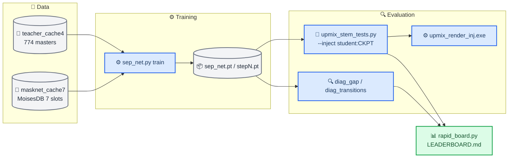

# Upmix Separator Track — Handoff

_Complete handoff of the rear-eligible separator track (Track B) to the next agent (Codex). State as of 2026-09-28 04:50, branch `feature/upmix-source-separation`, last commit `6eac814`._
_Read this first, then [the night report](UPMIX_SEPARATOR_NIGHT_REPORT_2026-09-28.md) for the numbers and [the plan](UPMIX_SOURCE_SEPARATION_PLAN.md) for the full history (reviews 1–16)._

---

## 📋 The job in one page

**Product.** Stereo CarPlay music becomes 5.1 in an Audi B&O car (MHI2 head unit, QNX, ARM). The goal: instruments (guitar, keys, piano, strings, winds) audibly and steadily in the rear, the voice never in the rear, bass and drums in the front, and no "back and forth" (the rear must not breathe with the song). Causal, about 150 M MAC/s int8 on the head unit, up to ≈85 ms extra latency acceptable.

**Two tracks.** Track A (another agent, another branch, same working tree) owns what ships in the car: a per-cell protect-mask net + mask-drive + soft veto in `hook/audio/`. **Track B (this handoff)** asks whether a causal on-budget estimator of the rear-eligible *audio* can carry the rear the way the non-causal teacher does.

**Where it stands.**

- The renderer interface is solved: fed the teacher's audio (htdemucs) it gives guitar 0.19–0.23 rear share at voice 0.01.
- Every on-budget student lands on one recall/leak frontier: guitar 0.09–0.12, voice 0.02–0.04, 4–9/39 songs swinging. Width, supervision, spectral structure and loss were each tested as one-change controlled runs and ruled out.
- Source attribution shows why: students pass 29–37 % of the eligible energy (ideal ratio mask 77 %) at the ideal mask's vocal leak, erase the air above 8 kHz, and duck the instruments 28 % when a voice enters (+47 % when it leaves).
- One 4k-step screen, a bounded sigmoid mask shared by both channels (`sharedmask`), is the first stability signal on every stem.
- **Review 16 (Codex) paused broad separator training.** Next: the owner's blind in-car listening test, a persistent rear-membership controller, direct optimisation of the product against the real renderer.

---

## 🚦 Rules you must follow

| Rule | Why |
| --- | --- |
| **Never reboot or restart the head unit yourself** | The owner does it; deploying files is fine, restarting is not |
| **No `Co-Authored-By` trailer in commits** | The owner is the sole author (repo rule overrides tool defaults) |
| **Docs in English only**, GitHub-ready tree under `docs/`, `UPPER_SNAKE.md` notes, relative links | Repo convention |
| **Do not touch Track A's files**: `hook/audio/hssr_mask.{c,h}`, the int8 port, and the uncommitted files in `docs/`, `wireless/`, `scripts/` | Another agent owns them; commit only your own paths (`git add <paths>`, never `-A`) |
| **Never print the NAS SMB credentials or the MoisesDB signed download link** | Secrets |
| **One GPU tenant at a time** on the PC | Two CUDA processes crashed natively (c10.dll access violations) |
| **Never `pip install` into the PC's Python while runs use it** | An install once upgraded torch to 2.14 and broke CUDA; the pinned stack is `torch==2.11.0`, `torchvision==0.26.0`, cu128 |
| **Ask Codex (you) / the owner before scope changes**; report results faithfully, including failures | Owner preference; the plan doc logs every review |

---

## 🖥️ The machine

| Item | Value |
| --- | --- |
| PC | Windows 11, RTX 5080 16 GB, reached over Tailscale: `ssh luka@100.127.113.11` (PowerShell on the far side) |
| Work dir | `D:\upmix` — `tools\` (scripts, renderer exe, models), `datasets\`, `runs\` |
| D: filesystem | **WinBtrfs** — slow CloseHandle, occasional stalls; every long job runs under a watchdog with `--resume` (`tools\stems_guard.ps1`) |
| Python | `C:\Users\LuKa\AppData\Local\Programs\Python\Python313\python.exe`, torch 2.11 cu128 |
| Mac (this repo) | `/Users/luka/Desktop/AUDI_2/Patches/mhi2-carplay`; local torch 2.10 for CPU smoke tests only |

<details>
<summary><strong>🔧 PC traps that cost hours</strong></summary>

- **Pattern-kill trap:** `Get-CimInstance ... | ? { $_.CommandLine -match 'run_x.ps1' }` matches your own ssh shell. Build patterns by concatenation or `-like '*-File D:\upmix\tools\run_x.ps1'`, and skip `$PID`.
- **Killing a WMI-launched runner kills its foreground python.** Queue a second runner that waits instead.
- **`$env:CUDA_VISIBLE_DEVICES=''` deletes the variable** in PowerShell; use `'-1'` to force CPU.
- **PowerShell `>` redirection writes UTF-16 LE** — read logs with `-Encoding Unicode` or BOM-aware decoding (`rapid_board.py` does this).
- **`tr` on the Mac chokes on UTF-16 bytes:** pipe ssh output through `LC_ALL=C tr -d '\000\r' | LC_ALL=C sed 's/[^[:print:]]//g'`.
- **Launch long jobs detached:** `Invoke-CimMethod -ClassName Win32_Process -MethodName Create -Arguments @{CommandLine='powershell -NoProfile -ExecutionPolicy Bypass -File D:\upmix\tools\X.ps1'}`.
- **Three Track A harnesses on the CPU once halved the training step rate**; a single CPU screen next to training did not.
- **Resume trap (fixed):** replaying an LR scheduler after loading the optimizer compounded the warm-up to 10.5×; `last.pt` now carries `sched` and `best`.
- **Loss-scale trap (fixed):** calibrate auxiliary-loss weights on the **parameter** gradient, never the output gradient (for `Y = M·X` the mixture factor kills the large output gradients of silent cells).

</details>

---

## 🗺️ Architecture of the tooling

_How the pieces connect: caches feed the student; a trained checkpoint is read by two kinds of evaluation — the PyTorch diagnostics on the 12 DEV excerpts and the real C renderer on 20 or 40 DEV songs — and the rapid daemon strings a 4k run, the diagnostics and a 20-song screen into one leaderboard row._



### Files you will touch (all under `tools/stereo-upmix-render/`, mirrored to `D:\upmix\tools\`)

| File | What it is |
| --- | --- |
| `sep_net.py` | The student. `BandSepNet` (48 bands, band GRUs, mixers, global GRU, per-band decoders). Flags: `--band-rnn`, `--lookahead`, `--bidir`, `--dec-skip`, `--norm window\|stream`, `--mask complex2\|shared_sigmoid`, `--loss lin\|log` (+ `--loss-floor`, `--loss-scale`), `--bandbal`, `--attr`, `--save-at`, `--half-half`, `--init` resume. `separate` subcommand; `load()` / `separate_array()` for injection |
| `mask_net.py` | Data helpers used by `sep_net` (`load_split`, `read_window`, `expand_slots`, `prefetch`, `dev_excerpt`); also the Track A mask-net trainer — do not change its behaviour |
| `upmix_stem_tests.py` | The renderer harness: per-stem rear share, swings, depth-follows-level, rear level, error vs the oracle. `--inject oracle\|irm\|teacher\|teacher2\|student:CKPT`, `--render-extra "--mask-drive G"`, `--songs N`, `--resume` |
| `diag_gap.py` | Source attribution: frozen mask on the true stems, reanalysed audio; eligible / vocal / protected transmission, band ratios, IRM reference, bootstrap CIs |
| `diag_transitions.py` | Vocal entries / exits / sustained controls: ducking, 0–2 s vocal peak, settling (censored), worst cases |
| `diag_ceiling.py`, `diag_lossfloor.py`, `diag_auxgrad.py`, `bench_precision.py` | Eval-path audit; loss floor coverage + parameter-gradient scale; aux-loss weights; fp32 / TF32 / bf16 benchmark (not yet run) |
| `rapid_board.py`, `pc/rapid_daemon.ps1`, `pc/rapid_context.ps1` | The rapid loop (below) |
| `teacher_label.py` | Teacher caches: htdemucs four-stem, BS-RoFormer vocals + demucs d/b (`--model roformer2`) |

On the PC only: `stems_guard.ps1` (watchdog), `run_sep3…12.ps1`, `run_sep9c.ps1` (long-run runners with queue integrity), `upmix_render_inj.exe` (the mingw build of the renderer with `--rear-audio` injection), `hssr_model.bin`, `hssr_guard.bin`.

---

## 🧪 The rapid loop — your main instrument

A job is one line `tag|sep_net args` in `D:\upmix\runs\rapid\QUEUE.txt`. The daemon (`rapid_daemon.ps1`, running) takes `D:\upmix\runs\GPU_LEASE` while jobs are queued (long runners wait on it), waits for the GPU, trains **4000 steps of the full recipe** (or `--steps N`), runs `diag_gap` and `diag_transitions` on the GPU, releases the lease when the queue empties, runs the **frozen 20-song CPU screen** at G 1.0, rebuilds `D:\upmix\runs\rapid\LEADERBOARD.md`, and removes the line. A job is idempotent: an existing folder resumes where it stopped.

```text
# add a job
ssh luka@100.127.113.11 "Add-Content D:\upmix\runs\rapid\QUEUE.txt -Value 'mytag|--mask shared_sigmoid --steps 10000'"
# read the board
ssh luka@100.127.113.11 "Get-Content D:\upmix\runs\rapid\LEADERBOARD.md"
```

**How to read it (review 15).** It is a *mechanism screen*, not a substitute for 40k: promote 4k → 10k → 40k. Compare against the anchors of the same training age (two seeds: noise ±0.05 eligible transmission, ±0.04 vocal, ±0.01 renderer shares). Promotion triggers: eligible transmission +0.03 at ≤ +0.01 vocal; entry ducking 10 points closer to 1 with p10 not worse; instrument shares +0.02 with voice, bass, level and error as guardrails. Every stem counts, not only the voice. A transparent mask "improves" transmission while failing separation; a silent mask has perfect ducking.

---

## 📊 Results you inherit

| Run | Change vs sep3 | Best SI-SDR | Renderer G 1.0: voice / guitar / keys / swings |
| --- | --- | --- | --- |
| sep3 | baseline, 125 M MAC/s | −0.24 | 0.02 / 0.09 / 0.10 / 5/39 |
| sep5 | widths ×2 (394 M) | −0.34 | 0.03 / 0.12 / 0.12 / 5/39 |
| sep6 | MoisesDB truth only | −0.66 | 0.02 / 0.10 / 0.11 / 4/39 |
| sep7 | BiGRU across bands (180 M) | −0.33 | 0.03 / 0.12 / 0.10 / 6/39 |
| sep8 | log-magnitude loss | −0.73 | 0.04 / 0.11 / 0.11 / 9/39 |
| teacher audio | — | — | 0.01 / 0.19–0.23 / 0.14–0.20 / 3/39 |
| ideal ratio mask | — | +5.27 | 0.01 / 0.23–0.24 / 0.20–0.23 / 2–3 |

Rapid 4k screens (20 songs): anchors guitar 0.11–0.12, piano 0.06–0.07, strings 0.13, bass 0.07–0.09, voice 0.04, guitar depth-follows-level +0.11/+0.12, entry-ducking p10 0.39–0.43. **sharedmask:** guitar 0.11, piano 0.09, keys 0.11, strings 0.16, wind 0.17, bass 0.10, voice 0.04, depth-follows-level guitar +0.02 / keys 0.00 / wind +0.03, ducking p10 0.58, 1 swing in 20 songs; costs bass, the air (−29 dB) and SI-SDR. logloss restores the air (−16 dB) and turns conservative; bandbal is conservative everywhere. Full tables: [night report](UPMIX_SEPARATOR_NIGHT_REPORT_2026-09-28.md).

---

## 🔄 Live state at handoff (04:50)

_What is running and what waits on what: sep9 holds the GPU; the rapid daemon holds the lease with the 10k promotion pair queued behind it; everything else review 16 paused._

```mermaid
stateDiagram-v2
    accTitle: PC Queue State at Handoff
    accDescr: sep9 is training on the GPU; when it and its renderer harness finish, the rapid daemon runs the sharedmask and anchor promotion pair at 10k steps and releases the lease; the other separator runs are paused and are resumed only by relaunching their runners.

    [*] --> Sep9Training: ⚙️ lookahead 8, step 10k of 40k
    Sep9Training --> Sep9Render: ✅ 40k reached
    Sep9Render --> RapidPair: 📤 GPU free
    RapidPair --> Idle: 🏁 sharedmask_10k and anchor_10k on the board
    Idle --> [*]
    note right of RapidPair
        The lease stays taken while the queue is non-empty
        Paused: sep9c, sep10, sep11, sep12, attr, sharedmask_log
    end note
```



| Item | State | Where |
| --- | --- | --- |
| sep9 (`--lookahead 8`, 85 ms) | Training, 10k: −0.98 dB; renders at G 1.0 / 1.3 after 40k (≈07:00) | `D:\upmix\runs\sep9\` |
| Rapid queue | `sharedmask` (finished, line clears), `sharedmask_10k`, `anchor_10k` (≈09:00) | `D:\upmix\runs\rapid\` |
| Paused by review 16 | sep9c (`--dec-skip`, the L = 0 control), sep10 (`--bidir`), sep11/sep12 (`--norm stream`, gated), `attr` (fixed), `sharedmask_log` | Relaunch notes in `D:\upmix\runs\rapid\PAUSED.txt` |
| Local background pollers (Mac) | Poll `sep9\DONE` and the board; harmless if left | — |

---

## 📍 What to do next (review 16's order)

1. **Read the leftovers, do not extend them.** sep9 at 40k through the renderer against sep3 and sep5; the 10k pair against its anchor. sharedmask goes to 40k only if, against the 10k anchor, instruments in the rear are not worse, depth-follows-level and ducking are better, and bass and voice did not rise.
2. **Prepare the blind listening kit** for the owner: 8–10 excerpts (vocal entries/exits, sustained instrumentals, dense choruses, exposed vocals, some outside DEV) rendered to 6-channel WAV in four conditions (front-only, Track A's deployable, sharedmask, teacher), level-matched, labels shuffled, a score sheet with the four questions. The owner plays it in the car; you do not touch the head unit.
3. **Persistent rear membership in a controller** (coordinate with Track A — it owns `hook/audio`): membership (slow, hysteresis, dwell, conservative admission) separated from protection (fast). Prototype offline in the renderer or in Python first; log membership changes and eligible-audio loss separately.
4. **Optimise the product directly:** 10–30 controller parameters by bounded search / CMA-ES against `upmix_render_inj.exe` on the 20-song screen, constrained (voice, bass, drums, stability) and maximising instrument delivery across families with a minimum useful rear level; validate on the 20 untouched DEV songs.
5. **Oracle-cue upper bound:** ground-truth vocal / drum / bass cues driving the same controller. Train small causal cue estimators only if this succeeds.
6. **Profile the head unit** (half a day, with the owner): deadline misses, memory traffic, thermals, latency — before planning beyond 150 M MAC/s.

Resume separator training only when these identify a specific missing capability (review 16).

---

## 🔗 References

- [Upmix Separator Night Report 2026-09-28](UPMIX_SEPARATOR_NIGHT_REPORT_2026-09-28.md) — every number, chart and resolved issue of the night
- [Upmix Source Separation Plan](UPMIX_SOURCE_SEPARATION_PLAN.md) — the running log, reviews 1–16, run rows
- [Upmix Mask Net Phase 1 Report 2026-09-27](UPMIX_MASK_PHASE1_REPORT_2026-09-27.md) — Track A in the car
- [Upmix Stability 2026-09-25](UPMIX_STABILITY_2026-09-25.md) — the original "back and forth" measurement
- [Upmix Calibration and Tuning](UPMIX_CALIBRATION_AND_TUNING.md) — the shipped renderer configuration
- [Upmix Datasets and Teachers](UPMIX_DATASETS_AND_TEACHERS.md) — MoisesDB, caches, htdemucs, BS-RoFormer

---

_Handoff written 2026-09-28 04:50. The next report belongs to whoever reads sep9 and the 10k pair._
