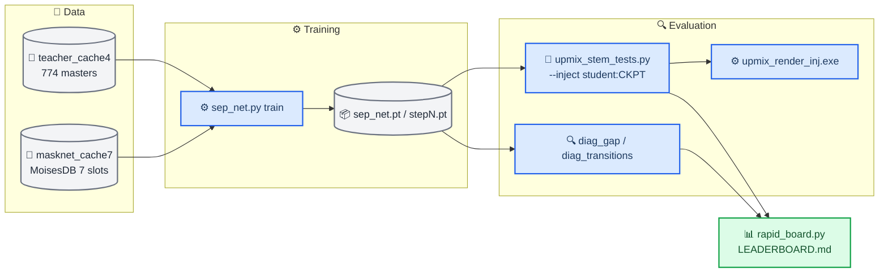

# Upmix Separator Track — Handoff

_Initial handoff of the rear-eligible separator track (Track B), written 2026-09-28 04:50 on `feature/upmix-source-separation` at `6eac814`. Later review sections below update that snapshot._
_Read this first, then [the night report](UPMIX_SEPARATOR_NIGHT_REPORT_2026-09-28.md) for the numbers and [the plan](UPMIX_SOURCE_SEPARATION_PLAN.md) for the full history (reviews 1–16)._

---

## 📋 The job in one page

**Product.** Stereo CarPlay music becomes 5.1 in an Audi B&O car (MHI2 head unit, QNX, ARM). The goal: instruments (guitar, keys, piano, strings, winds) audibly and steadily in the rear, the voice never in the rear, bass and drums in the front, and no "back and forth" (the rear must not breathe with the song). Causal, about 150 M MAC/s int8 on the head unit, up to ≈85 ms extra latency acceptable.

**Two tracks.** Track A (another agent, another branch, same working tree) owns what ships in the car: a per-cell protect-mask net + mask-drive + soft veto in `hook/audio/`. **Track B (this handoff)** asks whether a causal on-budget estimator of the rear-eligible *audio* can carry the rear the way the non-causal teacher does.

**At the initial handoff.** The bullets below are historical; see the current status immediately after them and the review ledger below.

- The renderer interface is solved: fed the teacher's audio (htdemucs) it gives guitar 0.19–0.23 rear share at voice 0.01.
- Every on-budget student lands on one recall/leak frontier: guitar 0.09–0.12, voice 0.02–0.04, 4–9/39 songs swinging. Width, supervision, spectral structure and loss were each tested as one-change controlled runs and ruled out.
- Source attribution shows why: students pass 29–37 % of the eligible energy (ideal ratio mask 77 %) at the ideal mask's vocal leak, erase the air above 8 kHz, and duck the instruments 28 % when a voice enters (+47 % when it leaves).
- One 4k-step screen, a bounded sigmoid mask shared by both channels (`sharedmask`), is the first stability signal on every stem.
- **Review 16 (Codex) paused broad separator training.** Next: the owner's blind in-car listening test, a persistent rear-membership controller, direct optimisation of the product against the real renderer.

**Current review-18 status (later 2026-09-28).** A host-only change to the C renderer's object/bed route passes the numerical full-40 DEV C-render gates **with true isolated eligible audio**: **8→0/40** any-stem swing songs, guitar/keys/piano/strings **.233/.235/.242/.231**, voice/bass/drums **.0038/.0084/.0097**, and rear RMS **+0.472 dB** against a freshly verified control. The same frozen renderer also passes with ideal bounded-mask/audio: **7→0/40**, instrument shares **.205/.215/.213/.208**, protected **.0044/.0112/.0090**, rear RMS **+0.075 dB**. Reused TEST20 gives **5→0/20** for true audio and **4→0/20** for ideal-mask/audio, but its formal gates remain NO because it lacks a valid wind slope; keys/strings coverage is also sparse. These are DEV-selected, noncausal upper bounds, not a new independent set. The frozen sep9 estimate through the new C route improves swings **6→1/20** yet fails guitar/keys/piano and bass (**.105/.144/.089/.070**). No full40 student promotion or new training followed. A causal extractor, source-attributed vocal-entry score, device int8 budget, head-unit port, independent validation and owner listening are still absent. The [direct-object report](UPMIX_DIRECT_OBJECT_RENDERER_PROBE_2026-09-28.md) records all iterations. No Track A or unit file was changed.

**Review-19 update (later 2026-09-28).** A matched 4k pair of causal, zero-lookahead, shared real-mask networks (107 M estimated neural MAC/s, before STFT/renderer) tested an explicit eligible-retention plus vocal/drum/bass-protection loss against an otherwise identical anchor. On the enriched DEV20 through the frozen direct C renderer, both had **2→0/20** swings. The source-loss candidate lifted guitar **.104→.118** and keys **.143→.156**, but also lifted voice **.0157→.0218**, bass **.0680→.0822** and matched rear level by **+.668 dB**. It failed the preselected extension rule (eligible recall +.03 < +.05; guitar +.016 < +.02; bass +.013 > +.01; level >+.5 dB), so no 10k continuation or full40 promotion. Vocal-entry median/p10 improved **.835/.588→.847/.618** on 43 events, still missing the .85 median target. The [causal source-loss report](UPMIX_CAUSAL_SOURCE_PAIR_2026-09-28.md) gives checkpoint locations and complete results. PC GPU lease is free and rapid queue empty. This is an extractor-selectivity failure for the tested loss, not proof of a general architectural limit. No unit, Track A, independent data or listening claim was added.

---

## 🚦 Rules you must follow

| Rule | Why |
| --- | --- |
| **Never reboot or restart the head unit yourself** | The owner does it; deploying files is fine, restarting is not |
| **No `Co-Authored-By` trailer in commits** | The owner is the sole author (repo rule overrides tool defaults) |
| **Docs in English only**, GitHub-ready tree under `docs/`, `UPPER_SNAKE.md` notes, relative links | Repo convention |
| **Do not touch Track A's files**: `hook/audio/hssr_mask.{c,h}`, the int8 port, and the uncommitted files in `docs/`, `wireless/`, `scripts/` | Another agent owns them; commit only your own paths (`git add <paths>`, never `-A`) |
| **Never print the NAS SMB credentials or the MoisesDB signed download link** | Secrets |
| **One GPU tenant at a time** on the PC | Two CUDA processes crashed natively (c10.dll access violations) |
| **Never `pip install` into the PC's Python while runs use it** | An install once upgraded torch to 2.14 and broke CUDA; the pinned stack is `torch==2.11.0`, `torchvision==0.26.0`, cu128 |
| **Ask Codex (you) / the owner before scope changes**; report results faithfully, including failures | Owner preference; the plan doc logs every review |

---

## 🖥️ The machine

| Item | Value |
| --- | --- |
| PC (the owner's second computer) | Windows 11, RTX 5080 16 GB, reached over Tailscale: `ssh luka@100.127.113.11` (PowerShell on the far side). **All tests, stems and training run here, on drive D:** |
| Music library | `D:\music` — the owner's own songs (source of the teacher-labelled masters and of the listening-test picks) |
| Work dir | `D:\upmix` — `tools\` (scripts, renderer exe, models), `datasets\`, `runs\` |
| D: filesystem | **WinBtrfs** — slow CloseHandle, occasional stalls; every long job runs under a watchdog with `--resume` (`tools\stems_guard.ps1`) |
| Python | `C:\Users\LuKa\AppData\Local\Programs\Python\Python313\python.exe`, torch 2.11 cu128 |
| Mac (this repo) | `/Users/luka/Desktop/AUDI_2/Patches/mhi2-carplay`; local torch 2.10 for CPU smoke tests only |

<details>
<summary><strong>🔧 PC traps that cost hours</strong></summary>

- **Pattern-kill trap:** `Get-CimInstance ... | ? { $_.CommandLine -match 'run_x.ps1' }` matches your own ssh shell. Build patterns by concatenation or `-like '*-File D:\upmix\tools\run_x.ps1'`, and skip `$PID`.
- **Killing a WMI-launched runner kills its foreground python.** Queue a second runner that waits instead.
- **`$env:CUDA_VISIBLE_DEVICES=''` deletes the variable** in PowerShell; use `'-1'` to force CPU.
- **PowerShell `>` redirection writes UTF-16 LE** — read logs with `-Encoding Unicode` or BOM-aware decoding (`rapid_board.py` does this).
- **`tr` on the Mac chokes on UTF-16 bytes:** pipe ssh output through `LC_ALL=C tr -d '\000\r' | LC_ALL=C sed 's/[^[:print:]]//g'`.
- **Launch long jobs detached:** `Invoke-CimMethod -ClassName Win32_Process -MethodName Create -Arguments @{CommandLine='powershell -NoProfile -ExecutionPolicy Bypass -File D:\upmix\tools\X.ps1'}`.
- **Three Track A harnesses on the CPU once halved the training step rate**; a single CPU screen next to training did not.
- **Resume trap (fixed):** replaying an LR scheduler after loading the optimizer compounded the warm-up to 10.5×; `last.pt` now carries `sched` and `best`.
- **Loss-scale trap (fixed):** calibrate auxiliary-loss weights on the **parameter** gradient, never the output gradient (for `Y = M·X` the mixture factor kills the large output gradients of silent cells).

</details>

---

## 🗺️ Architecture of the tooling

_How the pieces connect: caches feed the student; a trained checkpoint is read by two kinds of evaluation — the PyTorch diagnostics on the 12 DEV excerpts and the real C renderer on 20 or 40 DEV songs — and the rapid daemon strings a 4k run, the diagnostics and a 20-song screen into one leaderboard row._



### Files you will touch (all under `tools/stereo-upmix-render/`, mirrored to `D:\upmix\tools\`)

| File | What it is |
| --- | --- |
| `sep_net.py` | The student. `BandSepNet` (48 bands, band GRUs, mixers, global GRU, per-band decoders). Flags: `--band-rnn`, `--lookahead`, `--bidir`, `--dec-skip`, `--norm window\|stream`, `--mask complex2\|shared_sigmoid`, `--loss lin\|log` (+ `--loss-floor`, `--loss-scale`), `--bandbal`, `--attr`, `--save-at`, `--half-half`, `--init` resume. `separate` subcommand; `load()` / `separate_array()` for injection |
| `mask_net.py` | Data helpers used by `sep_net` (`load_split`, `read_window`, `expand_slots`, `prefetch`, `dev_excerpt`); also the Track A mask-net trainer — do not change its behaviour |
| `upmix_stem_tests.py` | The renderer harness: per-stem rear share, swings, depth-follows-level, rear level, error vs the oracle. `--inject oracle\|irm\|teacher\|teacher2\|student:CKPT`, `--render-extra "--mask-drive G"`, `--songs N`, `--resume` |
| `diag_gap.py` | Source attribution: frozen mask on the true stems, reanalysed audio; eligible / vocal / protected transmission, band ratios, IRM reference, bootstrap CIs |
| `diag_transitions.py` | Vocal entries / exits / sustained controls: ducking, 0–2 s vocal peak, settling (censored), worst cases |
| `diag_ceiling.py`, `diag_lossfloor.py`, `diag_auxgrad.py`, `bench_precision.py` | Eval-path audit; loss floor coverage + parameter-gradient scale; aux-loss weights; fp32 / TF32 / bf16 benchmark (not yet run) |
| `pc/rapid_board.py`, `pc/rapid_daemon.ps1`, `pc/rapid_context.ps1` | The rapid loop (below); the board counts unique songs where **any** stem swings from `screen/stems.csv` |
| `teacher_label.py` | Teacher caches: htdemucs four-stem, BS-RoFormer vocals + demucs d/b (`--model roformer2`) |

On the PC only: `stems_guard.ps1` (watchdog), `run_sep3…12.ps1`, `run_sep9c.ps1` (long-run runners with queue integrity), `upmix_render_inj.exe` (the mingw build of the renderer with `--rear-audio` injection), `hssr_model.bin`, `hssr_guard.bin`.

---

## 🧪 The rapid loop — your main instrument

A job is one line `tag|sep_net args` in `D:\upmix\runs\rapid\QUEUE.txt`. The daemon (`rapid_daemon.ps1`, running) takes `D:\upmix\runs\GPU_LEASE` while jobs are queued (long runners wait on it), waits for the GPU, trains **4000 steps of the full recipe** (or `--steps N`), runs `diag_gap` and `diag_transitions` on the GPU, releases the lease when the queue empties, runs the **frozen 20-song CPU screen** at G 1.0, rebuilds `D:\upmix\runs\rapid\LEADERBOARD.md`, and removes the line. A job is idempotent: an existing folder resumes where it stopped.

```text
# add a job
ssh luka@100.127.113.11 "Add-Content D:\upmix\runs\rapid\QUEUE.txt -Value 'mytag|--mask shared_sigmoid --steps 10000'"
# read the board
ssh luka@100.127.113.11 "Get-Content D:\upmix\runs\rapid\LEADERBOARD.md"
```

**How to read it (review 15).** It is a *mechanism screen*, not a substitute for 40k: promote 4k → 10k → 40k. Compare against the anchors of the same training age (two seeds: noise ±0.05 eligible transmission, ±0.04 vocal, ±0.01 renderer shares). Promotion triggers: eligible transmission +0.03 at ≤ +0.01 vocal; entry ducking 10 points closer to 1 with p10 not worse; instrument shares +0.02 with voice, bass, level and error as guardrails. Every stem counts, not only the voice. A transparent mask "improves" transmission while failing separation; a silent mask has perfect ducking.

---

## 📊 Results you inherit

| Run | Change vs sep3 | Best SI-SDR | Renderer G 1.0: voice / guitar / keys / **guitar** swings |
| --- | --- | --- | --- |
| sep3 | baseline, 125 M MAC/s | −0.24 | 0.02 / 0.09 / 0.10 / 5/39 |
| sep5 | widths ×2 (394 M) | −0.34 | 0.03 / 0.12 / 0.12 / 5/39 |
| sep6 | MoisesDB truth only | −0.66 | 0.02 / 0.10 / 0.11 / 4/39 |
| sep7 | BiGRU across bands (180 M) | −0.33 | 0.03 / 0.12 / 0.10 / 6/39 |
| sep8 | log-magnitude loss | −0.73 | 0.04 / 0.11 / 0.11 / 9/39 |
| sep9 | lookahead 8 frames, decoder skip | −0.63 @29k | 0.031 / 0.102 / 0.106 / 4/39 |
| teacher audio | — | — | 0.01 / 0.19–0.23 / 0.14–0.20 / 3/39 |
| ideal ratio mask | — | +5.27 | 0.01 / 0.23–0.24 / 0.20–0.23 / 2–3 |

Rapid 4k screens (20 songs): anchors guitar 0.11–0.12, piano 0.06–0.07, strings 0.13, bass 0.07–0.09, voice 0.04, guitar depth-follows-level +0.11/+0.12, entry-ducking p10 0.39–0.43. **sharedmask:** guitar 0.11, piano 0.09, keys 0.11, strings 0.16, wind 0.17, bass 0.10, voice 0.04, depth-follows-level guitar +0.02 / keys 0.00 / wind +0.03, ducking p10 0.58, 1 swing in 20 songs; costs bass, the air (−29 dB) and SI-SDR. logloss restores the air (−16 dB) and turns conservative; bandbal is conservative everywhere. Full tables: [night report](UPMIX_SEPARATOR_NIGHT_REPORT_2026-09-28.md).

**Counting correction:** the older 40-song "swinging" rows count guitar only. The goal counts unique songs with **any stem** swinging: sep3 is 11/40, sep8 16/40, sep9 G 1.0 11/40 and G 1.3 23/40. The PC rapid board now computes the unique-song union from `screen/stems.csv`.

**Interface ceiling correction (07:08):** recounting the original full-40 `iface8` CSVs with that same any-stem definition gives oracle mask × mixture **14/40**, oracle eligible audio **8/40**, ideal bounded real mask/audio **7/40**, teacher mask × mixture **23/40**, and teacher eligible audio **16/40**. The historical oracle-audio 3/39 and teacher-audio 5/39 figures were guitar-only. Clean eligible audio resolves six oracle-mask swing songs without adding any, but even perfect extracted audio misses the ≤ 5/39 stability target. The object/bed renderer therefore also needs a stability remedy; coordinate any hook change with Track A. The full table and source paths are in [the interface test](UPMIX_SOURCE_SEPARATION_PLAN.md).

---

## 🔄 Historical queue snapshot at handoff (04:50)

_What is running and what waits on what: sep9 holds the GPU; the rapid daemon holds the lease with the 10k promotion pair queued behind it; everything else review 16 paused._

```mermaid
stateDiagram-v2
    accTitle: PC Queue State at Handoff
    accDescr: sep9 is training on the GPU; when it and its renderer harness finish, the rapid daemon runs the sharedmask and anchor promotion pair at 10k steps and releases the lease; the other separator runs are paused and are resumed only by relaunching their runners.

    [*] --> Sep9Training: ⚙️ lookahead 8, step 10k of 40k
    Sep9Training --> Sep9Render: ✅ 40k reached
    Sep9Render --> RapidPair: 📤 GPU free
    RapidPair --> Idle: 🏁 sharedmask_10k and anchor_10k on the board
    Idle --> [*]
    note right of RapidPair
        The lease stays taken while the queue is non-empty
        Paused: sep9c, sep10, sep11, sep12, attr, sharedmask_log
    end note
```



| Item | State | Where |
| --- | --- | --- |
| sep9 (`--lookahead 8`, 85 ms) | **Done:** best −0.63 dB; renderer G 1.0 voice 0.03 / guitars 0.10 / keys 0.11 / 4/39 — same frontier, lookahead does not help | `D:\upmix\runs\sep9\` |
| Rapid queue | `sharedmask` (finished, line clears), `sharedmask_10k`, `anchor_10k` (≈09:00) | `D:\upmix\runs\rapid\` |
| Paused by review 16 | sep9c (`--dec-skip`, the L = 0 control), sep10 (`--bidir`), sep11/sep12 (`--norm stream`, gated), `attr` (fixed), `sharedmask_log` | Relaunch notes in `D:\upmix\runs\rapid\PAUSED.txt` |
| Local background pollers (Mac) | Poll `sep9\DONE` and the board; harmless if left | — |

**Live update 06:47 on 28.09:** sep9 completed cleanly at 40k and both 40-song C renders finished. G 1.0: voice 0.031, guitar 0.102, piano 0.080, keys 0.106, strings 0.081, bass 0.065, drums 0.092, any-stem swings 11/40. G 1.3: voice 0.044, guitar 0.161, piano 0.125, keys 0.157, strings 0.117, bass 0.102, drums 0.107, any-stem swings 23/40. **Do not promote or extend sep9.** The rapid daemon cleared the stale `sharedmask` line and began `sharedmask_10k`; `anchor_10k` remains next. The 04:50 state diagram and table above are an archival snapshot. See the [night report](UPMIX_SEPARATOR_NIGHT_REPORT_2026-09-28.md) for the full result.

**Mechanism update 07:02:** both a global membership latch and a per-source oracle activity latch have now been screened on the same 20 DEV songs through the C renderer. Global membership worsened any-stem swings 6 → 9; per-source membership left them at 6 → 6 while guitar and keys stayed almost always admitted and transient percussion was lost. Neither is a candidate. See [membership screens](UPMIX_PERSISTENT_MEMBERSHIP_SCREEN_2026-09-28.md). `sharedmask_10k` was at 4k; `anchor_10k` still waited in the rapid queue.

**Renderer follow-up prepared 07:16:** [`prepare_oracle_renderer_probe.py`](../../tools/stereo-upmix-render/prepare_oracle_renderer_probe.py) froze all eight full-harness oracle-audio swing songs plus 12 deterministic nonswinging controls in `D:\upmix\runs\oracle_renderer_probe\`. Its paired baseline has 20 songs, 115 stem rows and 8 any-stem swings; a self-comparison passed on the PC. [`run_oracle_renderer_probe.ps1`](../../tools/stereo-upmix-render/pc/run_oracle_renderer_probe.ps1) will screen rear body, rear air and front retention through the real C renderer on true eligible audio, **only after the 10k rapid pair drains**; it has not been run yet. This enriched diagnostic subset cannot certify a fix without the original full 40 and untouched 20. The rapid queue still contained `sharedmask_10k` (step 9k) and `anchor_10k` at 07:16.

**10k result 07:23:** `sharedmask_10k` completed the 20-song C screen. Relative to the 4k shared-mask screen, any-stem swings rose **1 → 5/20**, voice 0.039 → 0.041, guitar 0.111 → 0.131, piano 0.087 → 0.077, strings 0.158 → 0.124 and drums 0.078 → 0.092. Entry-retention p10 fell 0.58 → **0.431**. **Do not promote or extend this student.** It also uses `sep_net.py`'s default whole-window normalisation, so it is non-causal even before any device-port question. The paired 10k anchor is still running; leave it to finish so its comparison tests whether the 4k mechanism survives ordinary training. See the [night report](UPMIX_SEPARATOR_NIGHT_REPORT_2026-09-28.md) and `D:\upmix\runs\rapid\sharedmask_4k_vs_10k.json`.

**Swing timing diagnostic prepared 07:35:** [`diag_oracle_audio_swings.py`](../../tools/stereo-upmix-render/diag_oracle_audio_swings.py) reuses the original C output and the stem tracker to locate each one-second minimum/maximum in the eight oracle-audio swing songs and compare them with vocal level/entry times. The first CPU attempt stalled reading the large MoisesDB source on D: while `anchor_10k` was training; termination was requested and Windows reported `HasExited=True`, with no result produced. Retry only after the rapid queue is idle. This timeline is a mechanism clue, not the official source-attribution transition metric.

**Renderer probe runner revised 07:40:** [`oracle_renderer_sweep.py`](../../tools/stereo-upmix-render/oracle_renderer_sweep.py) loads each selected MoisesDB song only once, runs a fresh baseline and four C-renderer knob conditions, verifies every baseline stem against the original oracle CSV within 0.005, and writes paired results. The PowerShell guard still refuses to start while the rapid queue or a train/stem-harness process is active. The sweep is prepared but unrun; do not infer a knob winner from it yet.

**Promotion pair complete 08:00:** matched 20-song C screens give `anchor_10k` → `sharedmask_10k`: guitar 0.119 → 0.131 (paired +0.014, 90% CI +0.009 to +0.020), keys 0.108 → 0.111, strings 0.112 → 0.124, voice 0.041 → 0.041, bass 0.080 → 0.096, drums 0.092 → 0.092, any-stem swings **3 → 5/20** (two new, none resolved), entry-retention p10 0.400 → 0.431. **Reject promotion and do not extend either 10k run.** The [night report](UPMIX_SEPARATOR_NIGHT_REPORT_2026-09-28.md) has the full comparison; paired JSON: `D:\upmix\runs\rapid\anchor10k_vs_sharedmask10k.json`.

**Rapid queue repair 08:01:** the daemon's pipeline did not clear the final queue line when its filter produced no rows; it repeated `anchor_10k`'s already-completed bookkeeping in a tight loop. The daemon was stopped, the sole completed `anchor_10k` line manually cleared, and the GPU lease was absent. [`rapid_daemon.ps1`](../../tools/stereo-upmix-render/pc/rapid_daemon.ps1) now explicitly writes an empty queue file when no lines remain. No train or stem-harness process was active when the line was cleared. The daemon is currently stopped; relaunch it only for a new rapid job. The CPU-only oracle renderer probe may now run.

**Oracle renderer screen in progress 08:04:** fresh baseline reproduction passed on the first song; the CPU process is rendering all five conditions one song at a time, with no GPU lease. The [precommitted question and promotion rule](UPMIX_ORACLE_RENDERER_PROBE_2026-09-28.md) require at least three of the eight oracle-audio swing songs resolved, no new control swing, protected stems within limits and useful instrument level before any full-40 rerender. Results are not yet available.

**Oracle screen result, later 28.09:** all five 20-song C renders finished; the fresh baseline reproduced the original CSV. `rear_air_off` resolved three of eight any-stem swing songs with none new (8 → 5), guitar/keys/piano/strings 0.242/0.226/0.171/0.262, voice/bass/drums 0.008/0.010/0.032 and rear RMS −36.97 dBFS. `front_retention075` resolved seven with none new (8 → 1), instruments 0.176/0.179/0.122/0.187, protected 0.009/0.012/0.068 and **unchanged** rear RMS −36.64 dBFS. Both passed the precommitted screen gate and are being rerendered on the original full 40 DEV songs with a fresh baseline. `rear_body0` resolved only two and raised rear RMS by 1.47 dB; retention 0.25 created six new swing songs. This is still **perfect injected audio**, not a causal deployable separator or a car verdict. See [the screen report](UPMIX_ORACLE_RENDERER_PROBE_2026-09-28.md) and `D:\upmix\runs\oracle_renderer_probe\decision.json`.

**Full-40 oracle check, later 28.09:** the fresh baseline reproduced all 231 original stem rows. Rear air −40 dB cut any-stem swings **8 → 5/40**, but rear RMS fell **0.575 dB**, missing the fixed ±0.5 dB gate. Front retention 0.75 cut swings **8 → 1/40**, but six-song median strings fell to **0.134**, below 0.14. Every other share and slope gate passed. Neither is a full-harness winner as tested. The [probe report](UPMIX_ORACLE_RENDERER_PROBE_2026-09-28.md) records all numbers and an exploratory gain/retention follow-up. A 20-song **TEST-split** holdout is frozen, with no overlap with DEV; it is not literally an untouched DEV subgroup. The current production-mask C screen is running separately on the enriched 20 songs with Track A's frozen v21a binary, no oracle injection. Its first attempt exposed an old PC renderer lacking `--mask-model`; a separately named current-source mingw build fixed that, without modifying Track A's files. No owner listening verdict exists yet.

**Production-mask screen result, later 28.09:** Track A v21a on the enriched 20-song real-C screen has 15 any-stem swing songs, guitar/keys/piano/strings 0.176/0.166/0.118/0.225 and voice/bass/drums **0.075/0.150/0.285**. Rear air −40 dB gives 14 swings and protected **0.064/0.136/0.168**; front retention 0.75 gives seven swings, but guitar/keys 0.132/0.129 and protected **0.058/0.128/0.230**. Neither passes the protection or stability gates. Do not promote either to full-40 production or deploy it. The [production probe](UPMIX_PRODUCTION_RENDERER_PROBE_2026-09-28.md) has the full setup and result. This paired screen implicates mask selectivity in addition to the oracle-demonstrated renderer contribution; it is not a general impossibility claim. The posthoc oracle full-40 near-miss adjustment is now running, and the owner listening verdict remains pending.

**Exploratory oracle follow-up, later 28.09:** full-40 rear air −40 plus surround 0.427 restored rear RMS but made swings **8 → 9** (two new). Front retention **0.70** gave **4/40** swings, guitar/keys/piano/strings **0.185/0.187/0.128/0.140166**, voice/bass/drums **0.009/0.013/0.068**, unchanged rear RMS and acceptable level-dependence slopes. It passes all measured full-40 render gates but was chosen after inspecting this set, and its string margin is only **0.000166**. A separately frozen 20-song MoisesDB **TEST** split is now running for this setting; that result must be read before treating it as a robust upper bound. True eligible audio injection is noncausal and non-deployable, so this is not a product candidate or a car result. See the [probe report](UPMIX_ORACLE_RENDERER_PROBE_2026-09-28.md).

**Independent oracle TEST result, later 28.09:** front retention 0.70 reduced any-stem swings **5 → 2/20** with no new swing and protected shares within limits, but **keys 0.128 < 0.15**. Only five TEST songs carry keys, one carries strings, and none yields a valid wind slope, so the latter is unverified rather than a measured failure. The user offered a possible 0.12 keys threshold, but it was not adopted before this test. The independent render gate therefore fails; do not claim a robust numerical upper-bound winner. This TEST split is distinct from DEV, not the goal's literally requested untouched DEV subgroup. Complete data and caveats are in the [probe report](UPMIX_ORACLE_RENDERER_PROBE_2026-09-28.md). No deployable candidate or owner listening verdict has emerged.

**Bounded production-mask search, later 28.09:** a CPU-only 10-parameter, 18-candidate CMA-ES pilot used six fixed enriched DEV songs and the real C renderer with Track A's frozen v21a mask. None passed the small-screen constraints. The lowest scalar score silenced the rear by **4.03 dB** and left guitar/keys only **0.089/0.072**, while voice/bass/drums remained **0.029/0.127/0.141**. A rear-present point had guitar/keys **0.206/0.164** but protected **0.062/0.149/0.296** and 3/6 swings. Do not promote or deploy either; [the pilot report](UPMIX_CMA_RENDERER_PILOT_2026-09-28.md) and PC `D:\upmix\runs\cma_production_renderer6\search.json` record every point. This is a static-knob search, not the proposed new source-membership controller and not a universal negative result. The PC queue is otherwise idle; no GPU training was launched. Owner listening remains pending.

---

## 🧾 Review 16 investigation ledger — consolidated state, 2026-09-28

This is the current decision record. The 04:50 diagram and timestamped paragraphs above preserve how the queue and conclusions evolved; they are **historical snapshots**, not instructions to resume those jobs. Detailed per-song rows and configurations remain in the linked reports and PC run directories. No head-unit build was changed by Track B, no device benchmark was run, and there is no owner listening verdict yet.

### Measurement contract and honest sample labels

- The full DEV harness is **40 MoisesDB songs × 60 s**, the real C renderer, fixed gain and identical stem alignment. A rear share is the median over finite, source-dominant cells. A swing counts a **unique song with at least one stem** whose one-second rear-share range exceeds 0.30. Older `4/39`, `3/39` and similar figures in historical tables count guitar alone and must not be compared to the all-stem goal. Compare paired songs, not stem rows as independent samples.
- The still-active numerical limits are guitar ≥0.15, keys ≥0.15, piano ≥0.10, strings ≥0.14; voice ≤0.02, bass ≤0.06, drums ≤0.08; ≤5/39 songs swinging, guitar/keys/winds level slopes within ±0.05, vocal-entry retention median ≥0.85 and p10 ≥0.60. The owner suggested that keys **could** be relaxed to 0.12, but it was **not adopted before TEST**. Do not reinterpret the independent result using that threshold after seeing it.
- All 40 DEV songs had already influenced investigation, so there is no honest “20 untouched DEV songs.” The independent check froze **20 separate TEST songs** from 24 available, seed 1610, before the full-40 follow-up result; titles and IDs do not overlap DEV. Its keys statistic comes from five songs, strings from one, and it has no valid wind-slope estimate. Missing coverage is not a measured pass or failure. Preserve this TEST set as a holdout; do not retune against it. See the [oracle probe](UPMIX_ORACLE_RENDERER_PROBE_2026-09-28.md).
- Budget claims need **causal inference, measured ≤150 M MAC/s int8 on the head unit, and ≤85 ms extra latency**. Sep9's 144 M MAC/s is a float estimate, and its default whole-window normalization uses future context. Neither it nor the offline true-stem oracle meets this product contract. Front retention also changes the front denominator of rear share; a metric improvement alone cannot establish that the rear sounds useful.

### Experiment sequence and disposition

| Experiment / evidence | Measured result | Decision |
| --- | --- | --- |
| Earlier separator ladder, [night report](UPMIX_SEPARATOR_NIGHT_REPORT_2026-09-28.md) and [plan](UPMIX_SOURCE_SEPARATION_PLAN.md) | sep3/5/6/7/8 changed width, truth, bidirectional context and log loss. Gains in one dimension repeatedly brought voice leak, weak air or moving instruments elsewhere. The 4k log-loss screen restored air to about −16 dB versus −23 dB anchors but became conservative; band balancing did not fix the trade-off. The attribution-loss NaN was fixed, then its run was paused. | No broad separator sweep without a new measured mechanism. |
| sep9, 40k and full-40 C render | Eight-frame lookahead, nominal 85 ms; best SI-SDR −0.63 dB at 29k. At gain 1.0: guitar/keys/piano/strings **.102/.106/.080/.081**, voice/bass/drums **.031/.065/.092**, **11/40** any-stem swings, rear RMS −38.6 dBFS. At gain 1.3: **.161/.157/.125/.117**, protected **.044/.102/.107**, **23/40** swings, rear RMS −36.8 dBFS. | Reject both points. More rear level worsened protection and stability; lookahead did not break the separator frontier. The matched sep9c and sep10–12 runs stay paused. |
| 4k shared-mask mechanism, 20 DEV songs | Guitar/keys/piano/strings **.111/.114/.087/.158**, voice/bass/drums **.039/.097/.078**; **1/20** any-stem swings, guitar/keys/winds level slopes about **+.02/.00/+.03**, entry-retention p10 **.58**, but rear air about **−29 dB**. The model uses whole-window normalization. | Stability clue, not a passing or causal candidate. Promote only to a matched 10k check. |
| Paired 10k shared-mask vs anchor, 20 DEV songs | Anchor → shared mask: guitar **.119→.131** (paired song delta +.014, 90% interval +.009 to +.020), keys **.108→.111**, strings **.112→.124**, voice **.041→.041**, bass **.080→.096**, drums **.092→.092**; swings **3→5/20** with two new and none resolved; entry p10 **.400→.431**. The shared-mask trajectory itself worsened from its 4k result: swings **1→5**, piano **.087→.077**, strings **.158→.124**, entry p10 **.58→.431**. | Reject 10k promotion; no 40k extension. A 4k stability win was training-age sensitive. Full comparison: [night report](UPMIX_SEPARATOR_NIGHT_REPORT_2026-09-28.md), PC `rapid\anchor10k_vs_sharedmask10k.json`. |
| Global slow membership and per-source oracle activity latches, same 20 DEV songs | Global membership changed swings **6→9**, voice **.027→.023**, guitar **.188→.183**, keys **.164→.153**, drums **.106→.094**; member open median **96.4%**, eligible loss median **3.5%** (one song **88.6%**). Oracle activity latches left swings **6→6**, admitted guitar/keys almost continuously and strings only **13.8%** of time; percussion admission was zero despite its rear share improving **.329→.109**. | Reject those two controllers. They are activity latches, not proof that persistent **source identity** with separate fast protection cannot work. [Membership report](UPMIX_PERSISTENT_MEMBERSHIP_SCREEN_2026-09-28.md). |
| Oracle vocal/bass/drum protection weights, same 20 DEV songs | Weight 2, gain 1.0: voice/guitar/keys/bass/drums **.020/.162/.143/.055/.092**, **6/20** swings. Weight 4, gain 1.2: **.018/.190/.158/.056/.089**, **13/20** swings. Weight 4, gain 1.0, rear body zero: voice/guitar/piano/keys/strings/bass/drums **.017/.167/.128/.141/.100/.055/.082**, **6/20** swings. | None meets delivery, protection and stability together. Cheap true-stem activity alone did not solve the problem. [Membership report](UPMIX_PERSISTENT_MEMBERSHIP_SCREEN_2026-09-28.md). |
| Interface upper bounds, original full 40 | Recounted all-stem swings: oracle mask × mixture **14/40**, oracle true eligible audio **8/40**, ideal bounded real mask/audio **7/40**, teacher mask × mixture **23/40**, teacher eligible audio **16/40**. Oracle audio shares guitar/keys/piano/strings **.255/.230/.171/.180**, voice/bass/drums **.009/.013/.069**, with acceptable measured level slopes. | Extraction matters, but even perfect eligible audio misses the swing target in the original renderer. Renderer stability is an independent limit. [Plan](UPMIX_SOURCE_SEPARATION_PLAN.md). |
| Precommitted oracle renderer screen, enriched 20 DEV songs | All eight full-40 oracle swing songs plus 12 deterministic controls, 115 rows; fresh C baseline agrees within .005 per stem. Baseline **8/20** swings, rear RMS −36.64 dBFS. Air −40 dB: **5/20**, no new, guitar/keys/piano/strings **.242/.226/.171/.262**, protected **.008/.010/.032**, RMS −36.97. Front retention .75: **1/20**, no new, instruments **.176/.179/.122/.187**, protected **.009/.012/.068**, same RMS. Rear body zero resolved only two and raised RMS **1.47 dB**; retention .25 made **six new** swing songs. Frozen promotion gate required ≥3/8 resolved, none new, protection/shares/slopes and rear RMS within ±.5 dB. | Air off and retention .75 earned full-40 checks; other two rejected. This screen injects true, noncausal eligible audio. [Oracle report](UPMIX_ORACLE_RENDERER_PROBE_2026-09-28.md). |
| Full-40 oracle check and posthoc follow-up | Fresh baseline reproduced **231 stem rows** within .005. Air off reduced swings **8→5/40** but rear RMS **−37.619→−38.194 dBFS**, a **.575 dB** loss outside the gate. Retention .75 reduced **8→1/40** but strings fell to **.134<.14**. Posthoc air off + surround .427 restored level yet changed swings **8→9** with two new. Posthoc retention .70: **4/40** swings; instruments **.184837/.187481/.127802/.140166**, protected **.009291/.013020/.067981**, unchanged RMS, slopes **+.0025/−.0042/+.0037**. | Neither preselected knob passes full40. The .70 exploratory point passes measured DEV render gates by a **.000166** string margin, but was selected after seeing DEV and is not a deployable separator. [Oracle report](UPMIX_ORACLE_RENDERER_PROBE_2026-09-28.md). |
| Frozen independent TEST20 oracle check | Baseline **5/20** swings; retention .70 **2/20**, none new. Instruments guitar/keys/piano/strings **.1937/.128386/.1396/.1597**, protected voice/bass/drums **.0065/.0057/.0584**. Five keys songs, one string song, no valid wind slope. | **Fails formal keys ≥.15**. No robust upper-bound winner. The proposed keys .12 relaxation was not adopted; no holdout retune. [Oracle report](UPMIX_ORACLE_RENDERER_PROBE_2026-09-28.md). |
| Swing timing attribution check | Ten swinging stem traces across the eight original oracle swing songs; **six of eight** songs have no qualifying vocal entry. In `Holy Magick - Even Though`, guitar share moves **.144→.497** while the vocal is below **−88 dB** at both extrema. | The movement cannot be explained only by vocal-entry ducking. This is a timing diagnostic, **not** the formal source-attribution transition score. PC `oracle_renderer_probe\swing_timing.json`. |
| Production-mask renderer screen, enriched 20 DEV songs | Frozen Track A v21a mask, no oracle injection, real C. Baseline **15/20** swings, instruments **.176/.166/.118/.225**, protected **.075/.150/.285**, RMS −33.534. Air off: **14/20**, protected **.064/.136/.168**, RMS −34.058 (**.524 dB** lower; fails ±.5). Retention .75: **7/20**, instruments **.132/.129/.114/.173**, protected **.058/.128/.230**, same RMS. | Neither knob passes; no full-40 production promotion or deployment. This paired result implicates mask selectivity **for these knobs**, alongside the independent renderer limit. [Production report](UPMIX_PRODUCTION_RENDERER_PROBE_2026-09-28.md). |
| Static product-knob CMA-ES pilot, six fixed enriched DEV songs | Ten existing knobs, 18 bounded points (3 × 6), frozen v21a mask and real C. Baseline score **25.27**, **4/6** swings, guitar/keys **.257/.199**, protected **.091/.151/.344**, RMS −32.96. Lowest scalar score **13.65**: **0/6** swings but guitar/keys **.089/.072**, protected **.029/.127/.141**, RMS **−36.99** (4.03 dB lower). Rear-present point score **19.19**: **3/6** swings, instruments guitar/keys/piano/strings **.206/.164/.125/.185**, protected **.062/.149/.296**, RMS −33.93. | **0/18 feasible**, so no full-20/40 promotion or live config. Scalar optimization preferred near-silence even with a level penalty; hard feasibility gates are necessary. Existing static knobs were tested, not a new source-aware controller. [CMA report](UPMIX_CMA_RENDERER_PILOT_2026-09-28.md). |

### Tooling iterations and reproducibility traps

1. The rapid board was corrected to count the union of songs with **any** swinging stem. Frozen paired comparisons use the song as the unit, a fresh baseline within .005 per stem, fixed gain and the same C binary with only the stated knob changes. The oracle sweep loads each MoisesDB song once and caches per-song `.rows.json` results so an interrupted CPU sweep can resume without moving the evaluation set.
2. The last rapid-queue line remained after the PowerShell filter produced no rows, causing repeated bookkeeping for a completed job. The daemon was stopped, that completed line was cleared, and [`rapid_daemon.ps1`](../../tools/stereo-upmix-render/pc/rapid_daemon.ps1) now explicitly writes an empty file. The latest check found `D:\upmix\runs\rapid\QUEUE.txt` **0 bytes**; the daemon is stopped, no training was launched, and there is no GPU lease. Relaunch only for a deliberate new job; one GPU tenant remains the rule.
3. The first swing-timing diagnostic stalled on a large D: read while GPU training was active. It was later retried while idle and produced the timing result above. The first production screen used an old host executable without `--mask-model` and produced no valid rows. A separately named current-source MinGW host build then ran the screen; Track A files were not edited. The frozen v21a source binary and new host executable were hashed and recorded in the [production report](UPMIX_PRODUCTION_RENDERER_PROBE_2026-09-28.md).
4. The CMA runner's first delivery-loop typo was fixed. An interrupted pass left a destination file, and WinBtrfs reported a same-file/stat guard on retry. [`upmix_stem_tests.py`](../../tools/stereo-upmix-render/upmix_stem_tests.py) now captures the C renderer's stderr and removes only its own incomplete destination before retry. The deterministic six-song cache resumed and all 18 points completed. No pip install or head-unit reboot was involved.
5. The [CarPlay listening protocol](UPMIX_CARPLAY_LISTENING_PROTOCOL.md) already names ten owner-library songs with timestamps and four rear-only headphone preview cuts. The car plays the same ordinary stereo from the phone over **live CarPlay**; the head-unit hook creates 5.1. Today only front-only and Track A's shipped build can be compared live. Student and teacher previews are explicitly **outside the car chain**. A student needs a Track A-owned hook port; the teacher cannot run on budget. Six-channel WAV playback and `qsa_play` do not validate routing in the car. No owner score sheet has been returned.

### Architecture implications — review-18 evidence and remaining hypotheses

**Correction after the owner chose to continue offline without listening (review 17):** a slow identity latch on the **original mixture** cannot remove voice/bass/drum audio already carried through an overlapping time-frequency cell. The paired interface test (oracle mask × mixture **14/40** swinging, oracle eligible audio **8/40**, ideal bounded real-mask **audio** **7/40**) makes source-aware eligible **audio** the more informative extraction path. It does **not** prove that all real-valued masks are inadequate: the ideal bounded mask/audio row itself is much stronger than the trained students. The independent renderer swing failure persists even with true eligible audio. Treat extraction and rendering as **two separate architectural gates**; another latch or another 40k training continuation alone does not pass both.

**Review-17 offline result:** the preselected ideal-mask-audio + front-retention-.70 full40 C render reproduced the original 231-row baseline, cut any-stem swings **7→3/40** with no new song, and kept rear RMS unchanged, but bowed-string share fell **.16879→.13203**, below .14. It is a **failed** full-harness gate, not a causal candidate. The [architecture-gate report](UPMIX_ARCHITECTURE_GATE_2026-09-28.md) has exact family medians and setup. Its second diagnostic remeasured the original ten true-audio swing traces: median rear output energy per stem energy rises **6.14 dB** between depth extremes while front changes **−2.20 dB**; rear-side change is larger in **10/10** traces. Removing air reduces the rear change to **5.04 dB**, while retention .75 leaves it at **6.14 dB** and instead reduces the front-side change to **−.78 dB**. The output-energy result isolates a renderer-side target, though it cannot prove audibility or identify one internal DSP coefficient. The fixed-window share medians reproduce the saved values within .001.

| Route | Why it remains plausible | Earliest discriminating test |
| --- | --- | --- |
| **Source-aware eligible-audio estimator** | True eligible audio and ideal bounded-mask audio both pass full40 in the host direct/no-bed/body-0 C path. The frozen sep9 estimate through that same path still misses guitar/keys/piano and bass, despite swings 6→1/20. The sep3–9 models also use noncausal whole-window normalization. | Define an on-budget causal estimator against the fixed renderer. Measure source-attributed entry ducking, protected leak, instrument transmission and C-render shares at matched rear level. Do not treat more sep9 epochs as the architecture fix. |
| **Stable renderer object/front split** | The host-only direct/no-bed/body-0 prototype has passed all **measured** DEV40 render gates for true and ideal-mask audio, and shows secondary robustness on reused TEST20. The path bypasses pan projection and removes bed/fallback/rear body together, so no single internal term is isolated. | Once a causal estimator is feasible, test it on a new independent, adequately covered stem set; Track A then decides whether to port the object path. Device profile and owner ear remain necessary. |
| **Persistent source identity + fast protection** | May help an **audio estimator** keep an instrument across vocal entries. The tested global and true-stem activity latches did not preserve source continuity. | Prototype only if the causal estimator's transition attribution shows a remaining identity failure. Log membership changes and eligible-audio loss; never substitute an identity latch on the unseparated mixture for source extraction. Track A owns any hook port. |

The currently defensible result is a **measured renderer upper bound plus a measured sep9 extraction failure** for these tested settings, not a proof of general impossibility or a deployable candidate. Preserve the separate evidence labels: offline oracle, trained-student C render, reused TEST, device feasibility, and owner's live listening. None may stand in for another.

---

## 📍 What to do next (review 18: offline work now, listening later)

1. **Preserve the selected host bound and its limits.** The [direct-object report](UPMIX_DIRECT_OBJECT_RENDERER_PROBE_2026-09-28.md) has the exact 20/40/TEST outcomes, renderer and sep9 hashes, and failed iterations. Do not change surround .3235 based on the already-inspected TEST20. The selected path is a combined object/bed/body change, not a port or an identified single C coefficient.
2. **Build a causal eligible-audio estimator toward the ideal-mask/audio bound.** Use streaming normalization and an explicit object-audio output; keep extra latency ≤85 ms and an int8-computable architecture near the 150 M MAC/s device budget. Before another long run, define a short matched-age screen with hard guitar/keys/piano/strings, voice/bass/drums, swing, RMS and source-attributed vocal-entry gates through the fixed C renderer. Sep9 through that path failed guitar/keys/piano and bass, so simply continuing its checkpoint is not a complete fix. Use an identity controller only if attribution shows a specific continuity failure.
3. **Get independent coverage.** The 40 DEV songs selected this renderer, and the 20 TEST songs were previously inspected and lack a wind slope (five keys songs, one strings song). A new adequately covered set of real instrument/protected stems is needed; do not report reused TEST20 as untouched validation.
4. **Port only after a causal host candidate passes.** Track A owns `hook/audio` and the int8 port. Coordinate the interface and then measure actual ≤150 M int8 MAC/s, deadline misses and ≤85 ms added latency on the head unit, without rebooting it.
5. **Finish with live CarPlay owner listening.** The current offline bound cannot answer timbre or cabin depth after removing rear body/bed. Only front-only and Track A run live today; the new path needs Track A's port before the requested blind in-car comparison. The owner chose to defer listening while these offline architecture tests ran.

Resume separator training only when these identify a specific missing capability (review 16).

---

## 🧭 Where to look — before you ask

| Question | Answer / where |
| --- | --- |
| **How is the listening test played in the car?** | **Through CarPlay, live.** The phone streams ordinary stereo (realtime `lpcm` 48 kHz/16/2 on `mpl5_dio_ent`); the hook on the head unit upmixes it to 5.1 itself (`AUDIO_REALTIME_UPMIX=on`). So a candidate is a **renderer build + config on the head unit**, and the owner plays the same songs from the phone for each. No 6-channel WAV playback is needed. See [Stereo to 5.1 Upmix](STEREO_TO_5_1_UPMIX.md), [Dolby Atmos](DOLBY_ATMOS.md) (realtime = PCM passthrough) |
| **Which songs for the listening test?** | **Pick them yourself from the owner's library on the PC: `D:\music`** (3 367 files — the music he actually plays; the 774 teacher-labelled masters come from it). Their htdemucs stems are already in `D:\upmix\datasets\teacher_cache4\` (`<name>.npy` + `.json` with `"source"` = the file name in `D:\music`). Choose 8–10 with clear guitars / keys / piano / strings, a vocal entry and exit (run the event detector of `diag_transitions.py` on the teacher vocal stem), a sustained instrumental passage, a dense chorus and an exposed vocal; hand the owner the list (artist – title – timestamps). Everything heavy runs on that PC's GPU — tests, stems, training |
| Which candidates can play live today? | **Front-only** (`AUDIO_STEREO_UPMIX=off`) and **Track A's deployable** (the shipped config). The shared-mask student and the teacher do **not** run on the head unit: the student needs a port into the hook (coordinate with Track A, which owns `hook/audio`), the teacher never will (non-causal, ~100× budget). For those two, use an offline headphone preview (below), clearly labelled "not the car chain" |
| How do I switch a candidate on the unit? | Env in `deploy/smartphone_integrator/carplay_startup.sh` (the shipped table: [Upmix Calibration and Tuning](UPMIX_CALIBRATION_AND_TUNING.md), [Stereo to 5.1 Upmix — shipped calibration](STEREO_TO_5_1_UPMIX.md#-the-shipped-calibration)); files go to `/mnt/app/root/hooks/` and take effect on the **next phone connect** — no restart. **Never restart the unit or j9 yourself** |
| How do I copy files to the head unit? | Traps and the working method: `scripts/deploy_unit.sh`, memory note on SSH transport (no `scp`/`tar` on QNX; `ssh 'cat > f.new' < local` + `mv`, read back and compare; ControlMaster to dodge the auth rate limit; `/mnt/app` needs `mount -uw`; `/tmp` holds no directories). Deploy history and hashes: [Upmix Listening and Deploy Log](UPMIX_LISTENING_AND_DEPLOY_LOG.md) |
| Why not `qsa_play` a 6-channel file? | It sets no SAD header and inherits the last session's mask — it misled a two-day search. **Verify audio through CarPlay, never with `qsa_play`** ([Landmines](../LANDMINES.md), [QNX Audio Topology](QNX_AUDIO_TOPOLOGY.md)) |
| How were earlier A/B tests done? | Headphone previews of offline renders (21.09: four 60-s cuts, seven variants) then a sighted in-car confirmation; all by the owner, none blind ([Upmix Listening and Deploy Log](UPMIX_LISTENING_AND_DEPLOY_LOG.md)). Preview tools: `tools/stereo-upmix-render/render_q2_listen.py`, `q5_hssr_ab.py` (crude, not the cabin) |
| Does the car / amp chain matter for what the owner hears? | Yes: the B&O J525 is the renderer after us. [Virtual Cabin and Amp RE](VIRTUAL_CABIN_AND_AMP_RE.md), [J525 Wiring and Speakers](J525_WIRING_AND_SPEAKERS.md), [Discrete 5.1 Routing](DISCRETE_5_1_ROUTING.md); the input matrix is output-rows / input-columns ([Landmines](../LANDMINES.md)) |
| What is the renderer and its knobs? | [HSSR Model](HSSR_MODEL.md), [Stereo to 5.1 Upmix](STEREO_TO_5_1_UPMIX.md), [Upmix Calibration and Tuning](UPMIX_CALIBRATION_AND_TUNING.md), [Upmix Compute Budget](UPMIX_COMPUTE_BUDGET.md); C sources `hook/audio/hssr_dsp.c`, host build `tools/stereo-upmix-render/` |
| What does Track A have in the car? | [Upmix Mask Net Phase 1 Report 2026-09-27](UPMIX_MASK_PHASE1_REPORT_2026-09-27.md) (mask net, drive curve, health line, Krait bench) |
| The original "back and forth" analysis | [Upmix Stability 2026-09-25](UPMIX_STABILITY_2026-09-25.md) |
| Data, caches, teachers | [Upmix Datasets and Teachers](UPMIX_DATASETS_AND_TEACHERS.md); training history [Upmix Training History](UPMIX_TRAINING_HISTORY.md) |
| Every number and review of this track | [Night report](UPMIX_SEPARATOR_NIGHT_REPORT_2026-09-28.md), [the plan](UPMIX_SOURCE_SEPARATION_PLAN.md) (reviews 1–16) |
| All platform traps | [Landmines](../LANDMINES.md) — read it once, fully |

**What the listening test is, concretely:** the owner in the car, the same 8–10 songs from the phone (vocal entries and exits, sustained instrumentals, dense choruses, exposed vocals), each played with (a) front-only and (b) Track A's deployable, live through CarPlay, level-matched by ear or by the phone-mic check in the deploy log; the owner answers the four questions per song. The shared-mask student and the teacher join only as a headphone preview until the student is ported. Porting a student into the hook is a Track A decision — ask, do not do it.

---

## 🎯 Goal for the next agent

```text
/goal Make the CarPlay stereo->5.1 upmix's rear confident and stable in the owner's Audi, and prove it by ear.

DONE when ALL of these hold on the full harness (40 DEV MoisesDB songs x 60 s, real C renderer, stable gain)
AND on the 20 untouched DEV songs, for a candidate that fits the head unit (causal, <= 150 M MAC/s int8
measured on the device, <= 85 ms extra latency):
  1. Instruments in the rear: guitar >= 0.15, keys >= 0.15, piano >= 0.10, strings >= 0.14 rear share
     (teacher reference: 0.19 / 0.14 / 0.13 / 0.16).
  2. Protected stems: voice <= 0.02, bass <= 0.06, drums <= 0.08.
  3. No back-and-forth: <= 5/39 songs swinging (all stems), |depth-follows-level| <= 0.05 for guitar, keys
     and winds, vocal-entry ducking median >= 0.85 and p10 >= 0.60 (diag_transitions, source attribution).
  4. The owner's in-car test, live through CarPlay (the hook upmixes the phone's stereo; candidates are
     head-unit configs; front-only vs Track A vs candidate, level-matched), rates the candidate "instruments clearly behind, no voice behind, nothing moves when singing starts,
     would use daily" and prefers it to Track A's current deployable.
If 1-3 cannot be met on budget after the review-16 plan (listening test, persistent-membership controller,
CMA-ES against the real renderer, oracle-cue upper bound), stop and deliver instead: the best measured
candidate, the listening verdict, and the evidence of what limits it (extraction, rendering, or compute).

Rules: never reboot the head unit; no Co-Authored-By in commits; English docs; do not touch Track A's files
(hook/audio/hssr_mask.*, the int8 port) or others' uncommitted files; one GPU tenant; no pip installs into
the PC env while runs use it; never print NAS credentials or the MoisesDB link. Start by reading
docs/audio/UPMIX_SEPARATOR_HANDOFF.md, then the night report and the plan.
```

---

## 🔗 References

- [Upmix Separator Night Report 2026-09-28](UPMIX_SEPARATOR_NIGHT_REPORT_2026-09-28.md) — every number, chart and resolved issue of the night
- [Upmix Direct-Object Renderer Probe 2026-09-28](UPMIX_DIRECT_OBJECT_RENDERER_PROBE_2026-09-28.md) — review-18 host architecture iterations, oracle/ideal full40, reused TEST20 and frozen sep9 comparison
- [Upmix Causal Shared-Mask Source-Loss Pair 2026-09-28](UPMIX_CAUSAL_SOURCE_PAIR_2026-09-28.md) — review-19 matched causal estimator, source attribution, vocal entries, real-C screen and failed promotion
- [Upmix Source Separation Plan](UPMIX_SOURCE_SEPARATION_PLAN.md) — the running log, reviews 1–16, run rows
- [Upmix Mask Net Phase 1 Report 2026-09-27](UPMIX_MASK_PHASE1_REPORT_2026-09-27.md) — Track A in the car
- [Upmix Stability 2026-09-25](UPMIX_STABILITY_2026-09-25.md) — the original "back and forth" measurement
- [Upmix Calibration and Tuning](UPMIX_CALIBRATION_AND_TUNING.md) — the shipped renderer configuration
- [Upmix Datasets and Teachers](UPMIX_DATASETS_AND_TEACHERS.md) — MoisesDB, caches, htdemucs, BS-RoFormer

---

_Handoff written 2026-09-28 04:50. The next report belongs to whoever reads sep9 and the 10k pair._
