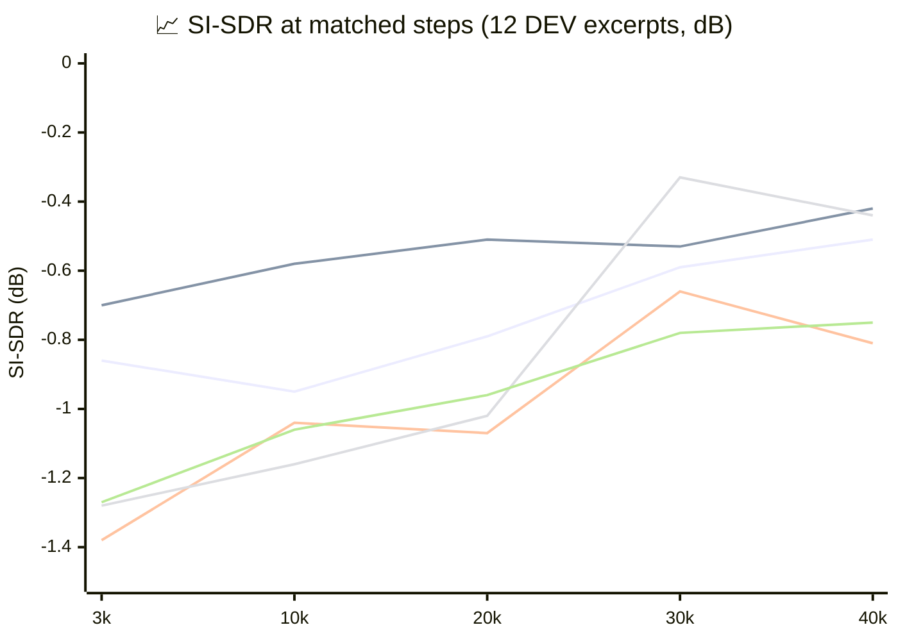
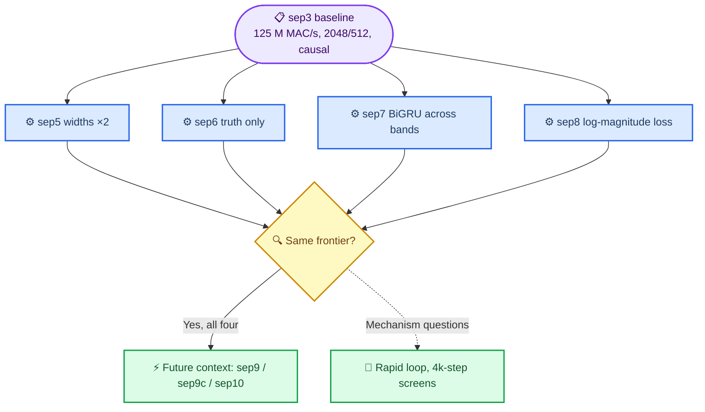
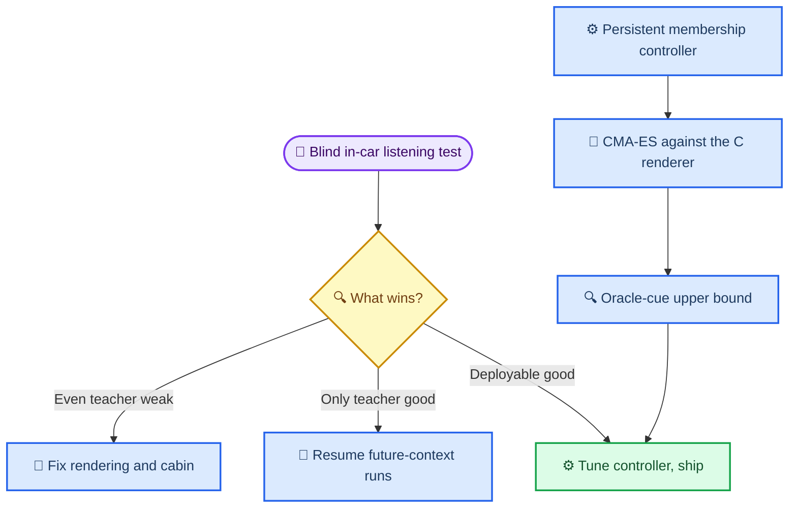

# Upmix Separator Track — Night Report 2026-09-27/28

_Status report of the rear-eligible separator track (branch `feature/upmix-source-separation`): decisions, actions, code changes, results and the running queue, from the sep5 capacity test (27.09 17:00) through the rapid-loop screens to review 16's pause of broad separator training (28.09 05:00)._
_Written for the owner and for whoever picks the track up in the morning. Companion to the running log in [Upmix Source Separation Plan](UPMIX_SOURCE_SEPARATION_PLAN.md)._

---

## 📋 TL;DR

- **Overall:** five controlled 40k-step runs (width, supervision, spectral structure, loss, plus the baseline) all land on **one recall/leak frontier** and give the **same renderer** at the stable gain: voice 0.02–0.04, guitars 0.09–0.12, 4–9 of 39 songs with **guitar** swings. The teacher's audio through the same renderer gives guitars 0.20–0.23 at voice 0.01. The all-stem goal needs the unique-song recount below.
- **Diagnosis:** the students are hedged, treble-less real masks. By source attribution they transmit **29–37 %** of the eligible energy (the ideal mask: 77 %) at the ideal mask's vocal transmission (0.10–0.14 vs 0.105), erase the air above 8 kHz by 14–27 dB, duck the instruments by **28 %** when a voice enters and release them by **47 %** when it leaves. Stable scenes are stable: the "back and forth" is transition-driven.
- **Future-context result:** sep9 (8-frame lookahead) completed at G 1.0 / 1.3 and failed the full renderer gates; its decoder-matched control and the bidirectional twin remain paused.
- **New tool:** a rapid test loop (4k-step full-recipe runs, attribution and transition diagnostics, a frozen 20-song CPU screen, a leaderboard of every stem) answers a mechanism question in ≈25 min instead of 2.7 h.
- **First stability signal:** one bounded sigmoid mask shared by both channels (`sharedmask`, 387k params, 107 M MAC/s) cuts guitar depth-follows-level from +0.12 to +0.02, softens entry ducking (p10 0.39 → 0.58), lifts piano / keys / strings in the rear, and swings once in 20 songs instead of three.
- **Direction change (review 16):** stop broad separator training for 2–3 days. Next: the owner's blind in-car listening test, a persistent rear-membership controller, and direct optimisation of the product against the real renderer.
- **Blocker:** the listening test needs the owner in the car.

---

## 🚦 Health summary

| Area | Status | Trend | Notes |
| --- | --- | --- | --- |
| **Stability goal** ("voice never", no back-and-forth) | 🔴 Not met | → | Historical deployable: voice 0.04 and 2/39 **guitar** swings; all-stem count and blind car verdict are separate gates |
| **Instrument rear-share goal** | 🔴 Not met on budget | → | Every 125–394 M MAC/s student sits at 0.09–0.12 guitar at G 1.0 |
| **Understanding** | 🟢 Good | ↑ | Attribution and transition diagnostics explain the gap; four levers ruled out |
| **Throughput** | 🟢 Improved | ↑ | 2.7 h per controlled run; the rapid loop answers mechanism questions in ≈25 min |
| **Direction** | 🟡 Changing | ↑ | Review 16: separators paused; listening and product-level optimisation next |
| **Infrastructure** | 🟢 Stable | ↑ | Resume, queue integrity and NaN guards fixed before sep8; lease-based GPU sharing |

**Status key:** 🟢 On track · 🟡 At risk · 🔴 Off track / blocked. **Trend key:** ↑ Improving · → Stable · ↓ Declining.

---

## ⚠️ Decisions needed

### Decision 1: the blind in-car listening test (review 16's highest-value experiment)

**Context:** every number in this report is a proxy; nobody has listened. Four conditions on identical excerpts, level-matched, blind and repeated: front-only stereo, Track A's deployable, the shared-mask candidate, and the teacher-fed renderer as the aspirational ceiling. Excerpts with vocal entries and exits, sustained instrumentals, dense choruses, exposed vocals, some outside the DEV set. Four questions: instruments clearly behind? any voice behind? does an instrument move or duck when singing starts? would you use it daily?

| Outcome | What it means |
| --- | --- |
| Even the teacher disappoints | The problem is rendering and cabin presentation, not extraction |
| Teacher delights, every deployable fails | Extraction is the real bottleneck; the future-context runs resume |
| Track A or shared-mask is already good | Ship it and tune the controller instead of training |

**Needed from the owner:** the time in the car. The kit (6-channel renders, shuffled labels, a score sheet) can be prepared on the PC.

### Decision 2: resume the paused separator runs or not

**Context:** review 16 paused `attr`, `sharedmask_log`, sep9c, sep10, sep11 and sep12; sep9 (lookahead) and the shared-mask / anchor pair at 10k finish. The runner files and queue lines are kept (`D:\upmix\runs\rapid\PAUSED.txt`).

| Option | Impact | Recommendation |
| --- | --- | --- |
| Keep paused until the listening test | GPU free for the controller search | Recommended |
| Resume sep9c / sep10 | The future-context verdict in ≈6 h | Only if the listening test says extraction is the bottleneck |

### Decision 3: compute headroom

**Context:** review 14 puts the credible route to 3× throughput at a second GPU or cloud worker plus a measured precision gain. Tonight's throughput is one 16 GB card.

| Option | Impact | Recommendation |
| --- | --- | --- |
| Second worker (cloud or a second card) | ≈2× independent experiments per night | Recommended if the track continues past sep10 |
| Stay on one card | 4 long runs or ≈10 rapid jobs per night | Acceptable for the next 48 h |

---

## 📊 Key metrics

| Metric | sep3 (baseline) | Best other student | Ideal mask | Teacher audio | Target |
| --- | --- | --- | --- | --- | --- |
| SI-SDR, 12 DEV excerpts | −0.24 dB | −0.33 (sep7) | +5.27 dB | — | ≥ +2 dB |
| Eligible transmission | 0.29 | 0.37 (sep5) | 0.77 | — | ≥ 0.45 (promotion) |
| Vocal transmission | 0.124 | 0.104 (sep6) | 0.105 | — | ≤ baseline |
| Renderer guitars, G 1.0 | 0.09 | 0.12 (sep5, sep7) | 0.23 | 0.20–0.23 | ≥ 0.15 (promotion) |
| Renderer voice, G 1.0 | 0.02 | 0.02–0.04 | 0.01 | 0.01 | ≤ 0.02 |
| Guitar songs swinging / 39 (historical) | 5 | 4–9 | 3 | 3–5 | —; goal is **any-stem** ≤ 5 |

_The learning curves of the five long runs at matched steps. Every run converges into the same −0.3…−0.8 dB band; the ideal ratio mask on the same evaluation path is +5.27 dB and the mixture −6.34 dB. Curves cross (sep7 trails until 20k and matches at 30k), which is why early SI-SDR cannot rank runs._



_Series in order: sep3 baseline · sep5 width ×2 · sep6 truth only · sep7 band BiGRU · sep8 log loss._

<details>
<summary><strong>📊 Detailed metrics — the five runs, attribution and transitions</strong></summary>

**Long runs (40k steps, batch 12 × 8 s; renderer on 40 DEV songs × 60 s at G 1.0):**

| Run | One change vs sep3 | Best SI-SDR | Vocal leak (eval) | Voice | Guitars | Keys | Guitar swinging | Level | Error |
| --- | --- | --- | --- | --- | --- | --- | --- | --- | --- |
| sep3 | — (125 M MAC/s) | −0.24 @47k | 0.15–0.17 | 0.02 | 0.09 | 0.10 | 5/39 | −39.5 | 0.15 |
| sep5 | widths ×2 (394 M) | −0.34 @18k | 0.10–0.16 | 0.03 | 0.12 | 0.12 | 5/39 | −38.1 | 0.13 |
| sep6 | MoisesDB truth only | −0.66 @30k | 0.07 | 0.02 | 0.10 | 0.11 | 4/39 | −39.1 | 0.17 |
| sep7 | BiGRU across bands (180 M) | −0.33 @30k | 0.10–0.11 | 0.03 | 0.12 | 0.10 | 6/39 | −38.3 | 0.15 |
| sep8 | log-magnitude loss, scale 0.74 | −0.73 @35k | 0.13–0.15 | 0.04 | 0.11 | 0.11 | 9/39 | −38.7 | 0.14 |

At G 1.3 every run buys +0.04…0.06 of guitars for 10–18 **guitar-swinging** songs and +0.01…0.02 of voice.

_Counting correction (later 28.09):_ the historical column above is **guitar-only**, whereas the goal counts unique songs where **any stem** has a one-second rear-share range above 0.30. Recounting completed CSVs gives sep3 **11/40** and sep8 **16/40** any-stem swinging songs. The rapid board now computes this union directly from `stems.csv`.

The same recount on the full 40-song interface experiment changes the interpretation of the apparent ceiling: oracle eligible **audio** swings in **8/40** songs, ideal bounded real-mask audio in **7/40**, htdemucs teacher audio in **16/40**, and oracle mask × mixture in **14/40**. The previously reported 3/39 oracle and 5/39 teacher values were guitar-only. Clean eligible audio reduces mask-induced movement, yet even perfect source audio remains above the any-stem limit; [the interface test](UPMIX_SOURCE_SEPARATION_PLAN.md) lists the six conditions and sources.

**Source attribution (the frozen mask applied to the true stems, reanalysed audio; 12 DEV excerpts, medians):**

| Checkpoint | Eligible transmitted | Vocal transmitted | Protected transmitted | Air 8–14 kHz | Air > 14 kHz | Body 1–8 kHz |
| --- | --- | --- | --- | --- | --- | --- |
| sep3 best | 0.29 | 0.124 | 0.063 | −13.6 dB | −14.6 dB | −4.1…−4.6 dB |
| sep5 best | 0.37 | 0.199 | 0.085 | −20.1 | −23.1 | −2.8…−3.6 |
| sep6 best | 0.33 | 0.104 | 0.059 | −22.2 | −27.3 | −3.9…−4.7 |
| sep7 best | 0.36 | 0.139 | 0.092 | −14.5 | −17.1 | −2.9…−3.7 |
| sep8 @26k | 0.36 | 0.167 | 0.072 | −8.3 | −10.0 | −2.6…−3.0 |
| Ideal ratio mask | 0.77 | 0.105 | — | — | — | — |

**Transitions (20 DEV songs, true stems; 43 vocal entries, 40 exits, 54 sustained controls; 4 s before / 8 s after; medians):**

| Checkpoint | Entry: eligible after/before | p10 | Vocal 0–2 s peak | Exit: after/before | Sustained: after/before |
| --- | --- | --- | --- | --- | --- |
| sep3 | 0.72 | 0.38 | 0.24 | 1.47 | 1.04 |
| sep5 | 0.77 | 0.37 | 0.29 | 1.26 | 0.99 |
| sep6 | 0.70 | 0.34 | 0.23 | 1.36 | 1.03 |
| sep7 | 0.76 | 0.32 | 0.34 | 1.41 | 1.03 |

Worst ducking (sep3): retention 0.85 → 0.10 at a vocal entry.

</details>

---

## ✅ Accomplishments

### What the night established

_Chronology of the night: each controlled run closes one hypothesis, each Codex review reshapes the next step, and the rapid loop appears once four levers have failed the same way._

```mermaid
timeline
    title 🧪 Separator track, 27.09 17:00 → 28.09 03:00
    section 27.09 evening
        17:00 : 📊 sep5 width ×2 finishes : plateau moves 0.4 dB, not the wall
        18:30 : 🔍 Gap decomposition : recall 0.38 vs 0.89, treble −19 dB, phase worthless
        19:00 : 🧠 Codex 11 : sep8 safeguards, transition eval, gates
        19:30 : 🔍 Transition eval : ducks 13 %, releases 40 %, stable when stable
        21:20 : 📊 sep6 truth-only : identical renderer, supervision not the lever
    section 27.09 night
        23:00 : 📊 sep7 band BiGRU : same plateau, structure not the lever
        23:20 : 🧠 Codex 12 and 13 : lookahead is the untested axis, code review finds resume and calibration bugs
        23:30 : 🔧 Fixes before sep8 : scheduler and best restored, queue integrity, loss scale 0.007 → 0.74
        00:00 : 🔍 Diagnostics v2 : source attribution, ideal mask passes 10.5 % of the vocal
    section 28.09 early
        00:40 : 🧠 Codex 14 and 15 : throughput levers, hybrid design, rapid loop as a mechanism screen
        01:20 : 🚀 Rapid loop live : lease, 4k runs, 20-song screen, leaderboard
        02:30 : 📊 sep8 log loss : air back +5 dB, vocal up too, 9/39 swinging
        02:45 : 📊 Anchors in : seed noise ±0.05 on eligible transmission
        03:35 : 📊 logloss and bandbal at 4k : air back, then more conservative
        04:30 : ⚠️ attr went NaN : 0/0 on silent windows, fixed
        04:30 : ✅ sharedmask at 4k : first stability signal on every stem
        05:00 : 🧠 Codex 16 : stop broad separator training, listen first
```

### Completed this period

- **Capacity ruled out (sep5)** — doubling every width moves the plateau ≈0.4 dB and the renderer by a hair; three times the compute buys nothing usable.
- **Supervision ruled out (sep6)** — training on MoisesDB truth alone reproduces sep3's renderer to the second decimal at half the eval vocal leak; the 774 pseudo-labelled masters bought boldness, not discrimination.
- **Spectral structure ruled out (sep7)** — a bidirectional GRU across all 48 bands at 1.4× the budget lands on the same plateau and the same renderer as the depthwise mixers.
- **Loss shapes the hedge, not the discrimination (sep8)** — the log-magnitude loss restores the air by 5 dB and 7 points of eligible transmission, but the vocal transmission rises with it and the renderer pays in voice and swings.
- **The evaluation path audited** — mixture and identity mask agree exactly; the ideal-mask ceiling on the exact path is +5.27 dB (not the +5.9 measured on a different harness).
- **The gap decomposed with source attribution** — the whole 5.5 dB is under-recovery: the mask transmits 29–37 % of the eligible energy against the ideal mask's 77 %, while leaking the voice no more than the ideal mask does.
- **The "back and forth" measured** — 28 % less instrument energy passes after a voice enters (one event in ten loses more than 60 %), 47 % more after it leaves; sustained scenes are stable.
- **Five Codex consultations (11–15) recorded** in the plan with every finding's fix and status.
- **The rapid loop built and running** — queue daemon with a GPU lease, full-recipe 4k runs with `--save-at` snapshots, GPU diagnostics, a frozen 20-song CPU screen, a leaderboard with context rows (teacher, oracle, ideal mask, sep3).

_How the four levers were tested and where they ended: one change per run against sep3, every result read through the same three lenses, every run landing on the same frontier._



### Code and protocol changes

| Commit | Change | Why |
| --- | --- | --- |
| `3068b47` | `--band-rnn` (BiGRU across the 48 bands); `diag_ceiling.py` | Structure diagnostic; eval-path audit |
| `2ea5526` | `--loss log` (log-magnitude L1 with a relative floor); `diag_gap.py` | Loss diagnostic; gap decomposition |
| `bade92e` | Floor from the mixture per resolution; `diag_transitions.py`, `diag_lossfloor.py` | Review 11 safeguards; transition eval |
| `f588f78` | `--lookahead L` (output delay + frame embedding into the decoder); `--bidir` | Review 12: the untested axis |
| `1198eff` | Resume restores scheduler and best; floors clamped; `--dec-skip`; runners never render an unfinished run; loss scale recalibrated on the parameter gradient (0.74) | Review 13 code review |
| `13c9be2` | Diagnostics v2: frozen mask on the true stems, reanalysed audio, directed crossings, censored settling | Review 13 §6 |
| `2161aba` | `--norm stream` (causal 2-s running level, closed-form EMA); deterministic prefetch seeds; bootstrap CIs | Streaming pair sep11/sep12; reproducibility |
| `6d213e3` | `--save-at` step snapshots | Proxy validation pairs (4k/10k vs 40k) |
| `caf20ef` | `pc/rapid_daemon.ps1`, `pc/rapid_context.ps1`, `rapid_board.py` | The rapid loop |
| `5661ba7` | `--attr` (attribution loss), `--bandbal` (band-balanced L1), `--mask shared_sigmoid`; `diag_auxgrad.py` | Rapid experiments 2, 3, 7 with calibrated weights |
| `1b46009` | `bench_precision.py` | Review 14's first throughput lever, to run when the GPU is free |
| `d1a1a52`, `8820346`, `c9e0bfd` | Board reads UTF-16 logs, reports every stem with depth-follows-level and total swings; daemon runs `--steps N` promotion jobs | Owner: "not only the voice"; 10k promotion |
| `c615e35` | Attribution loss floored against silent windows | NaN fix |
| `78ea330` | Review 16 recorded; queue paused | Change of direction |

Two traps found and fixed on the way: replaying an LR scheduler after loading the optimizer state compounded the warm-up to 10.5× the intended rate; a loss scale calibrated on the output gradient (0.007) would have silenced the new loss entirely, because the mixture factor in `Y = M·X` kills the large output gradients of near-silent cells before they reach the parameters — the parameter-gradient calibration gives 0.74.

---

## 🧪 Rapid-loop results — every stem

The rapid loop trains 4000 steps of the full recipe and reads the model through the same renderer as the long runs, on a frozen 20-song screen at G 1.0. After the owner's remark that the voice is not the only thing that matters, the board reports **all ten stems** and, per stem, how much its rear depth follows its own level — the direct measure of "back and forth".

_Rear share of the instrument families on the 20-song screen: the teacher and the oracle as ceilings, the two anchors as the reference point, and the four 4k-step experiments. Series in order: teacher · oracle · anchor seed 1 · anchor seed 2 · logloss · bandbal · sharedmask._

```mermaid
xychart-beta
    title "🎯 Rear share per stem, 20-song screen, G 1.0"
    x-axis ["guitar", "piano", "keys", "strings", "wind", "bass", "drums", "voice"]
    y-axis "Rear share" 0 --> 0.3
    bar [0.19, 0.13, 0.14, 0.16, 0.22, 0.04, 0.07, 0.01]
    bar [0.25, 0.16, 0.22, 0.20, 0.28, 0.01, 0.06, 0.01]
    line [0.11, 0.06, 0.09, 0.13, 0.16, 0.07, 0.10, 0.04]
    line [0.12, 0.07, 0.10, 0.13, 0.19, 0.09, 0.09, 0.04]
    line [0.10, 0.05, 0.09, 0.11, 0.17, 0.07, 0.10, 0.04]
    line [0.08, 0.05, 0.09, 0.12, 0.14, 0.04, 0.08, 0.03]
    line [0.11, 0.09, 0.11, 0.16, 0.17, 0.10, 0.08, 0.04]
```



| Row | Guitar | Piano | Keys | Strings | Wind | Bass ↓ | Drums ↓ | Voice ↓ | Swings (all stems) |
| --- | --- | --- | --- | --- | --- | --- | --- | --- | --- |
| Teacher audio | 0.19 | 0.13 | 0.14 | 0.16 | 0.22 | 0.04 | 0.07 | 0.01 | 6 |
| Oracle stems | 0.25 | 0.16 | 0.22 | 0.20 | 0.28 | 0.01 | 0.06 | 0.01 | 4 |
| sep3 best (40k) | 0.09 | 0.05 | 0.08 | 0.05 | 0.10 | 0.07 | 0.08 | 0.02 | 4 |
| anchor seed 1 | 0.11 | 0.06 | 0.09 | 0.13 | 0.16 | 0.07 | 0.10 | 0.04 | 3 |
| anchor seed 2 | 0.12 | 0.07 | 0.10 | 0.13 | 0.19 | 0.09 | 0.09 | 0.04 | 2 |
| logloss | 0.10 | 0.05 | 0.09 | 0.11 | 0.17 | 0.07 | 0.10 | 0.04 | — |
| bandbal | 0.08 | 0.05 | 0.09 | 0.12 | 0.14 | 0.04 | 0.08 | 0.03 | — |
| **sharedmask** | 0.11 | **0.09** | **0.11** | **0.16** | 0.17 | 0.10 | 0.08 | 0.04 | **1** |

| Mechanism metric | anchor s1 / s2 | logloss | bandbal | sharedmask |
| --- | --- | --- | --- | --- |
| Eligible / vocal transmission | 0.42–0.47 / 0.20–0.24 | 0.35 / 0.160 | 0.34 / 0.116 | 0.48 / 0.171 |
| Air 8–14 kHz | −23.0 / −23.7 dB | **−16.2 dB** | −23.2 dB | −28.8 dB |
| Entry ducking median / p10 | 0.76 / 0.39 · 0.75 / 0.43 | 0.68 / 0.39 | 0.78 / 0.39 | **0.83 / 0.58** |
| Depth follows level: guitar / keys / wind | +0.12 / −0.03 / −0.23 · +0.11 / −0.05 / −0.10 | — | — | **+0.02 / 0.00 / +0.03** |

What each experiment says:

- **logloss** — the air comes back at 4k exactly as sep8 showed at 40k (the first 4k ↔ 40k agreement of the proxy), but the mask turns more conservative everywhere else.
- **bandbal** — the band-balanced L1 does not restore the treble; weak-band gradients do not explain the erasure. The mask only becomes more cautious (vocal 0.116, guitar 0.08).
- **sharedmask** — the first mechanism response in the stability direction: depth no longer follows level for guitar, keys and wind, entry ducking is 15 points softer at p10, piano / keys / strings rise to or near the teacher, one swing in 20 songs. Costs: bass 0.10, quieter air (−29 dB), SI-SDR −1.46. Being promoted as a pair against the anchor at 10k.
- **attr** — the first run diverged to NaN at step 1000 (a window with silent vocal and silent eligible stems gave 0 / 0); fixed with an absolute floor and paused by review 16.

_Paired 4k check (later 28.09):_ [`compare_rapid_pair.py`](../../tools/stereo-upmix-render/compare_rapid_pair.py) joined the same 20 songs in `anchor_s1` and `sharedmask` and bootstrapped **songs**, not stem rows. Any-stem swings fell 3 → 1 (two resolved, none new), but guitar median rear share moved only 0.107 → 0.111; the paired median change was +0.007 with a 90% bootstrap interval −0.005 to +0.018. Piano and strings each had only 8 and 5 finite paired songs. This supports a stability mechanism signal, not a confident instrument-delivery promotion; the matched 10k pair is still needed.

_10k update (07:23 on 28.09):_ `sharedmask_10k` finished training and its 20 × 60 s real-C screen. Against the **same model family at 4k**, any-stem swing songs rose **1 → 5/20** (four new, none resolved). Median rear share: voice 0.039 → 0.041, guitar 0.111 → 0.131, piano 0.087 → 0.077, keys 0.114 → 0.111, strings 0.158 → 0.124, bass 0.097 → 0.096, drums 0.078 → 0.092. The 10k transition diagnostic gives entry-retention median 0.845, p10 **0.431** (4k p10 0.58; goal ≥ 0.60). Eligible transmission is 0.44 but vocal transmission 0.247; rear RMS −36.8 dBFS. The guitar gain does not compensate for worsened movement, ducking and protected stems; **do not extend `sharedmask_10k` to 40k**. `anchor_10k` was training when this was recorded, so the matched 10k comparison remains pending. Paired raw result: `D:\upmix\runs\rapid\sharedmask_4k_vs_10k.json`.

_Matched 10k decision (08:00 on 28.09):_ `anchor_10k` completed its own 20-song C render and transition diagnostic. The two 10k screens contain the same 20 songs. Relative to the anchor, shared-mask rear medians are guitar **0.119 → 0.131** (paired median +0.014, song-bootstrap 90% CI +0.009 to +0.020), keys 0.108 → 0.111 (+0.008, CI +0.004 to +0.012), strings 0.112 → 0.124 (+0.015 on only five songs), voice **0.041 → 0.041**, bass **0.080 → 0.096** (+0.018), drums 0.092 → 0.092, and any-stem swing songs **3 → 5/20** (two new, none resolved). Entry-retention p10 improves only 0.400 → 0.431, both below 0.60. Rear RMS differs by 0.1 dB (−36.9 vs −36.8). The small instrument gains therefore buy more bass leakage and movement, with voice/drums still far above their limits. **Reject the 10k shared-mask promotion; neither 10k model is a candidate.** Raw paired result: `D:\upmix\runs\rapid\anchor10k_vs_sharedmask10k.json`. This closes the queued separator promotion pair.

---

## 🔄 In progress

_The rapid loop's lifecycle for one queued job: it owns the GPU only while jobs are queued, runs the diagnostics on the GPU, releases the GPU before the CPU screen, and rebuilds the leaderboard; the long runners wait on the lease._

```mermaid
stateDiagram-v2
    accTitle: Rapid Loop Job Lifecycle
    accDescr: A queued job takes the GPU lease, waits for the GPU to be free, trains 4000 steps with the full recipe, runs the attribution and transition diagnostics on the GPU, releases the lease when nothing else is queued, runs the frozen 20-song screen on the CPU and rebuilds the leaderboard; a job without a checkpoint is recorded as failed.

    [*] --> Queued: 📝 Line in QUEUE.txt
    Queued --> Leased: 🔒 GPU_LEASE written
    Leased --> Training: ⚙️ No training or harness python running
    Training --> Diagnostics: ✅ step4000.pt saved
    Training --> Failed: ❌ No checkpoint
    Diagnostics --> Screening: 📤 Lease released if queue empty
    Screening --> Boarded: 📊 LEADERBOARD.md rebuilt
    Boarded --> [*]: 🏁 Line removed from the queue
    Failed --> [*]: 📝 Recorded in job.txt
    note right of Screening
        CPU only: CUDA_VISIBLE_DEVICES=-1
        20 DEV songs at G 1.0, ~9 min
    end note
```



| Work item | Started | Expected | Status |
| --- | --- | --- | --- |
| sep9 — lookahead 8 frames (85 ms), decoder skip | 04:15 | ≈07:00 | Completed 06:44; full G 1.0 / 1.3 C results below; not promoted |
| sharedmask_10k / anchor_10k — the promotion pair | after sep9 | ≈09:00 | Rapid loop resumed 06:44; sharedmask_10k started |
| sep9c, sep10, sep11, sep12, `attr`, `sharedmask_log` | — | — | ⏸️ Paused by review 16 |
| Track A (int8 port, car deployment) | separate branch | — | Shares the working tree; its uncommitted files are left alone |

**sep9 final, 40 DEV songs × 60 s through the real C renderer.** Training completed at 40k; the best checkpoint was step 29k (SI-SDR −0.63 dB). Both G runs completed with no FAILED marker. These are unique songs where any stem swings, computed from `stems.csv`, rather than the per-guitar count printed in the harness summary.

| sep9 gain | Voice ↓ | Guitar | Piano | Keys | Strings | Bass ↓ | Drums ↓ | Any-stem swings | Rear RMS |
| --- | ---: | ---: | ---: | ---: | ---: | ---: | ---: | ---: | ---: |
| G 1.0 | 0.031 | 0.102 | 0.080 | 0.106 | 0.081 | 0.065 | 0.092 | 11/40 | −38.6 dBFS |
| G 1.3 | 0.044 | 0.161 | 0.125 | 0.157 | 0.117 | 0.102 | 0.107 | 23/40 | −36.8 dBFS |

G 1.3 recovers guitar, piano, and keys but misses strings and all three protected-stem limits; 12 additional songs begin swinging and none of the original 11 stop. **Do not promote or extend sep9.** Its 8-frame future context is also not yet a strict causal implementation because whole-window normalisation sees future audio; a device latency/profile gate would still be required if its audio metrics had passed. Paired CSV comparisons against sep3 and sep8 are reproducible with [`compare_rapid_pair.py`](../../tools/stereo-upmix-render/compare_rapid_pair.py) and `D:\upmix\runs\sep9\dsp_g1.0\stems.csv` / `dsp_g1.3\stems.csv`.

**The rapid board so far** (20-song CPU screen at G 1.0; attribution on the 12 DEV excerpts at 4k steps):

| Row | SI-SDR@4k | Eligible tx | Vocal tx | Air 8–14 kHz | Entry duck med / p10 | Voice | Guitars | Keys | Any-stem swing/20 |
| --- | --- | --- | --- | --- | --- | --- | --- | --- | --- |
| ctx_teacher | — | — | — | — | — | 0.01 | 0.19 | 0.14 | 6 |
| ctx_oracle | — | — | — | — | — | 0.01 | 0.25 | 0.22 | 4 |
| ctx_irm | — | — | — | — | — | 0.01 | 0.24 | 0.20 | 3 |
| ctx_sep3best | — | — | — | — | — | 0.02 | 0.09 | 0.08 | 4 |
| anchor_s1 | −1.14 | 0.42 | 0.197 | −23.0 | 0.76 / 0.39 | 0.04 | 0.11 | 0.09 | 3 |
| anchor_s2 (seed 2) | −1.05 | 0.47 | 0.236 | −23.7 | 0.75 / 0.43 | 0.04 | 0.12 | 0.10 | 2 |

The two anchors set the noise floor of the proxy: ±0.05 on eligible transmission, ±0.04 on vocal transmission, ±0.01 on the renderer shares. Review 15's promotion triggers (+0.03 eligible at ≤ +0.01 vocal; ducking 10 points closer to unity; guitars +0.02) must be read against it — a single-seed delta inside that band means nothing. A 4k model is bolder than its 40k self (0.42–0.47 eligible against 0.29 for sep3 at 40k, at twice the vocal transmission): training makes the mask more conservative on both axes.

---

## 🚨 Risks and issues

| Risk | Likelihood | Impact | Mitigation |
| --- | --- | --- | --- |
| The 4k proxy does not predict 40k | 🟡 Medium | 🔴 High | Every long run now saves 4k/10k snapshots; the proxy is trusted per decision type only after 8–12 interventions agree ≈80 % on renderer metrics (review 15) |
| Future context does not help either | 🟡 Medium | 🔴 High | sep10 is the upper bound; if it stays on the frontier the track closes with review 12's closing statement |
| Two CUDA tenants crash (native c10.dll) | 🟢 Low | 🟡 Medium | Lease-based exclusive GPU ownership; the CPU screen never initialises CUDA; resume is now correct so a crash costs ≈15 min |
| WinBtrfs stalls a long job | 🟡 Medium | 🟡 Medium | Watchdog + resume in every runner; caches could move to NTFS SSD if stalls recur |
| Overfitting the 12 DEV excerpts and the 20-song screen | 🟡 Medium | 🟡 Medium | The other 20 DEV songs are reserved for promotion checks; the full 40 × 2 harness for finalists only |
| 150 M MAC/s does not prove Cortex-A9 feasibility | 🟡 Medium | 🟡 Medium | Track A measures the int8 port on the unit; a chosen student is only "deployable" after that |

<details>
<summary><strong>📋 Resolved issues</strong></summary>

| Issue | Resolution | When |
| --- | --- | --- |
| Resume reset `best` and multiplied the LR by 10.5× during warm-up | Scheduler state and best saved in `last.pt`, restored on `--init` | 27.09 23:25 |
| Runners could render and mark DONE after 60 failed tries | FAILED marker, no render without `train_done.txt` + checkpoint | 27.09 23:25 |
| Log loss produced NaN on silent windows | Floors clamped at 1e-7 | 27.09 23:25 |
| Loss scale 0.007 would have trained on the complex term alone | Parameter-gradient calibration → 0.74 | 27.09 23:26 |
| `$env:CUDA_VISIBLE_DEVICES=''` deletes the variable in PowerShell | Use `'-1'` to force CPU | 27.09 18:40 |
| Leaderboard read PowerShell's UTF-16 logs as UTF-8 | BOM-aware decoding | 28.09 02:55 |
| Attribution loss diverged to NaN (0 / 0 on silent windows) | Absolute floor on the denominators; the broken run kept as `attr_nan_bug` | 28.09 04:40 |
| The rapid daemon could only run 4000 steps | `--steps N` in a job line; snapshot and diagnostics at N | 28.09 04:50 |
| Cell-weighted recall/leak counted interference as leakage | v2 diagnostics attribute by applying the frozen mask to the true stems | 28.09 00:00 |

</details>

---

## 📍 Plan for next period

_Review 16's order for the next three days: listening first, then a persistent-membership controller tuned directly against the real renderer, then an oracle-cue upper bound; separator training resumes only if a specific missing capability is identified._



### Priorities

_Playback correction after this review: the car receives ordinary stereo over live CarPlay and the head-unit hook performs the upmix. Only front-only and Track A are currently playable in that chain. The shared-mask student requires a Track A-owned hook port; the non-causal teacher cannot run there. Rear-only headphone previews can screen the student and teacher but cannot count as an in-car result. See the [CarPlay listening protocol](UPMIX_CARPLAY_LISTENING_PROTOCOL.md)._

1. **Blind in-car listening test** — front-only versus Track A through live CarPlay, level-matched, shuffled, repeated; use the shared-mask and teacher only for the separate rear-only headphone preview until a student is ported into the hook.
2. **Persistent rear membership in Track A's controller** — slow membership with hysteresis and minimum dwell, separated from fast protection; log membership changes and eligible-audio loss separately.
3. **Optimise the product directly** — 10–30 controller parameters by bounded search / CMA-ES against the real C renderer, as constrained optimisation (voice, bass, drums, stability as constraints; instrument delivery across families maximised; a minimum useful rear level so silence cannot win); validate on untouched songs.
4. **Oracle-cue upper bound** — ground-truth vocal, drum and bass cues driving the same controller; small causal cue estimators only if the oracle succeeds.
5. **Half a day of head-unit profiling** — deadline misses, memory traffic, thermals, latency, before assuming more than 150 M MAC/s.
6. **Finish the cheap leftovers** — sep9 (lookahead) and the sharedmask / anchor 10k pair; read them, do not extend them.

### Key dates

| Time (28.09) | Event |
| --- | --- |
| ≈07:00 | sep9 (lookahead) rendered |
| ≈09:00 | sharedmask vs anchor at 10k on the board |
| Owner's choice | Blind listening test in the car |

---

## 🔗 References

- [Upmix Source Separation Plan](UPMIX_SOURCE_SEPARATION_PLAN.md) — the running log with every review (1–15), run row and diagnostic
- [Upmix Mask Net Phase 1 Report 2026-09-27](UPMIX_MASK_PHASE1_REPORT_2026-09-27.md) — Track A: the deployable mask net in the car
- [Upmix Stability 2026-09-25](UPMIX_STABILITY_2026-09-25.md) — the original "back and forth" measurement and causes
- [Upmix Datasets and Teachers](UPMIX_DATASETS_AND_TEACHERS.md) — MoisesDB, the caches, htdemucs and BS-RoFormer as teachers
- Student and tools: `tools/stereo-upmix-render/sep_net.py`, `diag_gap.py`, `diag_transitions.py`, `diag_lossfloor.py`, `diag_auxgrad.py`, `rapid_board.py`, `pc/rapid_daemon.ps1`, `pc/rapid_context.ps1`, `bench_precision.py`

The student and its diagnostics are PyTorch[^1]; the truth stems are MoisesDB[^2]; the pseudo-labels come from htdemucs[^3] and the second teacher is BS-RoFormer[^4]; the band model follows the band-split idea of BSRNN[^5].

[^1]: PyTorch. (2026). "PyTorch documentation." https://pytorch.org/docs/stable/
[^2]: Pereira, I., Araújo, F., Korzeniowski, F., Vogl, R. (2023). "MoisesDB: A dataset for source separation beyond 4-stems." _ISMIR 2023_. https://github.com/moises-ai/moises-db
[^3]: Rouard, S., Massa, F., Défossez, A. (2023). "Hybrid Transformers for Music Source Separation." _ICASSP 2023_. https://github.com/facebookresearch/demucs
[^4]: Lu, W.-T., Wang, J.-C., Kong, Q., Hung, Y.-N. (2024). "Music Source Separation with Band-Split RoPE Transformer." _ICASSP 2024_. https://arxiv.org/abs/2309.02612
[^5]: Luo, Y., Yu, J. (2023). "Music Source Separation with Band-Split RNN." _IEEE/ACM TASLP_. https://arxiv.org/abs/2209.15174

---

_Next report: after the listening test or when the 10k promotion pair lands._
