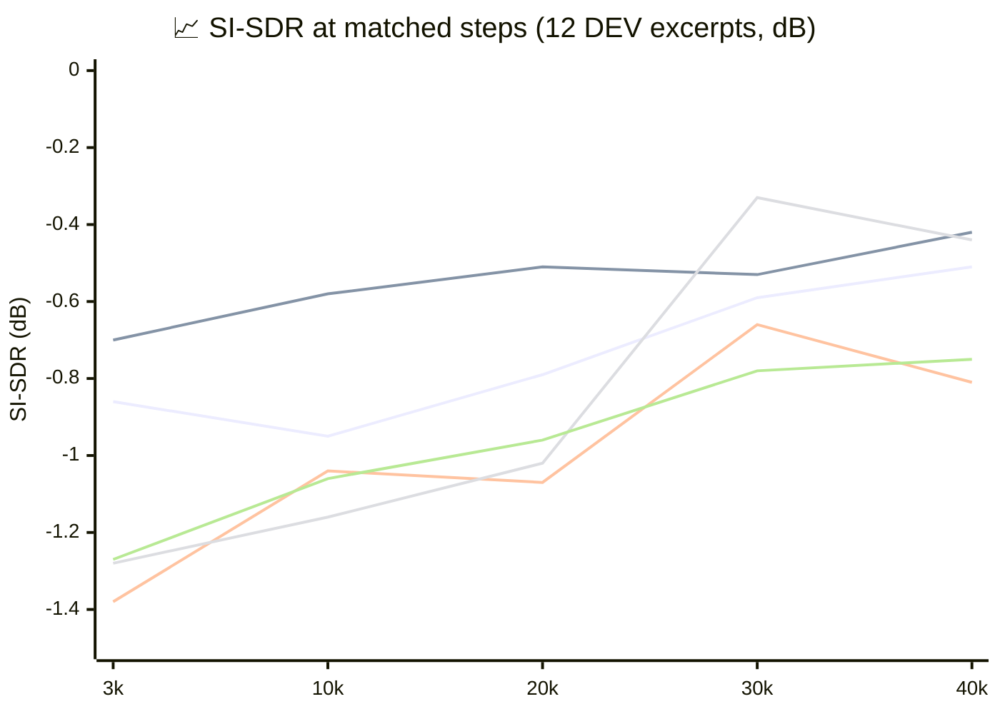

# Upmix Separator Track — Night Report 2026-09-27/28

_Status report of the rear-eligible separator track (branch `feature/upmix-source-separation`): decisions, actions, code changes, results and the running queue, from the sep5 capacity test (27.09 17:00) to the first rapid-loop anchors (28.09 03:00)._
_Written for the owner and for whoever picks the track up in the morning. Companion to the running log in [Upmix Source Separation Plan](UPMIX_SOURCE_SEPARATION_PLAN.md)._

---

## 📋 TL;DR

- **Overall:** five controlled 40k-step runs (width, supervision, spectral structure, loss, plus the baseline) all land on **one recall/leak frontier** and give the **same renderer** at the stable gain: voice 0.02–0.04, guitars 0.09–0.12, 4–9 of 39 songs swinging. The teacher's audio through the same renderer gives guitars 0.20–0.23 at voice 0.01.
- **Diagnosis:** the students are hedged, treble-less real masks. By source attribution they transmit **29–37 %** of the eligible energy (the ideal mask: 77 %) at the ideal mask's vocal transmission (0.10–0.14 vs 0.105), erase the air above 8 kHz by 14–27 dB, duck the instruments by **28 %** when a voice enters and release them by **47 %** when it leaves. Stable scenes are stable: the "back and forth" is transition-driven.
- **Untested axis:** future context. sep9 (85-ms lookahead), sep9c (its decoder-matched control) and sep10 (the bidirectional twin) are queued and start when the rapid loop releases the GPU.
- **New tool:** a rapid test loop (4k-step full-recipe runs, attribution and transition diagnostics, a frozen 20-song CPU screen, a leaderboard) is live on the PC. Two anchors are in; four mechanism experiments follow by ≈04:50.
- **Blocker:** none technical. Two decisions are open below: the GPU priority order and a listening test of the deployable candidate.

---

## 🚦 Health summary

| Area | Status | Trend | Notes |
| --- | --- | --- | --- |
| **Stability goal** ("voice never", no back-and-forth) | 🟢 Met by the deployable candidate | → | Mask-drive + v13 + soft veto: voice 0.04, 2/39 swinging, rear error 0.15 |
| **Rear-share goal** (guitars/keys 0.20+) | 🔴 Not met on budget | → | Every 125–394 M MAC/s student sits at 0.09–0.12 |
| **Understanding** | 🟢 Good | ↑ | Attribution and transition diagnostics explain the gap; four levers ruled out |
| **Throughput** | 🟡 At risk | ↑ | 2.7 h per controlled run; the rapid loop cuts mechanism questions to ≈25 min |
| **Infrastructure** | 🟢 Stable | ↑ | Resume, queue integrity and NaN guards fixed before sep8; lease-based GPU sharing |

**Status key:** 🟢 On track · 🟡 At risk · 🔴 Off track / blocked. **Trend key:** ↑ Improving · → Stable · ↓ Declining.

---

## ⚠️ Decisions needed

### Decision 1: keep the rapid loop ahead of the long queue?

**Context:** the rapid daemon holds `GPU_LEASE` while its queue is non-empty, so sep9 / sep9c / sep10 (the future-context tests, ≈2.7 h each) wait behind every rapid job. Both orders are defensible: the long runs answer the last untested axis; the rapid loop answers target/loss/conditioning questions four times faster.

| Option | Impact | Recommendation |
| --- | --- | --- |
| Rapid first (current) | Anchors and four experiments by ≈04:50, then sep9 by ≈07:40, sep10 by ≈13:10 | Recommended for tonight |
| Long queue first | Empty `QUEUE.txt`; sep9 starts within 5 min; rapid resumes after sep10 | Take if lookahead matters more than mechanism screens |

**Deadline:** none. Change it any time by editing `D:\upmix\runs\rapid\QUEUE.txt`.

### Decision 2: listen to the deployable candidate in the car

**Context:** every number above is a proxy. Nobody has listened to a 0.10–0.12 rear share with 2/39 swinging. If "audibly behind" already starts at 0.12, the product goal is closer than the metric suggests and a static air bed becomes a perceptual experiment worth running (review 12, §3). This is Track A's deployment path, not this branch's.

| Option | Impact | Recommendation |
| --- | --- | --- |
| Listen this week | Settles whether 0.10–0.12 is perceptually enough | Recommended |
| Wait for a 0.20 student | Unknown horizon; may never come on this budget | Not recommended |

### Decision 3: compute headroom

**Context:** review 14 puts the credible route to 3× throughput at a second GPU or cloud worker plus a measured precision gain. Tonight's throughput is one 16 GB card.

| Option | Impact | Recommendation |
| --- | --- | --- |
| Second worker (cloud or a second card) | ≈2× independent experiments per night | Recommended if the track continues past sep10 |
| Stay on one card | 4 long runs or ≈10 rapid jobs per night | Acceptable for the next 48 h |

---

## 📊 Key metrics

| Metric | sep3 (baseline) | Best other student | Ideal mask | Teacher audio | Target |
| --- | --- | --- | --- | --- | --- |
| SI-SDR, 12 DEV excerpts | −0.24 dB | −0.33 (sep7) | +5.27 dB | — | ≥ +2 dB |
| Eligible transmission | 0.29 | 0.37 (sep5) | 0.77 | — | ≥ 0.45 (promotion) |
| Vocal transmission | 0.124 | 0.104 (sep6) | 0.105 | — | ≤ baseline |
| Renderer guitars, G 1.0 | 0.09 | 0.12 (sep5, sep7) | 0.23 | 0.20–0.23 | ≥ 0.15 (promotion) |
| Renderer voice, G 1.0 | 0.02 | 0.02–0.04 | 0.01 | 0.01 | ≤ 0.02 |
| Songs swinging / 39 | 5 | 4–9 | 3 | 3–5 | ≤ 5 |

_The learning curves of the five long runs at matched steps. Every run converges into the same −0.3…−0.8 dB band; the ideal ratio mask on the same evaluation path is +5.27 dB and the mixture −6.34 dB. Curves cross (sep7 trails until 20k and matches at 30k), which is why early SI-SDR cannot rank runs._



_Series in order: sep3 baseline · sep5 width ×2 · sep6 truth only · sep7 band BiGRU · sep8 log loss._

<details>
<summary><strong>📊 Detailed metrics — the five runs, attribution and transitions</strong></summary>

**Long runs (40k steps, batch 12 × 8 s; renderer on 40 DEV songs × 60 s at G 1.0):**

| Run | One change vs sep3 | Best SI-SDR | Vocal leak (eval) | Voice | Guitars | Keys | Swinging | Level | Error |
| --- | --- | --- | --- | --- | --- | --- | --- | --- | --- |
| sep3 | — (125 M MAC/s) | −0.24 @47k | 0.15–0.17 | 0.02 | 0.09 | 0.10 | 5/39 | −39.5 | 0.15 |
| sep5 | widths ×2 (394 M) | −0.34 @18k | 0.10–0.16 | 0.03 | 0.12 | 0.12 | 5/39 | −38.1 | 0.13 |
| sep6 | MoisesDB truth only | −0.66 @30k | 0.07 | 0.02 | 0.10 | 0.11 | 4/39 | −39.1 | 0.17 |
| sep7 | BiGRU across bands (180 M) | −0.33 @30k | 0.10–0.11 | 0.03 | 0.12 | 0.10 | 6/39 | −38.3 | 0.15 |
| sep8 | log-magnitude loss, scale 0.74 | −0.73 @35k | 0.13–0.15 | 0.04 | 0.11 | 0.11 | 9/39 | −38.7 | 0.14 |

At G 1.3 every run buys +0.04…0.06 of guitars for 10–18 swinging songs and +0.01…0.02 of voice.

**Source attribution (the frozen mask applied to the true stems, reanalysed audio; 12 DEV excerpts, medians):**

| Checkpoint | Eligible transmitted | Vocal transmitted | Protected transmitted | Air 8–14 kHz | Air > 14 kHz | Body 1–8 kHz |
| --- | --- | --- | --- | --- | --- | --- |
| sep3 best | 0.29 | 0.124 | 0.063 | −13.6 dB | −14.6 dB | −4.1…−4.6 dB |
| sep5 best | 0.37 | 0.199 | 0.085 | −20.1 | −23.1 | −2.8…−3.6 |
| sep6 best | 0.33 | 0.104 | 0.059 | −22.2 | −27.3 | −3.9…−4.7 |
| sep7 best | 0.36 | 0.139 | 0.092 | −14.5 | −17.1 | −2.9…−3.7 |
| sep8 @26k | 0.36 | 0.167 | 0.072 | −8.3 | −10.0 | −2.6…−3.0 |
| Ideal ratio mask | 0.77 | 0.105 | — | — | — | — |

**Transitions (20 DEV songs, true stems; 43 vocal entries, 40 exits, 54 sustained controls; 4 s before / 8 s after; medians):**

| Checkpoint | Entry: eligible after/before | p10 | Vocal 0–2 s peak | Exit: after/before | Sustained: after/before |
| --- | --- | --- | --- | --- | --- |
| sep3 | 0.72 | 0.38 | 0.24 | 1.47 | 1.04 |
| sep5 | 0.77 | 0.37 | 0.29 | 1.26 | 0.99 |
| sep6 | 0.70 | 0.34 | 0.23 | 1.36 | 1.03 |
| sep7 | 0.76 | 0.32 | 0.34 | 1.41 | 1.03 |

Worst ducking (sep3): retention 0.85 → 0.10 at a vocal entry.

</details>

---

## ✅ Accomplishments

### What the night established

_Chronology of the night: each controlled run closes one hypothesis, each Codex review reshapes the next step, and the rapid loop appears once four levers have failed the same way._

```mermaid
timeline
    title 🧪 Separator track, 27.09 17:00 → 28.09 03:00
    section 27.09 evening
        17:00 : 📊 sep5 width ×2 finishes : plateau moves 0.4 dB, not the wall
        18:30 : 🔍 Gap decomposition : recall 0.38 vs 0.89, treble −19 dB, phase worthless
        19:00 : 🧠 Codex 11 : sep8 safeguards, transition eval, gates
        19:30 : 🔍 Transition eval : ducks 13 %, releases 40 %, stable when stable
        21:20 : 📊 sep6 truth-only : identical renderer, supervision not the lever
    section 27.09 night
        23:00 : 📊 sep7 band BiGRU : same plateau, structure not the lever
        23:20 : 🧠 Codex 12 and 13 : lookahead is the untested axis, code review finds resume and calibration bugs
        23:30 : 🔧 Fixes before sep8 : scheduler and best restored, queue integrity, loss scale 0.007 → 0.74
        00:00 : 🔍 Diagnostics v2 : source attribution, ideal mask passes 10.5 % of the vocal
    section 28.09 early
        00:40 : 🧠 Codex 14 and 15 : throughput levers, hybrid design, rapid loop as a mechanism screen
        01:20 : 🚀 Rapid loop live : lease, 4k runs, 20-song screen, leaderboard
        02:30 : 📊 sep8 log loss : air back +5 dB, vocal up too, 9/39 swinging
        02:45 : 📊 Anchors in : seed noise ±0.05 on eligible transmission
```

### Completed this period

- **Capacity ruled out (sep5)** — doubling every width moves the plateau ≈0.4 dB and the renderer by a hair; three times the compute buys nothing usable.
- **Supervision ruled out (sep6)** — training on MoisesDB truth alone reproduces sep3's renderer to the second decimal at half the eval vocal leak; the 774 pseudo-labelled masters bought boldness, not discrimination.
- **Spectral structure ruled out (sep7)** — a bidirectional GRU across all 48 bands at 1.4× the budget lands on the same plateau and the same renderer as the depthwise mixers.
- **Loss shapes the hedge, not the discrimination (sep8)** — the log-magnitude loss restores the air by 5 dB and 7 points of eligible transmission, but the vocal transmission rises with it and the renderer pays in voice and swings.
- **The evaluation path audited** — mixture and identity mask agree exactly; the ideal-mask ceiling on the exact path is +5.27 dB (not the +5.9 measured on a different harness).
- **The gap decomposed with source attribution** — the whole 5.5 dB is under-recovery: the mask transmits 29–37 % of the eligible energy against the ideal mask's 77 %, while leaking the voice no more than the ideal mask does.
- **The "back and forth" measured** — 28 % less instrument energy passes after a voice enters (one event in ten loses more than 60 %), 47 % more after it leaves; sustained scenes are stable.
- **Five Codex consultations (11–15) recorded** in the plan with every finding's fix and status.
- **The rapid loop built and running** — queue daemon with a GPU lease, full-recipe 4k runs with `--save-at` snapshots, GPU diagnostics, a frozen 20-song CPU screen, a leaderboard with context rows (teacher, oracle, ideal mask, sep3).

_How the four levers were tested and where they ended: one change per run against sep3, every result read through the same three lenses, every run landing on the same frontier._


### Code and protocol changes

| Commit | Change | Why |
| --- | --- | --- |
| `3068b47` | `--band-rnn` (BiGRU across the 48 bands); `diag_ceiling.py` | Structure diagnostic; eval-path audit |
| `2ea5526` | `--loss log` (log-magnitude L1 with a relative floor); `diag_gap.py` | Loss diagnostic; gap decomposition |
| `bade92e` | Floor from the mixture per resolution; `diag_transitions.py`, `diag_lossfloor.py` | Review 11 safeguards; transition eval |
| `f588f78` | `--lookahead L` (output delay + frame embedding into the decoder); `--bidir` | Review 12: the untested axis |
| `1198eff` | Resume restores scheduler and best; floors clamped; `--dec-skip`; runners never render an unfinished run; loss scale recalibrated on the parameter gradient (0.74) | Review 13 code review |
| `13c9be2` | Diagnostics v2: frozen mask on the true stems, reanalysed audio, directed crossings, censored settling | Review 13 §6 |
| `2161aba` | `--norm stream` (causal 2-s running level, closed-form EMA); deterministic prefetch seeds; bootstrap CIs | Streaming pair sep11/sep12; reproducibility |
| `6d213e3` | `--save-at` step snapshots | Proxy validation pairs (4k/10k vs 40k) |
| `caf20ef` | `pc/rapid_daemon.ps1`, `pc/rapid_context.ps1`, `rapid_board.py` | The rapid loop |
| `5661ba7` | `--attr` (attribution loss), `--bandbal` (band-balanced L1), `--mask shared_sigmoid`; `diag_auxgrad.py` | Rapid experiments 2, 3, 7 with calibrated weights |
| `1b46009` | `bench_precision.py` | Review 14's first throughput lever, to run when the GPU is free |

Two traps found and fixed on the way: replaying an LR scheduler after loading the optimizer state compounded the warm-up to 10.5× the intended rate; a loss scale calibrated on the output gradient (0.007) would have silenced the new loss entirely, because the mixture factor in `Y = M·X` kills the large output gradients of near-silent cells before they reach the parameters — the parameter-gradient calibration gives 0.74.

---

## 🔄 In progress

_The rapid loop's lifecycle for one queued job: it owns the GPU only while jobs are queued, runs the diagnostics on the GPU, releases the GPU before the CPU screen, and rebuilds the leaderboard; the long runners wait on the lease._

```mermaid
stateDiagram-v2
    accTitle: Rapid Loop Job Lifecycle
    accDescr: A queued job takes the GPU lease, waits for the GPU to be free, trains 4000 steps with the full recipe, runs the attribution and transition diagnostics on the GPU, releases the lease when nothing else is queued, runs the frozen 20-song screen on the CPU and rebuilds the leaderboard; a job without a checkpoint is recorded as failed.

    [*] --> Queued: 📝 Line in QUEUE.txt
    Queued --> Leased: 🔒 GPU_LEASE written
    Leased --> Training: ⚙️ No training or harness python running
    Training --> Diagnostics: ✅ step4000.pt saved
    Training --> Failed: ❌ No checkpoint
    Diagnostics --> Screening: 📤 Lease released if queue empty
    Screening --> Boarded: 📊 LEADERBOARD.md rebuilt
    Boarded --> [*]: 🏁 Line removed from the queue
    Failed --> [*]: 📝 Recorded in job.txt
    note right of Screening
        CPU only: CUDA_VISIBLE_DEVICES=-1
        20 DEV songs at G 1.0, ~9 min
    end note
```



| Work item | Started | Expected | Status |
| --- | --- | --- | --- |
| Rapid queue: `logloss`, `bandbal`, `attr`, `sharedmask` | 03:08 | ≈04:50 | On track |
| sep9 — lookahead 8 frames (85 ms), decoder skip | after the rapid queue | ≈07:40 | Waiting on the lease |
| sep9c — the L = 0 control with the same decoder input | after sep9 | ≈10:25 | Queued |
| sep10 — bidirectional-in-time twin (non-causal, diagnostic) | after sep9c | ≈13:10 | Queued |
| sep11 / sep12 — streaming normalisation pair | after sep10 | ≈18:40 | Gated: runs only if sep9 leads sep9c by ≥ 0.5 dB or sep8 cleared +0.75 dB |
| Track A (int8 port, car deployment) | separate branch | — | Shares the working tree; its uncommitted files are left alone |

**The rapid board so far** (20-song CPU screen at G 1.0; attribution on the 12 DEV excerpts at 4k steps):

| Row | SI-SDR@4k | Eligible tx | Vocal tx | Air 8–14 kHz | Entry duck med / p10 | Voice | Guitars | Keys | Swing/20 |
| --- | --- | --- | --- | --- | --- | --- | --- | --- | --- |
| ctx_teacher | — | — | — | — | — | 0.01 | 0.19 | 0.14 | 3 |
| ctx_oracle | — | — | — | — | — | 0.01 | 0.25 | 0.22 | 2 |
| ctx_irm | — | — | — | — | — | 0.01 | 0.24 | 0.20 | 2 |
| ctx_sep3best | — | — | — | — | — | 0.02 | 0.09 | 0.08 | 2 |
| anchor_s1 | −1.14 | 0.42 | 0.197 | −23.0 | 0.76 / 0.39 | 0.04 | 0.11 | 0.09 | 2 |
| anchor_s2 (seed 2) | −1.05 | 0.47 | 0.236 | −23.7 | 0.75 / 0.43 | 0.04 | 0.12 | 0.10 | 1 |

The two anchors set the noise floor of the proxy: ±0.05 on eligible transmission, ±0.04 on vocal transmission, ±0.01 on the renderer shares. Review 15's promotion triggers (+0.03 eligible at ≤ +0.01 vocal; ducking 10 points closer to unity; guitars +0.02) must be read against it — a single-seed delta inside that band means nothing. A 4k model is bolder than its 40k self (0.42–0.47 eligible against 0.29 for sep3 at 40k, at twice the vocal transmission): training makes the mask more conservative on both axes.

---

## 🚨 Risks and issues

| Risk | Likelihood | Impact | Mitigation |
| --- | --- | --- | --- |
| The 4k proxy does not predict 40k | 🟡 Medium | 🔴 High | Every long run now saves 4k/10k snapshots; the proxy is trusted per decision type only after 8–12 interventions agree ≈80 % on renderer metrics (review 15) |
| Future context does not help either | 🟡 Medium | 🔴 High | sep10 is the upper bound; if it stays on the frontier the track closes with review 12's closing statement |
| Two CUDA tenants crash (native c10.dll) | 🟢 Low | 🟡 Medium | Lease-based exclusive GPU ownership; the CPU screen never initialises CUDA; resume is now correct so a crash costs ≈15 min |
| WinBtrfs stalls a long job | 🟡 Medium | 🟡 Medium | Watchdog + resume in every runner; caches could move to NTFS SSD if stalls recur |
| Overfitting the 12 DEV excerpts and the 20-song screen | 🟡 Medium | 🟡 Medium | The other 20 DEV songs are reserved for promotion checks; the full 40 × 2 harness for finalists only |
| 150 M MAC/s does not prove Cortex-A9 feasibility | 🟡 Medium | 🟡 Medium | Track A measures the int8 port on the unit; a chosen student is only "deployable" after that |

<details>
<summary><strong>📋 Resolved issues</strong></summary>

| Issue | Resolution | When |
| --- | --- | --- |
| Resume reset `best` and multiplied the LR by 10.5× during warm-up | Scheduler state and best saved in `last.pt`, restored on `--init` | 27.09 23:25 |
| Runners could render and mark DONE after 60 failed tries | FAILED marker, no render without `train_done.txt` + checkpoint | 27.09 23:25 |
| Log loss produced NaN on silent windows | Floors clamped at 1e-7 | 27.09 23:25 |
| Loss scale 0.007 would have trained on the complex term alone | Parameter-gradient calibration → 0.74 | 27.09 23:26 |
| `$env:CUDA_VISIBLE_DEVICES=''` deletes the variable in PowerShell | Use `'-1'` to force CPU | 27.09 18:40 |
| Leaderboard read PowerShell's UTF-16 logs as UTF-8 | BOM-aware decoding | 28.09 02:55 |
| Cell-weighted recall/leak counted interference as leakage | v2 diagnostics attribute by applying the frozen mask to the true stems | 28.09 00:00 |

</details>

---

## 📍 Plan for next period

_The queue of the coming day on the PC: the rapid experiments finish first, then the three future-context runs, then the gated streaming pair; the precision benchmark takes the first free GPU window._

```mermaid
gantt
    accTitle: PC Queue for 28 September
    accDescr: Rapid experiments from 03:00 to about 05:00, then sep9, sep9c and sep10 in sequence, the gated sep11 and sep12 pair afterwards, and the precision benchmark in the first free window.
    title ⏰ PC queue, 28.09
    dateFormat HH:mm
    axisFormat %H:%M
    section 🧪 Rapid loop
        logloss, bandbal, attr, sharedmask :active, rapid, 03:08, 100m
    section ⚙️ Future context
        sep9 lookahead 8            :crit, s9, after rapid, 165m
        sep9c decoder-matched L=0   :s9c, after s9, 165m
        sep10 bidirectional twin    :s10, after s9c, 165m
        🏁 Future-context verdict   :milestone, m1, after s10, 0m
    section 🔧 Conditional
        sep11 / sep12 streaming pair (gated) :s11, after s10, 330m
        Precision benchmark (first free window) :bench, after s10, 15m
```



### Priorities

1. **Read sep9 against sep9c, not against sep3** — the same decoder input, the same loss, the same 40k; the lookahead's value is the pair's difference. Then sep10 as the upper bound of future context.
2. **Read the rapid experiments against both anchors** — promote only what clears the seed band on eligible transmission at held vocal transmission, and take promoted candidates to 10k, then 40k.
3. **Implement the remaining rapid experiments** — oracle vocal-activity conditioning (the ceiling of conditioning before building a detector), entry-centred crops, STFT 1024/256; the guitars+keys target needs a re-cache (the seven-slot cache folds guitars and keys into "other").
4. **Run the precision benchmark** in the first free GPU window and freeze the precision across candidates and controls.
5. **Decide the product path with the owner** — listen to the deployable candidate; decide whether a hybrid (separator + protection conditioning + coarse gains, review 14) is the second-night experiment or whether the track closes on review 12's statement.

### Key dates

| Time (28.09) | Event |
| --- | --- |
| ≈04:50 | Rapid experiments 1–4 on the board |
| ≈07:40 | sep9 (lookahead) rendered |
| ≈10:25 | sep9c (control) rendered — the lookahead verdict |
| ≈13:10 | sep10 (bidirectional twin) rendered — the future-context ceiling |
| ≈18:40 | sep11/sep12 if the gate opened |

---

## 🔗 References

- [Upmix Source Separation Plan](UPMIX_SOURCE_SEPARATION_PLAN.md) — the running log with every review (1–15), run row and diagnostic
- [Upmix Mask Net Phase 1 Report 2026-09-27](UPMIX_MASK_PHASE1_REPORT_2026-09-27.md) — Track A: the deployable mask net in the car
- [Upmix Stability 2026-09-25](UPMIX_STABILITY_2026-09-25.md) — the original "back and forth" measurement and causes
- [Upmix Datasets and Teachers](UPMIX_DATASETS_AND_TEACHERS.md) — MoisesDB, the caches, htdemucs and BS-RoFormer as teachers
- Student and tools: `tools/stereo-upmix-render/sep_net.py`, `diag_gap.py`, `diag_transitions.py`, `diag_lossfloor.py`, `diag_auxgrad.py`, `rapid_board.py`, `pc/rapid_daemon.ps1`, `pc/rapid_context.ps1`, `bench_precision.py`

The student and its diagnostics are PyTorch[^1]; the truth stems are MoisesDB[^2]; the pseudo-labels come from htdemucs[^3] and the second teacher is BS-RoFormer[^4]; the band model follows the band-split idea of BSRNN[^5].

[^1]: PyTorch. (2026). "PyTorch documentation." https://pytorch.org/docs/stable/
[^2]: Pereira, I., Araújo, F., Korzeniowski, F., Vogl, R. (2023). "MoisesDB: A dataset for source separation beyond 4-stems." _ISMIR 2023_. https://github.com/moises-ai/moises-db
[^3]: Rouard, S., Massa, F., Défossez, A. (2023). "Hybrid Transformers for Music Source Separation." _ICASSP 2023_. https://github.com/facebookresearch/demucs
[^4]: Lu, W.-T., Wang, J.-C., Kong, Q., Hung, Y.-N. (2024). "Music Source Separation with Band-Split RoPE Transformer." _ICASSP 2024_. https://arxiv.org/abs/2309.02612
[^5]: Luo, Y., Yu, J. (2023). "Music Source Separation with Band-Split RNN." _IEEE/ACM TASLP_. https://arxiv.org/abs/2209.15174

---

_Next report: after sep10 (≈13:10 on 28.09) or when the rapid board changes the picture._
