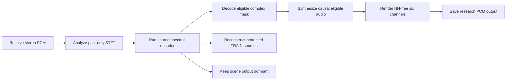
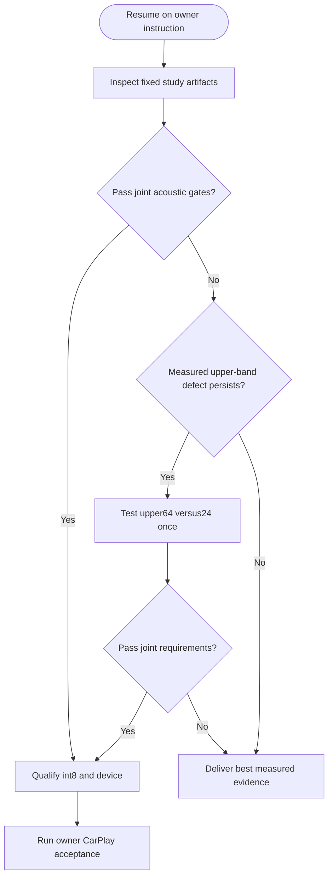

# Upmix Track B: session wrap and restart point

_Owner-requested wrap, 2026-09-30 local date; PC observations use UTC. Consolidated results, failed hypotheses, architecture, artifacts and remaining acceptance work._

---

## 📋 Current conclusion

- **Product goal remains unmet.** No new Track B candidate has passed the combined rear-instrument, protection, stability, generalization, device and owner-listening requirements.
- **One-network execution is implemented.** An isolated causal spectral model runs through an independent float/int8 C FFT/WOLA and NN-free six-channel renderer. Its numerical checks pass within their recorded scopes. It has not replaced the three models in the car.
- **The new spectral encoder improves fitting:** eligible TRAIN4 median SI-SDR is 7.524 dB versus 6.654 dB for the matched control; paired median improvement is +0.811 dB. The completed broad comparison fails joint promotion; see the final result below.
- **The renderer has demonstrated room for a stronger rear.** Exact labelled eligible audio reaches approximately 39% rear share with two swinging songs on the original full40 harness. Those labels are unavailable to a deployable model.
- **Work is being paused at the owner's request.** The existing fixed spectral/control study has now finished training, numerical audit and full40 evaluation and released its lease. No new training is queued.

The [unified architecture ledger](UPMIX_UNIFIED_SCENE_ARCHITECTURE_2026-09-30.md) retains the detailed chronology, protocols, errors, recoveries and raw artifacts. This document is the readable restart point; earlier process snapshots in the other reports are historical.

## 📊 Measurements and what they establish

### Final completed result, 2026-10-01 03:28 UTC

The [spectral40k full40 result](UPMIX_UNIFIED_SCENE_ARCHITECTURE_2026-09-30.md#-completed-spectral40k-pair-joint-promotion-fails) supersedes the pending observations in this wrap. At nominal.40, control→spectral G/K/P/S is .194/.190/.205/.216→.225/.217/.219/.191; V/B/D .0156/.1618/.0153→.0139/.1585/.0139; any-stem swings33→31/40; attributed vocal-entry median/p10 .7626/.4083→.7991/.4509. Both pass9/13 absolute gates but fail bass, movement and both entry requirements. Paired DEV20s gain+.1383dB and string regression also fail relative promotion. No candidate is ready for the car.

Both arms have40 songs×60s,231rows at all three predeclared gains and the same84entries+79exits+102sustained controls=265events. [Archive/hashes](UPMIX_UNIFIED_SCENE_ARCHITECTURE_2026-09-30_spectral_broad_final_inventory.json) and [aggregation checks](UPMIX_UNIFIED_SCENE_ARCHITECTURE_2026-09-30_spectral_broad_archive_checks.json) are retained. The [complete attempt chronicle](UPMIX_SEPARATOR_CHRONICLE_2026-09-25_TO_2026-09-30.md) links every recorded route, including interrupted and unexecuted attempts. Previous training/partial-full40 snapshots are historical.

### Original full40 acoustic results

The following rows belong to the original 40 DEV songs × 60 seconds and the named renderer configurations. They are not interchangeable with TRAIN fitting, DEV20 screens, source SI-SDR or per-band transmission. See the [Track A matched40 report](UPMIX_TRACKA_MATCHED40_2026-09-30.md) and the [unified full40 ledger](UPMIX_UNIFIED_SCENE_ARCHITECTURE_2026-09-30.md#completed-capacity-full40-pair-reject-this-expansion-as-the-repair).

| Candidate | Guitar / keys / piano / strings | Voice / bass / drums | Swing songs | Decision |
| --- | --- | --- | ---: | --- |
| Current Track A, rear air −9 dB | .165 / .152 / .095 / .069 | .076 / .149 / .296 | 29/40 | Deployable baseline; fails these offline targets |
| Broad joint-source model, fixed .40 | .177 / .193 / .194 / .195 | .0109 / .130 / .0100 | 27/40 | Reject: bass, swings and vocal entries |
| Old expanded capacity model, fixed .40 | .165 / .212 / .175 / .163 | .0113 / .1197 / .0123 | 28/40 | Reject: bass, swings and vocal entries |
| Exact-labelled eligible renderer bound, fixed .40 | .386 / .396 / .395 / .392 | .0057 / .0125 / .0117 | 2/40 | Eleven observed renderer gates pass; privileged reference |
| Original targets | ≥.15 / ≥.15 / ≥.10 / ≥.14 | ≤.02 / ≤.06 / ≤.08 | ≤5 | Joint acceptance required |

The owner offered a possible keys threshold of .12; this wrap does not adopt that relaxation. The exact-labelled audio renderer result and the separate exact-complex-mask vocal-entry bound are different experiments, not a single deployable candidate.

| Attributed vocal entries | Median | p10 | Scope / verdict |
| --- | ---: | ---: | --- |
| Broad joint-source model | .765 | .431 | Original 265 events; fails |
| Old capacity-expanded model | .7475 | .3735 | Original 265 events; fails |
| Exact-complex-mask bound | 1.0346 | .8820 | Original full40/event inventory; privileged pass |
| Required | ≥.85 | ≥.60 | Together with all other gates |

The [completed large causal reference](UPMIX_CAUSAL_GENERALIZATION_2026-09-29.md) improved paired source reconstruction by about +1.30 dB but still gave guitar .121, strings .109 and entry .804/.420, with approximately 2.168 G neural MAC/s. It is neither a budget candidate nor evidence that source SDR alone solves the rear scene. The [pretrained noncausal BSRNN SIMO reference](UPMIX_BSRNN_REAL_C_CHECK_2026-09-29.md) passes its 14 observed offline gates, but cannot run within the causal head-unit budget.

### Fitting and port results

| Completed check | Measured outcome | Practical limit |
| --- | --- | --- |
| Fresh spectral versus control, fixed20k | Eligible 7.524 versus 6.654 dB; paired +.811 dB; all four crops improve ≥.573 dB | Four TRAIN8s crops; ten fitting gates, not generalization |
| Fixed24 decoder, privileged bounded joint features | Eligible 7.524 → 14.051 dB; protected medians also improve | Requires labels; feasible fit, not inferable features or certified optimum |
| Native float/int8, true TRAIN4 | Eligible 7.5235 → 7.4619 dB; paired median loss .0639 dB, worst .0982 dB | Both quantization gates pass on these crops only |
| Native float/int8, three TRAIN vocal entries | Median/p10 .8927/.8044 → .8969/.8060 | Three TRAIN events, not original DEV265 |
| Upper64 initialization and structure | 23/23 checks; initial full outputs and waveforms exact | No efficacy training or rear-quality verdict |

Exact protocols, numerical tolerances and limitations are linked in the [spectral fitting](UPMIX_UNIFIED_SCENE_ARCHITECTURE_2026-09-30.md#completed-fresh-encoder20k-fit-spectral-package-passes-every-frozen-fitting-gate), [decoder diagnostic](UPMIX_UNIFIED_SCENE_ARCHITECTURE_2026-09-30.md#joint-fixed24-decoder-diagnosis-encoder-room-and-residual-treble-error-coexist), [native acoustic preparation](UPMIX_UNIFIED_SCENE_ARCHITECTURE_2026-09-30.md#native-floatint8-acoustic-qualification-prepared-true-train-and-entry-execution-passes) and [upper64 structural record](UPMIX_UNIFIED_SCENE_ARCHITECTURE_2026-09-30.md#contingent-upper64-decoder-preserving-initialization-and-observed-dense-counts-pass).

### Meaning of rear share and brightness

Rear share describes the harness's attributed rear versus front-plus-rear power statistic in source-dominant cells. A guitar value of .109 is not “10.9% of the whole song sent behind,” and it is not a vocal-leakage value. It also does not measure literal isolated guitar-energy retention, perception in the cabin, attack or sustain.

The [saved full40 spectrum audit](UPMIX_UNIFIED_SCENE_ARCHITECTURE_2026-09-30.md#saved-real-c-rear-spectrum-previous-capacity-model-loses-instrument-treble) finds that the old expanded model's guitar/keys 6–10 kHz rear ratios are .0381/.0231, versus .4120/.3669 for exact-labelled audio. At 10–16 kHz, guitar/keys/strings are .0143/.0024/.0037 versus .3225/.2887/.2180. Thus a respectable overall instrument median can coexist with almost absent treble. Coverage is sparse for some families; these are source-dominance proxies, not direct isolated-source or listening measurements.

## 🧪 Iterations, successes and rejected approaches

This index preserves the routes already explored. Each linked report contains its exact recipe, scope, per-source measurements, implementation failures and promotion decision. “Rejected” means that particular frozen comparison failed; it does not disprove every implementation of the idea.

| Research phase | Outcome | Detailed record |
| --- | --- | --- |
| Original architecture/loss shelf and fast loop | Many variants stayed on a recall/protection frontier; short-run gains did not establish a product | [Night report](UPMIX_SEPARATOR_NIGHT_REPORT_2026-09-28.md), [source plan/reviews](UPMIX_SOURCE_SEPARATION_PLAN.md) |
| Membership, role, confidence, dual-head and deep-filter variants | Failed one or more extraction, protected-source or vocal-entry gates | [Persistent membership](UPMIX_PERSISTENT_MEMBERSHIP_SCREEN_2026-09-28.md), [role probe](UPMIX_CAUSAL_ROLE_PROBE_2026-09-28.md), [confidence](UPMIX_CAUSAL_CONFIDENCE_MAP_2026-09-28.md), [dual head](UPMIX_DUAL_HEAD_CAUSAL_PROBE_2026-09-28.md), [deep filter](UPMIX_CAUSAL_DEEP_FILTER_PROBE_2026-09-28.md) |
| Stereo matrix, invariance, slow state and fine-role routes | More operator capacity or pure-cell discrimination did not deliver joint overlap/protection/entry success | [Matrix source loss](UPMIX_MATRIX_SOURCE_LOSS_PROBE_2026-09-28.md), [vocal invariance](UPMIX_VOCAL_INVARIANCE_PROBE_2026-09-28.md), [dual state](UPMIX_DUAL_STATE_PROBE_2026-09-28.md), [fine role](UPMIX_FINE_ROLE_PROBE_2026-09-28.md) |
| Privileged spatial/overlap bounds | Exposed room for improvement and tradeoffs between eligible transmission and protected subtraction | [Spatial source bound](UPMIX_SPATIAL_OVERLAP_BOUND_2026-09-29.md), [cue attribution](UPMIX_CUE_ATTRIBUTION_BOUND_2026-09-29.md), [overlap bound](UPMIX_OVERLAP_ORACLE_BOUND_2026-09-29.md) |
| Cross-song remix | Rapid data screens and distinct-song causal fine-role4k failed joint promotion | [Cross-song probe](UPMIX_CROSSSONG_AUGMENT_PROBE_2026-09-29.md), [effectiveness audit](UPMIX_EXPERIMENT_EFFECTIVENESS_AUDIT_2026-09-29.md) |
| Mixed MoisesDB/OnAir pool | Verified donor sampling and exact source sums; five admitted OnAir songs did not improve the joint4k screen | [Cross-corpus remix](UPMIX_CROSS_CORPUS_REMIX_PROBE_2026-09-29.md) |
| Detailed instrument additions / Cambridge trial | Small verified real-stem additions did not break the shelf in the tested recipe | [Cambridge trial](UPMIX_CAMBRIDGE_TRIAL_2026-09-29.md), [datasets](UPMIX_DATASETS_AND_TEACHERS.md) |
| Independent dataset acquisition | DSD100 acquired with integrity checks; broad four-stem labels limit fine-family evaluation | [DSD100 intake](UPMIX_DSD100_INDEPENDENT_CORPUS_2026-09-29.md) |
| Training-path diagnosis | Raw/cache, fitting and metric semantics checked; TRAIN≈DEV alone is not a unique diagnosis | [Training-path diagnosis](UPMIX_TRAINING_PATH_DIAGNOSIS_2026-09-29.md) |
| Input invariance, band allocation, decoder-state teaching | Exact invariance did not improve reconstruction; band gain was small; lower state error worsened audio loss | [Invariant input](UPMIX_INVARIANT_INPUT_PROBE_2026-09-29.md), [band allocation](UPMIX_BAND_ALLOCATION_PROBE_2026-09-29.md), [state supervision](UPMIX_DECODER_STATE_SUPERVISION_2026-09-29.md) |
| Research and public BSRNN reference | Strong offline SIMO reference established; noncausal compute prevents deployment | [Research review](UPMIX_RESEARCH_REVIEW_2026-09-29.md), [intake](UPMIX_BSRNN_REFERENCE_INTAKE_2026-09-29.md), [inference](UPMIX_BSRNN_PRETRAINED_INFERENCE_2026-09-29.md), [real C](UPMIX_BSRNN_REAL_C_CHECK_2026-09-29.md) |
| Large causal reference / compression premise | Better fitting and source reconstruction did not meet rear/entry targets; large graph over budget | [Causal encoder](UPMIX_CAUSAL_REFERENCE_ENCODER_2026-09-29.md), [generalization](UPMIX_CAUSAL_GENERALIZATION_2026-09-29.md) |
| Unified joint-source and capacity continuations | Completed full40 failures retained; neither loss change nor modest widening fixed bass/swings/entries | [Unified chronological ledger](UPMIX_UNIFIED_SCENE_ARCHITECTURE_2026-09-30.md) |
| New spectral encoder and native chain | Positive matched TRAIN fitting and numerical execution; broad quality pending | [Spectral broad protocol](UPMIX_UNIFIED_SCENE_ARCHITECTURE_2026-09-30.md#spectral-broad-comparison-frozen156train-and-full40-real-c-study-is-live), [native chain](UPMIX_UNIFIED_SCENE_ARCHITECTURE_2026-09-30.md#spectral-single-network-fftwola51-chain-full-train-numeric-integration-passes) |
| Targeted upper-band decoder | Implemented preserving initialization, actual operation counts and causal structure; efficacy pending and not queued | [Final23-gate evidence](UPMIX_UNIFIED_SCENE_ARCHITECTURE_2026-09-30_spectral_upper_decoder_structure_check.json) |

### Concrete fixes and negative diagnostics

- A real inverse-FFT DC/Nyquist endpoint defect caused CPU/CUDA waveform disagreement. It was reproduced and fixed in the new Track B synthesis; original failures and checkpoints remain recorded.
- Shared-decoder gradient domination, TRAIN state-horizon resets and mixture-consistency projection did not repair the tested broad model. Those negative diagnostics are retained rather than used as new training recipes.
- Old capacity widening's paired DEV source gain was only +.103 dB, below its predeclared +.3 dB gate; its full40 joint gates failed. Quiet .3235 and loud .50 gains did not rescue it.
- The final upper64 CPU initializer now seeds only the CPU generator and preserves caller RNG state. The earlier22-gate evidence is retained beside the final23-gate evidence.
- Native observation/replay separates input PCM rounding residual from ground-truth source contributions. Synthetic proportional partitions prove arithmetic closure only; the later true-TRAIN checks provide the distinct fitting/quantization evidence.
- SSH observation timeouts and Windows wrapper/argument failures were recovered without treating a missing observer result as permission to reboot or restart a live trainer. Recorded C/ARM verifier failures were corrected and original evidence retained.

These events and their exact tolerances are in the [unified ledger](UPMIX_UNIFIED_SCENE_ARCHITECTURE_2026-09-30.md). Track A's earlier mask-reset repair, int8/NEON mask timing around 1.33 ms, drive1.5 and rear-air−9 dB belong to the [Track A phase1 report](UPMIX_MASK_PHASE1_REPORT_2026-09-27.md). That timing measures the mask only; it is not spare budget for this entire new chain.

## 🧠 Architecture and implementation boundary

Current spectral backbone: width48, two layers, four grouped temporal GRUs, current-frame frequency mixing, interface24/global24 and decoder24. The model has no future temporal lookahead. Training reconstructs eligible, vocal, drums and bass; inference executes the eligible rows plus the currently dormant scene branch. Unused protected auxiliary outputs are omitted, not claimed to be perfect source protection. The current renderer keeps center zero.

| Graph | Selected eligible + scene dense MAC/s | Full four-source dense MAC/s | Implementation status |
| --- | ---: | ---: | --- |
| Spectral decoder24 | 116.712 M | 144.387 M | Native float/int8 C and ARM/QNX numerical checks |
| Contingent upper decoder64 | 129.327 M | 187.827 M | Actual Python operation counts; no new C/int8 port |

These counts omit FFT/iFFT, normalization, activations, feature/level arithmetic, complex multiplication, pooling, DSP, memory and scheduling. They are not measured Krait int8 throughput or loaded-chain latency.

The contingent graph changes only the 13 existing bands intersecting frequencies above 8 kHz from decoder24 to64. Whole-band boundaries cover 685 bins beginning at 7968.75 Hz, including two bins below 8 kHz. Common weights, lower/middle decoders, state and initial float output are preserved exactly. New hidden inputs are seeded; new outgoing columns start at zero. All added branches have a nonzero derivative route after one disposable synthetic optimizer probe; tiny derivatives do not prove effective learning speed.

The old int8 runtime uses the maximum across an entire decoder-input vector for activation scale. Added hidden coordinates can change that scale even when their outgoing float columns are zero. Consequently, float-preserving initialization is not an int8-preserving guarantee. The new graph requires a compatible export/runtime and fresh quantization checks if it earns further work; the prior .064 dB TRAIN quantization result cannot be transferred to it.

The existing full standalone chain uses 581,536 bytes of state, a 256 KiB worker stack and no per-hop allocation. Identity delays measured on the host are 32 ms eligible, 42.667 ms front and 54.667 ms rear, with another 10.667 ms frame acquisition plus execution/transport still to qualify. These are implementation measurements, not proof of the ≤85 ms loaded-device requirement. [Native/ARM chain details](UPMIX_UNIFIED_SCENE_ARCHITECTURE_2026-09-30.md#spectral-single-network-fftwola51-chain-full-train-numeric-integration-passes).

## 🖥️ PC state at wrap

**Latest final observation:** the [2026-10-01T03:28:25Z snapshot](UPMIX_UNIFIED_SCENE_ARCHITECTURE_2026-09-30_spectral_broad_final_pc_state.json) finds the study complete, matching supervisor/trainer/evaluator absent, lease absent and no runner-failure marker. The older37k and19/40 observations below are preserved as historical snapshots. Agent pause remains in force and no next efficacy task is queued.

### Read-only status follow-up, 2026-10-01 02:50 UTC

Both arms completed their fixed40k training. The saved terminal numerical audit reports `verified=true`, `smoke=false` and the original manifest hash. The existing full40 evaluator is live: control has40/40 song markers and its arm-complete marker; spectral has19/40 song markers, with its arm and pair completion still pending. Agent pause remains in force; no new job was started. [Captured terminal summaries and completion counts](UPMIX_SESSION_WRAP_2026-09-30_status_0250UTC.json).

Terminal DEV40×20s eligible SI-SDR medians are −.903642 dB control and −.770136 dB spectral. Their difference is a difference of medians, not the predeclared song-paired gain. Spectral eligible transmission in8–14/14–24kHz is .004843/.006290 with target-normalized spectral error1.008218/1.036058. These extraction diagnostics still show weak treble; they are not rear shares or a full40 promotion verdict. Original rear/protection/swing/265-event joint results are not yet available for the spectral terminal. The snapshot below preserves the earlier wrap-time observation rather than claiming37k is current.

The archived [read-only PC snapshot](UPMIX_SESSION_WRAP_2026-09-30_pc_snapshot.json) records the observation timestamp, exact process identities, last progress rows, terminal markers and fixed control checkpoint hash. This is a point-in-time observation, not a live dashboard.

**Observed at 2026-10-01T01:38:36.9304050Z:** spectral is **37,000/40,000** (6,996.816 s; 156 TRAIN songs; 148,000 windows). Control training is terminal **40,000/40,000** (6,538.499 s; 160,000 windows).

| Observed item | State |
| --- | --- |
| Existing broad supervisor | PID 45888 observed live |
| Spectral launcher / trainer | PIDs 37976 / 18188 observed live |
| Existing GPU lease | Present; owned study still live |
| Rapid daemon | Not observed live |
| Both-terminal numerical audit | Marker absent at snapshot |
| Full40 pair completion | Marker absent at snapshot |
| Runner failure marker | Absent at snapshot |

Control terminal checkpoint SHA-256: `5aaed6380ad35b59dcb30ea3446088d0550218590c0daeeea969a50796f2e841`. Spectral last draw digest: `17637d6a6a3751152d5feef2581f73c8d522e65f0e564aaabdf3d56b217e4411`. Training loss is not an acoustic verdict.

The supervisor already owns the sequential numerical audit and original full40 evaluation after both terminal checkpoints. Pausing the agent does not stop that external process. No upper64 efficacy run, new GPU recipe, hook deployment or environment install is started by this documentation wrap. The existing GPU lease must remain while its owner is live; do not clear it because the chat is paused.

### Frozen live study

- Run root: `D:\upmix\runs\spectral_context_generalization_v1`
- Data: 156 true-stem TRAIN songs; independent seven-slot ±6 dB gains; exact mixture sum
- Matched recipe: seed1, batch4, 8 s crops, fixed40k per arm, AdamW schedule, float32 with TF32 off
- Control24×3 versus spectral48×2; decoder24 adapts equally in both; scene stays frozen
- Fixed evaluation: TRAIN12 monitors, DEV40×20s only at terminal40k, then original40×60s/231 rows/265 attributed events through the same NN-free C renderer
- Nominal gain .40; predeclared .3235/.50 diagnostics do not select a rescue gain or best checkpoint
- Reserved20 is candidate-independent but older experiments already used those songs; it does not satisfy the strict untouched20 acceptance gate

Frozen source/manifest hashes and runner guards are in the [broad protocol](UPMIX_UNIFIED_SCENE_ARCHITECTURE_2026-09-30.md#spectral-broad-comparison-frozen156train-and-full40-real-c-study-is-live) and [supervisor](../../tools/stereo-upmix-render/pc/run_spectral_context_generalization.ps1). Process IDs are observations, never sufficient restart authorization on their own.

## 🎯 Acceptance and finite continuation

### Required before calling the candidate ready

- [ ] Original full40 and a genuinely untouched20 real-stem evaluation pass all instrument/protection gates at stable gain
- [ ] At most five swinging songs; absolute guitar/keys/winds level-follow slopes ≤.05
- [ ] Attributed vocal-entry median ≥.85 and p10 ≥.60, with useful absolute eligible transmission
- [ ] Native int8 full40 acoustic qualification passes on the promoted terminal asset
- [ ] Actual head-unit causal int8 cost ≤150 M MAC/s and extra latency ≤85 ms in the loaded chain
- [ ] Track A coordinates integration of the one-model path into its owned hook
- [ ] Owner's level-matched blind live CarPlay test confirms clear stable rear instruments, no rear voice, daily-use preference over current Track A

Front-only and current Track A can play live today. The new one-network chain is a research build; the noncausal teacher is an offline reference. No owner listening verdict has been obtained for this candidate. The [CarPlay protocol](UPMIX_CARPLAY_LISTENING_PROTOCOL.md) specifies live phone stereo, reconnect-based configuration activation and the distinction from headphone previews.

### Bounded next sequence after explicit resume

1. Inspect `control/train_complete.json`, `spectral/train_complete.json`, `audit.json`, `full40/complete.json`, any `runner_failure.json`, current processes and the owning lease. Hashes and complete markers take precedence over a last log line. Preserve partial/completed artifacts; do not rerun an already completed study.
2. Archive terminal checkpoints' hashes, original full40 tables, 265-event outputs and the predeclared joint decision. Reuse the standalone spectrum reporter on saved terminal C rows, with exact family coverage. No early DEV selection or gain rescue.
3. If terminal treble remains defective, the only reserved architecture intervention is a matched upper64-versus24 experiment, with identical parent/data/loss/seed/horizon and verified preserving initialization. Its efficacy job is not yet queued. Otherwise, deliver the measured result and limitation evidence.
4. A passing float candidate proceeds through the prepared actual-mixture native float/int8 full40 evaluator, independent real-stem validation, loaded-device measurement, Track A coordination and owner listening. The evaluator requires an acoustically promoted audited terminal; it has not run a native full40 assessment yet.
5. If the reserved repair also fails, end automatic architecture enumeration. Deliver the best measured candidate and evidence separating extraction, representation, rendering and compute limits. Record listening as pending until the owner actually performs it; do not invent a verdict or claim the original goal complete.

## 🔗 Artifacts and restart rules

### Latest code and evidence

| Artifact | Purpose |
| --- | --- |
| [Upper-band decoder](../../tools/stereo-upmix-render/unified_spectral_upper_decoder.py) | Isolated contingent24→64 architecture; no live helper mutation |
| [Structural verifier](../../tools/stereo-upmix-render/verify_spectral_upper_decoder.py) | Initialization, derivative-route, observed-count and causal checks |
| [Final structural protocol](UPMIX_UNIFIED_SCENE_ARCHITECTURE_2026-09-30_spectral_upper_decoder_structure_protocol.json) / [final result](UPMIX_UNIFIED_SCENE_ARCHITECTURE_2026-09-30_spectral_upper_decoder_structure_check.json) | Authoritative23-gate raw evidence with code/input hashes |
| [Original protocol v1](UPMIX_UNIFIED_SCENE_ARCHITECTURE_2026-09-30_spectral_upper_decoder_structure_protocol_v1.json) / [original result v1](UPMIX_UNIFIED_SCENE_ARCHITECTURE_2026-09-30_spectral_upper_decoder_structure_check_v1.json) | Preserved22-gate history before CPU-only seed guard |
| [Native full40 assessor](../../tools/stereo-upmix-render/assess_spectral_native_full40.py) | Prepared actual-mixture float/int8 qualification with original inventory |
| [Native true-TRAIN evidence](UPMIX_UNIFIED_SCENE_ARCHITECTURE_2026-09-30_spectral_native_smoke_check.json) | Original four real TRAIN mixtures and three detected TRAIN entries |
| [Mask replay](../../tools/stereo-upmix-render/spectral_chain_mask_replay.py) | Actual native mask applied to true sources plus separate PCM rounding residual |
| [Rear spectrum reporter](../../tools/stereo-upmix-render/report_upmix_rear_spectrum.py) | Source-family band medians, identity/coverage/hash checks from saved C output |
| [Complete architecture ledger](UPMIX_UNIFIED_SCENE_ARCHITECTURE_2026-09-30.md) | Detailed methods, successive results, failures and raw artifact links |

### Rules that survive the pause

- Never reboot/restart the head unit, j9 or PC to recover an observer or experiment
- One GPU tenant; preserve live lease ownership; no package installs into a PC environment while runs use it
- Preserve other agents' uncommitted files and Track A's hook/audio and int8 implementation
- English documentation; commits have no `Co-Authored-By`
- Never print NAS credentials or the private MoisesDB link
- Verify cabin audio through live CarPlay; never use `qsa_play` as channel-routing evidence
- Any student integration in Track A's hook requires coordination; no such integration happened in this wrap

Restart reading order: this wrap → [handoff](UPMIX_SEPARATOR_HANDOFF.md) → [night report](UPMIX_SEPARATOR_NIGHT_REPORT_2026-09-28.md) → [source plan](UPMIX_SOURCE_SEPARATION_PLAN.md) → current [unified ledger](UPMIX_UNIFIED_SCENE_ARCHITECTURE_2026-09-30.md). Preserve this evidence boundary when reporting progress: implemented graph, numerical parity, TRAIN fitting, DEV acoustic pass, device qualification and owner preference are separate milestones.
