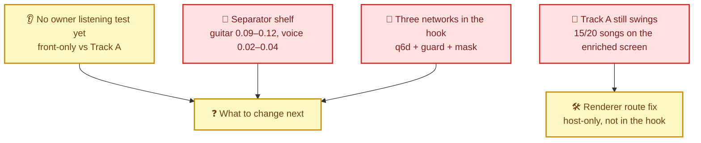
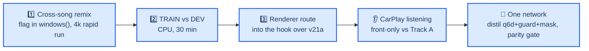

# Upmix Status and Problems 2026-09-29

One page for the owner: what the stereo→5.1 upmix has achieved, what is still broken, and the order of the next steps. Details live in the linked records; this note only summarises them.

---

## 🎯 Goal

Instruments audibly and stably in the rear, the voice never, no "back and forth". The car plays ordinary stereo from the phone over **live CarPlay**; the head-unit hook builds 5.1 (`AUDIO_REALTIME_UPMIX=on`). A candidate is therefore a head-unit build/config, not a file.

---

## ✅ Achieved

### Track A — what ships in the car

| Step | Result | Commit |
| --- | --- | --- |
| Float reference of the protect-mask net | Parity with PyTorch 3.6e-7 | cc5ec5d |
| Mask net in the production path | Features on the audio thread, inference on the control worker, 3-miss fallback to the heuristic | 518fba0 |
| Install package | v21a blob, startup env, per-model settings drift check | efa42d9, 81a836e |
| int8 + NEON port | 3.92 → **1.46 M instructions/control**; QNX `expf/logf` were software double — replaced | 6bbb02e → 6d667c7 |
| Krait measurement | Mask **1.33 ms/control** of ~10.7 ms, 839/839 on time, audio thread +1 % | — |
| Reset bug | `spa_stereo_upmix_reset()` dropped the guard/mask pointers — the mask never ran in the car before this | c43a17c |
| Car tuning | Mask drive **1.5**, rear air **−9 dB**: guitars 0.17 / voice 0.08 (4 songs >15 % vs 8 in the 22.09 build); guitar swing range a quarter lower, voice a third lower | 04fb06d |
| Best build | `build/install_protected_WAUZZZF47HA098927.zip` (SHA 710342a1…075f), three models, VIN-locked | 800de9d |

### Track B — separator feasibility

| Result | Meaning |
| --- | --- |
| Bounds measured | With **true** eligible audio the renderer gives **0/40** swinging songs and instruments ~0.21–0.23: the goal is reachable in principle |
| Renderer route (review 18) | Host-only object/bed change: 8→0/40 swings on truth; even the weak sep9 estimate 6→1/20 |
| Tooling | `sep_net.py` with all ablation flags, diagnostics (`diag_gap`, `diag_transitions`, `diag_ceiling`, `diag_lossfloor`, `diag_auxgrad`), rapid loop (queue, `GPU_LEASE`, 20-song screen, `LEADERBOARD.md`) |
| Fixes | Scheduler resume (10.5× LR), log-loss NaN, attribution 0/0 NaN, UTF-16 board, deterministic prefetch seeds |
| Proxy validation | sharedmask's 4k stability gain did **not** survive to 10k — 4k ducking/swings do not predict 10k |

---

## ❌ Problems

| Problem | Evidence | Status |
| --- | --- | --- |
| **The shelf** | ~38 variants (width, supervision, band RNN, loss, lookahead, complex/matrix/role masks, 8 s memory) land on one recall/leak frontier: guitar 0.09–0.12, voice 0.02–0.04. Target ~0.20 | Open |
| **Track A still swings** | Enriched 20-song real-C screen: 15/20 any-stem swing songs; instruments .176/.166/.118/.225, voice/bass/drums .075/.150/.285 | Open |
| **CMA-ES on the frozen mask failed** | 10 params, 18 candidates, 6 songs: best score silenced the rear by 4.03 dB | Closed (negative) |
| **Three networks** | q6d (routing) + guard (vocal safety, same graph) + mask v21a, run in series on one worker; three blobs, three settings | Open |
| **No listening test** | Owner blind test front-only vs Track A over CarPlay never done | Blocking |
| **Renderer fix not in the car** | The strongest swing lever exists only in the host C renderer | Open |
| **GPU contention** | One GPU training at a time; Codex's `operator_anchor4k` holds it now | Scheduling |

### Two untested causes of the shelf

1. **No cross-song stem remix.** `windows()` in `tools/stereo-upmix-render/sep_net.py` builds every training window from the stems of *one* song (only ±6 dB per-slot gains). Standard separator training mixes stems from different songs and offsets; with ~240 true-stem songs this is the cheapest untried data lever.
2. **Under- vs over-fitting was never measured for the separators.** The Track A mask lineage was flat on TRAIN as on DEV (AUC 0.81/0.76), i.e. underfit. For the sep students the TRAIN-vs-DEV screen has not been run. A TRAIN gap → data (remix, pseudo-labels on the 3,367-song `D:\music`); no gap → capacity/training length (the Krait has 2–4× headroom).

---

## 🧭 Next steps

| # | Step | Gate |
| --- | --- | --- |
| 1 | Cross-song remix flag in `windows()`; one 4k rapid run after the GPU lease frees | +0.03 eligible at ≤ +0.01 vocal vs the 4k anchor |
| 2 | TRAIN vs DEV screen of sep3 and sharedmask_10k | Decides data vs capacity |
| 3 | Review-18 renderer route in the hook, v21a unchanged | Fewer swings on the 20-song screen at equal rear level |
| 4 | Owner listening over CarPlay | Owner verdict |
| 5 | One multi-head network distilled from the three | Parity with Track A, cost ≤ today |

---

## 🔗 Records

- [Separator handoff](UPMIX_SEPARATOR_HANDOFF.md) — full ledger and rules
- [Separator night report 2026-09-28](UPMIX_SEPARATOR_NIGHT_REPORT_2026-09-28.md)
- [Source separation plan](UPMIX_SOURCE_SEPARATION_PLAN.md)
- [Listening and deploy log](UPMIX_LISTENING_AND_DEPLOY_LOG.md)
- [HSSR model](HSSR_MODEL.md)
