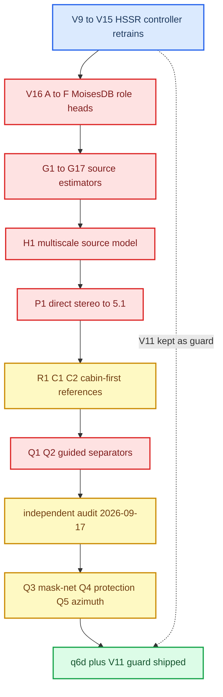
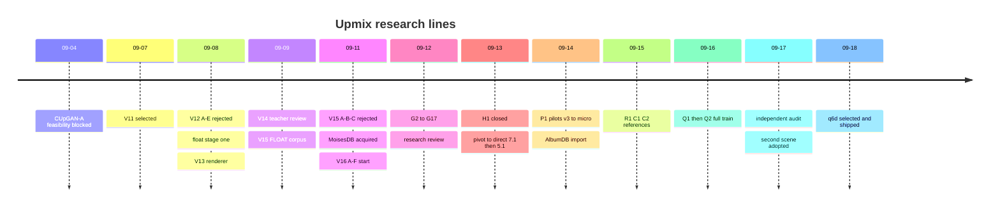

# Upmix Training History

*Iteration ledger for the stereo→5.1 upmix model, 2026-09-04 → 2026-09-30: original controller/source generations and the linked complete separator continuation, including successes, rejected mechanisms, interrupted attempts and unexecuted plans.*

---

## 📋 The arc in one screen

**Historical arc through2026-09-18:** Fifteen-plus model generations ran in two weeks. The shipped result ([HSSR Model](HSSR_MODEL.md)) is the *first* design, the 2×GRU-160 routing controller, retrained once on real MoisesDB stems (q6d) and paired with its predecessor V11 as a vocal guard. Every attempt to replace it with a waveform separator (V16 → G → H1 → P1 → Q2) failed on the same axis: it could not keep the lead out of the rear while still sending useful backing material there. The 2026-09-17 independent audit closed the separation line and redirected to the genre-agnostic second scene.



*Timeline of the research lines by date (UTC, 2026).*



Truth tags: **[model]** offline training/eval result, **[code]** checked in the current tree, **[car]** heard or measured on the unit, **[open]** unverified. For the pre-09-18 generations summarized below, only V11 and q6d ran in the car. Track A later added the deployed protection mask; its phase1/car record is linked in the continuation. No new one-network candidate has run in the car.

Sources: `UPMIX_MASTER_PLAN`, `UPMIX_RETROSPECTIVE_AND_STEREO71`, [HSSR_UPMIX_MODEL](../research/HSSR_UPMIX_MODEL.md).

## 🔄 HSSR controller generations V9 to V15

All share the "HSSR-160" graph (`368 → GRU160 → GRU160 → Linear264`, 451,464 params); only weights, trainable rows or targets differ. The architecture and runtime are in [HSSR Model](HSSR_MODEL.md); the datasets in [Upmix Datasets and Teachers](UPMIX_DATASETS_AND_TEACHERS.md).

| Gen | Date | Recipe | Verdict and key number |
|---|---|---|---|
| V9 | pre-09-07 | prior production baseline | superseded |
| V11 | 09-07 | MUSDB-derived real stems plus teacher supervision; extra 384/91 train/val caches incl. a 340/90 separator subset | **selected**; level-weighted selection ratio 17.4× → 59.1×; SHA `ab01463e…`; now the guard [model] |
| V12 A–E | 09-08 | fine-tune V11 on 43 private songs with BS-RoFormer two-stem teacher | all rejected. A lowered teacher loss but raised isolated-vocal heldout transfer ~49% (+18–49%) — objective/eval disagreement [model] |
| float stage 1 | 09-08 | V11 unchanged; float render + one Sound Check + linked matrix guard | host-tested only; later deleted with the whole float path (see [HSSR Model](HSSR_MODEL.md)) |
| V13 | 09-08 | bass fix, cabin renderer, routing-head-only pilot (frozen GRUs, 192 control frames, 64 burn-in) | renderer/data fixes kept, no new weights |
| V14 | 09-09 | 50-song teacher build, content audit, listening room | no trainer launched; filenames must not become truth |
| V15 A/B/C | 09-09→11 | FLOAT corpus; routing/pan-head-only streaming distillation from V11 | all rejected; each moved *more* vocal rearward |

### Float stage 1: why the peak detector watches the amp matrix

The first float candidate protected only the PCM rails. On *Crazy Train* p1 its known downstream input-matrix bus peaked at 1.030 FS at unity and **1.156 FS** with a +1 dB fixture, although every PCM channel was legal. The corrected candidate ran one linked detector over both domains (−1 dBFS ceiling, instantaneous attack, 100 ms release). Fourteen held-out excerpts × four variants = 56 renders, all with model SHA `ab01463e…` [model]:

| Variant | Max input-matrix bus peak, FS | Over-range samples |
|---|---:|---:|
| Legacy, no Sound Check fixture | 0.965 | 0 |
| Float, unity gain | 0.891 | 0 |
| Float, −9 dB fixture | 0.451 | 0 |
| Float, +1 dB fixture | 0.891 | 0 |

Bounded peaks are not better sound. The cabin guard that survives today in `hook/audio/stereo_upmix.c` descends from this idea; details belong to [Stereo to 5.1 Upmix](STEREO_TO_5_1_UPMIX.md).

### V15 streaming routing distillation

Baseline V11; both GRUs, the six class rows per band and all global/LFE rows frozen; only rear-selection and pan rows trainable. AdamW LR 1e-5, four epochs, BCE weighted `1 + 4·target_rear`, pan MSE ×0.5, vocal-negative loss ×0.25. Admission used uncalibrated AST/CLAP gates (instrumental positive: AST voice < 0.1, CLAP non-voice beats voice by > 0.05, teacher disagreement ≤ −12 dB).

| Case family | Train cases | Val cases | Train windows | Val windows |
|---|---:|---:|---:|---:|
| Original mix, two-stem rear/pan target | 70 | 18 | 131 | 31 |
| Vocal-only input, zero rear target | 303 | 62 | 473 | 103 |

383 distinct admitted clips, 128 without supported windows, 76 heldout excluded.

| Candidate | What changed | Result [model] |
|---|---|---|
| A | four epochs as above | pseudo-validation −5.13% (0.5773 → 0.5476) but vocal-negative loss +33.53%; C mixture attribution on all 100 val clips: vocal rear transfer +0.071 dB mean, p95 +0.199 dB, rose in every clip. Not promoted |
| B `guarded-v2` | restart from V11; vocal-negative weight 1; risk-weighted baseline-logit anchor (margin 0.05, pan anchor 0.25, total 2); select only if every family at 0 and −12 dB is no worse | selected neither epoch; `candidate.bin` = V11 |
| C `guarded-v3` | actual C features piped in (Python/C feature MAE 9.1e-5, max 0.298); anchor = mean of risk-weighted penalties | reference only; its auto-heldout owner was stopped as not role-aware |

The prospective numeric gate for any V15 winner: mean vocal delta ≤ 0 dB, mean selectivity ≥ 0 dB, mean instrumental ≥ −0.1 dB, vocal p95 ≤ +0.1 dB, at both levels.

Sources: `HSSR_DATASET_TRAINING_AUDIT`, `UPMIX_FLOAT_STAGE1`, `UPMIX_V15_STREAMING_TRAINING`, `UPMIX_V15_ROUTING_REFINEMENT`, `UPMIX_TEACHER_REVIEW_V14`.

## 📊 V16 MoisesDB role heads and scene models

MoisesDB arrived 2026-09-11 (see [Upmix Datasets and Teachers](UPMIX_DATASETS_AND_TEACHERS.md)). The V16 cycle asked whether a head on top of the controller could tell backing from lead.

| Cycle | Design | Outcome [model] |
|---|---|---|
| A / B | three 6-epoch, then three 12-epoch balanced/long-context role heads (frozen V11 embedding, linear, causal temporal) | low average error, no useful backing/lead discrimination |
| C | +210 activity-selected clean lead/backing windows | backing confidence up, selectivity not |
| D | side-object targets after spatial extraction (652 windows); projected CE vs direct protected-energy objective | direct risk keeps ~2.66× useful retention at equal lead, but only 0.0418% backing energy remains; worst authored lead leak 1.5062% (CE) / 2.1558% (risk) of source energy. Not accepted |
| E | +428 protected windows (lead-only, reverberant, one-sided, abrupt onset) from 107 TRAIN songs | worst lead leak 0.2326% / 0.2696%, backing insufficient |
| F | equal 182,888-param causal scene models with/without past-only 2048-point spectra; separate backing/instrument permissions | worst lead transfer **18.17% / 17.93%**, nearly all through the *instrumental* permission (*Trail Away*: instrumental 17.66%, backing 0.0136%). Rejected |

The lesson F wrote down: fixing only the vocal teacher cannot close an instrumental bypass of protection.

### G source estimators G1 to G17

G replaced routing with a complex stereo source estimator over 11 families (`lead, backing, foundation, high_percussion, drum_body, guitar, pad, keys, strings_winds, fx_other, unknown`).

| Step | Question | Result [model] |
|---|---|---|
| G2–G4 | 11-family capacity; protected/positive losses | G4 (300 updates): candidate NMSE 1.120 vs G3 0.712; isolated-lead energy 26.8% vs 4.3%. Rejected |
| G5 | can it memorize two TRAIN crops? (4 arms, 256 updates, 461 s) | see table below |
| G6 | long past-only branch | +0.73% sum NMSE, backing worse |
| G7 | pooled global GRU + band memory | lost to G5 |
| G8 / G12 | full 181-song TRAIN, 572 windows, 4096 updates | backing NMSE 0.927 / 0.928; lead-only candidate energy 0.429 / 0.413 — weak already on TRAIN |
| G9 | reliability floor 1e-4, FLOAT/S16, QNX replay | numerical stability fix, not quality |
| G10–G13 | phase, width, decimation | local sum gains, no backing/protection win |
| G14 | foundation as residual output | sum −22%, one lead-only test ~10× worse |
| G15 | orthonormal output basis | 8.46% worse |
| G16 / G17 | same model, more updates (to 8192) | see table below |

G5 memorization, TRAIN-only, two fixed crops:

| Arm | Complex loss | Candidate NMSE |
|---|---:|---:|
| width4 / GRU32 / complex | 0.291 | 0.600 |
| width4 / GRU32 / invariant | 0.273 | 0.583 |
| width8 / GRU64 / complex | 0.257 | 0.563 |
| width8 / GRU64 / invariant | 0.238 | 0.500 |
| TRAIN-fitted frequency-constant mask | 0.313 | 0.591 |

Capacity and a polarity-invariant input (log L/R power, ILD, weighted cross-spectrum; zero measured equivariance error vs ~0.004 legacy) both helped, yet the best backing NMSE stayed 0.539 / 0.735.

G17 continuation, 80 DEV windows / 40 songs:

| Metric | G12 @4096 | G17 @6144 | G17 @8192 |
|---|---:|---:|---:|
| Candidate sum NMSE | 0.690 | 0.693 | 0.692 |
| Backing NMSE (18 active windows) | 0.928 | 0.921 | 0.930 |
| Lead-only candidate energy / source | 0.413 | 0.389 | 0.333 |

More updates softened lead response and left backing unsolved.

### H1 multiscale source model

Four resolutions (257/129/65/33 bins, widths 12/20/32/48), two per-band GRU48 blocks, ten complex sources plus exact residual: 56,492 params but ~990.5 M dense MAC/s (4.36× G9). 256 updates on two TRAIN crops (*Battlestar — Fixed*, *Enouement — Calculus*) [model]:

| Mean metric | G9 control | H1 complex | H1 + fidelity |
|---|---:|---:|---:|
| Candidate sum NMSE | 0.504 | 0.661 | 0.662 |
| Backing NMSE | 0.664 | 0.897 | 0.903 |
| Lead NMSE | 0.189 | 0.247 | 0.256 |
| Mixture-conditioned lead response | 0.053 | 0.033 | 0.031 |

A protection/fidelity trade-off, not a win; closed 2026-09-13.

Sources: `UPMIX_CHAIN_REASSESSMENT_G5`, `UPMIX_H1_GENRE_AGNOSTIC`, `UPMIX_RETROSPECTIVE_AND_STEREO71`, `UPMIX_RESEARCH_2026_09`, `UPMIX_MASTER_PLAN`.

## 🎯 P1 direct stereo to multichannel

On 2026-09-13 the plan pivoted from per-band permissions to learning full-band spatial channels from multichannel masters: first stereo→7.1 (8 outputs + a mandatory 8→6 cabin renderer), then the same day **stereo→5.1**. Native 5.1 sources became direct targets; AlbumDB (12-channel 7.1.4) supplied a derived 5.1 — see [Upmix Datasets and Teachers](UPMIX_DATASETS_AND_TEACHERS.md).

The P1-A training pair uses a research downmix so that the input is exactly consistent with the target (LFE excluded):

```text
xL = FL + sqrt(.5)·FC + .5·SL + .5·BL
xR = FR + sqrt(.5)·FC + .5·SR + .5·BR
```

A silent rear also satisfies this closure, so every channel, rear recovery and foreground are scored separately.

| Experiment | Change | Result [model] |
|---|---|---|
| First pilot | 2 epochs, 5,014 updates | full-DEV rear NMSE 1 → 0.292, but FC NMSE 1 → 1.588 |
| v3 front protection | counterfactual/isolated/augmented front supervision | rear 0.292 → 0.326, FC 1.588 → 2.141. Failed |
| v4 `front_residual_v2` | subtract only known injected front | canonical front +18.6%, centre +75.8%, rear +6.57%. Failed |
| v5 front-folded | SL/SR-only decoder, analytical front, C/LFE zero | rear 0.311 → 0.301, mixed response 0.164 → 0.141; 8/9 checks pass, mixed protection fails the ≤ 0.0876 ceiling |
| Quiet mixtures | gain 0.1 / floor 0.0002 | rear −15.7%, isolated −54.6%, worst mixed +30.7% (0.184) |
| 2×2 factorial | gain × floor | mixed 0.141 / 0.142 / 0.148 / 0.184, none ≤ 0.0876 |
| Micro learnability | clean-only vs joint on fixed TRAIN scenes, 1024 updates | clean-only rear 0.0957 but mixed 1.098; joint 0.366 / 0.416 rear. A target-known bounded solution reaches 7.9e-6 — representable, not learned |
| Gradient audit | 20 TRAIN measurements | reconstruction and protection gradients conflict in 15/16; LR grid 3e-4 / 1e-4 followed |

A mixture diagnosis over all 139.3 M scored samples found *conditional source passage* dominates: TRAIN median source/base ≈ −10 dB vs weakest DEV ≈ −30 dB.

Sources: `UPMIX_MASTER_PLAN`, `UPMIX_RETROSPECTIVE_AND_STEREO71`, `UPMIX_ALBUMDB_PAPER_AUDIT`.

## ⚙️ Cabin-first references R1, C1 and C2

Cabin-first (2026-09-15) asked the reverse question: *given* true stems and a supplied role, what should the renderer do? No model is learned; these are electrical references through the known J525 input matrix (see [Virtual Cabin and Amp RE](VIRTUAL_CABIN_AND_AMP_RE.md)).

R1's production-E lead-cleanup pilot (256 updates) was not promoted: 27/33 active checks failed, and removing the direct X-carrier fixed zero-E injection but worsened all six pooled errors.

**C1** rendered six fixed TRAIN cases (58–60 s history + 60–76 s scored) in four modes: `bypass`, `additive`, `generic_closure` (`sqrt(.5)` rear fold), `cabin_balanced` (bounded M/S front/centre compensation, zero removal). Settings: rear 0.25, first-order HP 120 Hz, rail 0.98, release 50 ms. All 120 WAVs re-audited; protected counterfactual rear exactly 0; max bus peak 0.647 [model].

| C1 case | Support core MSE | Balanced/additive L+R+C squared change |
|---|---:|---:|
| Scream And Shout (backing) | 6.92e-4 | 0.347 |
| Lifes Changes (guitar + pad) | 1.14e-5 | 0.243 |
| Real (hi-hat) | 1.49e-5 | 0.429 |
| Stolen Car (pad) | 4.5e-9 | quiet, no ratio |
| Enouement / We're On Again | 0 | inactive / intentional negative |

**C2** added sustained passages (selection rule in [Upmix Datasets and Teachers](UPMIX_DATASETS_AND_TEACHERS.md)) and tested *relocation*: seven cases × four cells, 112 scored seconds. `F/F0` = front bus power vs original front-only; `R/F` = rear vs front.

| C2 case | rear040 F/F0 | move035 F/F0 | move070 F/F0 | move070 R/F |
|---|---:|---:|---:|---:|
| Scream backing | 1.026 | 0.466 | 0.144 | 4.20 |
| Real hi-hat | 1.031 | 0.454 | 0.122 | 4.66 |
| Enouement backing | 1.022 | 0.458 | 0.134 | 5.05 |
| Stolen Car pad | 1.030 | 0.461 | 0.133 | 4.24 |
| Lifes Changes guitar | 1.020 | 0.480 | 0.169 | 3.92 |
| Feel Low aux percussion | 1.030 | 0.453 | 0.121 | 4.79 |

Cells: control025 (rear 0.25), rear040 (0.40), move035/move070 (0.40 with 35%/70% source removal from the front). Pure addition leaves the front ~2–3% *louder*; only removal actually moves an object. No listening was done on either reference; the later audit called `cabin_balanced` "the only candidate worth listening to", not a proven winner.

Sources: `UPMIX_C1_CABIN_REFERENCE`, `UPMIX_C2_SCENE_REFERENCE`, `UPMIX_C2_SOURCE_SELECTION`, `UPMIX_MASTER_PLAN`.

## 🔍 Q2 guided separator and the independent audit

Q1 (2026-09-16) was a pilot: tiny recurrent multilabel detector → soft guidance → full-bin decoder, four broad families; 128 updates per arm; hints gave only a small gain and percussion/tonal lost to a TRAIN-fit scalar.

**Q2 `direct_power`** (reference geometry): 48 kHz, FFT1024/hop256, 513 bins, 32 guidance bands, width 24 / GRU48, 12 identity heads (`lead_vocal, backing_vocal, other_vocal, bass, drums, high_percussion, percussion, guitar, keys, strings_winds, other_plucked, other_unknown`), 31-frame causal context, four-frame held controls; ~111,132 params and 485.1 M dense MAC/s. Predicted-vs-disabled pair: one epoch each, 81 TRAIN songs / 25 artists / 813 sources / 4.49 h, 24,288 updates, ~1.9 s/update on the NAS; 19 DEV songs finished 05:36 UTC 2026-09-17.

Headline on 19 reused DEV songs, equal-song medians [model]: +0.451 dB vs the disabled arm (95% CI +0.156…+0.605) but **−0.099 dB vs a TRAIN-fitted raw scalar**. Per family vs raw scalar: drums +1.90, high percussion +0.56, lead +0.22, backing −0.46, guitar −0.46, bass −0.64, keys −2.65 (worst song −10.99).

### What the audit found

| Head | Cells | NMSE median | Output vs target, dB | Leak where absent, dB re mix |
|---|---:|---:|---:|---:|
| drums | 38 | 0.44 | −2.0 | n/a |
| lead_vocal | 38 | 0.81 | −13.0 | n/a |
| bass | 38 | 0.81 | −14.0 | n/a |
| high_percussion | 16 | 0.71 | −6.9 | −29.8 |
| guitar | 30 | 0.90 | −17.1 | −27.8 |
| backing_vocal | 22 | 1.06 | −17.4 | −32.6 |
| keys | 14 | 1.84 (max 22.8) | +1.3 | **−12.8** |

Why the numbers hid failure:

1. The raw-scalar control equals the model's own initialization (prior `‖s_k‖²/Σ‖s_j‖²` within 0.11 dB; `mask_head`/`refinement_head` start at zero). After 24,288 updates the model sits where it started.
2. The disabled arm equals MUTE (median +0.004 dB); the ablation only toggles 168 `hint_film` parameters.
3. A −40 dB activity threshold dropped 250/456 cells, exactly where rear leakage lives; keys produced a −12.8 dB phantom on 12 songs without keys.
4. Outputs 13–17 dB under target = MSE shrinkage toward mute, not "conservatism".

Structurally, only **2,352 of 111,132 parameters** separated per bin (`mask_head` 1,152 + `mask_bias` 48 + `refinement_head` 1,152); 107,436 sat in the detector (the cross-band bottleneck alone 73,728 = 66%). The decoder `(mask_bias_k + dyn_k + w_k − p_k)·X + residual_k` is unidentifiable. Even oracle 32-band hints left backing NMSE 0.57–0.89: band power carries no harmonic structure to split lead/backing or keys/guitar. Data: 100/181 TRAIN songs were dropped whole for one bleeding track; no augmentation; input was the raw stem sum, never a mastered mix. The renderer sent `0.35·Σ p_k·HP120(h_k)` rear with no delay or subtraction, which the factory matrix turns into +2.4 dB louder in front.

A static per-bin 2×2 Wiener filter (12 × 513 × 4 complex numbers, ~2–6 k MAC/frame, zero trained params) was then measured on the same 206 cells (`tools/stereo-upmix-render/q3_wiener_control.py:1-14`), median gain vs raw scalar in dB:

| Candidate | all | lead | backing | bass | drums | guitar | keys |
|---|---:|---:|---:|---:|---:|---:|---:|
| Q2 trained | −0.10 | +0.22 | −0.46 | −0.64 | +1.89 | −0.46 | −2.64 |
| Wiener 2×2 static | **+0.77** | +1.80 | +0.27 | +1.34 | +0.91 | +0.85 | +0.03 |
| Diagonal real gain | +0.82 | +1.38 | +0.23 | +1.20 | +0.88 | +0.58 | +0.19 |

Verdict: the architecture cannot yield the musical product; the next step must change separator and data, not a coefficient. Q2 native/QNX parity was complete (final weights ≤ 2.1e-8 float error) but `hook/audio` has zero `q2_` references [code] — Q2 never reached the car and nobody listened to its output.

Sources: `UPMIX_INDEPENDENT_AUDIT_2026-09-17`, `UPMIX_AGENT_HANDOFF_2026-09-17`, `UPMIX_MASTER_PLAN`.

## ✅ Q3 to q6d, the line that shipped

| Step | Design (code) | Outcome |
|---|---|---|
| Q3 mask-net | causal per-bin 13-way softmax (12 heads + residual), log-power + IPD features, band-split GRU + Conv1d over bands; per-head gain ±6 dB, L/R swap, polarity; bleed heads masked not dropped (`q3_masknet.py:1-14`) | epoch 0 (45 min on M3 Max, 724 steps × 8 crops) beat Q2 on lead/bass/guitar/keys (keys phantom gone), behind on drums, backing ≈ raw scalar [model] |
| Q4 protection mask | two-way softmax {protect, rest} on the Q3 trunk; loss `3·leak + support` (`q4_protect.py:1-14`); AlbumDB mastered DEV (`q4_albumdb_cache.py:1-9`) | leaked lead in-mix at −7.9 dB vs V11's −23…−26 dB; ML-mask line paused [model] |
| Q4 second scene | offline rear = not-protected AND wide/decorrelated/texture; rear HP 120 Hz, 15 ms delay; `dsp`, `roles`, `dsp+prot` variants (`q4_second_scene.py:1-14`) | its rule, ported to C, is the shipped scene (heard in the car 2026-09-17) [car] |
| Q5 azimuth scene | no ML: per-bin level-pan azimuth, histogram peaks, centre → front (`q5_azimuth_scene.py:1-15`); A/B vs HSSR V11 isolated-stem probe, historical vocals −22.9 dB (`q5_hssr_ab.py:1-10`) | prototype feeding the C scene port |
| q6 → q6b | HSSR-160 retrained on MoisesDB real classes; q6 put backing vocals in class 4, which let wide/doubled leads leak (*Joy* lead −27 → −7 dB); q6b moved **all** vocals back to class 0 (`q6_hssr_moises_cache.py:21-26`) | superseded |
| **q6d** | full-network fine-tune from V11, 181 TRAIN / 40 val caches, LR 5e-4, batch 16, seq 64, 5 epochs, best 3, `selection-v11` loss, 2,889 s on 4 NAS threads (`models/hssr-q6d-moises-a/manifest.json`) | **shipped primary** with V11 guard; validation total 7.156 → 4.920 [code] |

Sources: `UPMIX_INDEPENDENT_AUDIT_2026-09-17`, `UPMIX_TRAINING_DATA_AND_MODELS`.

## 🎯 The acceptance contract every line was judged by

The musical policy (master plan, 2026-09-13 onward), genre-agnostic including dubstep:

- Lead, co-lead, lead doubles, foreground vocal hooks, a main growl/wobble bass, lead synth or guitar riff stay front. Width, frequency, reverb, distortion and stem filenames grant no rear permission; ambiguous vocal stays front.
- Backing, secondary synths/guitars, hats/shakers, textures may go rear **only** with supported role evidence and no lead contamination. A silent rear never passes.
- PCM C stays zero (the J525 already derives centre from L/R); no broad bass gain; Sound Check applied once after synthesis; front subtraction only of a source-aligned accepted estimate.
- Named regressions: *Cities In Dust* ~103 s (wordless sample), *Good King Wenceslas*.

Frozen release acceptance v2 (none was ever met by any separator line):

| Gate | Threshold |
|---|---|
| Recovery | median ≥ +3 dB over best deployable control, bootstrap 95% lower ≥ 0; worst active song NMSE ≤ 0.8 |
| Protection | solo rear ≤ −30 dB; mixed response P95 ≤ −24 dB, worst ≤ −18 dB |
| Support | transfer p10 ≥ −6 dB, p90 ≤ +1 dB; ≥ 80% of eligible intervals retained |
| Front fidelity | coherent gain error ≤ 0.5 dB, phase P95 ≤ 5°; bass 20–120 Hz change ≤ 1 dB; envelope P95 ≤ 3 dB |
| Native | max error ≤ 5e-5, S16 ≤ 2 LSB |
| Target | real APQ8064/Krait, ≤ 40 ms latency, ≤ 32 MiB, P99 ≤ 80% period, zero misses for ≥ 7,200 s under load |
| Listening | blind level-matched, ≥ 24 song-cluster verdicts, Wilson lower bound > 0.5 |

Status ladder: 1 research candidate → 2 installation-ready for controlled car evaluation → 3 acoustically validated release. Every separator line stayed at 1. The shipped HSSR was chosen by the user's in-car listening instead [car]; the formal gates remain [open].

Amp-model readiness (2026-09-20, `tools/soundamp-virtual-cabin/amp_model_readiness.py`): electrical comparison available, EQ/B sensitivity grid complete 392/392 cells, but measurement evidence absent, vehicle state unverified, full cabin fidelity not established. A test count is never a cabin claim. Details in [Virtual Cabin and Amp RE](VIRTUAL_CABIN_AND_AMP_RE.md).

Sources: `UPMIX_MASTER_PLAN`, `UPMIX_AGENT_HANDOFF_2026-09-17`, `UPMIX_MODEL_READINESS_2026-09-20`.

## 🔧 Detail behind the verdicts

<details>
<summary><strong>📋 Q2 internals the audit took apart</strong></summary>

- **Loss:** complex MSE ×1 + magnitude L1 ×0.1 + activity BCE ×0.05 + descriptor smooth-L1 ×0.05 + uncertainty ×0.01, all in the STFT domain, no PCM term and no sum-to-mix constraint. Heads UNKNOWN by detection (hats inside a full drum kit, lead/backing under `other_vocal`, all heads under an `other` stem) still got a hard-zero audio target because the audio loss only looked at an always-true `known` flag. The NMSE denominator was local to each 6 s chunk in training but song-level in evaluation. Zero-initialized readouts meant the encoder first learned to sum bands through the descriptor loss.
- **Detector:** raw quadratures `[Lre, Lim, Rre, Rim]/√1024`, each frame normalized by its single loudest bin, so a kick squashes every other bin; 32 bands × 5 features → Linear(31→48) → 4-frame blocks → cross-band bottleneck → one GRU48 → 7 numbers per source per band, held 4 frames without interpolation (a 21 ms zipper).
- **Hint audit** (four fixed TRAIN contexts, TF error where 1.0 = MUTE): the detector learned only drums/bass, which are visible from band power. For vocals, guitar and keys it did no better than a constant, and worse for keys (mean 0.074 vs target 0.029). With truth-oracle hints, backing still sat at 0.57–0.89 and guitar at 0.79–0.91. Absent-head leakage rose with oracle hints (absent guitar −24.6 → −15.5 dB, absent bass −15.8 → −10.6 dB re mix) because the decoder's learned cancellation broke.
- **Metric blind spots:** power-weighted NMSE ignores quiet intros; the coherent-transfer β was computed but never aggregated; a two-channel "song median" is min(L,R); effective N ≈ 8 artist clusters.
- **Renderer:** front = dry original delayed 1,024 samples, C/LFE zero, one gain, limiter and quantizer. The rear had no delay, decorrelation or subtraction (`source_removal=0`). The rear-door drivers sit 1–3 ms behind the seat, so a coherent zero-delay rear combs and drags the image. The headroom budget `ρ = max(Rwork, max|a|)` collapses on a hot master, so the rear "breathes" with front transients (50 ms release). Lead protection was one hard zero on head 0, so anything the separator leaked into backing, other-vocal or unknown went rear at 0.35·p, full band.
- **Keys head** mixed grand piano 31, synth pad 24, synth lead 22, organ 8 and e-piano 7 tracks.
- **Native evidence (engineering only):** host plus QEMU Cortex-A15 parity for the common-output stage, gain clock, PCM provider and session chain (≤ 1.2e-7). The full-chain QNX guest matched Torch within 5.575e-9. Final-weight parity passed on 8 named guest checks (float error ~2.09e-8, S16 1 LSB). The standalone S16 session adapter held ~1.68 MB state and ~9.45 MB workspace. The production seam was to be `spa103_render_frame` in `audio_hook.c`, after decoded-S16 trim. Still missing: reserve-before-DSP ring, delayed packet tags, FLUSH/seek/EOF, a click-free handoff, and moving inference off `spa103_render.lock`. Three separate "frozen" output kernels each had their own gain and limiter, so picking the wrong one would have doubled the limiter.
- **Audit corrections (§9):** `cabin_balanced` was never rejected by listening, only defaulted conservatively. There was no user ban on rear delay or decorrelation, only on faking the effect with level, reverb or phase tricks. A historical HQ candidate had a 1,024-sample rear delay but was never compared in the car. Whole-song bleed exclusion was a conservative choice, never shown to be better.
- **The Q3 plan it proposed:** per-head bleed admission, `other_vocal` and `other_plucked` merged into unknown, stem augmentation plus input mastering simulation; log|X_L|, log|X_R|, ILD, IPD → causal band-split GRU (~1 M params) → per-bin softmax over 12 heads; fixed denominator; train on the Mac for 10–20 epochs. Pass criteria: backing and keys NMSE < 0.8, absent-head leak < −30 dB re mix, high percussion < 0.5, plus WAV renders of three DEV songs through `cabin_balanced` with a 15 ms rear delay, **listened to before any conclusion**.

</details>

---

<details>
<summary><strong>📋 Smaller engineering results per line</strong></summary>

- **V11/V12 audit recipe** (2026-09-08), in this order: fix the teachers (native rate, shared gain, float output, cache provenance); expand to 3–5 disjoint 20–30 s passages per song with real-stem replay; train stateful and quantization-aware (2–4 s chunks, 0.5–1 s causal burn-in, truncated BPTT with detached state, resets only at real track boundaries) using a differentiable emulator of the custom C GRU; retrain the unchanged 2×160 baseline before any width or frequency-aware alternative. Evaluate *mixture-conditioned*: record the controller's masks on the full mix, then apply that frozen trajectory to the aligned stems. Isolated-stem reruns are stress tests, not leakage measurements.
- **G5 coupled guard:** a rear-only veto cannot restore material already subtracted from the front. Host-only `g2_guard_apply_objects` / `g2_guard_postprocess_objects` require a dry front plus a separate source-aligned removal buffer, with one admitted gate controlling both rear output and front removal. Missing or stale decisions keep the dry front and close the rear. Never used in production.
- **H1 targets:** `source_scene_targets.py` defined a five-target scene (foreground, backing support, instrumental support, texture support, unknown) built from individual tracks before family aggregation. `source_scene_stress.py` generated authored electronic-drop, dense-unison and sparse-tonal fixtures. Neither was used in the H1 pilot.
- **P1 stage plan (0–10):** preserve baselines → review roles across 587 clips → correct teachers/targets → exact-source authored tests → baseline and capacity study → role-aware objective → C parity → render/cabin protections → safety and target budget → frozen heldout → listening and vehicle acceptance. Only stages 0–1 (technical part) and the stage-6 infrastructure were completed.
- **C1:** owner A stopped before rendering audio because an over-conservative output estimate exceeded its 2 GiB budget; owner B finished in 288.9 s.
- **C2 safety:** all 28 gain traces unity; max PCM/bus peaks 0.7067/0.6882; C/LFE slots zero; 172 eligible / 52 unknown channel-band cells; max 0–200 Hz excess 3.45e-7.
- **Historical J525 matrix:** C1/C2/Q2 used `Bus_L = .794 L + .398 C + .398 LFE + .708 Ls`, `Bus_Ls = 1.995 Ls + .200 LFE`. The orientation was later corrected; see [Virtual Cabin and Amp RE](VIRTUAL_CABIN_AND_AMP_RE.md) and [Upmix Calibration and Tuning](UPMIX_CALIBRATION_AND_TUNING.md).
- **Amp-model bridge** (`amp_cabin_render.py`) has two domains: `most_inputs` (six end-to-end responses, AmpChain must not be re-applied) and `post_amp_config_outputs` (16 `cfg00`…`cfg15` responses, AmpChain first, tied to real config-order outputs). An evidence manifest must hash a capture, a state record, a mic calibration and (post-amp only) an output mapping. `--require full-fidelity` always exits 2. The test count at the time was 704 (121 extraction + 583 model/cabin).
- **Where the old weights sit** (NAS, relative to the private base): HSSR v13 `project/build/hssr-cabin-v13-a/`; V15 a/b/c `project/build/hssr-v15-routing-{a,b,c}/`; G8/G12/G17 `R/v16-moises-source-g{8-nas-full,12-nas-full,17-budget}-a/`; H1 `R/v17-source-h1-sequence-a/`; P1 geometry LR1e-4 / 3e-4 `runtime/p1-front-{policy-orchestrator-a,rate-orchestrator-b}/comparison/geometry1024`; q6d `runtime/q6d-hssr-moises-train-a/`.

</details>

---

## ⚠️ Process lessons

- **Iteration speed, not rigor, was the bottleneck.** 204 runtime owners on the NAS, models ≤ 111 k params trained for hundreds to 24 k updates on a 4-core CPU. The M3 Max was refused because two *uninterrupted* runs already differed (first at update 11 by 5.96e-8; max parameter 2.98e-8, Adam 3.73e-9, PCM metric 1.36e-9). Research needs sealed weights, not bit-exact restart. See [Upmix Compute Budget](UPMIX_COMPUTE_BUDGET.md).
- **Update count is not exposure.** The 572 cached 8 s windows cover 11.70% of the 10.86 h TRAIN timeline; repeated crops or gain variants are not new songs.
- **Stale status is a trap.** Plans kept "waiting"/"running" lines hours after jobs finished; live PID + start-tick checks and sealed reports are authoritative.
- **Loss-only selection lies.** V12-A and V15-A lowered their objectives while moving more vocal rearward. Select on mixture-conditioned protection per family.
- **Heldout discipline.** MoisesDB's 19 heldout songs were never decoded; the private "blind" seven became a development regression set once inspected.
- **Controls must be real controls.** A control equal to initialization or to MUTE makes any model look like progress.

Sources: `UPMIX_INDEPENDENT_AUDIT_2026-09-17`, `UPMIX_Q2_MPS_RESTART_QUALIFICATION`, `UPMIX_NAS_ATTEMPT_INVENTORY`.

## 📜 Separator continuation, 2026-09-25 to 09-30

The [complete attempt chronicle](UPMIX_SEPARATOR_CHRONICLE_2026-09-25_TO_2026-09-30.md) extends this history rather than replacing its earlier generation tables. It indexes all named mask students from v2–v29/diag7, sep1–sep12 completed and paused paths, shared-mask4k/10k confirmation, review16 membership/CMA/renderer variants, reviews19–43 source/spatial/memory probes, every data intervention, later fitting/BSRNN reference tests and the single-network iterations. Each entry states the change, result, decision and evidence source. Interrupted/no-checkpoint launches, pending recipes and structural-only prototypes are explicitly separated from completed efficacy results.

| Later period | Historical outcome | Primary record |
| --- | --- | --- |
|09-21 to09-27 Track A | In-car tuning, protection-mask reset repair and int8/NEON mask implementation; still three models | [Phase1/car record](UPMIX_MASK_PHASE1_REPORT_2026-09-27.md), [deploy/listening log](UPMIX_LISTENING_AND_DEPLOY_LOG.md) |
|09-25 to09-27 mask/sep ladder | Weak rear/protection frontier persists across specific controlled recipes | [Source plan](UPMIX_SOURCE_SEPARATION_PLAN.md), [night report](UPMIX_SEPARATOR_NIGHT_REPORT_2026-09-28.md) |
|09-28 renderer and ownership | Privileged direct-object bound succeeds; learned cue/source/entry comparisons fail | [Historical chronicle](UPMIX_SEPARATOR_CHRONICLE_2026-09-25_TO_2026-09-30.md) |
|09-29 data and fitting | Moises/OnAir/instrument/Cambridge comparisons fail their frozen gates; large SIMO reference establishes offline room | [Historical chronicle](UPMIX_SEPARATOR_CHRONICLE_2026-09-25_TO_2026-09-30.md), [BSRNN C result](UPMIX_BSRNN_REAL_C_CHECK_2026-09-29.md) |
|09-30 one-network research | Native causal chain and spectral TRAIN fitting pass limited gates; broad/capacity/spectral product comparisons fail | [Unified chronology](UPMIX_UNIFIED_SCENE_ARCHITECTURE_2026-09-30.md) |
|Final03:28UTC readback | Spectral40k original full40 complete;31swings/bass .1585/entry .799/.451; joint promotion false; lease released | [Final measured result](UPMIX_UNIFIED_SCENE_ARCHITECTURE_2026-09-30.md#-completed-spectral40k-pair-joint-promotion-fails) |

The [session wrap](UPMIX_SESSION_WRAP_2026-09-30.md) preserves the original acceptance contract and paused restart boundary. The [final18-file archive inventory](UPMIX_UNIFIED_SCENE_ARCHITECTURE_2026-09-30_spectral_broad_final_inventory.json) and [independent aggregation checks](UPMIX_UNIFIED_SCENE_ARCHITECTURE_2026-09-30_spectral_broad_archive_checks.json) retain both terminals, every predeclared gain, source/event evidence and exact hashes. Higher overall guitar share (.225) does not establish treble recovery, stability, device readiness or owner preference. The reserved upper64 decoder has23 structural checks but has not received efficacy training or a new C/int8 port.

Historical holdout and car statements above describe their recorded date. Later inspected DEV/TEST songs and the candidate-independent reserved20 cannot be called genuinely untouched now. No architecture count should be inferred by adding review IDs, seeds, checkpoint monitors, renderer points and diagnostics. Work remains paused at the owner's request; this documentation update started no new training.

## 📚 Sources

Merged originals were removed from the tree after this note absorbed them; they remain in git history (commit 23972aa).

| Source | What it holds |
|---|---|
| `UPMIX_MASTER_PLAN` | Running spec 09-11→17: policy, stage table, V16/P1/Q1/Q2 execution log |
| `UPMIX_INDEPENDENT_AUDIT_2026-09-17` | Q2 tombstone: head table, structure, Wiener control, Q3 epoch 0 |
| `UPMIX_AGENT_HANDOFF_2026-09-17` | Takeover brief: Q2 geometry, results, acceptance v2, constraints |
| `UPMIX_RETROSPECTIVE_AND_STEREO71` | V15–H1 retrospective, G17/H1 tables, 7.1 pivot, P1 plan |
| `UPMIX_CHAIN_REASSESSMENT_G5` | G4 disposition, G5 learnability arms, chain audit |
| `UPMIX_H1_GENRE_AGNOSTIC` | H1 architecture, cost, results, timeline audit |
| `HSSR_DATASET_TRAINING_AUDIT` | V11/V12 data and training/runtime mismatch audit |
| `UPMIX_FLOAT_STAGE1` | Float render + matrix-guard candidate, peak table |
| `UPMIX_V15_STREAMING_TRAINING` | V15 routing-head distillation recipe and admission |
| `UPMIX_V15_ROUTING_REFINEMENT` | V15 A/B/C results and guarded selection rules |
| `UPMIX_TEACHER_REVIEW_V14` | V14 coverage and listening-room workflow |
| `UPMIX_C1_CABIN_REFERENCE` | C1 four-mode electrical reference |
| `UPMIX_C2_SCENE_REFERENCE` | C2 relocation reference table |
| `UPMIX_C2_SOURCE_SELECTION` | C2 sustained-passage selection |
| `UPMIX_Q2_MPS_RESTART_QUALIFICATION` | MPS vs CPU nondeterminism numbers |
| `UPMIX_MODEL_READINESS_2026-09-20` | Amp-model readiness evidence contract |
| `UPMIX_NAS_ATTEMPT_INVENTORY` | Where every old checkpoint lives |
| [HSSR_UPMIX_MODEL](../research/HSSR_UPMIX_MODEL.md) | Long-form model paper |
