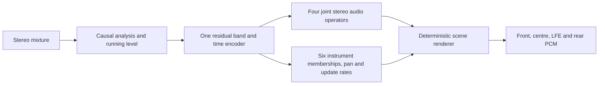
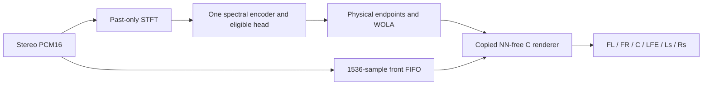

# One causal network for a stronger rear scene

**Historical ledger and final spectral result, owner-requested documentation:** [Complete separator attempt chronicle](UPMIX_SEPARATOR_CHRONICLE_2026-09-25_TO_2026-09-30.md) continues the original training history with named mask/sep variants, every review16–43 mechanism, data interventions, interrupted/paused attempts, BSRNN and one-network iterations. [Completed spectral40k full40 pair](UPMIX_UNIFIED_SCENE_ARCHITECTURE_2026-09-30.md#-completed-spectral40k-pair-joint-promotion-fails): nominal G/K/P/S .225/.217/.219/.191, V/B/D .0139/.1585/.0139,31/40 swings, entry .799/.451;9/13 absolute gates pass but bass/movement/both entry gates fail. Paired DEV source gain+.1383dB<+.3 and string regression fail relative promotion. Original CSV/event/hash evidence is archived. At2026-10-01T03:28:25Z the study is terminal, matching processes/lease absent; no new efficacy run is queued and the agent stays paused. Earlier pending/running snapshots are historical.

**Owner-requested wrap / agent pause, 2026-09-30:** [Consolidated session record](UPMIX_SESSION_WRAP_2026-09-30.md) collects results, failures, all experiment-report links, one-network architecture, raw artifacts, acceptance gaps and the finite restart sequence. At 2026-10-01T01:38:36.9304050Z spectral is 37,000/40k with supervisor45888/launcher37976/trainer18188 live; control40k is terminal. The already running supervisor may finish its fixed training/audit/full40 evaluation; pausing the agent does not stop that external job. No upper64 efficacy training is queued. Upper64 Python preparation passes23 structural checks and observes129.327M selected denseMAC/s; no quality, int8 port or device claim. Full40 spectral, native int8 qualification, genuinely untouched20, loaded-device≤150M/≤85ms and owner CarPlay proof remain open. Earlier live snapshots below are historical.

_2026-09-30. Track B. Owner direction: replace q6d + guard + v21a with one capable network and make the rear scene more expressive. Paired TRAIN fitting completed; real-FFT defect corrected and waveform/host contracts verified. No DEV-quality, scene, device or car candidate established._

**Latest verified state:** the spectral20k fitting checkpoint now has a standalone C/int8 port with native float parity, exact selected-output/state replay, ARM/QNX arithmetic and full TRAIN4 quantization screen passing (eligible loss.0658dB). The complete standalone FFT/WOLA/NN-free C5.1 chain also passes native Mac/Windows19numeric gates and ARM/QNX64hop arithmetic replay; C is zero and scene dormant. Broad156TRAIN comparison remains active, control27,250/40k, followed by spectral40k and original full40 renderer/events. These are distinct scopes; independent20, broad int8, loaded device and owner ears remain open.

## 🎯 Decision and acceptance

Build **one shared causal encoder with joint audio and scene outputs**. One feature pass, one recurrent trunk, one checkpoint, one worker invocation and one state owner. The network estimates audio for eligible instruments, vocal, drums and bass; it also estimates persistent instrument membership and stereo placement. The renderer remains deterministic DSP and is part of the measured end-to-end system. Multiple output heads share the trunk; they do not introduce separate inference networks.

The owner wants full instruments clearly behind with a stable, wide scene. The previous 15–20% rear-energy targets are historical engineering floors. Passing them does not prove expressive rear sound. Retain them for continuity, and add an explicitly labelled expressiveness exploration before freezing a higher numerical delivery target or calling the system successful. The owner's live CarPlay verdict remains the acoustic acceptance gate.

| Requirement | Evidence needed |
| --- | --- |
| Replace all three deployed networks | Host adapter consumes only the unified outputs; no q6d, guard or v21a inference in that candidate; later one blob and one invocation in Track A's port |
| Improve instrument delivery and protection together | Matched Track A/unified/SIMO comparison on identical DEV40×60s, input/renderer conditions and recorded programme level; every source and song retained |
| Expressive rear with body and attacks | Report rear delivery by instrument, frequency band and attack/sustain; source retention and absolute rear level alongside rear fraction; eventual owner listening |
| Stable when singing starts | Source-attributed entry median/p10 ≥.85/.60 and useful absolute instrument retention before/after; no nearly silent stability result |
| Runtime fit | ≤150 M measured device int8 MAC/s and ≤85 ms extra latency; complete transforms/DSP/state traffic and loaded deadlines reported separately |
| Final independent proof | Original full40 plus an adequately covered untouched20 set and owner blind live CarPlay; already inspected songs cannot supply independence |

## 🔎 What existing results establish

The [completed causal pair](UPMIX_CAUSAL_GENERALIZATION_2026-09-29.md) improved natural DEV paired SI-SDR by1.303dB, with all11 relative quality gates passing. Direct C improves keys/piano rear shares to.159/.135 and voice to.0059, but guitar/strings remain.121/.109 and entry retention.804/.420. The network costs2.168G estimated neural MAC/s. It is a quality/mechanism reference, not a student fitting the unit.

The [pretrained SIMO reference](UPMIX_BSRNN_REAL_C_CHECK_2026-09-29.md) reaches guitar/keys/piano/strings.200/.211/.219/.204, voice.0022 and entry.876/.746 through direct C. Future context, corpus, pretraining, capacity and output details differ. Its success does not prove that causal compression will preserve those values or that20% rear energy sounds sufficiently expressive.

Track A's [full40 drive1.5 report](UPMIX_MASK_PHASE1_REPORT_2026-09-27.md) gives guitar≈.17, voice≈.08, drums≈.30. Its [failure-enriched20](UPMIX_PRODUCTION_RENDERER_PROBE_2026-09-28.md) gives instruments.176/.166/.118/.225, voice/bass/drums.075/.150/.285 and15/20 swing songs. These20-song numbers are not matched full40 comparisons with the new reference. Obtain the complete current Track A baseline before claiming superiority.

| Already tested approach | Measured limit | Consequence for this proposal |
| --- | --- | --- |
| [Complex audio plus auxiliary role logits](UPMIX_DUAL_HEAD_CAUSAL_PROBE_2026-09-28.md) | Lower vocal also lowered eligible energy; source gates0/4 and entry p10.542 failed | Supervise actual protected audio and eligible reconstruction; adding class logits alone does not solve separation |
| [Fixed8s EMA spatial state](UPMIX_DUAL_STATE_PROBE_2026-09-28.md) | State affected output, but protected ratios failed and entry-tail improvement was too small | Train membership/placement from true instrument activity; test learned state against bypass on the same checkpoint |
| [Output invariance penalty](UPMIX_VOCAL_INVARIANCE_PROBE_2026-09-28.md) | Eligible transmission collapsed to.0713 while ratio stability appeared good | Require absolute eligible audio reconstruction/retention; output equality alone cannot establish stable content |
| [Anchored synthetic entry reconstruction](UPMIX_VOCAL_ENTRY_TARGET_PROBE_2026-09-28.md) | Preserved level, but protected/entry gates still failed at4k | Entry pairs are a later isolated intervention, not an assumed cure bundled into the first run |
| [Scalar matrix source penalty](UPMIX_MATRIX_SOURCE_LOSS_PROBE_2026-09-28.md) | Raised eligible and protected energy together | Joint source outputs require their own controlled supervision test; extra losses have no automatic quality guarantee |

This is a new integration direction with an untrained compact prototype. It does not establish that shared inference, learned persistence, distillation or finer family supervision will beat the measured shelf.

## 🧠 Implemented prototype and output contract

Prototype: [unified_upmix_net.py](../../tools/stereo-upmix-render/unified_upmix_net.py). Defaults:2048/512 STFT interface,48 existing unequal bands,24-channel normalized residual trunk with2 temporal/frequency blocks,16-channel local/global states,16-channel decoder bottlenecks. Time GRUs are forward only; frequency bidirectionality remains inside the current frame. Input is stereo mixture spectra only. Fixed TRAIN normalization constants are explicit buffers, never statistics from future input or DEV.



| Output/state | Prototype shape/meaning | Replaces or supports |
| --- | --- | --- |
| `source_masks`, `source_stft` | Four stereo complex diagonal operators and estimates: eligible, vocal, drums, bass; `[B,T,4,1025,2]` complex | Eligible extraction/protection that previously required mask plus guard |
| `family_presence` | Six independently sigmoid scores per48-band frame: guitar, keys, piano, strings, winds, other | Fine instrument evidence for the scene; scores are uncalibrated until trained |
| `membership`, `family_pan` | Six persistent memberships and pans per band, driven by learned per-family update rates | Scene continuity and spatial placement that previously depended on q6d and vetoes |
| Carried state | Per-block temporal GRUs, global GRU, input level, family membership and pan | One state owner; caller explicitly resets/detaches |

Protected estimates supply learned evidence and training targets; a high vocal posterior must not automatically multiply down the whole eligible output. Sources overlap in a cell, so scene memberships use independent probabilities rather than a winner-takes-all softmax. The prototype's family state is a mechanism hypothesis; it has not learned source identity. Four source operators are diagonal stereo complex masks, not a proven full2×2 unmixing operator or isolated family waveforms.

The native48-band scene outputs **are not q6d's32-band/264-value ABI**. A frozen host adapter must define band-overlap mapping, activity/confidence calibration, source membership, attack/body handling and fallback. A change in network count alone is not a complete renderer replacement. Direct C is the starting routing condition because the original C produced15/40 swings even with the better causal estimate. Any Track A integration requires its owner; Track B changes only copied host tools.

## ⚙️ Counted cost and structural checks

Default prototype has **483,086 parameters and110.0055 M estimated dense MAC/s**, counting every audio/scene head at93.75 frames/s. This estimate excludes FFT/iFFT, feature/normalization/activation work, complex products, reductions, scene-state arithmetic, renderer and int8 memory/kernels. It is below the neural screening ceiling; no device-fit claim follows. Four protected/eligible spectral outputs do not require four production iFFTs: protected spectra can supply evidence while only selected rear audio is synthesized, subject to the frozen adapter and measurement.

| Dense component | MAC per frame |
| --- | ---: |
| Input projections |147,600|
| Temporal GRUs |331,776|
| Current-frame frequency GRUs |248,832|
| Residual projections |110,592|
| Local interface |18,432|
| Global GRU |1,536|
| Decoder bottlenecks |24,576|
| Four-source projections |262,400|
| Family scene projection |27,648|
| **Total** |**1,173,392**|

[CPU smoke evidence](UPMIX_UNIFIED_SCENE_ARCHITECTURE_2026-09-30_smoke.json), local Torch2.10.0: all future-prefix differences0; arbitrary1/7/1/12-frame chunk split preserves outputs within7.634e−7 absolute; reset reproduces output exactly; source attribution closes to3.872e−15 NSE; silence finite; encoder/trunk/audio/scene gradients finite and nonzero. Random spectra establish numerical structure only. Waveform streaming, transform latency, physical symmetry, real-music fitting, int8 parity and acoustic quality remain open. The first smoke caught Python's reserved `global` keyword in a state constructor; corrected to `global_state` before the successful test. No training or data was affected.

## 🎓 Training and comparison sequence

1. **Freeze the host replacement contract and matched Track A baseline.** Read current configs/blobs; do not modify them. Implement copied-host replay using the unified outputs alone. Verify output channel ordering, source-operator attribution, and stateful causal transform reconstruction on real TRAIN audio. Report native48→renderer-band mapping and every remaining deterministic control. Do not call an injection test that still runs q6d/guard a complete three-network replacement.
2. **Establish learnability on the exact frozen TRAIN fitting crops.** First train eligible reconstruction with the joint source/scene heads inactive, then a matched all-source audio arm from identical trunk initialization with the same steps/draws. Targets come from real stems, with per-source loudness normalization/weights frozen from TRAIN gradient/error audit. Fit the four source estimates directly; record eligible/protected audio and attribution, not scalar CE alone. Membership supervision uses audited raw MoisesDB instrument-family sidecars; coarse seven-slot `other` alone cannot label six families.
3. **Activate and isolate the scene state.** Hold source training/data/horizon constant, add true-family activity/pan targets with explicit silent/absent masks, and supervise family persistence through natural entries. Compare trained scene state against bypass on the same checkpoint. Freeze coefficient calibration on TRAIN; demonstrate learned head usage and no eligibility collapse. Start with the completed best true-stem recipe. New corpus/remix, teacher supervision and synthetic vocal-entry pairs remain subsequent controlled interventions.
4. **Complete broad training and matched full40.** Predeclare seed, full horizon, draw sequence and terminal selection before GPU work;4k is a diagnostic snapshot, not automatic convergence evidence. Compare Track A, unified audio-only/scene arms, and saved causal/SIMO references on identical songs/input and declared routes. Report paired song confidence intervals, all family shares/bands, absolute level, source leakage, entries/exits and any-stem motion. A single untrained architecture does not justify a new long training queue.
5. **Teacher and quantization work after an acoustic recipe is established.** Optional SIMO training-only audio targets with true-stem authority and source/treble attribution audit; no q6d imitation as the sole target, no latent-state MSE shortcut. Use quantization-aware training and device parity/profile after the compact model passes offline joint quality. Do not enlarge the≤150M allowance or reinterpret1.33ms mask timing as unused full-chain capacity.

The owner authorized implementation, training and completion. The audio fitting pair uses complete true-stem targets and can run independently while the copied-host adapter is being built. Host comparison remains mandatory before a broad acoustic claim; dormant scene heads are not presented as trained routing.

## 🎚️ Expressiveness experiment

Explore predeclared instrument transfer settings aimed at approximate **20%,30%,40%** rear-energy operating points. These are exploratory points, not newly accepted universal targets, per-song fitted gains or a promise that40% is perceptually correct. Calibrate a single global transfer setting for each point on TRAIN/privileged reference audio, freeze it, then record actual DEV outcomes. Rear fraction alone cannot identify body, attacks, melody, decorrelated wash or cabin localization.

- Keep programme level, front sound and rear level visible. Never increase rear fraction merely by removing front energy. Do not treat Track A's protected-heavy rear RMS as an instrument-loudness target.
- Attribute useful eligible audio and protected leakage at each point. Protected limits remain voice≤.02, bass≤.06, drums≤.08; stronger instrument transfer cannot hide a protection regression.
- Report guitar/keys/piano/strings/winds body, attack and upper-band delivery with actual source coverage; absence is undefined, not zero. Retain front timbre and image as separate outcomes.
- Inspect absolute eligible entry pre/post level alongside median/p10 retention. Learned membership must not cause long tails or hold an instrument that ended; exits and attacks are required controls.
- Compare rear L/R correlation/width and instrument pan stability; correlation alone is not a perceptual score. Confirm channel/speaker routing through the CarPlay chain.
- Select the final expressive operating point through the owner's shuffled, programme-level-matched live CarPlay comparison once Track A has ported a passing candidate. PC previews remain explicitly offline.

## 📍 Current handoff

Implemented: compact unified prototype; paired true-stem fitting launched after protocol commit `0a6fe70a`; copied-host audio-only renderer built and verified; past-only waveform transform implemented. The original pair completed with a verified audit but failed the absolute fitting gate. The bounded20k extension completed and passed all frozen fitting/numerical gates; details below. The next frozen study uses156TRAIN songs and the actual past-only waveform path, with20candidate-specific holdout songs reserved before broad training. Scene supervision, broad generalization, device and listening remain open. Keep both completed reference checkpoints and all negative experiments available for comparison.

## 🧪 Frozen first fitting pair

Runner: `tools/stereo-upmix-render/pc/run_unified_upmix_fit.ps1`; trainer: `train_unified_upmix_fit.py`; fresh PC root: `D:\upmix\runs\unified_upmix_fit_v1`. This is a TRAIN-only mechanism check, not DEV selection or a production candidate. The copied-host adapter is independent work during fitting; no source changes are permitted after this protocol is prepared.

| Frozen choice | Definition |
| --- | --- |
| Fixtures | Exact four natural 8s TRAIN crops from `separator_causal_reference_v1/manifest.json`; manifest SHA256 `95edc076b2bf10fb0019b440da147d64046dcea16128bb038f4022c6b72bbc99`; selected int16 and split hashes verified again |
| Inputs/targets | Exact sum of eligible, voice, drums and bass; seven-slot truth only; no teacher, remix, extra corpus, fine-family labels or DEV |
| Initialization | Identical seed1 checkpoint for both arms; all source decoders present in both; scene parameters frozen and not evaluated during fitting |
| Control | Eligible full audio objective only |
| Intervention | Same eligible objective plus normalized mean of vocal/drum/bass full audio objectives; shared encoder and joint decoders |
| Source normalization | One scalar per source, eligible RMS/source RMS on the four fixed TRAIN crops, floor1e−5 |
| Auxiliary weight | Before any update, `0.20 × eligible shared-trunk gradient norm / normalized protected mean shared-trunk gradient norm`; calibration and checkpoint recorded in `prepared.json` |
| Schedule | Both10,000 terminal steps, AdamW lr3e−4, weight decay1e−4, global grad clip5; TF32 off; no early best-checkpoint selection |
| Reporting | Every250steps: loss and SI-SDR per source, actual-mixture eligible operator attribution, source-presence mask and elapsed seconds |
| Terminal audit | Independent CPU load/replay: loss difference≤1e−4 and SI-SDR difference≤.05dB; saved-weight real-spectrum causality/chunk test; frozen scene tensor hashes |
| Fitting gate | Joint eligible loss≤1.05×control; median eligible SDR≥control−.3dB and≥7dB; no eligible crop worsens by>1dB; each present protected source median SDR≥0dB |

Protected-source SI-SDR gates exclude absent crops (source energy≤1e−6 of summed source energy); those crops remain in the reconstruction loss and leakage report. A zero-power source does not establish successful protection. Scene audio/routing, natural generalization, streaming waveform delay, int8/device budget and owner listening remain outside this fitting gate.

The running-level computation now uses bounded128-frame analytic EMA scans instead of one GPU operation per frame. It carries the previous level across arbitrary chunks. [Updated structural evidence](UPMIX_UNIFIED_SCENE_ARCHITECTURE_2026-09-30_stage1_smoke.json) records the exact source SHA: future-prefix error0, chunk error≤7.153e−7, reset0, attribution closure3.808e−15; all source/scene gradients finite and nonzero. A separate synthetic four-audio-objective backward/replay succeeded with the scene parameters frozen. The original smoke file remains historical evidence for the prototype revision.

A failed fitting gate is recorded and diagnosed. It must not be turned into a long broad run merely because a checkpoint exists. Passing this gate only authorizes the already requested next training/evaluation work; it does not meet the CarPlay goal.

## 🔌 Audio-only host and waveform implementation

[Builder](../../tools/stereo-upmix-render/build_unified_audio_host.py) copies the CLI, stereo DSP, HSSR DSP and legacy neural C implementations into a new host build directory. It removes the old control inference, permits null legacy models only in those copies, requires a same-length eligible stereo PCM16 injection, and preserves the direct/no-bed source route. Every q6d/guard/mask inference and model-file loader is replaced by an abort trap; the CLI refuses their arguments. A successful render records zero old neural invocations and zero old blobs. Original source hashes are checked before/after building. Nothing under `hook/audio` is written.

This is **audio-only**: scene membership/pan outputs do not yet guide the renderer. Reset old control values remain zero; deterministic front/LFE/body/gain processing stays explicit. It is not a complete scene adapter, device port or production build. The isolated Windows executable [build manifest](UPMIX_UNIFIED_SCENE_ARCHITECTURE_2026-09-30_host_build.json) records source/copy/binary hashes.

[Native synthetic verification](UPMIX_UNIFIED_SCENE_ARCHITECTURE_2026-09-30_host_smoke.json): vocal entry leaves both rear-carrier energies unchanged (ratios1/1), distinct left/right carriers retain correlation≈−2.7e−8, voice-only plus zero eligible estimate gives exactly zero rear, centre remains zero, and missing/short eligible input or old network arguments fail. This validates routing with known audio, not extraction on songs.

[Past-only streaming transform](../../tools/stereo-upmix-render/unified_upmix_stream.py): Hann2048/512, zero-start analysis, shared carried neural state, fixed-normalization causal WOLA and explicit three-hop flush. [CPU waveform smoke](UPMIX_UNIFIED_SCENE_ARCHITECTURE_2026-09-30_stream_smoke.json): identity NSE1.826e−14, streamed identity1.811e−14, whole-frame versus sample-stream random-network output5.055e−14, arbitrary-chunk error0 and future-input prefix error0. The array delay is1536samples/32ms; hop acquisition can add512samples/10.667ms. Neural runtime, scheduling, additional C DSP, transport and cabin delay are excluded and still need real measurements. The zero-start transform differs at startup from the fitting pair's centered-reflect convenience transform; broad training/evaluation must use the actual causal transform before any deployment claim.

Matched Track A baseline tool: [eval_tracka_matched40.py](../../tools/stereo-upmix-render/eval_tracka_matched40.py), CPU-only. It freezes the same40song IDs,60s excerpts,231covered stem rows and input gain as the completed SIMO/causal comparisons, with all three exact existing Track A blobs and no audio injection. Current startup uses mask drive1.5, vocal gate.5 and **rear-air−9dB**. Earlier production20 used the helper's−12dB setting, so those values are not an exact current-shipped baseline. The new baseline records this difference and uses−9 explicitly; it does not alter deployment configuration.

## 📊 First10k checkpoints and audit diagnosis

Both fitting arms completed: eligible-only789.542s, joint-audio1057.411s. On the four repeated TRAIN crops, GPU median eligible SI-SDR6.7505→6.9138dB; every crop improved. Eligible objective.06009288→.06044522 (+.586%). Joint protected medians: voice8.8752, drums10.6346, present bass6.1725dB. These are fits to known material, not unseen-song performance or rear shares. The absolute≥7dB fitting gate **fails**, by about.086dB; all other numeric acoustic comparisons meet their thresholds. No broad promotion is claimed.

The original CPU audit stopped because it compared all output losses to1e−4, including the untrained protected decoders in the eligible-only control. Diagnostic replay found control protected loss differences1.08e−4/1.63e−4/1.42e−4, while its trained eligible loss differed8.46e−7. Joint trained losses differ≤7.90e−7; all-source SDR differences≤.003dB. The original failure/checkpoints/protocol remain intact.

**Audit amendment, frozen before execution:** [audit_unified_upmix_fit.py](../../tools/stereo-upmix-render/audit_unified_upmix_fit.py) applies the original1e−4 loss tolerance to trained tasks, retains.05dB SDR comparison for every output, and adds independent CPU/CUDA spectral **and waveform** parity NSE≤1e−9 for every source, including the dormant control heads. Checkpoint/protocol/source hashes and saved-weight causality/chunk checks remain mandatory. This changes numerical verification of unused outputs; it does not weaken the≥7dB fitting gate or change any training weight, source, target or schedule.

[verify_unified_stream_train.py](../../tools/stereo-upmix-render/verify_unified_stream_train.py) replayed the eligible-only terminal checkpoint on all four actual TRAIN waveforms: identity NSE1.746e−14, saved-model whole/stream replay1.233e−13, future-input prefix9.933e−14. The causal-transform full-crop scores are.25–.51dB below centered-reflect fitting; after2s warmup differences are−.096..+.006dB. Startup/edge treatment measurably matters; broad training must use the causal transform.

## 🐛 Verified inverse-FFT boundary defect and correction

The first strengthened audit also failed: neural spectra agreed on CPU/CUDA (NSE2.35e−11..1.02e−10), but synthesized waveforms did not. Dormant control source waveform NSE reached2.069e−4; joint eligible NSE was1.784e−8. Replaying **identical spectra** isolated the discrepancy to inverse real FFT, not the encoder, TF32, window generation or tensor contiguity. Generating the Hann window on CPU and forcing contiguous input did not resolve it.

The complex outputs contain imaginary DC/Nyquist coefficients. NVIDIA requires real endpoints for C2R and documents undefined behavior otherwise ([cuFFT documentation](https://docs.nvidia.com/cuda/cufft/index.html)); PyTorch describes those imaginary components as unrepresentable in real output ([inverse real FFT documentation](https://docs.pytorch.org/docs/stable/generated/torch.fft.irfft.html)). Explicitly zeroing those two imaginary values reduced same-spectrum CPU/CUDA waveform NSE to3.27e−14, without changing any weights or interior frequency bins. [Before](UPMIX_UNIFIED_SCENE_ARCHITECTURE_2026-09-30_fft_before.json) and [endpoint probe](UPMIX_UNIFIED_SCENE_ARCHITECTURE_2026-09-30_fft_endpoint_probe.json) retain the measurements.

[unified_upmix_audio.py](../../tools/stereo-upmix-render/unified_upmix_audio.py) now implements functional, differentiable endpoint projection before inverse FFT; endpoint imaginary gradients are zero. The causal waveform path uses it. Legacy `sep_net.py`, Track A and the original10k trainer remain unchanged so their hashes and historical results survive. This is a verified synthesis defect, **not evidence that it caused the guitar/entry quality shelf**. Old GPU estimates remain historical PCM measurements; they do not qualify the corrected real-audio path.

The corrected saved-checkpoint [audit](UPMIX_UNIFIED_SCENE_ARCHITECTURE_2026-09-30_fit_audit.json) passes all numerical/source/hash/temporal checks: maximum all-source CPU/CUDA spectral NSE1.011e−10 and waveform NSE8.081e−11. The original≥7dB fitting gate still fails. The numerical defect was resolved, rather than accepting the earlier divergent waveforms.

## ⏩ Frozen20k extension

The first joint checkpoint misses only the7dB absolute fitting floor; all four eligible crop scores improve, all protected reconstructions are positive, and relative loss/stability checks pass. Execute one bounded continuation of **both** arms to20k total, retaining the original10k checkpoint/protocol/audit and optimizer states in a separate root `D:\upmix\runs\unified_upmix_fit20k_v1`. No architecture, data, source coefficient, scene, DEV or gain change. The mandatory real-FFT endpoint correction applies to both arms. Additional steps and the correction are confounded across phases; do not attribute10k→20k improvement exclusively to either.

[Extension trainer](../../tools/stereo-upmix-render/extend_unified_upmix_fit.py), [single-GPU runner](../../tools/stereo-upmix-render/pc/run_unified_upmix_fit20k.ps1): original terminal states copied byte-for-byte; same constant AdamW3e−4/wd1e−4/clip5; same four TRAIN8s crops and fixed auxiliary coefficient. Eligible-only then joint-audio; fixed terminal20k; every250-step four-source/source-attribution report; numerical audit uses the corrected physical synthesis and original acoustic gates. No best-checkpoint selection or broad promotion from an intermediate crossing. If the absolute fitting floor still fails, diagnose the measured decoder/encoder limit before a long generalization run.

[Current Track A matched40 report](UPMIX_TRACKA_MATCHED40_2026-09-30.md) is complete and freezes the relevant baseline:29/40 any-stem swings; rear instrument shares guitar.1650, keys.1523, piano.0953, strings.0691; voice.0756, bass.1493, drums.2964. Its complete231stem rows, protocol and source hashes are preserved.


## ✅ Completed20k fitting and numerical audit

Both terminal20k arms and the saved-checkpoint CPU/CUDA audit completed. All seven frozen fitting gates pass. The [20k protocol](UPMIX_UNIFIED_SCENE_ARCHITECTURE_2026-09-30_fit20k_protocol.json), [audit](UPMIX_UNIFIED_SCENE_ARCHITECTURE_2026-09-30_fit20k_audit.json) and complete250-step curves ([control](UPMIX_UNIFIED_SCENE_ARCHITECTURE_2026-09-30_eligible_fit20k_progress.json), [joint](UPMIX_UNIFIED_SCENE_ARCHITECTURE_2026-09-30_joint_fit20k_progress.json)) retain both phases; original10k failure/checkpoints remain separate.

| Terminal20k TRAIN metric | Eligible-only | Joint four-source |
| --- | ---: | ---: |
| Eligible median SI-SDR |7.563687dB|7.539014dB|
| Eligible objective |.056150999|.057022773|
| Vocal median SI-SDR |Untrained control head|9.203519dB|
| Drum median SI-SDR |Untrained control head|11.022015dB|
| Present-bass median SI-SDR |Untrained control head|6.616205dB|

Joint eligible objective is1.55% higher, within the predeclared5% allowance; median eligible SDR is.025dB below control, within.3dB. Every protected median is positive; absent bass remains excluded. This establishes compact four-source fitting, not better rear share or generalization. Relative/source quality outside these four crops is still unknown. Additional training and corrected IFFT are confounded across phases.

Audited control checkpoint `5c8c3343cdd8d434405af659f37435a25dc7d69f08aa8903b2eb88a46cae24b6`; joint checkpoint `4eacc7d14c91856d92434c2c11eff210324fb401b93fa766fc5ab17850e2c672`.20k audit SHA256 `accc66d3efb1c1033b05350b54dd893cae50f64c9437d021e8847411958f8735`. All-source CPU/CUDA waveform parity, frozen dormant scene and future-prefix/chunk audits passed. The supervisor returned0 and released its sole GPU lease.

## 🔒 Frozen broad source study and holdout scope

[Trainer](../../tools/stereo-upmix-render/train_unified_upmix_generalization.py), [real-C evaluator](../../tools/stereo-upmix-render/eval_unified_upmix_generalization.py), [runner](../../tools/stereo-upmix-render/pc/run_unified_upmix_generalization.ps1). Both arms start from the **same audited joint20k weights**, with fresh optimizers and a fixed40k broad horizon. Eligible-only versus joint changes only the three protected audio objectives. Same source coefficient/normalizers, architecture,156TRAIN inventory, deterministic crop/gain sequence,2k warmup/cosine schedule and terminal checkpoint selection. Scene heads remain frozen. No new corpus, teacher, remix or gain search is bundled into this mechanism comparison; prior failed remix results remain in their reports.

The broad loss and inference now use **the actual past-only Hann analysis and WOLA synthesis**, including explicit real DC/Nyquist endpoints. TRAIN compensates the fixed1536-sample output delay for supervision; deployment still needs aligned mixture/front/rear delays and measured execution latency. No centered inference shortcut. Local four-source transform reconstruction NSE1.77e−14, attribution closure2.05e−14 and all-head finite backpropagation passed. The PC must next pass matched20-step TRAIN smoke, saved all-output CPU/CUDA PCM parity and real chunk-state replay before either long run.

Before broad training, [metadata-only partition](UPMIX_UNIFIED_SCENE_ARCHITECTURE_2026-09-30_candidate_holdout.json) reserved20originalTRAIN songs by whole artist, excluding every fitting/monitor artist. Remaining156songs train both arms. Metadata presence covers17guitar/7keys/6piano/2strings/2winds songs; this does not guarantee activity inside60s cuts. Deterministic hash order and bounded subset-sum choose the partition without audio or model scores. [Reservation tool](../../tools/stereo-upmix-render/reserve_unified_holdout.py) and metadata provenance are recorded. **These20are independent of this fresh candidate, not globally pristine:** historical students trained on the original176TRAIN pool. Do not relabel them untouched DEV or claim they close the strict acceptance goal. Legacy inspected TEST20 also cannot serve as pristine validation. The strict untouched20 acceptance remains open. Reserved audio stays sealed until a fixed terminal candidate passes the inspected full40; no checkpoint/knob selection uses it.

TRAIN12/DEV40 monitors retain the previous exact20s cuts with up to10s preceding context; intermediate reports are diagnostics only. At terminal40k both arms undergo CPU/CUDA signal audit, then full40×60s/231stem rows through the copied **NN-free C host**, plus every detected source-attributed vocal entry/exit/sustained event. Historical models and Track A are never run inside this candidate renderer. Nominal surround gain **.40** is fixed before DEV; .3235 and.50 are diagnostic operating points, not best-of-DEV or per-song fitting. Common front retention.5, front bass−3, air−9, body0, attackoff and unchanged `.7/dry_mix_peak` input gain. Absolute levels, clipping, protected shares and swings are exported at each point; an increase in loudness alone is not a quality or listening verdict. Product floor gates use the nominal point, with the original voice/bass/drum, instrument, slope, swing and entry limits.

Scene/family supervision is a subsequent isolated step on verified true Moises instrument sidecars, after source generalization is measured. One shared audio model and an NN-free C route are not yet the complete three-model semantic replacement: persistent family state,48→renderer-band mapping, bass/LFE semantics, int8/device execution, strict unseen20 and owner live-CarPlay listening remain required.


Broad startup recovery: the first preparation worker exited before creating its protocol or updating weights: new source-hash collection passed a Python string to a helper requiring `Path`, raising `AttributeError`. Corrected explicit path conversion in trainer/evaluator; complete module-hash collection now executes locally. Original supervisor log retained; no numerical/quality gate relaxed, no checkpoint discarded. New source hashes and launch recorded before the second attempt.


## 🔬 Broad waveform audit refinement before long training

The v1 preparation recovered its path-typing startup failure and both20-step TRAIN smoke arms finished, but the end-to-end all-source CPU/CUDA waveform NSE≤1e−9 gate failed. **Neither40k arm started.** Preserve `D:\upmix\runs\unified_source_generalization_v1`, its manifest, both smoke checkpoints, failure record and diagnostic files. [Original protocol](UPMIX_UNIFIED_SCENE_ARCHITECTURE_2026-09-30_broad_v1_manifest.json), [failure](UPMIX_UNIFIED_SCENE_ARCHITECTURE_2026-09-30_broad_v1_runner_failure.json), [native errors](UPMIX_UNIFIED_SCENE_ARCHITECTURE_2026-09-30_broad_v1_numeric_diagnosis.json), [backend decomposition](UPMIX_UNIFIED_SCENE_ARCHITECTURE_2026-09-30_broad_v1_backend_diagnosis.json), [control smoke](UPMIX_UNIFIED_SCENE_ARCHITECTURE_2026-09-30_broad_v1_control_smoke.json), [joint smoke](UPMIX_UNIFIED_SCENE_ARCHITECTURE_2026-09-30_broad_v1_joint_smoke.json).

On the saved joint20-step weights, native FFT input NSE is5.25e−14; total waveform NSE is2.57e−9..8.89e−9. With **identical GPU input spectra supplied to the CPU model**, waveform NSE falls to1.39e−10..5.69e−10 and spectral NSE≤6.38e−10. With **identical predicted spectra** supplied to both synthesis backends, waveform NSE is1.85e−14..2.68e−14. The earlier invalid-endpoint IFFT defect is corrected; this difference arises from tiny native input-FFT rounding amplified by the model. Native PCM error RMS is.035.. .091PCM16LSB, maximum1.268LSB, and SI-SDR deltas≤.000136dB. This is a numerical diagnostic, not an acoustic improvement or int8 proof.

Freeze a new v2 root **before long training**. Keep the original≤1e−9 all-head PCM gate for **identical input spectra** and add explicit native end-to-end gates: FFT input NSE≤1e−12, waveform NSE≤1e−7, maximum difference≤4PCM16LSB, per-source audio-loss difference≤1e−4 and SI-SDR difference≤.05dB. This is an explicit numerical protocol amendment; the acoustic fitting, source, rear, motion and entry gates are unchanged. Real arbitrary-chunk waveform replay still requires≤1e−9. Saved GPU input spectra and outputs make the two checks reproducible. No gain or checkpoint tuning is introduced.

Both training and validation now analyze **the actual summed PCM mixture once**, matching inference, instead of summing separately transformed target spectra as a mathematically equivalent float shortcut. Target transforms remain independent for supervision/attribution. Architecture, warm start, recipe, optimizer and terminal horizon remain unchanged. Original v1 is retained; v2 repeats both20-step execution/audit gates before any broad update.


## 🧮 Fixed-decoder TRAIN diagnostic

While broad training runs, the isolated two-thread CPU [decoder probe](../../tools/stereo-upmix-render/audit_unified_decoder_capacity.py) reads the audited joint20k weights and the same four exact TRAIN crops. The saved16-dimensional eligible output basis stays fixed; per-frame privileged features minimize squared spectral error with trace-relative1e−10 ridge in float64. No model weight, GPU state, split or objective changes. The complex affine mapping was verified before the PC execution. [Complete48-band result](UPMIX_UNIFIED_SCENE_ARCHITECTURE_2026-09-30_decoder_bound_unbounded.json).

Past-only current eligible crop SDRs are8.454/11.429/2.990/5.007dB; unconstrained fixed-basis oracle gives28.206/31.240/21.628/22.397dB. Squared spectral error falls.226182→.005467. These are privileged TRAIN results, not a usable separator or rear score. **Do not conclude the encoder is the only limit:** the oracle ignores the saved tanh feature bounds and the protected objectives. Many inferred coordinates exceed[-1,1], with maxima above2000 in low bands. A bounded feasible-feature check is needed before deciding whether decoder saturation or upstream features dominate. Upper-band oracle errors remain.24–.55, so the global score also hides frequency-dependent residuals. Keep broad training unchanged until its frozen terminal result.

Live v2 broad execution: matched20-step source/exposure/CPU-CUDA/state audits passed; eligible-only40k is running on the sole GPU, then joint40k, independent CPU audit and predeclared full40 real-C/events execute automatically. No candidate holdout audio has been read. [Frozen v2 manifest](UPMIX_UNIFIED_SCENE_ARCHITECTURE_2026-09-30_broad_v2_manifest.json), [execution audit](UPMIX_UNIFIED_SCENE_ARCHITECTURE_2026-09-30_broad_v2_smoke_audit.json). Nominal/screen points remain frozen; no scene, device or acoustic success claim follows from this execution audit.


## 📐 Bounded eligible decoder probe

The [bounded TRAIN result](UPMIX_UNIFIED_SCENE_ARCHITECTURE_2026-09-30_decoder_bound_bounded.json) keeps the same fixed weights and constrains every privileged decoder feature to the actual tanh range[-1,1].64 cycles of exact scalar coordinate minimization start from the saved network's feasible features. Every band remains feasible and its squared error does not increase. This finite procedure reports projected-coordinate residuals; it is not a certified optimum.

Past-only eligible SDRs become17.538/21.592/13.489/15.331dB, median16.435dB, versus the saved encoder's median6.731dB. Spectral NSE falls.226182→.046682. This establishes substantial representational room **for the eligible output on these four TRAIN crops**, within the saved decoder's feature bounds. It does not prove causal recoverability, generalization, simultaneous protected-source quality or that all high-frequency bands can be restored. The earlier unbounded result remains a separate, more optimistic diagnostic. A shared four-source basis can constrain tasks differently; an eligible-only oracle must not be used as proof that joint training can achieve every source target.

## 🧱 Independent float and int8 C graph

[Standalone runtime](../../tools/stereo-upmix-render/unified_runtime/README.md), [exporter](../../tools/stereo-upmix-render/export_unified_upmix_runtime.py), [CPU TRAIN verifier](../../tools/stereo-upmix-render/verify_unified_upmix_runtime.py). No hook files, running training modules or GPU environment changed. One immutable blob holds432 named parameter tensors; caller-owned state is11600bytes. Prediction allocates no heap memory. It reproduces running level, per-band layer norms, both time/frequency recurrent blocks, local/global features, all four complex output operators and family membership/pan state. Every dense operation is counted:1173392MAC/frame,110005500MAC/s at93.75frames/s; excluded FFT/features/norm/nonlinear/state/DSP costs still need device measurements.

The C graph uses PyTorch's reset/update/new GRU ordering, including reset after the recurrent affine/bias. Float mode stores1,945,892bytes; symmetric per-row matrix int8 plus float norms/biases stores667,964bytes. Dynamic matrix inputs are per-vector signed int8 with ties-to-even rounding and int32 accumulation. A NEON dot kernel is included but not yet validated on ARM. Native clang and MinGW builds pass warnings-as-errors. The first MinGW build caught two misleading-indentation warnings; they were corrected before the executable was frozen. Available Docker images have only unversioned QNX tags; the requested4.9 image is absent, so no QNX compilation or device claim follows from the Windows build.

[Export manifest](UPMIX_UNIFIED_SCENE_ARCHITECTURE_2026-09-30_runtime_assets_manifest.json), [frozen check protocol](UPMIX_UNIFIED_SCENE_ARCHITECTURE_2026-09-30_runtime_train_protocol.json), [complete check](UPMIX_UNIFIED_SCENE_ARCHITECTURE_2026-09-30_runtime_train_check.json). The same audited joint20k checkpoint and four exact TRAIN8s crops produce3012neural frames. **Every float parity gate passes**: all-source waveform NSE≤4.281e−13, maximum scene/state error6.587e−6 and all source SDR differences≤.01dB. Scene is still untrained; numerical replay is not semantic scene validation.

**The first int8 screen fails.** Drum median SDR falls10.146829→9.306996dB (−.839833dB), beyond the predeclared.3dB allowance; one drum crop falls1.5823dB. Eligible median loses.0308dB, vocal and bass medians remain within.3dB, and eligible/protected attributed energy gates pass. No tolerance is relaxed. Quantized scene field differences reach.3334, but those fields are untrained and have no acoustic pass criterion yet. Keep the float/int8 results and blobs as separate evidence; quantization-aware recovery must follow a validated acoustic recipe.

Windows standalone neural timing: float mean/p99/max.6445/.8662/.9532ms; int8.7453/.9312/5.1715ms. This is the PC scalar/auto-vectorized path, not Krait/NEON performance, full-chain latency or head-unit deadline proof. Input/output file IO is excluded. Source masks require physical endpoint projection after application and a separate causal WOLA/renderer. No shipping deployment was attempted.

Live broad progress at this checkpoint: eligible-only has passed32k of40k on156TRAIN songs; joint40k and terminal real-C source/events remain pending. The30k diagnostic still has negative median eligible SDR on TRAIN12/DEV40 and weak upper-band instrument transmission. Four-crop fitting and a correct C port do not establish that the new shared encoder has escaped the broad-data shelf.


## 🤝 Shared four-source decoder feasibility

The [joint bounded TRAIN diagnostic](UPMIX_UNIFIED_SCENE_ARCHITECTURE_2026-09-30_joint_decoder_bound.json), [tool](../../tools/stereo-upmix-render/audit_unified_joint_decoder.py), uses one common16-feature vector for **all four outputs simultaneously**. The saved decoder and tanh bounds remain fixed. Privileged true targets minimize a TRAIN-normalized squared spectral proxy, with the protected coefficient from the fitting calibration; this proxy is not the training L1/multires objective. The affine construction reproduces actual saved outputs before64 coordinate-descent cycles; total per-band weighted error cannot increase, but individual sources may trade off. No GPU/training weight or DEV is involved.

All four source waveform results improve on these four crops. Median eligible SDR6.731→14.874dB; voice8.187→11.438, drums10.147→12.703, present bass5.378→11.244dB. Eligible spectral NSE.226182→.060391. Unlike the eligible-only probe, this establishes feasible shared-feature room while preserving the protected tasks on this fixture. It still does not prove that a causal encoder can infer those features, give a certified optimum, or resolve natural-song generalization. Broad terminal training remains the decision point; no network enlargement is justified solely by this diagnostic.

## 🦾 ARM/QNX compilation

[Isolated build evidence](UPMIX_UNIFIED_SCENE_ARCHITECTURE_2026-09-30_runtime_qnx_build.json), [build script](../../tools/stereo-upmix-render/unified_runtime/build_qnx.sh). The installed unversioned toolchain resolves to GCC8.5.0; its image ID, actual flags, source hashes and binary hash are recorded. The repository is mounted read-only and output uses a fresh standalone directory. ARMv7/QNX softfp NEON build passes warnings-as-errors; disassembly contains signed8-bit widening multiply and pairwise signed16-to32 accumulation. This corrects the earlier missing4.9-tag limitation by using the available compiler explicitly. It is compilation proof only: no ARM execution, NEON parity, unit timing or loaded deadline proof yet.


## 🌊 Complete standalone C waveform path

[Audio stream source/API](../../tools/stereo-upmix-render/unified_runtime/unified_audio_stream.h), [CPU verifier](../../tools/stereo-upmix-render/verify_unified_audio_stream.py), [frozen protocol](UPMIX_UNIFIED_SCENE_ARCHITECTURE_2026-09-30_audio_stream_protocol.json), [results](UPMIX_UNIFIED_SCENE_ARCHITECTURE_2026-09-30_audio_stream_check.json), [ARM build/stack evidence](UPMIX_UNIFIED_SCENE_ARCHITECTURE_2026-09-30_audio_stream_qnx_build.json). Actual stereo PCM passes independent radix2 FFT, one unified graph invocation and eligible physical-endpoint iFFT/Hann WOLA. No old network or hook code runs. One stream owns163760bytes in the checked x64 build; no process/reset allocation.

All five predeclared float waveform gates pass on the four exact TRAIN8s crops: identity NSE1.438e−14; complete C versus PyTorch eligible waveform NSE8.547e−10; maximum eligible SDR delta.0000544dB; repeat/reset error0; changing a future PCM suffix leaves every already emitted complete-hop sample exactly unchanged. Output keeps1536samples/32ms array delay and up to512samples/10.667ms acquisition; execution/renderer/transport latency must be added separately. Source matching is not broad quality or a cabin verdict.

PC float complete-path mean/p99/max.7181/1.0248/4.4824ms; int8.8144/1.0523/1.3988ms. Int8 eligible waveform NSE versus float is.001881, and versus the original identical-input int8 neural-only path.0001084: small native FFT differences can change dynamic activation bins and recurrent trajectories. This records an additional int8 sensitivity, not a waived parity/quality gate. The original drum-quality screen still fails. Dormant scene outputs do not route this audio.

Both standalone paths cross-compile under GCC8.5/QNX ARMv7 softfp NEON. Compiler stack usage is49712bytes for `umx_predict` alone plus632bytes GRU/608bytes linear frames, before the thread/caller stack. A future integration must configure adequate stack and measure loaded execution explicitly; no existing worker capacity is inferred. The source repository mount remains read-only. No unit/restart/deploy action was performed.

Broad control40k finished in5245.797s. Its terminal TRAIN12/DEV40 median eligible SDR is−.6365/−.8314dB; DEV eligible/vocal/drum/bass operator transmission.360815/.111066/.032638/.022540. Upper-band DEV eligible transmission remains.010281 (8–14k)/.009531 (>14k). The four-crop warm-start fit does not generalize adequately. Joint40k is running from the exact same warm start/draw sequence, then the independent audit and full40 C/events follow. Do not reinterpret control's untrained protected reconstruction heads as a valid four-source model.


## 🔬 Quantization error decomposition on TRAIN

[Isolated copy builder](../../tools/stereo-upmix-render/build_unified_quant_probe.py), [factor audit](../../tools/stereo-upmix-render/audit_unified_quantization.py), [results](UPMIX_UNIFIED_SCENE_ARCHITECTURE_2026-09-30_quant_factors.json), [protocol](UPMIX_UNIFIED_SCENE_ARCHITECTURE_2026-09-30_quant_factors_protocol.json). Identical saved input spectra, model/fixture and shared reset/state path; one diagnostic rounds only matrix weights, the other only matrix inputs. They are separate C copies, not mixed-precision deployment recipes. The original runtime, blobs and training remain untouched. First weight-only copy failed warnings-as-errors for unused quantizer/dot code; those unused functions were removed in a fresh diagnostic build, preserving the initial compiler log.

Median SDR changes versus float:

| Rounding factor | Eligible | Voice | Drums | Present bass |
| --- | ---: | ---: | ---: | ---: |
| Weights only |−.0191dB|+.0055dB|−.6790dB|−.2037dB|
| Activations only |−.0130dB|+.0013dB|−.2128dB|−.0150dB|

Weight rounding contributes most of the observed drum regression on this fitting checkpoint. The two errors interact and are not additive. This supports targeting weight-aware recovery **after broad acoustic quality is established**, not assuming activation calibration or a faster dot kernel fixes extraction. It does not prove QAT will recover full int8 quality. The original all-source int8 screen still fails; no threshold was changed.

## 📚 Research cross-check during broad training

The new [BSRNN replication study](https://arxiv.org/html/2609.21918v1), with its [author implementation](https://github.com/magronp/bsrnn), explicitly examines pipeline details alongside model size. Its small prototype is64channels/eight blocks, substantially larger than this24channel/two-block causal student; increasing model size improves its results, while some decoder reductions remain competitive. Its training runs use200epochs, and preprocessing/augmentation choices also matter. These numbers cannot be transferred directly across causality, corpus, metrics and compute budgets. **Inference:** a four-crop fit cannot exclude shared-encoder capacity/optimization limits on the broad task, and a fixed-decoder oracle only tests output representability. No source paper establishes that a110M causal network will reproduce the noncausal SIMO result.

[PyTorch's quantization guide](https://pytorch.org/blog/quantization-in-practice/) describes dynamic input quantization overhead and training with simulated rounding to address quality losses. Our own weight/activation decomposition is the task-specific evidence; generic QAT guidance is not a recovery result. No extra package, environment change, GPU recipe or device budget increase was introduced.


## 🧪 QNX/ARM numerical execution and recovered test failures

[QEMU check script](../../tools/stereo-upmix-render/unified_runtime/qnx_qemu_check.sh), [actual runtime/kernel check](../../tools/stereo-upmix-render/unified_runtime/unified_runtime_arm_check.c), [TRAIN fixture packer](../../tools/stereo-upmix-render/make_unified_arm_fixture.py), [completed ARM result](UPMIX_UNIFIED_SCENE_ARCHITECTURE_2026-09-30_arm_qemu_v4.json). It runs the actual GCC8.5/ARMv7 NEON graph in an isolated Cortex-A15/QNX guest on the Mac; no physical head unit is accessed. First64 frames from each of four already inspected fitting crops are fixed before execution. The ARM check interleaves four caller-owned states frame by frame, whereas the saved Windows reference processed whole streams.24 scalar-reference integer dot cases cover signed extremes, mixed patterns, SIMD tails and full534-input width.

Both modes pass the predeclared numerical gates. All24 dot sums are exact. Float source-estimate spectral NSE≤2.574e−13 and scene maximum difference5.052e−6. Int8 source NSE≤5.975e−5 and scene maximum difference.021895, within the frozen1e−4/.05 diagnostic tolerances. **This is an ARM numerical execution screen, not bit-exact cross-libm full-network int8 parity**, acoustic recovery, Audi/Krait timing, loaded deadlines or the full60s device path. The original int8 drum quality failure remains open.

Preserved recovery sequence: [v1](UPMIX_UNIFIED_SCENE_ARCHITECTURE_2026-09-30_arm_qemu_v1_failed.json), [v2](UPMIX_UNIFIED_SCENE_ARCHITECTURE_2026-09-30_arm_qemu_v2_failed.json), [v3](UPMIX_UNIFIED_SCENE_ARCHITECTURE_2026-09-30_arm_qemu_v3_failed.json), and their raw serial logs ([v1](UPMIX_UNIFIED_SCENE_ARCHITECTURE_2026-09-30_arm_qemu_v1_failed.log.txt), [v2](UPMIX_UNIFIED_SCENE_ARCHITECTURE_2026-09-30_arm_qemu_v2_failed.log.txt), [v3](UPMIX_UNIFIED_SCENE_ARCHITECTURE_2026-09-30_arm_qemu_v3_failed.log.txt), [v4](UPMIX_UNIFIED_SCENE_ARCHITECTURE_2026-09-30_arm_qemu_v4.log.txt)). Initial shell preflight caught a missing space after the cleanup function brace, before any guest execution. Initial dot check failed for16×(-127×127): expected−258064, measured−66040. The SIMD kernel was not changed. A direct volatile function-pointer call proved the **guest libc** `memset(bytes,-127,16)` produces repeated`81 ff ff ff`, not sixteen`81` bytes. GCC had folded constant signed-byte test filling into that call. Explicit volatile test stores resolved all24 dot cases. Runtime initialization uses zero fills, not this negative fill; no production/library patch was made. Guest libc hash is recorded; do not assume the owner's unit uses this library or has this defect.

The next guest passed float but could not spawn the same boot-image executable a second time (ENOENT); explicit path alone did not fix it. A single process now loads/checks float then int8 sequentially, preserving independent model loads and per-stream state. It completes both modes. This bounds the test harness recovery; it does not diagnose a universal QNX spawning issue or justify a device workaround. All gates were frozen before the first guest and remain unchanged.


## 🕰️ TRAIN state-horizon hypothesis rejected for the control

[Diagnostic](../../tools/stereo-upmix-render/audit_unified_training_horizon.py), [fixed protocol](UPMIX_UNIFIED_SCENE_ARCHITECTURE_2026-09-30_train_horizon_control_protocol.json), [all12 TRAIN rows](UPMIX_UNIFIED_SCENE_ARCHITECTURE_2026-09-30_train_horizon_control.json). Read only the terminal40k eligible-only weights and original TRAIN12 20s cuts with up-to10s preceding context; no DEV, parameter or active-training change. It tests whether reset8s training versus longer carried inference explains the poor TRAIN scores. Cases isolate hidden/global resets with level retained, all neural state resets with actual continuous FFT retained, and independent zero-start8s transform/model inference. Last-case delay compensation at edges is explicitly offline; none of these reset policies is a deployment proposal.

Continuous median eligible SDR−.636459dB. Paired median changes: hidden reset−.128080, all-neural reset−.127594, independent zero-start−.106111dB. Eligible transmission changes+.008741/+.008125/−.001955; vocal transmission+.007289/+.007494/+.003389. Every predeclared≥.5dB or≥.03-retention diagnostic improvement signal is false. Restoring the8s training horizon does not repair this control's observed shortfall. This rejects that particular explanation on these TRAIN cuts, not every long-state failure or the joint model's eventual result.

All raw ARM serial logs are now marked binary-preserved in `.gitattributes`, alongside the JSON evidence, so stored bytes agree with the recorded log hashes.


## ✂️ Training-only reconstruction outputs skipped at inference

The source-supervised model still trains and stores four source operators. Live rear synthesis consumes only eligible; protected reconstruction heads can remain auxiliary training targets without computing their terminal affine rows. `umx_predict` retains the original full-output API. New `umx_predict_eligible` computes eligible plus every scene field, writes zero to unused protected mask fields, and retains the identical shared state. The standalone audio path uses this selected API. No running Python training or renderer evaluation source changed.

[Exact ARM check](UPMIX_UNIFIED_SCENE_ARCHITECTURE_2026-09-30_arm_output_selection.json), [raw guest log](UPMIX_UNIFIED_SCENE_ARCHITECTURE_2026-09-30_arm_output_selection.log.txt), [checker](../../tools/stereo-upmix-render/unified_runtime/unified_runtime_prune_check.c), [isolated guest script](../../tools/stereo-upmix-render/unified_runtime/qnx_qemu_prune_check.sh). Both float and int8 pass on Windows and ARM/QNX: all753 frames of each of four interleaved TRAIN streams preserve eligible masks, every scene field and every caller-owned state byte **bit exactly** against the same platform's full-output graph. Unused protected output fields are zero. This preserves current eligible acoustics; it does not recover the original int8 drum reconstruction failure or establish device deadlines.

Counted dense operations drop1173392→976592/frame, or110.0055→91.5555M MAC/s. FFT, norms, nonlinearities, features, DSP and scheduling remain excluded. The blob and trained shared encoder are unchanged.

[Architecture cost table](UPMIX_UNIFIED_SCENE_ARCHITECTURE_2026-09-30_inference_budget.json), [counter](../../tools/stereo-upmix-render/unified_runtime_budget.py):

| Shared width, two blocks | Four outputs, M MAC/s | Eligible plus scene, M MAC/s | Status |
| --- | ---: | ---: | --- |
|24|110.0055|91.5555|Current trained graph; selected C API verified|
|28|135.9998|117.5498|Untrained architecture option|
|32|165.5940|147.1440|Untrained option with little dense margin|

This creates a concrete budget lever for a wider encoder without increasing the150M ceiling. It is not a width selection, a generalization result or measured head-unit compute. Current blob format/state/export support24 only; wider options need explicit implementation and verification. Choose any new source experiment after the fixed broad40k C/events result, rather than changing the live matched study.


## 🔬 Fixed-terminal TRAIN mixture-consistency diagnostic scheduled

[Diagnostic](../../tools/stereo-upmix-render/audit_unified_mixture_consistency.py). Independent CPU supervisor waits for the current joint40k terminal marker, then reads that fixed checkpoint and the original TRAIN12 monitor only. It does not touch DEV, sealed20, weights, running modules or GPU ownership. Three predeclared cases: raw operators, uniform correction `m_i + (1 - sum(m))/4`, and eligible-only residual `1 - sum(protected)` with protected outputs unchanged. Targets score SDR/attributed retention only; projection consumes inferred masks and actual mixture.

This tests missing mixture completeness, a constraint described in [Wisdom et al., ICASSP2019](https://research.google/pubs/differentiable-consistency-constraints-for-improved-deep-speech-enhancement/). Their reported speech enhancement improvement does not establish success for music or this renderer. Our risk is explicit: residual correction can restore instrument energy while sending protected reconstruction error to the rear. The diagnostic requires each protected attributed-transmission delta≤.01 alongside a≥.5dB paired median eligible SDR or≥.03 eligible-transmission improvement. This is an explanatory signal, not a product promotion gate. A failed post-hoc projection does not disprove learning with a projection during training.

Both corrections can be folded into each existing terminal affine decoder because all source outputs share its16 tanh features. No extra shared network, recurrent state or inference rows are needed. Random-graph CPU fold parity passes below1.2e−14 spectral NSE; the saved-checkpoint diagnostic must independently pass≤1e−9 fold parity and≤1e−10 summed waveform closure. No acoustic result exists yet. All current broad40k and real-C gates remain unchanged.


## 🧪 Terminal broad source training and numerical audit complete

[Control monitor](UPMIX_UNIFIED_SCENE_ARCHITECTURE_2026-09-30_broad_control40k_monitor.json), [joint monitor](UPMIX_UNIFIED_SCENE_ARCHITECTURE_2026-09-30_broad_joint40k_monitor.json), [terminal audit](UPMIX_UNIFIED_SCENE_ARCHITECTURE_2026-09-30_broad_terminal_audit.json), [manifest](UPMIX_UNIFIED_SCENE_ARCHITECTURE_2026-09-30_broad_manifest.json). Both fixed40k arms completed with156distinctTRAIN/160000windows and identical draw digest. Control/joint elapsed5245.797/6415.205s. Every saved all-source CPU/CUDA, actual native PCM, chunk and causality gate passes; native PCM source errors≤1.13e−10NSE and≤.124PCM16LSB. No numeric tolerance was changed.

| Terminal monitor | Eligible-only | Joint audio |
| --- | ---: | ---: |
| TRAIN12 eligible median SI-SDR |−.6365dB|−.8688dB|
| DEV40 eligible median SI-SDR |−.8314dB|−.7098dB|
| DEV40 eligible operator TX |.360815|.366473|
| DEV40 vocal operator TX into eligible |.111066|.106075|
| DEV40 drum operator TX into eligible |.032638|.025723|
| DEV40 bass operator TX into eligible |.022540|.020078|
| DEV40 eligible8–14k TX |.010281|.004729|
| DEV40 eligible14–24k TX |.009531|.005921|

The difference of unpaired DEV medians is positive, but the **paired40-song median eligible SDR delta is−.017403dB**, with20/40nonworse. There is no demonstrated broad extraction gain from auxiliary source supervision alone. Joint protected reconstruction medians on DEV are voice3.225/drums2.015/bass2.806dB; the control's untrained protected reconstruction heads do not provide a quality baseline. All transmission figures describe frozen-operator response to components, not literal audible isolated content or rear shares. Full60s C/entries is still required.

### C execution-path failure recovered

[Initial failure](UPMIX_UNIFIED_SCENE_ARCHITECTURE_2026-09-30_broad_c_path_failure.json), [recovery preflight](UPMIX_UNIFIED_SCENE_ARCHITECTURE_2026-09-30_broad_c_path_recovery.json). Initial C evaluation stopped before any rendered song: runner passed the parent Moises directory and `load_song` could not find the first `data.json`. Actual root is `D:\upmix\datasets\moisesdb\moisesdb_v0.1`. All40metadata paths were preflighted and hashed; old runner and failure were preserved. The runner now uses the correct existing root and, on explicit resume, reuses the already verified terminal audit only after manifest/checkpoint/evaluator-audit identity checks. The evaluator, checkpoints, frozen nominal gain, source data, renderer and gates did not change. New supervisor2560 owns oneGPUlease and resumes the original full40protocol. No retraining was performed.

## 🔬 TRAIN mixture-consistency result: no diagnostic gain

[Protocol](UPMIX_UNIFIED_SCENE_ARCHITECTURE_2026-09-30_mixture_consistency_train_protocol.json), [all12rows/result](UPMIX_UNIFIED_SCENE_ARCHITECTURE_2026-09-30_mixture_consistency_train.json). Both folded-decoder numerical checks pass≤2.42e−14spectralNSE; both projections restore summed waveform identity≤1.88e−14NSE. Raw summed-source waveform mismatch median.007465NSE (about−21.3dB) was already much smaller than individual-source reconstruction errors.

Uniform projection gives paired median eligible SDR+.020265dB, eligibleTX−.012780 and vocalTX−.005902; no predeclared diagnostic improvement. Eligible residual gives−.357355dB, eligibleTX−.054089 and drumTX+.010372; no diagnostic improvement, with a protected-response regression. Neither restores upper-band eligible transmission. No projected candidate, new training recipe, DEV test or gate waiver follows. This rejects a cheap post-hoc missing-mixture repair on these TRAIN cuts; it does not prove projection-trained models cannot improve.

Next explanatory probe is [fixed-terminal TRAIN source allocation](../../tools/stereo-upmix-render/audit_unified_source_allocation.py):4×4 frozen output/input operator responses by frequency band, actual source reconstruction errors and summed-spectrum closure. It uses only FFT windows entirely inside original20s scored cuts. Responses quantify sensitivity and can cancel in a sum, so are never labelled literal audible contents. CPU-only execution does not alter current full40GPU evaluation.


## Full broad DEV40 real-C result: product gates fail

[Complete paired result](UPMIX_UNIFIED_SCENE_ARCHITECTURE_2026-09-30_broad_full40.json), [fixed C protocol](UPMIX_UNIFIED_SCENE_ARCHITECTURE_2026-09-30_broad_full40_protocol.json), [control](UPMIX_UNIFIED_SCENE_ARCHITECTURE_2026-09-30_broad_control_full40.json), [joint](UPMIX_UNIFIED_SCENE_ARCHITECTURE_2026-09-30_broad_joint_full40.json). Each terminal arm completed the original 40 DEV songs × 60 s, 231 stem rows at each of three gains, and 265 attributed events. The copied C host runs no legacy q6d, guard or mask model. Scene outputs remain dormant.

At the predeclared nominal surround gain .40:

| Measure | Eligible-only control | Joint source supervision | Required |
| --- | ---: | ---: | ---: |
| Guitar rear share | .187881 | .176703 | ≥ .15 |
| Keys | .217714 | .193417 | ≥ .15 |
| Piano | .202491 | .193950 | ≥ .10 |
| Strings | .191910 | .195094 | ≥ .14 |
| Voice | .015098 | .010858 | ≤ .02 |
| Bass | .115417 | .130215 | ≤ .06 |
| Drums | .013713 | .010034 | ≤ .08 |
| Any-stem swing songs | 30/40 | 27/40 | ≤ 5 |
| Eligible vocal-entry median | .802444 | .765289 | ≥ .85 |
| Eligible vocal-entry p10 | .408400 | .431209 | ≥ .60 |
| Rear RMS versus current matched Track A | −3.101 dB | −3.130 dB | Report level explicitly |

Both pass instrument floors, voice/drums and all three level slopes, but fail bass, swinging and both entry gates: 9/13 observed nominal gates. Relative joint comparison passes 7/8 and fails entry median. No product promotion follows. More protected-source supervision alone did not solve broad extraction, nor make the rear stable at this gain.

The frozen alternate gains do not rescue the combined result. At .3235 control/joint swings fall to 1/0, but guitar falls to .109/.102 and bass remains .067/.076; rear is 4.945/4.974 dB below Track A. At .50 guitar rises to .324/.309, but bass .177/.178 and swings 38/37; all control slopes and joint guitar/keys slopes fail. No gain was selected after DEV inspection. Raw CSVs preserve every per-song/stem failure: [control .3235](UPMIX_UNIFIED_SCENE_ARCHITECTURE_2026-09-30_broad_control_reference_03235.csv), [control .40](UPMIX_UNIFIED_SCENE_ARCHITECTURE_2026-09-30_broad_control_nominal_040.csv), [control .50](UPMIX_UNIFIED_SCENE_ARCHITECTURE_2026-09-30_broad_control_diagnostic_050.csv), [joint .3235](UPMIX_UNIFIED_SCENE_ARCHITECTURE_2026-09-30_broad_joint_reference_03235.csv), [joint .40](UPMIX_UNIFIED_SCENE_ARCHITECTURE_2026-09-30_broad_joint_nominal_040.csv), [joint .50](UPMIX_UNIFIED_SCENE_ARCHITECTURE_2026-09-30_broad_joint_diagnostic_050.csv). [Control events](UPMIX_UNIFIED_SCENE_ARCHITECTURE_2026-09-30_broad_control_transitions.json) and [joint events](UPMIX_UNIFIED_SCENE_ARCHITECTURE_2026-09-30_broad_joint_transitions.json) are retained.

Rear share is power in dry-source-dominated time-frequency cells; it is not an isolated routed-source waveform. Frozen-operator source transmission is a component sensitivity which can cancel, not literal audible content. The very high bass proxy despite low extracted-bass response needs a perfect-label renderer check before attributing all failures to the encoder.

## TRAIN source allocation and decoder-gradient diagnoses

[Source allocation protocol](UPMIX_UNIFIED_SCENE_ARCHITECTURE_2026-09-30_source_allocation_train_protocol.json), [all 12 TRAIN rows](UPMIX_UNIFIED_SCENE_ARCHITECTURE_2026-09-30_source_allocation_train.json). At 8–14 kHz the true eligible component responds in eligible/vocal/drum operators at .008078/.110870/.551275 median; above 14 kHz .010006/.104296/.618871. Actual eligible reconstruction NSE is .97594/1.00197 while summed-source NSE is .00317/.000833. Thus correct mixture closure can coexist with poor source assignment. Eligible high-band target power is rare: .00013868/.00000261 of all-source, all-band power versus drums .0016889/.0004021. These measurements motivate investigating source assignment; they do not prove capacity, class weighting or a split decoder is the cause.

[Shared decoder gradient protocol](UPMIX_UNIFIED_SCENE_ARCHITECTURE_2026-09-30_decoder_gradients_train_protocol.json), [result](UPMIX_UNIFIED_SCENE_ARCHITECTURE_2026-09-30_decoder_gradients_train.json), [execution record](UPMIX_UNIFIED_SCENE_ARCHITECTURE_2026-09-30_decoder_gradients_execution.json). First 8 s of each original TRAIN12 scored cut, same zero-start training transform and exact source objective/normalizers/coefficient. Only the first shared per-band 32→16 decoder affine is differentiated. **0/576 band cases** have combined descent opposing eligible, and every frequency group has 0/12 song reversals. Median cosine across all bands .095696; weighted protected/eligible gradient norm ratio .264765. This does not support auxiliary gradient domination at this bottleneck on these cuts. A source-specific decoder is not justified as a measured repair from this negative result.

Execution failure is preserved in [v1 protocol](UPMIX_UNIFIED_SCENE_ARCHITECTURE_2026-09-30_decoder_gradients_v1_failed_protocol.json). Direct PowerShell native redirection under ErrorActionPreference=Stop aborted before a row without a Python traceback. A fresh v2 used Start-Process with independent stdout/stderr/exit capture; it completed all 12 rows with exit 0 and exposed a nonfatal requires-grad tensor-to-float logging warning. No objective or gradient computation changed. The current tool detaches those two logging scalars; the saved v2 protocol identifies the exact original calculation source. The warning is a plausible explanation for the shell abort, not a reproduced universal PowerShell diagnosis.

## Function-preserving capacity continuation: frozen and running

[Expansion implementation](../../tools/stereo-upmix-render/expand_unified_upmix.py), [training](../../tools/stereo-upmix-render/train_unified_capacity.py), [evaluation](../../tools/stereo-upmix-render/eval_unified_capacity.py), [one-GPU runner](../../tools/stereo-upmix-render/pc/run_unified_capacity.ps1), [manifest](UPMIX_UNIFIED_SCENE_ARCHITECTURE_2026-09-30_capacity_manifest.json), [expansion protocol](UPMIX_UNIFIED_SCENE_ARCHITECTURE_2026-09-30_capacity_expansion_protocol.json).

Both arms start from the fixed joint40k checkpoint `ea4133f8983898d0b728b7aa969875b0574092cdcbe0bce1fbf7df33f3092a48`, selected because all audio heads are trained, not as a promoted winner. Control retains width24/two blocks/local16/global16/decoder16. Expanded retains width24 but adds an identity residual block and widens local/global/decoder features to24. Old coordinates and GRU gate rows are copied; new outgoing links start at zero. This preserves the starting function, unlike a fresh wider model whose initial quality would confound the comparison.

[CPU initial check](UPMIX_UNIFIED_SCENE_ARCHITECTURE_2026-09-30_capacity_expansion_initial_check.json): all output fields are bit exact at initialization; carried chunk NSE ≤2.08e−14, future-prefix/reset error 0, finite silence. Added modules receive nonzero gradients on the second synthetic step in a separate disposable copy. [Real TRAIN CUDA initialization](UPMIX_UNIFIED_SCENE_ARCHITECTURE_2026-09-30_capacity_initial_train_cuda.json) passes the ≤1e−9 all-field/waveform identity gate; [both actual 20-step smokes and numeric audit](UPMIX_UNIFIED_SCENE_ARCHITECTURE_2026-09-30_capacity_smoke_audit.json) pass.

| Graph | Parameters | All-source dense M MAC/s | Eligible-plus-scene dense M MAC/s |
| --- | ---: | ---: | ---: |
| Control | 483,086 | 110.0055 | 91.5555 |
| Expanded | 655,478 | 159.9255 | 132.2505 |

The deployed path needs only eligible plus scene. These are counted dense operations, **not measured device cost**. Existing C blob/runtime support only the default graph; the expanded graph is not yet a ported or int8-qualified candidate.

Fixed sequential 20k continuation per arm; fresh AdamW, weight decay 1e−4, clip5, 2k warmup to 3e−4 then cosine to 3e−5. Identical 156 true TRAIN songs and deterministic draws indexed 40001–60000; no remix, new corpus, teacher, source weighting or lookahead change. Scene remains frozen/dormant and reserved20 audio unread. Intermediate snapshots are diagnostic only; no DEV early stopping or gain selection. Terminal strict CPU/CUDA/native PCM/chunk/causality audit precedes the same full40 C/265-events protocol at .3235/.40/.50. Relative eligible SDR ≥control−.3 dB, eligible response ≥.9control, each protected response ≤control+.01, swings and entry ratios nonworse are necessary alongside every absolute product gate. PC root `D:\upmix\runs\unified_capacity_continuation_v1`; source hashes are frozen while training runs.

## Exact-labelled-audio renderer bound: CPU check running

[Independent CPU evaluator](../../tools/stereo-upmix-render/eval_unified_renderer_oracle.py) feeds the exact sum of labelled raw eligible stems through the same NN-free C host, original40/231 cuts and frozen three gains. Mixture and eligible share .7/dry_peak normalization; eligible injection stays unity, without gain/clipping rescue. Per-song output waveform hashes and every failed row are retained. Root `D:\upmix\runs\unified_renderer_oracle_full40_v1`.

Earlier SIMO/teacher direct-C references still ran legacy q6d/guard. Their passing results cannot establish the achievable bound for this NN-free renderer. If exact eligible still fails a rear proxy or swing gate, source capacity alone cannot fix that renderer/measurement result. This oracle bounds the harness with privileged labels; it does not establish causal extractability, clean labels by ear or an owner verdict. No thresholds have been adjusted and no oracle result is claimed yet.

## Expanded graph standalone C port prepared

[Isolated runtime v2](../../tools/stereo-upmix-render/unified_runtime_v2/README.md), [exporter](../../tools/stereo-upmix-render/export_unified_upmix_runtime_v2.py), [numeric audit](../../tools/stereo-upmix-render/audit_unified_runtime_v2.py). The original default runtime and active GPU sources remain unchanged. V2 accepts exactly the default24/2/16/16/16 or expanded24/3/24/24/24 graph, validates432/452 tensors respectively, and pads caller state to16,240bytes. It retains the dimension-tagged blob format; old loaders reject expanded dimensions.

[Initial trained-parent/expanded check](UPMIX_UNIFIED_SCENE_ARCHITECTURE_2026-09-30_runtime_v2_initial.json), [protocol](UPMIX_UNIFIED_SCENE_ARCHITECTURE_2026-09-30_runtime_v2_initial_protocol.json), [actual20-step expanded checkpoint check](UPMIX_UNIFIED_SCENE_ARCHITECTURE_2026-09-30_runtime_v2_smoke.json), [protocol](UPMIX_UNIFIED_SCENE_ARCHITECTURE_2026-09-30_runtime_v2_smoke_protocol.json). Fixed first64 frames of four already inspected TRAIN crops. Every all-source float spectral and scene gate passes; default C outputs are bit exact to v1 built by the same compiler. Float and int8 eligible selection preserve eligible/scene/full padded state bit exactly over four interleaved states, with protected output fields zero and exact operation counts. The20-step case matters because the initial added projection is zero: it exercises learned nonzero new links. No terminal expanded acoustic or int8-quality result is inferred from these port checks.

[QNX/ARM cross-build identity and stack reports](UPMIX_UNIFIED_SCENE_ARCHITECTURE_2026-09-30_runtime_v2_qnx_build.json). Both neural and PCM binaries compile under the installed ARMv7/NEON toolchain with warnings-as-errors; prediction stack51,904bytes plus nested calls. Expanded smoke blob is2,636,352bytes float /846,968bytes int8. No unit access, hook integration, physical timing or original int8 drum recovery occurs. Terminal capacity evaluation still uses the unchanged frozen Python/audio-only real-C protocol, so this separate C implementation cannot alter the experiment outcome.

### Expanded learned graph executes on ARM/QNX

[Expanded20-step ARM result](UPMIX_UNIFIED_SCENE_ARCHITECTURE_2026-09-30_runtime_v2_arm_smoke.json), [raw guest log](UPMIX_UNIFIED_SCENE_ARCHITECTURE_2026-09-30_runtime_v2_arm_smoke.log.txt). The same fixed64 TRAIN frames per stream are compared to saved Mac C float/int8 output; QNX interleaves four independent states. All24 scalar-reference NEON dot cases pass. Float source spectral NSE≤8.59e−14 and scene max difference9.39e−7; int8 source NSE≤1.69e−5 and scene difference.018244, within unchanged1e−4/.05 numerical tolerances. Third-block/global/decoder learned weights come from actual20-step training, not the identity initialization. This validates ARM numerical execution of the larger graph, not int8 acoustic recovery or physical-unit cost. The guest's already documented negative-memset diagnostic still appears; kernel fixtures use explicit volatile stores and require exact sums.

The decoder-gradient execution warning and stage sequence are now preserved byte-for-byte: [stderr](UPMIX_UNIFIED_SCENE_ARCHITECTURE_2026-09-30_decoder_gradients_stderr.log.txt), [stdout](UPMIX_UNIFIED_SCENE_ARCHITECTURE_2026-09-30_decoder_gradients_stdout.log.txt).

## Exact-labelled-audio NN-free renderer result: expressive rear is attainable in this harness

[Full40 result](UPMIX_UNIFIED_SCENE_ARCHITECTURE_2026-09-30_renderer_oracle_full40.json), [protocol](UPMIX_UNIFIED_SCENE_ARCHITECTURE_2026-09-30_renderer_oracle_protocol.json), [exit0 record](UPMIX_UNIFIED_SCENE_ARCHITECTURE_2026-09-30_renderer_oracle_execution.json). All original40×60s cuts and231 stem rows completed at every frozen gain with no network, clipping rescue or gain change. Exact labelled eligible is the injection. All11 observed renderer/share/slope/swing gates pass at both .3235 and nominal .40. No attributed entry audit, independent20, device or listening gate is inferred from this result.

| Fixed surround gain | Guitar | Keys | Piano | Strings | Voice | Bass | Drums | Swing songs | Rear RMS |
| --- | ---: | ---: | ---: | ---: | ---: | ---: | ---: | ---: | ---: |
| .3235 | .232682 | .234754 | .242969 | .229268 | .003733 | .008177 | .007759 | 0/40 | −37.267 dBFS |
| .40 nominal | .386417 | .395902 | .395368 | .391956 | .005717 | .012537 | .011748 | 2/40 | −35.423 dBFS |
| .50 diagnostic | .612617 | .637316 | .636047 | .629050 | .008928 | .019594 | .018145 | 11/40 | −33.485 dBFS |

Raw [reference .3235](UPMIX_UNIFIED_SCENE_ARCHITECTURE_2026-09-30_renderer_oracle_reference_03235.csv), [nominal .40](UPMIX_UNIFIED_SCENE_ARCHITECTURE_2026-09-30_renderer_oracle_nominal_040.csv), [diagnostic .50](UPMIX_UNIFIED_SCENE_ARCHITECTURE_2026-09-30_renderer_oracle_diagnostic_050.csv) retain every stem and failure. Nominal swing songs are Ben James — Home and Holy Magick — Darkest Heart. Nominal guitar/keys/wind level slopes .024064/.031069/.017126 all pass. The .50 point fails swing count and keys slope .059727; high rear gain has a renderer/measurement stability limit even with privileged clean eligible audio. It is not selected.

**Inference from the controlled replacement:** the NN-free C renderer can support roughly39% instrument rear share at nominal .40 with low protected proxies, versus the joint network's roughly18% and27/40 swings on the same cuts/settings. Therefore the nominal harness is not capped at the historical15–20% instrument floors. Extraction quality remains a major demonstrated limitation of the current network; this comparison does not prove which architecture or training recipe repairs it. Proxy bass is not an unavoidable artifact at this operating point: it falls .130215→.012537 with exact eligible. The nominal oracle rear is2.225dB above the joint network but still .905dB below current Track A, without any input/output gain rescue.

The owner wants a more expressive rear. This oracle supplies a measurable operating reference; it does not establish whether39% is the preferred cabin balance or whether the labelled audio is perfectly clean by ear. Both physical CarPlay listening and device-qualified causal extraction remain required.

### Capacity control continuation completed; expanded arm started

[Control terminal20k monitor](UPMIX_UNIFIED_SCENE_ARCHITECTURE_2026-09-30_capacity_control20k_monitor.json), [training completion](UPMIX_UNIFIED_SCENE_ARCHITECTURE_2026-09-30_capacity_control_training.json). All20,000 continuation steps completed in3,340.869s over156TRAIN, then the same supervisor started expanded training sequentially. Final full40 C/entries and independent paired terminal audit wait for expanded20k; no current candidate verdict follows.

Control TRAIN12 eligible loss .281401→.280442, median SI-SDR−.868838→−.935383; DEV40 unpaired median−.709828→−.588197dB. DEV eligible transmission .357576, voice/drums/bass response .101519/.024121/.018890. Upper-band DEV eligible response .006715/.005743, with reconstruction NSE1.061929/1.080188. Longer training under this unchanged source recipe has not produced strong TRAIN extraction or restored treble. The modest difference between DEV medians is not a paired capacity effect and does not select this checkpoint over the frozen parent. Expanded remains on its predeclared20k horizon.

## Full causal PCM16 chain: one model and NN-free real C

[Standalone chain](../../tools/stereo-upmix-render/unified_chain/unified_chain_cli.c), [host builder](../../tools/stereo-upmix-render/build_unified_chain.py), [TRAIN verifier](../../tools/stereo-upmix-render/verify_unified_chain.py), [QNX builder](../../tools/stereo-upmix-render/unified_chain/build_qnx.sh). One expanded model runs past-only2048/512 analysis, eligible-only inference plus dormant scene, inverse FFT/WOLA and the copied NN-free real C renderer. Front mixture is delayed1536samples to align it with the causal source; predicted audio is never advanced. All old model loads/invocations are trapped. No Track A source or shipped hook/config is modified.

[Four original TRAIN8s cuts, v2 result](UPMIX_UNIFIED_SCENE_ARCHITECTURE_2026-09-30_chain_train_v2.json), [protocol](UPMIX_UNIFIED_SCENE_ARCHITECTURE_2026-09-30_chain_train_v2_protocol.json), [artifact inventory](UPMIX_UNIFIED_SCENE_ARCHITECTURE_2026-09-30_chain_artifact_inventory.json). Actual learned expanded20-step checkpoint5699c9b5… is used, not an identity initialization. All11 numeric checks pass. Native unrounded float source versus independently computed Torch past-only source has NSE2.372925e−12 and maximum.032532PCM16LSB. NativePCM16 versus once-rounded reference has NSE9.849375e−10 and maximum1LSB. Every channel of both float-model and int8-model output is bit exact to separate real-C rendering of the saved causal source and1536-sample-delayed mixture. Repeated four-stream reset and changed-future prefix are exact. These checks establish arithmetic/state integration, not source quality or trained scene routing.

The first measurement failure is retained: [v1 failed result](UPMIX_UNIFIED_SCENE_ARCHITECTURE_2026-09-30_chain_failed_v1.json), [v1 protocol](UPMIX_UNIFIED_SCENE_ARCHITECTURE_2026-09-30_chain_failed_v1_protocol.json), [all recovery records and original source versions](UPMIX_UNIFIED_SCENE_ARCHITECTURE_2026-09-30_chain_recoveries.json). Comparing quantizedPCM16 directly to unrounded float produced NSE1.624246e−7, exceeding1e−7 despite maximum.515869LSB. V2 adds an unrounded diagnostic and compares float arithmetic and roundedPCM16 independently at the same1e−7/4LSB thresholds. Signal arithmetic, weights, levels and renderer stay unchanged; the original quantization-floor measurement remains in v2. Earlier Windows misleading-indentation and QNX header-order compilation failures are preserved; formatting/include order repairs do not alter processing. Only unchanged copied legacy dead helpers receive unused-function/unused-parameter warning exceptions; new code retains warnings-as-errors.

### Measured delays and host cost

Identity impulse first and peak offsets coincide: source1536samples/32ms; front2048/42.6667ms; rear2624/54.6667ms. Hop acquisition512samples/10.6667ms, execution and scheduling must be accounted for separately. This is an identity-stream algorithm check, not a physical loaded-unit≤85ms certificate.

On Mac,3016processing hops over the four TRAIN cuts: float mean/p99/max.585/.663/.768ms; int8.469/.524/.703ms, zero hops over10.6667ms. IO is outside the timed region. [Float log](UPMIX_UNIFIED_SCENE_ARCHITECTURE_2026-09-30_chain_train_v2_float.log.txt), [int8 log](UPMIX_UNIFIED_SCENE_ARCHITECTURE_2026-09-30_chain_train_v2_int8.log.txt), [impulse log](UPMIX_UNIFIED_SCENE_ARCHITECTURE_2026-09-30_chain_train_v2_identity_pulse.log.txt). These are host numbers, not Krait timing. Selected neural dense count132.2505M MAC/s excludes FFT/nonlinear/DSP/scheduling. Chain state576,928bytes onx64 excludes model allocation; one explicit256KiB-stack pthread owns processing state and no processing heap allocation is used.

[QNX build identity and stack reports](UPMIX_UNIFIED_SCENE_ARCHITECTURE_2026-09-30_chain_qnx_build.json): ARMv7/NEON executable21a32266401aef919daeccc83fcc841560e57cff0fd9b3aab927037c1b94130d, prediction stack51,904bytes plus nested calls; worker execute25,032bytes. Standard headers before local headers resolve the recorded size_t compilation failure. Full-chain QNX execution and physical-unit timing remain open; previous neural-only ARM execution is a separate result. One read-only SSH probe timed out before authentication; no unit installation, mount, reboot or process restart occurred.

The original all-source int8 drum quality failure remains recorded. Unused drum reconstruction is not by itself a deployed eligible-stream protection measurement; terminal eligible/scene int8 and full-C quality must be measured directly. None of these numerical/port checks waive source, independent20, device or owner listening gates.

## Both capacity continuations complete; terminal full40 evaluation running

[Expanded terminal20k monitor](UPMIX_UNIFIED_SCENE_ARCHITECTURE_2026-09-30_capacity_expanded20k_monitor.json), [training completion](UPMIX_UNIFIED_SCENE_ARCHITECTURE_2026-09-30_capacity_expanded_training.json), [strict paired terminal audit](UPMIX_UNIFIED_SCENE_ARCHITECTURE_2026-09-30_capacity_terminal_audit.json). Expanded20k completed in3,300.907s after control20k. Both saved checkpoints pass CPU/CUDA, nativePCM, chunk and future-prefix gates; same deterministic training draw sequence verified. Checkpoints control65c0572774d1fff4150a80c1bcef365f83be701bb09e2c741127384f0e651641, expanded1b0cb33f1b3faac1c0f655a7c0f40cebe55640b7a60a254346edf0a762ce9aa6.

Expanded TRAIN12 eligible medianSI-SDR−.465622 versus control−.935383; paired song median delta+.097479dB,10/12nonworse. DEV40 expanded median−.451227 versus control−.588197; **paired song median+.102677dB,25/40nonworse**. Difference of aggregate medians is not the paired gain. Expanded DEV eligible/vocal/drum/bass sensitivities.350157/.101956/.026387/.018451;8–14/>14kHz eligible response.008536/.006075 with NSE1.035338/1.084131. This is a modest capacity effect with weak upper-band extraction, not a shelf breakthrough. Fixed full40×60s/231rows/three gains and265source-attributed events per arm are now running under the same supervisor. No DEV-selected checkpoint or new GPU experiment is launched.

## Efficient architecture literature: constraints before another graph

[Band-SCNet, Interspeech2025](https://www.isca-archive.org/interspeech_2025/yang25d_interspeech.pdf) reports causal music separation with sparse frequency compression, cross-band frequency convolution/full-band mixing, narrow-band processing and compressed attention fusion. Its reported2.59M parameters conceal17.59G FLOPs/s; latency92ms and single-threadi7 real-time factor.478 are not our device/budget qualification. Other-stem SDR5.87 uses MUSDB/museval and is not comparable to our SI-SDR/rear proxies. Reusing the published network directly is therefore unsupported. Current-frame frequency mixing with cheaper recurrent temporal features is an architectural hypothesis requiring measured cost and a matched fit, not an assured repair.

[GroupComm](https://arxiv.org/abs/2011.08397) reports grouped features with learned inter-group communication for lightweight speech separation. This does not establish music quality, head-unit cost or that independent groups suffice. Any grouped recurrence proposal must preserve cross-frequency information and be tested on our source failures. Neither paper justifies changing the frozen capacity study, increasing the150M allowance or claiming a deployable student.

## Wider spectral context prototype within the dense-operation screen

[Isolated model and structural check](../../tools/stereo-upmix-render/unified_spectral_context_net.py), [v2 CPU result](UPMIX_UNIFIED_SCENE_ARCHITECTURE_2026-09-30_spectral_context_structure_v2.json), [source/protocol identity](UPMIX_UNIFIED_SCENE_ARCHITECTURE_2026-09-30_spectral_context_protocol.json). No active GPU source, queued experiment or Track A file changes. This prepares one architectural hypothesis while the frozen capacity full40 evaluator remains live; it is not an acoustically trained candidate.

The measured broad models still lose eligible upper-band energy and gain only+.103dB paired DEV SDR from the capacity package. That does not prove spectral compression is the root cause. The proposed alternative doubles per-band feature width24→48 and replaces expensive bidirectional frequency GRUs with current-frame depthwise seven-band convolution plus eight learned full-band frequency matrices. Four12-unit temporal GRUs retain causal state; a full48→48 projection and frequency mixing communicate across groups. Two blocks, local/global/decoder24, original frontend/features/four-source outputs and dormant six-family scene interface remain. The grouping is an architectural adaptation, not a reproduced GroupComm or Band-SCNet model.

834,534parameters. Counted dense operations: **144.387M MAC/s for all four audio heads plus scene**, **116.712M for eligible plus scene after final protected-row pruning**. The Python prototype currently computes all four heads; selected pruning and the new graph are not supported by existing C export/runtime. An independent forward-hook counter on actual Linear/Conv1d/GRU input shapes matches1,540,128all-source denseMAC/frame exactly. FFT, nonlinear operations, DSP, traffic and device execution remain excluded. More parameters do not necessarily mean more MACs; grouped recurrence changes that tradeoff. Neither count is physical-unit proof.

Synthetic CPU v2 checks pass: future-prefix NSE0 for every field; maximum carried-chunk NSE6.36e−14; reset exact; finite silence; source-attribution closure3.83e−15; gradients nonzero in encoder/time groups/communication/local frequency/full-band/decoder/scene. An isolated block sends a first-band perturbation to the last band (NSE.0003863), proving current-frame cross-band connectivity beyond the local kernel.

The [first structural result](UPMIX_UNIFIED_SCENE_ARCHITECTURE_2026-09-30_spectral_context_structure_v1.json) is preserved with its limitation: perturbing low frequencies through the whole network also changes running level/global pooling, so that test cannot isolate the new frequency mixer. V2 tests the block directly and adds independent operation counting. Architecture and signal arithmetic did not change; no acoustic gate was relaxed.

**Next action is conditional on the completed frozen capacity C/event result.** If the existing candidate passes its joint acoustic gates, prioritize its int8/device qualification. Otherwise, before any broad new run, compare fresh matched trunks against the same fixed trained decoder on identical original TRAIN crops/objectives/steps, with exact saved-checkpoint source and causality audits. This trunk cannot preserve the old function; comparing a fresh prototype with a trained incumbent would confound the result. Initial checkpoints, fit horizon and promotion gates for that comparison are not frozen yet; nothing is copied to PC or scheduled. Do not infer instrument rear gain, protected safety, controller training or compression success from synthetic structure.

## Capacity control full40 complete: longer training still fails the joint product gates

[Control full40 result](UPMIX_UNIFIED_SCENE_ARCHITECTURE_2026-09-30_capacity_control_full40.json), [frozen paired protocol](UPMIX_UNIFIED_SCENE_ARCHITECTURE_2026-09-30_capacity_full40_protocol.json), [all265 source-attributed events](UPMIX_UNIFIED_SCENE_ARCHITECTURE_2026-09-30_capacity_control_transitions.json). Saved terminal checkpoint65c0572774d1fff4150a80c1bcef365f83be701bb09e2c741127384f0e651641; original40×60s and231stem rows at each frozen gain completed. Expanded is still evaluated by the same live one-GPU supervisor; no paired verdict or new GPU run follows yet.

| Fixed gain | Guitar | Keys | Piano | Strings | Voice | Bass | Drums | Swings | Rear dBFS |
| --- | ---: | ---: | ---: | ---: | ---: | ---: | ---: | ---: | ---: |
| .3235 | .097256 | .120001 | .101378 | .098951 | .006710 | .075260 | .007681 | 1/40 | −39.610087 |
| .40 nominal | .164366 | .210210 | .177933 | .172318 | .010622 | .119398 | .011835 | 27/40 | −37.766140 |
| .50 diagnostic | .285758 | .365111 | .312504 | .307096 | .017342 | .173636 | .018561 | 36/40 | −35.827806 |

Raw [reference .3235](UPMIX_UNIFIED_SCENE_ARCHITECTURE_2026-09-30_capacity_control_reference_03235.csv), [nominal .40](UPMIX_UNIFIED_SCENE_ARCHITECTURE_2026-09-30_capacity_control_nominal_040.csv), [diagnostic .50](UPMIX_UNIFIED_SCENE_ARCHITECTURE_2026-09-30_capacity_control_diagnostic_050.csv) preserve every row/failure. Nominal passes9/13 observed combined gates: all four instrument floors, vocal/drum protection and guitar/keys/wind slopes pass, while bass, any-stem swing count and both vocal-entry gates fail. Entry retention median/p10 **.741696/.399899** over84entries (36songs,83valid ratios) remains below.85/.60. Nominal rear is3.247956dB below current Track A at unchanged input/injection gain.

Full60s eligible SI-SDR median−.070852 is not comparable to the terminal20s monitor median−.588197; window length/start/context differ. Full source eligible/vocal/drum/bass sensitivities.399247/.087698/.025164/.023018; upper eligible responses.014042/.011092 remain weak. Rear-share proxies and source sensitivities retain their previously stated limits. Lower gain still fails guitar/strings/bass; higher gain fails stability/bass/slopes. No alternate gain is selected and no source quality is inferred from the successful numerical C port.

The control alone establishes that another20k of the unchanged source recipe does not solve the goal. It does not establish the expanded arm's outcome or prove that the prepared spectral-context graph repairs extraction. Finish the frozen paired test before selecting the next training action.

## Completed capacity full40 pair: reject this expansion as the repair

[Paired result](UPMIX_UNIFIED_SCENE_ARCHITECTURE_2026-09-30_capacity_full40.json), [expanded full40](UPMIX_UNIFIED_SCENE_ARCHITECTURE_2026-09-30_capacity_expanded_full40.json), [expanded265 attributed events](UPMIX_UNIFIED_SCENE_ARCHITECTURE_2026-09-30_capacity_expanded_transitions.json). Both fixed terminal20k arms completed the original40×60s/231stem rows at all three frozen gains. The supervisor completed and released its own GPU lease before the next study. Paired eligible DEV20s monitor gain is+.102677dB,25/40nonworse; this small improvement does not translate into the required rear stability.

| Nominal .40 | Control | Expanded | Required |
| --- | ---: | ---: | ---: |
| Guitar rear share | .164366 | .165255 | ≥.15 |
| Keys | .210210 | .211962 | ≥.15 |
| Piano | .177933 | .174850 | ≥.10 |
| Strings | .172318 | .163198 | ≥.14 |
| Voice | .010622 | .011288 | ≤.02 |
| Bass | .119398 | .119668 | ≤.06 |
| Drums | .011835 | .012311 | ≤.08 |
| Any-stem swing songs | 27/40 | 28/40 | ≤5 |
| Attributed vocal-entry median | .741696 | .747545 | ≥.85 |
| Attributed vocal-entry p10 | .399899 | .373510 | ≥.60 |
| Rear RMS dBFS | −37.766140 | −37.753698 | Record level; no gain rescue |

Each arm passes9/13 absolute observed gates and fails bass, swing count and both entry floors. Expansion passes6/8 relative gates, failing nonworse swings and entry p10. **Reject promotion of this larger old graph and another continuation of the same recipe as a demonstrated solution.** The result does not prove that all wider encoders are ineffective.

Expanded raw [.3235](UPMIX_UNIFIED_SCENE_ARCHITECTURE_2026-09-30_capacity_expanded_reference_03235.csv), [.40](UPMIX_UNIFIED_SCENE_ARCHITECTURE_2026-09-30_capacity_expanded_nominal_040.csv), [.50](UPMIX_UNIFIED_SCENE_ARCHITECTURE_2026-09-30_capacity_expanded_diagnostic_050.csv) retain all failures. At .3235 guitar/keys/piano/strings.096445/.121097/.103430/.093012 and bass.073232 fail despite1/40swings; rear−39.597640dBFS. At .50 those instruments.286867/.370817/.301257/.294194 accompany bass.173325 and36/40swings. No diagnostic gain is selected. Expanded nominal rear is3.235514dB below Track A. Full60s eligible medianSI-SDR+.000227dB differs in scope from the DEV20s monitor; full source eligible/vocal/drum/bass sensitivities.407728/.090278/.026251/.022821 and upper eligible responses.015366/.010593 remain weak. Component sensitivity is not isolated audible leakage.

## Fresh spectral encoder: fixed-decoder source fitting is running

[Frozen PC protocol](UPMIX_UNIFIED_SCENE_ARCHITECTURE_2026-09-30_spectral_fit_protocol.json), [prepared initial identities](UPMIX_UNIFIED_SCENE_ARCHITECTURE_2026-09-30_spectral_fit_prepared.json), [fitter](../../tools/stereo-upmix-render/train_spectral_context_fit.py), [one-GPU runner](../../tools/stereo-upmix-render/pc/run_spectral_context_fit.ps1). Root `D:\upmix\runs\spectral_context_fixed_decoder_fit_v1`. Preparation requires the completed capacity acoustic/numerical pair and expanded absolute failure; both prerequisites were verified. Four original8s fitting crops were checked against the156true-TRAIN inventory. Reserved20 and DEV audio are not used in this fit.

Both encoders start fresh with seed1. Control uses the original width24/depth3/local24/global24 architecture; candidate uses width48/depth2 with four12-unit temporal GRUs per block, full48-channel group communication, a current-frame7-band depthwise frequency convolution, and eight learned full-band mixers. Both have identical local/global/decoder24 interfaces. Their per-band decoder and dormant scene tensors are copied bit exactly from fixed expanded20k checkpoint `1b0cb33f1b3faac1c0f655a7c0f40cebe55640b7a60a254346edf0a762ce9aa6` and frozen. This parent is an available trained compatible decoder, not an acoustic winner. Fresh initial functions differ, so the experiment tests the entire fresh encoder package with fixed heads; it is not a function-preserving continuation or a comparison against the warm incumbent.

| Arm | Selected eligible-plus-scene dense M MAC/s | All-source-plus-scene dense M MAC/s |
| --- | ---: | ---: |
| Fresh original24×3 | 132.2505 | 159.9255 |
| Fresh spectral48×2 | 116.712 | 144.387 |

Counts omit FFT, nonlinearities, renderer, memory traffic and scheduling. Selected candidate count requires a future verified final-row pruning; Python currently computes all four sources. Existing C exporter/runtime does not support this new grouped/mixer graph. These numbers do not certify the physical150M/85ms constraints.

Same original fixed physical spectral and multiresolution four-source objective, auxiliary coefficient/normalizers; no remix, teacher, new corpus, gain or loss change. Fresh AdamW3e−4 constant, weight decay1e−4, clip5, float32/TF32off; all four crops each step. Sequential fixed20k per arm. Snapshots0/1k/4k/10k/20k are diagnostic; no early acoustic stop, best-DEV selection or broader training from a smoke result.

Frozen fitting promotion requires paired crop eligible SI-SDR median gain≥.5dB, candidate eligible median≥7dB, each eligible crop delta≥−.3dB, median eligible crop loss≤1.05control, every present protected source median≥0dB and≥control−.3dB, plus saved decoder/scene identity and CPU/device/native/chunk/future audits. A passing result would establish only a TRAIN fitting advantage. Next would be a separately frozen broad matched study on156TRAIN ending in full40 real-C/events; independent20, int8, device and owner ears remain mandatory.

[Actual two20-step GPU smokes and saved audit](UPMIX_UNIFIED_SCENE_ARCHITECTURE_2026-09-30_spectral_fit_smoke_audit.json) passes numerical provenance and frozen heads. All-source same-input CPU/device waveform NSE≤6.05e−12, native waveform NSE≤7.23e−12, maximum≤.048PCM16LSB; neural future-prefix error0 and actual carried PCM chunk NSE≤2.80e−14. Smoke acoustic floors fail and do not promote. [CPU synthetic update/reload boot](UPMIX_UNIFIED_SCENE_ARCHITECTURE_2026-09-30_spectral_fit_cpu_boot.json) separately verifies trainable gradients, exact frozen decoder and bit-exact reload for both architecture tags; it is not an acoustic result or the frozen PC preparation.

[Launch failure and recovery](UPMIX_UNIFIED_SCENE_ARCHITECTURE_2026-09-30_spectral_fit_launch_recovery.json) preserves both launcher sources. First hidden Start-Process reported PID24208 but later had no live supervisor, Python, lease, preparation markers or live log; no observed training is attributed to it. Fresh v2 Win32_Process.Create returned0/supervisor8104 and survived SSH; actual launcher12844/child trainer37444, GPU lease, both smokes and full control progress were verified. Original wrapper is retained. Recovery did not follow an ambiguous observation timeout and did not restart a running worker. Latest observed control progress14k/20k,1,738.546s, loss.084775; spectral full20k follows automatically under the same single tenant. Source bytes are frozen while this job runs.

| Frozen new source | SHA256 |
| --- | --- |
| unified_spectral_context_net.py | `5d67e9c5ab7b92b145887aac0ae754db96b10f99c9541bc66c0434e3e6494335` |
| train_spectral_context_fit.py | `4c2b18067e0bc73b1626410902651be05dd4b844ec1fac34e72566353394c9a6` |
| pc/run_spectral_context_fit.ps1 | `040f474960c6bdf40f5843b2aa64ddcbfe18b30145d25809a7fca22b46e1f3b4` |
| PC protocol | `99f19ad71f64f0d9dab12ad52c46ecdf0cb37af042336424b0f59bdc727abdbb` |

This is Track B execution. Track A hook/int8 files, unit, existing environments and other agents' changes remain untouched. Structural connectivity and successful numeric smokes establish that the experiment is valid, not that the encoder has broken the extraction shelf.

## Source-attribution semantics: independent exact-mask diagnostic running

[CPU-only evaluator](../../tools/stereo-upmix-render/diag_unified_exact_mask_attribution.py), [synthetic counterexample](UPMIX_UNIFIED_SCENE_ARCHITECTURE_2026-09-30_exact_mask_attribution_synthetic.json), [actual launch provenance](UPMIX_UNIFIED_SCENE_ARCHITECTURE_2026-09-30_exact_mask_attribution_launch.json). Root `D:\upmix\runs\exact_complex_mask_attribution_v1`; CPU supervisor40288/launcher31184/child2620 are verified live alongside the separate GPU fitting study. CUDA visibility is disabled only for this new CPU process; one GPU tenant remains. No imported active fitting/evaluation module is edited.

Question: can attributed eligible retention change at a vocal entry even when the actual reconstructed eligible waveform is exact? For a privileged diagonal complex mask `M=E/X`, actual `M*X=E`; the frozen-mask eligible component is `M*E`, and protected components can cancel in the sum. This calculation establishes non-uniqueness of component interpretation, not that existing candidate failures are measurement artifacts.

A fixed synthetic collinear entry verifies this distinction: attributed eligible post/pre.111674 versus actual target post/pre1.000000000008; exact target reconstruction and component-sum numerical gates pass. It is a constructed component counterexample, not a music result. Real-data protocol uses every original40/265 event, rechecks the unchanged detector/event set, same22s crops/10s warm/4pre8post, centered reanalysis, energy floor and .85/.60 entry gates. CPUfloat64 past-only2048/512 target/mask calculation; no magnitude cap, learned network, teacher, normalization adjustment or threshold selection. Each event must prove actual target waveform NSE and component-sum NSE≤1e−9; zero mask only where mixture spectrum is exactlyzero. Per-event input hashes, mask maxima, all-source sensitivities, attributed retention/leakage and actual target retention are preserved.

Real-data outcome is pending. This diagnostic cannot relax the original product gates, establish causal learnability or replace rear/int8/device/ear evaluation. The privileged unbounded mask may have very large cancelling components and is not a head-unit candidate. Earlier bounded real IRM audit used a different transform/source scope; it is not the exact complex-mask test.

The fresh fixed-decoder control snapshots are also preserved: [4k](UPMIX_UNIFIED_SCENE_ARCHITECTURE_2026-09-30_spectral_fit_control4000_monitor.json), [10k](UPMIX_UNIFIED_SCENE_ARCHITECTURE_2026-09-30_spectral_fit_control10000_monitor.json). Eligible crop medians5.849115→6.298156dB;10k vocal/drums/present-bass8.040965/10.797274/5.645786dB. These are four TRAIN fitting crops with fixed heads, not a paired terminal verdict or broad generalization gain. Latest full control18,750/20k,2,331.880s; spectral20k follows. Both terminal arms and saved numeric/acoustic audits are required before fitting promotion.

### Fresh fixed-decoder control completed20k; spectral arm started

[Terminal control fitting result](UPMIX_UNIFIED_SCENE_ARCHITECTURE_2026-09-30_spectral_fit_control20000_monitor.json), [completion marker](UPMIX_UNIFIED_SCENE_ARCHITECTURE_2026-09-30_spectral_fit_control_training.json). Checkpoint `b8c9559ff4d8b334de6e95edd8e418e303bb659247e7c071bc1e5d82359d4488`, fixed20k in2,491.101s. Eligible/vocal/drum/present-bass crop medians **6.653578/8.284472/11.051271/5.991181dB**; four eligible crop SDRs8.539931/11.662354/2.353253/4.767225dB. This is a fresh encoder with frozen broad-trained24 decoder and cannot be directly compared to the earlier jointly trained16-decoder fitting result.

The same supervisor8104 launched actual spectral trainer42192/child17468;500/20k,68.993s, loss.099147 is verified. Control launcher12844/child37444 completed; two Python pairs now represent one GPU trainer plus the explicitly CPU-only diagnostic. The terminal paired saved CPU/device/acoustic audit remains pending; no winner or broad new-model run is selected from intermediate results.

Exact-mask diagnostic arithmetic uses the algebraic sum of float64 analyzed true-source spectra as its denominator, with actual source waveforms reconstructed and checked. It studies privileged component interpretation in high precision; float32/int8 behavior and physical playback are outside its scope. Its script and live protocol bytes remain fixed until the run ends.

## Exact complex-mask real40 result: entry gates are achievable

[Full265-row result](UPMIX_UNIFIED_SCENE_ARCHITECTURE_2026-09-30_exact_mask_attribution_full40.json), [frozen source/event protocol](UPMIX_UNIFIED_SCENE_ARCHITECTURE_2026-09-30_exact_mask_attribution_protocol.json), [exit0 execution record](UPMIX_UNIFIED_SCENE_ARCHITECTURE_2026-09-30_exact_mask_attribution_execution.json). All40original DEV songs and265 unchanged detected events completed onCPU. Supervisor40288 and its launcher/child are terminal; the new spectral fitting study remains the sole GPU tenant. No event/threshold selection or live training-source change occurred.

| Entry measure | Privileged exact mask | Required |
| --- | ---: | ---: |
| Entries / songs / valid ratios | 84 / 36 / 83 | Same original coverage |
| Attributed eligible post/pre median | 1.034611 | ≥.85 |
| Attributed eligible post/pre p10 | .881974 | ≥.60 |
| Actual target post/pre median | .999999999830 | Diagnostic exact-target check |
| Actual target post/pre p10 | .999999998903 | Diagnostic exact-target check |

Every event verifies exact target waveform and source-attribution sum: maximum waveform NSE4.585100e−15, component-sum NSE4.687623e−31. Thus this high-precision privileged per-channel complex mask passes both original aggregate entry gates on the actual40/265 event inventory. **The conjecture that these aggregate thresholds necessarily reject exact extraction is unsupported by this test.** Current learned entry failures still require repair. This result does not prove a causal budgeted network can infer the privileged mask.

The component caveat is real but narrower. Eight of83entries have attributed duck<.85 and one<.60, despite exact actual target throughout. Worst: song1f98fe4d… at16.25s, attributed duck.416403 with actual target duck.999999998961. Median all265-event source component sensitivities eligible/vocal/drum/bass1.088654/.164883/.072980/.088134; entry vocal component0–2s median.180804 even though the actual waveform equals the labelled eligible target. These quantities reflect cancelling responses of a frozen operator and cannot be labelled literal audible vocal/bass leakage. Actual source reconstruction, real-C protected proxies and event gates must remain visible separately; lowering protected component energy alone is not evidence of cleaner audio.

Maximum privileged mask magnitude366,795.425. Unbounded/high-precision ratios and unavailable true stems exclude deployment or int8/compute/causal-quality claims. The existing exact-labelled real-C renderer oracle and this cache-event diagnostic have different source/window/normalization scopes; they are separate bounds, not a combined candidate passing all13product gates. No thresholds are relaxed and neither oracle replaces independent20, physical chain or owner listening evidence.

### Spectral encoder4k diagnostic: positive matched fitting signal, terminal test pending

[Candidate4k GPU monitor](UPMIX_UNIFIED_SCENE_ARCHITECTURE_2026-09-30_spectral_fit_spectral4000_monitor.json), [same-age control4k](UPMIX_UNIFIED_SCENE_ARCHITECTURE_2026-09-30_spectral_fit_control4000_monitor.json). Same four8s TRAIN crops and identical fixed decoder/objective. Eligible medians control5.849115 versus spectral6.801737dB. **Paired crop median gain+1.140835dB**, all four deltas positive:1.455091/.826578/1.464856/.450152dB. Difference of aggregate medians+.952622dB is a different statistic. Eligible median crop loss.070346→.062654; vocal/drum/present-bass medians7.359949/10.294687/5.113802→8.067246/11.343552/6.386748dB.

Candidate4k checkpoint `c513db911d2fdd8187dbf1b93a0ff153987feb247ab3d898df3bb17e095d3fa1`. Actual supervisor8104/trainer42192/child17468 is live at4,250/20k. This is a positive encoder-fitting signal on four known crops, not a broad extraction shelf breakthrough. Candidate median6.802 remains below the frozen7dB fitting floor at this diagnostic age. Saved CPU/device/acoustic/causal audit and every gate apply only after the fixed20k endpoint; no early checkpoint selection or extra run is authorized by the4k monitor alone.

## Completed fresh-encoder20k fit: spectral package passes every frozen fitting gate

[Strict saved terminal audit](UPMIX_UNIFIED_SCENE_ARCHITECTURE_2026-09-30_spectral_fit_terminal_audit.json), [candidate20k GPU monitor](UPMIX_UNIFIED_SCENE_ARCHITECTURE_2026-09-30_spectral_fit_spectral20000_monitor.json), [candidate training completion](UPMIX_UNIFIED_SCENE_ARCHITECTURE_2026-09-30_spectral_fit_spectral_training.json). Both fixed20k endpoints are complete. Spectral finished in2,669.117s after control2,491.101s; supervisor8104 is terminal, Python processes empty and its own lease absent before admitting the next study. No source or threshold changed during this fit.

| TRAIN4 crop median SI-SDR dB | Original control20k | Spectral20k |
| --- | ---: | ---: |
| Eligible | 6.653578 | 7.523506 |
| Vocal | 8.284461 | 8.735006 |
| Drums | 11.051280 | 11.706498 |
| Present bass | 5.991147 | 7.057942 |
| Eligible median crop loss | .063388 | .057308 |

**Paired eligible crop median gain+.811341dB**; four gains1.166931/.728645/.894037/.572925dB. All10 frozen fitting conditions pass, including absolute7dB, each eligible crop≥control−.3, loss≤1.05control and every protected reconstruction floor/nonregression. Difference of eligible aggregate medians+.869928dB is a different statistic. Candidate checkpoint `ff072970aef01749f44afc0c8bc010c542eb7e2384cdf88d8b7473b6a3854da2`; control `b8c9559ff4d8b334de6e95edd8e418e303bb659247e7c071bc1e5d82359d4488`.

Saved CPU/device all-source same-input waveform NSE≤1.475e−10, native waveform NSE≤1.163e−9, maximum.699PCM16LSB; all unchanged thresholds pass. Native input NSE5.312e−14, actual PCM chunk NSE≤2.090e−13 and neural changed-future prefix error0. Frozen decoder and dormant scene identities are exact. This establishes a fresh encoder-fitting advantage with the common fixed24 decoder on four known crops, not a broad quality, brightness or product pass. The older jointly trained16-decoder fitting study reached about7.54dB under different conditions; this new result is not a fair measured win against that historical fit.

[Candidate10k diagnostic](UPMIX_UNIFIED_SCENE_ARCHITECTURE_2026-09-30_spectral_fit_spectral10000_monitor.json): eligible median7.293071 versus6.298156, paired median+.870443dB, all four gainspositive. Protected medians also improve. It did not select the checkpoint; terminal20k remains the sole fitting endpoint.

## Spectral broad comparison: frozen156TRAIN and full40 real-C study is live

[Actual PC manifest](UPMIX_UNIFIED_SCENE_ARCHITECTURE_2026-09-30_spectral_broad_manifest.json), [trainer](../../tools/stereo-upmix-render/train_spectral_context_generalization.py), [full40 evaluator](../../tools/stereo-upmix-render/eval_spectral_context_generalization.py), [single-tenant runner](../../tools/stereo-upmix-render/pc/run_spectral_context_generalization.ps1), [launch identity](UPMIX_UNIFIED_SCENE_ARCHITECTURE_2026-09-30_spectral_broad_launch.json). Root `D:\upmix\runs\spectral_context_generalization_v1`. Preparation requires the completed passed saved20k pair, all its frozen gates and checkpoint/protocol identities; these prerequisites were satisfied. Original156TRAIN headers/metadata and partition are bound to the audited capacity parent. Reserved20 IDs are disjoint, audio unread; they remain candidate-independent rather than globally pristine.

Each arm starts from its own fixed20k encoder-fitting checkpoint. Decoder and dormant scene weights are identical initially. **Decoder is unfrozen in both broad arms**, allowing it to adapt to the broad corpus; scene remains frozen. This tests the architecture-plus-fitting package, not an isolated mixer/width effect. Same physical four-source spectral+multires objective and original fixed normalizers/coefficient; uniform8s crops, independent7-slot±6dB gains, exact source sum, identical deterministic draws1–40000 from156true-stem songs. No extra corpus, remix, teacher, source weighting, gain or lookahead change. Fresh AdamW3e−4/2k warmup/cosine3e−5, weight decay1e−4/clip5/float32/TF32off. Both fixed40k sequentially on oneGPU; all156 songs must appear in each terminal exposure audit and draw digest must match.

Only TRAIN12 intermediate diagnostics at0/1k/4k/10k/20k/30k; DEV40 is loaded at the fixed terminal40k snapshot. No early acoustic stop, best-DEV or gain selection. Strict saved CPU/device/native/chunk/future audit precedes original40×60s/231stem rows at each of .3235/.40/.50 plus265attributed events per arm. Nominal .40, .7/dry_peak input and unity injection remain fixed. No clipping/gain rescue. Neural extraction is Python past-only into actual NN-free C with verifiedoldNNcalls0; neural C port/int8/device chain remains a separate required qualification.

Frozen broad promotion requires paired DEV20s eligible SI-SDR≥control+.3dB and at least21/40nonworse; nominal C guitar/keys/piano/strings medians≥control−.01, protected C vocal/drum/bass medians≤control+.005, swings and entry median/p10 nonworse. **All original13 absolute observed gates are still mandatory:** instrument floors.15/.15/.10/.14, voice/bass/drums ceilings.02/.06/.08,≤5swings, guitar/keys/wind slopes≤.05, entry median/p10≥.85/.60. Rear RMS is recorded at unchanged gains; no quieting is selected. Source-component sensitivities remain reported as diagnostics, with their exact-mask cancellation caveat; their energy is not an additional literal audible-leak gate. This forward precommitment does not change the completed failing capacity verdict. Current Track A's dated matched40 summary, exact source/baseline hashes and candidate share differences are retained. A quality pass would still leave independent20, native int8/device≤150M/≤85ms and owner CarPlay/ears open.

### Broad preparation and actual execution evidence

[Final-source CPU boot](UPMIX_UNIFIED_SCENE_ARCHITECTURE_2026-09-30_spectral_broad_cpu_boot.json), [boot/template failures and recovery](UPMIX_UNIFIED_SCENE_ARCHITECTURE_2026-09-30_spectral_broad_boot_recovery.json), [PC syntax/import/all-helper hash validation](UPMIX_UNIFIED_SCENE_ARCHITECTURE_2026-09-30_spectral_broad_source_validation.log.txt). Disposable prior-smoke copies verify decoder gradients/nonzero updates, scene exactness, architecture-tagged reload bit exact, futureprefix0/chunk≤4.05e−14. First synthetic8192-sample fixture yielded19frames and an empty slice in the existing145-frame causality helper; it was rejected. A fresh65536-sample fixture/131frames covers every nonempty slice; no model, objective or gate change. Local template guards caught an FT.load substring match and stale expanded monitor key before deployment. These are preparation checks, not broad acoustic results; original failures are retained.

[Actual20step broad smokes and saved CPU audit](UPMIX_UNIFIED_SCENE_ARCHITECTURE_2026-09-30_spectral_broad_smoke_audit.json). Both arms consumed80windows covering63TRAIN songs with identical digest `ab715df9e72e1f1ed43b6eadb86d0735397818e603d88fd0594a08d7bf46a946`. Same-input all-source CPU/device NSE≤2.431e−10; native NSE≤8.292e−9, max1.115PCM16LSB, loss error≤8.80e−7, SDR error≤.000135dB; futureprefix0 and actual chunk NSE≤4.833e−13. All unchanged numerical gates pass. Smoke acoustic results are not promotion criteria. [Control initial TRAIN12 monitor](UPMIX_UNIFIED_SCENE_ARCHITECTURE_2026-09-30_spectral_broad_control_initial_monitor.json) has eligible median−5.538478dB, demonstrating why four-crop fitting is insufficient; no DEV subset is read at this snapshot.

WMI supervisor45888 returned0 and is confirmed live. Actual full control launcher26924/child trainer32840 owns the lease; latest observed8250/40k,1,362.003s, all156songs exposed. Actual candidate smoke completed; candidate full40k follows only after control. No other GPU worker, hook edit, unit restart, package install or other agent's uncommitted file edit occurs. All new training/evaluation/helper source bytes are frozen while this study runs.

| Frozen broad source | SHA256 |
| --- | --- |
| train_spectral_context_generalization.py | `41b6b7120acea648950fc20eb8f5f52da5424a31f9d122d27205a885965c2a13` |
| eval_spectral_context_generalization.py | `3ee5bc4b4e519cff2987881b4d8cc5a441de41f71a0ea3aac754e23d592fb418` |
| pc/run_spectral_context_generalization.ps1 | `debc2a8e43203c6d27e35b478c3a5a0a8fb51bb8f3da8835699458a7ab8ae8f4` |
| Actual broad manifest | `dc884c742d10dbd26d9488e8a914c30e5805d5000dd6e1020b22e5bca37ea5c0` |

Selected dense estimate remains132.2505M control/116.712M spectral, excluding FFT/nonlinear/DSP/traffic/scheduling and requiring future final-row pruning. No physical budget or bright-rear result is claimed from fitting/smoke success. Next finish this fixed paired broad endpoint and real-C/event decision; prepare new graph's isolated C/int8 qualification without modifying active imported sources or Track A.

## Spectral encoder C/int8 port: native and ARM/QNX arithmetic checks pass

[Isolated runtime and contract](../../tools/stereo-upmix-render/unified_spectral_runtime_v1/README.md), [new exporter](../../tools/stereo-upmix-render/export_spectral_context_runtime.py), [native audit](../../tools/stereo-upmix-render/audit_spectral_context_runtime.py), [full TRAIN waveform diagnostic](../../tools/stereo-upmix-render/verify_spectral_context_runtime_train.py). This is a new graph-specific Track B runtime; the original and v2 runtimes, active training/imported helpers, Track A hook and unit are unchanged. Exact width48/depth2/local24/global24/decoder24/group4/channel8/kernel7, 480 tensors and separate `UMXSPN01` magic are enforced. Seven-band depthwise weights serialize as48×7 with original48×1×7 provenance. Per-channel seven-band input vectors have individual dynamic activation scales; padding is explicit. Time groups communicate through the full48 projection and the current-frame frequency path; no future frame is accessed.

The completed **spectral20k fitting** checkpoint `ff072970aef01749f44afc0c8bc010c542eb7e2384cdf88d8b7473b6a3854da2` is the real trained numerical asset. It is not a broad winner. [Export identities](UPMIX_UNIFIED_SCENE_ARCHITECTURE_2026-09-30_spectral_runtime_assets_manifest.json): float3,353,556bytes/SHA`690e7e4a12b8b697330b2620d7fb66173e08e846ed02f961cfc1c4475e66294a`; int8 1,039,836bytes/SHA`1eef7e486c3aaea39be2171ab136eb501de793a9dd634034fc309c3a80f8a46a`. Norms, biases, nonlinearities and recurrent/scene state stay float; matrices use symmetric row int8, signed per-vector nearest-even activations and exact int32 accumulation/ARMv7 NEON.

[TRAIN fixture provenance](UPMIX_UNIFIED_SCENE_ARCHITECTURE_2026-09-30_spectral_runtime_fixture_manifest.json), [frozen native protocol](UPMIX_UNIFIED_SCENE_ARCHITECTURE_2026-09-30_spectral_runtime_native_protocol.json), [actual native result](UPMIX_UNIFIED_SCENE_ARCHITECTURE_2026-09-30_spectral_runtime_native_check.json). Only first64 GPU-saved input STFT frames of each of the four already inspected fitting TRAIN8s cuts are read; no DEV or reserved audio. Native float source-reconstruction NSE by E/V/D/B is2.991e−13/1.904e−13/1.515e−13/2.810e−13, all≤1e−9. Maximum scene error1.937e−6≤1e−4. Both float/int8 repeat/reset and changed-future first32-frame prefix are exact. All-output versus eligible-only produces bit-exact eligible, scene and complete state with four independent streams interleaved; protected output fields are zero. Every frozen native numerical/selection gate passes.

Actual operation counts match Python: all-source1,540,128MAC/frame/144.387M/s; selected1,244,928MAC/frame/**116.712M/s**, including zero-padded depthwise multiplies at93.75fps. State20,848bytes on the native host; inference makes no heap allocation. Training-only protected heads remain in the blob but can be skipped at prediction. FFT/nonlinear/norm/renderer/traffic/scheduling costs are outside the dense count; no measured Audi budget or deadline is claimed. Native Mac timing is retained in raw evidence for reproducibility, not used to infer Krait headroom.

The first64-frame int8-to-float Torch source NSE is.001143/.000614/.000768/.001199; scene pan maxabs.098237. Those remain diagnostics, not broad int8 acoustic parity success. **The full four8s TRAIN waveform/quantization check is now complete**: [frozen full-crop protocol](UPMIX_UNIFIED_SCENE_ARCHITECTURE_2026-09-30_spectral_runtime_full_train_protocol.json), [actual3012-frame result](UPMIX_UNIFIED_SCENE_ARCHITECTURE_2026-09-30_spectral_runtime_full_train_check.json). Every float gate and all5 predeclared int8 reconstruction gates pass. Float waveform NSE≤2.972e−13; exact all-source count, all-source SDR differences≤.01dB and scene≤1e−4. Eligible median float7.523507→int8 **7.457695dB**, loss.065811dB; worst individual eligible crop loss.089850dB. Present vocal/drum/bass median losses.025454/.039723/.021091dB. Unchanged bounds are eligible median loss≤.3dB, each eligible crop loss≤1dB and each present protected median loss≤.3dB. Source-component energy remains diagnostic with the documented exact-mask cancellation caveat, not a literal audible-leak promotion gate.

| TRAIN4 median reconstruction SI-SDR dB | Native float C | Native int8 C | Int8 minus float |
| --- | ---: | ---: | ---: |
| Eligible | 7.523507 | 7.457695 | −.065811 |
| Vocal | 8.735006 | 8.709552 | −.025454 |
| Drums | 11.706498 | 11.666775 | −.039723 |
| Present bass | 7.057942 | 7.036851 | −.021091 |

[Transport recovery and CPU launch](UPMIX_UNIFIED_SCENE_ARCHITECTURE_2026-09-30_spectral_runtime_transfer_recovery.json). The initial own large-base64 PowerShell Console.In transfer stayed live with unchanged read799,636bytes and created neither zip nor destination; its local SSH handle99163 was confirmed. SFTP uploaded the same isolated4,233,906-byte bundle and its SHA was verified before cancelling the redundant own copy. The surviving own PC copy19564/parent52112 was identified by decoded payload/parent and terminated; no training process was touched. Original copy handles were confirmed missing before extraction. WMI CPU supervisor46360 launched with process-local CUDA_VISIBLE_DEVICES=−1/PYTHONPATH/thread2, returned0, completed the full waveform check and is terminal (own CPU Python/supervisor set empty). No packages, live source, shared queue/lease, GPU job or unit changed; the GPU study continues. Narrow TRAIN quantization success does not establish broad real-C stability, source protection, brightness, device timing or trained scene semantics.

[Resolved QNX build/compiler/flags/stack record](UPMIX_UNIFIED_SCENE_ARCHITECTURE_2026-09-30_spectral_runtime_qnx_build.json), [ARM reference fixture](UPMIX_UNIFIED_SCENE_ARCHITECTURE_2026-09-30_spectral_runtime_arm_fixture_manifest.json), [actual ARM/QNX guest result](UPMIX_UNIFIED_SCENE_ARCHITECTURE_2026-09-30_spectral_runtime_arm_check.json). The existing isolated toolchain builds both neural and FFT/WOLA audio-stream binaries with warnings as errors. QNX compiler stack record: predictor68,848bytes, audio process112bytes, additional callees separate; no worker deadline proof. Local QEMU Cortex-A15/QNX executes four interleaved streams×16frames of the same saved TRAIN prefix. All24 private int8 dot cases are exact; float source NSE≤1.456e−12/scene1.535e−6; int8-to-native-int8 source NSE≤3.080e−5/scene.034353 pass the frozen guest bounds1e−4/.05. This compares ARM int8 with the corresponding native int8 arithmetic, not with ground-truth extraction. The unit is never contacted or restarted.

Broad supervisor45888/control26924/32840 remains verified live, last18,000/40k/all156songs exposed; spectral40k follows, then saved terminal and original full40 real-C/event gates. No test or gain selection moved earlier. Next finish the matched broad acoustic comparison; qualify any passing terminal with its own fresh export, full5.1 int8 render, independent20, actual≤150M/≤85ms loaded unit and owner CarPlay. Scene semantics and a physical bright rear remain unproved.

## Spectral single-network FFT/WOLA/5.1 chain: full TRAIN numeric integration passes

[New isolated chain](../../tools/stereo-upmix-render/unified_spectral_chain_v1/README.md), [builder](../../tools/stereo-upmix-render/build_spectral_context_chain.py), [native full-chain verifier](../../tools/stereo-upmix-render/verify_spectral_context_chain.py). The graph-specific C runtime now connects to past-only2048/512 Hann FFT/WOLA, a1536sample front-mixture FIFO and copied NN-free real C renderer. The actual fitted spectral20k checkpoint `ff072970aef01749f44afc0c8bc010c542eb7e2384cdf88d8b7473b6a3854da2` is used. It is not a broad winner. Scene remains computed but dormant. Source overflow fails with preserved outputs; neither gain nor clipping rescue is applied.



The selected source path executes one unified prediction per hop,116.712M dense MAC/s, and skips training-only protected output rows while retaining bit-exact state/eligible/scene. Legacy q6d/guard/mask loads and inference abort in the copied host. Original and v2 chain/runtime files, live Python/imported helpers, Track A and unit remain unchanged.

### Native Mac and actual Windows PC results

[Mac build](UPMIX_UNIFIED_SCENE_ARCHITECTURE_2026-09-30_spectral_chain_mac_build.json), [Mac frozen protocol](UPMIX_UNIFIED_SCENE_ARCHITECTURE_2026-09-30_spectral_chain_mac_protocol.json), [Mac result](UPMIX_UNIFIED_SCENE_ARCHITECTURE_2026-09-30_spectral_chain_mac_check.json), [Windows build](UPMIX_UNIFIED_SCENE_ARCHITECTURE_2026-09-30_spectral_chain_windows_build.json), [PC frozen protocol](UPMIX_UNIFIED_SCENE_ARCHITECTURE_2026-09-30_spectral_chain_pc_protocol.json), [actual PC result](UPMIX_UNIFIED_SCENE_ARCHITECTURE_2026-09-30_spectral_chain_pc_check.json). Same already inspected four TRAIN8s mixtures, exact float input SHA`47dc5768a7ff38100a7d7cfbfa209fd5ea95e43101382d6e5cbf7819400e7233`, rounded once to nativePCM16; no new audio subset or level. Both hosts pass **all19 frozen numeric/integration gates** on3016processed hops.

| Check | Mac | Windows PC |
| --- | ---: | ---: |
| Unrounded native float source vs past-only Torch waveform NSE | 3.071136e−10 | 3.725834e−10 |
| Maximum unrounded source difference, PCM16 LSB | .209961 | .274658 |
| Native PCM16 vs once-rounded Torch source NSE | 1.270248e−8 | 1.396232e−8 |
| Maximum rounded source difference, LSB | 1 | 1 |
| All six output fields vs independent saved-source real C, float and int8 | Bit exact | Bit exact |
| Both float/int8 repeat/reset and changed-future prefix | Exact | Exact |
| Old learned model invocations/blobs | 0 / 0 | 0 / 0 |

Unrounded and once-rounded arithmetic remain separate under the existing1e−7/max4LSB bounds; mixed rounded-versus-unrounded diagnostic is not substituted for either gate. Fixed renderer: nominal surround.40, front bass−3dB, front retention.5, body0, air−9dB, bed delays enabled, attackoff and default LFE assistance. Independent rendering has exactly the same delayed front mix and saved actual C source for each stream; every source/output hash is retained. That equality establishes integration, not source separation or cabin preference.

[Actual channel coverage](UPMIX_UNIFIED_SCENE_ARCHITECTURE_2026-09-30_spectral_chain_channel_coverage.json) makes the scope explicit: **C is zero in this configuration**, so the C arithmetic comparison is a zero-field check, not active center playback validation. FL/FR/LFE/Ls/Rs and both eligible rails are exercised, including nonzero LFE in the ARM prefix. Voice remains in the front stereo path; scene semantics/center use are not established by these checks. No six-active-speaker or physical routing claim is made.

Identity-pulse peak/onset offsets agree on both hosts: eligible1536samples/32ms, front2048/42.667ms, rear2624/54.667ms. Up to512samples/10.667ms acquisition, measured execution, queue/scheduling and live hook/CarPlay transport are separate. A single pulse and desktop timings do not prove the85ms loaded unit requirement. Worker stack256KiB; combined native chain state581,536bytes excluding model and stack; processing does not allocate per hop.

Desktop timing is retained only as host evidence. Mac float/int8 mean.626/.634ms,p99.715/.732,max.840/.870; Windows1.123/1.613,p991.646/2.196,max4.439/9.335ms, no10.667ms-overdue hops in these cases. These are different hardware/compiler/library contexts, not Krait headroom or physical loaded-worker results. The [SFTP CPU bundle](UPMIX_UNIFIED_SCENE_ARCHITECTURE_2026-09-30_spectral_chain_cpu_bundle.json) is SHA-verified in a new own PC directory; WMI CPU supervisor45800 returned0, executed with process-local CUDA_VISIBLE_DEVICES=−1/two threads and is now terminal/own CPU process set empty. No GPU/queue/lease/package/shared-source mutation occurs.

### ARM/QNX full-chain execution and retained verifier failure

[QNX build/flags/compiler/stack record](UPMIX_UNIFIED_SCENE_ARCHITECTURE_2026-09-30_spectral_chain_qnx_build.json), [ARM fixture and predeclared gates](UPMIX_UNIFIED_SCENE_ARCHITECTURE_2026-09-30_spectral_chain_arm_fixture.json), [actual local ARM/QNX guest result](UPMIX_UNIFIED_SCENE_ARCHITECTURE_2026-09-30_spectral_chain_arm_check.json), [fixture builder](../../tools/stereo-upmix-render/make_spectral_chain_arm_fixture.py). The guest executes **the full PCM FFT→single model→WOLA→NN-free C chain**, four independent streams interleaved for64consecutive512sample hops each, including actual front FIFO, eligible rounding and rear DSP; both models share the saved20k checkpoint. A native checker precheck reproduces all reference rails exactly. The guest labels its actual platform `qnx-arm`; no Audi process is contacted. Its checked dense count is the selected1,244,928MAC/frame, old learned calls0, and worker stack256KiB.

ARM float all6+eligible channel NSE≤2.480e−9, maximum2LSB, passes the predeclared1e−7/max4LSB gates. ARM int8 versus corresponding **native int8** channel/source NSE≤6.554e−5 passes the predeclared1e−4 platform bound; maximum rear-channel difference23LSB and eligible57LSB are reported, not silently forced to the float4LSB bound. Center is zero; LFE is an exercised exact match. This is arithmetic tolerance versus the same quantized native model. It does not qualify int8 against ground truth, full60s state, original DEV protection/entry/stability, loaded Krait deadlines or ears. Any viable fixed broad terminal still needs its own export, full native/ARM/quantized broad acoustic replay and device qualification. QNX compiler static frames: chain execute25,032bytes, predictor68,848bytes, additional callees separate; this is not measured peak hook stack.

[Retained first verifier failure and correction](UPMIX_UNIFIED_SCENE_ARCHITECTURE_2026-09-30_spectral_chain_recovery.json). First Mac audit v1 failed before C processing: a templated architecture-check insertion accidentally left the mixture-array assignment inside the failure conditional, producing UnboundLocalError. The failing source and protocol are retained. Moving the assignment onto an unconditional next line fixes only the verifier; model, C runtime, renderer, input/gains and numerical gates are unchanged. Fresh v2 Mac audit then passes; PC and ARM use the corrected fixed verifier/reference. No training or unit restart occurs.

### Current completion boundary

Broad156TRAIN supervisor45888/control26924/32840 remains **verified live**, latest27,250/40k/4,458.342s, all156songs exposed. Spectral40k follows sequentially, then saved terminal audit/original40×60s231stem rows265events at fixed nominal.40. DEV is still first evaluated at the fixed terminal, reserved20 audio unread; no early promotion/gain selection. This turn completes new graph's standalone native/ARM arithmetic integration, not the requested bright and stable rear. Original13 acoustic gates, adequate independent20, full int8 device chain≤150M/≤85ms and owner blind live CarPlay preference remain open. No goal-completion claim.


## Saved real-C rear spectrum: previous capacity model loses instrument treble

[Reproducible CSV reporter](../../tools/stereo-upmix-render/report_upmix_rear_spectrum.py), [full band/coverage/paired-delta artifact](UPMIX_UNIFIED_SCENE_ARCHITECTURE_2026-09-30_rear_spectrum_audit.json). This is descriptive analysis of the **already evaluated original DEV40**: current Track A, old capacity control/expanded terminals and exact-labelled eligible renderer oracle. The fresh spectral40k candidate has no terminal result yet and is not included. No new audio, training, GPU job, gain choice or promotion gate is introduced.

The existing harness already saves six band columns from the actual C output; its headline whole-stem medians did not show this spectral collapse. All four CSVs have identical40song/231song-stem identities and identical finite coverage per band. The reporter checks identities/counts, input hashes, fractions and the original helper's frequency boundaries without importing or changing live training/evaluation helpers. Independently recomputed medians/counts agree; incorrect counts and mismatched identities are rejected. NaN stays missing.

| Stem | Old expanded 300–1000 Hz | Old expanded 6–10 kHz | Exact-labelled C 6–10 kHz | Track A 6–10 kHz | Finite 6–10 kHz rows |
| --- | ---: | ---: | ---: | ---: | ---: |
| Guitar | .1825 | .0381 | .4120 | .4407 | 39/39 |
| Keys | .1785 | .0231 | .3669 | .4523 | 21/27 |
| Piano | .1396 | .0714 | .4138 | .3672 | 12/15 |
| Strings | .1730 | .0166 | .2515 | .3327 | 6/6 |
| Winds | .1072 | .0252 | .4098 | .4032 | 5/5 |
| Vocal | .0094 | .0003 | .0011 | .2620 | 40/40 |
| Bass | .1360 | .0423 | .0569 | .5292 | 24/40 |
| Drums | .0228 | .0030 | .0043 | .2918 | 40/40 |

These values are medians across finite per-song **rear power/(front+rear power)** ratios, measured over the whole excerpt in cells where the dry stem exceeds the rest by10dB. They are not isolated source energy transmission, and ratios of these medians must not be called a percentage of an instrument retained. Per-band power aggregation differs from the time-median `median_rear`; do not substitute one for the other. Protected-band values are source-dominance proxies with the existing component/cancellation caveat, not direct proof of audible voice. Band coverage is sparse for strings/winds and several upper-band keys/piano/bass rows.

At10–16kHz, expanded guitar/keys/string ratios are .0143/.0024/.0037 versus exact-labelled .3225/.2887/.2180, with35/39,20/27 and6/6 finite rows respectively. The same nominal NN-free renderer can support instrument body and treble with exact eligible audio. Old expanded whole-stem guitar/keys .165/.212 therefore does **not** establish a bright rear. Track A has stronger treble but much larger protected-source proxies; passing all high-frequency mixture content or raising global gain would risk restoring protected material too. This evidence locates an end-to-end spectral defect in the learned path; it does not uniquely distinguish upstream representation from decoder rank, objective or optimization.

CSV labels truncate integer kHz boundaries: `rear_1_2k` actually means1000–2500Hz and `rear_2_4k` means2500–4000Hz. The artifact records all exact Hz edges. A band summary does not measure instrument attack versus sustain or perceived cabin brightness; those remain unproved. Reuse this standalone report on the fixed new spectral terminals after their scheduled full40 renders, retain original acoustic gates and coverage, and avoid interpreting scalar rear-share gains as spectral restoration. No live evaluator mutation or retrospective new pass threshold.

```sh
python3 tools/stereo-upmix-render/report_upmix_rear_spectrum.py \
  --input track_a=docs/audio/UPMIX_TRACKA_MATCHED40_2026-09-30_stems.csv \
  --input capacity_control=docs/audio/UPMIX_UNIFIED_SCENE_ARCHITECTURE_2026-09-30_capacity_control_nominal_040.csv \
  --input capacity_expanded=docs/audio/UPMIX_UNIFIED_SCENE_ARCHITECTURE_2026-09-30_capacity_expanded_nominal_040.csv \
  --input renderer_oracle=docs/audio/UPMIX_UNIFIED_SCENE_ARCHITECTURE_2026-09-30_renderer_oracle_nominal_040.csv \
  --reference renderer_oracle \
  --output docs/audio/UPMIX_UNIFIED_SCENE_ARCHITECTURE_2026-09-30_rear_spectrum_audit.json
```

Latest verified broad supervisor45888/control26924/32840 remains live at34,750/40k/5,682.127s; all156TRAIN songs exposed. Spectral40k follows sequentially, then terminal numerical/full40/event checks. A read-only unit SSH probe returned255/connection timeout: no unit command, copy, mount or restart occurred. Actual loaded-device budget remains unmeasured. This is new analysis of saved failed models, not a new candidate win or a completed product.


## Joint fixed24 decoder diagnosis: encoder room and residual treble error coexist

[New isolated CPU diagnostic](../../tools/stereo-upmix-render/audit_spectral_joint_decoder.py), [frozen protocol](UPMIX_UNIFIED_SCENE_ARCHITECTURE_2026-09-30_spectral_joint_decoder_protocol.json), [actual48band result](UPMIX_UNIFIED_SCENE_ARCHITECTURE_2026-09-30_spectral_joint_decoder_complete.json), [independent checks](UPMIX_UNIFIED_SCENE_ARCHITECTURE_2026-09-30_spectral_joint_decoder_checks.json), [CPU launch](UPMIX_UNIFIED_SCENE_ARCHITECTURE_2026-09-30_spectral_joint_decoder_launch.json), [exit](UPMIX_UNIFIED_SCENE_ARCHITECTURE_2026-09-30_spectral_joint_decoder_exit.json). Exactly the four original TRAIN8s crops and the already audited spectral20k checkpoint `ff072970aef01749f44afc0c8bc010c542eb7e2384cdf88d8b7473b6a3854da2` are used; no DEV, reserved audio, model update, renderer, teacher or new GPU job. Frozen fitting helpers/decoder, split, int16 crop hashes and physical-role hash are verified. Original code is preserved; new script transfer SHA`dccc8c2542e3894b3e8b9abda807509c5db142afa9753febc06559755174dc14` is checked before launch.

This extends the old eligible-only16decoder audit to the actual shared24decoder and all four supervised sources. For each independent frame/band, form the saved final affine mask decoder multiplied by the actual complex mixture, with physical real DC/Nyquist endpoints. Solve weighted squared spectral error in float64. Joint coefficients are `[1.00000000, 0.16331711, 0.06502442, 0.12065981]` approximately, derived from the original protected coefficient and squared normalizers; exact values are in the frozen protocol. This is a **quadratic diagnostic surrogate**, not the original spectral/multires training loss. Ridge is trace-relative1e−10. A separate64cycle coordinate descent starts from actual saved tanh features and remains in[-1,1]. Eligible-only unbounded projection ignores the protected objectives and is explicitly separate.

| Variant, TRAIN4 median SI-SDR dB | Eligible | Vocal | Drums | Present bass (3 crops) | Eligible NSE 8–14 kHz | Eligible NSE 14–24 kHz |
| --- | ---: | ---: | ---: | ---: | ---: | ---: |
| Saved spectral encoder | 7.523506 | 8.735006 | 11.706498 | 7.057942 | .494958 | .666624 |
| Privileged bounded joint features | 14.050931 | 10.804310 | 13.337316 | 10.847842 | .377561 | .518751 |
| Privileged unbounded joint features | 19.624844 | 12.328394 | 14.453703 | 13.980029 | .343601 | .497658 |
| Privileged unbounded eligible-only features | 28.138603 | −24.749081 | −26.560299 | −28.947382 | .311961 | .485941 |

NSE is squared complex spectral error divided by target energy, not rear fraction or source transmission. Whole-band aggregation is over the four cuts, whereas SDR is median per-crop stereo mean. Absent bass remainsnull. The privileged features require unavailable labels, bypass upstream decoder layers/encoder, and do not obey the encoder's cross-band or temporal constraints. The bounded result is feasible in the final decoder, not proof these features can be inferred; maximum projected coordinate step .149839 after64cycles means convergence is not certified. Unbounded features can violate tanh, and the numerical ridge projection is not a certified global architecture ceiling. Every feasible/unbounded joint solve reduces its declared quadratic in all48bands; total error .677567M→.282560M bounded/.156575M unbounded. The physical affine map reproduces actual saved outputs with maximum chunk NSE2.633e−14; current source SDR matches the prior audited fitting result within1.908e−6dB. A separate synthetic all48band/DC/Nyquist smoke on the real fitted decoder also passes.

**Interpretation:** the saved decoder has substantial feasible aggregate reconstruction room above the current encoder. At the same time, even the privileged eligible-only fit retains large treble residuals in this learned decoder basis. A scalar28dB oracle would hide that defect, just as overall rear medians hid the old model's band collapse. Improving only upstream inference is not evidence of restoring bright rear instruments with these fixed weights. This does not show a universal rank ceiling for every learned24decoder: the live broad study already unfreezes the decoder equally in both arms, and it may change its basis. Protected auxiliary outputs of the eligible-only fit become poor because their objectives were omitted; that is not direct proof of audible rear voice. Bounded joint bass upper-band error also worsens on small target energy despite better overall bass SDR. No product/source-protection gate is inferred from these surrogates.

[Prospective decoder arithmetic](UPMIX_UNIFIED_SCENE_ARCHITECTURE_2026-09-30_spectral_decoder_budget_plan.json) identifies a targeted next architecture if the fixed broad terminal still loses treble: keep the spectral backbone and lower/mid24decoder, expand only the13 existing bands intersecting>8kHz (685bins). Under the existing selected eligible+scene formula, high decoder48/64/96 gives124.281/129.327/139.419M denseMAC/s, versus116.712M now. These are **hypothetical formulas**, not implemented graphs, observed counts, device timing or efficacy results; FFT/norm/nonlinear/DSP/scheduling costs remain separate. Prefer one matched64-versus24 output-capacity test to arbitrary whole-network widening, contingent on terminal evidence. Use identical encoder start, data, loss, seed and horizon, verify starting function/budget/causality, and repeat terminal TRAIN decoder/spectral diagnosis before broad promotion. No new efficacy job is queued and no architecture size is selected on early DEV.

CPU supervisor44116 returned0 in73.575s, launcher20980/child47232 are gone, CUDA_VISIBLE_DEVICES=−1/process-local two threads. GPU supervisor45888 continued uninterrupted. Control training is now complete40k/6,538.499s/all156songs/160,000windows, terminal checkpoint`5aaed6380ad35b59dcb30ea3446088d0550218590c0daeeea969a50796f2e841`, draw digest`57c2e4a48bd581634700f868e90f327664418eb6124770101692194f2380e26d`. The spectral arm automatically started under the same supervisor and is verified live at1,000/40k/177.182s, launcher37976/child18188, all156songs exposed. Both-arm terminal numeric audit and the scheduled original40×60s/231rows/265events fixed-gain renders remain pending. Scene stays dormant. No shared GPU lease/queue, environment, Track A, unit or other dirty file changed. Original independent20, full int8 acoustic/device≤150M/≤85ms and owner CarPlay proof remain open.


[Control terminal training marker](UPMIX_UNIFIED_SCENE_ARCHITECTURE_2026-09-30_spectral_broad_control_terminal_training.json), [fixed40k source evaluation](UPMIX_UNIFIED_SCENE_ARCHITECTURE_2026-09-30_spectral_broad_control_terminal_eval.json). Per the frozen per-arm schedule, control TRAIN12 and DEV40×20s are now evaluated at its fixed40k terminal; the spectral endpoint is still pending. Eligible median TRAIN−.996415/DEV−.903642dB; DEV upper-band conditional source transmissions .006526/.007433 with eligible error NSE1.024167/1.029650 in8–14/14–24kHz. These are source reconstruction/operator diagnostics, not actual rear ratios or literal audible protected leakage. TRAIN≈DEV here is an observation, not a unique underfit diagnosis. The matched recipe, terminal horizon and original full40/entry gates remain unchanged. No intermediate spectral DEV or candidate/gain selection follows this control readout. Saved terminal CPU/native/future audit is scheduled after both arms; this training/evaluation marker alone is not that audit or a full60s C pass.

[Latest verified process/training snapshot](UPMIX_UNIFIED_SCENE_ARCHITECTURE_2026-09-30_spectral_broad_control_terminal_state.json): spectral3,250/40k, supervisor45888/launcher37976/child18188 live, own CPU process set empty. This is progress only; the fixed spectral endpoint and matched acoustic comparison remain pending.


## Finite architecture search and actual-mixture C mask observation

The owner asks whether this work has an endpoint. The current architecture campaign has the following finite decision sequence; it does not relax any product acceptance condition:

1. Finish the already frozen matched spectral/control40k comparison, saved numerical audit and original40×60s real-C/265-event evaluation. Read the fixed terminal; do not extend training or select another gain/checkpoint after seeing DEV.
2. If the terminal still shows the measured instrument upper-band loss, allow **one targeted upper-band decoder64-versus24 comparison**, keeping the same backbone/data/loss/seed/horizon and verifying the starting function and causal budget. The prospective129.327M dense formula is not implemented or device measured. This experiment remains contingent and is not queued.
3. If that targeted candidate also fails joint instrument/protected/stability/entry requirements, end automatic architecture enumeration in this campaign. Deliver the best measured candidate, the failed gates and evidence distinguishing extraction, rendering and compute limits. Record any listening verdict actually obtained; until the owner tests it, the verdict is **pending**, not inferred from metrics. Further architecture campaigns require a new concrete hypothesis and decision.

A passing acoustic candidate still needs terminal native float/int8 qualification, genuinely untouched20 qualification, loaded head-unit≤150M/≤85ms measurement, authorized Track A integration and owner blind live CarPlay preference. The finite sequence bounds model exploration; it is not a promise that a production-ready model will emerge or that the original fallback is already complete.

At2026-10-01T00:19:43Z, the PC confirms spectral13,000/40k,2,248.046s, all156TRAIN songs exposed,52,000windows. GPU supervisor45888/launcher37976/child18188 are live; own CPU process set is empty. Control40k is complete. About80minutes of training remain at the observed rate; subsequent numerical/full40/event evaluation is additional work, not included in that estimate. No intermediate spectral DEV selection is performed.

[Raw frozen mask-observation protocol](UPMIX_UNIFIED_SCENE_ARCHITECTURE_2026-09-30_spectral_mask_observation_protocol.json), [raw17-gate result](UPMIX_UNIFIED_SCENE_ARCHITECTURE_2026-09-30_spectral_mask_observation_check.json), [native build](UPMIX_UNIFIED_SCENE_ARCHITECTURE_2026-09-30_spectral_mask_observation_build.json). The isolated C CLI now optionally records eligible complex masks computed on the **actual rounded PCM16 mixture**. `spectral_chain_mask_replay.py` applies those masks to source spectra on CPU and keeps the input rounding/sum residual as a separate component. It never re-infers masks on isolated sources or changes true labels. Native delayed audio is retained; only a fixed1536sample array shift is used for offline scoring. Native nearest-even×32768 conversion differs from the older harness WAV truncation×32767; future native float/int8 comparisons must share the actual rounded input and explicitly retain this conversion distinction.

All17 declared observation gates pass on the actual fitted spectral20k float/int8 assets: old unobserved versus new observed six-channel PCM, source PCM and unrounded source are bit exact over the original four TRAIN8s mixtures; masks reproduce the native source within the frozen NSE≤1e−7/max4LSB bound; synthetic proportional partitions plus the separate residual close within≤1e−9; partial-hop input exercises nontrivial half-LSB rounding; reset and future audio/mask prefixes are exact; silent identity and one-byte trailing-file rejection pass. Exact selected count remains116.712M denseMAC/s, with old model invocations/blobs zero. All verifier/library identities match the executed protocol before raw evidence is archived.

**Scope:** source partitions in this observation verifier are synthetic proportional splits, not true stem discrimination. These17 gates establish arithmetic, observation transparency and state handling; they do not establish better rear instruments, protected-source rejection, int8 full40 quality or device deadlines. Mask IO occurs after timed processing/audio writes and is diagnostic only. Windows/QNX observation-build replay and original true-source event qualification remain pending; prior unobserved native/QNX arithmetic results remain separately scoped. No active training source/helper, GPU recipe, shared lease/queue, PC environment, Track A file or unit is changed.


## Native float/int8 acoustic qualification prepared; true TRAIN and entry execution passes

[Evaluator](../../tools/stereo-upmix-render/assess_spectral_native_full40.py), [Windows observation-chain build](UPMIX_UNIFIED_SCENE_ARCHITECTURE_2026-09-30_spectral_native_smoke_windows_build.json), [verified bundle identities](UPMIX_UNIFIED_SCENE_ARCHITECTURE_2026-09-30_spectral_native_smoke_bundle.json), [frozen TRAIN protocol](UPMIX_UNIFIED_SCENE_ARCHITECTURE_2026-09-30_spectral_native_smoke_protocol.json), [actual TRAIN/event result](UPMIX_UNIFIED_SCENE_ARCHITECTURE_2026-09-30_spectral_native_smoke_check.json). New evaluator SHA`e1cca30786c0d51a60b45b334ab7e5eed402e3fc0347f49b2f23eefb271d1c76` was frozen before execution and still matches the archived protocol. Static native Windows chain SHA`90240a0236706633096c56fc46024bc633f288ebc8728aac6acffc4ccd2fabbe` uses the reviewed fixed.40 CLI source, actual fitted spectral20k assets and zero legacy model calls/blobs.

This smoke replaces the prior synthetic proportional source partitions with the **original four true TRAIN8s source crops**. It also detects and executes the first valid entry per fitting song: three22s events qualify after the unchanged10s warm/4s pre/8s post limits; the fourth fitting song contributes no eligible entry. These are TRAIN events, not a substitute for original40/265 DEV coverage. Float and int8 run once on the actual rounded mixture; source spectra use those recorded masks, original labels stay unchanged and input rounding/sum residual remains separate.

| Native fitting/event measurement | Float | Int8 |
| --- | ---: | ---: |
| Four eligible SI-SDRs, dB | 9.706845 / 12.390973 / 3.247279 / 5.340150 | 9.622186 / 12.347873 / 3.149074 / 5.301611 |
| Eligible SI-SDR median, dB | 7.523498 | 7.461899 |
| Three TRAIN entry duck median / p10 | .892688 / .804441 | .896932 / .806034 |
| Maximum actual-mask source replay NSE | 3.773e−14 | 3.752e−14 |
| Maximum source replay difference, PCM16 LSB | .002930 | .003906 |
| Maximum true-source plus input-residual closure NSE | 2.411e−14 | 2.386e−14 |

The difference of eligible medians is−.061599dB; paired median delta−.063879dB and worst crop−.098204dB satisfy the frozen paired-median≤.3dB/each≤1dB loss checks. Do not relabel a three-TRAIN-event threshold success as original full40 entry qualification. Native acoustic/product flags are explicitly **false** in this smoke, regardless of its good arithmetic and small quantization loss. Protected component energies are conditional sensitivities, not direct audible protected leakage. No bright rear or generalization verdict follows from this fitting checkpoint.

The full path is prepared but **not run**. It requires an acoustically promoted, numerically verified fixed spectral40k checkpoint and matching export/build identity. It binds original40×60s/231 stem keys and the exact265 unchanged event keys before replay. It preserves actual native float/int8 six-channel audio, masks, input/source identities and rear-band metrics. Both arms must pass the same original13 absolute gates; int8 additionally must retain eligible paired SDR, rear RMS within.5dB, instrument medians within−.01/protected within+.005, nonworse swings and nonworse entry median/p10. No gain, checkpoint or dataset selection is exposed. The fixed1536sample array alignment is offline only; delayed raw native audio is retained. Scene remains dormant/center zero, so source-entry scoring does not claim a trained semantic scene controller or physical cabin stability. Full path, true untouched20, loaded device and owner CarPlay remain pending.

[CPU launch](UPMIX_UNIFIED_SCENE_ARCHITECTURE_2026-09-30_spectral_native_smoke_launch.json), [terminal exit0](UPMIX_UNIFIED_SCENE_ARCHITECTURE_2026-09-30_spectral_native_smoke_exit.json), [verified GPU state](UPMIX_UNIFIED_SCENE_ARCHITECTURE_2026-09-30_spectral_native_smoke_state.json). CPU supervisor22880 finished at2026-10-01T00:31:13Z, about49s after launch; at00:36:44Z both that supervisor and matching Python set were confirmed missing, while45888/37976/18188 remained live. At00:39:01Z spectral is19,750/40k,3,413.877s/all156TRAIN/79,000windows. Control remains terminal40k. No new GPU architecture, lease/queue, package, training source/helper, Track A or unit changed.

Two read-only status requests using PowerShell `Get-Content -Tail` on this small CPU log stalled, although the run had already exited0. Separate exact-handle and `[IO.File]::ReadAllText` queries recovered the authoritative result. Only the two identified local SSH observation children were cancelled; training and the completed CPU study were untouched. This is an observed transport/log-reader trap, not proof of its filesystem cause. Prefer bounded `ReadAllText`/`ReadAllBytes` queries for these diagnostic logs and never infer training termination or restart a job from an observation timeout.


## Contingent upper64 decoder: preserving initialization and observed dense counts pass

[Isolated architecture](../../tools/stereo-upmix-render/unified_spectral_upper_decoder.py), [CPU verifier](../../tools/stereo-upmix-render/verify_spectral_upper_decoder.py), [frozen structural protocol](UPMIX_UNIFIED_SCENE_ARCHITECTURE_2026-09-30_spectral_upper_decoder_structure_protocol.json), [actual23-gate result](UPMIX_UNIFIED_SCENE_ARCHITECTURE_2026-09-30_spectral_upper_decoder_structure_check.json). The previously hypothetical64-versus24 upper-band variant now exists as an isolated Python graph. **No efficacy training is started or queued.** Activation remains contingent on the current fixed broad terminal and real-C/event evidence. If current quality passes, qualify that candidate first. This preparation does not add another architecture choice or loosen the finite-search boundary.

The original48×2 spectral backbone, local/global24 interface, low/mid24 decoder, source definitions, normalization, scene state and2048/512 past-only frontend are retained. Only13 bands intersecting>8kHz receive64 instead of24 decoder features. They span685 bins starting at bin340 (7,968.75Hz); because expansion applies to complete existing bands, the first two bins below8kHz also belong to this region. Constructor rejects other widths/cutoffs rather than offering a grid.

Initialization copies all original shared/scene tensors and low/mid decoder tensors exactly. Upper input projections keep the old24 rows and add40 seeded nonzero feature rows; upper output projections keep old24 columns and zero the new40 outgoing columns. Zeroing both incoming and outgoing sides would create permanently dead added units. Caller CPU RNG is preserved and initialization repeats exactly. The final implementation seeds only the CPU default generator inside an explicit CPU construction context; a guard prohibits all-device `torch.manual_seed`, which could otherwise alter a future caller's CUDA RNG despite CPU-only `fork_rng`. The initial CPU-only24→64 structural scope did not touch the active PC GPU; the seeding guard protects future library callers. The final protocol also records geometry/physical-endpoint helpers and the Torch version. Earlier [v1 protocol](UPMIX_UNIFIED_SCENE_ARCHITECTURE_2026-09-30_spectral_upper_decoder_structure_protocol_v1.json) and [v1 result](UPMIX_UNIFIED_SCENE_ARCHITECTURE_2026-09-30_spectral_upper_decoder_structure_check_v1.json) are retained; authoritative23-gate evidence above matches final source hashes. Scene parameters remain frozen. Verification uses the real fitted spectral20k parent`ff072970…`, the exact four original TRAIN8s mixtures, and no DEV. Full four-source masks, scene outputs and synthesized eligible waveforms are **bit exact at this native CPU float start** (initial NSE0); shared recurrent/scene state is exact.

| Structural count / scope | Result |
| --- | ---: |
| Parameters in full training graph | 1,298,414 |
| Observed full four-source dense operations/frame | 2,003,488 |
| Full four-source dense MAC/s | 187.827M |
| Observed eligible+scene dense operations/frame | 1,379,488 |
| Eligible+scene dense MAC/s | **129.327M** |
| Current24 decoder selected dense MAC/s | 116.712M |
| Selected versus full eligible/scene maximum NSE | 1.788e−14 |
| Active added-branch chunk maximum NSE | 1.474e−13 |
| Future-prefix NSE after branch activation | 0 |

Independent hooks count actual executed Linear/GRU/depthwise operations, including padded convolution positions; both full and selected counts equal their formulas. The selected reference genuinely computes only eligible output rows and scatters zeros into unused auxiliary output slots for the original tensor ABI. Those protected auxiliary zeros **are not source protection or reconstruction evidence**. The187.827M full graph exceeds the head-unit neural limit; eventual inference must use the129.327M selected path. Neither number includes FFT, norms, nonlinear functions, DSP, scheduling or memory traffic. No whole-chain/device≤150M result is inferred.

A disposable copy receives one synthetic squared-output SGD update; the initialized candidate and saved parent are unchanged. Every added upper branch has nonzero outgoing gradients initially and nonzero incoming gradients after that update. Minimum sums are3.130e−4 and6.280e−13 respectively: a nonzero derivative route does not establish useful optimization speed or a bright rear. Chunk/future/reset/silence tests exercise the activated copy, avoiding a causality check hidden behind initially zero outgoing links. All23 frozen structural gates pass. No new checkpoint is selected or emitted as a trained winner.

**Port risk:** this graph has a distinct architecture tag and heterogeneous decoder widths. Existing C/int8 export/runtime and native full40 qualifier target the uniform24 graph and must not be reused as if compatible. A passing trained64 variant needs a fresh port, quantization and native acoustic qualification. Float-preserving initialization alone does not guarantee int8-preserving initialization: the current vector quantizer takes maxabs over the entire input vector, so extra hidden activations can alter the old coordinates' scale even with zero outgoing new weights. This mechanism is visible in the current runtime; its actual effect on this new graph is unmeasured. Preserve this risk when specifying the port, rather than assuming the prior.06dB TRAIN loss transfers.

Current GPU remains the sole existing broad study: at2026-10-01T01:08:36Z supervisor45888/launcher37976/child18188 are live, spectral28,250/40k,5,159.238s/all156TRAIN/113,000windows. Control remains terminal40k. No active model/helper, GPU recipe, shared lease/queue, PC environment, Track A or unit changed. Next finish that fixed terminal/numeric/full40 evaluation; only the already bounded, matched64-versus24 hypothesis may follow if its measured upper-band defect persists. Original independent20/native int8/device/owner listening requirements remain open.


## 🏁 Completed spectral40k pair: joint promotion fails

Final readback at2026-10-01T03:28:25Z: both fixed40k trainings, saved terminal numerical audit, original full40×60s/231-row C comparisons and original265-event inventories are complete. The study supervisor/trainer/evaluator are no longer observed; its lease is absent and no runner-failure marker exists. The owner-requested agent pause stays in force. No upper64 efficacy run or native full40 int8 qualification was launched. Earlier running/partial snapshots are historical.

[Original final pair decision](UPMIX_UNIFIED_SCENE_ARCHITECTURE_2026-09-30_spectral_broad_full40_complete.json), [frozen full40 protocol](UPMIX_UNIFIED_SCENE_ARCHITECTURE_2026-09-30_spectral_broad_full40_protocol.json), [terminal numerical audit](UPMIX_UNIFIED_SCENE_ARCHITECTURE_2026-09-30_spectral_broad_terminal_audit.json), [18-file archive hashes](UPMIX_UNIFIED_SCENE_ARCHITECTURE_2026-09-30_spectral_broad_final_inventory.json), [final read-only PC snapshot](UPMIX_UNIFIED_SCENE_ARCHITECTURE_2026-09-30_spectral_broad_final_pc_state.json), [independent saved-output aggregation checks](UPMIX_UNIFIED_SCENE_ARCHITECTURE_2026-09-30_spectral_broad_archive_checks.json).

### Nominal fixed .40 result

| Original full40 metric | Control24×3 | Spectral48×2 | Required |
| --- | ---: | ---: | ---: |
| Guitar rear share | 0.194270 | 0.225364 | ≥.15 |
| Keys rear share | 0.190331 | 0.216898 | ≥.15 |
| Piano rear share | 0.204842 | 0.219015 | ≥.10 |
| Strings rear share | 0.216352 | 0.191086 | ≥.14 |
| Voice rear share | 0.015550 | 0.013869 | ≤.02 |
| Bass rear share | 0.161813 | 0.158550 | ≤.06 |
| Drums rear share | 0.015328 | 0.013857 | ≤.08 |
| Any-stem swinging songs | 33/40 | 31/40 | ≤5 |
| Attributed vocal-entry median | 0.762592 | 0.799061 | ≥.85 |
| Attributed vocal-entry p10 | 0.408296 | 0.450894 | ≥.60 |
| Guitar depth-follows-level slope | +0.035791 | +0.031650 | absolute≤.05 |
| Keys depth-follows-level slope | +0.031591 | +0.023695 | absolute≤.05 |
| Wind depth-follows-level slope | +0.010579 | +0.004877 | absolute≤.05 |
| Rear RMS dBFS | -37.507149 | -37.298210 | Nominal gain fixed |

Both arms pass9/13 original absolute conditions and fail the same four: bass, any-stem movement, entry median and entry p10. Spectral improves nominal guitar, keys and piano and protects voice/drums, but that is not joint promotion. The new whole-stem string median drops .216352→.191086, beyond the relative−.01 allowance. Relative gates pass10/12: the other failed condition is paired DEV40×20s eligible SDR gain **+.138302dB<+.3dB**;23/40 songs are nonworse. `acoustic_promotion_pass=false`, `device_or_product_pass=false`. The native full40 assessor therefore has no promoted terminal prerequisite.

Each arm uses40 songs and231 identical song/stem rows at each of three predeclared points. Event inventories match exactly:84 vocal entries in36 songs,79 exits in35 songs and102 sustained controls in37 songs,265 events total. “265 events” does not mean265 vocal entries. Numerical validation is a separate passed gate; device/ears/independent20 remain unproved.

### Diagnostic gain points do not rescue the candidate

| Spectral fixed point | Guitar / keys / piano / strings | Voice / bass / drums | Any-stem swings |
| --- | --- | --- | ---: |
| reference_03235 | 0.1326 / 0.1263 / 0.1279 / 0.1105 | 0.0089 / 0.0946 / 0.0088 | 1/40 |
| nominal_040 | 0.2254 / 0.2169 / 0.2190 / 0.1911 | 0.0139 / 0.1585 / 0.0139 | 31/40 |
| diagnostic_050 | 0.3860 / 0.3786 / 0.3742 / 0.3236 | 0.0225 / 0.1855 / 0.0227 | 37/40 |

Quiet.3235 reaches one swinging song but guitar/keys/strings and bass still fail. Loud.50 raises instruments with37 swinging songs, voice above.02 and bass .185530. Source-attributed entry failures remain. These are predeclared diagnostics, not a selected new gain; the .40 nominal and original thresholds are unchanged. All six control/candidate CSVs are archived with hashes.

### Treble remains weak despite higher overall rear shares

[Saved-C spectral/Track A/oracle band and coverage audit](UPMIX_UNIFIED_SCENE_ARCHITECTURE_2026-09-30_spectral_broad_rear_spectrum_audit.json) runs the unchanged standalone reporter on the completed rows; no audio inference, new tuning or pass threshold is introduced.

| Stem,6–10kHz | Control rear ratio | Spectral rear ratio | Exact-labelled oracle | Finite rows |
| --- | ---: | ---: | ---: | ---: |
| Guitar | 0.023488 | 0.018478 | 0.412032 | 39/39 |
| Keys | 0.030188 | 0.022471 | 0.366858 | 21/27 |
| Piano | 0.051947 | 0.029074 | 0.413794 | 12/15 |
| Strings | 0.017383 | 0.020673 | 0.251518 | 6/6 |
| Wind | 0.025389 | 0.029417 | 0.409814 | 5/5 |

At10–16kHz the spectral guitar/keys/string ratios are .010982/.004237/.006252 versus oracle .322519/.288704/.217993. These are whole-excerpt source-dominant rear/(front+rear) power proxies; sparse family coverage is retained, and they are not isolated source-energy fractions or cabin brightness/attack/sustain judgments. Overall guitar .225 therefore does not show a bright expressive rear. This confirms a targeted upper-band defect in the completed learned path but does not uniquely identify decoder rank, upstream representation, loss or optimization as its sole cause.

### Historical disposition and bounded next step

This full-horizon result supersedes the positive four-TRAIN-crop fitting signal as an acoustic decision. The single-network prototype and native arithmetic remain useful engineering results; the spectral architecture package is **rejected for joint acoustic promotion**. Preserve both terminals, all gain points, event outputs and failed gates. No best-checkpoint search, extra10k continuation, device deployment or acceptance relaxation follows.

If the owner resumes, the reserved upper64-versus24 matched hypothesis may be planned against this measured treble defect. Its existing23-check Python preparation is not an efficacy result or compatible C/int8 port. Any such comparison still must retain bass, movement and entry gates; treble recovery alone cannot meet the goal. The finite search limit and the owner listening/device/untouched20 requirements remain unchanged. For the complete attempt inventory, including interrupted and unexecuted paths, see the [historical separator chronicle](UPMIX_SEPARATOR_CHRONICLE_2026-09-25_TO_2026-09-30.md).
