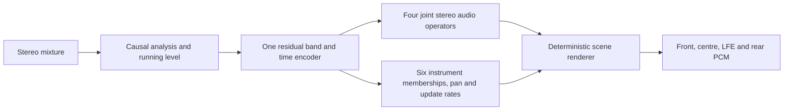

# One causal network for a stronger rear scene

_2026-09-30. Track B. Owner direction: replace q6d + guard + v21a with one capable network and make the rear scene more expressive. CPU prototype implemented; no trained weights, GPU run, renderer adapter or hook integration._

## 🎯 Decision and acceptance

Build **one shared causal encoder with joint audio and scene outputs**. One feature pass, one recurrent trunk, one checkpoint, one worker invocation and one state owner. The network estimates audio for eligible instruments, vocal, drums and bass; it also estimates persistent instrument membership and stereo placement. The renderer remains deterministic DSP and is part of the measured end-to-end system. Multiple output heads share the trunk; they do not introduce separate inference networks.

The owner wants full instruments clearly behind with a stable, wide scene. The previous 15–20% rear-energy targets are historical engineering floors. Passing them does not prove expressive rear sound. Retain them for continuity, and add an explicitly labelled expressiveness exploration before freezing a higher numerical delivery target or calling the system successful. The owner's live CarPlay verdict remains the acoustic acceptance gate.

| Requirement | Evidence needed |
| --- | --- |
| Replace all three deployed networks | Host adapter consumes only the unified outputs; no q6d, guard or v21a inference in that candidate; later one blob and one invocation in Track A's port |
| Improve instrument delivery and protection together | Matched Track A/unified/SIMO comparison on identical DEV40×60s, input/renderer conditions and recorded programme level; every source and song retained |
| Expressive rear with body and attacks | Report rear delivery by instrument, frequency band and attack/sustain; source retention and absolute rear level alongside rear fraction; eventual owner listening |
| Stable when singing starts | Source-attributed entry median/p10 ≥.85/.60 and useful absolute instrument retention before/after; no nearly silent stability result |
| Runtime fit | ≤150 M measured device int8 MAC/s and ≤85 ms extra latency; complete transforms/DSP/state traffic and loaded deadlines reported separately |
| Final independent proof | Original full40 plus an adequately covered untouched20 set and owner blind live CarPlay; already inspected songs cannot supply independence |

## 🔎 What existing results establish

The [completed causal pair](UPMIX_CAUSAL_GENERALIZATION_2026-09-29.md) improved natural DEV paired SI-SDR by1.303dB, with all11 relative quality gates passing. Direct C improves keys/piano rear shares to.159/.135 and voice to.0059, but guitar/strings remain.121/.109 and entry retention.804/.420. The network costs2.168G estimated neural MAC/s. It is a quality/mechanism reference, not a student fitting the unit.

The [pretrained SIMO reference](UPMIX_BSRNN_REAL_C_CHECK_2026-09-29.md) reaches guitar/keys/piano/strings.200/.211/.219/.204, voice.0022 and entry.876/.746 through direct C. Future context, corpus, pretraining, capacity and output details differ. Its success does not prove that causal compression will preserve those values or that20% rear energy sounds sufficiently expressive.

Track A's [full40 drive1.5 report](UPMIX_MASK_PHASE1_REPORT_2026-09-27.md) gives guitar≈.17, voice≈.08, drums≈.30. Its [failure-enriched20](UPMIX_PRODUCTION_RENDERER_PROBE_2026-09-28.md) gives instruments.176/.166/.118/.225, voice/bass/drums.075/.150/.285 and15/20 swing songs. These20-song numbers are not matched full40 comparisons with the new reference. Obtain the complete current Track A baseline before claiming superiority.

| Already tested approach | Measured limit | Consequence for this proposal |
| --- | --- | --- |
| [Complex audio plus auxiliary role logits](UPMIX_DUAL_HEAD_CAUSAL_PROBE_2026-09-28.md) | Lower vocal also lowered eligible energy; source gates0/4 and entry p10.542 failed | Supervise actual protected audio and eligible reconstruction; adding class logits alone does not solve separation |
| [Fixed8s EMA spatial state](UPMIX_DUAL_STATE_PROBE_2026-09-28.md) | State affected output, but protected ratios failed and entry-tail improvement was too small | Train membership/placement from true instrument activity; test learned state against bypass on the same checkpoint |
| [Output invariance penalty](UPMIX_VOCAL_INVARIANCE_PROBE_2026-09-28.md) | Eligible transmission collapsed to.0713 while ratio stability appeared good | Require absolute eligible audio reconstruction/retention; output equality alone cannot establish stable content |
| [Anchored synthetic entry reconstruction](UPMIX_VOCAL_ENTRY_TARGET_PROBE_2026-09-28.md) | Preserved level, but protected/entry gates still failed at4k | Entry pairs are a later isolated intervention, not an assumed cure bundled into the first run |
| [Scalar matrix source penalty](UPMIX_MATRIX_SOURCE_LOSS_PROBE_2026-09-28.md) | Raised eligible and protected energy together | Joint source outputs require their own controlled supervision test; extra losses have no automatic quality guarantee |

This is a new integration direction with an untrained compact prototype. It does not establish that shared inference, learned persistence, distillation or finer family supervision will beat the measured shelf.

## 🧠 Implemented prototype and output contract

Prototype: [unified_upmix_net.py](../../tools/stereo-upmix-render/unified_upmix_net.py). Defaults:2048/512 STFT interface,48 existing unequal bands,24-channel normalized residual trunk with2 temporal/frequency blocks,16-channel local/global states,16-channel decoder bottlenecks. Time GRUs are forward only; frequency bidirectionality remains inside the current frame. Input is stereo mixture spectra only. Fixed TRAIN normalization constants are explicit buffers, never statistics from future input or DEV.

| Output/state | Prototype shape/meaning | Replaces or supports |
| --- | --- | --- |
| `source_masks`, `source_stft` | Four stereo complex diagonal operators and estimates: eligible, vocal, drums, bass; `[B,T,4,1025,2]` complex | Eligible extraction/protection that previously required mask plus guard |
| `family_presence` | Six independently sigmoid scores per48-band frame: guitar, keys, piano, strings, winds, other | Fine instrument evidence for the scene; scores are uncalibrated until trained |
| `membership`, `family_pan` | Six persistent memberships and pans per band, driven by learned per-family update rates | Scene continuity and spatial placement that previously depended on q6d and vetoes |
| Carried state | Per-block temporal GRUs, global GRU, input level, family membership and pan | One state owner; caller explicitly resets/detaches |

Protected estimates supply learned evidence and training targets; a high vocal posterior must not automatically multiply down the whole eligible output. Sources overlap in a cell, so scene memberships use independent probabilities rather than a winner-takes-all softmax. The prototype's family state is a mechanism hypothesis; it has not learned source identity. Four source operators are diagonal stereo complex masks, not a proven full2×2 unmixing operator or isolated family waveforms.

The native48-band scene outputs **are not q6d's32-band/264-value ABI**. A frozen host adapter must define band-overlap mapping, activity/confidence calibration, source membership, attack/body handling and fallback. A change in network count alone is not a complete renderer replacement. Direct C is the starting routing condition because the original C produced15/40 swings even with the better causal estimate. Any Track A integration requires its owner; Track B changes only copied host tools.

## ⚙️ Counted cost and structural checks

Default prototype has **483,086 parameters and110.0055 M estimated dense MAC/s**, counting every audio/scene head at93.75 frames/s. This estimate excludes FFT/iFFT, feature/normalization/activation work, complex products, reductions, scene-state arithmetic, renderer and int8 memory/kernels. It is below the neural screening ceiling; no device-fit claim follows. Four protected/eligible spectral outputs do not require four production iFFTs: protected spectra can supply evidence while only selected rear audio is synthesized, subject to the frozen adapter and measurement.

| Dense component | MAC per frame |
| --- | ---: |
| Input projections |147,600|
| Temporal GRUs |331,776|
| Current-frame frequency GRUs |248,832|
| Residual projections |110,592|
| Local interface |18,432|
| Global GRU |1,536|
| Decoder bottlenecks |24,576|
| Four-source projections |262,400|
| Family scene projection |27,648|
| **Total** |**1,173,392**|

[CPU smoke evidence](UPMIX_UNIFIED_SCENE_ARCHITECTURE_2026-09-30_smoke.json), local Torch2.10.0: all future-prefix differences0; arbitrary1/7/1/12-frame chunk split preserves outputs within7.634e−7 absolute; reset reproduces output exactly; source attribution closes to3.872e−15 NSE; silence finite; encoder/trunk/audio/scene gradients finite and nonzero. Random spectra establish numerical structure only. Waveform streaming, transform latency, physical symmetry, real-music fitting, int8 parity and acoustic quality remain open. The first smoke caught Python's reserved `global` keyword in a state constructor; corrected to `global_state` before the successful test. No training or data was affected.

## 🎓 Training and comparison sequence

1. **Freeze the host replacement contract and matched Track A baseline.** Read current configs/blobs; do not modify them. Implement copied-host replay using the unified outputs alone. Verify output channel ordering, source-operator attribution, and stateful causal transform reconstruction on real TRAIN audio. Report native48→renderer-band mapping and every remaining deterministic control. Do not call an injection test that still runs q6d/guard a complete three-network replacement.
2. **Establish learnability on the exact frozen TRAIN fitting crops.** First train eligible reconstruction with the joint source/scene heads inactive, then a matched all-source audio arm from identical trunk initialization with the same steps/draws. Targets come from real stems, with per-source loudness normalization/weights frozen from TRAIN gradient/error audit. Fit the four source estimates directly; record eligible/protected audio and attribution, not scalar CE alone. Membership supervision uses audited raw MoisesDB instrument-family sidecars; coarse seven-slot `other` alone cannot label six families.
3. **Activate and isolate the scene state.** Hold source training/data/horizon constant, add true-family activity/pan targets with explicit silent/absent masks, and supervise family persistence through natural entries. Compare trained scene state against bypass on the same checkpoint. Freeze coefficient calibration on TRAIN; demonstrate learned head usage and no eligibility collapse. Start with the completed best true-stem recipe. New corpus/remix, teacher supervision and synthetic vocal-entry pairs remain subsequent controlled interventions.
4. **Complete broad training and matched full40.** Predeclare seed, full horizon, draw sequence and terminal selection before GPU work;4k is a diagnostic snapshot, not automatic convergence evidence. Compare Track A, unified audio-only/scene arms, and saved causal/SIMO references on identical songs/input and declared routes. Report paired song confidence intervals, all family shares/bands, absolute level, source leakage, entries/exits and any-stem motion. A single untrained architecture does not justify a new long training queue.
5. **Teacher and quantization work after an acoustic recipe is established.** Optional SIMO training-only audio targets with true-stem authority and source/treble attribution audit; no q6d imitation as the sole target, no latent-state MSE shortcut. Use quantization-aware training and device parity/profile after the compact model passes offline joint quality. Do not enlarge the≤150M allowance or reinterpret1.33ms mask timing as unused full-chain capacity.

The owner authorized the unified/expressive direction. This update implements the CPU architecture and preserves the necessary pre-GPU definition work; it does not ask for another permission, launch a job with missing targets/adapter, or declare a trained student.

## 🎚️ Expressiveness experiment

Explore predeclared instrument transfer settings aimed at approximate **20%,30%,40%** rear-energy operating points. These are exploratory points, not newly accepted universal targets, per-song fitted gains or a promise that40% is perceptually correct. Calibrate a single global transfer setting for each point on TRAIN/privileged reference audio, freeze it, then record actual DEV outcomes. Rear fraction alone cannot identify body, attacks, melody, decorrelated wash or cabin localization.

- Keep programme level, front sound and rear level visible. Never increase rear fraction merely by removing front energy. Do not treat Track A's protected-heavy rear RMS as an instrument-loudness target.
- Attribute useful eligible audio and protected leakage at each point. Protected limits remain voice≤.02, bass≤.06, drums≤.08; stronger instrument transfer cannot hide a protection regression.
- Report guitar/keys/piano/strings/winds body, attack and upper-band delivery with actual source coverage; absence is undefined, not zero. Retain front timbre and image as separate outcomes.
- Inspect absolute eligible entry pre/post level alongside median/p10 retention. Learned membership must not cause long tails or hold an instrument that ended; exits and attacks are required controls.
- Compare rear L/R correlation/width and instrument pan stability; correlation alone is not a perceptual score. Confirm channel/speaker routing through the CarPlay chain.
- Select the final expressive operating point through the owner's shuffled, programme-level-matched live CarPlay comparison once Track A has ported a passing candidate. PC previews remain explicitly offline.

## 📍 Current handoff

Implemented: isolated unified CPU prototype, full counted heads/state, meaningful structural smoke, architecture/expressiveness decision. No GPU use, queued job, package install, trained checkpoint, new C adapter, Track A edit or unit action. Next complete the copied-host contract/current Track A full40 baseline and real-TRAIN fitting/supervision protocol, then execute its frozen pair on the single PC GPU. Keep both completed reference checkpoints and all negative experiments available for comparison.
