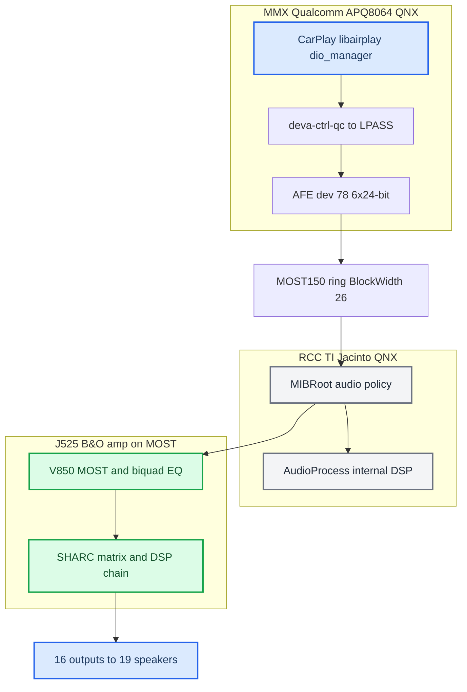
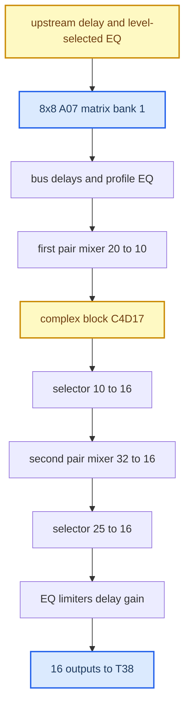
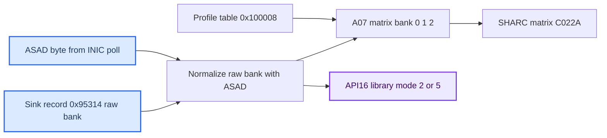

# Virtual Cabin and Amp RE

*Reverse-engineering the Audi B&O J525 amplifier, why getting six discrete channels to it was so hard, the SHARC DSP chain, and what the "Virtual Cabin" actually is.*

---

## 🎯 What the Virtual Cabin is

The Audi B&O amplifier (part `8W0035465`, the "J525") is a **complete 5.1 processor**: it takes six logical inputs `L R C LFE Ls Rs`, runs them through an input matrix and a deep per-driver DSP/EQ/crossover chain, and fans them out to 16 amplified circuits driving 19 speakers. **The "Virtual Cabin" is our decision to let the amp be the renderer** — the hook only delivers the *right six PCM channels* in Apple order and declares them correctly. The amp derives the centre, manages the sub, crosses over every driver, and spatializes. We do not re-implement any of that on the head unit.

For the stereo content that is most of what people play, the [HSSR upmix](HSSR_MODEL.md) synthesizes the six channels the Virtual Cabin then renders. The discrete path is in [Discrete 5.1 Routing](DISCRETE_5_1_ROUTING.md).

This note is the hub for the amp. The detail lives in three companion notes:

| Note | What it covers |
|---|---|
| [SHARC DSP Blocks](SHARC_DSP_BLOCKS.md) | the SHARC program: extraction, 79-entry graph, every kernel, the level-selected input EQ, the adaptive block C4D17, the V850 control plane |
| [SHARC B Processors](SHARC_B_PROCESSORS.md) | the two "B" processors: the spectral/spatial first B and the auxiliary second B, their configuration banks and APIs |
| [J525 Wiring and Speakers](J525_WIRING_AND_SPEAKERS.md) | the 19 speakers, 16 T38 circuits, DSP-slot candidates, external measurements |

> **Honesty.** The amp DSP model is `[model]` — static RE of one firmware image (`CodeFlash_*.bin`, SHA-256 `8776fdb8…41fe4b`). No live amp state was read back, no arithmetic is bit-exact, no cabin SPL is modelled. Getting six channels *to* the amp is `[car]`-confirmed. Long-form provenance: [VIRTUAL_CABIN](../research/VIRTUAL_CABIN.md).

## ⚙️ The machine — two SoCs and an amp

The head unit is split across two processors, and that split is the root of the whole problem.



- **MMX = Qualcomm APQ8064 (QNX)** — the CarPlay/AirPlay stack, `dio_manager`, `libairplay.so`, `deva-ctrl-qc.so`, `io-audio`, LPASS (Hexagon aDSP). **Amplifier-agnostic**: nothing in MMX boot reads any amp coding.
- **RCC = TI Jacinto (DRA6xx, C674x DSP) (QNX)** — `MIBRoot` (the audio-policy owner), `AudioProcess`, and the *internal* amp's DSP. **All amplifier-specific routing policy lives here.**
- **J525 amp** (external, on the MOST fibre ring with the MIB J794 and the cluster J285) — a **V850** MOST/FBlock control processor + an **ADSP-2148x SHARC** audio DSP. The B&O box.

The two framings ("MMX sends 6×24" vs "the RCC link is 2- or 8-slot") sit on opposite sides of two INICs, which reframe; the only quantity that crosses end-to-end is the MOST synchronous **BlockWidth** (26 bytes for the six-channel source).

## 🔧 The single-byte routing decision

MIBRoot resolves a route through a two-table mapper keyed on **one byte**. CarPlay media = connection 162 (`CL_ENT_AMP_DIO_MEDIA`) → resource `0x78`. The only selector is `g_externalAmplifierCoded`, written from DSI prop `Amp.Amplifier.ExternalAmplifierCoded`, computed from **E2P record 0xF1, byte +0x0B (`Sound_System`)**: `==2` → external, else internal.

| ExternalAmplifierCoded | source | sink | width |
|---|---|---|---|
| 1 (external, B&O/Bose) | `eSRC_ENT_AMP_DIO_MEDIA_MC` (0x46f) | `eSNK_DTCP51` (2) | **26 B = 6ch** |
| 0 (internal amp) | `eSRC_ENT_AMP_DIO_MEDIA` (0x46e) | `eSNK_SPEAKERS` (1) | **4 B = stereo** |

There is no channel-count negotiation and no capability check — one byte picks a static `{source, sink}` pair. Read/flip it from a shell: `on -f rcc /usr/apps/modifyE2P r fc 1` → `02`=external, `01`=internal.

The finding that shapes the product: the internal (non-B&O) amp has **no native 6-channel CarPlay route**. The internal media source is BlockWidth 4 (stereo); `eSNK_SPEAKERS_MC` is a dead alias in none of the 143 resource records. So on an internal-amp car a PCM6 stream is front L/R only. The safe policy is `AUDIO_SPATIAL=0` unless E2P 0xFC reads `02` — `AUDIO_STEREO_UPMIX=off` alone is not enough, because the bypass still writes PCM6 (`L R 0 0 0 0`, `hook/audio/stereo_upmix.c:666-672`). That gate is assigned to the installer, and no installer script implements it yet: `carplay_startup.sh` hardcodes `AUDIO_SPATIAL=1` for this B&O unit (`deploy/smartphone_integrator/carplay_startup.sh:57-60`) **[code]**. A real internal 6-channel path is feasible but needs RCC-side flashing — planned, not built. See [Landmines](../LANDMINES.md).

## 📊 Why six channels was hard — two independent fixes

Getting six channels to the amp took two months because the head unit silently collapsed to stereo through **two independent mechanisms**, each masquerading as a fault downstream. Both are fixed on the Qualcomm side and `[car]`-confirmed.

| # | Layer | The bug | The fix |
|---|---|---|---|
| 1 | Qualcomm CSD | `mpl5` shipped `min_voices=2`; `deva_update_session_info_from_list` copies the record's **minimum** into the active session at route-attach (14 s before the PCM channel exists), so CSD advances `0x4800`/tick while submitting `0x1800` — **tearing at 62.5 Hz** | mirror `mpl5`'s caps record field-for-field to `mpl1` (min/max voices = 6, fragsize `0x4800`); QSA inserts a channel conversion so stereo still opens |
| 2 | libairplay | `createMetadata` wrote a **stereo SAD header** (`asad=0xc0`) beside genuinely six-channel PCM, so the amp kept only L/R | interpose `createMetadata` to announce `asad=0xfc` / 6ch / 24-bit |

The full sequence and the mirror driver live in [Discrete 5.1 Routing](DISCRETE_5_1_ROUTING.md). **Ceiling: 6 is the max a byte can reach** (`deva_csd_start_csd_session_playback` hardcodes 6; no 8-channel output node), so CarPlay's 5.1.2 = 8 channels would need an 8→6 fold on the hook side. The fold exists (`hook/audio/spatial_downmix.c:71-97`) but runs only on the experimental `AUDIO_SPATIAL_ATMOS=1` / SETUP-66 path; the shipped config advertises APAC 5.1 (`hook/audio/audio_hook.c:785-788`). The output order is Apple canonical `L R C LFE Ls Rs`, which deva maps straight to FL FR FC LFE LB RB (`hook/audio/audio_hook.c:419-420`).

### The LPASS COPP topology A/B (a side experiment)

Every count in the head-unit chain is already six: audio_service allows eight, the ACDB entry for device 78 (`78_TDM_ENTERTAINMENT1_RX`) declares ChannelConfig 6 with slot offsets 2/5/8/11/14/17 at 24 bit, and ADM opens the COPP with 6 channels mapped FL FR FC LFE LS RS. Stock `Speaker_cal.acdb` binds device 78 to topology `0x00010314` ("SPEAKER_STEREO_AUDIO_COPP" by public name) at four application-type entries (file offsets `0x78a9/0x78b1/0x78b9/0x78c1`). Static Hexagon analysis of the signed LPASS image found **no 6→2 step**: stereo-only modules are disabled on a 6ch reinit and the rest accept up to eight.

| Topology | RX descriptor | Modules | Note |
|---|---|---|---|
| `0x10314` (stock dev 78) | `0xc04e981c` | 11 | same graph as `0x10BE3` DEFAULT_AUDIO_COPP — swapping to it proves nothing |
| `0x10312` (NULL/NONE COPP) | `0xc04e9804` | 3 | stock use only on 1–3-channel devices |
| `0x1031B` (SPEAKER_MCH_PEAK_VOL) | `0xc04e9738` | resampler + peak meter + soft volume | explicitly multichannel; strongest A/B candidate |

`sources/acdb/patch_acdb_topology.sh <stock> [out] [topology]` checks the `QCMSNDDB` magic and device name, rewrites the four entries (default `0x10312`) and prints the new SHA; revert = restore the original file. The checked-in [Speaker_cal.acdb](../sources/acdb/Speaker_cal.acdb) is **already the patched `0x10312` variant** (SHA-256 `c6e23c0e…883f`), not stock (stock is `a203ec5c…f9b`). This was a diagnostic, never a proven fix; the real 6ch fixes were the two above.

Sources: [patch_acdb_topology.sh](../sources/acdb/patch_acdb_topology.sh), [Speaker_cal.acdb](../sources/acdb/Speaker_cal.acdb)

## 🔍 Inside the amp — the SHARC DSP chain

> Everything here is **static RE + mathematical reconstruction** of one CodeFlash image. No live amp state; no bit-exact arithmetic; no cabin acoustics. `[model]`

**Extraction.** The V850 CodeFlash *embeds the complete ADSP-2148x SPI slave-boot stream* at file offset `0x041014`, length `0x27764` (161,636 B). `AD301A07`/`AD301B01` are V850-consumed parameter/tuning datasets, not the application. Bytes are bit-reversed on the SPI side; 560 boot blocks parse to exactly `+0x27764`. Details in [SHARC DSP Blocks](SHARC_DSP_BLOCKS.md).

**Biquad math.** The V850 filter designer uses an 8-byte design record `{u16 freq_selector, s16 gain_tenths_dB, u8 Q_code, u8 type, u16 reserved}`, with `K = cot(π·f/48000)`, `G = 10^(dB/20)`, and the convention **`Q = q_code/10` for peaks, `ζ = q_code/10` for 2nd-order LP/HP** (q_code 7 = Butterworth). Types include peak (1), LP/HP (2..25), low shelf (26), high shelf (27), all-pass (28). A separate SHARC-internal designer implements RBJ cookbook filters for the "B" processor. Full formula table in [SHARC DSP Blocks](SHARC_DSP_BLOCKS.md).



The schedule, stage by stage: upstream 8-lane delay → prefilter/gains → tone EQ → **level-selected 16-bank EQ** (common to both paths, can add up to +20.5 dB at 55 Hz) → the A07 matrix (and, in parallel, the first B) → 8-bus delays → row EQ → 8-channel profile EQ → first pair mixer 20→10 (A + first-B spectral) → complex block C4D17 (5-band adaptive) → 10→16 selector → second pair mixer 32→16 (A + second-B aux) → 25→16 selector → packed output EQ → EQ → limiter → EQ → output delay → limiter → gain → 16 outputs → T38 → 19 speakers.

There are **two independent "B" processors**: a spectral first-B (74-band, 1024-point FFT, 1024 + 512 samples of latency) injected at the first mixer, and a second-B fed only by auxiliary inputs at the second mixer — see [SHARC B Processors](SHARC_B_PROCESSORS.md). The complex block C4D17 is active-scheduled and **not proven off**; its auxiliary-plus-LMS structure looks like in-cabin noise compensation, and the amp's T38 carries a roof-module microphone. `[open]`

Sources: `SOUNDAMP_FULL_DSP_MODEL`, `SHARC_APPLICATION_EXTRACTION`, `AMP_SHARC_ARTIFACTS`

## 📊 The input matrix

> **Correction that supersedes older notes:** the matrix orientation was transposed in earlier readings. The V850 writer `A903C` reads `RAM[8·i+j]` (`gp−0x3E20`) and sends it to SHARC `C022A[8·j+i]`; the SHARC consumer `1269BC` reads coefficient `R7·outputs+R3` with R7 looping inputs. So **A07/RAM rows = outputs, columns = inputs**. The old per-speaker summaries ("sub = LFE only", "centre no bass", "woofers sum L/Ls/C/LFE", "fb3 = −3 dB woofers") and AmpChain v5/v6 are withdrawn; the CSV and extractor were regenerated. Use the matrix below.

The V850 selects a signed-dB 8×8 table from `AD301A07` (profile 0, bank 1 for the CarPlay/DTCP51 sink) and writes 64 linear coefficients to SHARC `0xC022A..0xC0269`, two outputs per 16-word packet. The table below is the hook's own copy, `kInputMatrix` (`hook/audio/stereo_upmix.c:66-73`), rows = inputs, converted to dB. Its orientation is self-checking: the largest bus column, bus6 = 0.708 + 2.818 ≈ 3.53, equals `kCabinMatrixMaxColumnNorm` (`stereo_upmix.c:64`) **[code]**.

| input | busL | busR | busC | busLFE | busLs | busRs | bus6 | bus7 |
|---|---|---|---|---|---|---|---|---|
| L | −2 | · | −8 | −8 | −3 | · | −3 | · |
| R | · | −2 | −8 | −8 | · | −3 | · | −3 |
| C | −6 | −6 | −3 | −10 | · | · | · | · |
| LFE | · | · | · | +3 | · | · | · | · |
| Ls | · | · | · | −14 | +6 | · | +9 | · |
| Rs | · | · | · | −14 | · | +6 | · | +9 |

(`·` = −99 dB floor: stored −100 is clamped by the writer to −99 dB = `1.122e−5`, leakage, deliberately not an exact zero; inputs Ch7/Ch8 feed nothing in bank 1.) Structurally the amp **derives the centre** (C bus fed from L and R at −8 dB, plus C itself at −3 dB), and its LFE bus sums LFE at +3 dB **together with** L/R at −8 dB, C at −10 dB and Ls/Rs at −14 dB. Ls/Rs feed their own buses (+6 dB) and the effect buses 6/7 (+9 dB), which L/R also reach at −3 dB. So even the hook's compatibility output `L R 0 0 0 0` lands on the centre, LFE, surround and effect buses. The **bus → physical-speaker binding and every per-driver crossover / EQ / gain / delay are inferred, not recovered** — candidates in [J525 Wiring and Speakers](J525_WIRING_AND_SPEAKERS.md).

### How the bank and profile are chosen



`SelectA07ProfileAndMatrix @ 0xC23C0` (and the live selector `FUN_000C2774`):

```text
profile  = int8(A07[0x100008 + state_a + 21*state_b])   state_a gp-0x456A, state_b gp-0x4592
raw_bank = table_0x95314[(SinkNr - 0x21) * 4]           record [raw_bank, SAD flag, width, 0]
matrix   = A07[0x101BB4 + profile*0xC0 + bank*0x40]     copied to RAM gp-0x3E20
```

Both 21-entry selector rows are `[−1, 0, 1, −1, …]`: state_a 1 → profile 0 (startup), 2 → profile 1, anything else → built-in fallback; profiles 2..7 exist but are unreachable, and state_b changes nothing. Bank normalization: raw 0 → 0, raw 1 → 1, raw 2 → 0 for ASAD `0xc0`, → 1 when `(ASAD & 3) == 0` (incl. `0xfc`), else → 2; raw ≥ 3 → 0.

| A07 layout | Offset |
|---|---|
| signature `AD301A07` | `0x100000` |
| 2×21 profile selector | `0x100008` |
| 8 config profiles × `0x370` | `0x100034` |
| 8 matrix sets × `0xC0` (banks 0/1/2 = stereo/5.1/7.1, `0x40` each) | `0x101BB4` |
| fixed calibration copied by `B64E0` to `gp−0x1330C` | `0x102438..0x103237` |

| SinkNr | Role | Raw bank | Effective bank |
|---|---|---:|---|
| `0x21`, `0x27`, `0x2A` | stereo family | 0 | 0 |
| `0x22..0x24`, `0x2D..0x30` | mono/announcement | 3 | 0 |
| `0x25`, `0x2B..0x2C` | six-position | 1 | 1 |
| **`0x26`** | protected 5.1 `DTCP51` (record `01 a5 10 00` at `0x95328`) | **1** | **1, for every ASAD** |
| `0x28..0x29`, `0x31..0x32` | eight-position | 2 | 0/1/2 by ASAD |

Corrected contents of the other banks (profile 0, rows = inputs as in the table above):

- **Bank 0 (stereo)**: L → busL 0, busC −6, busLFE −6, busLs 0, bus6 0 (R mirrored); C, LFE, Ls, Rs, Ch7, Ch8 feed nothing. The old "fold-down of C/LFE/Ls/Rs into L/R" reading was the transposed view.
- **Bank 2 (7.1)**: bank 1 plus Ch7 → bus6 0 dB and Ch8 → bus7 0 dB.
- **Profile 1** differs from profile 0 only in C → busC −2, LFE → busLFE +4, Ls/Rs → own bus +5, Ls/Rs → bus6/7 +10.
- **Fallback bank 1**: identity for the first six inputs plus L/Ls → bus6 −6 (R/Rs → bus7 −6).

The full 8 profiles × 3 banks × 64 cells (plus fallback) with file offsets and SHARC addresses are in [SHARC_INPUT_OUTPUT_MATRICES.csv](../sources/SHARC_INPUT_OUTPUT_MATRICES.csv) (regenerate with `tools/extract_amp_sharc_matrix.py`). Each logical output occupies eight consecutive SHARC words (output 1 = `0xC022A..0xC0231` … output 8 = `0xC0262..0xC0269`); the lookup multiplies the signed byte by ten and clamps to about −99..+20 dB. Historically (2026-09-02) this matrix gave a clean negative: no reachable profile/bank mutes C, LFE, Ls or Rs, so the car's "only L/R audible" result had to arise before or after the matrix — it turned out to be the stereo SAD header. Row read/write handlers exist inside the V850 (`WriteInputMatrixRowFromMessage 0xD394E` queues parameter `0x0F`; `ReadInputMatrixRowToMessage 0xD39B6`), but their outer MOST/diagnostic identifier is not mapped.

### The amp hears ASAD live

The saved allocation byte `gp−0x3E21` has three writers: init to `0xc0` (`B64E0 @ 0xB6B82`), Connect (`C4B34 @ 0xC4DB8`, forces `0xc0` only when the sink's SAD flag is `0x5a` — sink `0x26` has `0xa5`), and the INIC poll `FUN_000D1D94` (request `00 07 01 2c d0 71 00 01 00`), which on change stores the new byte and raises task 9 / event 15 → `C2774` → reselect the matrix and resend parameter group `0x0F` (`WriteSharcInputMatrix8x8 @ 0xA9040`). So the amp reacts without a new Connect; the limitation is the head unit, whose deva metadata devctl only changes persistent state and emits a new SAD header on the next CSD playback start.

ASAD-dependent trims (tenths of a dB, lookup `69398 − 4·result`, clamp `−990..200`), indexed by the clamped surround coordinate `gp−0x3DE0` (−9..+9):

| Table (file) | Values | Applied when |
|---|---|---|
| `102C9E` input-coordinate branch | all 0 | `ASAD & 15 != 0` and input ≥ 4 |
| `102CC4` output-coordinate branch | −90, −80 … +90 | `ASAD == 0xC0`, `gp−0x456B == 0x5A`, **output** row ≥ 4 |
| `102C78` odd pair gains (`AA644`) | all 0 | row > 0, ASAD `0xC0`, odd entries |

(An older audit quoted `0x102CB0/0x102CD6/0x102C8A` — the same tables at their zero-coordinate entry — and read the nonzero one as acting on input rows.) With ASAD `0xfc` none applies.

### The stereo↔5.1 mode switch is the B library mode

A bank refresh also schedules parameter group `0x30`, which writes SHARC control `0x10` from table `0x6EAA0`: **bank 0 → 2.0, banks 1/2 → 5.0**. Control `0x10` is the first-B library's **API16 mode selector**: mode 2 processes the stereo pair, mode 5 additionally mixes the third upstream lane into both sides (`L + g·S2`, `R + g·S2`, g ≈ −6 dB) before the spectral/spatial processing ([SHARC B Processors](SHARC_B_PROCESSORS.md)). That is the concrete meaning of the "multichannel mode" — it is still not honestly nameable as "Symphoria". For sink `0x26` both `asad=0xc0` and `0xfc` keep bank 1 / mode 5, so ASAD does not switch stereo↔5.1 there; reaching bank 0 / mode 2 needs a stereo sink (`0x21`, `0x2A`) or a raw-bank-2 sink, which changes the MOST contract. Adopted policy: one fixed PCM6/48k/S16 stream with `asad=0xfc` for the whole session; an `0xfc` vs `0xc0` A/B with separate playback starts remains available as a diagnostic only (and would only exercise the ASAD trims).

Sources: `SHARC_MATRIX_CONTROL_2026-09-20`, `SHARC_INPUT_OUTPUT_MATRIX`, `AMP_STEREO_5_1_MATRIX_DIFF`, [SHARC_INPUT_OUTPUT_MATRICES.csv](../sources/SHARC_INPUT_OUTPUT_MATRICES.csv), `SHARC_REMAINING_BLOCKS_2026-09-19`

## 🔧 What the amp does for us, and the matrix in our code

"Virtual Cabin" = feed the amp six correct PCM channels and let it be the renderer. The amp handles:

- **Centre**, derived from L+R — so the hook writes **digital C = 0** on purpose.
- **Bass management** — the LFE bus sums LFE (+3 dB) with L/R, C and Ls/Rs, so LFE = 0 does **not** silence the sub. `AUDIO_STEREO_LFE=assist` (level via `AUDIO_STEREO_LFE_GAIN`, dB re 4096) is a relative top-up, not the whole sub feed (`hook/audio/stereo_upmix.h:32-36`, `hook/audio/audio_hook.h:66-70`, `:88-91`) **[code]**.
- **Crossovers, per-driver EQ, spatial buses, and the 19-speaker fan-out.**

**The matrix inside the hook is a guard, not acoustics.** `hook/audio/stereo_upmix.c:66` embeds `kInputMatrix[6][8]` — the profile-0/bank-1 matrix converted to linear, transposed once so rows are inputs (comment at `:57`). Its only purpose is the S16 cabin guard `spa_upmix_cabin_guard_s16` (`stereo_upmix.c:327`), which predicts each logical bus peak so no bus exceeds `kCabinSampleLimit = 32275` (0.985 FS, `stereo_upmix.c:55`). The largest column norm is `3.53` (`stereo_upmix.c:64`), so the hot-path early-out is: if `peak · 3.53 ≤ limit`, nothing can clip — return before touching the matrix (`stereo_upmix.c:340`). On overload it repairs via LFE only first, then linked-scales all six channels (`stereo_upmix.c:350-410`) **[code]**. The header states it explicitly: this is a downstream peak-detection model, not an acoustic model or an EQ inverse — it cannot bound the amp's own upstream EQ, which can add up to +20.5 dB at 55 Hz.

## 📈 Electrical regressions through the model

The offline tools run hook output through the recovered chain; these are **electrical levels, not cabin SPL**.

**LFE V2 through the J525 matrix (2026-09-07, 3D off).** HSSR Universal V11 at rear 0.25 with Cabin-Aware LFE V2, 100 excerpts (50 songs × two 10 s), exact profile-0/bank-1 matrix (the later bus→circuit fan-out was equal-power inference):

| Path | Mean LFE energy | LFE/front | Mean / max LFE peak | Max J525 bus | Clipped |
|---|---:|---:|---:|---:|---:|
| Fixed assist (removed) | 0.362 % | −22.54 dB | −22.32 / −15.44 dBFS | −0.27 dBFS | 0 |
| **Cabin-Aware LFE V2** | **0.448 %** | **−21.77 dB** | **−20.72 / −14.11 dBFS** | **−0.48 dBFS** | **0** |

V2 raises LFE energy 23.9 % yet gains 0.21 dB of bus headroom, because its limiter solves the allowed LFE interval from the current front/rear samples. A coherent 40 Hz tone gives LFE RMS `0.135107`, the same with `L = −R` (the removed mono-sum path gave zero); 500 Hz sits 60.3 dB below. `AUDIO_STEREO_LFE=assist` still selects exactly V2 (`hook/audio/audio_hook.h:66-70`) **[code]**; the shipped rear gain is now 0.40, not 0.25 (`deploy/smartphone_integrator/carplay_startup.sh:65`).

**Bank-1 music report v2 (historical, pre-orientation-fix).** Seven tracks, 60 s clips, analysis 5..55 s, Welch PSD re dry L; baseline is L/R-only PCM6 in bank 1: dry woofer 60–120 Hz −0.7 dB, front mid −2.3 dB, sub −90.4 dB (leakage); LFE 12288 no shelf: sub −5.3 dB, bass/mid +2.80 dB; LFE 4096: sub −14.8 dB, +3.07 dB; LFE 4096 with −3 dB shelf: +0.15 dB. The "sub −90 dB with L/R only" figure came from the transposed matrix; the corrected rerender supersedes these numbers ([Stereo to 5.1 Upmix](STEREO_TO_5_1_UPMIX.md)).

Sources: `SOUNDAMP_9VS_DOCUMENTARY_HSSR_RESULTS`, `SOUNDAMP_FULL_DSP_MODEL`

## 🔐 The speakers and the mode ceiling

PR 9VS "B&O 3D Advanced" = **19 loudspeakers on 16 amplified T38 circuits**, proven from the Audi current-flow diagram + J525 connector page. Some outputs drive two drivers (door treble+bass share a circuit; rear = 6 drivers on 4 outputs); the R211 subwoofer occupies two output pairs. External mic-sweep passbands are amateur observations, **not** Audi filter coefficients, and must not be fit as EQ. Full tables and images: [J525 Wiring and Speakers](J525_WIRING_AND_SPEAKERS.md).

### The 8-channel sink is rear 7.1, not 5.1.2

`SinkInfo.Get(0x32)` on FBlock `0x22`, FktID `0x0111` returns `Entertainment_7.1_SAD`: BlockWidth 26 (2 DTCP + 8 × 24 bit), synchronous, MOST-DTCP, GenericPCM, 8 channels named `01 02 03 04 05 06 13 14` — positions 7/8 are **`0x13/0x14` = Back Left/Right of Center**. Height would be `0x0D/0x0F` (Top Front L/R), which appear in none of the 18 sink profiles at `0x96E99`. So **discrete 5.1.2 over the stock amp is impossible**; any 5.1.2 source is folded 8→6 ([Dolby Atmos](DOLBY_ATMOS.md)). The selectable sinks and why `0x26` advertises width 14 but runs at 26 are in [Discrete 5.1 Routing](DISCRETE_5_1_ROUTING.md).

A patch plan exists (amp-side note `AMP_ENTERTAINMENT_7_1_MOST.md`): repurpose profile row 17 at `0x96F21` with two bytes, `0x96F27: 13 → 0D` and `0x96F28: 14 → 0F`. It is closed on **cost**, not evidence: those bytes sit inside the CRC-covered V850 region `0x0–0xFFFFF` (the DSP region `0x100000+` has no footer), and the full chain would also need a decodable 5.1.2 format, deva 6→8 with a mixer node that doesn't exist, an 8-channel MOST allocation, a SHARC routing patch and a Symphoria-height bypass — and the payoff is only discrete versus synthesized height. Corrections kept from that RE: the "per-mode counts 2,4,6,8" bytes at `0x96E35/0x96E3C` were misaligned views (real arrays start `0x96E3F`); FktID `0x0116` (`FUN_000C7694`) always returns descriptor 0 by design; `FUN_000C8F0C` (FktID `0x0D1A`) is unrelated to the coefficient groups at `0x97028`; `0x96DE8` is a network-service dispatch table.

Sources: `AMP_7_1_SINK`, `SOUNDAMP_9VS_VIRTUAL_CABIN_EVIDENCE`

## ⚠️ Where it stands

**CONFIRMED on car:** discrete 5.1 CarPlay end to end (2026-09-06); the two closing fixes (deva caps-mirror, SAD `asad=0xfc`/24-bit) plus restored `updateFeedback` clock reference.

**Blocked / modelled / not done:**

- **Phone-side spatial over realtime CarPlay** — refused live; phone-side gate, lever exhausted. See [Dolby Atmos](DOLBY_ATMOS.md). `[car]`
- **Non-B&O internal 6ch** — no route exists; feasible via RCC flashing but untested for lack of an internal-amp car. The installer-side `AUDIO_SPATIAL` E2P gate is not implemented yet (`deploy/smartphone_integrator/carplay_startup.sh:57-60`). `[open]`
- **The amp DSP model is static RE** — no live bank/profile/mode/level/limiter/gain readback (no verified J525 readback transport; RCC `/dev/io-amp` is the internal TI DSP); the level-selected input EQ bank, C4D17 and both B processors are not proven off or on; bus→speaker binding, per-driver EQ, and "3D OFF = level 0" are inferences; nothing is bit-exact. `[model]`
- **HSSR upmix quality** — a formal stationary-vehicle A/B is still outstanding. `[open]`

Code: `hook/audio/stereo_upmix.{c,h}`, `hook/audio/spatial_downmix.{c,h}`. Model: `tools/soundamp-virtual-cabin/`. RE artifacts: `assets/soundamp/`.

**Related:** [Internal Amp Path](INTERNAL_AMP_PATH.md) and [QNX Audio Topology](QNX_AUDIO_TOPOLOGY.md) (the non-B&O route and the QNX side of the chain) · [Upmix Training History](UPMIX_TRAINING_HISTORY.md) (what the upmix model learned) · [Upmix Calibration and Tuning](UPMIX_CALIBRATION_AND_TUNING.md#the-corrected-matrix-changed-the-diagnosis) (what the corrected matrix did to the upmix diagnosis) · [Buffered Playback Lifecycle](BUFFERED_PLAYBACK_LIFECYCLE.md) (the type-103 session that feeds the amp).

## 📚 Sources

Merged originals were removed from the tree after this note absorbed them; they remain in git history (commit 23972aa).

| File | What it holds |
|---|---|
| [VIRTUAL_CABIN](../research/VIRTUAL_CABIN.md) | long-form white paper for this domain |
| `SOUNDAMP_FULL_DSP_MODEL` | the conditional electronic model v7–v9, implemented chain, v2 music report |
| `SHARC_MATRIX_CONTROL_2026-09-20` | orientation proof, coordinate tables, `AA644` pair row |
| `SHARC_INPUT_OUTPUT_MATRIX` | original matrix extraction (orientation there is superseded) |
| [SHARC_INPUT_OUTPUT_MATRICES.csv](../sources/SHARC_INPUT_OUTPUT_MATRICES.csv) | all profiles × banks, corrected orientation |
| `AMP_STEREO_5_1_MATRIX_DIFF` | bank selection, live ASAD, control `0x10` (bank tables there are in the old orientation) |
| `SHARC_APPLICATION_EXTRACTION` | embedded SHARC stream |
| `AMP_SHARC_ARTIFACTS` | `assets/soundamp/` index |
| `AMP_7_1_SINK` | 8-channel sink, 5.1.2 patch plan and its cost |
| `SOUNDAMP_9VS_DOCUMENTARY_HSSR_RESULTS` | LFE V2 regression through the matrix |
| `SOUNDAMP_9VS_VIRTUAL_CABIN_EVIDENCE` | 9VS evidence boundary |
| [patch_acdb_topology.sh](../sources/acdb/patch_acdb_topology.sh), [Speaker_cal.acdb](../sources/acdb/Speaker_cal.acdb) | LPASS COPP topology A/B generator and the patched ACDB |
| [albumdb page-5.png](../sources/papers/albumdb-paper.gitqWx/page-5.png) | AlbumDB (AES Europe) paper page 5: 7.1.4 speaker table, 7.1.4→5.1 downmix recipe — upmix training-data context, see [Stereo to 5.1 Upmix](STEREO_TO_5_1_UPMIX.md) |
| [band-scnet.pdf](../sources/papers/upmix-research-20260912/band-scnet.pdf), [band-scnet-4.png](../sources/papers/upmix-research-20260912/band-scnet-4.png) | Band-SCNet (Interspeech 2025), causal real-time separation reference (2.59 M params, 92 ms) — upmix research, see [HSSR Model](HSSR_MODEL.md) |
| [vocalrep.pdf](../sources/papers/upmix-research-20260912/vocalrep.pdf), [vocalrep-06.png](../sources/papers/upmix-research-20260912/vocalrep-06.png) | VocalRep (lead/backing/accompaniment representations) — upmix research, see [HSSR Model](HSSR_MODEL.md) |
