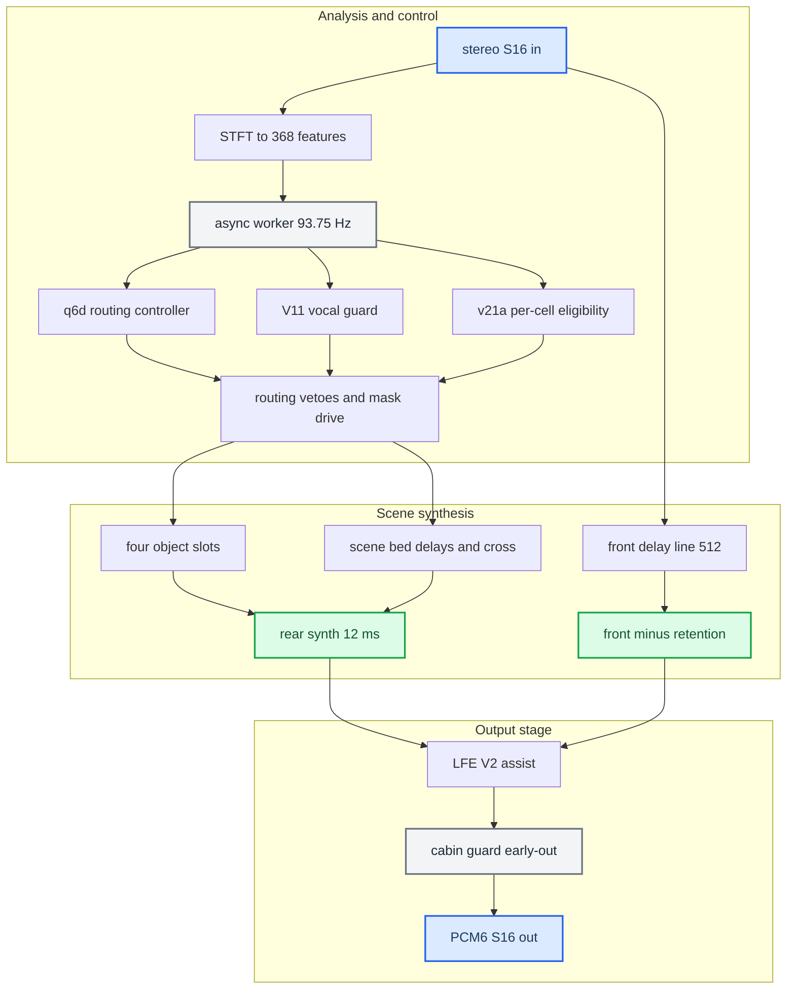
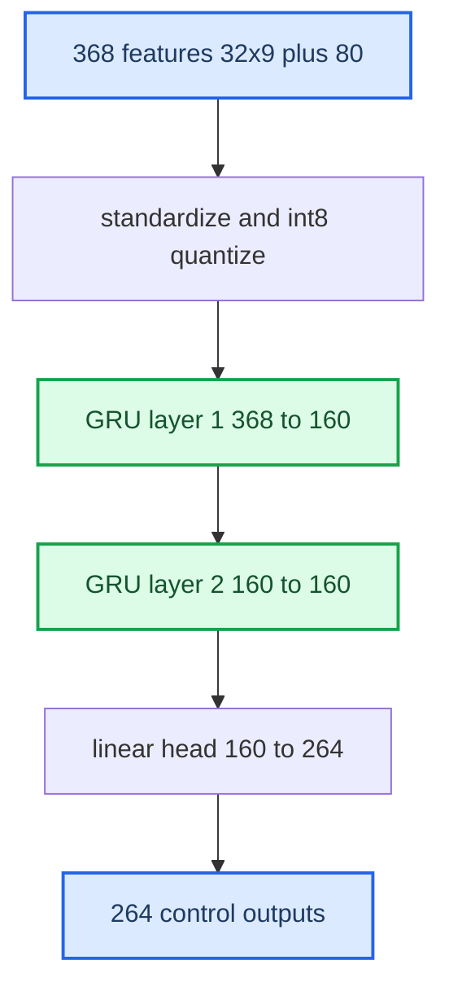
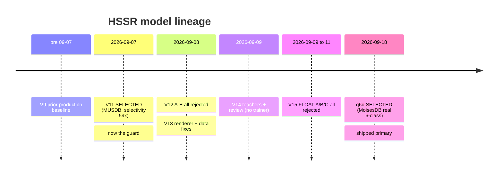

# HSSR Model

> **Retired 2026-10-09 with the Universal backend.** The renderer, models and knobs this note describes left the tree; the last tree that has them is git tag `upmix-universal-last-2026-10-09`.
> What runs now: [Stereo to 5.1 Upmix](../STEREO_TO_5_1_UPMIX.md). Why, and with which numbers: [Upmix History and Results](UPMIX_HISTORY_AND_RESULTS_2026-10-09.md), [Upmix Code Retirement](UPMIX_CODE_RETIREMENT_2026-10-09.md).
> The LFE, amp and measurement facts below remain valid.

*The AI that drives the CarPlay Virtual Cabin upmix: what it is, why 12-class separation failed, the second-scene design, the runtime, every iteration V9→q6d, and the shipped calibration.*

---

## 🎯 What HSSR is

HSSR = High-Selectivity Semantic Rear-routing. It is a small, causal, quantized GRU **routing controller** — not a source separator. It never splits audio into stems. It listens to a stereo signal 93.75 times a second and emits, per frequency band, a decision: *how much of this belongs behind the listener, and where*. A deterministic DSP then builds a 5.1 field from that decision, on top of the reverse-engineered [J525 Virtual Cabin](../VIRTUAL_CABIN_AND_AMP_RE.md).

The early history: ~15 model generations tried to make a network *separate* music into 12 instrument classes on 240 songs, and it never worked — an independent audit found the trained model equalled "mute plus drums". That implementation gave way to a genre-agnostic **second scene**: move the not-protected, spatially-wide part of the stereo image behind the listener, delayed so the front still anchors the sound. Current Track A uses three models: `q6d` routing, `V11` vocal-protection guard and `v21a` per-cell eligibility mask. The [phase 1 report](UPMIX_MASK_PHASE1_REPORT_2026-09-27.md) records its car integration; the [matched40 report](UPMIX_TRACKA_MATCHED40_2026-09-30.md) records the current-setting host baseline.

Track B subsequently returned to eligible-audio separation with a single causal spectral network and an isolated C float/int8 runtime. Its final spectral40k full40 comparison fails joint acoustic promotion; it has not replaced Track A. See the [domain diagrams](UPMIX_DOMAIN_MODEL.md), [session wrap](UPMIX_SESSION_WRAP_2026-09-30.md) and [complete attempt chronicle](UPMIX_SEPARATOR_CHRONICLE_2026-09-25_TO_2026-09-30.md). Earlier conclusions below describe the named historical implementations, not a proof that source separation is impossible.

Provenance: [HSSR_UPMIX_MODEL](../../research/HSSR_UPMIX_MODEL.md), `hook/audio/hssr_dsp.{c,h}`, `hook/audio/hssr_neon.{c,h}`. See also [Stereo to 5.1 Upmix](../STEREO_TO_5_1_UPMIX.md) and [Dolby Atmos](../DOLBY_ATMOS.md). Companion notes: [Upmix Training History](UPMIX_TRAINING_HISTORY.md) (every experiment line), [Upmix Datasets and Teachers](../UPMIX_DATASETS_AND_TEACHERS.md) (corpora, teachers, role labels), [Upmix Compute Budget](../UPMIX_COMPUTE_BUDGET.md) (Krait cost), [Upmix Literature](../UPMIX_LITERATURE.md) (prior art).

## 📚 Why the first approach failed

For roughly fifteen generations (V11…Q2) the model was asked to do supervised source separation over 240 songs. It never reached a regime where separation works. The 2026-09-17 independent audit is the tombstone (`docs/audio/UPMIX_TRAINING_HISTORY.md`):

- The trained model after a full 24,288-update pass equals `MUTE + drums`; "+0.45 dB vs disabled" compares against an empty control, "−0.1 dB vs raw scalar" means it sits at its own initialization.
- Per-family DEV NMSE: drums 0.44, but lead 0.81, bass 0.81, guitar 0.90, backing 1.06, keys 1.84 — most heads output 13–17 dB below target (MSE shrinkage toward mute).
- Only 2,352 of 111,132 parameters did per-bin separation; even *oracle* 32-band hints left backing NMSE 0.57–0.89 — the band-power interface structurally cannot separate lead/backing or keys/guitar.
- A static per-bin 2×2 Wiener filter with zero trainable parameters beat the trained model on every family except drums.

The 2026-09-17 decision was to stop that 12-class implementation and pursue a rear protection/routing mask. Its data and band-power interface had not supported the requested separation. The full ledger (V16, G1–G17, H1, P1, C1/C2, Q1–Q5) with every number is in [Upmix Training History](UPMIX_TRAINING_HISTORY.md). Later Track B audio-separation evidence is tracked separately in the [attempt chronicle](UPMIX_SEPARATOR_CHRONICLE_2026-09-25_TO_2026-09-30.md).

Sources: `UPMIX_INDEPENDENT_AUDIT_2026-09-17`, `UPMIX_AGENT_HANDOFF_2026-09-17`, `UPMIX_RETROSPECTIVE_AND_STEREO71`.

## 🎯 The second-scene design

Given the Virtual Cabin, split the stereo image and move part of it behind the listener as a *second scene* — not ambience, not a copy of the mix, for any genre, with no instrument classes (adopted by Luka 2026-09-17). Rear = (NOT protected: lead vocal / bass / drum core / dominant harmonic line) AND (spatially wide / decorrelated / texture-like). Three components:

1. **DSP, genre-free** — per-bin pan, inter-channel coherence, texture (fast/slow envelope); low frequencies stay front.
2. **The only learned part** — a *protection mask*: what must not go rear, with an asymmetric loss (a leaked lead is far worse than a missed piece of support).
3. **Renderer** — rear delayed 10–20 ms, high-passed, decorrelated; front = X − α·rear.

**Why the rear is delayed.** The shipped mechanism delays the rear only, by 12 ms (`SPA_SCENE_REAR_DELAY_FRAMES = 576` at 48 kHz, `hook/audio/stereo_upmix.h:31`), and leaves the front aligned, so the louder, earlier front anchors the image by the precedence (Haas) effect and the rear reads as distinct objects, not an echo. The in-mix rear copy sits ~20–30 dB under the front and 12 ms late — "which is why Luka hears objects, not a vocal echo". This is deliberately unlike Dolby.

> **Historical scope.** The Q4 mask line was prototyped, measured worse than V11 for vocals and shelved. Current Track A additionally deploys the later v21a eligibility mask; it is a different model and experiment line.

## 🔧 How the runtime works

Output rail is fixed PCM6 `L, R, C, LFE, Ls, Rs`. **C is always digital zero** — the amplifier derives centre, so the hook must not.

### Signal path (STFT / WOLA)

- FFT size 512, hop 128, 257 half-spectrum bins, 32 perceptual bands, 64 four-bin "shape" bands, control every 4th hop; latency 512 frames = 10.667 ms (`hook/audio/hssr_dsp.h:15-24`).
- Half-sine analysis window; synthesis window divided by the per-phase COLA `Σw²` with the `1/N` folded in. In-place radix-2 512-point FFT; both output channels packed into one Hermitian spectrum and recovered with a single inverse FFT.
- The DSP core is float; the boundaries are S16. The fronts come from a 512-deep S16 delay line; only the rear is synthesized float (bounded ±2.0).
- The synchronous path (offline render tools) is bit-exact; the async worker differs only in scheduling, never arithmetic.

### The controller network

Shape `368 → GRU(160) → GRU(160) → Linear(264)` (`hook/audio/hssr_neon.h:17-19`), int8 weights with per-row float dequant scales, loaded from an `HSSRNEO1` CRC32-validated blob (`hook/audio/hssr_neon.c:258-272`). 451,464 parameters, 469,760-byte export (64-byte header + payload, `hssr_neon.h:22-34`).

The 368 features are 32 bands × 9 + 64 shape + 16 global; they are standardized, clamped to ±6 and quantized at 127/6 (`hook/audio/hssr_neon.c:378`). The 264 outputs are 32 bands × [6 class logits, rearability, pan] + 8 globals.

Runtime inference is not PyTorch: the C path quantizes matrix inputs and recurrent activations and uses rational sigmoid/tanh (bounded cost on old QNX libm), so loading the exported weights into PyTorch is not the shipped inference. Measured on V11, C vs dequantized PyTorch differs by 0.0056 mean vocal probability and 0.0032 rear probability; resetting PyTorch state every 64 controls (0.68 s) moves rear probability by 0.012 — more than the C/float gap — so training must carry state, as the runtime does. Of the 8 global outputs only `k=3..7` are used: scene confidence, rear-activity target, scene stability, fx-present, global safety.

**Class taxonomy [code].** q6d grouped the 12 MoisesDB identity heads into the same six output slots (`tools/stereo-upmix-render/q6_hssr_moises_cache.py:21-26`):

| Slot | q6d meaning | MoisesDB heads |
|---|---|---|
| 0 | all vocals | lead, backing, other vocal |
| 1 | bass | bass |
| 2 | drums | drums, percussion, high percussion |
| 3 | guitar | guitar, other plucked |
| 4 | strings / background | strings & winds, other/unknown |
| 5 | keys | keys |

Slots 4 and 5 are the two "safe rear" classes (`hook/audio/hssr_dsp.c:628-631`). Superseded: the older wording "4 keys, 5 other" (and the same line in [UPMIX](../../research/UPMIX.md) and [HSSR_UPMIX_MODEL](../../research/HSSR_UPMIX_MODEL.md)) swaps them. V11 used MUSDB's four stems with `other` split three ways by a coherence/flux heuristic, so keys read as vocal and backing equalled lead.

### Training objective

`train_hssr.py` trains the float graph with profile `selection-v11` (`tools/stereo-upmix-render/train_hssr.py:781-857`) [code]:

- Class loss: soft-target cross-entropy over the six class logits per band.
- Rear loss: BCE on rearability weighted `1 + 4·rear + 5·vocal·(1−rear) + 2·bass·(1−rear)` — a vocal false positive costs far more than a missed rear object, and the positive weight stops the all-front solution.
- Pan: MSE weighted by the rear target; globals: BCE; smoothness: mean |Δ rear| between controls.
- Total `class + 2.4·rear + 0.5·pan + 0.5·global + 0.08·smooth`; AdamW (weight decay 1e-4) with cosine annealing (`train_hssr.py:1133-1140`).

q6d's recipe from its manifest: warm start from V11 weights with V11's normalization kept, LR 5e-4, batch 16, sequence 64, 5 epochs, early-stop patience 2, best epoch 3 (validation 7.156 → 4.920), 181 train / 40 validation song caches, 2,889 s on 4 NAS CPU threads (`models/hssr-q6d-moises-a/manifest.json`). Both blobs are flagged `development_only` for MUSDB/MoisesDB licensing (`train_hssr.py:14-16`).

### Routing, vetoes and object slots

Per band, rearability is multiplied by a chain of steep semantic vetoes, then smoothed asymmetrically (fast attack 0.35 / slow release 0.035) (`hook/audio/hssr_dsp.c:642-761`):

- Two q6d calibrations come first (`hssr_dsp.c:635-645`): the vocal probability used by the vetoes is boosted ×2.5 below 0.4 and forced to 1.0 above it (q6d reads keys/guitar as vocal at ≤ 0.02/0.07 but processed leads can drop to 0.19), and the raw rearability sigmoid is remapped by `smoothstep(0.12, 0.36)` because real positives cluster near 0.25 over a 0.13 floor.
- `bass_keep = 1 − 0.85·p[bass]`, applied to the 5th power.
- `lead_keep = 1 − 0.92·vocal_risk`, applied to the 4th power (a leaked lead is far more audible than missed support); `vocal_risk = p[vocal]·(1 − 0.80·spatiality)` — a genuinely wide lead may survive, a centred lead cannot.
- drums `×(1−0.35·p[drums])`, guitar `×(1−0.10·p[guitar])`, background/FX lift `×(1+0.85·(p[keys]+p[other]))`, then scene-focus and global-safety scaling, then makeup `×16.0` (`hssr_dsp.c:17`).
- Hard frequency gates: zero rear below 220 Hz, ramp 220→350 Hz, ×0.65 above 15 kHz, ×0.25 above 20 kHz (`hssr_dsp.c:750-758`).

**Object slots**: 4 slots, two per rear half-plane (even→left, odd→right). Each band scores per slot from `semantic × directed-pan smoothstep × (0.55+0.45·coherence)`, transient-boosted; nothing below 220 Hz; confidence needs both an energy share and a peak candidate, held 250 ms (`SPA_HSSR_SCENE_HOLD_HOPS = 94`, `hssr_dsp.c:940-941`). At render each bin picks the best slot, gated by per-bin ~45 ms coherence so room/reverb is not steered.

### The protection mask and the guard model

The protection mask keeps lead vocal (class 0) and bass (class 1) out of the rear, implemented as the steep vetoes above plus the "centred lead cannot acquire a slot" rule. The guard is a second GRU — V11, whose bias is "everything harmonic is vocal" — loaded from `AUDIO_HSSR_GUARD_MODEL` or, by default, `hssr_guard.bin` beside the main model (`hook/audio/audio_hook.c:1754-1771`).

Its vocal posterior is **discounted by the primary's confidence** the band is keys/other (`combined = gvocal·(1 − p[keys] − p[other])`), then max-merged into the vocal probability; it also overrides the wide-lead escape and scales rearability by `(1 − 0.95·guard_vocal)²` (`hssr_dsp.c:613-673`). So a voice the guard hears is protected even when q6d reads it as keys. This hybrid veto is why two models ride together.

### Front retention and the HF taper

`front_retention = r` is the object share left in the front. Energy conservation bounds it: `r* = sqrt(1−b²)` (b = rear gain); above `r*` the object localizes forward and the second scene collapses, so `r` is chosen below `r*`. The shipped value is `r = 0.5` (`deploy/smartphone_integrator/carplay_startup.sh:75`; code default 0, `hook/audio/audio_hook.c:183-194`).

Measurement showed ungated retention kept each bright object's treble in the front (+1.3 dB in the front 2–16 kHz, per the code comment at `hssr_dsp.c:1576-1578`). The fix makes retention frequency-dependent: `retention_eff(band) = r · (1 − smoothstep(bandEdgeHz, lo, hi))`, defaults `lo=1000 Hz`, `hi=2500 Hz` (`hook/audio/stereo_upmix.h:42-43`, `hssr_dsp.c:1579-1582`); `AUDIO_HSSR_RETENTION_HF=LO:HI` overrides it and `HI<=LO` restores flat retention. With `AUDIO_HSSR_BED_ATTACK=owner` the per-band front keep becomes `1 − r·(1 − collapse·w·owner)` (`hssr_dsp.c:1583-1590`). Committed 2026-09-21 (`48b9851`).

### Scene-bed distribution

Shipped on (`carplay_startup.sh:76-78`), default off in code (`hook/audio/audio_hook.h:78-81`):

- **Bed delays** (`AUDIO_HSSR_BED_DELAYS=on`) — only the bed is decorrelated; each band mixes `0.79·now + 0.60·delayed_same − 0.14·delayed_opposite` (unit energy) through a 16-hop per-bin ring, with per-band delays of 1–15 hops (2.667 ms each), longer at low frequency and different for Ls and Rs (`hssr_dsp.c:52-63`, `:1190-1313`). Objects stay coherent.
- **Bed attack** (`AUDIO_HSSR_BED_ATTACK=owner`, `AUDIO_HSSR_ATTACK_COLLAPSE=0.75`) — the ported Dolby transient detector (`β = 0.9637` per hop, `hssr_dsp.c:65-66`, `:1171-1189`). In owner mode a hit fades the delayed copies where a second-scene object owns the band and collapses an ownerless bed row forward (×0.39); `front` mode is the Dolby reference, always forward.

### Async execution and the realtime guard

Inference runs every 4th hop (93.75 Hz = 48000/(128·4)). A `SCHED_RR` priority-17 worker owns the recurrent state (`hook/audio/audio_hook.c:1963-1964`, `:3959`; `hook/audio/hssr_control_worker.c:116-131`); the audio thread submits features and reads results through two-entry mailboxes (`hssr_control_worker.h:45-46`) — no locks, no allocation, no logging on the audio thread. One or two missed deadlines keep the last stable mask; the third consecutive miss decays it toward a quiet rear (`hssr_dsp.c:1160-1165`).

The realtime media path (`AUDIO_REALTIME_UPMIX=on`, shipped, `carplay_startup.sh:86`) runs the same renderer inside the stock QSA thread on its own state and worker; period 768 frames = 16 ms, +10.7 ms front latency. Old 8 ms builds self-disabled in 3 of 5 recorded sessions. The current guard (`hook/audio/rt_upmix_guard.h:19-45`):

| Rule | Value |
|---|---|
| Budget per period | 12 ms (QSA holds ~128 ms behind the 16 ms period) |
| Disable after | 4 consecutive overruns |
| Cold-start forgiveness | 64 periods (~1 s) |
| Revival | only after a ≥ 500 ms gap in the stream (no mid-track rear reappearance) |

Speedup numbers are QEMU `-icount` estimates, bit-identical, not on-car measurements.

## 📊 The model iterations

All variants use the same "HSSR-160" graph (`GRU(368→160)→GRU(160→160)→Linear(160→264)`, 451,464 params); only weights differ. A width ablation (160→192 = 597k; 160→256 = 943k) was costed but never adopted.

*Timeline of the model lineage from V9 through the shipped q6d.*

| Gen | Date | What it did | Outcome |
|---|---|---|---|
| V9 | pre-09-07 | prior production baseline, same graph | superseded by V11 |
| V11 | 2026-09-07 | MUSDB18-derived; sharpened selectivity, no graph change | **SELECTED**; selection ratio 17.4×→59.1×; SHA `ab01463e…`. Now the guard |
| V12 A–E | 2026-09-08 | fine-tune V11 on 43 songs + BS-RoFormer teacher | all rejected; A: vocal leakage +18–49%; ship = new float hook + original V11 |
| V13 | 2026-09-08 | bass fix + cabin renderer; routing-head-only pilot | renderer/data fixes kept; no new weights |
| V14 | 2026-09-09 | 50-song corpus teacher build + review | no trainer launched; teacher filenames must not become truth |
| V15 A/B/C | 2026-09-09→11 | rebuilt dataset in float; streaming distillation | all rejected; every candidate moved *more* vocal to the rear |
| q6 → q6b | 2026-09-18 | MoisesDB real classes; q6 put backing vocals in slot 4, which let wide/doubled leads through (*Joy* lead −27 → −7 dB); q6b moved every vocal back to slot 0 | superseded |
| q6d | 2026-09-18 | first trained on real dataset stems (MoisesDB 6-class); full network fine-tune from V11 | **SELECTED** as shipped primary; best epoch 3; SHA `96abe57d…`. Weakness: confuses vocals with keys → why the guard exists |

Between V15 and q6d sit the separator lines (V16 role heads, G1–G17, H1, P1, Q1–Q5) — none reused this graph and none shipped; see [Upmix Training History](UPMIX_TRAINING_HISTORY.md).

Both shipped blobs are in the repo: `models/hssr-q6d-moises-a/hssr_model.bin` (SHA-256 `96abe57d…`) and `models/hssr-selection-v11/hssr_guard.bin` (`ab01463e…`), re-hashed 2026-09-22 [code].

**Datasets.** MoisesDB v0.1 (240 songs, 181 TRAIN / 40 DEV) for q6d's real 6-class targets; MUSDB18 (150 tracks) for V11; a 43-song private corpus for V11/V12/V13; a 50-song local corpus for V14/V15 teachers. Teacher networks (Demucs6, BS-RoFormer, karaoke, AST/CLAP) only ever labelled data — q6d used real stems, not pseudo-labels. Both shipped weights are flagged development-only / non-commercial. Sizes, splits, defects and licences: [Upmix Datasets and Teachers](../UPMIX_DATASETS_AND_TEACHERS.md).

Sources: `UPMIX_TRAINING_DATA_AND_MODELS`, `HSSR_DATASET_TRAINING_AUDIT`, `UPMIX_V15_ROUTING_REFINEMENT`, `UPMIX_V15_STREAMING_TRAINING`, `UPMIX_FULL_FLOAT_DATASET_V15`.

## 📌 Calibration

The 60-second one-variable grid (2026-09-21) corrected several earlier conclusions:

- **6-second prefixes are not representative** — they understated bass/mid tilt by ~1.5 dB mean.
- **Front bass is the only control that moves bass** (+3.3 dB per 3 dB shelf); retention does not touch bass.
- **LFE is not a monotonic sub-volume knob** in the corrected model.

**The bass culprit (2026-09-19).** The 2026-09-18 build silently raised the LFE default from 4096 to 12288 (+9.5 dB) and widened the LFE LR4 48→60 Hz; since the 5.1 bank feeds the sub from LFE, the whole sub got +9.5 dB — the "bass everywhere" the user heard. Fixed: default back to 4096 (`hook/audio/stereo_upmix.h:35`) plus the `AUDIO_STEREO_LFE_GAIN` knob, dB re 4096, −24..+12 (`hook/audio/audio_hook.c:276-295`).

Luka, 2026-09-21: *current calibration is OK for now — do not tune.* The scene-bed variant (retention 0.5, bed delays, owner attack) was chosen after a headphone A/B the same day and is what ships; the full shipped table is in [Stereo to 5.1 Upmix](../STEREO_TO_5_1_UPMIX.md).

## ❌ What was tried and rejected

- **Q4 learned protection mask** — leaked lead in-mix at −7.9 dB where V11 held solo vocals at −23…−26 dB. Worse than V11; the ML-mask line was paused.
- **Float render candidate** — the one-variable grid proved its "tilt reduction" was actually a +1.9 dB bass increase; the float/cabin/quiet path was deleted (commit `9255485`).
- **TRUEPAN** (objects keep own pan) — rear L/R correlation jumped to 0.86–0.90 (rear went near-mono); wide steering *is* the second-scene width.
- **Front echo pre-compensation** — injected an anti-phase 12 ms copy into the centre bus; worse than the echo it removed.
- **Vocal-veto hysteresis / max-hold** — latched on transient false positives; in-mix rear fell 7–20 dB. Reverted.
- **MPS training refusal** — the M3 Max was refused only because two runs differed by ≤3e-8; iteration scale, not rigor, was the limit ([Upmix Compute Budget](../UPMIX_COMPUTE_BUDGET.md)).
- **CUpGAN-A** — Fraunhofer's ambience GAN has no public weights, and even its disclosed core needs ~99% of a Krait core ([Upmix Compute Budget](../UPMIX_COMPUTE_BUDGET.md)).
- **Waveform separators as the product** (V16, G, H1, P1, Q2) — none kept the lead out of the rear while delivering useful backing; a zero-parameter per-bin Wiener filter beat trained Q2 ([Upmix Training History](UPMIX_TRAINING_HISTORY.md)).

## ⚠️ Where it stands

**Deployed 2026-09-22:** single-path scene code, primary q6d + V11 guard, surround 0.40 / front bass −3 / LFE 0 / retention 0.5 with HF taper 1000:2500 / bed delays on / owner attack at 0.75, and the realtime type-100 upmix on (`carplay_startup.sh:63-86`). User verdict after the scene build: "it sounds gorgeous now, great bright objects behind".

**Open items** — no on-car period-time distribution `[open]`; no Krait full-chain loaded trace, TARGET gate unverified `[open]`; no blind listening / cabin SPL `[open]`; known semantic misses (processed vocal intros, wide synth-bass) read as keys `[car]`. See [Landmines](../../LANDMINES.md).

**Related:** [Upmix Calibration and Tuning](UPMIX_CALIBRATION_AND_TUNING.md) (how the shipped knob values were reached) · [Upmix Release and Acceptance](UPMIX_RELEASE_AND_ACCEPTANCE.md) (the acceptance protocol and the rejected candidates) · [J525 Wiring and Speakers](../J525_WIRING_AND_SPEAKERS.md) (the rear doors are mid-bass speakers).

## 📚 Sources

Merged originals were removed from the tree after this note absorbed them; they remain in git history (commit 23972aa).

| Source | What it holds |
|---|---|
| [HSSR_UPMIX_MODEL](../../research/HSSR_UPMIX_MODEL.md) | Long-form model paper this note condenses |
| `UPMIX_INDEPENDENT_AUDIT_2026-09-17` | Why 12-class separation failed |
| `UPMIX_AGENT_HANDOFF_2026-09-17` | Q2 state and acceptance at the turning point |
| `UPMIX_RETROSPECTIVE_AND_STEREO71` | V15–H1 retrospective |
| `UPMIX_TRAINING_DATA_AND_MODELS` | Provenance of the two shipped blobs |
| `HSSR_DATASET_TRAINING_AUDIT` | Graph, width ablation, C vs PyTorch mismatch |
| `UPMIX_V15_STREAMING_TRAINING` | V15 routing-head recipe |
| `UPMIX_V15_ROUTING_REFINEMENT` | V15 rejection evidence |
| `UPMIX_FULL_FLOAT_DATASET_V15` | FLOAT corpus behind V15 |
| `UPMIX_MASTER_PLAN` | Musical policy the model must respect |
