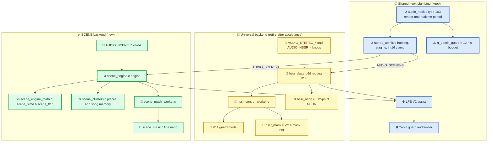
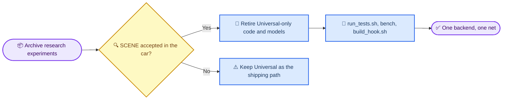

# Upmix Code Retirement Map

> Current status: retirement is complete. SCENE is the only stereo synthesis backend; Universal is not a runtime fallback. The completion record appears later on this page. Recover old tools through the [verified registry](RETIRED_TOOLS.md).
>
> The initial inventory and diagrams below are preserved as the **pre-removal plan**, not the current module/configuration map. Use [current runtime](../STEREO_TO_5_1_UPMIX.md) for active controls.

## 🗺️ What the two backends use

The open question the inventory answers is where the LFE V2 assist and the cabin guard physically live:
if they are inside `hssr_dsp.c`, retiring the Universal DSP means moving them first.

## 📋 Retirement gates

## 🔍 Inventory (read-only survey, 2026-10-09)

Method: three agents, grep and call-site evidence only; sizes from single-file QNX cross-compiles and
`nm -S` on the fresh hook (`.text` 454,190 B). Line counts are the file totals.

### Hook C code

| File | Lines | Used by SCENE | Universal only | Verdict |
| --- | ---: | :---: | :---: | --- |
| `hssr_dsp.c/.h` (q6d DSP, bed/attack/retention/vocal gate/rear air, V11 and v21a glue) | 2,489 | no | yes | retire; its 356 KB state is embedded in every upmix state |
| `hssr_neon.c/.h` (q6d GRU loader, 512-point NEON) | 510 | no | yes | retire |
| `hssr_mask.c/.h` (v21a mask net `HSSRMSK1`) | 947 | no | yes | retire |
| `hssr_control_worker.c/.h` (HSSR worker, 222 KB, two instances) | 423 | no | yes | retire |
| `stereo_upmix.c/.h` | 1,668 | 263 lines | 399 lines | keep the shared 621 lines; delete the Universal branches |
| `scene_engine.c/.h`, `scene_engine_math.c`, `scene_fft.h`, `scene_simd.h`, `scene_clusters.c/.h`, `scene_mask.c/.h`, `scene_mask_worker.c/.h` | 3,739 | yes | | keep |
| `soundcheck.c/.h` (type-103 programme gain) | 407 | neither | neither | keep, independent of the backend |
| `rt_upmix_guard.h`, `pcm_period.h`, `media_route.h` | 441 | shared | | keep |
| `audio_hook.c` Universal parts: model loaders (lines 1931–2021), worker start (2311, 4343), `AUDIO_STEREO_*`/`AUDIO_HSSR_*` parsing | ~400 | no | yes | delete with Universal |

**LFE V2 and the cabin guard live in `stereo_upmix.c` (lines 253–344 and 415–498), not in `hssr_dsp.c`.**
SCENE keeps working with `hssr_dsp.c` deleted after dropping the `_hssr` members and the include.
The Universal-era "scene rear delay" (`SPA_SCENE_REAR_DELAY_FRAMES` 576, `kSceneRearLowShelf`) is the 22.09
second-scene DSP, not the SCENE backend: it goes too.

### Models

| Path | Bytes | Loaded by | Verdict |
| --- | ---: | --- | --- |
| `models/hssr-q6d-moises-a/` (`hssr_model.bin`, manifest, settings) | 493,322 | Universal only (`AUDIO_HSSR_MODEL`) | retire |
| `models/hssr-selection-v11/` (`hssr_guard.bin`, settings) | 470,650 | Universal only (guard worker) | retire |
| `models/mask-full-probe-v21a/` (`hssr_mask.bin`, manifest, settings) | 698,553 | Universal only (`AUDIO_HSSR_MASK_MODEL`) | retire |
| `models/scene-masknet-c/` (`scene_masknet_c.bin` 32,544 + manifest) | 32,544 | SCENE (`AUDIO_SCENE_MASK_BLOB`) | **the one model**; needs a `.gitignore` whitelist like the others |

### Tests and scripts

| Path | Verdict |
| --- | --- |
| `tests/hssr_neon_test.c`, `tests/hssr_control_worker_test.c`, `tests/hssr_guard_worker_test.c` (orphan) | retire |
| `tests/stereo_upmix_test.c`: 11 Universal-only functions, 4 shared (two assert the Universal backend and must be re-pointed at SCENE), 2 SCENE | split |
| `tests/buffered_pcm_switch_test.c` | edit: run the switch sequence with SCENE or OFF |
| `scripts/run_tests.sh`, `test_hook_audio.sh`, `test_audio_interposers.sh`, `apac_flags.sh`, `prepare_install.sh`, `build_hook_common.sh` | edit link lists, drop the three model copies, drop `upmix_behavior_test` (Universal harness) |
| `tools/stereo-upmix-render/bench/stereo_upmix_bench.c`, `build_host.sh`, `build_qnx.sh`, `qnx_qemu_bench.sh`, `mask_selftest_compare.py`, `hssr_gles2_bench.c`, `hssr_neon_bench.c`, `hssr_validate.c` | retire; `scene_*bench*` and the two QEMU plugins stay |

### Tools

| Era | Files | Lines | Verdict |
| --- | ---: | ---: | --- |
| A — the scene family (`scene_upmix.py`, `test_scene_upmix.py`, `scene_albumdb_eval.py`, `scene_oracle_master.py`, `scene_car_kit.py`, `scene_dev40_*.py`, `scene_swing_audit.py`, `scene_port_fixtures.py`, `scene_mask_fixtures.py`, `port/`, `bench/scene_*`) | 22 | 4,673 | keep (untracked until the first commit) |
| B — the stem harness the DEV40 numbers depend on (`upmix_behavior_tests.py`, `upmix_stem_tests.py`, `baseline_upmix.py`, `mask_net.py`, `upmix_music_tests.py`) | 5 | ~4,000 | keep; `stereo_upmix_render.c` and `mask_infer_test.c` retire with Universal |
| C1 — 09-06..09-18 corpus and teacher-audit pipeline | 32 | 4,442 | archive |
| C2 — 09-11..09-22 Q2–Q6, R1, cabin V13, V15 campaigns | 47 | 9,085 | archive |
| C3 — 09-25..09-30 separator and oracle-renderer research (`sep_net*.py`, `separator_*`, `audit_*`, `pc/`, `bsrnn_*`, `causal_*`, `unified_*`, `spectral_*`, `direct_object_*`) | 199 | 17,178 | archive |
| C4 — 10-03..10-04 Track B joint nets named `scene_*` (`scene_joint_*`, `scene_fly_net.py`, `scene_history_net.py`, `scene_interband_net.py`, `scene_operator_oracle.py`, `scene_flywire_783_64.json`, `train_scene_joint_nas.py`, `run_scene_*_nas.py`, `fit_scene_fixed_nas.py`) | ~20 | ~3,000 | archive: not the engine despite the name |

### Documents

| Group | Files | Verdict |
| --- | ---: | --- |
| Current spec and hand-off (`UPMIX_SCENE_ALGORITHM_2026-10-08.md`, `UPMIX_REWORK_BASELINE/PROPOSAL/RADICAL_DIRECTIONS_2026-10-07.md`, this file, `SCENE_BACKEND_DEPLOY.md`) | 6 | keep |
| Track A reference (`HSSR_MODEL.md`, `STEREO_TO_5_1_UPMIX.md`, `UPMIX_CALIBRATION_AND_TUNING.md`, `UPMIX_RELEASE_AND_ACCEPTANCE.md`, `UPMIX_TRACKA_MATCHED40_2026-09-30.md`, listening logs, training history, datasets, compute budget) | 14 | keep as history, mark retired at the top |
| Hardware and routing (`QNX_AUDIO_TOPOLOGY.md`, `VIRTUAL_CABIN_AND_AMP_RE.md`, SHARC, J525, internal amp, discrete 5.1, Atmos, buffered path, APAC, Cinemo) | 14 | keep |
| Superseded research write-ups 09-28..10-04 (65 notes, ~6,600 lines, 285 sidecars = 9.6 MB) | 65 | archive into `docs/audio/archive/` with one index line each |
| `UPMIX_SOURCE_SEPARATION_PLAN.md` (251 KB), `UPMIX_SEPARATOR_HANDOFF.md` (128 KB) | 2 | archive after the code they cite is gone |

### Startup knobs

| Keep | Delete |
| --- | --- |
| `AUDIO_STEREO_UPMIX` on/off (on = SCENE), `AUDIO_REALTIME_UPMIX`, `AUDIO_STEREO_LFE`, `AUDIO_STEREO_LFE_GAIN`, the eight `AUDIO_SCENE_*` knobs, `AUDIO_SCENE_MASK_BLOB`, `AUDIO_SCENE_MASK_SYNC` | `AUDIO_HSSR_MODEL`, `AUDIO_STEREO_SURROUND`, `FRONT_BASS_DB`, `FRONT_RETENTION`, `FRONT_TREBLE_DB`, `REAR_AIR_DB`, `AUDIO_HSSR_BED_DELAYS/ATTACK`, `AUDIO_HSSR_VOCAL_GATE`, `AUDIO_HSSR_MASK_MODEL/DRIVE`, `AUDIO_HSSR_GUARD_MODEL`, `AUDIO_SCENE` (SCENE becomes the only renderer) |

## ✅ Execution plan

1. Commit the scene work as it stands (it is untracked: engine, net, worker, backend, tools, docs, model).
2. Write `UPMIX_HISTORY_AND_RESULTS.md`: every iteration with its numbers and verdict, so the deleted code stays readable.
3. Remove the Universal backend, its models, tests, bench and knobs; make `AUDIO_STEREO_UPMIX=on` select SCENE; keep OFF, the guard, the cabin guard, LFE V2.
4. Archive eras C1–C4 and the superseded notes.
5. Rebuild, `run_tests.sh`, QEMU bench, package; update `LANDMINES.md`, the READMEs and `DEPLOY_AND_RELEASE.md`.
6. Rollback path if the car rejects SCENE: `git revert` of the removal commits, or the last Track A install zip.

## 🏁 Executed (2026-10-09 evening)

| Step | Result |
| --- | --- |
| 1. Commit the scene work | `1501fc7d` "audio: add the SCENE upmix renderer"; tag `upmix-universal-last-2026-10-09` on it = the last tree with Universal, its models, tests, bench and the research tools |
| 2. History document | [Upmix History and Results](UPMIX_HISTORY_AND_RESULTS_2026-10-09.md): six eras, every iteration with its numbers and source, Track A vs SCENE side by side, the surviving lessons, the recovery table |
| 3. Hook | `hssr_dsp/neon/mask/control_worker` deleted; `stereo_upmix.h` enum OFF=0 / SCENE=1, config down to `sample_rate_hz front_gain_q15 lfe_gain_q15 lfe_enabled backend scene scene_mask_blob scene_mask_provider`; the Universal per-frame loop, shelves, limiter, 576-frame delay and bed glue gone; LFE V2 and the cabin guard kept unchanged; `audio_hook.c` 9,703 → 9,121 lines, `AUDIO_STEREO_UPMIX=on` = SCENE, `AUDIO_SCENE` and the eighteen Universal knobs removed; unprotected hook 2.1 MB → 1.4 MB, zero compiler warnings |
| 4. Models | only `models/scene-masknet-c/` (blob + manifest + a new `settings.json` for `check_model_settings.py`); the three HSSR model directories deleted and un-whitelisted in `.gitignore` |
| 5. Tests and scripts | `stereo_upmix_test` reduced to validation, OFF bypass, LFE V2 + cabin guard, SCENE smoke, mask worker; `buffered_pcm_switch_test` runs the SCENE backend; `hssr_*` tests, `upmix_behavior_test` and the Universal link lines removed from `run_tests.sh`, `test_hook_audio.sh`, `test_audio_interposers.sh`, `apac_flags.sh`; trace fixtures say `upmix=scene`; `run_tests.sh` and `test_hook_audio.sh` pass end to end, the port tests (math, clusters, engine, mask, hook render) all pass with their goldens now under `~/Desktop/AUDI_2/upmix-data/scene_port_fixtures_2026-10-09/` |
| 6. Tools | `tools/stereo-upmix-render/`: 415 files / ~54,000 lines deleted (Universal host renderer and bench, eras C1–C5, `sep_net.py`, `teacher_label.py`), 47 kept (scene family, `port/`, scene bench + QEMU plugins, `bench/results/`, the stem harness with its injection branches stripped and `--model` optional); `test_scene_upmix.py` 51/51 |
| 7. Deploy | `carplay_startup.sh`: the Universal block replaced by the live variant J block with the blob on (comment the `AUDIO_SCENE_MASK_BLOB` line for the spatial-only A/B); `prepare_install.sh` ships only `scene_masknet_c.bin`; the uninstaller keeps removing `hssr_*.bin` from older installs on purpose |
| 8. Packages | `build/install_<VIN>.zip` (SCENE) and `build/install_scene_j_unprotected.zip`; the Track A rollback kept as `build/install_trackA_trackA_2026-09-28.zip` (the only copy of the hssr model files outside git) |
| 9. Docs | live docs rewritten for SCENE (`STEREO_TO_5_1_UPMIX.md`, `docs/audio/README.md`, `LANDMINES.md`, `SCENE_BACKEND_DEPLOY.md`, `DEPLOY_AND_RELEASE.md`, root and tools READMEs); Track A reference docs carry a retirement banner; the superseded 09-25 … 10-04 research notes moved to [archive/](README.md) |
| Not done | the QEMU bench was not re-run (the scene engine and net files did not change in this cleanup); nothing has been heard in the car; `tools/soundamp-virtual-cabin/audit_*` scripts that spawned the Universal host renderer keep their metric functions but their render CLI paths are dead |

Risk accepted: there is no Universal fallback in the tree any more. Rollback = the Track A zip above, or `git checkout upmix-universal-last-2026-10-09` and a rebuild.
