# Upmix History and Results

*Why this file exists: on 2026-10-09 the code of every retired upmix iteration is removed from the tree. The Universal/HSSR backend (q6d, V11 guard, v21a mask, its DSP, worker and bench), the era-C research tools (corpus pipeline, Q2–Q6/R1/cabin campaigns, separator and oracle-renderer research, the Track B joint nets) and 65 superseded research notes go to the archive (`UPMIX_CODE_RETIREMENT_2026-10-09.md`). This is the record: what each iteration was, what it measured, and why it lost, so the deleted code stays readable. Every number below comes from a file in this repository and every table row names it. Evidence tags follow `UPMIX_REWORK_BASELINE_2026-10-07.md`: [car] heard by the owner, [log] measured on the unit, [offline] real music through the real renderer on a PC, [oracle] true stems, [model] static amp model. Where a doc records no number the row says so. Bare file names are in `docs/audio/`; the notes archived on 2026-10-09 live in `docs/audio/archive/` (index: [archive/README.md](README.md)); `bench/results/…` means `tools/stereo-upmix-render/bench/results/…`.*

---

## 🗺️ Timeline

```mermaid
timeline
    accTitle: Virtual Cabin upmix eras, 2026-09-04 to 2026-10-09
    accDescr: Six eras in order. DSP renderers without a network on 09-04, the HSSR Universal controller line from 09-05 to 09-11, separation research V16 to Q2 until the 09-17 audit, the second scene and Track A tuning in the car from 09-17 to 09-30, the Track B separation and joint-scene research from 09-25 to 10-04 that never reached the hook, and the SCENE renderer designed on 10-07 and ported to C by 10-09.
    title Upmix eras
    section DSP and HSSR Universal
        2026-09-04 : ambient-hq, hsr-td and music-stage renderers, no network
        2026-09-05 to 09-06 : hssr-neon, active, object, object-focus : direct-surround V4 and RoFormer V9 : Universal-only prune
        2026-09-07 to 09-08 : V11 selected : async worker : cabin-aware LFE V2 : rear high shelf
        2026-09-08 to 09-11 : V12 A to E, V13 cabin render, V14, V15 A to C all rejected
    section Separation research before the second scene
        2026-09-11 to 09-13 : V16 role heads : G1 to G17 : H1 multiscale
        2026-09-13 to 09-16 : P1 direct stereo to 5.1 : R1 C1 C2 cabin-first : Q1 Q2 guided separator
        2026-09-17 : independent audit closes Q2 : Q4 protection mask : q5 azimuth probe
    section Second scene and Track A in the car
        2026-09-17 : scene1 shipped, rear delay 12 ms, surround 0.40, the only wow
        2026-09-18 to 09-19 : scene5 with q6d and V11 guard : LFE plus 9.5 dB boom found and reverted
        2026-09-20 to 09-22 : amp matrix corrected : 60 s grid : scene bed : HF taper : car_0922 everything was great
        2026-09-25 : users hear back and front : vocal gate, attack off, rear air bed candidate
        2026-09-26 to 09-28 : mask net v21a in C : reset bug : drive 1.5 and air minus 9 shipped : best build
        2026-09-30 : Track A matched40 baseline, 29 of 40 songs swinging
    section Track B research, never in the hook
        2026-09-25 to 09-27 : mask students v2 to v29 : classical baselines : separators sep1 to sep9
        2026-09-28 : oracle renderer probes : direct-object route 0 of 40 : reviews 16 to 37
        2026-09-29 : reviews 38 to 43 : data screens : fitting diagnostics : BSRNN SIMO 14 of 14 : causal reference 2.17 G
        2026-09-30 to 10-01 : unified and spectral 40k rejected
        2026-10-03 to 10-04 : joint scene on the NAS, MLP12, FlyWire, interband, history16
    section SCENE renderer
        2026-10-07 : rework baseline, proposal and radical directions
        2026-10-08 : numpy reference, AlbumDB, DEV40, TEST20, semantic stage, oracle ceilings
        2026-10-09 : fine net c, variants I J K, streaming reference, C port stages 1 to 4 : Universal retired, SCENE the only renderer, variant J package with the net on
```

---

## 📊 Iteration table

Metric names: *rear share* = fraction of a stem's own-cell energy (≥ 300 Hz, stem ≥ 10 dB above the rest) landing in Ls+Rs; *swings* = songs where any stem's 1 s rear-share medians range more than 0.30 inside the minute (older rows count guitar only, x/39); *flick250* = std of the 2.5–10 kHz rear share at 245 ms frames; *leak* = protected energy passed; *entry* = eligible retention after a vocal entry, median/p10. Definitions and their blind spots: `UPMIX_REWORK_BASELINE_2026-10-07.md` §6.

### Era 0, DSP renderers without a network (2026-09-04)

| Date | Name | Idea | Key numbers | Verdict | Source |
|---|---|---|---|---|---|
| 09-04 | `ambient-hq` (ambient-lite, surround 0.18) | decorrelated ambience from stereo, no model | QEMU 3,947,842 instr per 1024-frame block (185 M instr/s); 4,034,828 after the mask fix | superseded by HSSR on 09-06; no car verdict recorded | `bench/results/2026-09-04-hsr-td.md`, `bench/results/2026-09-04-post-mask-fix.md` |
| 09-04 | `hsr-td` | causal time-domain six-band covariance decoder, residual to Ls/Rs, no FFT | 1,089,350 instr/block, 3.62× fewer than ambient-hq; exact-loop agreement 0.9997 | superseded; no car verdict recorded | `bench/results/2026-09-04-hsr-td.md` |
| 09-04/05 | `music-stage` (surround 0.20) | no-net DSP stage | Krait 1.81 ms mean / 4.03 P99 / 6.04 max per 21.33 ms period [log] | superseded; remains the no-net cost reference | `bench/results/2026-09-05-hssr-neon.md`, `UPMIX_COMPUTE_BUDGET.md` |

### Era 1, HSSR Universal controller line (2026-09-05 to 09-11)

| Date | Name | Idea | Key numbers | Verdict | Source |
|---|---|---|---|---|---|
| 09-05 | `hssr-neon` | STFT 512/128, 32 bands, 368→GRU160→GRU160→264 int8 (451,464 params), rear cap 0.25 | Krait 4.28 mean / 6.04 P95 / 8.06 P99 / 9.07 max ms; 97.29 % class agreement vs PyTorch [log] | superseded by active | `bench/results/2026-09-05-hssr-neon.md` |
| 09-05 | `hssr-active` | assertive profile, 1.75× front subtraction | held-out rear energy ratio .117 → .137; front SNR 25.15 → 15.86 dB; Krait 4.69 mean / 10.07 max ms; deployed (hook `b9a374a2`) | superseded by object | `bench/results/2026-09-05-hssr-active.md` |
| 09-05 | `hssr-object` | per-bin fine mask inside each band, 2.0× transfer | rear energy ratio .135 → .171; front SNR 12.85 dB; Krait 5.02 mean / 13.09 max ms; loaded repeat P99 21.15 ms = the whole period | superseded | `bench/results/2026-09-05-hssr-object.md`, `UPMIX_COMPUTE_BUDGET.md` |
| 09-06 | `hssr-object-focus` | hard-steer the object to one rear side (pan 0.78), 2.5× transfer | rear energy ratio .144 → .177; L/R corr error .390 → .321; front SNR 14.33 → 10.45 dB | build default; the ±0.78..0.95 steering survived into Track A | `bench/results/2026-09-06-hssr-object-focus.md` |
| 09-06 | EDM-v2 / direct-surround V3, V4 | rearability targets for percussion and synth objects; authored 5.1 fold cache | Apple stereo corpus rear 0.75 % → 1.50 % (V4); held-out rear envelope corr .409 → .457 | V4 candidate, superseded by V9 | `bench/results/2026-09-06-hssr-ml-v4.md` |
| 09-06 | V9 RoFormer-teacher | isolated-vocal counterexamples in training | private rear 3.53 %; RoFormer vocal mix rear 0.020 % (96:1 selectivity) | selected, superseded by V11; the Universal-only prune cut ~1,300 lines of `stereo_upmix.c` | `bench/results/2026-09-06-hssr-universal-roformer-v9.md` |
| 09-07 | V11 selection | asymmetric selection target, blind 7-song set | blind selection ratio 17.37× → 59.07×; instrumental rear +111 %, vocal −37 % | selected; later the guard model of Track A (`hssr_guard.bin` `ab01463e…`) | `bench/results/2026-09-07-hssr-selection-v11.md`, `HSSR_MODEL.md` |
| 09-07 | async controller worker | GRU on a persistent worker, two-slot SPSC mailboxes | host p99 −44.8 %; QEMU +0.19 % total; checksum unchanged | kept through Track A; the pattern reused by the SCENE mask worker | `bench/results/2026-09-07-hssr-async-refactor.md` |
| 09-07 | Cabin-aware LFE V2 | per-side LR4 sub feed, low-band correlation fold, bass/drum posteriors; ceiling 8192 → 4096 | LFE/front −21.77 → −28.18 dB; max J525 bus −0.239 dBFS | kept, still in SCENE (see LFE below) | `bench/results/2026-09-07-cabin-aware-lfe-v2.md` |
| 09-08 | LFE LP48 | one 48 Hz LR4 per side instead of the 55/95 Hz pair | LFE energy fraction −20.6 %; rear unchanged | kept; the corner moved to 60 Hz on 09-17/18 | `bench/results/2026-09-08-lfe-lp48.md`, `UPMIX_CALIBRATION_AND_TUNING.md` |
| 09-08 | rear +3 dB shelf @ 4 kHz | rear presence on Ls/Rs only | Ls/Rs above 4 kHz +2.15 dB; rear/front −18.17 → −17.54 dB | kept in Track A | `bench/results/2026-09-08-rear-high-shelf.md` |
| 09-08 | V12 A–E | fine-tune V11 on 43 songs with a BS-RoFormer teacher | A: isolated-vocal heldout transfer +18…49 % | all rejected | `UPMIX_TRAINING_HISTORY.md` |
| 09-08 | float stage 1, V13 cabin render | float render, linked matrix guard, cabin subtraction policy, quiet LFE | matrix bus 1.030 / 1.156 FS at unity / +1 dB; V13 aux LFE −6.5 dB, rear −6.81 dB; cost +8 % / +17 % | deleted 09-21 (`9255485`); the cabin guard descends from it | `UPMIX_TRAINING_HISTORY.md`, `UPMIX_RELEASE_AND_ACCEPTANCE.md` |
| 09-09 to 11 | V14, V15 A/B/C | teacher review; streaming routing-head distillation | V15-A vocal rear transfer +0.071 dB mean, p95 +0.199 dB, rose in every clip | V14 no trainer; V15 all rejected | `UPMIX_TRAINING_HISTORY.md` |

### Era 2, separation research before the second scene (2026-09-11 to 09-17)

| Date | Name | Idea | Key numbers | Verdict | Source |
|---|---|---|---|---|---|
| 09-11/12 | V16 A–F role heads | a head on the controller to tell backing from lead | F: worst lead transfer 18.17 % / 17.93 %, through the instrumental permission | rejected | `UPMIX_TRAINING_HISTORY.md` |
| 09-12/13 | G1–G17 source estimators | complex stereo source estimator over 11 families, band-power interface | G8/G12 backing NMSE 0.927 / 0.928, lead-only energy 0.43; G17 @8192 backing 0.930 | rejected; native C (2.78 M QEMU instr/frame) never wired | `UPMIX_TRAINING_HISTORY.md`, `UPMIX_RELEASE_AND_ACCEPTANCE.md` |
| 09-13 | H1 multiscale | four resolutions, 56,492 params | ~990.5 M MAC/s; backing NMSE 0.897 vs G9 0.664 | closed 09-13 | `UPMIX_TRAINING_HISTORY.md`, `UPMIX_COMPUTE_BUDGET.md` |
| 09-13/14 | P1 direct stereo → 5.1 | learn FL/FR/C/Ls/Rs from a research downmix | rear NMSE 1 → 0.292 but FC 1 → 1.588; mixed protection never ≤ 0.0876; gradients conflict 15/16 | failed | `UPMIX_TRAINING_HISTORY.md` |
| 09-15 | R1, C1, C2 cabin-first references | true stems and a supplied role through the J525 matrix, no model | C2: pure addition leaves the front 2–3 % louder (F/F0 1.02–1.03); 70 % removal F/F0 0.12–0.17, R/F 3.9–5.05 | references only, never listened | `UPMIX_TRAINING_HISTORY.md` |
| 09-16/17 | Q1, Q2 guided separator | 12 identity heads, 111,132 params, 485.1 M MAC/s, 24,288 updates on the NAS | +0.451 dB vs the disabled arm (= MUTE), −0.099 dB vs a TRAIN-fitted scalar; 2,352 params separate per bin; static 2×2 Wiener +0.77 dB | audited 09-17 as mute+drums; never reached the car; nobody listened | `UPMIX_TRAINING_HISTORY.md`, `UPMIX_COMPUTE_BUDGET.md` |
| 09-17 | Q3 mask net, Q4 protection mask, q5 azimuth | per-bin 13-way softmax; learned protect mask; pure pan geometry | Q4 lead in-mix −7.9 dB vs V11 −23…−26 dB; q5 in-mix lead leak −5…−12 dB from the vocal's own width | Q4 paused; q5 folded into HSSR's slots then switched off (the veto set the rear amount) | `HSSR_MODEL.md`, `UPMIX_LISTENING_AND_DEPLOY_LOG.md`, `UPMIX_REWORK_BASELINE_2026-10-07.md` §3.3b |

### Era 3, second scene and Track A in the car (2026-09-17 to 09-30)

| Date | Name | Idea | Key numbers | Verdict | Source |
|---|---|---|---|---|---|
| 09-17 | scene1 (`SPA_HSSR_SCENE`, hook `e85655c2`) | rear-only 12 ms delay, surround 0.25 → 0.40 (cap 0.5), extraction untouched | rear PCM below 350 Hz 40–55 dB under input; the delay alone leaves every bus within 0.6 dB [model] | shipped; [car] "it sounds gorgeous now", bright objects behind; MMI Bass turned down | `UPMIX_LISTENING_AND_DEPLOY_LOG.md`, `UPMIX_REWORK_BASELINE_2026-10-07.md` §3.1 |
| 09-17 | TRUEPAN, anti-phase front cleanup, veto hysteresis | objects keep their own pan; −0.891·rear into the front; 2.5 s latch | rear L/R corr 0.42–0.56 → 0.86–0.90; centre bus +4–5 dB at 4–16 kHz; in-mix rear −7…−20 dB | all rejected | `HSSR_MODEL.md`, `UPMIX_LISTENING_AND_DEPLOY_LOG.md` |
| 09-18 | scene2–scene5 (hook `6882c720`) | rear low shelf −4 dB @ 500 Hz; slot confidence decay 0.018 → 0.006/hop; coherence weight; 4 slots; diffuse layer | lead solo → rear −30.3 / −28.7 / −35.1 dB; slot on/off per minute Joy 22 → 4; mean mask 0.61 → 0.48 | shipped with q6d + V11 guard; [car] "a bit less WOW, the highs are clearly heard behind"; bass boom | `UPMIX_LISTENING_AND_DEPLOY_LOG.md` |
| 09-18 | q6 → q6b → q6d (`hssr_model.bin` `96abe57d…`) | HSSR-160 fine-tuned from V11 on MoisesDB real 6-class stems | q6: Joy lead −27 → −7 dB; q6d val loss 7.156 → 4.920 in 2,889 s; keys blocked V11 8/16 vs q6d 0/16; lead missed V11 1/40 vs q6d 4/40 | q6d shipped primary with V11 as hybrid guard | `HSSR_MODEL.md`, `UPMIX_TRAINING_HISTORY.md` |
| 09-18/19 | LFE 4096 → 12288 (+9.5 dB), LR4 48 → 60 Hz (`ccb09c6`) | close a modelled 48–62 Hz dip (transposed-matrix reasoning) | modelled sub 20–60 Hz +9.54 dB [model]; [car] "bass everywhere", Bass −30 % | level reverted 09-19, `AUDIO_STEREO_LFE_GAIN` added, front bass shelf −3 dB; 60 Hz corner stayed | `UPMIX_CALIBRATION_AND_TUNING.md` |
| 09-20 | corrected amp matrix | the A07 input matrix was transposed in every model to AmpChain v6; guard table stale in 22/48 coefficients | bass/mid tilt +4.303 dB (front mid −4.68 dB); zeroing LFE raises the modelled sub +1.27 dB; EQ bank 10 vs 7 ±5.9 dB [model] | guard rewritten; every per-speaker claim from the transposed matrix withdrawn | `UPMIX_CALIBRATION_AND_TUNING.md` |
| 09-21 | 60 s one-variable grid | 7 cuts × one lever each through the amp model | front bass −3 → 0: woofer +2.90, sub +3.43 dB; surround .40 → .30: front mid +0.62, rear −0.58; retention 0 → .75: front mid +2.43, rear +1.15, centre +3.27; 6 s prefixes understated tilt 1.5 dB mean, 4.8 max [model] | owner: "calibration OK, do not tune"; float path deleted (`9255485`) | `UPMIX_CALIBRATION_AND_TUNING.md` |
| 09-21 | scene bed (retention 0.5, bed delays, owner attack 0.75) | Dolby principles: per-band delay comb on the bed, owner-collapse on hits | MSC Ls/Rs 2–8 kHz 0.499 → 0.362; owner costs front mid −0.80 dB on hits [model] | chosen by headphone A/B of 7 variants; [car] "a bit too much treble, the problem is in the front" | `UPMIX_CALIBRATION_AND_TUNING.md`, `UPMIX_LISTENING_AND_DEPLOY_LOG.md` |
| 09-21 | realtime type-100 upmix, 8 ms guard | Spotify path upmixed inside stock's QSA thread | worst periods 11,079 / 9,064 / 8,057 / 9,064 / 10,071 µs; disabled in 3/5 sessions [log] | [car] "rears blinking"; guard 10 ms (09-22), 12 ms + 64 cold periods (09-25) | `STEREO_TO_5_1_UPMIX.md` |
| 09-21 | packed transforms, band hoist | 4 → 2 inverse transforms per hop | 9,711,018 → 7,833,140 instr/block (−19.3 %); max diff 4 LSB | kept; packed analysis rejected (tracker decisions flip, 1461 LSB) | `bench/results/2026-09-21-fft-packing-and-band-hoist.md` |
| 09-22 | HF taper 1000:2500, 10 ms guard, cost cuts (hook `dbd5da32`, car_0922) | retention tapered with frequency; cabin-guard early-out, NEON FFT and guard | front 2–8 kHz +1.32 → +0.04 dB; 8,039,373 → 5,726,857 instr/block (−28.8 %); on 40 DEV guitars 0.17 / keys 0.18 / drums 0.26 / voice 0.08 (8 songs > 15 %) / −36.3 dBFS / 27/39 swinging | shipped; [car] "everything was great" = the ear's reference build | `UPMIX_CALIBRATION_AND_TUNING.md`, `STEREO_TO_5_1_UPMIX.md`, `bench/results/2026-09-22-scene-profile-and-cabin-guard.md`, `UPMIX_REWORK_BASELINE_2026-10-07.md` §3.1 |
| 09-25 | stability root cause and candidate (`0ffe8eb`) | vocal gate 0.95 on the final mask, `BED_ATTACK=off`, rear air bed −12 dB, front treble knob | 30 MoisesDB: vocals 0.10 → 0.01, swing 24 → 10/30, guitars 0.21 → 0.07, drums 0.26 → 0.14; library 200: flick250 0.141 → 0.064, swinging 162 → 86; rear low-mid −6.9 dB; air −12 restores rear 2–16 kHz −11.1 vs −10.7 dB at flick 0.078 [offline] | committed, never listened as such; surround 0.5 rejected (+45 % flicker) | `UPMIX_STABILITY_2026-09-25.md` |
| 09-25 | −O3, fused FFT passes, biquad pairs | free cuts, bit-identical | 5,732,852 → 4,634,693 instr/block (−19.2 %) | kept | `bench/results/2026-09-25-free-cuts-o3-fft-biquad-pairs.md` |
| 09-25/26 | Phase 0 mask students v2–v29 (PC) | per-cell rear-eligibility student at 512/128, 7 stem slots | all on one line, guitars ≈ 1.4× voice; DEV AUC ≤ 0.87 = TRAIN AUC (underfit); htdemucs mask through the DSP = oracle (voice 0.03 / guitars 0.20); raw v21a voice 0.09 / guitars 0.13 [offline] | v21a chosen (with gate 0.5 at drive 1.0: voice 0.04 / guitars 0.07 / 2/40 / −37.6 dBFS) | `UPMIX_SOURCE_SEPARATION_PLAN.md`, `UPMIX_SEPARATOR_CHRONICLE_2026-09-25_TO_2026-09-30.md`, `UPMIX_MASK_PHASE1_REPORT_2026-09-27.md` |
| 09-26 | classical baselines | passive matrix S = (L−R)/√2, 7 kHz LP, 12 ms, −3 dB; Avendano–Jot primary/ambient | matrix: vocals 0.05 / guitar 0.13 / keys 0.21 / bass 0.02 / drums 0.05, guitars 4/39 swinging; PAD: drums 18/40 swinging [offline] | "the matrix is the baseline to beat perceptually"; the listening comparison never run | `UPMIX_SOURCE_SEPARATION_PLAN.md`, `UPMIX_REWORK_BASELINE_2026-10-07.md` §3.3a |
| 09-26/27 | Phase 1: v21a in C (`hssr_mask.c`, int8/NEON, blob `HSSRMSK1` 694,856 B) | three cost passes | 3.92 → 1.97 → 1.46 M instr/control; Krait 1.33 ms per 10.67 ms control; 839/839 worker jobs on time; NEON vs scalar 4e-5, int8 decoder vs PyTorch 0.0168 [log] | shipped 27.09 | `UPMIX_MASK_PHASE1_REPORT_2026-09-27.md` |
| 09-27 | reset bug (`c43a17c`) | `spa_stereo_upmix_reset()` dropped the guard and mask pointers | health line maskReady=0 with 1535/1535 worker jobs [log] | fixed; the mask net had never run in the car before 27.09 evening | `UPMIX_MASK_PHASE1_REPORT_2026-09-27.md` |
| 09-27 | drive curve → shipped config (`04fb06d`) | mask drive 1.0 / 1.3 / 1.5 / 1.7, air −9, gate 0.5 | 40 DEV guitars / voice: 1.0 → 0.07 / 0.04; 1.3 → 0.13 / 0.06; 1.5 → 0.17 / 0.08 (4 songs > 15 %), drums 0.30, −34.4 dBFS; 1.7 → 0.21 / 0.10 (8) [offline] | drive 1.5 / air −9 / gate 0.5 shipped, sighted; [car] "something behind, still less than 22.09", "the ear still wants more" | `UPMIX_MASK_PHASE1_REPORT_2026-09-27.md`, `UPMIX_REWORK_BASELINE_2026-10-07.md` §2.4 |
| 09-28 | best install build | `install_<VIN>.zip` from `800de9d` / Track A final `04fb06d` | SHA-256 710342a1…075f | the last Track A zip; owner blind listening pending | `UPMIX_REWORK_BASELINE_2026-10-07.md` §1 |
| 09-30 | Track A matched40 | host replay of the three deployed models at the shipped knobs, DEV40 × 60 s, 231 stem rows | guitar .165 / keys .152 / piano .095 / strings .069; voice .076 / bass .149 / drums .296; 29/40 swinging; −34.5 dBFS; 5 of 11 gates pass [offline] | the Track A reference row | `UPMIX_TRACKA_MATCHED40_2026-09-30.md` |

### Era 4, Track B research, never ported to the hook (2026-09-27 to 10-04)

| Date | Name | Idea | Key numbers | Verdict | Source |
|---|---|---|---|---|---|
| 09-27 | sep1, sep2 | small magnitude-mask separators at 2048/512 | sep1's selection picked near-silence (guitar .02); sep2 best −1.76 dB, guitar .12 / voice .04 / 5/39 | rejected | `UPMIX_SEPARATOR_HANDOFF.md`, `UPMIX_SEPARATOR_CHRONICLE_2026-09-25_TO_2026-09-30.md` |
| 09-27 | sep3 BandSepNet | 48 bands, 587k params, 125 M MAC/s, complex masks | best −0.24 dB @ 47k; G 1.0 voice .02 / guitars .09 / 5/39; G 1.3 .13 / 10/39; G 1.6 .18 / 15/39 | rejected: gain buys instruments, swing explodes; the 300/800 ms hold doubles voice | `UPMIX_SEPARATOR_HANDOFF.md`, `UPMIX_REWORK_BASELINE_2026-10-07.md` §3.2 |
| 09-27/28 | sep5 (width ×2, 394 M), sep6 truth-only, sep7 band BiGRU (180 M), sep8 log loss | capacity, supervision, spectral structure, loss | sep5 −0.34 dB, .03 / .12; sep6 −0.66, .02 / .10; sep7 −0.33, .03 / .12; sep8 −0.73, .04 / .11, 16/40 any-stem | all rejected, same frontier | `UPMIX_SEPARATOR_HANDOFF.md`, `UPMIX_SEPARATOR_CHRONICLE_2026-09-25_TO_2026-09-30.md` |
| 09-28 | sep9 lookahead 85 ms (144 M) | 8-hop future context, decoder skip | G 1.0: G/K/P/S .102 / .106 / .080 / .081, V/B/D .031 / .065 / .092, 11/40; G 1.3: 23/40 | rejected; whole-window normalisation was non-causal (confound) | `UPMIX_SEPARATOR_CHRONICLE_2026-09-25_TO_2026-09-30.md`, `UPMIX_SEPARATOR_NIGHT_REPORT_2026-09-28.md` |
| 09-28 | sharedmask 4k → 10k | one bounded sigmoid mask shared by L and R (387k, 107 M) | 4k: 1/20 swings, entry p10 .39 → .58, depth-follows-level +0.12 → +0.02; 10k: 5/20, p10 .431, bass .080 → .096 | rejected: the 4k signal did not survive 10k | `UPMIX_SEPARATOR_NIGHT_REPORT_2026-09-28.md`, `UPMIX_SEPARATOR_CHRONICLE_2026-09-25_TO_2026-09-30.md` |
| 09-27/28 | interface test (six-way) | oracle / teacher masks vs eligible audio through the real C renderer | any-stem swings: oracle mask 14/40, true audio 8/40, IRM audio 7/40, teacher mask 23/40, teacher audio 16/40 [oracle] | "audio beats mask"; even perfect audio misses the ≤ 5 target | `UPMIX_SEPARATOR_HANDOFF.md` |
| 09-28 | gap decomposition, IRM ceiling | frozen masks on true stems at 2048/512 | IRM +5.9 dB (eval path +5.27), mixture −6.3; students transmit 29–37 % of eligible energy vs IRM 77 %; 8–14 kHz −19…−21 dB; entry post/pre 0.72 median, p10 0.38 | treble and transitions are the wall | `UPMIX_REWORK_BASELINE_2026-10-07.md` §3.2, `UPMIX_SEPARATOR_HANDOFF.md` |
| 09-28 | oracle renderer probe | true eligible audio through Track A's renderer; body 0, air −40, retention .25 / .75 / .70 | full40 baseline 8/40; air −40 → 5/40 but rear −0.575 dB (fails ±0.5); retention .75 → 1/40 but strings .134 < .14; retention .25 → 14/20 [oracle] | all fail; retention moves the share denominator, not the rear | `UPMIX_ORACLE_RENDERER_PROBE_2026-09-28.md` |
| 09-28 | architecture gate | swing attribution on the 8 oracle swing songs | rear energy per source energy +6.14 dB between depth extremes (front −2.20 dB) in 10/10 traces; 6 of 8 songs have no vocal entry [oracle] | the object route itself swings, independent of extraction | `UPMIX_ARCHITECTURE_GATE_2026-09-28.md` |
| 09-28 | direct-object route (host only) | object straight to Ls/Rs, no bed, body 0, surround .3235 | true audio 8 → 0/40 (+0.27 dB); IRM audio 0/40 (.205 / .215 / .213 / .208; .004 / .011 / .009); TEST20 4 → 0/20; sep9 6 → 1/20 but guitar .105 / bass .070 [oracle] | mechanism pass, in-sample (.3235 calibrated on DEV); never ported to the hook | `UPMIX_DIRECT_OBJECT_RENDERER_PROBE_2026-09-28.md` |
| 09-28 | production knob screen | v21a with air −40 / retention .75 on enriched DEV20 | baseline 15/20; air off 14 (rear −0.524 dB); retention .75 → 7 but guitar .132 / keys .129; voice .058–.075, bass .128–.150, drums .168–.285 | neither promoted; mask selectivity dominates | `UPMIX_PRODUCTION_RENDERER_PROBE_2026-09-28.md` |
| 09-28 | CMA-ES on 10 static knobs | 18 candidates on 6 songs with the frozen v21a mask | 0 feasible; the best score silenced the rear by 4.03 dB (guitar .089, voice .029) | rejected: a scalar score prefers silence | `UPMIX_CMA_RENDERER_PILOT_2026-09-28.md` |
| 09-28 | persistent membership latches | global, per-source, protected-cue latches on the mixture | global 6 → 9/20; per-source 6 → 6; cues 4/G1.2 13/20; cues 4/G1/body0 6 swings, strings .100, drums .082 | rejected | `UPMIX_PERSISTENT_MEMBERSHIP_SCREEN_2026-09-28.md` |
| 09-28 | continuous-context audit | 60 s inference vs 8 s resets | −.001 / −.004 dB median, range −.05…+.05 dB | resets are not the cause | `UPMIX_CONTINUOUS_CONTEXT_AUDIT_2026-09-28.md` |
| 09-29 | data screens (4k) | MoisesDB remix, OnAir 5 songs, instrument sidecar remix, cross-corpus, Cambridge 3 songs, DSD100 | remix eligible .42 → .44, voice .197 → .208, 3/20; sidecar .44 → .42; cross-corpus same 4/20; Cambridge guitar −.0124 paired; DSD100 acquired (15,989,815,305 B, 50 Dev / 50 Test), never trained | all reject at 4k; not a proof against large mixed corpora | `UPMIX_MOISES_REMIX_PROBE_2026-09-29.md`, `UPMIX_ONAIR_DATA_PROBE_2026-09-29.md`, `UPMIX_MOISES_INSTRUMENT_SIDECAR_2026-09-29.md`, `UPMIX_CROSS_CORPUS_REMIX_PROBE_2026-09-29.md`, `UPMIX_CAMBRIDGE_TRIAL_2026-09-29.md`, `UPMIX_DSD100_INDEPENDENT_CORPUS_2026-09-29.md` |
| 09-29 | fitting diagnostics (4 TRAIN crops) | can the student fit known audio at all | 10k closes 73.2 % of the oracle gap, SI-SDR 7.80 dB; the same decoder with privileged free states 20.59 dB; polarity flip 7.80 → −0.97 dB; invariant input 7.797 → 7.630 (fail); decoder-state teaching 7.794 → 7.536 (fail); 48-band redistribution 7.797 → 7.951 (fails the gain gate) | encoder/state inference is the limit, not the decoder | `UPMIX_TRAINING_PATH_DIAGNOSIS_2026-09-29.md`, `UPMIX_INVARIANT_INPUT_PROBE_2026-09-29.md`, `UPMIX_DECODER_STATE_SUPERVISION_2026-09-29.md`, `UPMIX_BAND_ALLOCATION_PROBE_2026-09-29.md` |
| 09-29 | BSRNN SIMO reference | pretrained 108,727,540-param bidirectional separator, direct C route | TRAIN4 "other" SI-SDR 11.013 dB (large 7.463, student 7.797); full40 G/K/P/S .200 / .211 / .219 / .204, V/B/D .0022 / .0070 / .0033, 0/40 swings, entry .876 / .746, 14/14 gates; original route 11/40, strings .135; 8–14 kHz −9.27 dB; 27/83 entries < .85 | the offline existence proof; non-causal, 30× the budget | `UPMIX_BSRNN_PRETRAINED_INFERENCE_2026-09-29.md`, `UPMIX_BSRNN_REAL_C_CHECK_2026-09-29.md` |
| 09-29/30 | causal reference encoder residual96x4 | the largest causal encoder, 2.168 G MAC/s (14× budget) | fitting SI-SDR 7.754 → 10.500 dB on TRAIN4; 40k full40 paired +1.30 dB, 39/40 nonworse, relative gates pass; absolute fail: guitar .121, strings .109, entry .804 / .420; original-route swings 10 → 15/40 | rejected; more causal compute does not carry the success | `UPMIX_CAUSAL_REFERENCE_ENCODER_2026-09-29.md`, `UPMIX_CAUSAL_GENERALIZATION_2026-09-29.md` |
| 09-30 to 10-01 | unified / spectral one-network | 483,086 params / 110 M MAC/s, past-only STFT 2048/512, four complex masks + scene heads, NN-free C renderer; spectral 48×2 834,534 params (144 / 117 M) | 10k fails 7 dB by 0.086, 20k passes; broad 40k eligible-only vs joint .188 / .218 / .202 / .192 vs .177 / .193 / .194 / .195, bass .115 / .130, swings 30 / 27; spectral 40k full40 .225 / .217 / .219 / .191, V/B/D .0139 / .1585 / .0139, 31/40, entry .799 / .451, paired +.138 dB < +.3; 6–10 kHz rear guitar .018 vs oracle .412; int8 drum SDR −0.84 dB | rejected 2026-10-01 03:28 Z; learned rears sit 3.1–3.3 dB below Track A at equal gain | `UPMIX_UNIFIED_SCENE_ARCHITECTURE_2026-09-30.md`, `UPMIX_SEPARATOR_CHRONICLE_2026-09-25_TO_2026-09-30.md`, `UPMIX_REWORK_BASELINE_2026-10-07.md` §3.6 |
| 10-03 | joint scene NAS pilot | 68,044 params / 103 M MAC/s, STFT 1024/256, input = self-downmix of AlbumDB 5.1 masters, 7 songs, 4096 updates | rear NMSE TRAIN .971 / DEV 1.136 (1.0 = silent rear) | fail, on TRAIN as well | `UPMIX_JOINT_SCENE_NAS_PILOT_2026-10-03.md` |
| 10-03/04 | fixed TRAIN crop 2048 → 8192, MLP12 head | one 0.7 s excerpt; then a 20→12→20 SiLU operator head | linear 2048 .4485 / .4695, 8192 .3189 / .3489; MLP12 .2848 / .3148 (−10.7 % / −9.8 %) at 111.11 M MAC/s; output-reachability oracle .000265 / .000317 | gate ≤ .10 never met; MLP12 kept as the anchor; the output family can reproduce the target | `UPMIX_JOINT_SCENE_FIXED_FIT_2026-10-03.md`, `UPMIX_JOINT_SCENE_8192_CONTINUATION_2026-10-03.md`, `UPMIX_JOINT_SCENE_MLP12_HEAD_2026-10-03.md`, `UPMIX_SCENE_OUTPUT_REACHABILITY_2026-10-04.md` |
| 10-04 | interband GRU12, history16, FlyWire reservoir | frequency context; three past encoded frames; 64-node / 340-edge connectome subgraph vs its rewired null | interband .2898 / .3118 (+1.78 % / −0.95 %, 122.06 M); history16 .3026 / .3431 (6.27 % / 8.99 % worse); FlyWire .4107 / .4422 vs rewired .4022 / .4308 vs GRU .3594 / .4021 @4096; gradient audit: rear gradients already dominate | all fail their predeclared rules; no NAS run queued since | `UPMIX_SCENE_INTERBAND_CONTEXT_2026-10-04.md`, `UPMIX_SCENE_ENCODED_HISTORY_2026-10-04.md`, `UPMIX_FLYWIRE_TOPOLOGY_SCREEN_2026-10-04.md`, `UPMIX_TRAINING_HISTORY.md` |

Reviews 19–43 (2026-09-28/29): one controlled mechanism each, all rejected at the frozen gates (eligible ≥ .432, vocal/E ≤ .324, drums/E ≤ .0568, bass/E ≤ .0339, entry ≥ .85 / .60)

| Review | Mechanism | Key numbers (DEV12 source diagnostic unless stated) | Source |
|---|---|---|---|
| 19 | shared-mask source loss | eligible .46 → .49, vocal .156 → .195, rear +.668 dB: opens pure-vocal cells | `UPMIX_CAUSAL_SOURCE_PAIR_2026-09-28.md` |
| 20, 21 | four-role softmax; rare confident-cell focus | eligible .4624 → .3505 / .3372; entry .788 / .539 and .786 / .520; true-power target passes (unavailable labels) | `UPMIX_CAUSAL_ROLE_PROBE_2026-09-28.md`, `UPMIX_CAUSAL_ROLE_FOCUS_2026-09-28.md` |
| 22 | confidence map static / 80 ms EMA | static vocal/E .3231 (4/4 source gates) but entry .826 / .473; EMA 2/4 | `UPMIX_CAUSAL_CONFIDENCE_MAP_2026-09-28.md` |
| 23, 24 | dual head; two-tap complex FIR | eligible .3623 / .3984, vocal/E .4497 / .4755, 0/4 gates | `UPMIX_DUAL_HEAD_CAUSAL_PROBE_2026-09-28.md`, `UPMIX_CAUSAL_DEEP_FILTER_PROBE_2026-09-28.md` |
| 26–30 | 2×2 complex L/R matrix family | privileged full operator eligible .3189 → .4617, vocal/E .5314 → .3183, better in 11/12 (bound passes); learned matrix2 eligible .4043, vocal/E .5381, 0/4; cross terms .308 of output; matrix source loss eligible .462 but vocal/E .506; added vocal 99.45 % from pure-vocal cells | `UPMIX_SPATIAL_CUE_UPPER_BOUND_2026-09-28.md`, `UPMIX_CAUSAL_MATRIX_PROBE_2026-09-28.md`, `UPMIX_MATRIX_CROSS_ABLATION_2026-09-28.md`, `UPMIX_MATRIX_SOURCE_LOSS_PROBE_2026-09-28.md`, `UPMIX_MATRIX_CELL_ATTRIBUTION_2026-09-28.md` |
| 31–33 | privileged protected-cell veto; vocal invariance; anchored entry target | veto eligible .4255 (< .432), vocal/E .1642, entry .828 / .493; invariance eligible .0713 (collapse to silence); anchored vocal/E .5422 | `UPMIX_PROTECTED_VETO_UPPER_BOUND_2026-09-28.md`, `UPMIX_VOCAL_INVARIANCE_PROBE_2026-09-28.md`, `UPMIX_VOCAL_ENTRY_TARGET_PROBE_2026-09-28.md` |
| 34, 35 | spatial-memory horizon; dual 8 s state | first 2 s / 8 s window fits fail (error +4.29 / +5.62 dB vs 30 s); recency 2–8 s fits pass medians; the 8 s slow state fails ratios and p10 | `UPMIX_SPATIAL_MEMORY_HORIZON_2026-09-28.md`, `UPMIX_DUAL_STATE_PROBE_2026-09-28.md` |
| 36, 37 | role-cue audit; fine-cell role route (146 M) | pure-cell AUC .941 hides mixed-cell correlation .192; fine route uses the cue 7 %, entry tail worse | `UPMIX_ROLE_CUE_AUDIT_2026-09-28.md`, `UPMIX_FINE_ROLE_PROBE_2026-09-28.md` |
| 38–41 | true-stem IRM bound; 2×2 operator bound; student cue; cue attribution | IRM fails bass/E .0589; operator passes medians (vocal/E .300, bass/E .0094, entry 1.04 / .78) with one song at 6e-6 eligible; student cue vocal/E .545, drums/E .071; eligible rides on protected audio (→ .31 when subtracted) | `UPMIX_OVERLAP_ORACLE_BOUND_2026-09-29.md`, `UPMIX_SPATIAL_OVERLAP_BOUND_2026-09-29.md`, `UPMIX_STUDENT_SPATIAL_CUE_2026-09-29.md`, `UPMIX_CUE_ATTRIBUTION_BOUND_2026-09-29.md` |
| 42, 43 | slow-operator anchor; cross-song remix | eligible .478 → .431, p10 .710 → .676; .4921 → .4912, p10 .5814 → .5893 | `UPMIX_OPERATOR_ANCHOR_PROBE_2026-09-29.md`, `UPMIX_CROSSSONG_AUGMENT_PROBE_2026-09-29.md` |

---

### Era 5, SCENE renderer (2026-10-07 to 10-09)

| Date | Name | Idea | Key numbers | Verdict | Source |
|---|---|---|---|---|---|
| 10-07 | rework baseline, proposal, radical directions | synthesis of everything above; STRUCT-REAR structural rear; rear-lead, sidecar box, Atmos profile, venue | no new measurement; the rear sits ~7 dB under the amp's own L → busLs −3 dB bleed [model]; `MASK_DRIVE=0` ≠ object off | the record the SCENE design rests on; STRUCT-REAR not built as such | `UPMIX_REWORK_BASELINE_2026-10-07.md`, `UPMIX_REWORK_PROPOSAL_2026-10-07.md`, `UPMIX_RADICAL_DIRECTIONS_2026-10-07.md` |
| 10-08 | `scene_upmix.py` numpy reference | closed-form primary/ambient per cell (~60 flops), exact two-source unmix against the centre, pan-cluster places (K ≤ 3, dwell, 2 s release), side layer, air copy, 300 ms direction statistic | 37/37 synthetic checks; oracle master guitar .78–.90 rear at α 0.7–0.9 with lead vocal .006–.011; ~5 s per 60 s [offline] | the reference the C port matches | `UPMIX_SCENE_ALGORITHM_2026-10-08.md` §14 |
| 10-08 | AlbumDB, 10 songs with real stems | matrix vs PAD vs scene α 0 / 0.5 / 0.7 / 0.9, no-cluster, n512 | α 0.7: voc .02 / bvoc .09 / bass .03 / drums .09 / hperc .21 / gtr .13 / keys .25, 5/10 swinging, −31.9 dBFS; matrix .01 / .10 / .02 / .09 / .11 / .16 / .37, 3/10, −30.4; rank-one path without places: voc .20, 9/10 | places appear only on hard-panned material; the rank-one path (the v2 spec) rejected | `UPMIX_SCENE_ALGORITHM_2026-10-08.md` §14 |
| 10-08 | DEV40, spatial only | same protocol as matched40 | α 0.7 + side LP 7 kHz (default): vocals .075 / bass .029 / drums .134 / guitar .163 / keys .196 / piano .162 / strings .282, 29/40, −32.5 dBFS, 1 vocal-leak song; σ_min 0.15: guitar .211 / keys .255 / strings .371, 33/40, 5 leak; no mass scaling: vocal .128, 39/40 | defaults fixed; σ_min 0.15 the second car candidate; mass scaling kept | `UPMIX_SCENE_ALGORITHM_2026-10-08.md` §15 |
| 10-08 | TEST20 (untouched) | Track A vs matrix vs scene | Track A .093 / .108 / .262 / .241 / .122 (V/B/D/G/K), 9/20, 3 leak; matrix .092 / .014 / .086 / .148 / .293, 9/20, 4; scene α 0.7 .103 / .013 / .259 / .194 / .184, 18/20, 9 leak | the DEV40 picture does not carry: doubled and hard-panned vocals move; the fix is semantic | `UPMIX_SCENE_ALGORITHM_2026-10-08.md` §15 |
| 10-08 | semantic stage, oracle ceiling on AlbumDB | external per-cell eligibility, slow attack 300 ms / fast release 30 ms, `inst_alpha` transfer at the cell's own pan | oracle mask α 0.7: gtr .54 / keys .54 / hperc .60 / voc .03 / drums .21, −28.4 dBFS (guitar −0.4 dB, keys +3.1 dB behind); 23 Hz grid: drums .15 / bass .05 / gtr .60 / keys .64; duck 0.5: gtr .48 / keys .46, bvoc .06, drums .15 | the 94 Hz grid sets the drum leak; a fine-grid net is the lever | `UPMIX_SCENE_ALGORITHM_2026-10-08.md` §16 |
| 10-08/09 | DEV40 semantic ceilings and nets | oracle / v21a / fine net b / fine net c, with and without duck and long gate | oracle, no duck: gtr .494 / keys .640 / piano .459 / strings .588, voc .090 / bass .061 / drums .167, 39/40, 5 leak, −30.3 dBFS; oracle + duck 0.5: gtr .420 / keys .545, voc .055 / bass .044 / drums .108, 1 leak; v21a (128 M) no duck: gtr .380 / keys .420, voc .133 / bass .151 / drums .239, 19 leak; v21a + duck 0.5: gtr .280 / keys .357, voc .098, 9 leak; fine net b (3.8 k params, 90 M): gtr .255 / keys .259, voc .082 / bass .045 / drums .139, 6 leak; fine net c (8.1 k, 192 M): gtr .261 / keys .296 / piano .217 / strings .382, voc .085 / bass .049 / drums .141, 6 leak; duck 0.5 only: 20/40 swings, voc .045, drums .091, gtr .132 | car candidate = net c with letter I shaping (next row); H = fallback; "swings" here read the arrangement (300 ms up / 30 ms down smoothers) | `UPMIX_SCENE_ALGORITHM_2026-10-08.md` §16 |
| 10-09 | net c, letter I (gamma 1, inst_alpha 0.9, duck 0.25) | full-rear shaping | vocals .076 / bass .061 / drums .148 / guitar .264 / keys .345 / piano .212 / strings .392, 38/40, 4 leak songs, −31.0 dBFS; ≈ 60 % of the oracle-plus-duck ceiling at 192 M MAC/s | the car candidate | `UPMIX_SCENE_ALGORITHM_2026-10-08.md` §15 decision, §16 |
| 10-09 | long gate τ 3 / 10 s, song memory, track-change reset, silence gate | eligibility gated by a long EMA; remembered pans re-admit in 0.4 s; reset fades places 1.5 s | τ 3 s removes transient mislabels (bass .13 → .08) for 5 % of the guitar; τ 10 s eats instruments; on 40 songs v21a vocal .098 → .083, guitar .280 → .230; suite 51/51 | gate default 0, the net is the lever; reset and memory kept | `UPMIX_SCENE_ALGORITHM_2026-10-08.md` §16 |
| 10-09 | streaming reference `_engine()` / `SceneStream` | one generator holds all state, block-exact driver | stream − render ≤ 1.1e-16 for blocks of 256 / 768 / 1000 / 4096; latency n_fft (21.3 ms at 1024/256) + rear delay; estimate ~65 Mflop/s | the sample-exact reference for the C port | `UPMIX_SCENE_ALGORITHM_2026-10-08.md` §17 |
| 10-09 | variants J, K | rear delay 0 so our Ls and the amp's −3 dB front copy meet the rear doors in phase; K adds bleed cancel 0.355 | our Ls coherent with front L .05–.18 below 1 kHz, .3–.5 above; door ripple 1.4–2.4 dB std with +12 ms, 0.7–2.0 without; the amp's bus is 11.8 ms late by itself [model] | J = default (`rear_delay_ms 0`); K a knob until the cabin probe | `UPMIX_SCENE_ALGORITHM_2026-10-08.md` §18 |
| 10-09 | C port stage 1, engine | `scene_engine.c`, `scene_engine_math.c`, `scene_clusters.c` | −131 dB vs `stream_render`; blocks of 1000 and 768 bit-identical; state 265 KB, stack 23 KB; QNX cross-build warning-free, zero double, zero fused | done | `UPMIX_SCENE_ALGORITHM_2026-10-08.md` §18 |
| 10-09 | stage 2, net c runtime and `SCENE` backend | `scene_mask.c` (`SMSKNET1` 32,544 B), `SPA_STEREO_UPMIX_SCENE = 2`, 1024-frame FIFO, state 394 → 717 KB | net vs torch 3.5e-6 on C features, 4.2e-3 end to end; hook −69.6 dB vs Python on album01; QEMU 2.40 M instr per 256-hop (−O2), 2.1× Universal's audio-thread count; naive car scaling 8.6–13.2 ms vs the 12 ms guard | too expensive, stage 3 | `UPMIX_SCENE_ALGORITHM_2026-10-08.md` §18 |
| 10-09 | stage 3, NEON engine, wiring, package | NEON Stockham radix-4 real-pair FFTs, polynomial atan2 / sincos, mask rows on the 512-frame cadence, track change → reset, LFE V2 fed from the net | engine 2.45 M → 0.83 M instr/hop (−66 %), 0.80 M at production flags, naive car 2.9–4.5 ms of 16 ms; net 19.4 M instr/control (convs 47 %, soft-double libm 33 %); `install_scene_unprotected.zip` 3.8 MB, OFF by default | the net is too expensive on the audio thread, stage 4 | `UPMIX_SCENE_ALGORITHM_2026-10-08.md` §18, `../build-and-deploy/SCENE_BACKEND_DEPLOY.md` |
| 10-09 | stage 4, four-lane engine, NEON net, worker | `scene_simd.h` lane type with bit-identical scalar fallback; net on `scene_mask_worker.c` (SCHED_RR 17, `AUDIO_SCENE_MASK_SYNC=1` for the synchronous path) | engine 0.83 M → 0.34 M instr/hop (0.33 M production, 0.31 M spatial only), L1D 180 k accesses / 8.3 k misses per hop; net 19.4 M → 1.37 M instr/control (2.05 M MAC, int8 rejected), posteriors vs torch 4.2e-4 / 5.2e-3; audio thread 0.98 M instr per 768-frame period → 1.1–1.8 ms of the 12 ms budget by the only Krait calibration, worker 1.6–2.5 ms per 10.7 ms, sync 3.5–5.6 ms; hook 2,123,420 B, zip 3,814,130 B (SHA 8fb39a10…); SETUP now reports 1024 frames of latency | READY, OFF by default; not yet heard in the car; Universal stays the shipping path until acceptance | `UPMIX_SCENE_ALGORITHM_2026-10-08.md` §18, `../build-and-deploy/SCENE_BACKEND_DEPLOY.md`, `UPMIX_CODE_RETIREMENT_2026-10-09.md` |

---

## ⚖️ Track A vs SCENE

Same 40 MoisesDB songs, 60 s excerpts, 231 stem rows, same gain and metrics (`upmix_stem_tests.py`); median rear share per stem over songs; swings = any-stem 1 s range > 0.30; leak = songs with the lead vocal above .15 [offline]. Sources: Track A row `UPMIX_TRACKA_MATCHED40_2026-09-30.md`; every other row `UPMIX_SCENE_ALGORITHM_2026-10-08.md` §15–§16.

| Condition (DEV40) | vocals | bass | drums | guitar | keys | piano | strings | percussion | other | swings | leak | rear dBFS |
|---|---|---|---|---|---|---|---|---|---|---|---|---|
| Track A host baseline (q6d + V11 + v21a, drive 1.5 / gate .5 / air −9, 30.09) | .076 | .149 | .296 | .165 | .152 | .095 | .069 | .200 | .169 | 29/40 | 4 | −34.4 |
| passive matrix (L−R, 7 kHz, 12 ms) | .052 | .019 | .048 | .129 | .210 | .190 | .332 | .010 | .170 | 15/40 | 3 | −31.9 |
| SCENE spatial only (α 0.7, σ_min 0.08, side LP 7 kHz) | .075 | .029 | .134 | .163 | .196 | .162 | .282 | .159 | .234 | 29/40 | 1 | −32.5 |
| SCENE + fine net c, letter I (the car candidate) | .076 | .061 | .148 | .264 | .345 | .212 | .392 | .175 | .259 | 38/40 | 4 | −31.0 |
| SCENE + oracle mask + duck 0.5 (ceiling) | .055 | .044 | .108 | .420 | .545 | .375 | .517 | .304 | .297 | 39/40 | 1 | −31.4 |

| Condition (TEST20, untouched, 103 rows) | vocals | bass | drums | guitar | keys | swings | leak |
|---|---|---|---|---|---|---|---|
| Track A | .093 | .108 | .262 | .241 | .122 | 9/20 | 3 |
| passive matrix | .092 | .014 | .086 | .148 | .293 | 9/20 | 4 |
| SCENE spatial only (α 0.7) | .103 | .013 | .259 | .194 | .184 | 18/20 | 9 |
| SCENE spatial only, σ_min 0.15 | .127 | .018 | .291 | .225 | .255 | 18/20 | 9 |

No TEST20 row exists for the net c car candidate (`UPMIX_SCENE_ALGORITHM_2026-10-08.md` §16 lists only DEV40 and AlbumDB rows for the semantic stage).

| Cost and latency | Track A (Universal) | SCENE | Source |
|---|---|---|---|
| Models | q6d + V11 guard (two GRUs, 84 M MAC/s int8) + v21a mask (1.46 M instr/control) | one net c (8.1 k params, 2.05 M MAC/control = 192 M MAC/s, 1.37 M instr/control) | `UPMIX_REWORK_BASELINE_2026-10-07.md` §1.13, `UPMIX_MASK_PHASE1_REPORT_2026-09-27.md`, `../build-and-deploy/SCENE_BACKEND_DEPLOY.md` |
| Worker | mask 1.33 ms per 10.67 ms control on the Krait [log] | net 1.6–2.5 ms per 10.7 ms control (QEMU scaled, estimate) | same |
| Audio thread | QEMU 4,634,693 instr per 1024-frame block after the 25.09 cuts; Krait 4.28 ms mean / 9.07 max per 21.33 ms on the 09-05 build, loaded P99 21.15 ms [log] | 0.33 M instr per 256-hop → 0.98 M per 768-frame period, 1.1–1.8 ms of the 12 ms guard (estimate); guard histogram not yet collected | `bench/results/2026-09-25-free-cuts-o3-fft-biquad-pairs.md`, `UPMIX_COMPUTE_BUDGET.md`, `../build-and-deploy/SCENE_BACKEND_DEPLOY.md` |
| Latency | 512 frames (10.67 ms) + 12 ms rear-only delay | 1024 frames (21.3 ms) + rear delay 0 (variant J) | `UPMIX_REWORK_BASELINE_2026-10-07.md` §1.3, `UPMIX_SCENE_ALGORITHM_2026-10-08.md` §17–§18 |
| State, binary | 356 KB DSP state embedded in every upmix state; hook 1.5 MB | 717 KB per instance, two instances; hook 2,123,420 B | `UPMIX_CODE_RETIREMENT_2026-10-09.md`, `../build-and-deploy/SCENE_BACKEND_DEPLOY.md` |
| Listening | one sighted listener: 17.09 "gorgeous" (level + delay), 22.09 "everything was great", 25.09 users "back and front", 27.09 "something behind, still less than 22.09", 07.10 reopened as too faint; no blind test ever | heard in the car on 2026-10-09 (variant J, net c on the worker, hook `33b6ee9b…`); the owner's verdict of 2026-10-10: "sounds good, really good" **[car]**, one sighted listener, no blind test; the six-condition blinded car kit (`scene_car_kit.py`, `KEY.txt`) was prepared and not played | `UPMIX_LISTENING_AND_DEPLOY_LOG.md`, `UPMIX_REWORK_BASELINE_2026-10-07.md` §2, §9.1, `UPMIX_SCENE_ALGORITHM_2026-10-08.md` §15 |

---

## 🧠 Lessons that survive

- Do not judge by NMSE, and a control equal to initialization or to MUTE makes any model look like progress: Q2's "+0.45 dB vs disabled" was +0.45 dB vs mute and −0.10 dB vs its own starting scalar; its detector had learned only drums and bass. `UPMIX_TRAINING_HISTORY.md`.
- Nobody listened to Q2 (it never reached the car), to the 25.09 candidate, to the 28 level-matched PCM6 files of 09-20, or to any Track B candidate; Track A shipped on one sighted listener and no blind test exists. `UPMIX_TRAINING_HISTORY.md`, `UPMIX_STABILITY_2026-09-25.md`, `UPMIX_CALIBRATION_AND_TUNING.md`, `UPMIX_REWORK_BASELINE_2026-10-07.md` §5.
- Teacher pseudo-labels: protection labels are usable (94 % precise at vocal share > 0.9), rear permission is not (14 % of the vocal energy sits in "other"); teacher-as-truth is a dead end. `UPMIX_REWORK_BASELINE_2026-10-07.md` §3.5, `UPMIX_SOURCE_SEPARATION_PLAN.md`.
- Fast-attack / slow-release memories between a decision and the rendered object (band mask ~0.3 s, slot weight ~1 s, bin mask ~0.13 s) split every instrument in depth, body front and top rear; the 22.09 owner attack detector was the largest single jump generator. `UPMIX_STABILITY_2026-09-25.md`.
- Surround 0.5 is the wrong lever: it buys the 22.09 rear treble back for +45 % flicker; gain is never a repair (drive 1.7, G 1.6, oracle .50 all traded for voice and swing). `UPMIX_STABILITY_2026-09-25.md`, `UPMIX_REWORK_BASELINE_2026-10-07.md` §4.
- Static rear content does not jump: the rear air bed restored the rear treble at flick250 0.064 → 0.078, while every dynamic lever returned the flicker with the treble. `UPMIX_STABILITY_2026-09-25.md`.
- Level + delay made the only unreserved "wow" (17.09, surround 0.25 → 0.40 with a 12 ms rear-only delay); the level did it, not the delay. `UPMIX_REWORK_BASELINE_2026-10-07.md` §4, `UPMIX_LISTENING_AND_DEPLOY_LOG.md`.
- The LFE +9.5 dB episode: a feature commit silently moved the LFE default 4096 → 12288 and the whole sub followed; never change a level default inside a feature commit. `UPMIX_CALIBRATION_AND_TUNING.md`.
- `AUDIO_HSSR_MASK_DRIVE=0` does not switch the object layer off; it returns the object to the heuristic slot path. `UPMIX_REWORK_PROPOSAL_2026-10-07.md` §0.
- Compute: the audit ceiling is ~200 M MAC/s int8 (≈ 100 M float32) on a worker, the product gate ≤ 150 M MAC/s measured on the loaded unit; there is no measured free 75–80 % budget, dense MAC counts exclude FFT, features and memory traffic, and QEMU instructions are not Krait milliseconds. `UPMIX_COMPUTE_BUDGET.md`, `UPMIX_REWORK_BASELINE_2026-10-07.md` §5.
- Amp door model: rear door = 0.707·L + 2.0·Ls; the front L reaches the rear-door bus at −3 dB and the effect bus at −3 dB, Ls at +6 / +9 dB, and the rear bus is ~11.8 ms late by itself; every per-speaker claim derived from the transposed matrix is withdrawn. `UPMIX_SCENE_ALGORITHM_2026-10-08.md` §18, `UPMIX_CALIBRATION_AND_TUNING.md`, `UPMIX_REWORK_BASELINE_2026-10-07.md` §1.11.
- Bleed tolerance: a lead-vocal median of .076–.098 in the hook's Ls is +2.2…+2.7 dB at the rear doors over the amp's own bleed, which is where the SCENE duck depth was set. `UPMIX_SCENE_ALGORITHM_2026-10-08.md` §15–§16.
- Rear share is not level: the Track B gates pinned rear RMS at −37 dBFS ± 0.5 dB and so forbade a louder rear by construction; "stable because quiet" is not a result. `UPMIX_REWORK_BASELINE_2026-10-07.md` §2.11, §6.
- Audio beats mask: the same source as eligible audio through the object path swings 8/40, as a mask × mixture 14/40; a veto-only mask cannot create a rear. `UPMIX_SEPARATOR_HANDOFF.md`, `UPMIX_REWORK_BASELINE_2026-10-07.md` §4.
- The object route itself swings: true audio injected at G 1.0 still moved 8/40 songs with +6.14 dB rear energy per source energy between depth extremes; the direct route at .3235 gave 0/40, so routing dominates at that level and extraction at .40. `UPMIX_ARCHITECTURE_GATE_2026-09-28.md`, `UPMIX_DIRECT_OBJECT_RENDERER_PROBE_2026-09-28.md`.
- Every learned estimator erases treble (8–14 kHz −13…−27 dB; SIMO −9.3 dB; unified 6–10 kHz guitar .018 vs oracle .412) and ducks at vocal entries; an extraction-independent static treble path is the only one that kept highs behind. `UPMIX_REWORK_BASELINE_2026-10-07.md` §2.11.
- 4k screens do not predict 10k (sharedmask 1/20 → 5/20); 6 s prefixes understate tilt by 1.5 dB mean; measure ≥ 60 s, one lever per row. `UPMIX_SEPARATOR_NIGHT_REPORT_2026-09-28.md`, `UPMIX_SEPARATOR_CHRONICLE_2026-09-25_TO_2026-09-30.md`, `UPMIX_CALIBRATION_AND_TUNING.md`.
- Learning FL/FR/C/Ls/Rs from a self-downmix of authored masters fails on TRAIN (rear NMSE .971); FlyWire wiring loses to its own rewired null. `UPMIX_JOINT_SCENE_NAS_PILOT_2026-10-03.md`, `UPMIX_FLYWIRE_TOPOLOGY_SCREEN_2026-10-04.md`.
- A 94 Hz-bin mask leaks the vocal (a vocal and a piano harmonic 40 Hz apart share one bin); the 23 Hz grid sets the drum leak (.21 → .15), so a mask net belongs on the fine grid. `UPMIX_SCENE_ALGORITHM_2026-10-08.md` §16.
- Host builds need `-ffp-contract=off`: tracker decisions flip on the last bit (packed analysis rejected at 1461 LSB; Apple clang FMA drifts up to 800 LSB). `bench/results/2026-09-21-fft-packing-and-band-hoist.md`, `UPMIX_CALIBRATION_AND_TUNING.md`.
- A reset must hand the model pointers back: `spa_stereo_upmix_reset()` memset them away, so the mask net had never run in the car before 27.09 evening and every earlier verdict was the heuristic path. `UPMIX_MASK_PHASE1_REPORT_2026-09-27.md`.
- Coupled guard and comb lessons: one admitted gate must drive both the front subtraction and the rear (G5); a zero-delay coherent rear combed with the rear doors and a shared headroom detector made the rear breathe (Q2). `UPMIX_REWORK_BASELINE_2026-10-07.md` §5.
- MPS was refused over a 5.96e-8 nondeterminism and the 4-core NAS became the bottleneck; iteration scale, not rigor, limited the controller line. `UPMIX_COMPUTE_BUDGET.md`, `UPMIX_TRAINING_HISTORY.md`.

---

## 🗂️ Where the retired code went

Removal commit of 2026-10-09; the last state before it is tagged ``upmix-universal-last-2026-10-09` (commit 1501fc7d)` (maintainer fills in). Rollback of the whole step: `git revert` of the removal commits, or the last Track A zip `build/install_<VIN>.zip` (SHA 710342a1…075f). Inventory: `UPMIX_CODE_RETIREMENT_2026-10-09.md`.

| Era | Deleted or archived on 2026-10-09 | How to recover | Described in |
|---|---|---|---|
| Universal backend, hook C | `hssr_dsp.c/.h` (2,489 lines: q6d routing, beds, attack, retention, vocal gate, rear air), `hssr_neon.c/.h` (510), `hssr_mask.c/.h` (947, v21a runtime), `hssr_control_worker.c/.h` (423), the 399 Universal lines of `stereo_upmix.c`, the ~400 Universal lines of `audio_hook.c` (model loaders, worker start, `AUDIO_STEREO_*` / `AUDIO_HSSR_*` parsing), the 22.09 second-scene DSP (`SPA_SCENE_REAR_DELAY_FRAMES` 576, `kSceneRearLowShelf`) | `git checkout `upmix-universal-last-2026-10-09` (commit 1501fc7d) -- hook/audio/` | `HSSR_MODEL.md`, `STEREO_TO_5_1_UPMIX.md`, `UPMIX_REWORK_BASELINE_2026-10-07.md` §1 |
| Universal models | `models/hssr-q6d-moises-a/` (493,322 B), `models/hssr-selection-v11/` (470,650 B), `models/mask-full-probe-v21a/` (698,553 B) | the tag, or the 28.09 zip; weights are development-only (MoisesDB CC BY-NC-SA, MUSDB) | `HSSR_MODEL.md`, `UPMIX_MASK_PHASE1_REPORT_2026-09-27.md`, `UPMIX_RELEASE_AND_ACCEPTANCE.md` |
| Universal tests and bench | `tests/hssr_neon_test.c`, `hssr_control_worker_test.c`, `hssr_guard_worker_test.c`, 11 Universal-only functions of `tests/stereo_upmix_test.c`; `bench/stereo_upmix_bench.c`, `build_host.sh`, `build_qnx.sh`, `qnx_qemu_bench.sh`, `mask_selftest_compare.py`, `hssr_gles2_bench.c`, `hssr_neon_bench.c`, `hssr_validate.c`; the `upmix_behavior_test` harness in `run_tests.sh` | the tag; `bench/results/*.md` stay | `tools/stereo-upmix-render/bench/README.md`, `bench/results/2026-09-04…2026-09-25-*.md` |
| Era B tools (kept, two retired) | `stereo_upmix_render.c` and `mask_infer_test.c` retire with Universal; `upmix_behavior_tests.py`, `upmix_stem_tests.py`, `baseline_upmix.py`, `mask_net.py`, `upmix_music_tests.py` stay because the DEV40 numbers depend on them | the tag for the two | `UPMIX_STABILITY_2026-09-25.md`, `UPMIX_SOURCE_SEPARATION_PLAN.md` |
| Era C1 tools, 09-06 to 09-18 corpus and teacher-audit pipeline (32 files, 4,442 lines) | archived | the tag | `UPMIX_TRAINING_HISTORY.md`, `UPMIX_DATASETS_AND_TEACHERS.md` |
| Era C2 tools, 09-11 to 09-22 Q2–Q6, R1, cabin V13, V15 campaigns (47 files, 9,085 lines) | archived | the tag | `UPMIX_TRAINING_HISTORY.md`, `UPMIX_RELEASE_AND_ACCEPTANCE.md`, `UPMIX_LISTENING_AND_DEPLOY_LOG.md` |
| Era C3 tools, 09-25 to 09-30 separator and oracle-renderer research (`sep_net*.py`, `separator_*`, `audit_*`, `pc/`, `bsrnn_*`, `causal_*`, `unified_*`, `spectral_*`, `direct_object_*`; 199 files, 17,178 lines) | archived | the tag; checkpoints live on the PC under `D:\upmix\runs\` and on the NAS, not in git | `UPMIX_SEPARATOR_CHRONICLE_2026-09-25_TO_2026-09-30.md`, `UPMIX_SOURCE_SEPARATION_PLAN.md`, `UPMIX_SEPARATOR_HANDOFF.md`, `UPMIX_UNIFIED_SCENE_ARCHITECTURE_2026-09-30.md` |
| Era C4 tools, 10-03 to 10-04 Track B joint nets named `scene_*` (`scene_joint_*`, `scene_fly_net.py`, `scene_history_net.py`, `scene_interband_net.py`, `scene_operator_oracle.py`, `scene_flywire_783_64.json`, `train_scene_joint_nas.py`, `run_scene_*_nas.py`, `fit_scene_fixed_nas.py`; ~20 files, ~3,000 lines) — not the SCENE engine despite the name | archived | the tag | `UPMIX_TRAINING_HISTORY.md` (October 3/4 sections), the eight 10-03/10-04 notes |
| Superseded research notes, 09-28 to 10-04 (65 notes, ~6,600 lines, 285 sidecars = 9.6 MB); `UPMIX_SOURCE_SEPARATION_PLAN.md` and `UPMIX_SEPARATOR_HANDOFF.md` after their code | `docs/audio/archive/` with one index line each | the archive directory and the tag | `UPMIX_CODE_RETIREMENT_2026-10-09.md` |
| Track A reference docs (`HSSR_MODEL.md`, `STEREO_TO_5_1_UPMIX.md`, `UPMIX_CALIBRATION_AND_TUNING.md`, `UPMIX_RELEASE_AND_ACCEPTANCE.md`, `UPMIX_TRACKA_MATCHED40_2026-09-30.md`, listening log, training history, datasets, compute budget) | kept, marked retired at the top | — | `UPMIX_CODE_RETIREMENT_2026-10-09.md` |
| Startup knobs | `AUDIO_HSSR_MODEL`, `AUDIO_STEREO_SURROUND`, `FRONT_BASS_DB`, `FRONT_RETENTION`, `FRONT_TREBLE_DB`, `REAR_AIR_DB`, `AUDIO_HSSR_BED_DELAYS/ATTACK`, `AUDIO_HSSR_VOCAL_GATE`, `AUDIO_HSSR_MASK_MODEL/DRIVE`, `AUDIO_HSSR_GUARD_MODEL`, `AUDIO_SCENE` (SCENE becomes the only renderer; `AUDIO_STEREO_UPMIX=on` selects it) | last shipped values: `deploy/smartphone_integrator/carplay_startup.sh` at the tag; the shipped table in `STEREO_TO_5_1_UPMIX.md` | `UPMIX_CALIBRATION_AND_TUNING.md`, `UPMIX_REWORK_BASELINE_2026-10-07.md` §1.12 |
| Old checkpoints never in git | V13, V15 a/b/c, G8/G12/G17, H1, P1, q6d on the NAS; sep3…sep9, matrix2, residual96x4, unified / spectral 40k, MLP12 on the PC | NAS and PC paths listed in the docs | `UPMIX_TRAINING_HISTORY.md` ("where the old weights sit"), `UPMIX_REWORK_BASELINE_2026-10-07.md` §9 |

---

## 🔊 LFE

| Item | State | Source |
|---|---|---|
| What is kept | Cabin-aware LFE V2 lives in `stereo_upmix.c` (lines 253–344), not in `hssr_dsp.c`; it survives the Universal removal together with the cabin guard (415–498) | `UPMIX_CODE_RETIREMENT_2026-10-09.md` |
| What it does | mono of the delayed front, LR4 60 Hz (the comments still say 48), anti-phase handling, dynamic gain 0.96 + 0.08·bass_conf + 0.08·drum_conf + 0.08·transient ≤ 1.10, × 4096/32768 = 0.125 FS, paired front trim 31392/32768 = 0.958 | `UPMIX_REWORK_BASELINE_2026-10-07.md` §1.8, `bench/results/2026-09-07-cabin-aware-lfe-v2.md`, `bench/results/2026-09-08-lfe-lp48.md` |
| Posteriors | Universal fed q6d's bass/drum posteriors; SCENE feeds net c's bass and drum-core posteriors through the same normalised assist; without the blob the assist is steered from the front alone | `UPMIX_SCENE_ALGORITHM_2026-10-08.md` §18 (stage 3), `../build-and-deploy/SCENE_BACKEND_DEPLOY.md` |
| Knobs | `AUDIO_STEREO_LFE` = `assist` / `off`; `AUDIO_STEREO_LFE_GAIN` in dB re 4096, −24..+12, Q15 cap 16384; shipped `assist` / 0 dB | `STEREO_TO_5_1_UPMIX.md` (shipped calibration), `../build-and-deploy/SCENE_BACKEND_DEPLOY.md` |
| The +9.5 dB finding | the 09-18 build (`ccb09c6`) silently raised the default 4096 → 12288 and widened the LR4 48 → 60 Hz; the modelled sub 20–60 Hz rose 9.54 dB and the car heard "bass everywhere" (Bass −30 %); the level went back to 4096 on 09-19 with the gain knob, the 60 Hz corner stayed | `UPMIX_CALIBRATION_AND_TUNING.md`, `UPMIX_LISTENING_AND_DEPLOY_LOG.md` |
| Not a sub-volume knob | zeroing LFE raises the modelled sub +1.27 dB (destructive summation in the fixed chain); the front bass shelf is the only bass lever (+3.3–3.4 dB sub per 3 dB); digital LFE also reaches the front buses at 0.398, centre 0.316 and rear 0.1995 per unit, sub 1.4125 [model] | `UPMIX_CALIBRATION_AND_TUNING.md`, `bench/results/2026-09-07-cabin-aware-lfe-v2.md` |
| Still needs a car check | the assist steered by net c's posteriors played in the car on 2026-10-09 (LFE assist about −29 dBFS in the log) and the owner's 2026-10-10 verdict covers the whole scene, not a bass A/B; the SCENE renderer writes LFE 0 itself; a phone-mic driver-seat recording stock vs ours is required before any level change; the amp's input-EQ bank (7 vs 10, ±5.9 dB on woofers and sub) is unknown live; SoundCheck's +1 dB after the cabin guard was never captured | `UPMIX_REWORK_BASELINE_2026-10-07.md` §8, `UPMIX_CALIBRATION_AND_TUNING.md`, `STEREO_TO_5_1_UPMIX.md` (honest gaps) |
