# Joint Scene: Fixed TRAIN Continuation to 8192

*2026-10-03 America/Chicago · Track B · Owner-authorized continuation and discussion of architecture alternatives. Launch was October4 in UTC.*

**Outcome: 8192 total steps completed; rear fitting remains partial.** Ls/Rs NMSE improved .448540/.469496→.318857/.348871, but neither reaches the .10 criterion. The restored start matches the predecessor exactly, and signal conservation passes. No new architecture has been trained.

## 🧭 Question and control

The [first fixed-crop diagnostic](UPMIX_JOINT_SCENE_FIXED_FIT_2026-10-03.md) reached Ls/Rs NMSE .448540/.469496 at2048 updates. Its curves were still descending. The owner authorized continuing that checkpoint to **8192 total updates**, adding6144. This tests the optimization horizon while preserving the scene estimator, crop, loss, normalization and optimizer settings.

The owner also asked about different layers and connections. Those proposals are recorded below; none is trained in this continuation. The fixed-crop fitting gate remains both rear channels NMSE≤.10 and dry PCM relative null RMS≤1e-5. Passing it would establish only same-crop fitting, not generalization or an Audi release.

```mermaid
flowchart LR
  accTitle: Continuation before architecture comparison
  accDescr: Restore the completed 2048-step model and optimizer, verify exact initial replay, and continue unchanged to 8192. Separate proposed architecture comparisons retain the same crop and learning recipe.
  predecessor["Completed step2048"] --> restore_state["Restore model and AdamW"]
  restore_state --> replay_check["Match saved crop metrics"]
  replay_check --> unchanged_run["6144 additional unchanged updates"]
  unchanged_run --> terminal_check["Step8192 rear and conservation gates"]
  terminal_check --> recorded_verdict["Record convergence evidence"]
  recorded_verdict -.-> proposed_ablations["Separate layer and connection comparisons"]
```

## 🔁 Resume integrity and protocol

| Item | Frozen value / check |
|---|---|
| NAS run | `runtime/scene-joint-fixed-train-8192-20261003-b` |
| Predecessor | `runtime/scene-joint-fixed-train-20261003-a/run/terminal.pt` |
| Launch | 2026-10-04T00:09:39.125056+00:00; PID409909 at launch |
| Horizon |2048→8192, exactly6144 new updates |
| Data | TRAIN albumdb-01, start sample1,354,304, length33,536; no DEV/heldout audio |
| Geometry |128 frames,32 warm and96 scored; same recurrent reset for every update |
| Inputs / outputs | Stereo→FL/FR/C/Ls/Rs; no LFE/effect audio |
| Model / loss | Original model and parent loss source SHA256 unchanged |
| Optimizer | Restored AdamW moments and step counters2048, lr .001, decay .0001, clip5 |
| Normalization | Frozen original TRAIN pool powers, unchanged |
| Checkpoint binding | Previous raw checkpoint SHA256, report/protocol/config/step checked |
| Recipe binding | Frozen crop, source, loss, normalization, optimizer and gate fields checked |
| Replay | Restored initial metrics must match the predecessor terminal within1e-6 |
| Environment | Existing CPU PyTorch environment, three threads, no package installs |
| Other jobs | No active upmix Python tenant at launch; no PC queue resumed |

The runner gained `--resume-run`; `--steps` is the total target step, not the number of new updates. New outputs and source snapshots are isolated from the predecessor. Weight and optimizer loading is strict. There are no stochastic operations after initialization in this fixed-crop model/loss recipe, so an RNG state is not required to restore its updates; the actual numerical trajectory is checked below.

One resume contract test passed locally and on NAS. It checks bit-identical second-update weights for an uninterrupted versus restored AdamW trajectory, rejection of a changed learning rate, and rejection of a tampered checkpoint. The unchanged model's signal/causality tests remain those recorded in the parent pilot.

## 📊 Measured continuation

<!-- CONTINUATION_RESULT_START -->
**Completed: 8192/8192 total updates (6144 additional updates) in 1093.9 s.** Terminal fitting failed; best monitored fitting failed.

| Metric | Resumed step2048 | Best monitored checkpoint | Terminal |
|---|---:|---:|---:|
| Step | 2048 | 8192 | 8192 |
| Ls NMSE | 0.448540 | 0.318857 | 0.318857 |
| Rs NMSE | 0.469496 | 0.348871 | 0.348871 |
| Ls energy / target | 0.536235 | 0.682199 | 0.682199 |
| Rs energy / target | 0.522414 | 0.637116 | 0.637116 |
| Ls target cosine | 0.742676 | 0.825314 | 0.825314 |
| Rs target cosine | 0.728378 | 0.806973 | 0.806973 |
| Total training loss | 0.0309863 | 0.022677 | 0.022677 |
| Dry PCM relative null RMS | 5.39507e-07 | 7.15701e-07 | 7.15701e-07 |

### Complete monitor curve

| Step | Ls NMSE | Rs NMSE | Loss |
|---|---:|---:|---:|
| 2176 | 0.441331 | 0.465076 | 0.030590 |
| 2304 | 0.434271 | 0.460880 | 0.030200 |
| 2432 | 0.427855 | 0.457084 | 0.029856 |
| 2560 | 0.423428 | 0.456119 | 0.029624 |
| 2688 | 0.415804 | 0.449122 | 0.029189 |
| 2816 | 0.411495 | 0.447584 | 0.028926 |
| 2944 | 0.413651 | 0.451188 | 0.029128 |
| 3072 | 0.405542 | 0.444500 | 0.028644 |
| 3200 | 0.400364 | 0.440734 | 0.028344 |
| 3328 | 0.395652 | 0.437484 | 0.028079 |
| 3456 | 0.391624 | 0.434606 | 0.027845 |
| 3584 | 0.390570 | 0.435106 | 0.027757 |
| 3712 | 0.385779 | 0.431413 | 0.027482 |
| 3840 | 0.382136 | 0.428196 | 0.027260 |
| 3968 | 0.376289 | 0.421888 | 0.026919 |
| 4096 | 0.373661 | 0.420225 | 0.026811 |
| 4224 | 0.370156 | 0.416168 | 0.026523 |
| 4352 | 0.366752 | 0.412995 | 0.026308 |
| 4480 | 0.366748 | 0.413737 | 0.026284 |
| 4608 | 0.361153 | 0.407033 | 0.025923 |
| 4736 | 0.358489 | 0.404152 | 0.025737 |
| 4864 | 0.355250 | 0.400247 | 0.025511 |
| 4992 | 0.352932 | 0.397385 | 0.025346 |
| 5120 | 0.354894 | 0.401781 | 0.025543 |
| 5248 | 0.348909 | 0.392125 | 0.025025 |
| 5376 | 0.346323 | 0.388681 | 0.024833 |
| 5504 | 0.427731 | 0.453379 | 0.029742 |
| 5632 | 0.343191 | 0.384664 | 0.024602 |
| 5760 | 0.341422 | 0.382211 | 0.024465 |
| 5888 | 0.340028 | 0.380233 | 0.024351 |
| 6016 | 0.341192 | 0.380877 | 0.024366 |
| 6144 | 0.337164 | 0.375981 | 0.024129 |
| 6272 | 0.335741 | 0.374240 | 0.024035 |
| 6400 | 0.334220 | 0.372008 | 0.023920 |
| 6528 | 0.332611 | 0.370000 | 0.023809 |
| 6656 | 0.331484 | 0.368245 | 0.023719 |
| 6784 | 0.330064 | 0.366096 | 0.023608 |
| 6912 | 0.329325 | 0.364373 | 0.023536 |
| 7040 | 0.328687 | 0.363849 | 0.023479 |
| 7168 | 0.327956 | 0.361967 | 0.023425 |
| 7296 | 0.326230 | 0.359033 | 0.023266 |
| 7424 | 0.324595 | 0.357678 | 0.023187 |
| 7552 | 0.323293 | 0.355743 | 0.023072 |
| 7680 | 0.322330 | 0.354167 | 0.022986 |
| 7808 | 0.323192 | 0.354268 | 0.023000 |
| 7936 | 0.320646 | 0.351353 | 0.022835 |
| 8064 | 0.319591 | 0.349932 | 0.022745 |
| 8192 | 0.318857 | 0.348871 | 0.022677 |

All five crop target-power denominators are known. Initial and terminal metrics use the identical samples and initial recurrent state; no new songs or offsets intervene.

Terminal per-channel NMSE, FL/FR/C/Ls/Rs: 0.039713, 0.044830, 0.010183, 0.318857, 0.348871.

[Machine-readable evidence](UPMIX_JOINT_SCENE_8192_CONTINUATION_2026-10-03.json) retains launch/protocol/source/audio hashes, initial/best/terminal raw metrics, all monitors and terminal checkpoint hash. Full optimizer history remains on NAS.
<!-- CONTINUATION_RESULT_END -->

The full optimizer history, monitors every128 steps, best/terminal checkpoints and logs remain in the new NAS run root. An owned `run/STOP` marker requests a retained-output stop. There is no automatic architecture or further-training queue.

### What the completed control establishes

Restoring all AdamW counters at2048 reproduced the saved starting metrics with maximum difference0.0. Terminal counters are8192. The extra6144 updates reduced each rear error substantially, while the original same-crop fitting gate remained unmet. This isolates a real benefit from a longer horizon without changing the estimator or learning recipe.

All 6144 additional global gradient norms were finite; none exceeded the clip threshold5. There are brief fitting regressions, notably checkpoint5504, followed by recovery. The continuation curve is not strictly monotonic, and its remaining error should not be described as an established asymptotic floor.

The terminal target-informed best scalar gains are approximately1.0 for both rear channels, with optimal NMSE still approximately .319/.349. Increasing output gain cannot repair this reconstruction gap; the saved energy/cosine metrics support the numerical bound. No gain audio was rendered, and this bound does not decide preferred spatial loudness in the Audi.

Learning continues slowly near the end; a hard asymptotic architecture ceiling has not been demonstrated. The result supports a targeted expressivity comparison, alongside the unexecuted exact current-head reachability oracle. It does not justify calling the model ready or treating authored diffuse rear waveform error as a direct measure of perceived rear-scene quality.

For the next architecture comparison, first test the hidden operator head under the same fixed-crop recipe at matched2048/8192 counts. Then test interband communication independently if needed. Keep front/centre errors and conservation in the comparison; do not promote a rear gain that sacrifices them. Dataset changes and multilayer changes remain separate experiments. These comparisons are proposals, not queued runs.

**Subsequent owner selection:** the owner chose alternative1. The [MLP12 head comparison](UPMIX_JOINT_SCENE_MLP12_HEAD_2026-10-03.md) records its separately launched fresh run. The control measured above remains unchanged; the other architecture proposals remain unexecuted.

## 🧠 Layers and connections worth comparing

Inspection of the unchanged model gives a concrete distribution, not a proof of the cause of failure:

| Module | Parameters |
|---|---:|
| Input projection |130 |
| Three frequency blocks |510 |
| Band normalization |20 |
| Band temporal GRU |660 |
| Global encoder |20,544 |
| Global temporal GRU |24,960 |
| Global decoder |20,800 |
| Output operator head |420 |
| Total |68,044 |

The global encoder/GRU/decoder contain66,304 parameters, **97.44%** of the total. Local frequency width is10; the final20-feature operator head is one affine layer followed by bounded tanh. Band/global context is added with fixed equal weighting before interpolation and concatenation with local features. This makes targeted changes to local expressivity and communication reasonable hypotheses. Parameter sharing across bins also explains why a small parameter count can still consume substantial MAC/s.

### Proposed matched ablations

These costs are dense neural arithmetic estimates using the existing513 bins,32 bands and187.5 frames/s. They exclude FFT/WOLA, features, projection, nonlinearities, normalization, complex application and LFE DSP; they are not device measurements or proof of the complete≤150 M MAC/s budget.

| Proposal | Single changed mechanism | Estimated dense neural MAC/s |
|---|---|---:|
| Baseline | Existing shared band/global encoder and linear head |103.42 M |
| Hidden operator head | Replace20→20 affine head with20→12→20 and a hidden activation |111.11 M |
| Gated band/global context | Add20→10 gate at32-band resolution instead of fixed equal addition |104.62 M |
| Task-specific hidden heads | Shared20 features→separate hidden8 decoders for FL/FR/C and Ls/Rs |111.11 M |
| Explicit interband context | Add same-frame, bidirectional frequency-band GRU12 plus24→10 projection |114.36 M |

The hidden-head change is the first simple expressivity comparison; an explicit interband connection is the stronger structural comparison. BSRNN provides a relevant precedent for interleaved temporal/band modeling and a hidden MLP for complex masks.[^bsrnn] Our small same-frame frequency-GRU proposal is an adaptation, not BSRNN's published model or result. A bidirectional **frequency** pass uses only the current STFT frame; temporal recurrence must remain forward-only.

Merely splitting the existing affine output into two named affine heads is mathematically equivalent to the baseline. Separate task-specific hidden processing would be a real change. The dry downmix projection still couples front/centre/rear gradients, so separate decoders do not automatically eliminate loss conflict. Similarly, a gate is useful only if measurements show better fitting or stability, not because its name implies attention or specialization.

For a gated-context comparison, initialize the gate at .5 and preserve the existing scale, e.g. `(2*g*band + 2*(1-g)*global)/sqrt(2)`. This initially reproduces the equal-addition baseline rather than confounding a new connection with a gain change. An added interband branch should likewise have a zero-initialized output projection if the goal is to preserve the baseline's initial function.

A September18,2026 BSRNN replication studies architecture together with preprocessing and optimization. It reports improved convergence from greater early-stopping patience, while changing masker width produces different effects by source.[^replication] These results concern much larger offline instrument separators, not our causal scene task; they support recording convergence and matched pipeline details, not assuming that a larger layer alone guarantees improvement.

Keep the same selected TRAIN crop, common gain, loss, normalization, seed, scored geometry and optimizer recipe for these comparisons, and compare learning curves at matched update counts. Changed architectures start from their own fresh weights; a resumed baseline has a different training history and must not be treated as an equal-step fresh model. Record parameter and full-operation estimates before promoting a candidate; measure the complete native int8 chain on the head unit before claiming budget compliance.

## 📁 Code and evidence

- [fit_scene_fixed_nas.py](../../../tools/stereo-upmix-render/fit_scene_fixed_nas.py): unchanged fixed-crop recipe plus hash-bound model/optimizer restoration and replay check.
- [test_scene_fixed_resume.py](../../../tools/stereo-upmix-render/test_scene_fixed_resume.py): trajectory equality and recipe/checkpoint rejection.
- [scene_joint_net.py](../../../tools/stereo-upmix-render/scene_joint_net.py): unchanged model; proposals above are not implemented here.

[^bsrnn]: ../Luo and Yu, [Music Source Separation with Band-split RNN](https://arxiv.org/pdf/2209.15174), sectionII.B–C. The paper uses bidirectional LSTMs and separate band modules; its temporal model is not our causal deployment design.
[^replication]: ../Magron, Serizel and Douwes, [Investigating the Performance and Energy Costs of Replicating Band-Split RNN for Music Source Separation](https://arxiv.org/html/2609.21918v1), September18,2026, sections4.1.1/4.1.3/4.1.5. [Author code and models](https://github.com/magronp/bsrnn).
