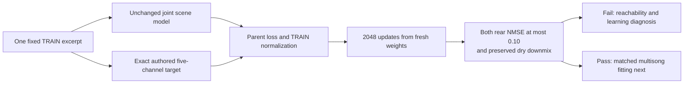

# Joint Scene: One TRAIN Excerpt Fitting Diagnostic

*2026-10-03 · Track B · Owner selected diagnostic step2 after the failed joint NAS pilot.*

**Outcome:2048 updates completed; partial rear learning, strict fitting gate not reached.** Ls/Rs NMSE improved to .448540/.469496 from approximately1.0. The curve was still improving at termination, so this is not evidence of a demonstrated hard architecture ceiling.

## 🧭 Question and scope

Can the unchanged joint scene network learn the rear of one repeatedly presented TRAIN excerpt? The [parent pilot](UPMIX_JOINT_SCENE_NAS_PILOT_2026-10-03.md) failed rear fitting after4096 updates across seven TRAIN songs. This diagnostic removes song/offset diversity while keeping the model, loss, normalization, optimizer and excerpt geometry unchanged.

A pass would establish fitting of this particular excerpt. A failure at the finite horizon would focus investigation on output reachability, estimator/optimization and loss pressure; it would not prove that every scene architecture is incapable of learning rear audio. The separate target-informed reachability diagnostic has not been run for this exact graph.

## 🗂️ Frozen experiment

| Element | Protocol |
|---|---|
| NAS | 100.85.38.96; CPU only; three threads |
| Launch | 2026-10-03T23:52:50.530423+00:00; PID407748 at launch |
| Run | `runtime/scene-joint-fixed-train-20261003-a` under the existing private training root |
| Parent | `runtime/scene-joint-front-rear-20261003-a/run` |
| Song | albumdb-01, existing TRAIN assignment |
| Crop start | Sample1,354,304 at48kHz, approximately28.215 s |
| Complete crop | 33,536 samples, .698667 s |
| Model frames | 128 STFT frames; first32 warm frames excluded from loss |
| Scored interval | 96 frames, .512 s in hop duration |
| Selection | Beginning of the first recorded parent TRAIN monitor crop for this song |
| Inputs/targets | Same-target stereo downmix / FL, FR, C, Ls, Rs; no LFE/effects |
| Initialization | Fresh same-seed20261003 weights; no parent checkpoint |
| State | Starts afresh for every presentation, matching the parent training |
| Horizon | 2048 updates; monitors every128 |
| Optimizer | Parent AdamW: lr .001, weight decay .0001, gradient clip5 |
| Loss | Parent fixed TRAIN channel-power-normalized complex MSE plus .05 magnitude MAE |
| Admission | Hash/header/order/common gain checked for selected TRAIN WAV; parent catalog/model/loss hashes verified |
| Other partitions | No DEV/heldout audio decoded |

The parent TRAIN normalization is deliberately retained. It is not recomputed from this crop. Thus per-channel normalized training loss is distinct from crop-local channel NMSE; a falling aggregate loss must not be mistaken for rear fitting. In this crop, rear targets are non-silent and pass the declared energy precheck, but are much weaker than the centre.

The launch rechecked that no other upmix Python tenant was active, compiled the uploaded sources in the existing NAS environment, then detached the bounded run. The model and imported parent loss files match their original SHA256 hashes. Existing contract tests for those unchanged components passed locally and on NAS in the parent experiment; no environment packages were installed or Track A files changed.

## 📏 Diagnostic gates

Before training, the rule was fixed: **both Ls and Rs NMSE≤.10**, and dry PCM relative downmix null RMS≤1e-5 on this exact scored crop. NMSE1 denotes a silent rear baseline; it is not rear share or leakage.

Both terminal and best monitored results are retained. The best checkpoint minimizes the worse of Ls/Rs NMSE, not the average or overall loss. A pass at any monitored checkpoint is a same-crop fitting witness; terminal behaviour is reported separately. Neither qualifies a model for the Audi.

## 📊 Measured outcome

<!-- FIXED_FIT_RESULT_START -->
**Completed: 2048/2048 updates in 365.6 s.** Terminal fitting failed; best monitored fitting failed.

| Metric | Initialization | Best monitored checkpoint | Terminal |
|---|---:|---:|---:|
| Step | 0 | 2048 | 2048 |
| Ls NMSE | 0.998521 | 0.448540 | 0.448540 |
| Rs NMSE | 1.025514 | 0.469496 | 0.469496 |
| Ls energy / target | 0.046137 | 0.536235 | 0.536235 |
| Rs energy / target | 0.011761 | 0.522414 | 0.522414 |
| Ls target cosine | 0.110839 | 0.742676 | 0.742676 |
| Rs target cosine | -0.063405 | 0.728378 | 0.728378 |
| Total training loss | 0.878052 | 0.0309863 | 0.0309863 |
| Dry PCM relative null RMS | 4.26082e-07 | 5.39507e-07 | 5.39507e-07 |

### Complete monitor curve

| Step | Ls NMSE | Rs NMSE | Loss |
|---|---:|---:|---:|
| 128 | 0.846115 | 0.849977 | 0.091066 |
| 256 | 0.797418 | 0.788613 | 0.064780 |
| 384 | 0.740063 | 0.744591 | 0.056131 |
| 512 | 0.672033 | 0.680524 | 0.049053 |
| 640 | 0.635124 | 0.630798 | 0.045075 |
| 768 | 0.603226 | 0.584328 | 0.041864 |
| 896 | 0.581734 | 0.560209 | 0.039707 |
| 1024 | 0.553072 | 0.539669 | 0.037668 |
| 1152 | 0.531118 | 0.524400 | 0.036163 |
| 1280 | 0.513549 | 0.512321 | 0.034980 |
| 1408 | 0.498445 | 0.499838 | 0.033987 |
| 1536 | 0.484721 | 0.491410 | 0.033146 |
| 1664 | 0.474201 | 0.484641 | 0.032484 |
| 1792 | 0.464951 | 0.479333 | 0.031929 |
| 1920 | 0.457104 | 0.474238 | 0.031459 |
| 2048 | 0.448540 | 0.469496 | 0.030986 |

All five crop target-power denominators are known. Initial and terminal metrics use the identical samples and initial recurrent state; no new songs or offsets intervene.

Terminal per-channel NMSE, FL/FR/C/Ls/Rs: 0.054893, 0.061866, 0.014306, 0.448540, 0.469496.

[Machine-readable evidence](UPMIX_JOINT_SCENE_FIXED_FIT_2026-10-03.json) retains launch/protocol/source/audio hashes, initial/best/terminal raw metrics, all monitors and terminal checkpoint hash. Full optimizer history remains on NAS.
<!-- FIXED_FIT_RESULT_END -->

## 📁 Reproduction and retained evidence

[fit_scene_fixed_nas.py](../../../tools/stereo-upmix-render/fit_scene_fixed_nas.py) imports the unchanged [scene model](../../../tools/stereo-upmix-render/scene_joint_net.py) and [parent loss/helpers](../../../tools/stereo-upmix-render/train_scene_joint_nas.py). Immutable source snapshots, `launch.json` and `train.log` live in the new run root. Its `run/` contains protocol, initial/monitor/status/best reports, best/terminal checkpoints, hashes and full optimizer history.

An owned `run/STOP` marker stops the run while retaining outputs. Sources, parent runs and catalog/audio are not modified. No extra training experiment is automatically queued by this diagnostic.

## 🔬 Interpretation and next decision

The network learned rear structure on the repeated crop: target cosine rose to .742676/.728378, with rear energy approximately .536235/.522414 of **target rear energy**, not of the stereo song. FL/FR/C NMSE reached .054893/.061866/.014306. Dry downmix relative null RMS5.395e-7 passed. This is useful partial fitting, not successful memorization under the frozen .10 rear gate.

All2048 recorded global gradient norms are finite. Nine updates exceeded the clip threshold5; median pre-clip norm was .069792 and the last128-update median .033792. These summaries do not isolate per-channel gradient conflict, but they do not support a claim that clipping blocked every update. Source/gradient contract checks and observed rear learning argue against a wholly disconnected rear training path.

Both rear NMSE values declined at every recorded128-update checkpoint. From1024 to2048, Ls/Rs improved .553072/.539669→.448540/.469496; the last checkpoint was best. Thus insufficient optimization horizon remains a live explanation, alongside estimator/output restrictions and the authored target's structure. The2048-update failure cannot distinguish these causes.

The next narrow choices are exact target-informed reachability under this graph's coefficient limits/projection, or a separately recorded continuation of this fixed-crop checkpoint and optimizer to a bounded longer horizon. The still-decreasing curve provides evidence for the latter; it would measure convergence, not establish generalization. Neither follow-up has been queued. Multisong/DEV fitting and a new encoder should follow stronger same-crop evidence, not replace it.

**Subsequent owner instruction:** the owner authorized [continuation to8192 total steps](UPMIX_JOINT_SCENE_8192_CONTINUATION_2026-10-03.md). That isolated run restores the2048 model and optimizer without altering this completed first-stage result. The exact current-head reachability oracle remains unexecuted.

Generalization, protected voice/bass/drums, source-attributed entries, swinging, full40/untouched20, independently mastered stereo transfer, complete native int8 device cost/latency and owner live CarPlay preference remain unevaluated.
